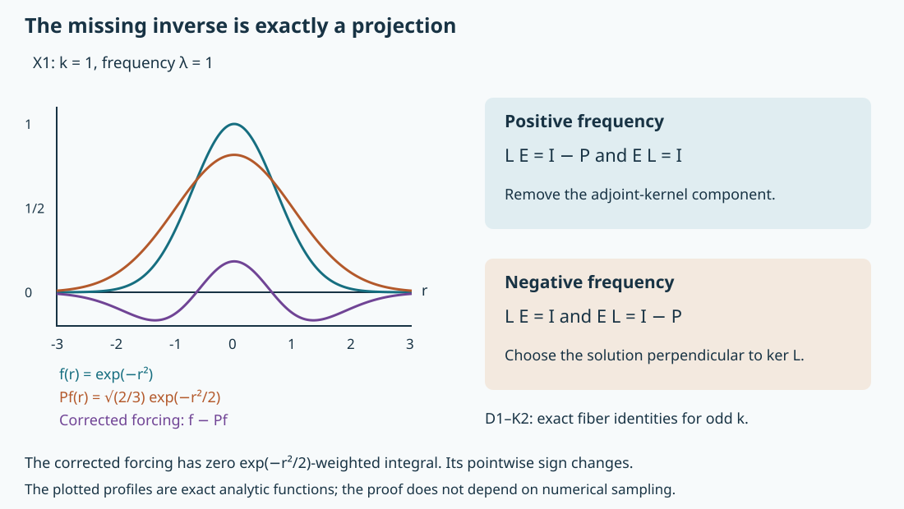

# Symplectic model projectors, parametrices and solvability

A right inverse fails when the forcing has a component in the adjoint kernel. A left inverse fails when a solution has a component in the kernel. For the finite-contact complex model these two failures live in opposite frequency directions. We construct the inverse and both projections, prove their exact wavefront relations and Sobolev bounds, and use the cokernel projection to decide microlocal solvability.

The mathematical antecedent is Lars Hörmander, *The Analysis of Linear Partial Differential Operators IV*, 2009 edition, Section 26.3, printed pages 86–91: the even-contact fundamental solution, Propositions 26.3.7, 26.3.7′ and 26.3.8, and Theorem 26.3.9. The earlier [finite-contact lesson](../20261011-finite-contact-complex-model/finite-contact-complex-models-and-regularity.html), FCM:E0–F2 and N3, supplies exact coercivity, favorable microlocal regularity and the full variable-coefficient reduction. We give a direct one-dimensional proof of the inverse bounds instead of invoking an unproved continuity assertion about the complex kernels.

This exposition, its proofs, three solved exercises and reproducible illustration are independent expression, CC0-1.0. Exact earlier providers are in the proof map. Human foundation proofs remain external in the current export. [Global symplectic assembly](../20261011-global-symplectic-parametrix/global-symplectic-parametrix-and-hermitian-projectors.html) treats patching on the characteristic manifold.

## 1. The model and its closed one-dimensional realization

**H0. Notation and the complete local result.** Let \(k\geq1\), \(\delta=(k+1)^{-1}\), \(D=-i\partial\), and write \(x=(r,z,t)\in\mathbb R\times\mathbb R^{n-2}\times\mathbb R\), \(n\geq2\). Put

\[
 V(r)=\frac{r^{k+1}}{k+1},\qquad L=D_r+i r^kD_t,
 \qquad L_\tau=-i(\partial_r-\tau r^k). \tag{SP1}
\]

Fourier transformation in \(t\) uses the kernel \(e^{-it\tau}\). We construct distributional kernels \(E,Q_+,Q_-\) acting continuously from compactly supported distributions to distributions, with

\[
 LE=I-Q_+,\qquad EL=I-Q_-,\qquad L^*Q_+=0,
 \qquad LQ_-=0. \tag{SP2}
\]

For even \(k\), both projections are zero. For odd \(k\), they are orthogonal projections on \(L^2\). At every covector with \(\tau\ne0\), they preserve microlocal \(H^s\), and \(E\) gains \(\delta\), for every real \(s\), including the endpoint. In dimension two these are continuous maps \(H^s_{\rm comp}\to H^s_{\rm loc}\) and \(H^s_{\rm comp}\to H^{s+\delta}_{\rm loc}\) without a directional restriction. The extra relation when \(n>2\) is specified in T0; no global pseudolocality is asserted there.

**D0. The closed domain and its core.** For fixed \(\tau\ne0\), let
\(T_\tau=\partial_r-\tau r^k\) on
\(\mathcal D_\tau=\{v\in L^2:T_\tau v\in L^2\text{ in distributions}\}\).
This is a closed densely defined operator: distributional passage to the limit proves closedness, and compact smooth functions are dense in \(L^2\). They are also a core in the graph norm. Indeed, multiplication by \(\chi(r/R)\), with \(\chi=1\) near zero, gives
\(T_\tau(\chi_Rv)=\chi_RT_\tau v+\chi'_Rv\); both errors tend to zero in \(L^2\). For this fixed compact support, mollification commutes with the derivative. Its commutator with multiplication by \(r^k\) tends to zero in \(L^2\), since that coefficient is uniformly continuous and bounded on a fixed enlarged compact interval. This gives the required smooth compact approximants.

Integration by parts on this core identifies the adjoint domain with the distributional domain of \(-\partial_r-\tau r^k\). To see the reverse inclusion as well, the defining bounded functional on the core is exactly that distributional derivative; the preceding approximation extends the identity to the graph domain. Thus

\[
 L_\tau^*=L_{-\tau},\qquad
 \ker T_\tau=\{c e^{\tau V}:c\in\mathbb C\}\cap L^2. \tag{SP3}
\]

The last equality is distributional. Multiplication by \(e^{-\tau V}\) reduces the equation to derivative zero. A distribution with derivative zero is constant: every compact test of integral zero is the derivative of a compact test, obtained by integrating it from \(-\infty\). This also proves that there are no additional rough null solutions.

**D1. Closed range and the minimal inverse.** FCM:E0–E1, extended by D0, give

\[
 \|v\|_2\leq C_k|\tau|^{-\delta}\|L_\tau v\|_2
 \quad(\tau>0), \tag{SP4}
\]

and the same estimate for negative \(\tau\) when \(k\) is even. An operator satisfying (SP4) is injective with closed range: a convergent sequence of outputs has Cauchy preimages, and closedness supplies the limit. The orthogonal complement of its range is its adjoint kernel, by the definition of the adjoint.

We use only the elementary Hilbert projection theorem here. For completeness, a minimizing sequence for the distance from a vector to a closed linear subspace is Cauchy by the parallelogram identity. Completeness gives the minimizer; varying by every real and imaginary multiple of a subspace vector proves orthogonality. This proves existence, uniqueness and norm at most one of the projection.

If \(k\) is even, \(V\) is odd and strictly increasing. Neither \(e^V\) nor \(e^{-V}\) is square integrable. Hence \(L_\tau\) is bijective and has inverse \(E_\tau\) satisfying \(\|E_\tau\|\leq C_k|\tau|^{-\delta}\).

If \(k\) is odd, put, for \(\lambda>0\),

\[
 w_\lambda(r)=e^{-\lambda V(r)},\quad
 I_\lambda=\int_{\mathbb R}w_\lambda^2\,dr
       =\lambda^{-\delta}I_1,\quad
 P_\lambda f=\frac{w_\lambda}{I_\lambda}
                  \int w_\lambda f\,dr. \tag{SP5}
\]

The integral has no conjugate on \(f\); the real function \(w_\lambda\) is the conjugated vector in the usual inner product. The positive-frequency operator has range \(w_\lambda^\perp\) and zero kernel. Define \(E_\lambda\) as its inverse on that range, composed with \(I-P_\lambda\), and define \(E_{-\lambda}=E_\lambda^*\). Taking adjoints in the two positive-frequency identities gives

\[
\begin{array}{ll}
 L_\lambda E_\lambda=I-P_\lambda,&E_\lambda L_\lambda=I,\\
 L_{-\lambda}E_{-\lambda}=I,&E_{-\lambda}L_{-\lambda}=I-P_\lambda,
\end{array}
\qquad \|E_{\pm\lambda}\|\leq C_k\lambda^{-\delta}. \tag{SP6}
\]

The identities with an unbounded factor hold on its graph domain. For example the adjoint of \(E_\lambda L_\lambda=I\) says that \(E_\lambda^*\) maps \(L^2\) into the adjoint domain and \(L_\lambda^*E_\lambda^*=I\); this follows directly by testing against the dense graph domain. No unbounded-operator interchange is assumed. The negative inverse takes values perpendicular to \(w_\lambda\), as follows by pairing with the positive inverse's zero action on that vector. Thus both are the minimal inverses.

## 2. Actual kernels, including zero frequency

**K0. The even-contact fundamental solution.** For even \(k\), direct integration gives

\[
 E_\tau(r,a)=
 \begin{cases}
 -i\,\mathbf1_{a>r}e^{\tau(V(r)-V(a))},&\tau>0,\\
 i\,\mathbf1_{a<r}e^{\tau(V(r)-V(a))},&\tau<0.
 \end{cases} \tag{SP7}
\]

For compact smooth forcing these formulas solve \(L_\tau u=f\), decay at the appropriate infinite endpoints, and belong to \(L^2\). Outside the forcing support the remaining tail is a decaying exponential; on the support it is bounded. D1 proves uniqueness, so these are the actual inverses. Differentiation in \(r\) gives the unit delta with the displayed factors \(\pm i\), and integration by parts in \(a\) gives the left identity as well.

For \(r\ne a\), inverse Fourier transformation in \(t-b\) yields the same expression from either half-line:

\[
 E_2(r,t;a,b)=\frac{i}{2\pi}
       \frac{1}{V(r)-V(a)+i(t-b)}. \tag{SP8}
\]

At its singular set the meaning of (SP8) is the distribution defined by (SP7), or equivalently its limit with a factor \(e^{-\varepsilon|\tau|}\) before Fourier inversion. This specifies the extension, rather than assigning an arbitrary pointwise value on the diagonal. This distribution is locally integrable: integration in \(t-b\) over a compact interval bounds its absolute integral by a constant times \(1+|\log|V(r)-V(a)||\). For an odd integer \(k+1\),
\(|V(r)-V(a)|\geq c_k|r-a|^{k+1}\); this follows by scaling the difference to \(r-a=1\) and minimizing the positive continuous polynomial in \(a\), which tends to infinity. The logarithm is locally integrable. Dominated convergence away from a shrinking neighborhood, followed by this bound, identifies the distributional and locally integrable interpretations. In particular there is no extra distribution supported on the diagonal.

**K1. The odd-contact kernel and the subtraction it needs.** For odd \(k\), define

\[
 G_\lambda(r)=I_\lambda^{-1}\int_{-\infty}^{r}e^{-2\lambda V(u)}\,du,
 \qquad G_\lambda(r)=G_1(\lambda^\delta r). \tag{SP9}
\]

Solving the equation after subtracting \(P_\lambda f\) gives

\[
 E_\lambda(r,a)=i e^{\lambda(V(r)-V(a))}
             \bigl(H(r-a)-G_\lambda(r)\bigr),\qquad
 E_{-\lambda}(r,a)=\overline{E_\lambda(a,r)}. \tag{SP10}
\]

Indeed the integrating-factor primitive of \(f-P_\lambda f\) from \(-\infty\) to \(r\) is exactly this formula. Its total weighted integral is zero. Beyond either endpoint of the forcing support, the remaining primitive is a Gaussian-type tail, so the output is in \(L^2\). D1 again identifies it with the minimal inverse. The choice of \(H(0)\) has no distributional effect.

Here are bounds needed to make all Fourier integrals actual distributions. For \(u\geq1\), \(V'(u)=u^k\geq1\), so
\(\int_u^\infty e^{-2V(v)}dv\leq\tfrac12e^{-2V(u)}\). The ratio of the two sides without the factor \(1/2\) is bounded on \([0,1]\) as well. Reflection and scaling therefore give

\[
 G_\lambda(r)\leq C e^{-2\lambda V(r)}\ (r<0),\qquad
 1-G_\lambda(r)\leq C e^{-2\lambda V(r)}\ (r>0). \tag{SP11}
\]

If \(V(r)\leq V(a)\), the exponential in (SP10) is at most one. Otherwise \(|r|>|a|\); then \(H(r-a)=0\) for \(r<0\) and equals one for \(r>0\), so (SP11) bounds the product by \(Ce^{-\lambda(V(r)+V(a))}\). Consequently both kernels in (SP10) are uniformly bounded for all \(r,a,\lambda\). This also controls \(\lambda\downarrow0\) on every fixed compact rectangle. The even kernels have absolute value at most one.

**K2. Fourier inversion, projection identities and continuity on test functions.** Let \(E_2\) be the inverse Fourier transform of \(E_\tau(r,a)\) in \(t-b\). For odd \(k\), define

\[
 Q_{\pm,2}(r,t;a,b)=\frac1{2\pi I_1}
   \int_0^\infty \lambda^\delta
     e^{-\lambda(V(r)+V(a))}e^{\pm i\lambda(t-b)}\,d\lambda. \tag{SP12}
\]

The bounds in K1, and the polynomial bound \(\lambda^\delta\) in (SP12), define these as distributions: Fourier transforming a compact smooth test in \(t-b\) gives arbitrary inverse powers of \(\lambda\), uniformly on the remaining compact variables. The integrals against that transformed test converge absolutely. The same observation justifies distributional differentiation and all the identities obtained on compact smooth inputs. Low frequencies are integrable, and (SP6) handles high frequencies on \(L^2\). Thus the definition agrees with the direct integral of the one-dimensional operators.

Plancherel and (SP5) show that \(Q_{+,2}\) is the orthogonal projection acting by \(P_\tau\) for \(\tau>0\) and zero for \(\tau<0\). The minus projection acts by \(P_{-\tau}\) for \(\tau<0\). They are self-adjoint, idempotent and mutually orthogonal. Equations (SP6) give (SP2) on compact smooth functions, as well as \(Q_+L=0\). The annihilation assertions follow by differentiating \(w_\lambda\). The value at \(\tau=0\), a measure-zero set, changes none of these distributions or operators.

## 3. Wavefront relations and action on distributions

**W0. The exact two-dimensional projection relation.** Write \(\Delta'\) for the twisted diagonal \(\{(x,\xi;x,\xi):\xi\ne0\}\). For odd \(k\),

\[
 \operatorname{WF}'(Q_{\pm,2})=
 \{(0,t;0,\tau;0,t;0,\tau):\ \pm\tau>0\}. \tag{SP13}
\]

First, (SP12) is smooth unless \(r=a=0\) and \(t=b\). Where \(V(r)+V(a)>0\), exponential convergence permits all derivatives. Where \(t-b\ne0\), separate \(0<\lambda<2\), which is smooth, and integrate the remaining integral repeatedly by parts in \(\lambda\). On a compact set all differentiated amplitudes have polynomial bounds; each additional \(\lambda\)-derivative lowers the bound by one. Factors \((V(r)+V(a))^j e^{-\lambda(V(r)+V(a))}\) are bounded by \(C_j\lambda^{-j}\). Thus arbitrarily many integrations prove uniform convergence after every base derivative.

The equations in the two kernel variables are \(L_x^*Q_+=0\), \(L_y^tQ_+=0\), and \((D_t+D_b)Q_+=0\). For \(Q_-\), the first two operators are \(L_x\) and \((L_y^*)^t\). Ordinary microlocal ellipticity confines wavefront to the common characteristic set. At the possible singular bases just found, this says that the two normal covectors vanish and the last covectors are opposite before twisting. The sign is fixed by (SP12): after a compact cutoff in \(t-b\), its Fourier transform is a convolution with a Schwartz function centered at \(+\lambda\), or \(-\lambda\). In the opposite frequency cone, the distance to that center is bounded below by a constant times the sum of the two magnitudes. Arbitrarily high Schwartz bounds absorb every amplitude power and every compact-base derivative. Hence that opposite cone has no wavefront.

There is actually a singularity at every allowed base. Put \(r=a=\varepsilon\ne0\) and \(t=b\). The positive integral in (SP12), after the substitution \(u=2V(\varepsilon)\lambda\), is a positive constant times \((2V(\varepsilon))^{-1-\delta}\), which diverges as \(\varepsilon\to0\). A smooth extension is impossible. At that base the upper bound permits just one nonzero conic ray, so nonemptiness and conicity give equality in (SP13).

**W1. The inverse has exactly the diagonal relation.** In dimension two,

\[
 \operatorname{WF}'(E_2)=\Delta'. \tag{SP14}
\]

Use the two equations (SP2) on the kernel and translation invariance in \(t-b\). Away from the diagonal, their right sides are smooth by W0. A wavefront covector there must satisfy
\(\xi_r=\eta_a=0\), \(r^k\xi_t=a^k\eta_b=0\), and \(\xi_t+\eta_b=0\), with untwisted input covector \(\eta\). If \(\xi_t=0\), all covectors vanish, which is excluded. Otherwise \(r=a=0\). If \(\xi_t>0\), the operator in the output variables is microlocally hypoelliptic by FCM:F2, with all input variables treated as spectators. If \(\xi_t<0\), the transposed input operator, multiplied by \(-1\), has positive last covector \(\eta_b=-\xi_t\), and the same result applies. For even contact either sign is favorable. This excludes every off-diagonal covector, including the axes with a zero input or output covector. The argument is valid in the full kernel cotangent space: around each retained nonzero last component the total frequency is comparable to that component on a sufficiently small cone.

Conversely, \(L_xE_2=\delta_{x=y}-Q_{+,2}\) forces the wavefront of \(E_2\) to contain every diagonal covector outside the closed set in (SP13). A differential operator cannot create a new wavefront direction, and the delta kernel has all diagonal directions, directly from its localized Fourier transform. That complement is dense in the diagonal, so closedness proves (SP14). For even \(k\), \(Q_+=0\) gives the same conclusion immediately.

**A0. The kernel action used here is justified by Fourier bounds.** We record the precise elementary kernel principle. A distributional kernel with no wavefront point whose output covector is zero acts continuously on compactly supported distributions. If it also has no point whose input covector is zero, it sends compact smooth inputs to smooth outputs. Its output wavefront is contained in the composition of its twisted relation with the input wavefront.

To prove these statements, insert compact cutoffs in both kernel variables, with the input cutoff one on the fixed input support. The compact kernel has a Fourier transform of polynomial growth. Absence of the output-zero axis gives arbitrary decay whenever \(|\eta|\geq C(1+|\xi|)\), uniformly on closed smaller cones. For an input of order \(N\), its Fourier transform is bounded by \(C_N\langle\eta\rangle^N\). The formula integrating \(\widehat K(\xi,-\eta)\widehat f(\eta)\) is therefore convergent in that region; in its complement the polynomial bound gives a polynomial in \(\xi\). This defines a distribution and proves continuity on each fixed support and finite-order bounded set. For smooth input, split additionally at \(|\xi|\geq C(1+|\eta|)\); absence of the input-zero axis handles this part and rapid decrease of the input handles its complement. For the directional assertion, partition the compact input support and unit frequency sphere into finitely many small patches. On every patch that cannot meet the stated relation, either the kernel transform or the microlocalized input has arbitrary decay. The same split proves arbitrary output decay on a smaller target cone. Smooth cutoffs preserve these estimates by convolution with rapidly decreasing Fourier transforms. This proves the assertions and their quantitative seminorm versions.

Compact mollification with a fixed slightly enlarged support converges in distributions with a common polynomial Fourier bound. Dominated convergence in the preceding formulas extends identities known on compact smooth inputs to compact distributions. W0–W1 meet both axis conditions. Consequently (SP2) holds for every compact distribution, not merely for test functions.

## 4. Every real Sobolev order and the extra parameters

**M0. Tangential estimates with the exact gain.** Let \(R,R'>0\), and suppose the input is supported in \(|r|\leq R'\), without requiring compact \(t\)-support. For every real \(s\),

\[
 \|\mathbf1_{|r|\leq R}\langle D_t\rangle^{s+\delta}E_2f\|_2
    \leq C_{R,R',s}\|\langle D_t\rangle^sf\|_2,
 \qquad
 \|\langle D_t\rangle^sQ_{\pm,2}f\|_2
    \leq\|\langle D_t\rangle^sf\|_2. \tag{SP15}
\]

For \(|\tau|\geq1\), the first inequality is exactly (SP6), or its even-contact version, integrated by Plancherel. For \(|\tau|\leq1\), K1 bounds the inverse kernel on the fixed input/output rectangle. Cauchy–Schwarz in \(a\) gives a uniform operator bound \(L^2([-R',R'])\to L^2([-R,R])\). The weights are bounded above and below in this range. This proves the low-frequency part without integrating the possibly nonintegrable square of \(|\tau|^{-\delta}\) at zero. The projection estimate follows from its norm-one fibers. All tangential multipliers commute with these operators because their coefficients are independent of \(t\).

Multiplication by a compact smooth cutoff in \(t\) is bounded in every tangential weighted norm used here. Indeed, the Fourier convolution kernel is Schwartz and
\(\langle\tau\rangle^s/\langle\sigma\rangle^s\leq C_s\langle\tau-\sigma\rangle^{|s|}\). The resulting integrable convolution kernel is bounded on \(L^2\) by Cauchy–Schwarz followed by product integration. The same argument covers cutoffs depending smoothly on the other compact variables, with uniform derivative bounds.

**M1. Conversion to full microlocal Sobolev regularity.** Fix a nonzero last covector. On a sufficiently small frequency cone,
\(|\xi|\leq C|\tau|\), so \(\langle\xi\rangle^s\) and \(\langle\tau\rangle^s\) are comparable for every real \(s\). By W0–W1 and A0, an input microlocally in \(H^s\) at the target may be replaced, modulo a smooth output there, by a compact proper ordinary localization of that input inside a slightly larger such cone. This localization has tangential weighted \(L^2\) norm bounded by its full \(H^s\) norm. To verify that statement also for negative \(s\), compose \(\langle D_t\rangle^s\) with the localization: on its frequency support all derivatives obey the ordinary order-\(s\) symbol bounds; off that support the full separated-symbol remainder is smoothing. P2:OP5–OP6 and GE:D7 give the resulting \(H^s\to L^2\) bound. Compact output support in \(r\) is retained by proper localization.

Apply (SP15), a compact output cutoff and a frequency multiplier in a smaller cone. The same comparison now gives

\[
 f\in H^s\text{ at }(x,\xi),\ \tau\ne0
 \quad\Longrightarrow\quad
 Q_\pm f\in H^s\text{ there},\quad Ef\in H^{s+\delta}\text{ there}. \tag{SP16}
\]

The smoothing contributions are bounded in every target seminorm by a sufficiently coarse input distribution norm, by the explicit Fourier proof in A0. Thus this argument proves estimates, not only membership.

In dimension two the remaining nonzero covectors have \(\tau=0\), \(\xi_r\ne0\). The projectors are smooth there by (SP13), and \(L\) is elliptic. The ordinary parametrix applied to \(LEf=f-Q_+f\) gives \(Ef\in H^{s+1}\), hence \(H^{s+\delta}\), there. On fixed compact input and output sets, a finite conic partition combines these estimates with (SP16). The coarse output distribution norm required by elliptic localization is controlled by the input \(H^s\) norm using A0's polynomial Fourier estimate. This proves continuity \(H^s_{\rm comp}\to H^{s+\delta}_{\rm loc}\) and \(H^s_{\rm comp}\to H^s_{\rm loc}\) in dimension two for every real \(s\).

**T0. The tensor product and its exact additional relation.** For general \(n\), tensor each two-dimensional kernel with \(\delta(z-w)\). Define

\[
 \mathcal R_0=\{(r,z,t;0,\zeta,0;
                         a,z,b;0,\zeta,0):\ \zeta\ne0\}. \tag{SP17}
\]

Then

\[
 \operatorname{WF}'(E)=\Delta'\cup\mathcal R_0,\qquad
 \operatorname{WF}'(Q_\pm)=
 \{(x,\xi;x,\xi):r=\xi_r=0,\ \pm\tau>0\}\cup\mathcal R_0
 \quad(k\text{ odd}). \tag{SP18}
\]

The closure of the first projector set at \(\tau=0\), when \(\zeta\ne0\), is already in \(\mathcal R_0\). For even \(k\), the projectors remain zero and have empty wavefront; the inverse relation is unchanged. When \(n=2\), \(\mathcal R_0\) is empty.

Here is the tensor calculation, including equality. In coordinates \(v=z-w\), \(w\), a product cutoff makes the Fourier transform equal to the localized transform of the two-dimensional kernel, times a constant in the dual variable to \(v\), times a Schwartz function in the dual variable to \(w\). It can be singular only where that last dual variable vanishes, with any covector dual to \(v\), and with the base covector either in the original wavefront or zero over its support. Conversely, a nonrapid sequence for the original localized transform remains nonrapid after assigning the dual \(v\)-frequency any prescribed proportional magnitude. If the base covector is zero, choose a fixed base frequency where the localized transform is nonzero and let the dual \(v\)-frequency tend to infinity. These arguments work in arbitrarily small product neighborhoods, proving the asserted equality, provided the support of each nonzero two-dimensional kernel is the whole base space.

That support assertion also has a direct proof. For \(Q_\pm\), with \(V(r)+V(a)>0\), its Fourier integral is analytic in the real variable \(t-b\); at zero it is strictly positive. It cannot vanish on an open interval. The same argument applies to \(E_2\) for \(r\ne a\): its positive and negative frequency kernels have exponential decay with a strictly positive rate on each compact rectangle separated from \(r=a\). This follows from the alternatives in K1 and (SP11); in the even case it follows from strict monotonicity of \(V\). They are not the zero Fourier function, by (SP7) or (SP10). Fourier uniqueness and the power-series identity theorem therefore exclude an interval of zeros. The needed identity theorem follows by differentiating a convergent power series at a point of such an interval, then continuing through overlapping convergence intervals. These points are dense, so the support is the entire base space. This completes the tensor equality and (SP18).

Both axes remain absent in (SP18), so A0 defines continuous action on compact distributions and extends (SP2) to them. The equations are preserved by the tensor product. The projection remains orthogonal by product integration. For \(\tau\ne0\), (SP15) holds after integration in every spectator variable, with the same constant. The cone comparison now uses \(|(\xi_r,\zeta,\tau)|\leq C|\tau|\). It proves (SP16) in all dimensions. At \(\tau=0\), the additional relation really permits a different output \((r,t)\), so the unrestricted higher-dimensional pseudolocal assertion would be false.

## 5. Solvability and transfer to variable coefficients

**S0. The cokernel gives an exact solvability criterion.** Let \(f\) be compactly supported and \(q=(x,\xi)\) have \(\tau\ne0\). Then

\[
 \exists u\in\mathcal D':q\notin\operatorname{WF}(Lu-f)
 \quad\Longleftrightarrow\quad
 q\notin\operatorname{WF}(Q_+f). \tag{SP19}
\]

For necessity, multiply a proposed solution by a compact cutoff equal to one near the base of \(q\). The commutator error has base support away from that point. At \(\tau\ne0\), (SP18) is diagonal, so applying \(Q_+\) to this error or to a residual smooth at \(q\) remains smooth there. But \(Q_+L=0\) on compact distributions, by self-adjointness and \(L^*Q_+=0\). Hence \(Q_+f\) must be smooth at \(q\). For sufficiency, take \(u=Ef\) in (SP2). In the even case \(Q_+=0\), so there is always such a local inverse. In the odd case the condition is automatic outside \(\{r=\xi_r=0,\tau>0\}\).

**S1. Actual forcing that fails the criterion.** At the positive characteristic mark of an odd-contact model, let \(h\) be the solution of \(L^*h=0\) obtained by reflecting \(t\) in FCM:R0–R2. Choose its Sobolev threshold \(\sigma\): it belongs exactly to \(H^a\) for \(a<\sigma\), and its wavefront is the single positive ray at the origin. Its partial Fourier transform at \(\tau=\lambda>0\) is a scalar multiple of \(w_\lambda(r)\), with the same spectator Gaussian as in that construction. Formula (SP5) therefore gives \(Q_+h=h\) directly on this polynomially growing Fourier integral, which is cut off for \(\lambda\leq1\).

Choose a compact smooth \(\chi\) equal to one near the origin and set \(g=\chi h\). FCM:R0 proves that \((1-\chi)h\) is Schwartz. Applying \(Q_+\) to a Schwartz function gives a smooth function: its partial Fourier transform decreases to every order at large \(\lambda\); at small \(\lambda\), all compact-base differentiated projection kernels are bounded by an integrable power \(\lambda^\delta\) times a fixed polynomial in the integration variable, absorbed by Schwartz decay. This justifies differentiation of the integral. It follows that \(Q_+g=h\) modulo a smooth function. Taking \(\sigma=s+1\) gives an actual compact \(g\in H^s\), with exactly that singular ray, which is not microlocally in the range of \(L\), by (SP19). The argument applies to every real \(s\); high finite regularity never removes the obstruction.

**S2. The full graph transfer and source order.** Under the exact hypotheses of FCM:H0, use the full properly localized graph pair from FCM:N3,
\(\mathcal B P\mathcal A=L\) modulo smooth kernels, with
\(\operatorname{ord}\mathcal A=0\) and \(\operatorname{ord}\mathcal B=1-m\).
On smaller matched cones set

\[
 \mathcal E=\mathcal A E\mathcal B,\quad
 \Pi_+=\mathcal B^{-1}Q_+\mathcal B,\quad
 \Pi_-=\mathcal A Q_-\mathcal A^{-1}. \tag{SP20}
\]

All compositions use proper cutoffs in the matched regions. Separated errors have smooth compact kernels there; A0 and the graph wavefront and continuity results show that composing them still gives a smooth local error. Thus

\[
 P\mathcal E=I-\Pi_+,\qquad \mathcal E P=I-\Pi_-
 \quad\bmod C^\infty,\qquad
 \mathcal E:H^s\longrightarrow H^{s+m-1+\delta}
 \text{ microlocally}. \tag{SP21}
\]

The transported projectors preserve every Sobolev order: their two graph orders cancel. They are idempotent modulo smoothing; orthogonality need not survive a nonunitary graph change and is not asserted. Their wavefront relations are the transported characteristic diagonal subsets. The extra relation \(\mathcal R_0\) is excluded by the retained \(\tau\ne0\) model cones. The exact solvability criterion is that \(Q_+\mathcal B f\) be smooth at the matched model covector, equivalently that \(\Pi_+f\) be smooth at the original one.

If \(p=0\) and \(\{\operatorname{Re}p,\operatorname{Im}p\}>0\), the simple-bracket normal form has \(k=1\) at the positive mark. For prescribed original order \(s\), apply S1 with model threshold \(\sigma=s+m\), and transfer its compact source by \(\mathcal B^{-1}\), then a compact output cutoff equal to one at the mark. Its regularity threshold is \(\sigma-(m-1)=s+1\), so the resulting \(f\) belongs to \(H^s_{\rm loc}\). Elliptic inverse graph transfer preserves its exact one-ray wavefront and the nonzero obstruction. Therefore

\[
 (x_0,\xi_0)\in\operatorname{WF}(Pu-f)
 \quad\text{for every }u\in\mathcal D'(X). \tag{SP22}
\]

This is the full positive-bracket nonsolvability conclusion for any prescribed finite Sobolev regularity, with the order of the source graph included. These constructions are local. Gluing them globally over a general symplectic characteristic manifold, and proving any global uniqueness normalization, is not supplied by a local inverse identity.

## 6. Three exercises with complete solutions

**X1. Compute a projector and the removed moment.** For \(k=1\), \(\lambda=1\), let \(f(r)=e^{-r^2}\). Find \(P_1f\) and show that \(f-P_1f\) has the required weighted moment zero.

**Solution.** Here \(w_1=e^{-r^2/2}\), \(I_1=\sqrt\pi\), and
\(\int w_1 f=\sqrt{2\pi/3}\). Hence \(P_1f=\sqrt{2/3}\,e^{-r^2/2}\). Substitution gives
\(\int w_1(f-P_1f)=\sqrt{2\pi/3}-\sqrt{2/3}\sqrt\pi=0\).
The original \(f\) is not in the positive-frequency range of \(L_1\), while its corrected version is. This is precisely the subtraction in (SP10).

**X2. Keep the spectator relation.** In dimension three, choose output \((r,z,t)=(1,0,2)\) and input \((a,w,b)=(-3,0,5)\), with both covectors \((0,1,0)\). Is this pair in the inverse relation? Is it permitted for an odd-contact projection? What changes if the last covector becomes nonzero?

**Solution.** It is in \(\mathcal R_0\), since the spectator positions and covectors agree, while the first and last covector components vanish. It is therefore in the wavefront relation of \(E\) and of both odd-contact projections, although the two base points differ. If the last component is nonzero, \(\mathcal R_0\) is unavailable; the inverse relation requires equality of the base points, and the projector additionally requires \(r=\xi_r=0\) and its specified sign. The displayed pair then belongs to neither relation. This is why the hypothesis \(\tau\ne0\) in higher-dimensional microlocal regularity is essential.

**X3. Account for the original operator order.** Let \(m=3/2\), \(k=3\), and let the original forcing be microlocally \(H^{-2}\). Compute the parametrix gain and output order. At a positive simple-bracket point of an order-\(3/2\) operator, choose the model threshold that produces a nonsolvable original forcing in \(H^{-2}\).

**Solution.** The gain is \(m-1+\delta=3/2-1+1/4=3/4\), so \(\mathcal E f\in H^{-5/4}\). The forcing is first carried by the order-\(-1/2\) source graph into \(H^{-3/2}\), and the model inverse adds \(1/4\), which gives the same answer. For the nonsolvability construction use the simple-bracket model \(k=1\), choose \(\sigma=s+m=-1/2\), and transfer by the order-\(1/2\) inverse source graph. The resulting source threshold is \(-1\); thus it lies in \(H^{-2}\), but its cokernel projection remains singular. Positive regularity gain for the inverse modulo projection does not imply that every forcing is solvable.

## 7. The projection in a concrete profile

**V0. A removed moment and the two inverse identities.** The plot shows the exact functions in X1 on \([-3,3]\): the input \(e^{-r^2}\), its projected component \(\sqrt{2/3}e^{-r^2/2}\), and their difference. The difference has zero \(w_1\)-weighted integral, although it is not pointwise zero. The accompanying diagram records which side of the inverse identity loses a projection in each frequency half-line. These are exact analytic formulas sampled for display; the proof is D0–K2, not the plot.

[Global symplectic assembly](../20261011-global-symplectic-parametrix/global-symplectic-parametrix-and-hermitian-projectors.html) combines these local inverses in the stated properly supported pseudolocal class. [The finite-contact companion](../20261011-finite-contact-complex-model/finite-contact-complex-models-and-regularity.html) gives the full operator reduction and the exact favorable and opposite-sign regularity examples.
