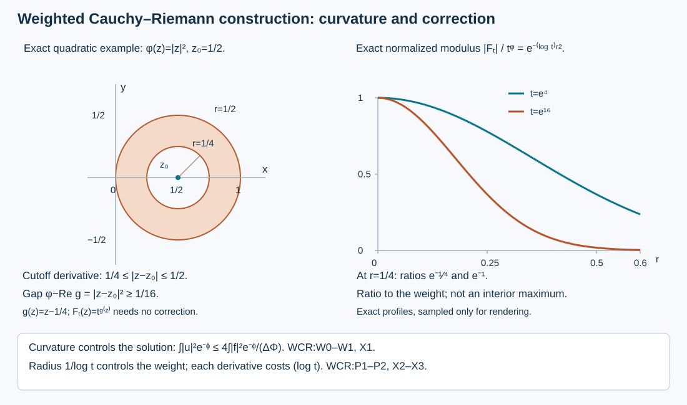

# Weighted Cauchy–Riemann estimates and holomorphic peaks

Independent exposition, proofs, exercises and illustration: GPT-6 Astra (OpenAI), 11 October 2026. CC0-1.0.

A positive curvature term in a weighted integration identity gives an actual solution of the Cauchy–Riemann equation on any open subset of the plane. We then use that solution to correct a local holomorphic exponential without changing its value at a chosen point. The resulting functions have controlled size and derivatives, with each derivative costing only a power of the logarithm of the large parameter.

The primary source is Lars Hörmander, *The Analysis of Linear Partial Differential Operators IV*, 2009 eBook, §26.2, Lemmas 26.2.5–26.2.6, printed pages 77–78.  This independently written lesson supplies those analytic tools, including the local pointwise estimate and the treatment of a merely twice continuously differentiable weight. Use these analytic tools with [complex involutive propagation](../20261011-complex-involutive-propagation/complex-involutive-normal-form-and-regularity-propagation.html) and [prescribed superharmonic regularity](../20261011-prescribed-superharmonic-regularity/prescribed-superharmonic-regularity.html). The curvature constants, weak solution argument and logarithmic derivative bounds are retained in the proofs in this lesson.

We use the earlier [Hilbert-space proof](../20261004-free-canonical-composition/compactness-and-essential-norms.md#t1-the-hilbert-space-facts-with-proofs), measure, completeness and smooth-density proofs, and [planar fundamental-solution calculation](../20261005-restored-function-normal-forms/real-and-complex-symplectic-function-normal-forms.md#7-a-smooth-elliptic-solver-with-parameters). The proof map identifies exact providers. Linked human foundations remain external.

## 1. The curvature identity and its solution

**H0. Conventions and full statement.** Write \(z=x+iy\), \(dA=dx\,dy\), and
\[
 \partial=\tfrac12(\partial_x-i\partial_y),\qquad
 \bar\partial=\tfrac12(\partial_x+i\partial_y),\qquad
 \Delta=4\partial\bar\partial.
 \tag{CR1}
\]
Let \(\omega\subset\mathbb C\) be any open set, and let \(\Phi\in C^2(\omega;\mathbb R)\) satisfy \(\Delta\Phi>0\). No regularity of its boundary, global lower bound for its curvature, or finite area is assumed. Set
\[
 (v,w)_\Phi=\int_\omega v\overline w e^{-\Phi}\,dA,\qquad
 \delta_\Phi w=e^\Phi\partial(e^{-\Phi}w)
                  =\partial w-\Phi_z w.
 \tag{CR2}
\]
The inner product is linear in its first entry. If
\[
 J_\Phi(f)=\int_\omega
       \frac{|f|^2}{\Delta\Phi}e^{-\Phi}\,dA<\infty,
 \tag{CR3}
\]
there is a distributional solution \(\bar\partial u=f\) with
\[
 \int_\omega |u|^2e^{-\Phi}\,dA\le4J_\Phi(f).
 \tag{CR4}
\]
In particular \(f\in L^2_{\mathrm{loc}}(\omega)\), since \(e^\Phi\Delta\Phi\) is bounded on each compact subset. The constructed solution is the unique one of smallest weighted norm.

**W0. Prove the exact identity before using positivity.** For \(w\in C_c^\infty(\omega)\), real integration by parts gives
\[
 (\bar\partial v,w)_\Phi=-(v,\delta_\Phi w)_\Phi,\qquad
 \bar\partial\delta_\Phi w
   =\delta_\Phi\bar\partial w-\Phi_{z\bar z}w.
 \tag{CR5}
\]
For the first formula, expand \(\partial_x+i\partial_y\), move its two real derivatives onto \(\overline w e^{-\Phi}\), and conjugate their coefficients. For the second, apply the product rule to \(\bar\partial(\partial w-\Phi_z w)\); the mixed derivatives of \(w\) commute. These computations need only two continuous derivatives of \(\Phi\). All supports are compactly inside \(\omega\).

Apply the first identity to \(\delta_\Phi w\), then the second, and then the first to \(w,\bar\partial w\). The result is
\[
 \|\delta_\Phi w\|_\Phi^2
   =\|\bar\partial w\|_\Phi^2
       +\frac14\int_\omega\Delta\Phi\,|w|^2e^{-\Phi}\,dA.
 \tag{CR6}
\]
There is no boundary term. The identity also holds for compact \(C^1\) tests by smooth approximation in the \(C^1\) norm: both sides of CR6 are continuous in that norm on a fixed compact set.

**W1. Construct the actual solution, with its norm.** The weighted space is a Hilbert space: multiplication by \(e^{-\Phi/2}\) is an isometry onto ordinary \(L^2(\omega)\), whose completeness is already proved. Weighted Cauchy–Schwarz and CR6 give
\[
 |(f,w)_\Phi|^2
 \le J_\Phi(f)\int_\omega\Delta\Phi|w|^2e^{-\Phi}\,dA
 \le4J_\Phi(f)\|\delta_\Phi w\|_\Phi^2.
 \tag{CR7}
\]
On the linear space of vectors \(\delta_\Phi w\), define the antilinear functional \(\delta_\Phi w\mapsto-(f,w)_\Phi\). It is well defined: if two such vectors agree, CR7 applied to the difference makes their functional values agree. Its norm is at most \(2J_\Phi(f)^{1/2}\). Extend it continuously to the closure of that space, and extend it by zero on the orthogonal complement. The earlier Hilbert projection and representation proof gives \(u\) of norm at most this same bound, with
\[
 (u,\delta_\Phi w)_\Phi=-(f,w)_\Phi
                  \quad(w\in C_c^\infty(\omega)).
 \tag{CR8}
\]
Thus CR4 holds.

To identify the equation for a \(C^2\) weight, do not assume that \(e^\Phi\psi\) is a smooth test. For \(\psi\in C_c^\infty(\omega)\), that product is compact \(C^2\). Approximate it by smooth functions in \(C^1\) with supports in one compact subset of \(\omega\). Local \(L^2\) integrability of \(u,f\) makes CR8 pass to the limit. Since
\(\delta_\Phi(e^\Phi\psi)=e^\Phi\partial\psi\), the resulting equality is precisely the weak equation \(\bar\partial u=f\) against \(\overline\psi\).

The same argument identifies the orthogonal complement of the closed range of the test map with the weighted \(L^2\) nullspace of \(\bar\partial\). Our extension by zero makes \(u\) orthogonal to that nullspace. Any other solution differs from it by a null vector, so Pythagoras proves the minimal-norm assertion and uniqueness. The case \(J_\Phi(f)=0\) gives \(u=0\).

## 2. Local pointwise control from the equation

**C0. Mean values and weak holomorphic functions.** Here holomorphic means a smooth function \(h\) satisfying \(\bar\partial h=0\); the usual complex derivative is then \(\partial_xh\). On a circle inside its domain,
\(\partial_\theta h(z+re^{i\theta})=ir\,\partial_rh(z+re^{i\theta})\).
Integration in \(\theta\) makes the angular derivative vanish. Therefore the circle average has zero \(r\)-derivative and equals its limit \(h(z)\) at zero. Integrating those circle averages in \(r\), with any smooth radial kernel \(\rho_r\) of integral one supported in the radius-\(r\) disk, gives
\[
 h(z)=\int\rho_r(z-w)h(w)\,dA(w),\qquad
 |D^\alpha h(z)|\le C_\alpha r^{-|\alpha|-1}
                  \|h\|_{L^2(D(z,r))}.
 \tag{CR9}
\]
For the derivative bound choose the averaging radius on a neighborhood of the point and differentiate the kernel. Its \(L^2\) derivative norm is \(C_\alpha r^{-|\alpha|-1}\), by the real two-dimensional change of variables. The analogous \(L^1\) bound gives \(C_\alpha r^{-|\alpha|}\sup|h|\).

These statements also prove the needed weak regularity. If \(h\in L^2_{\mathrm{loc}}\) and \(\bar\partial h=0\) distributionally, convolve it with compact smooth mollifiers on successively smaller interior sets. The mollifications are smooth and satisfy the same equation. Their \(L^2\) differences tend to zero. CR9 bounds every derivative of those differences uniformly on a still smaller compact set. They consequently converge there, with every derivative, to a smooth holomorphic representative of \(h\). Compatibility on overlaps follows from equality as \(L^2\) functions. This proves weak holomorphic regularity without an omitted elliptic-regularity theorem.

**C1. Include the nonzero forcing in the pointwise estimate.** The earlier planar polar-coordinate calculation proves
\[
 \bar\partial\frac1{\pi z}=\delta_0
              \quad\hbox{in distributions on }\mathbb C.
 \tag{CR10}
\]
Its factor is twice the fundamental solution of \(\partial_x+i\partial_y\). If \(u\in L^2(D(z,2r))\), \(\bar\partial u=h\), and \(h\) is smooth there, then
\[
 |u(z)|\le C\left(r^{-1}\|u\|_{L^2(D(z,2r))}
                     +r\|h\|_{L^\infty(D(z,2r))}\right).
 \tag{CR11}
\]
Indeed take a cutoff equal to one on \(D(z,3r/2)\), supported in \(D(z,2r)\), and let \(v=(\pi z)^{-1}*(\chi h)\). This is smooth: on each compact set the kernel is integrable and every derivative may instead fall on the compact smooth factor. Formula CR10 gives \(\bar\partial v=h\) on the smaller disk. The integral of \(1/(\pi|w|)\) over a radius-\(R\) disk is \(2R\), by polar integration. Thus \(|v|\le Cr\|h\|_\infty\) on \(D(z,r)\) and \(\|v\|_{L^2(D(z,r))}\le Cr^2\|h\|_\infty\). Apply C0 and its value bound to \(u-v\) on that disk. Adding \(v(z)\) proves CR11 and proves that \(u\) itself has a smooth representative near \(z\). The constant is independent of \(r,u,h,z\).

## 3. Correct a local peak without changing its value

**P0. Statement and the quadratic support.** Let \(\phi\in C^2(\omega;\mathbb R)\) with \(\Delta\phi>0\), and let \(z_0\) belong to a relatively compact open subset \(\omega_0\) of \(\omega\). For every sufficiently large real \(t\), we will construct a holomorphic \(F_t\) on the entire original \(\omega\) such that
\[
 F_t(z_0)=t^{\phi(z_0)},\qquad
 |F_t(z)|\le2t^{\phi(z)},\qquad
 |D^\alpha F_t(z)|\le C_\alpha(\log t)^{|\alpha|}
                                      t^{\phi(z)}
 \quad(z\in\omega_0).
 \tag{CR12}
\]
Constants and the lower threshold may depend on \(\omega_0,\phi,z_0\), but not on \(t,z\). No simple connectivity is needed.

Write \(w=z-z_0\), and define the holomorphic polynomial
\[
 g(z)=\phi(z_0)+2\phi_z(z_0)w+\phi_{zz}(z_0)w^2.
 \tag{CR13}
\]
Real second-order Taylor expansion, expressed using CR1, gives
\[
 \phi(z)-\operatorname{Re}g(z)
       =\tfrac14\Delta\phi(z_0)|w|^2+o(|w|^2).
 \tag{CR14}
\]
Choose \(b>0,\delta>0\) so that the closed radius-\(\delta\) disk lies in \(\omega_0\) and the left side is at least \(b|w|^2\) there. Choose \(0\le\chi\le1\), equal to one when \(|w|\le\delta/2\), supported in \(|w|<\delta\). The cutoff derivative is separated from \(z_0\).

**P1. Solve the correction with a quantitative small factor.** Put \(\lambda=\log t\), and define, by zero extension away from the cutoff support,
\[
 H_t(z)=\frac{\bar\partial\chi(z)}{z-z_0}\,e^{\lambda g(z)},
 \qquad \varepsilon=b\delta^2/4>0.
 \tag{CR15}
\]
This is smooth, including near \(z_0\). On its support, CR14 gives
\[
 |H_t(z)|\le C t^{\phi(z)-\varepsilon},\qquad
 \int_\omega\frac{|H_t|^2}{\Delta\phi}\,
                      t^{-2\phi}\,dA\le C t^{-2\varepsilon}.
 \tag{CR16}
\]
The denominator has a positive minimum on this fixed compact support; no minimum over all of \(\omega\) is used. Apply W1 with \(\Phi=2\lambda\phi\), for \(t\ge e\). It gives \(\bar\partial U_t=H_t\) on all of \(\omega\), with
\[
 \int_\omega |U_t|^2t^{-2\phi}\,dA
       \le\frac{2C}{\lambda}t^{-2\varepsilon}.
 \tag{CR17}
\]
The pointwise forcing is smooth, so C1 makes \(U_t\) smooth everywhere.

Choose open sets \(\overline{\omega_0}\subset\omega_1\Subset\omega_2\Subset\omega\).
On their fixed compact closures \(|\nabla\phi|\) is bounded. For \(z\in\omega_1\) and \(r=1/\lambda\), take \(t\) sufficiently large that \(D(z,2r)\subset\omega_2\). Along the segment inside that disk, the real fundamental theorem gives
\[
 t^{\phi(w)}\le e^{2L}t^{\phi(z)}
                         \quad(w\in D(z,2/\lambda)).
 \tag{CR18}
\]
Using CR17 and this inequality in CR11, and CR16 for its forcing term, gives
\[
 |U_t(z)|\le C(\lambda^{1/2}+\lambda^{-1})
                  t^{\phi(z)-\varepsilon}
            \le C'\lambda\,t^{\phi(z)-\varepsilon}
                         \quad(z\in\omega_1).
 \tag{CR19}
\]
This bound includes points in the cutoff annulus, where \(U_t\) need not be holomorphic. It does not replace the inhomogeneous pointwise estimate by a holomorphic mean-value assertion.

**P2. Exact interpolation and every derivative.** Set
\[
 F_t(z)=\chi(z)e^{\lambda g(z)}-(z-z_0)U_t(z).
 \tag{CR20}
\]
The product rule and CR15 cancel its \(\bar\partial\) derivative exactly. At \(z_0\), the correction vanishes and \(g(z_0)=\phi(z_0)\), proving the required value. On the support of \(\chi\), its first term has modulus at most \(t^\phi\); elsewhere it is zero. On \(\omega_1\), CR19 bounds the second term by \(C\lambda t^{-\varepsilon}t^\phi\), because \(|z-z_0|\) is bounded there. The factor \(\lambda t^{-\varepsilon}\) tends to zero (for example compare the exponential series with its second term). Enlarging the threshold gives \(|F_t|\le2t^\phi\) on \(\omega_1\).

Finally use C0's differentiated radial averaging with radius \(1/\lambda\), now for the holomorphic function \(F_t\), at points of \(\omega_0\). The averaging disk lies in \(\omega_1\), and CR18 compares its weight to the central weight. The \(L^1\) derivative-kernel bound gives precisely the last estimate in CR12 for every real multiindex. The domain and the size bound do not shrink with derivative order; only \(C_\alpha\) changes. This completes both constructions.

## 4. Three complete solutions

**X1. Is the curvature constant sharp?** Take \(\omega=\mathbb C\), \(\Phi=a|z|^2\), \(a>0\), and \(f=1\). Find the minimal weighted solution and compare CR4.

**Solution.** The solution \(u=\overline z\) satisfies \(\bar\partial u=1\). Polar integration and \(s=ar^2\), followed by one integration by parts, give
\[
 \int_{\mathbb C}e^{-a|z|^2}\,dA=\frac{\pi}{a},\qquad
 \int_{\mathbb C}|z|^2e^{-a|z|^2}\,dA=\frac{\pi}{a^2},
 \qquad\Delta\Phi=4a.
 \tag{CR21}
\]
Every other weighted solution is \(\overline z+h\) with \(h\) entire holomorphic, by C0. On each centered circle the mean of \(zh(z)\) is its value zero at the center, again by C0. Consequently \(\overline z\) is orthogonal to \(h\) in the Gaussian inner product; the radial integral is legitimate by Cauchy–Schwarz. Thus \(\overline z\) is the minimal solution. Both sides of CR4 equal \(\pi/a^2\); reducing its constant below \(4\) would fail.

**X2. An exact quadratic peak.** Let \(\phi(z)=|z|^2\) and \(z_0=1/2\). Compute \(g\), the normalized modulus of \(t^g\), and the cutoff gap for \(\delta=1/2\).

**Solution.** Here \(\phi_z(z_0)=1/2,\phi_{zz}=0\), so
\[
 g(z)=z-\tfrac14,\qquad
 \phi(z)-\operatorname{Re}g(z)=|z-\tfrac12|^2,\qquad
 \frac{|t^{g(z)}|}{t^{\phi(z)}}=t^{-|z-1/2|^2}.
 \tag{CR22}
\]
This example already has a global holomorphic peak; no correction is necessary. For the general cutoff construction one may take \(b=1\), and the derivative annulus \(\delta/2\le|z-z_0|\le\delta\) gives \(\varepsilon=1/16\). At its inner edge the normalized modulus is \(t^{-1/16}\); at its outer edge it is \(t^{-1/4}\). These are bounds for the ratio to the weight, not assertions that the unnormalized holomorphic function has an interior maximum.

**X3. Why does each derivative cost a logarithm?** Use the exact peak of X2 and compare the averaging radius \(1/\log t\) with a fixed radius.

**Solution.** Its \(k\)-th \(x\)-derivative at \(z_0\) equals
\[
 \partial_x^k t^{z-1/4}\big|_{z=1/2}
                =(\log t)^k t^{1/4}.
 \tag{CR23}
\]
Thus a uniform constant in place of \((\log t)^k\) is impossible for \(k\ge1\) in this construction. A disk of radius \(r\) changes a weight with gradient bound \(L\) by at most \(t^{Lr}\). At a fixed positive radius that factor is unbounded; at \(r=1/\log t\) it is at most \(e^L\). The derivative of the averaging kernel costs exactly \(r^{-k}=(\log t)^k\). Both parts of the choice are necessary to the stated estimate.

## 5. The local gap and the exact peak profile

**V0. What is plotted.** The left panel uses the exact quadratic example \(\phi=|z|^2,z_0=1/2\), with circles of radii \(1/4\) and \(1/2\). The annulus is where the cutoff derivative may be supported, and its minimum quadratic gap is \(1/16\). The right panel plots the exact normalized profiles \(e^{-4r^2}\) and \(e^{-16r^2}\), corresponding to \(t=e^4,e^{16}\); it is a ratio to the weight. The figure makes no claim about a maximum of the holomorphic function itself. Its captioned formulas identify the curvature constant and the logarithmic derivative cost. The complete proof, rather than a numerical plot, establishes CR4 and CR12.
