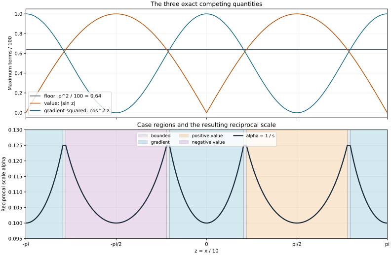

# Adaptive scales and a principal-type solution estimate

The transverse symbol can be small, have one sign, or factor through a simple zero. One phase-space scale detects these alternatives and lets their different estimates be summed with uniform constants. We construct that scale, prove the factorization with all derivative bounds, and obtain the full small-time solution estimate. The derivative energy retained in the factorized regions is the input needed for the subsequent localized argument.

The antecedents are Lars Hörmander, *The Analysis of Linear Partial Differential Operators IV*, 2009 edition, Lemma 26.10.2, Proposition 26.10.3 and estimate (26.10.16), printed pages 150–155. This lesson supplies independent proofs and exact connections to the earlier metric calculus, scalar positivity and Nirenberg–Treves estimates. [Localized energy and quasiconcavity](../20261012-localized-quasiconcave-propagation/localized-weights-and-quasiconcave-propagation.html) supplies the measured estimate, canonical barrier, shell test and exact Sobolev-index bootstrap.

The proof map records the complete receiving chain. The Hilbert-valued calculus [MP:B1 and MP:B7](../20261005-metric-positivity/metric-operator-bounds.html) controls the countably many localizations without a dimension-dependent coefficient constant. The scalar positivity proof [MP:F2–F5](../20261005-metric-positivity/scalar-fefferman-phong.html) bounds the negative quantization error. The complete [Nirenberg–Treves estimates](../20261012-nirenberg-treves-operator/nirenberg-treves-estimates-and-square-root-commutators.html), NTO:E1 and NTO:E3, give both the solution bound and the retained energy.

Original expression, three complete solutions and the reproducible figure are CC0-1.0. Linked components retain their terms. Human foundational proofs remain external. 

## 1. State the estimate and normalize its coefficients

**H0. Operator, domains and quantifiers.** Write \(X=(x,\xi)\in\mathbb R^{2d}\), \(d\ge0\), \(D_t=-i\partial_t\), and use Weyl quantization at parameter one. Let \(0<a\le1\), \(\delta>0\). Let \(F(t,X)\) be real and \(R(t,X)\) complex. All their transverse derivatives are jointly continuous; no time derivative is assumed. Suppose

\[
 F(t,X)F(s,X)\ge0,\qquad
 a^2|\partial_X^jF(t,X)|+|\partial_X^jR(t,X)|
       \le\delta C_j a^j,\quad j=0,1,\ldots . \tag{AP1}
\]

The derivative norms here are operator norms of the symmetric multilinear derivative tensors; replacing them by finitely many coordinate derivatives only changes dimension-dependent constants. Set

\[
 P=D_t+iF^w(t,x,D_x)+R^w(t,x,D_x).
 \qquad
 \|u\|_{L^2_{t,x}}\le16T\|Pu\|_{L^2_{t,x}},
 \quad\operatorname{supp}_tu\subset[-T,T]. \tag{AP2}
\]

There are \(a_0,\tau_0>0\), depending on finitely many \(C_j\) and \(d\), for which (AP2) holds if \(a\le a_0\), \(\delta T\le\tau_0\), and \(u\) is smooth in time with spatial Schwartz values, vanishing outside the stated time interval. This includes the compactly supported smooth test functions in the source statement. Constants do not depend on the number of localizing balls or on the sizes of the local operators.

**H1. Normalization does not change \(16T\).** Extend the coefficients outside the time interval by their endpoint values if necessary. This preserves their transverse bounds, continuity and fixed-\(X\) sign property. Choose \(M\ge1\) large enough that the first three transverse bounds for \(F/(\delta M)\) are at most \(a^{-2},a^{-1},1\). Use \(\theta=\delta M t\). The operator becomes

\[
 P=\delta M\left(D_\theta+i\widetilde F^w(\theta)
                         +\widetilde R^w(\theta)\right),
 \qquad \widetilde F=F/(\delta M),\
 \widetilde R=R/(\delta M). \tag{AP3}
\]

The new time window is \(\widetilde T=\delta M T\). Every \(L^2\) norm acquires the same Jacobian factor \((\delta M)^{-1/2}\), and \(16\widetilde T/(\delta M)=16T\). We therefore prove the normalized estimate with \(\delta=1\) and
\(|F|\le a^{-2}\), \(|F_X|\le a^{-1}\), \(\|F_{XX}\|\le1\). Higher constants and the \(R\) constants remain bounded fixed numbers. The smallness condition for the normalized time window gives precisely a condition on \(\delta T\) in H0. When there are no transverse variables, the sign hypothesis makes \(F(t)\) have one weak sign. NTO:E1 applies directly on the scalar Hilbert space with \(A=|F|\) and \(B=1\) or \(-1\), giving the \(4T\) bound before the bounded \(R\) term is absorbed. This proves the stated \(16T\) bound for sufficiently small normalized \(T\). The remaining adaptive construction concerns positive transverse dimension.

## 2. Construct the adaptive scale

**S0. One reciprocal scale.** For \(1\le p\le a^{-1}\), put

\[
 s(X)=\max\left(p,\ \sup_t|F(t,X)|^{1/2},\
                         \sup_t|F_X(t,X)|\right),\qquad
 \alpha(X)=s(X)^{-1}. \tag{AP4}
\]

Then \(a\le\alpha\le p^{-1}\). Taylor's integral remainder and the unit Hessian bound give, with \(r=|Y-X|\),

\[
 |F(t,Y)|\le s(X)^2+s(X)r+\tfrac12r^2
                  \le(s(X)+r)^2,\qquad
 |F_X(t,Y)|\le s(X)+r. \tag{AP5}
\]

Taking suprema and then exchanging \(X,Y\) proves \(|s(Y)-s(X)|\le r\). Consequently \(s\) and \(\alpha\) are continuous, and

\[
 \frac{\alpha(X)}{1+\alpha(X)r}\le\alpha(Y),\qquad
 \frac{\alpha(X)}{1+q}\le\alpha(Y)
        \le\frac{\alpha(X)}{1-q}
        \quad\text{if }\alpha(X)r\le q<1. \tag{AP6}
\]

In particular \(\alpha(Y)\le2\alpha(X)\) for \(q=1/2\). The first inequality is the global growth assertion of Lemma 26.10.2. The derivative bounds improve to

\[
 |\partial_X^jF(t,X)|\le C'_j\alpha(X)^{j-2},
                    \qquad j=0,1,\ldots . \tag{AP7}
\]

For \(j=0,1\) use the definition. For \(j\ge2\), use \(a\le\alpha\) in the original bound \(C_j a^{j-2}\).

**S1. The actual metric and its weights.** On transverse phase space set

\[
 g_X=\alpha(X)^2|dX|^2,\quad
 g_X^\sigma=\alpha(X)^{-2}|dX|^2,\quad
 h_g=\alpha(X)^2. \tag{AP8}
\]

The dual formula follows directly from the standard symplectic matrix, as in WY:W1–W3. Since \(\alpha\le1\), \(g\le g^\sigma\). Formula (AP6) proves slow variation with a uniform radius.

For temperateness write \(L=r/\alpha(X)=g_X^\sigma(Y-X)^{1/2}\). The Lipschitz bound gives \(s(Y)/s(X)\le1+r/s(X)\le1+L\). For the reverse ratio, \(s(X)/s(Y)\le1+r/s(Y)\le1+r\le1+L\), because \(s(Y)\ge1\) and \(\alpha(X)\le1\). Thus both metric ratios are at most \((1+L)^2\). The same inequalities prove local continuity and temperateness of every fixed real power of \(\alpha\). All structural constants are independent of \(a,p\).

No derivative of the metric is required. Formula (AP7) says exactly that \(F\in S(\alpha^{-2},g)\). Also \(R\in S(1,g)\), because \(a\le\alpha\) in all its derivative bounds.

**S2. The bounded case.** At a point where \(s(X)=p\), (AP6) gives
\(\tfrac12\le p\alpha(Y)\le1\) if \(\alpha(X)|Y-X|\le1/2\). Formula (AP7) therefore gives

\[
 |\partial_X^jF(t,Y)|\le4C'_j p^{2-j},
                  \qquad j=0,1,\ldots . \tag{AP9}
\]

For \(j\ge2\) the factor four can be replaced by one, since \(\alpha(Y)\le p^{-1}\). This region has a uniformly bounded operator after \(p\) is fixed, even when the original symbol bound \(a^{-2}\) is large.

## 3. The other two cases: one sign or a simple factor

**C0. A value maximum forces a sign on a whole ball.** Suppose
\(s(X)^2=\sup_t F(t,X)\). Choose a time with
\(F(t,X)>\tfrac34s(X)^2\). This choice is possible even if the supremum is not attained. Taylor's formula gives
\[
 F(t,Y)>0\quad\text{if }\alpha(X)|Y-X|<\tfrac12,
 \tag{AP10}
\]
because the possible loss is at most
\(s(X)|Y-X|+\tfrac12|Y-X|^2<\tfrac58s(X)^2\).
The sign hypothesis in (AP1) then forces \(F(s,Y)\ge0\) at every other time. If the maximum is instead \(\sup_t(-F)\), the same argument gives a nonpositive sign throughout the ball. Together with S2 this leaves only the gradient case. Ties can be assigned to either applicable case.

**C1. A gradient supremum supplies a genuine smooth limiting function.** Suppose
\(s(X)=\sup_t|F_X(t,X)|\). Choose times \(t_n\) for which these gradient norms approach \(s(X)\). Set \(s_*=s(X)\) and normalize
\[
 f_n(Z)=s_*^{-2}F(t_n,X+s_*Z). \tag{AP11}
\]
On every fixed compact \(Z\)-ball the functions and every derivative are uniformly bounded by (AP5), (AP7) and (AP6). They have a subsequence converging locally with every derivative.

Here are the compactness details. Choose a countable dense grid in each integer-radius ball, list all multiindices and grid points, and successively take convergent subsequences of the bounded scalar derivative values there. A diagonal subsequence works at every listed pair. The next derivative bounds give uniform Lipschitz estimates on each smaller ball, so a finite grid converts pointwise convergence into uniform convergence there. The fundamental theorem on coordinate segments shows that the limits of successive derivatives are derivatives of the limiting function. Repeating this for every derivative and radius proves \(C^\infty_{\mathrm{loc}}\) convergence. The finite grid exists by compactness; the subsequences exist by the bounded real-sequence theorem in the elementary foundation. This argument needs no compactness in the time variable.

In physical coordinates the limit is a smooth real function \(G\) with
\[
 |G_X(X)|=s_*,\quad
 |\partial_Y^jG(Y)|\le C_j\alpha(Y)^{j-2},\quad
 F(t,Y)G(Y)\ge0. \tag{AP12}
\]
The sign inequality follows by taking the pointwise limit with \(t\) fixed. Also \(\|G_{YY}\|\le1\). Its gradient therefore never vanishes in \(|Y-X|<s_*/2\). At each zero of \(G\) there, a displacement in its nonzero-gradient direction produces both signs. The sign inequality and continuity force \(F(t,Y)=0\) at that zero, for every \(t\).

**C2. Exact division and positivity.** Choose the unit direction
\(e=G_X(X)/s_*\). In normalized coordinates of (AP11), the derivative of
\(s_*^{-2}G(X+s_*Z)\) in direction \(e\) is at least \(1-|Z|\). On \(|Z|<3/4\) it is at least \(1/4\). Whenever a zero is nearby, the implicit-function theorem gives a graph \(Z_e=b(Z_\perp)\), with all derivatives bounded uniformly. Its differentiated equation proves these bounds by induction: the highest derivative is multiplied by the first derivative, which is bounded below by \(1/4\), and every other term contains already bounded derivatives.

Writing \(\mathcal G(Z)=s_*^{-2}G(X+s_*Z)\) and
\(\mathcal F(t,Z)=s_*^{-2}F(t,X+s_*Z)\), the fundamental theorem gives
\[
 \mathcal G=(Z_e-b)\int_0^1\partial_e\mathcal G
             (b+\theta(Z_e-b),Z_\perp)\,d\theta,\qquad
 \mathcal F=(Z_e-b)\int_0^1\partial_e\mathcal F
             (t,b+\theta(Z_e-b),Z_\perp)\,d\theta. \tag{AP13}
\]
The denominator integral is at least \(1/4\). Its ratio defines a smooth quotient \(H\), continuous in time with every transverse derivative, also at the zero. Off the zero the quotient is \(F/G\), so \(H\ge0\); continuity gives the same conclusion at the zero.

These local quotients agree on overlaps: they agree off the hypersurface, which is dense, and hence agree everywhere. They therefore define
\[
 F(t,Y)=G(Y)H(t,Y),\qquad H\ge0,
             \quad |Y-X|<s_*/2. \tag{AP14}
\]

**C3. Uniform bounds also where no zero is nearby.** On the normalized half-ball, inspect the line in direction \(e\) for displacements of size at most \(1/4\). If it has a zero, (AP13) applies on a neighborhood of the point, with the uniform graph and derivative bounds just proved. If it has no zero, monotonicity and the derivative lower bound imply \(|\mathcal G|\ge1/16\) at the point: otherwise a displacement of size less than \(1/4\) in the decreasing direction would cross zero. On a small neighborhood the lower bound can be weakened to \(1/32\), and ordinary reciprocal differentiation bounds the quotient there.

Thus every derivative of the quotient on the half-ball is bounded by a constant depending only on the relevant derivative bounds, through order \(j+1\). Returning to physical coordinates gives
\[
 |\partial_Y^jG(Y)|\le C_j\alpha(Y)^{j-2},\qquad
 |\partial_Y^jH(t,Y)|\le C_j\alpha(Y)^j. \tag{AP15}
\]
The comparability in (AP6) changes only the fixed constants. This completes all three cases of Lemma 26.10.2, including an unattained supremum, genuine smooth division and every quotient derivative.

## 4. Quantize a squared partition at the moving scale

**G0. Exact coefficient calculus.** WY:W10 and MP:B1 prove every finite Weyl product remainder, retaining the order of operator coefficients. MP:B7 proves the \(L^2\) bound with constants independent of the coefficient Hilbert spaces. For one scalar metric \(g\), a product remainder after \(N\) terms has weight \(m_1m_2h_g^N\). On a frozen ball with \(\alpha_\nu=\alpha(X_\nu)\), \(h_g=\alpha_\nu^2\).

For scalar commutators, the zeroth term cancels. After the Poisson term, the remainder gains at least \(h_g^2\). For the square of one real scalar symbol, its first Poisson term vanishes. These statements concern full finite remainders, and are used with their actual weights below.

**G1. The squared frame.** The earlier ellipsoid-cover and cutoff proofs P2:ML2–ML3 give centers \(X_\nu\), real cutoffs \(\phi_\nu\), and larger nonnegative cutoffs \(\psi_\nu\), with
\[
 \sum_\nu\phi_\nu^2=1,\quad
 \psi_\nu=1\text{ near }\operatorname{supp}\phi_\nu,\quad
 \operatorname{supp}\psi_\nu\subset
        \{Y:\alpha_\nu|Y-X_\nu|<1/2\}. \tag{AP16}
\]
The support margins are strict and the larger balls have uniformly bounded multiplicity. The cutoffs have uniform \(S(1,g)\) seminorms; the column \((\phi_\nu)_\nu\) has the same bounds in \(\ell^2\). Pointwise finite overlap proves the column derivative bounds. One can start with a sufficiently small covering radius and select two larger radii below \(1/2\); local metric comparison preserves all these margins.

Let \(\Phi u=(\phi_\nu^wu)_\nu\). The exact coefficient calculus gives
\(\Phi^*\Phi=I+E\), where the scalar square cancellations make
\(E\in\operatorname{Op}^wS(\alpha^4,g)\). In particular its norm is at most \(C p^{-2}\), using the weaker weight \(\alpha^2\). The same fixed finite seminorms control this bound independently of \(p,a\). Fix \(p\) large enough to make the norm at most \(1/2\), and then require \(a\le p^{-1}\). It follows that
\[
 \tfrac12\|u\|^2\le\sum_\nu\|\phi_\nu^wu\|^2
                         \le\tfrac32\|u\|^2. \tag{AP17}
\]
All sums converge in Hilbert norm. This follows first for finite columns and then for the full column by MP:B7 and its complete coefficient calculus; testing compact smooth vectors and using the locally finite partition identifies the symbol \(1\). It is not an assumption of orthogonal projections.

**G2. Local symbols and uniform time continuity.** Set
\[
 F_\nu=\psi_\nu^2F,\qquad P_\nu=D_t+iF_\nu^w. \tag{AP18}
\]
Each local symbol is bounded uniformly in
\(S(\alpha_\nu^{-2},\alpha_\nu^2|dX|^2)\), with compact phase support. For fixed \(\nu\), continuity of every derivative on its compact support and the finite-seminorm operator bound make \(F_\nu^w(t)\) norm-continuous. The uniform seminorm bounds, rather than a common modulus of time continuity, supply the estimates below.

## 5. The local solution estimate in all three cases

**L0. Bounded and one-sign balls.** If the center is in S2, \(\|F_\nu^w\|\le Cp^2\). NTO:E1 with \(A=B=0\) gives
\[
 \|v\|\le4T\|D_tv\|
       \le4T\|P_\nu v\|+4TCp^2\|v\|. \tag{AP19}
\]
For \(T\) sufficiently small this yields \(\|v\|\le8T\|P_\nu v\|\).

In a positive-sign ball \(F_\nu\ge0\). Scalar Fefferman–Phong in the frozen metric applies to
\(\alpha_\nu^{-2}F_\nu\in S(\alpha_\nu^{-4},g_\nu)=S(h_{g_\nu}^{-2},g_\nu)\), and gives \(F_\nu^w\ge-C\alpha_\nu^2I\). Thus \(A=F_\nu^w+cI\ge0\) for a fixed \(c\), \(B=I\). Their commutators vanish. NTO:E1 applied to \(i(D_t+iA)=\partial_t-A\) gives the same local estimate after absorbing \(4Tc\|v\|\). A negative-sign ball uses \(-F_\nu^w+cI\) and \(B=-I\), with the same error and estimate. This proves
\[
 \|v\|\le8T\|P_\nu v\| \tag{AP20}
\]
in both sign cases, with the stated temporal support.

**L1. The factorized ball.** In C2–C3 put
\[
 G_\nu=\psi_\nu G,\quad H_\nu=\psi_\nu H,\quad
 B=G_\nu^w,\quad A(t)=H_\nu^w+c\alpha_\nu^2I. \tag{AP21}
\]
The symbols \(G_\nu,H_\nu\) have weights \(\alpha_\nu^{-2},1\) in the frozen metric, and \(H_\nu\ge0\). The same scalar positivity theorem gives \(H_\nu^w\ge-C\alpha_\nu^4I\); the larger correction in (AP21) makes \(A\ge0\). Both \(A\) and \(B\) are bounded and self-adjoint for each fixed ball. Moreover
\[
 \|A\|\le C,\quad
 \|[B,A]\|\le C,\quad
 \|[B,[B,A]]\|\le C,\quad
 \|B\|\le C\alpha_\nu^{-2}. \tag{AP22}
\]
For the first commutator its weight is
\(\alpha_\nu^{-2}\alpha_\nu^2=1\). For the second it is again
\(\alpha_\nu^{-2}\alpha_\nu^2=1\). These use full commutator remainders in G0; the added identity commutes exactly.

The leading product is \(G_\nu H_\nu=F_\nu\). The first full product remainder has weight \(\alpha_\nu^{-2}\alpha_\nu^2=1\), and the added correction \(c\alpha_\nu^2B\) also has bounded norm. Hence
\[
 AB-F_\nu^w=K_\nu(t),\qquad\|K_\nu(t)\|\le C. \tag{AP23}
\]
NTO:E1 has a uniform \(M\) in its commutator hypothesis. Choose \(T\) so small that its solution constant is at most \(6T\). Applied to \(\partial_t-AB=i(D_t+iAB)\), and then (AP23), it gives
\(\|v\|\le6T\|P_\nu v\|+6TC\|v\|\). Further shrink \(T\) to obtain (AP20). The norm of \(B\) can grow without bound as \(a\) shrinks; it does not enter this solution constant.

**L2. Apply local estimates to the actual frame vectors.** The functions \(\phi_\nu^wu(t)\) are still Schwartz and have the same time support. Quantization acts only in the transverse variables. Thus (AP20) applies to them, and (AP17) gives
\[
 \|u\|\le8\sqrt2T
       \left(\sum_\nu\|P_\nu\phi_\nu^wu\|^2\right)^{1/2}.
 \tag{AP24}
\]

**L3. The complete column error is bounded.** Put \(P_0=D_t+iF^w\). The exact identity is
\[
 (P_\nu\phi_\nu^w)_\nu=\Phi P_0+\mathcal K,\qquad
 \mathcal K_\nu=i(F_\nu^w\phi_\nu^w-\phi_\nu^wF^w).
 \tag{AP25}
\]
The zeroth symbol term vanishes because \(\psi_\nu=1\) near the support of \(\phi_\nu\). The first term is the bracket of \(F\) and \(\phi_\nu\) there, whose weight is \(\alpha^{-2}h_g=1\). The remaining full product error has weight \(\alpha^{-2}h_g^2=\alpha^2\). Treat \((F_\nu)_\nu\) as a diagonal operator symbol and \((\phi_\nu)_\nu\) as a column. Their differentiated norm bounds follow from the bounded multiplicity, with the coefficient order preserved. MP:B1 and MP:B7 therefore give
\[
 \|\mathcal Ku\|_{L^2(\ell^2)}\le C\|u\|. \tag{AP26}
\]
This includes separated-support tails; the finite remainder theorem already controls their full operator symbols. No sum of individual scalar operator norms is used.

## 6. Sum the estimate and restore the lower-order term

**A0. Keep the numerical constant.** By (AP17), (AP24)–(AP26),
\[
 \|u\|\le8\sqrt3T\|P_0u\|+8\sqrt2CT\|u\|. \tag{AP27}
\]
Since \(8\sqrt3<14\), choose \(T\) so small that
\(8\sqrt2CT\le1-8\sqrt3/14\). Absorption then gives
\[
 \|u\|\le14T\|P_0u\|. \tag{AP28}
\]
The positive gap is exact: \(192<196\). All other smallness choices involve only the same fixed finite seminorm data and the fixed \(p\).

**A1. Add \(R\), then undo time normalization.** Since \(R\in S(1,g)\), MP:B7 gives \(\|R^w(t)\|\le C_R\). Require \(14TC_R\le1/8\). Equation (AP28) yields
\[
 \|u\|\le14T\|Pu\|+\tfrac18\|u\|,
       \qquad\|u\|\le16T\|Pu\|. \tag{AP29}
\]
Integrating the pointwise operator bound in time is justified on the stated test domain. Joint continuity and the compact time interval give strong measurability; the uniform operator bound gives the integrable majorant. H1 now restores \(\delta\) and the original time, proving H0 in its full quantifiers.

## 7. Retain the derivative energy on factorized balls

**E0. The positive form before it is discarded.** Work in L1, at normalized time, and let \(v\) have the original temporal support. NTO:E3, with (AP22), and the bounded error (AP23), gives
\[
 \int(Bv,H_\nu^wBv)\,dt
       \le CT\alpha_\nu^{-2}\|P_\nu v\|^2. \tag{AP30}
\]
Indeed the left side is at most the form with \(A=H_\nu^w+c\alpha_\nu^2I\). NTO:E3 bounds that form by
\(T\|B\|(18\|(\partial_t-AB)v\|^2+2M^2\|v\|^2)\).
The error is bounded, (AP20) controls \(\|v\|\), and
\(\|B\|\le C\alpha_\nu^{-2}\). This proves (AP30), with a constant uniform over all factorized balls.

**E1. A derivative is controlled by the nonnegative factor.** For every coordinate derivative \(H_{\nu,j}=\partial_{X_j}H_\nu\), the Hessian bound is \(C\alpha_\nu^2\). Taylor's formula on the line in its gradient direction, optimized over the displacement, proves
\[
 |H_{\nu,j}|^2\le C\alpha_\nu^2H_\nu. \tag{AP31}
\]
The symbol is globally nonnegative and compactly supported, so the optimizing line is legitimate. If the Hessian bound is zero, a globally nonnegative affine function with compact support is zero, and the assertion is immediate.

The nonnegative difference
\(C\alpha_\nu^2H_\nu-H_{\nu,j}^2\) has weight \(\alpha_\nu^2\). Scaling it by \(\alpha_\nu^{-6}\) puts it in \(S(h_{g_\nu}^{-2},g_\nu)\), so Fefferman–Phong bounds its negative form by \(C\alpha_\nu^6\|w\|^2\). The square product
\((H_{\nu,j}^w)^2-(H_{\nu,j}^2)^w\) has the same weight \(\alpha_\nu^6\), since its first bracket vanishes. Thus, also with the weaker error \(\alpha_\nu^4\),
\[
 \|H_{\nu,j}^ww\|^2
   \le C\alpha_\nu^2(H_\nu^ww,w)
                      +C'\alpha_\nu^4\|w\|^2. \tag{AP32}
\]
This argument supplies the needed derivative inequality using the exact earlier scalar positivity theorem; no unproved sharp Gårding estimate is imported.

**E2. Convert the form into the exact product measurement.** Substitute \(w=Bv=G_\nu^wv\), integrate, and use (AP30), (AP22) and (AP20). The first term is bounded by \(CT\|P_\nu v\|^2\); the second by \(C\|v\|^2\le CT^2\|P_\nu v\|^2\). Also the full product error
\[
 H_{\nu,j}^wG_\nu^w-(H_{\nu,j}G_\nu)^w
       \in\operatorname{Op}^wS(\alpha_\nu,g_\nu) \tag{AP33}
\]
has uniformly bounded norm. Its squared action is absorbed with another use of (AP20), taking \(T\le1\). We obtain
\[
 \|(H_{\nu,j}G_\nu)^wv\|^2
                     \le CT\|P_\nu v\|^2,
                 \quad j=1,\ldots,2d. \tag{AP34}
\]
This is estimate (26.10.16), with the complete product and energy errors. Only transverse derivatives occur; the coefficient hypotheses do not supply a time derivative.

## 8. Connect the estimate to a cubic-flat characteristic tube

**D0. Exact dilation and width-before-frequency choices.** Suppose a degree-one homogeneous imaginary symbol \(f(t,x,\xi)\) has zero transverse two-jet on a compact characteristic interval, and a degree-zero symbol \(r\) vanishes there. Write \(\eta=\lambda\xi\), with marked \(\eta_0\ne0\), and insert one fixed nonnegative cutoff
\(\psi(x/\delta,(\eta-\eta_0)/\delta)\). The compact-parameter Taylor proof gives normalized annular derivatives
\[
 |\partial_{x,\eta}^jf|\le C_j\delta^{3-j},\qquad
 |\partial_{x,\eta}^jr|\le C_j\delta^{1-j}
          \quad\text{on the cutoff support}. \tag{AP35}
\]
For \(j>3\) or \(j>1\), respectively, use the bounded original derivative and \(0<\delta\le1\); the negative powers only weaken the bound. Differentiating the cutoff preserves the displayed budgets. Near the time endpoints choose a slightly enlarged tube: Taylor in the joint variables about the compact central interval gives the same bounds.

Translation of the frequency center is a unitary modulation. Then use the unitary spatial dilation
\(x=\sqrt\lambda\,z\), \(\xi=\lambda^{-1/2}\zeta\), with the translated center understood. It is symplectic, since \(dx\wedge d\xi=dz\wedge d\zeta\). Homogeneity contributes \(\lambda^{-1}\) to \(f\). Each transverse derivative in the new variables contributes \(\sqrt\lambda/\delta\). With
\[
 a^2=\lambda/\delta^2,\qquad
 |\partial_{z,\zeta}^jF|\le C_j\delta a^{j-2},
 \qquad|\partial_{z,\zeta}^jR|\le C_j\delta a^j, \tag{AP36}
\]
we are exactly in (AP1). Thus a fixed time interval is permitted by choosing the width \(\delta\) small, then choosing \(\lambda\) small at that fixed width so that \(a\le a_0\). The \(16T\) constant survives unitary modulation and dilation. This is the full global estimate on the cubic-flat tube; the finer localized measurement still requires the next argument.

## 9. Three complete calculations

### Exercise 1. Locate all three adaptive cases

**X1. A nontrivial maximum.** Take \(a=1/10\), \(p=8\), and
\(F(t,x,\xi)=100c(t)\sin(x/10)\), independent of \(\xi\), with
\(c(t)=(1+\cos t)/2\). Determine the adaptive scale and the case at each phase point.

**Solution.** The coefficient is nonnegative and has supremum one, so the fixed-\(X\) sign property holds. The value, gradient and Hessian bounds are \(100,10,1\). Put \(z=x/10\). Then
\[
 s^2=\max(64,100|\sin z|,100\cos^2z),\qquad
 \alpha=\left[\max(64,100|\sin z|,100\cos^2z)\right]^{-1/2}.
 \tag{AP37}
\]
Let \(y=|\sin z|\). The floor wins when
\(3/5\le y\le16/25\), because \(1-y^2\le16/25\) and \(y\le16/25\).
The gradient wins for \(y<3/5\), since there
\(1-y^2>16/25>y\). The value wins for \(y>16/25\), since there
\(y>16/25>1-y^2\). At the boundary there are ties. The value sign is the sign of \(\sin z\). At \(x=0\), the gradient case has \(G(x)=100\sin(x/10)\), \(H(t,x)=c(t)\), so the exact quotient is already visible and all its transverse derivatives vanish. Independence of \(\xi\) adds zero derivatives and changes none of these assertions.

### Exercise 2. Check every power in the retained energy

**X2. Frozen derivative scales.** Let \(0<b\le1\) be the local reciprocal scale. Suppose \(G\in S(b^{-2},b^2|dX|^2)\), \(H\in S(1,b^2|dX|^2)\). Find the orders of both commutators, the derivative square error and the derivative-product error.

**Solution.** The Planck parameter is \(b^2\). One commutator has weight
\(b^{-2}b^2=1\), and the second has the same weight. A coordinate derivative \(H_j\) has weight \(b\). Its square has weight \(b^2\), and the first correction vanishes, so the full square error has weight \(b^2(b^2)^2=b^6\). The first product error between \(H_j\) and \(G\) has weight \(b\,b^{-2}b^2=b\). The form defect in (AP31) has weight \(b^2\); multiplying by \(b^{-6}\) puts it at \(b^{-4}=h^{-2}\), so its negative error is exactly bounded at weight \(b^6\). Finally \(b^4\|G^wv\|^2\le C\|v\|^2\), since \(\|G^w\|\le Cb^{-2}\). These are all full remainder weights used in E1–E2.

### Exercise 3. Recover the original width and time constant

**X3. Two independent small parameters.** Let \(\delta=1/20\), \(\lambda=1/160000\), and original time half-width \(T=3\). Compute \(a\), the derivative amplitude \(j=0\) in (AP36), and the normalized time window when \(M=2\).

**Solution.** Here \(a^2=\lambda/\delta^2=1/400\), so \(a=1/20\). The imaginary-symbol amplitude budget is \(\delta a^{-2}=20\); the zero-order \(R\) budget is \(\delta=1/20\). The normalized time window is \(\delta MT=3/10\). If the fixed seminorm thresholds admit these choices, its estimate is
\(\|u\|\le16(3/10)\|\widetilde Pu\|\). Since \(P=(1/10)\widetilde P\), returning to original time gives \(16T=48\), exactly as (AP2). The numerical choices do not by themselves prove they lie below a theorem's seminorm-dependent thresholds; they verify the scale and Jacobian identities.

## 10. Read the adaptive-scale figure

**F0. Exact competing quantities and their scale.** The figure plots (AP37) over one period in \(z=x/10\). Its upper panel compares the floor, value and squared-gradient terms divided by \(100\). Its lower panel displays \(\alpha\), with the same three case regions. The transition values \(3/5\) and \(16/25\) are exact. These are numerical samples of explicit formulas; the complete arbitrary-symbol proof is S0–C3.

[Computational material](figures/build_figure.py) accompanies the text. The adaptive trichotomy, full global \(16T\) estimate and derivative energy are proved here. [Localized energy and quasiconcavity](../20261012-localized-quasiconcave-propagation/localized-weights-and-quasiconcave-propagation.html) supplies the measured estimate, canonical barrier, shell test and exact Sobolev-index bootstrap.
