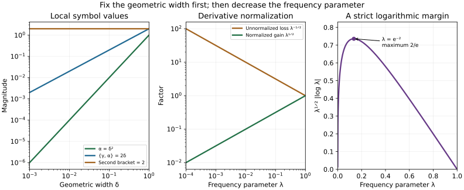

# Frequency-localized estimates and Sobolev indices

Two scales enter propagation through a degenerate characteristic interval. The geometric width makes the commutators small. The frequency parameter then makes the quantization errors small at that fixed width. We prove the full localized estimates with this order of choices, and characterize the microlocal Sobolev index by variable powers on frequency shells.

The mathematical antecedents are Hörmander IV, Lemmas 26.9.2–3, printed pages 138–141 of the approved 2009 edition. Our proof of the first lemma uses the already proved scalar Fefferman–Phong theorem and Weyl products to retain all scale-dependent errors. The functional-analytic estimates are the complete Nirenberg–Treves proofs in the preceding lesson. The second lemma includes the finite inverse construction and the actual norm integral that gives an elliptic test.

Original exposition, exercises and figure are CC0-1.0. The proof map identifies exact earlier proofs. Linked human foundations remain external; internal export P514 closure is not claimed.  [Reduced-leaf propagation](../20261012-reduced-leaf-propagation/regularity-on-reduced-characteristic-leaves.html) proves the superharmonic and conic conclusions. [One-dimensional descent](../20261012-one-dimensional-descent/one-dimensional-descent-and-affine-concavity.html) and [semidefinite propagation](../20261012-semiconcave-propagation/semiconcavity-and-semidefinite-characteristics.html) retain the full real-order and clock hypotheses.

## 1. The two statements and their quantifiers

**H0. The localized differential operator.** Write \(t\in\mathbb R\), \(x\in\mathbb R^d\), \(z=(x,\eta)\), and \(z_0=(0,\eta_0)\), where \(\eta_0\ne0\). For coefficient derivatives put \(Z=(t,z)\), with \(Z_0=t\) and \(Z_1,\ldots,Z_{2d}\) the components of \(z\). Let \(I\) be a fixed compact interval and let \(I_\delta=I+[-\delta,\delta]\). The real smooth functions \(\alpha(t,z)\ge0\) and \(\gamma(z)\) have bounded derivatives on a fixed neighborhood, with

\[
 \alpha(t,z_0)=0\quad(t\in I),\qquad \gamma(z_0)=0.
 \tag{LP1}
\]

No nonvanishing derivative of \(\gamma\) is needed for the estimates; the principal-type application has that additional property. Fix \(0\le\psi\le1\), compactly supported in phase space and equal to one near zero, and put \(\psi_\delta(z)=\psi((z-z_0)/\delta)\). For sufficiently small \(\delta\), its support stays in the fixed neighborhood and in an annulus away from \(\eta=0\).

Use \(D_t=-i\partial_t\). Superscripts \(w\) and \(L\) denote Weyl and left quantization at parameter \(\lambda>0\): the phase is \(e^{i(x-y)\cdot\eta/\lambda}\), with factor \((2\pi\lambda)^{-d}\). Define

\[
 P_{\delta,\lambda}(t)
   =\operatorname{Op}_{\lambda}^{L}
       (\lambda^{-1}\psi_\delta^4\alpha\gamma),\qquad
 \mathcal L_{\delta,\lambda}=D_t+iP_{\delta,\lambda}(t).
 \tag{LP2}
\]

There are \(\delta_0>0\) and \(C\), independent of \(\delta,\lambda\), such that for every \(0<\delta\le\delta_0\) there is \(\lambda_\delta>0\) for which

\[
 \begin{aligned}
 \|v\|_{L^2_{t,x}}&\le C\|\mathcal L_{\delta,\lambda}v\|_{L^2_{t,x}},\\
 \sqrt\lambda\sum_{j=0}^{2d}
  \left\|\operatorname{Op}_{\lambda}^{L}
    (\lambda^{-1}\psi_\delta^4\gamma\,\partial_{Z_j}\alpha)v\right\|_{L^2_{t,x}}
  &\le C\|\mathcal L_{\delta,\lambda}v\|_{L^2_{t,x}}
 \end{aligned}
 \quad(0<\lambda<\lambda_\delta),
 \tag{LP3}
\]

for \(v\in C_c^\infty(I_\delta\times\mathbb R^d)\). In particular, this does not assert one frequency threshold uniform over every shrinking width.

For the original homogeneous symbols \(h(t,x,\xi)\) of degree zero and \(g(x,\xi)\) of degree one, set \(\alpha(t,x,\eta)=h(t,x,\eta)\), \(\gamma(x,\eta)=g(x,\eta)\) near the annulus. Then \(g(x,\eta/\lambda)=\lambda^{-1}\gamma(x,\eta)\). The second line of (LP3) is equivalently

\[
 \lambda\left(\|\operatorname{Op}^{L}(\psi_{\delta,\lambda}^4g\,\partial_t h)v\|
 +\sum_{j=1}^d\|\operatorname{Op}^{L}(\psi_{\delta,\lambda}^4g\,\partial_{x_j}h)v\|\right)
 +\sum_{j=1}^d\|\operatorname{Op}^{L}(\psi_{\delta,\lambda}^4g\,\partial_{\xi_j}h)v\|
 \le C\sqrt\lambda\|\mathcal L_{\delta,\lambda}v\|,
 \quad \psi_{\delta,\lambda}(x,\xi)=\psi_\delta(x,\lambda\xi).
 \tag{LP4}
\]

The frequency derivative has an additional factor \(\lambda\) before multiplication by \(g\). Formula (LP4) includes the time derivative as well as every transverse base and frequency derivative, with the fourth power of the cutoff in all symbols. The time term is needed when a later variable-order weight depends on the frequency dual to time.

**H1. The variable-power criterion.** For a distribution \(u\), let \(s_u^*(x,\xi)\) be the supremum of real Sobolev exponents attained microlocally at \((x,\xi)\). Microlocal membership means that an order-zero test elliptic there sends a compact localization of \(u\) into the stated Sobolev space. Ordinary parametrices make this independent of the test. The index is homogeneous of degree zero in \(\xi\) and lower semicontinuous, because each attained microlocal Sobolev region is open.

Let \(u\in\mathcal E'(\mathbb R^n)\) and \(\chi,\phi\in C_c^\infty(T^*\mathbb R^n\setminus0)\), with \(\phi\) possibly complex. Set

\[
 q_\lambda(x,\xi)=\chi(x,\lambda\xi)
           \exp[-\phi(x,\lambda\xi)\log\lambda],\qquad 0<\lambda<1.
 \tag{LP5}
\]

If \(s_u^*>\operatorname{Re}\phi\) throughout \(\operatorname{supp}\chi\), then \(\|q_\lambda(x,D)u\|_2\) is bounded as \(\lambda\downarrow0\). Conversely, this norm bound implies

\[
 s_u^*(x,\xi)\ge\operatorname{Re}\phi(x,\xi)
       \quad\hbox{where }\chi(x,\xi)\ne0.
 \tag{LP6}
\]

The converse is an index assertion; it does not assert membership at the endpoint exponent.

## 2. The exact scaled calculus and positive forms

**C0. Finite products at the actual frequency scale.** The earlier Weyl product and quantization proofs WY:W10–W11 and WY:Q1–Q3, with the uniform operator bound MP:B7, apply to the constant metric

\[
 G_\lambda=|dx|^2+\lambda^2|d\xi|^2,\qquad
 G_\lambda^\sigma=\lambda^{-2}|dx|^2+|d\xi|^2,
 \qquad h_{G_\lambda}=\lambda.
 \tag{LP7}
\]

It is constant, so its slow-variation and temperateness constants are one. In normalized coordinates \(\eta=\lambda\xi\), its symbol seminorms are the ordinary bounded \(z\)-derivatives. Thus bounded smooth symbols have uniformly bounded operators; an \(N\)-term product remainder gains \(\lambda^N\), with every differentiated seminorm. The fixed support may be retained up to a remainder smaller than every power of \(\lambda\) away from it. This last statement follows by applying the finite product formula to separated cutoffs: every coefficient vanishes. The full off-diagonal kernel proof P2:OP4 bounds the remainder and its derivatives, including all polynomially weighted tails.

Our bracket convention is

\[
 \{b,a\}=\sum_j(\partial_{\eta_j}b\,\partial_{x_j}a
                  -\partial_{x_j}b\,\partial_{\eta_j}a),\qquad
 b\# a=ba+\frac{\lambda}{2i}\{b,a\}+O(\lambda^2).
 \tag{LP8}
\]

For scalar real factors the first correction in a palindrome \(b\#a\#b\) vanishes: it is \(\{b,a\}b+\{ba,b\}=0\). The same is true for any real palindrome by reversing the first-order terms. A real left symbol \(a\) has Weyl symbol \(a+(i\lambda/2)\sum_j\partial_{x_j}\partial_{\eta_j}a+O(\lambda^2)\), with the sign already established by WY:Q1–Q3.

We write \(O_\delta(\lambda^k)\) for a remainder with all normalized symbol seminorms, and hence its operator norm, bounded by constants depending on the fixed \(\delta\) times \(\lambda^k\). These constants are never treated as uniform in a shrinking \(\delta\).

**C1. Positivity, norm maxima and the gradient form.** The complete constant-metric scalar theorem MP:F2–F5 applied to \(a/\lambda^2\) gives

\[
 a\ge0\quad\Longrightarrow\quad
 (a_\lambda^w w,w)\ge-C\lambda^2\|w\|^2,
 \tag{LP9}
\]

when the finitely many required \(z\)-derivatives of \(a\) are uniformly bounded. Divide first by their common bound to meet the normalized hypotheses, and multiply the conclusion back. Formula (LP7) checks the metric hypothesis exactly. We use (LP9) only for scalar symbols. Schwartz density and boundedness extend it to every \(w\in L^2\).

If \(a_\delta\) is a bounded smooth symbol at fixed width and \(m_\delta=\sup|a_\delta|\), apply (LP9) to \(m_\delta^2-|a_\delta|^2\ge0\). The product formula gives \((a_\delta^w)^*a_\delta^w=|a_\delta|^2{}^w+O_\delta(\lambda)\). Hence

\[
 \|a_\delta^w\|^2\le m_\delta^2+C_\delta\lambda,
 \qquad \|a_\delta^w\|\le m_\delta+C_\delta\sqrt\lambda.
 \tag{LP10}
\]

The same holds for left quantization by its one-term conversion. A symbol with a fixed finite asymptotic expansion obeys this estimate for its leading coefficient and the corresponding norm bounds for its remainders. In particular a family of leading coefficients with a uniform maximum has a uniform operator bound after making \(\lambda\) small separately at each width.

Extend \(\alpha\ge0\) smoothly with a fixed nonnegative cutoff in all its variables to a globally bounded nonnegative function; extend \(\gamma\) with a fixed real cutoff. These extensions agree with the original coefficients on a fixed neighborhood of every small cutoff support. Their derivatives are bounded independently of \(\delta\). Apply the earlier nonnegative gradient proof FP0:S1 in the full \((t,z)\) space: it gives \(|d_Z\alpha|^2\le C\alpha\), including \(|\partial_t\alpha|^2\). Consequently \(C\alpha-\sum_{j=0}^{2d}(\partial_{Z_j}\alpha)^2\ge0\). At each fixed \(t\), apply (LP9) to this nonnegative symbol in \(z\) and use the two-term square formula for each real derivative. The first square correction vanishes. We obtain the uniform form inequality

\[
 \sum_{j=0}^{2d}\| (\partial_{Z_j}\alpha)_\lambda^w w\|^2
    \le C(\alpha_\lambda^w w,w)+C\lambda^2\|w\|^2.
 \tag{LP11}
\]

The time derivative in (LP11) is a coefficient symbol quantized only in the transverse variables; it does not differentiate \(w\) in time. Uniformity follows from the fixed bounds on its transverse derivatives. All constants concern the fixed extended coefficient, not the shrinking cutoff. This is the reason for proving (LP11) before localization.

## 3. Small commutators and the solution estimate

**S0. Geometric vanishing gives the three different sizes.** A smooth nonnegative function vanishing at a point has zero first derivative there: its directional difference quotients from the two signs force this. Taylor's formula with the fixed second-derivative bounds, using a closest point of \(I\times\{z_0\}\), therefore gives on \(I_\delta\times\operatorname{supp}\psi_\delta\)

\[
 \alpha=O(\delta^2),\quad d_{t,z}\alpha=O(\delta),\quad
 \gamma=O(\delta),\quad d_z\gamma=O(1).
 \tag{LP12}
\]

Every higher derivative is bounded. For all multiindices in \(z\), the weaker but useful bounds are \(\partial_z^\nu\alpha=O(\delta^{2-|\nu|})\) and \(\partial_z^\nu\gamma=O(\delta^{1-|\nu|})\) on that support. For orders beyond the vanishing order these follow from boundedness and \(\delta\le1\). Each cutoff derivative costs \(\delta^{-1}\). Set

\[
 a=\psi_\delta^2\alpha,\qquad b=\psi_\delta^2\gamma.
 \quad
 |a|\le C\delta^2,\quad |\{b,a\}|\le C\delta,
 \quad |\{b,\{b,a\}\}|\le C.
 \tag{LP13}
\]

For the last two estimates, count respectively two and four total derivatives: the initial powers are \(\delta^3\) and \(\delta^4\). This argument applies term by term in the product rule and is uniform in \(t\in I_\delta\).

**S1. Positive bounded operators with a fixed sign convention.** Let \(Q=\psi_\delta^w\) and define

\[
 A(t)=Q\alpha_\lambda^w(t)Q+C_0\lambda^2I,
 \qquad B=\lambda^{-1}Q\gamma_\lambda^w Q.
 \tag{LP14}
\]

Both are bounded and self-adjoint at each fixed \(\lambda,\delta\). They are norm-continuous in time, by the finite-seminorm operator bound, and \(B\) is independent of time. Formula (LP10) gives \(\|Q\|\le2\) once \(\lambda\) is small at fixed width. Formula (LP9) then makes \(A\ge0\) for a single \(C_0\) independent of width and time.

The palindrome cancellation gives symbols \(a+O_\delta(\lambda^2)+C_0\lambda^2\) and \(\lambda^{-1}b+O_\delta(\lambda)\) for \(A,B\). The full commutator expansions, retaining the symbol remainders before commuting again, give

\[
 \begin{aligned}
 [B,A]&=\operatorname{Op}_\lambda^w(\{b,a\}/i)+O_\delta(\lambda),\\
 [B,[B,A]]&=\operatorname{Op}_\lambda^w(-\{b,\{b,a\}\})+O_\delta(\lambda).
 \end{aligned}
 \tag{LP15}
\]

For example, commuting \(\lambda^{-1}b^w\) with a symbol remainder of size \(\lambda\) gains another factor \(\lambda\) from cancellation of the scalar products, leaving size \(\lambda\). A mere operator-norm estimate of that remainder would not justify this step.

Use (LP10) and then shrink \(\lambda_\delta\) to make the errors smaller than \(\delta^2,\delta,1\), respectively. With constants independent of both parameters,

\[
 \|A\|\le C\delta^2,\qquad \|[B,A]\|\le C\delta,
 \qquad \|[B,[B,A]]\|\le C,
 \qquad \|B\|\le C/\lambda.
 \tag{LP16}
\]

Thus the Nirenberg–Treves commutator product \(10\|A\|^{1/4}\|[B,A]\|^{1/2}\|[B,[B,A]]\|^{1/4}\) is at most \(C\delta\).

**S2. Transfer both Hilbert estimates to the actual operator.** Choose a fixed \(T\) containing every small \(I_\delta\) in \((-T,T)\). Decrease \(\delta_0\) until the preceding product times \(T\) is less than \(1/4\). Apply NTO:E1 and NTO:E3 in \(H=L^2(\mathbb R^d)\). Their right-hand side \(v'-ABv\) equals \(i(D_t+iAB)v\). They give

\[
 \|v\|\le C\|(D_t+iAB)v\|,\qquad
 \int (ABv,Bv)\,dt\le\frac C\lambda\|(D_t+iAB)v\|^2.
 \tag{LP17}
\]

Here and below the unlabelled norms include time; the second bound also used the first to control the \(M^2\|v\|^2\) term in NTO:E3.

The leading symbol of \(AB\) is \(\lambda^{-1}\psi_\delta^4\alpha\gamma\). Its first product correction is \(\{a,b\}/(2i)\), of size \(O(\delta)\). All other corrections are \(O_\delta(\lambda)\), including the added \(C_0\lambda^2 B\). Changing the leading Weyl term to left quantization adds a mixed second derivative of \(\psi_\delta^4\alpha\gamma\), whose size is again \(O(\delta)\): its undifferentiated size is \(\delta^3\), and two derivatives cost \(\delta^{-2}\). Formula (LP10), followed by a smaller frequency threshold, therefore gives

\[
 \|AB-P_{\delta,\lambda}\|\le C\delta.
 \tag{LP18}
\]

Choose \(\delta_0\) still smaller so that this error is absorbed in the first inequality of (LP17). This proves the first line of (LP3). It also bounds \(\|(D_t+iAB)v\|\) by \(C\|\mathcal L_{\delta,\lambda}v\|\), and hence proves

\[
 \lambda\int(ABv,Bv)\,dt
       \le C\|\mathcal L_{\delta,\lambda}v\|^2.
 \tag{LP19}
\]

The two Hilbert energy estimates themselves require no coefficient time derivative. Its separate controlled occurrence in (LP11) supplies the additional differentiated-coefficient estimate.

## 4. Retain the differentiated coefficient energy

**E0. Compare the two full quadratic forms.** Put

\[
 C_{\delta,\lambda}
     =\lambda^{-1}(\psi_\delta^3\gamma)_\lambda^w.
 \tag{LP20}
\]

The principal symbols of \(C_{\delta,\lambda}^*\alpha_\lambda^w C_{\delta,\lambda}\) and \(BAB\) agree: both are \(\lambda^{-2}\psi_\delta^6\gamma^2\alpha\). Their first Weyl corrections vanish. Indeed the first is a real palindrome; the part of the second not containing \(C_0\lambda^2\) is the real palindrome

\[
 \lambda^{-2}Q\gamma_\lambda^w Q^2\alpha_\lambda^w Q^2\gamma_\lambda^w Q.
 \tag{LP21}
\]

A second-order product coefficient has four total \(z\)-derivatives. Its two factors \(\gamma\) and one factor \(\alpha\) initially give \(\delta^4\); the cutoff and coefficient derivative bounds (LP12) therefore give a uniform maximum. The remaining finite-product remainder is \(O_\delta(\lambda)\), after the prefactor \(\lambda^{-2}\). The extra \(C_0\lambda^2B^2\) has norm at most a constant by (LP16). Formula (LP10) now proves

\[
 \left| (\alpha_\lambda^w C_{\delta,\lambda}v,C_{\delta,\lambda}v)
                   -(ABv,Bv)\right|\le C\|v\|^2.
 \tag{LP22}
\]

This comparison concerns the complete operators, not just their principal symbols. The constants become uniform by choosing the frequency threshold after the width, as before.

**E1. Recover exactly the fourth-power derivative symbols.** Apply (LP11) with \(w=C_{\delta,\lambda}v\). Its last error is at most \(C\|v\|^2\), since \(\|C_{\delta,\lambda}\|\le C/\lambda\). Multiply each differentiated operator on the left by \(Q\), whose norm is at most two. Its principal symbol is

\[
 \lambda^{-1}\psi_\delta^4\gamma\,\partial_{Z_j}\alpha,
 \qquad 0\le j\le2d.
 \tag{LP23}
\]

The first product correction has two total transverse derivatives applied to factors initially of size \(\delta^2\); hence its maximum is uniformly bounded. This includes \(j=0\): Taylor's formula in (LP12) gives \(\partial_t\alpha=O(\delta)\), and every transverse derivative of order \(k\) of this coefficient is \(O(\delta^{1-k})\). For \(k\ge1\), the latter follows from the fixed smooth derivative bounds and \(\delta\le1\). The higher remainder is \(O_\delta(\lambda)\). The conversion of (LP23) to left quantization has the same bounded first correction and smaller remainder. Thus each complete operator \(Q(\partial_{Z_j}\alpha)_\lambda^w C_{\delta,\lambda}\) differs from the left operator in (LP23) by a uniformly bounded operator.

Combine these statements with (LP22), sum the finitely many squares, and integrate in time. The result is

\[
 \sum_{j=0}^{2d}\|\operatorname{Op}_\lambda^L
       (\lambda^{-1}\psi_\delta^4\gamma\,\partial_{Z_j}\alpha)v\|^2
 \le C\int(ABv,Bv)\,dt+C\|v\|^2.
 \tag{LP24}
\]

Multiply by \(\lambda\) and use (LP19) and the already proved solution estimate. Finite-dimensional Cauchy–Schwarz changes the sum of squares to the sum in (LP3). This completes both localized estimates. All powers and constants in (LP4) follow by the displayed homogeneous change of variables, so this proves the full scope of Lemma 26.9.2.

## 5. Variable powers on a frequency shell

**V0. Derivatives and the forward implication.** On the support of \(\chi(x,\lambda\xi)\), the quantity \(\lambda|\xi|\) lies between fixed positive bounds. Differentiating (LP5) once in \(x\) gives

\[
 \partial_xq_\lambda
  =\bigl(\partial_x\chi-\chi\log\lambda\,\partial_x\phi\bigr)
             (x,\lambda\xi)\lambda^{-\phi(x,\lambda\xi)}.
 \tag{LP25}
\]

A frequency derivative has the same expression in \(\eta\), multiplied by \(\lambda\). Iterating the product rule gives finitely many powers of \(\log\lambda\) with smooth bounded coefficients. For every \(k\ge0\) and \(\epsilon>0\), \(\lambda^\epsilon|\log\lambda|^k\) is bounded on \(0<\lambda\le1\): set \(r=-\log\lambda\) and maximize \(e^{-\epsilon r}r^k\). Therefore, whenever \(\operatorname{Re}\phi<\mu\) on the compact support in question,

\[
 |\partial_\xi^\beta\partial_x^\nu q_\lambda(x,\xi)|
          \le C_{\beta\nu}\langle\xi\rangle^{\mu-|\beta|},
 \tag{LP26}
\]

uniformly as \(\lambda\downarrow0\). Compactness supplies the strict margin needed to absorb each finite logarithmic power.

If \(s_u^*>\operatorname{Re}\phi\) on \(\operatorname{supp}\chi\), lower semicontinuity and compactness give a finite smooth decomposition \(\chi=\sum\chi_j\), with constants \(\mu_j\) such that \(\operatorname{Re}\phi<\mu_j<s_u^*\) on a neighborhood of each support. A microlocal test supported in a slightly larger fixed conic neighborhood sends \(u\) into \(H^{\mu_j}\) and is the identity microlocally on the smaller support. Existence of this finite localization and its parametrix is K:K2–K4. Formula (LP26) and CE:G1 give a uniform \(H^{\mu_j}\to L^2\) bound for the corresponding shell operator. Composing with the complementary test has every finite coefficient zero; P2:OP4 gives a uniform smoothing remainder after choosing enough terms. Applying it to the fixed compact distribution is bounded. Summing the finite decomposition proves the forward implication.

For clarity, a compact distribution belongs to \(H^{-M}\) for some finite \(M\). Its finite-order distribution bound applied to a cutoff times \(e^{-ix\cdot\xi}\) bounds its Fourier transform by \(C\langle\xi\rangle^k\); choose \(M>k+n/2\) and integrate the squared weighted bound. The Fourier and dual-Sobolev constructions are P3:L2–L3 and CE:G1. This also justifies every uniform smoothing remainder applied above.

**V1. A finite inverse with a strict local margin.** Suppose the norms in H1 are bounded. Fix \((y,\eta)\) where \(\chi\ne0\), and choose \(\mu<\operatorname{Re}\phi(y,\eta)\). Take a nonnegative \(\chi_0\in C_c^\infty\), positive at that point, with support \(K\) in the region where \(\chi\ne0\) and \(\operatorname{Re}\phi\ge\mu+\kappa\) for some \(\kappa>0\). Work in normalized variables and write \(q=\chi\lambda^{-\phi}\). The first inverse symbol is

\[
 a_0=\frac{\chi_0}{\chi}\lambda^{\phi-\mu}.
 \tag{LP27}
\]

It and every \(z\)-derivative are bounded uniformly in \(\lambda\), since \(\lambda^\kappa\) absorbs the logarithms. Use the left product formula

\[
 a\#_L q\sim\sum_\beta
      \frac{\lambda^{|\beta|}}{i^{|\beta|}\beta!}
            (\partial_\eta^\beta a)(\partial_x^\beta q).
 \tag{LP28}
\]

The zeroth product in (LP27) is \(\chi_0\lambda^{-\mu}\). Its defect of formal degree \(j\ge1\) is \(\lambda^{j-\mu}r_j(z,\log\lambda)\), where \(r_j\) is a polynomial in its second argument with smooth coefficients supported in \(K\). Add

\[
 a_j=-\lambda^{j+\phi-\mu}\,r_j(z,\log\lambda)/\chi(z).
 \tag{LP29}
\]

Its zeroth product cancels that defect; its other products have strictly higher degree. This proves the recursion by induction, with no convergent infinite series required. Supports stay inside \(K\), since differentiation does not enlarge a smooth support. Each finite sum \(a^{(N)}=\sum_{j=0}^{N-1}a_j\) has uniformly bounded normalized derivatives, including all its logarithmic factors, and hence a uniform \(L^2\) operator bound by C0.

Here is the quantitative remainder needed to apply it to a distribution. Put \(m_- =\min_K\operatorname{Re}\phi\) and \(m_+=\max_{\operatorname{supp}\chi}\operatorname{Re}\phi\). The exact finite-product remainder, after all degrees below \(N\) cancel, has size

\[
 O\bigl(\lambda^{N+m_- -\mu-m_+-\epsilon}\bigr)
 \tag{LP30}
\]

in every fixed normalized symbol seminorm, for any \(\epsilon>0\). Indeed a derivative of \(a_j\) costs only logarithms beyond the power \(\lambda^{j+m_- -\mu}\), a derivative of \(q\) costs only logarithms beyond \(\lambda^{-m_+}\), and the remainder from their product gains \(\lambda^{N-j}\). There are finitely many \(j\), so the displayed power follows. Outside a fixed enlarged frequency support the same estimate holds with arbitrarily prescribed inverse powers of \(\langle\eta\rangle\), by the separated-support kernel integrations by parts in P2:OP4. Thus composing with the multiplier \(\langle D\rangle^M\) costs at most \(C\lambda^{-M}\); C0 and CE:G1 bound the resulting operator. Choose \(N\) so large that \(N+m_- -\mu-m_+-\epsilon-M\ge0\). With \(u\in H^{-M}\) we have proved the actual identity and bound

\[
 \operatorname{Op}_\lambda^L(\chi_0\lambda^{-\mu})u
   =\operatorname{Op}_\lambda^L(a^{(N)})q_\lambda(x,D)u+R_\lambda u,
 \qquad \|R_\lambda u\|_2\le C\|u\|_{-M}.
 \tag{LP31}
\]

The sign of \(R_\lambda\) just incorporates the cancelled defect. In particular the left side is uniformly bounded. This argument proves an inverse for the requested fixed Sobolev input; it never assumes ellipticity with a uniform lower bound for the original variable-power symbol.

**V2. Integrate to an elliptic Sobolev test.** For \(\sigma>0\) integrate the left side of (LP31) against \(\lambda^{\sigma-1}\,d\lambda\) on \((0,1)\). The uniform bound proves absolute norm integrability, with bound \(C/\sigma\); continuity for positive \(\lambda\) follows by the kernel action on the fixed compact distribution. CE:H4 supplies the actual \(L^2\)-valued integral and interchange with continuous linear functionals. Its distributional symbol is

\[
 r(x,\xi)=\int_0^1\chi_0(x,\lambda\xi)
                  \lambda^{\sigma-\mu-1}\,d\lambda,
 \qquad r(x,D)u\in L^2.
 \tag{LP32}
\]

To identify this integral, pair with a Schwartz test and first integrate over \([\epsilon,1]\). Fourier decay of the test and the polynomial distribution bound above give an integrable majorant after sufficiently many derivatives, so the distributional limit agrees with the norm integral. For sufficiently large \(|\xi|=R\), the change of variable \(\rho=\lambda R\) and the compact annular support give the exact expression

\[
 r(x,R\omega)=R^{\mu-\sigma}
       \int_0^\infty\chi_0(x,\rho\omega)
                         \rho^{\sigma-\mu-1}\,d\rho.
 \tag{LP33}
\]

The last integral is smooth in \(x,\omega\); its integration range lies in one fixed compact subinterval of \((0,\infty)\). It is positive at \(x=y,\omega=\eta/|\eta|\), because \(\chi_0(y,\eta)>0\) and \(\chi_0\ge0\). Hence \(r\) is an ordinary symbol of order \(\mu-\sigma\), elliptic near that ray. K:K2–K3 and CE:G1 give \(u\in H^{\mu-\sigma}\) microlocally there. Let \(\sigma\downarrow0\), then \(\mu\uparrow\operatorname{Re}\phi(y,\eta)\). This proves (LP6), and completes Lemma 26.9.3 including complex weights and exact endpoint scope.

## 6. Three solved checks and the scale picture

**X1. The vanishing orders in a concrete model.** In one transverse dimension take \(\alpha=x^2\), \(\gamma=\eta-1\) near \(z_0=(0,1)\). Compute both nested brackets, the left/Weyl correction, and their sizes at \(x=\delta,\eta=1+\delta\), where the cutoff is one.

**Solution.** Direct differentiation gives

\[
 \{\gamma,\alpha\}=2x,\qquad
 \{\gamma,\{\gamma,\alpha\}\}=2,\qquad
 \partial_x\partial_\eta(\alpha\gamma)=2x.
 \tag{LP34}
\]

The three sizes are \(\delta^2,2\delta,2\), and the correction has size \(2\delta\). Also \(\gamma\partial_x\alpha=2\delta^2\) at the chosen point. To check the time term, take the point interval \(I=\{0\}\) and the coefficient \(\alpha=t^2+x^2\). Then \(|\partial_t\alpha|^2+|\partial_x\alpha|^2=4\alpha\), and at \(t=x=\delta,\eta=1+\delta\) one has \(\gamma\partial_t\alpha=2\delta^2\), exactly the size required in E1. These are local symbol calculations. They explain the powers in S0 and E1; they are not a replacement for the complete cutoff and operator estimates.

**X2. Why the endpoint is not part of the converse.** Take \(u=\delta_0\) in \(\mathbb R^n\), a smooth compact base cutoff \(a\) with \(a(0)=1\), and a nonzero smooth annular frequency cutoff \(b\). Use \(\chi(x,\eta)=a(x)b(\eta)\) and choose \(\phi=-n/2\) on its support. Verify the shell bound and the exact Sobolev endpoint.

**Solution.** Fourier inversion gives

\[
 q_\lambda(x,D)\delta_0
      =\lambda^{-n/2}a(x)\check b(x/\lambda),\qquad
 \|q_\lambda(x,D)\delta_0\|_2^2
      =\int |a(\lambda y)|^2|\check b(y)|^2\,dy\le C.
 \tag{LP35}
\]

Use the inverse Fourier normalization of P3:L1 in defining \(\check b\). The Fourier transform of a base localization of \(\delta_0\) is a nonzero constant. Its weighted square integral on any open cone converges exactly when \(2s+n<0\), by polar coordinates; at equality it has the divergent radial integral \(\int_1^\infty r^{-1}dr\). The ordinary microlocal test criterion K:K3 gives \(s_{\delta_0}^*=-n/2\) on every ray above zero, but no endpoint \(H^{-n/2}\) membership. Thus the conclusion in (LP6) is sharp.

**X3. The logarithmic cost really is absorbed by a strict margin.** For \(\kappa>0\) and an integer \(k\ge1\), find the maximum of \(\lambda^\kappa|\log\lambda|^k\) on \(0<\lambda\le1\). Explain its use in the inverse construction.

**Solution.** With \(r=-\log\lambda\ge0\), the derivative of \(e^{-\kappa r}r^k\) is \(e^{-\kappa r}r^{k-1}(k-\kappa r)\). Its maximum is therefore

\[
 \sup_{0<\lambda\le1}\lambda^\kappa|\log\lambda|^k
       =\left(\frac{k}{e\kappa}\right)^k,
 \qquad \lambda=e^{-k/\kappa}.
 \tag{LP36}
\]

For \(k=0\), the supremum is one. Every fixed derivative in (LP27)–(LP29) inserts only a finite logarithmic power, and the local margin \(\operatorname{Re}\phi-\mu\ge\kappa\) pays for it. The required constants can grow as that margin tends to zero, so the proof does not pass to endpoint membership by pretending they are uniform.

**F0. Exact quantities in the figure.** The first panel samples the three symbol quantities in (LP34) as the geometric width shrinks. The second plots the frequency loss \(\lambda^{-1/2}\) in the unnormalized derivative estimate, alongside the normalized gain \(\lambda^{1/2}\). The third plots the explicit function in (LP36) for \(\kappa=1/2,k=1\), with its exact maximum at \(\lambda=e^{-2}\). These are formulas sampled for illustration; the proofs and their independent order of scale choices are above.

The [figure source](figures/build_figure.py), [exact checks](model-check.json), source credit, [proof review](proof-review.json) and [reader checks](reader-check.json) accompany the argument. [Reduced-leaf propagation](../20261012-reduced-leaf-propagation/regularity-on-reduced-characteristic-leaves.html) proves the superharmonic and conic conclusions. [One-dimensional descent](../20261012-one-dimensional-descent/one-dimensional-descent-and-affine-concavity.html) and [semidefinite propagation](../20261012-semiconcave-propagation/semiconcavity-and-semidefinite-characteristics.html) retain the full real-order and clock hypotheses.
