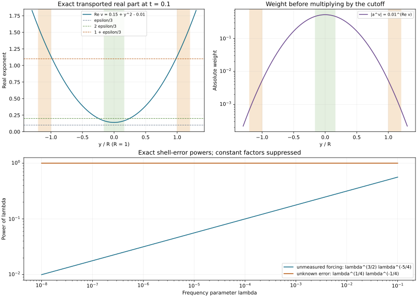

# Localized weights and quasi-concave propagation

A global solution estimate measures the entire forcing. Propagation needs a forcing measurement in a smaller phase-space region. Complex transported weights supply that localization: their real parts are small where regularity is wanted and large where a cutoff changes. We prove the complete localized estimate, then use frequency shells to recover the Sobolev index on every one-dimensional characteristic interval.

The antecedents are Lars Hörmander, *The Analysis of Linear Partial Differential Operators IV*, 2009 edition, Proposition 26.10.4, Lemma 26.10.5 and Theorem 26.10.1 with its compact reformulation, printed pages 149 and 155–160. The [adaptive estimate](../20261012-adaptive-principal-estimate/adaptive-scales-and-principal-type-estimates.html), APE:H0–E2, supplies the global estimate and retained energy. The [uniform barrier proof](../20261011-degenerate-analytic-quotient/boundary-barriers-and-degenerate-analytic-quotients.html), DAQ:B0–B2, supplies the actual complex solutions used below. The proof map pins every earlier result.

The general theorem uses constant comparisons and requires no affine parameter. The corrected semidefinite clock from [SCP](../20261012-semiconcave-propagation/semiconcavity-and-semidefinite-characteristics.html) is retained where its earlier theorem is used. We do not infer global quasi-concavity from local quasi-concavity.

Original exposition, three complete solutions and the reproducible figure are CC0-1.0. Linked components retain their terms. Human foundations remain external, so internal export P514 closure is unclaimed. 

## 1. The localized estimate

**H0. Exact statement and domains.** Let \(P=D_t+iF^w(t,x,D_x)+R^w(t,x,D_x)\) satisfy APE:H0: \(F\) is real, \(F(t,X)F(s,X)\ge0\), all transverse derivatives are jointly continuous, and
\[
 a^2|\partial_X^jF|+|\partial_X^jR|
              \le\delta C_j a^j,\quad X=(x,\xi),\quad j=0,1,\ldots . \tag{LQ1}
\]
Let \(\chi_0,\chi_1\) be time-independent scalar symbols, uniformly bounded in \(S(1,g_0)\), \(g_0=a^2|dX|^2\), with \(\chi_1=1\) on a neighborhood of \(\operatorname{supp}\chi_0\). They may be complex. For every \(\varepsilon>0\), sufficiently small \(a\) and \(\delta T\) give
\[
 a^\varepsilon\|\chi_0^wu\|
 \le CT\left(\|\chi_1^wPu\|+a^3\|Pu\|\right)
                         +a^{1/2}\|u\|. \tag{LQ2}
\]
Norms are in \(L^2_{t,x}\). Initially \(u\) is smooth with spatial Schwartz values and vanishes for \(|t|>T\). Constants depend on finitely many coefficient and cutoff seminorms and on \(\varepsilon\), not on \(a,\delta,T\). This is Proposition 26.10.4 with its original measured forcing and powers. In zero transverse dimension the cutoffs are scalars; APE:H1's scalar estimate immediately gives (LQ2).

**H1. Normalize time, loss and the cutoff collar.** APE:H1 reduces to \(\delta=1\) with the first three bounds on \(F\) normalized; it preserves the factor \(T\) in (LQ2). It suffices to prove \(0<\varepsilon\le1/4\), since the left side decreases when \(\varepsilon\) increases.

The derivative bound on \(\chi_1\) gives a fixed \(\gamma>0\) such that
\[
 |\chi_1(X)|>1/2\quad
       \text{if }\operatorname{dist}(X,\operatorname{supp}\chi_0)
                                               <\gamma/a. \tag{LQ3}
\]
Indeed compare its value \(1\) at an arbitrarily close support point and integrate its gradient on the intervening segment. Replace \(a\) by \(a/\gamma\), changing only the fixed seminorm constants. The adaptive balls used below then lie in this collar whenever their inner support meets \(\operatorname{supp}\chi_0\). At the end we undo this fixed change. The proof will allow any prescribed positive coefficient in front of the last error in (LQ2), so that this change does not alter the displayed coefficient one.

## 2. Exact measurement and the bounded adaptive region

**C0. Two compatible measuring scales.** Apply APE:S0–G2 with
\[
 p=a^{-1/2},\qquad a\le\alpha(X)\le a^{1/2},\qquad
 g_X=\alpha(X)^2|dX|^2,\quad h_g=\alpha^2,\quad
 h_{0,g}=a\alpha\le a^{3/2}. \tag{LQ4}
\]
Here \(h_{0,g}\) is the cross parameter for \(g_0,g\), not \(h_g\). APE:S1 proves all metric and weight conditions; the pair is compatible because \(g_0\le g\), \(g_0^\sigma\ge g^\sigma\), and the mean is comparable with \(g\). WY:W10 and MP:B1 give the complete mixed products, and MP:B7 gives their Hilbert-valued bounds.

Use the squared partition \(\phi_\nu\) of APE:G1, with real outer cutoffs \(\psi_\nu\), \(\psi_\nu=1\) on a larger neighborhood of every inner support. Arrange the inner supports inside \(B_\nu(1/4)\), the plateau inside \(B_\nu(2/5)\), and outer supports inside \(B_\nu(49/100)\), where \(B_\nu(r)=\{X:\alpha_\nu|X-X_\nu|<r\}\). The moving-cover proof permits these fixed strict margins. Put
\[
 F_\nu=\psi_\nu^2F,\quad R_\nu=\psi_\nu^2R,\quad
 P_\nu=D_t+iF_\nu^w+R_\nu^w,\qquad
 \tfrac12\|w\|^2\le\sum_\nu\|\phi_\nu^ww\|^2
                                           \le\tfrac32\|w\|^2. \tag{LQ5}
\]
Classify the centers into the bounded, one-sign and simple-factor cases of APE:S2 and C0–C3. Only balls whose inner support meets \(\operatorname{supp}\chi_0\) need sign or factor estimates; call them active balls.

**C1. A two-term inverse retains \(a^3\).** Let \(b=(b_\nu)_\nu\), or \(b=(b_{\nu j})_{\nu,j}\), be a uniformly bounded column in \(S(1,g;\ell^2)\), supported in active balls. A bounded smooth reciprocal of \(\chi_1\) can be extended from (LQ3) with all \(g_0\) derivative bounds: multiply \(1/\chi_1\) by a fixed smooth cutoff in \(|\chi_1|^2\) which is one on the required collar and zero near zero. Define there
\[
 e=b/\chi_1+\{b,1/\chi_1\}/(2i).
 \qquad e\#\chi_1=b+q,\quad q\in S(a^3,g;\ell^2). \tag{LQ6}
\]
The first corrections cancel since
\(\chi_1\{b,1/\chi_1\}+\{b/\chi_1,\chi_1\}=0\).
The full mixed second remainder has weight
\((a\alpha)^2\le a^3\); the correction's next product has that same weight. The complete coefficient calculus preserves the column order. Therefore
\[
 \sum\|b_\nu^ww\|^2
       \le C\left(\|\chi_1^ww\|^2+a^6\|w\|^2\right). \tag{LQ7}
\]
The assertion applies also to the double index \((\nu,j)\). This is an actual operator measurement, including all off-support remainders.

For the ordinary pair \(\chi_0,\chi_1\), every coefficient of
\(\chi_0\#(\chi_1-1)\) is zero on the support of its first factor. A finite expansion in \(g_0\), of depth two or greater, gives
\[
 \|\chi_0^ww\|\le C\left(\|\chi_1^ww\|+a^4\|w\|\right). \tag{LQ8}
\]
The cutoff collar supplies uniform support margins; no fixed Euclidean gap as \(a\) varies is assumed.

**I0. The bounded centers.** Apply APE:H0 to \(\phi_\nu^w\chi_0^wu\) and \(P_\nu\). Each \(P_\nu\) has the required coefficient bounds at its frozen scale, uniformly. Its complete equation splits as
\[
 P_\nu\phi_\nu^w\chi_0^wu
 = [P_\nu,\phi_\nu^w]\chi_0^wu
 +\phi_\nu^w[P_\nu,\chi_0^w]u
 +\phi_\nu^w\chi_0^w(P_\nu-P)u
 +\phi_\nu^w\chi_0^wPu. \tag{LQ9}
\]
The first column has \(S(1,g)\) symbol and is bounded by \(C\|\chi_0^wu\|\), as in APE:L3. On bounded centers \(\alpha_\nu=a^{1/2}\), so the leading second-column bracket has weight \(a/\alpha_\nu=a^{1/2}\); its full remainder has weight \(\alpha^2\le a\). Its squared action is bounded by \(Ca\|u\|^2\).

In the third column every product coefficient vanishes on the inner support, because \(\psi_\nu=1\) on its neighborhood. Arbitrarily deep finite expansion bounds its full symbol by \(S(a,g;\ell^2)\), or a smaller weight. The last column is bounded by the frame applied to \(\chi_0^wPu\), with complete composition errors already included. Use (LQ8) on that forcing. Writing \(A=\|\chi_0^wu\|\), \(U=\|u\|\), and
\[
 D^2=\|\chi_1^wPu\|^2+a^6\|Pu\|^2, \tag{LQ10}
\]
we obtain
\[
 \sum_{\mathrm I}\|\phi_\nu^w\chi_0^wu\|^2
                      \le CT^2(D^2+aU^2+A^2). \tag{LQ11}
\]
All sums are coefficient-column estimates. Counting scalar operator norms would not give this assertion.

## 3. The one-sign centers

**S0. Keep the symmetric imaginary-part identity.** For a positive-sign center put \(w_\nu=\phi_\nu^wu\). With the inner product linear in its first argument,
\[
 2\operatorname{Im}(Pw_\nu,w_\nu)
  =-\partial_t\|w_\nu\|^2+
                  2(F^ww_\nu,w_\nu)+2\operatorname{Im}(R^ww_\nu,w_\nu).
 \tag{LQ12}
\]
The local nonnegative symbol \(F_\nu\), the positivity proof in APE:L0, and the complete plateau errors give the lower bound
\(-\partial_t\|w_\nu\|^2-C\|w_\nu\|^2\), with a summed additional error at most \(CaU^2\). For the commutator term in
\(\operatorname{Im}(\phi_\nu^wPu,w_\nu)\), self-adjointness of the real cutoff converts the \(iF^w\) part exactly into the double-commutator form
\[
 ([\phi_\nu^w,[\phi_\nu^w,F^w]]u,u).
 \tag{LQ13}
\]
The zeroth terms and first antisymmetric corrections give its full symbol weight
\(\alpha^{-2}h_g^2=\alpha^2\le a\). The \(R\) contribution is
\(2\operatorname{Im}(\phi_\nu^w[\phi_\nu^w,R^w]u,u)\), with the same or a smaller weight. The coefficient product and bound therefore control their summed absolute forms by \(CaU^2\).

Multiply by \(T+t\), integrate, and sum. Temporal endpoint terms vanish and the weight is between zero and \(2T\). Cauchy–Schwarz followed by
\(2xy\le x^2+y^2\), then absorption for small \(T\), gives
\[
 \sum_{\mathrm {II}_+}\|\phi_\nu^wu\|^2
 \le CT^2\sum_{\mathrm {II}_+}\|\phi_\nu^wPu\|^2+CTaU^2.
 \tag{LQ14}
\]
Negative-sign centers use \(T-t\) after reversing time. Equation (LQ7) controls the active forcing column, so the same estimate holds for the union of both signs with \(CT^2D^2\) as its first term.

## 4. Uniform transported barriers on the factorized centers

**W0. A uniform canonical chart with an actual inverse.** On a factorized ball APE:C1–C3 gives \(F=GH\), \(H\ge0\), and all derivative bounds. Use
\(X=X_\nu+Z/\alpha_\nu\). The normalized function
\(\mathcal G=\alpha_\nu^2G(X_\nu+Z/\alpha_\nu)\) has bounded derivatives and gradient bounded below on the inner ball. At a selected point \(Y\), an orthogonal symplectic linear change makes \(\partial_{\eta_1}\mathcal G\ge c>0\). Identify the standard phase space with \(\mathbb C^d\), normalize the nonzero gradient, and complete that unit vector to a complex orthonormal basis by finite Gram–Schmidt. The corresponding real matrix is orthogonal and commutes with the standard complex structure, hence preserves the symplectic form. Arrange that gradient in the \(\eta_1\) direction. The matrix and its inverse have norm one.

On the section \(y_1=0\), solve \(\mathcal G=\theta\) for \(\eta_1\). The quantitative inverse proof and its differentiated equation give one common domain and all uniform derivatives. Flow this section by \(H_{\mathcal G}\), using flow time \(r\). The finite-coordinate flow proof G2:NF1–NF7 gives uniform domains, derivatives and inverse flows; after shrinking, \(\partial_r y_1\ge c/2\). The inverse finds the unique hit on \(y_1=0\), then uses the section coordinates. Its differentiated hitting equation supplies every uniform inverse derivative.

This chart is exactly canonical:
\[
 \Phi^*\omega=d\theta\wedge dr+\sum_{j>1}d\eta_j\wedge dy_j.
 \tag{LQ15}
\]
At \(r=0\) the restricted form is the spectator sum, since \(dy_1=0\). Contraction with \(\partial_r\) is \(-d\theta\), because
\(\iota_{H_{\mathcal G}}\omega=-d\mathcal G\); invariance under its Hamilton flow gives (LQ15) everywhere. Thus \(\mathcal G=\theta\) is retained exactly. Its marked value need not be zero; a constant momentum translation centers that value and leaves the Hamilton field unchanged. All domain and derivative constants depend only on the bounded family and the gradient lower bound.

**W1. Actual complex solutions and a fixed finite cover.** Conformal scaling of the symplectic form gives
\[
 \partial_tv-iH_\nu\{v,G_\nu\}=0
 \quad\longleftrightarrow\quad
 \partial_t\widetilde v+i\widetilde H_\nu\partial_r\widetilde v=0.
 \tag{LQ16}
\]
No unitary operator conjugation is used here; these are coordinate equations for symbols. The transformed coefficients are a bounded nonnegative continuous-time family. DAQ:B0–B2 supplies one common time window and a solution \(U\) with positive real part everywhere, real part below \(\varepsilon/3\) on an inner neighborhood, and real part above one outside a larger inner neighborhood. Every spatial derivative and its first time derivative has a uniform bound.

Choose a real cutoff \(\varphi=1\) on the latter neighborhood and supported inside the solution domain, and a larger real cutoff \(\eta=1\) near its support. Set \(v=\eta(U+\varepsilon/3)\), and pull both functions back through the chart. The equation holds near \(\operatorname{supp}\varphi\). Each inner neighborhood contains a normalized ball of one fixed positive radius. A finite grid covers \(B_\nu(1/4)\) by these balls; its cardinality is bounded by one integer \(J\), independent of \(\nu,a\). The usual normalized bump partition, with denominator bounded below by one, gives \(\widetilde\varphi_{\nu j}\) there. Padding with zero cutoffs makes \(J\) the same for every center. We have
\[
 \begin{gathered}
 \varphi_{\nu j}=1\text{ on }\operatorname{supp}\widetilde\varphi_{\nu j},
 \qquad \sum_j\widetilde\varphi_{\nu j}=1
                   \text{ near }\operatorname{supp}\phi_\nu,\\
 \operatorname{Re}v_{\nu j}>\varepsilon/3\text{ on }\operatorname{supp}\varphi_{\nu j},
 \quad \operatorname{Re}v_{\nu j}<2\varepsilon/3
                     \text{ on }\operatorname{supp}\widetilde\varphi_{\nu j},\\
 \operatorname{Re}v_{\nu j}>1+\varepsilon/3
                       \text{ on }\operatorname{supp}d\varphi_{\nu j}.
 \end{gathered} \tag{LQ17}
\]
All cutoffs and exponents have uniform \(S(1,g)\) bounds. The compact supports lie strictly inside the local factorization plateau. This proves the full uniform transported-weight assertion of Lemma 26.10.5.

**W2. Define complex powers and retain the time domain.** Set
\[
 m_{\nu j}=\varphi_{\nu j}a^{v_{\nu j}},
 \qquad a^v=\exp(v\log a),\quad 0<a<1. \tag{LQ18}
\]
Every differentiated term contains a power of \(|\log a|\), controlled by the positive lower bound for \(\operatorname{Re}v\):
\(\sup_{0<a<1}a^c|\log a|^k<\infty\) for \(c>0\). Put \(z=-\log a\); the maximum of \(e^{-cz}z^k\) occurs at \(z=k/c\), including the trivial \(k=0\) case. Thus the entire column \(m\) is uniformly in \(S(1,g;\ell^2)\), also with its first time derivative.

The vectors \(m_{\nu j}^wu\) are \(C^1\) in time and retain the original time support. APE's estimate and derivative energy extend to this domain: mollify the zero-extended vector in time, use the slightly enlarged window \(T'\), and let the mollifier width decrease and \(T'\downarrow T\). Uniform bounds and continuity of the coefficients give convergence of the vector and its operator image in \(L^2\); spatial Schwartz approximation supplies the same conclusion if needed. The smallness inequalities are chosen strict before this limit. No time derivative of \(F,H,R\) is presumed.

## 5. The weighted commutator and reconstruction

**M0. Cancel the complete leading transport term.** Since quantization here is transverse, the time commutator is exact:
\[
 [m^w,D_t]=i(\partial_tm)^w.
 \tag{LQ19}
\]
The leading symbol of \([m^w,P_\nu]\) is
\[
 i\,m_t+\{m,F_\nu\}
   =\{\varphi,F_\nu\}a^v
                 +(\log a)G_\nu\{v,H_\nu\}m. \tag{LQ20}
\]
Indeed \(v_t=iH_\nu\{v,G_\nu\}\), so the \(H_\nu\{v,G_\nu\}\) terms cancel. This sign uses \(D_t=-i\partial_t\). The first term is supported where \(d\varphi\ne0\). Its ordinary weight is one, while (LQ17) supplies \(a^{1+\varepsilon/3}\); all logarithmic derivatives can be absorbed, so it is in \(S(a,g)\). The full Weyl remainder after the bracket has weight \(\alpha^2\le a\). The lower-order \(R_\nu\) commutator has the same or a smaller weight. Also \(m^w(P-P_\nu)\) has all expansion coefficients zero and an arbitrarily small finite-depth remainder.

**M1. Use the derivative energy, including its product errors.** Expand the remaining bracket into
\[
 (\log a)\sum_k
 \left((\partial_{\xi_k}v)^w(G_\nu\partial_{x_k}H_\nu)^w
       -(\partial_{x_k}v)^w(G_\nu\partial_{\xi_k}H_\nu)^w\right)m^w.
 \tag{LQ21}
\]
Its difference from (LQ20) is a full \(S(a,g;\ell^2)\) operator error. To check the logarithms, the uncorrected product weights are \(\alpha,\alpha^{-1},1\); one product remainder gains \(\alpha^2\). Retain the factor \(a^{\varepsilon/3}\) from \(m\) in these remainders before estimating its derivatives. Then
\(\alpha^2a^{\varepsilon/3}|\log a|^k\le C_{\varepsilon,k}a\), including every differentiated coefficient.

APE:E2 bounds the differentiated-factor measurement by
\(C\sqrt T\|P_\nu m^wu\|\). It still holds with \(R_\nu\): the latter is bounded, and APE:H0 gives
\(\|m^wu\|\le16T\|P_\nu m^wu\|\), so the error is absorbed in its constant. The first factors in (LQ21) have norm at most \(C\alpha_\nu\le C\sqrt a\). Summing as one coefficient column gives, with \(Z=\|(P_\nu m_{\nu j}^wu)_{\nu,j}\|\),
\[
 Z\le\|(m_{\nu j}^wPu)_{\nu,j}\|
             +C\sqrt{aT}|\log a|Z+CaU. \tag{LQ22}
\]
For small \(a,T\), absorb the middle term. Apply the global estimate to each weighted vector and then (LQ7) to the forcing column. We obtain
\[
 \sum_{\mathrm {III},j}\|m_{\nu j}^wu\|^2
                         \le CT^2(D^2+a^2U^2). \tag{LQ23}
\]
The fixed finite \(J\), bounded overlap and complete column calculus make the constants independent of the number of centers.

**M2. Recover the desired small power.** Put
\[
 r_{\nu j}=\phi_\nu\widetilde\varphi_{\nu j}a^{\varepsilon-v_{\nu j}}.
 \qquad
 \sum_jr_{\nu j}m_{\nu j}=a^\varepsilon\phi_\nu. \tag{LQ24}
\]
On its support the real exponent is greater than \(\varepsilon/3\), so \(r\) and every derivative are uniformly bounded. The full first product remainder has weight \(\alpha^2\le a\). The row-to-column coefficient bound therefore proves
\[
 \sum_{\mathrm {III}}\|a^\varepsilon\phi_\nu^wu\|^2
             \le C\sum_{\mathrm {III},j}\|m_{\nu j}^wu\|^2+Ca^2U^2.
 \tag{LQ25}
\]

**D0. Combine the three cases and finish (LQ2).** For the active sign and factor columns commute the ordinary cutoff past the adaptive cutoff:
\[
 \phi_\nu^w\chi_0^w=\chi_0^w\phi_\nu^w+K_\nu^w,
                         \quad K\in S(a^{3/2},g;\ell^2). \tag{LQ26}
\]
This is the full mixed commutator, with cross parameter \(a\alpha\). Nonactive products have every coefficient zero and arbitrarily small finite-depth errors. The operator \(\chi_0^w\) is uniformly bounded. Use the frame in (LQ5), (LQ11), the sign estimate, and (LQ23)–(LQ26). The result has the form
\[
 a^{2\varepsilon}A^2
 \le CT^2(D^2+a^{2\varepsilon}A^2)
            +C(T+T^2)aU^2+C(a^2+a^3)U^2. \tag{LQ27}
\]
Choose \(T\) first to absorb the displayed \(A^2\) term and to make the coefficient of \(aU^2\) as small as desired. Then choose \(a\) to do the same for the higher powers. Taking square roots gives
\(a^\varepsilon A\le CTD+\zeta a^{1/2}U\), for any prescribed \(\zeta>0\).
This freedom undoes the fixed collar rescaling in H1 with coefficient one. Since \(D\le\|\chi_1^wPu\|+a^3\|Pu\|\), undoing the time normalization proves (LQ2) in its full quantifiers.

## 6. A constant comparison on a cubic-flat arc

**T0. Reduce the full operator and state the temporary index.** Consider a compact one-dimensional characteristic arc with embedded nonradial cosphere projection. The whole homogeneous tube PSG:N0–N2 and exact graph/order reduction GE:D7–D11 give principal symbol
\[
 p=\tau+if(t,x,\xi),\quad f\text{ real, degree one, independent of }\tau,
 \quad\Gamma=\{(t,0;0,e)\},\quad e\ne0. \tag{LQ28}
\]
Unknown indices are preserved and forcing indices acquire the exact shift \(m-1\). Normalize to order one. We prove the compact comparison
\[
 s_{Pu}^*\ge\sigma\text{ on }\Gamma,\quad
 s_u^*\ge\sigma\text{ at its ends}
                   \quad\Longrightarrow\quad s_u^*\ge\sigma\text{ on }\Gamma.
 \tag{LQ29}
\]
First assume \(s_u^*\ge\sigma-1/4\) on the arc and \(f\) has zero transverse two-jet there.

PSN:R1 removes temporal momentum from every lower term with a full elliptic multiplier and actual symbol summation. RLP:G1's gauge makes an order-zero representative \(r_0\) vanish on the entire marked ray at every large frequency, with all uniform symbol derivatives. Conversion from left to Weyl quantization does not change this zero: its order-zero correction from \(f\) is a constant multiple of \(f_{x\xi}\), which vanishes by the zero two-jet. All other conversion errors have order minus one. A remainder of order minus one sends the temporary unknown to index at least \(\sigma+3/4\), so discarding it preserves the forcing hypothesis. Thus we can use
\(P=D_t+if^w+r_0^w\) on a smaller working cone, with \(r_0=0\) on the central ray. The gauge and its inverse preserve every real Sobolev index.

**T1. Choose width, then frequency.** APE:D0 gives cutoff coefficients \(F_{\delta,\lambda},R_{\delta,\lambda}\) with the precise Taylor budgets, and the unitary symplectic dilation has
\[
 a^2=\lambda/\delta^2.
 \qquad
 P_{\delta,\lambda}=D_t+iF_{\delta,\lambda}^w+R_{\delta,\lambda}^w.
 \tag{LQ30}
\]
Choose real inner transverse cutoffs \(\chi_{0,\delta,\lambda}\), \(\chi_{1,\delta,\lambda}\) with a plateau and \(\chi_0(0,e)=1\), and a still larger coefficient plateau. The localized estimate reads
\[
 (\lambda/\delta^2)^{\varepsilon/2}\|\chi_0^wv\|
 \le C_\delta\left(\|\chi_1^wP_{\delta,\lambda}v\|
       +(\lambda/\delta^2)^{3/2}\|P_{\delta,\lambda}v\|
       +(\lambda/\delta^2)^{1/4}\|v\|\right). \tag{LQ31}
\]
The fixed time length is absorbed in \(C_\delta\). Choose \(\delta\) small before choosing \(\lambda\) small at that width. No threshold uniform over every shrinking tube is claimed.

**T2. An actual time-compact shell test.** Fix \(0<\varepsilon<1/4\). The endpoint bounds and lower semicontinuity give regular endpoint collars at every exponent below \(\sigma\). Choose an interior compact interval \(I_0\) so that these collars contain \(\Gamma\setminus I_0\). Let \(\chi(t,x;\tau,\xi)\) be compactly supported in the working annulus and in the open original time interval, equal to one near \(I_0\) and the marked covector. Arrange transverse plateaus larger than the \(\chi_1\) tube. Put, in full left quantization,
\[
 q_\lambda(t,x;\tau,\xi)=
   \chi(t,x;\lambda\tau,\lambda\xi)\lambda^{-\sigma+\varepsilon},
 \qquad v_\lambda=q_\lambda(t,x,D_t,D_x)u. \tag{LQ32}
\]
A compact base localization makes \(u\in\mathcal E'\), retaining the equation microlocally; proper-kernel errors are smooth on the smaller tube. Each \(v_\lambda\) is smooth, spatially compact and supported in the required time interval. LPE:H1 and V0–V2, with the strict margin supplied by \(\varepsilon\), give
\[
 \|v_\lambda\|\le C\lambda^{-1/4},\qquad
 \|P_{\delta,\lambda}v_\lambda\|\le C_\delta\lambda^{-5/4}. \tag{LQ33}
\]
For the second estimate, \(\lambda D_tv_\lambda\) is the sum of the shell tests with amplitudes \((\lambda\tau)\chi\) and \(\lambda D_t\chi\). The scaled spatial coefficient operator is uniformly bounded after multiplication by \(\lambda\). This proves the second bound without a global estimate for the unknown outside its working microlocal neighborhood.

**T3. The measured forcing and every spacetime bracket term.** Full finite composition gives
\[
 \chi_1^wP_{\delta,\lambda}q_\lambda^L
   -\chi_1^wq_\lambda^LP
  =\lambda^{-\sigma+\varepsilon}
                 \operatorname{Op}^L(\widetilde\chi(t,x;\lambda\tau,\lambda\xi))
                  +E_{\delta,\lambda}, \tag{LQ34}
\]
where \(E_{\delta,\lambda}\) has uniform effective order
\(\sigma-\varepsilon-1\) on the shell, and the leading amplitude is the measured full spacetime bracket divided by \(i\). In the convention \(\{p,\chi\}=H_p\chi\),
\[
 \{p,\chi\}=\partial_t\chi-if_t\partial_\tau\chi
        +i\sum_k(f_{\xi_k}\partial_{x_k}\chi
                             -f_{x_k}\partial_{\xi_k}\chi). \tag{LQ35}
\]
The temporal-frequency term is retained. On the measured transverse plateau, cutoff derivatives near \(\tau=0\) occur only in the endpoint collars. The remaining derivative support stays away from \(\tau=0\), where the principal symbol is elliptic because its real part is \(\tau\). The forcing index exceeds \(\sigma-\varepsilon\) on a common small neighborhood of the original arc; elliptic regularity there gives the stronger unknown index on this latter support. Thus the first term of (LQ34), and \(q_\lambda^LPu\), are uniformly in \(L^2\), by the exact shell criterion.

For precision about the auxiliary operator, a tangential symbol does not have uniform ordinary full-frequency bounds on the temporal covector axis. Split the \(D_t\) terms exactly. For the remaining products use the full normalized shell, where \(\lambda\xi\) stays away from zero, and the constant-parameter tangential calculus of LPE:C0 and P2:OP3–OP4. At fixed \(\delta\) every normalized coefficient derivative has its stated bound. On the coefficient plateau the auxiliary and original symbols coincide; elsewhere the measured separated products have all coefficients zero. Expand to depth larger than the actual compact input's negative Sobolev order and the requested output order. The complete differentiated off-diagonal remainder bounds every tail by the needed power of \(\lambda\). The effective order \(\sigma-\varepsilon-1\) is below the temporary input index \(\sigma-1/4\), with a strict margin, so its action is uniformly bounded as well. This verifies
\[
 \|\chi_1^wP_{\delta,\lambda}v_\lambda\|\le C_{\delta,\varepsilon}. \tag{LQ36}
\]
No derivative of this measured forcing has been assumed.

**T4. Pass to the index and bootstrap.** Insert (LQ33), (LQ36) in (LQ31). The unmeasured forcing term is \(O_\delta(\lambda^{1/4})\); the unknown error is bounded. Therefore
\[
 \lambda^{\varepsilon/2}\|\chi_0^wv_\lambda\|\le C_{\delta,\varepsilon}.
 \tag{LQ37}
\]
The full mixed Weyl/left product differs from its leading shell amplitude
\(\chi_0q_\lambda\) by effective order \(\sigma-\varepsilon-1\), harmless under the same temporary input and finite-depth localization. LPE:H1's converse gives
\[
 s_u^*\ge\sigma-3\varepsilon/2\text{ on }I_0.
 \qquad \varepsilon\downarrow0\ \Longrightarrow\ s_u^*\ge\sigma.
 \tag{LQ38}
\]
This is an index conclusion, not membership at the endpoint exponent.

A compact distribution has a finite \(H^{-M}\) bound, KS:S1. Choose \(N\) with
\(\sigma-N/4\le-M\), and apply the preceding implication successively at target levels \(\sigma-(N-1)/4,\ldots,\sigma\). The forcing and endpoint hypotheses persist at every lower target. This finite quarter bootstrap proves (LQ29) on every cubic-flat arc.

## 7. Cover the other characteristic arcs

**G0. Radial curves and the complete strata.** ODP:G0 proves that the regular characteristic set is exhausted by the rank-two saturation \(S\), escaping rank-one set \(N_{11}\), nonzero-quadratic extension \(N_{12}^e\), and residual set \(N_{13}\), with full rank-one curves belonging to one piece. A radial point makes the whole curve a ray by homogeneous flow uniqueness, ODD:G0. Both indices are constant there, so (LQ29) is immediate.

On a rank-one arc in \(S\), CPG:T1 supplies \(f=gh\), \(g=h=0\) on the arc and \(h\ge0\). Every first derivative of \(h\) is zero at these points, by its nonnegative minimum. Hence every second derivative of \(gh\) is zero. On \(N_{13}\) the same zero two-jet is ODP:G1. Thus T0–T4 covers both pieces on every arc with embedded cosphere projection.

**G1. Escaping arcs.** CPG:C0 and M2 give a one-sign homogeneous neighborhood of a compact part of the maximal characteristic zero component in \(N_{11}\). Apply ODP:B0 in the favorable orientation, starting from the appropriate regular endpoint. For any exponent below \(\sigma\), the source and incoming endpoint have a strict compact margin; forward propagation gives that exponent everywhere. Increasing the exponent to \(\sigma\) proves (LQ29). The two endpoint hypotheses supply an incoming value in either sign orientation.

**G2. Localize an arc in the nonzero-quadratic extension.** Choose an ordinary order-zero cutoff \(\Phi\) equal to one on a conic neighborhood of an interior subarc, supported in a small tube with temporal support inside the original interval. Its temporal transition lies in the regular endpoint collars. Transverse and angular transitions avoid the smaller central cone. Proper calculus gives
\[
 P\Phi u=\Phi Pu+[P,\Phi]u. \tag{LQ39}
\]
On the identity neighborhood the complete commutator is smoothing, since every differentiated cutoff coefficient is zero. At its temporal transition it has order zero and acts on the known endpoint regularity. Along the central curve outside its support the localized unknown is smooth. For any small \(\eta>0\), it follows that \(P\Phi u\) has index at least \(\sigma-\eta\) wherever needed, and \(\Phi u\) is smooth off the retained arc.

Retain an embedded extension of its projected arc which includes one nonzero-\(Q\) point of the same curve. If the maximal projected orbit is a circle, take this point in the complementary arc when necessary and extend without a full turn. Otherwise the projected orbit is injective. The regular homogeneous tube gives a common model \(p=\tau+if(t,Y)\) over this extension, with \(f(t,Y)\) of one weak sign for each fixed \(Y\).

**G3. Add endpoints without requiring new source data.** Choose a smooth function \(y(t)\), equal to \(t\) near the operator wavefront of \(\Phi\), whose values stay in the common model interval and which takes the nonzero-\(Q\) marked time at both ends of a larger artificial interval. Such a function is a finite smooth interpolation on the two disjoint outer intervals. It need not be monotone. Define the new principal symbol there by
\[
 \widehat p=\tau+if(y(t),Y). \tag{LQ40}
\]
The fixed-\(Y\) sign property persists under any such time map, so PSG:E1 proves condition (P). A fixed nonnegative transverse cutoff extends the construction beyond the smaller tube while preserving that property. Retain the complete original operator near the wavefront of \(\Phi u\); extend its lower-order symbols with proper representatives elsewhere. To make a genuine full-variable classical symbol, multiply the tangential terms by a degree-zero angular cutoff equal to one on the whole working conic tube and supported where transverse momentum is comparable to full momentum, then smooth the low frequencies. Every full-variable derivative has the required bound. Condition (P) is needed on the working tube, where that cutoff is one; all uses of the earlier propagation theorems are microlocal there. The difference acts smoothly on \(\Phi u\), by the complete separated-kernel proof. Thus the forcing index \(\sigma-\eta\) remains valid, while the artificial endpoints have infinite unknown index and the same nonzero quadratic form.

If that form is indefinite, ODD's full affine-concavity theorem applies. Otherwise SCP's full corrected-clock semi-concavity theorem applies. In both cases use the constant comparison \(\sigma-\eta\). Its endpoint comparison forces the infimum unknown index on every quotient fiber to be at least \(\sigma-\eta\), and hence the same holds pointwise. Undo \(\Phi\) on the interior subarc and let \(\eta\downarrow0\). Endpoint collars complete (LQ29). This argument adds no forcing hypothesis beyond the original arc and uses no semidefinite affine-uniqueness claim.

**G4. Repeated cosphere points do not reduce the theorem's scope.** A nonradial projected characteristic is regular. Homogeneity and local real Hamilton-flow uniqueness give unique projected curve germs. As in ODD:G1, a return with opposite tangent would continue a reversed-germ identity to a midpoint with tangent equal to its negative, impossible. A first same-tangent return gives an embedded projected circle: compactness and local regularity give a positive local injectivity time, and the closed return set gives the first return.

If the original compact interval has no return, its projection is embedded and the preceding arguments apply. If it has a return, it covers this entire projected circle. The indices are conic, so the source threshold \(\sigma\) is known on the entire circle. The regular endpoint provides a nonempty open arc where the unknown exceeds \(\sigma-\eta\). Cut the circle inside that good arc. Its complementary closed arc has injective projection and both endpoints in the good arc. Apply the already proved compact comparison with target \(\sigma-\eta\) there; the known good arc covers the rest. Let \(\eta\downarrow0\).

Representatives along the original orbit or its homogeneous continuation have exactly the same conic indices, so this cutting argument changes no regularity data. It proves (LQ29) also for repeated cosphere points and repeated phase points. It does not rely on a local-to-global assertion about quasi-concavity.

## 8. The full quasi-concavity theorem

**Q0. Recover every constant comparison.** Undo the order-one reduction in T0. For a proper scalar classical operator \(P\) of real order \(m\), satisfying (P), and any regular one-dimensional characteristic interval \(I\), the compact theorem is
\[
 s_{Pu}^*\ge s\text{ on }J,\quad s_u^*\ge s+m-1\text{ at }\partial J
 \quad\Longrightarrow\quad s_u^*\ge s+m-1\text{ on }J
 \tag{LQ41}
\]
for every compact subinterval \(J\subset I\) and finite real \(s\).

Let now \(s(t)\) be a lower semicontinuous quasi-concave function with
\(s_{Pu}^*(t)\ge s(t)\). Suppose the endpoint values of
\(\min(s_u^*,s+m-1)\) are at least a finite constant \(c\) on a compact test interval. Quasi-concavity gives \(s(t)\ge c-m+1\) throughout it. Apply (LQ41) with that constant to get \(s_u^*\ge c\). The other term of the minimum is also at least \(c\), so
\[
 s_{Pu}^*\ge s,\ s\text{ quasi-concave}
 \quad\Longrightarrow\quad
                  \min(s_u^*,s+m-1)\text{ quasi-concave}. \tag{LQ42}
\]
Lower semicontinuity follows from the exact microlocal-index and finite-minimum proofs. Arbitrarily large finite tests include infinite endpoint values; no subtraction of infinities occurs. The argument applies on closed, open or half-open intervals through their compact test subintervals. This proves both equivalent versions of Theorem 26.10.1 with all endpoint strata, real orders, radial curves and repeated projections.

## 9. Three complete calculations

### Exercise 1. An exact complex barrier in a constant model

**X1. Inspect its real part.** For \(\partial_t+i\partial_y\), set
\[
 v(t,y)=\varepsilon/2+(y-it)^2/R^2,\qquad
 \operatorname{Re}v=\varepsilon/2+(y^2-t^2)/R^2. \tag{LQ43}
\]
Verify the transport equation and the three real-part margins.

**Solution.** Differentiation gives \(v_t=-2i(y-it)/R^2\), \(v_y=2(y-it)/R^2\), so \(v_t+iv_y=0\). If \(t^2/R^2<\varepsilon/6\), then \(\operatorname{Re}v>\varepsilon/3\) everywhere. When \(y^2/R^2<\varepsilon/12\), it is below \(7\varepsilon/12<2\varepsilon/3\). On a cutoff derivative region with \(y^2/R^2>1\), it exceeds \(1+\varepsilon/3\). Adding the squared inactive coordinates divided by \(R^2\) preserves the equation and supplies the corresponding radial outer margin. This explicit example illustrates the actual general barrier construction W0–W1.

### Exercise 2. Why the first inverse correction matters

**X2. Cancel the two first brackets.** Let \(c\ne0\), and \(b\) be a scalar symbol supported where \(c\) is bounded away from zero. Show that
\(e=b/c+\{b,1/c\}/(2i)\) removes the first error in \(e\#c\).

**Solution.** The leading product is \(b\). Its first two correction terms are
\[
 \frac1{2i}\left(c\{b,1/c\}+\{b/c,c\}\right)
 =\frac1{2i}\left(-\{b,c\}/c+\{b,c\}/c\right)=0. \tag{LQ44}
\]
With the ordinary scale \(a\) and adaptive scale \(\alpha\le\sqrt a\), the full next remainder has weight
\((a\alpha)^2\le a^3\). The inverse without this correction would leave only the first-error weight \(a\alpha\le a^{3/2}\). Thus the \(a^3\) forcing remainder in (LQ2) is an actual second-remainder gain, not a formal replacement of measured data.

### Exercise 3. Check the quarter bootstrap on a frequency shell

**X3. Track every power.** Assume the temporary index is \(\sigma-1/4\) and use (LQ32). Determine all error powers and the final index.

**Solution.** The strict \(\varepsilon\) margin gives
\(\|v_\lambda\|=O(\lambda^{-1/4})\) and
\(\|P_{\delta,\lambda}v_\lambda\|=O_\delta(\lambda^{-5/4})\).
At fixed \(\delta\), the unmeasured forcing term has power
\(\lambda^{3/2}\lambda^{-5/4}=\lambda^{1/4}\), while the unknown error has power
\(\lambda^{1/4}\lambda^{-1/4}=1\). The measured forcing is bounded. The left power is \(\lambda^{\varepsilon/2}\), so its leading shell test has exponent
\(\sigma-\varepsilon-\varepsilon/2=\sigma-3\varepsilon/2\).
The converse criterion gives that index. Letting \(\varepsilon\) decrease proves the full target index \(\sigma\); it does not prove endpoint membership. Each quarter step preserves the forcing threshold, so finitely many such steps begin at any finite negative Sobolev bound.

## 10. Read the transported-weight figure

**F0. An exact model and its shell powers.** The figure shows the real part of (LQ43) for stated exact parameter values, together with \(|a^v|=a^{\operatorname{Re}v}\). It marks the inner and outgoing regions and the three proved margins. A separate panel displays the two shell-error powers from X3. These are samples of explicit formulas. The arbitrary-coefficient equation, uniform charts, finite covering and all operator remainders are proved above.

The [generator](figures/build_figure.py), [finite checks](model-check.json), source credit, [proof review](proof-review.json) and [reader checks](reader-check.json) accompany the complete argument. [Escape regularity and semi-global solutions](../20261015-escape-regularity-and-solvability/escape-arcs-regularity-and-semiglobal-solutions.html) uses this constant-comparison theorem. [The trapping criterion](../20261015-trapped-characteristics-and-principal-type/trapped-characteristics-and-the-escape-criterion.html) gives the equivalent global geometry with its explicit stationary-point convention.
