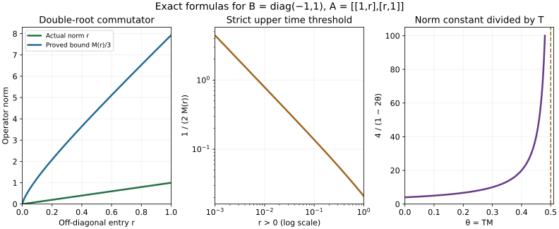
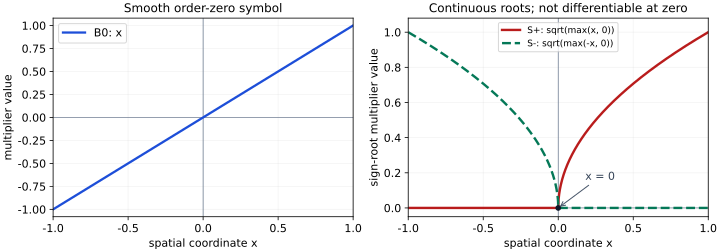

# Nirenberg–Treves estimates and square-root commutators

An evolution with a nonnegative operator multiplying a fixed self-adjoint operator need not itself be positive. The obstruction is their failure to commute. We bound that obstruction through two ordinary commutators, then obtain both a small-time solution estimate and a positive energy estimate. Every operator acts on an arbitrary complex Hilbert space; no finite-dimensional reduction or spectral gap is assumed.

The antecedents are Hörmander IV, Theorem 26.8.1, Lemma 26.8.2 and Theorem 26.8.3, printed pages 134–137 of the 2009 edition. The lesson gives independent proofs, including the continuous functional calculus and sign decomposition needed for these results. An absolutely norm-convergent resolvent formula supplies the square-root bound directly. There is no omitted appeal to a spectral measure or contour integral.

Original expression, exercises and figure are CC0-1.0. The proof map connects the Hilbert, integration and elementary prerequisites to exact earlier proofs. Linked human foundations remain external. 

## 1. The full statements and the operator conventions

**H0. Hypotheses and both estimates.** Let \(H\) be a complex Hilbert space, with inner product linear in the first variable. Let \(B\) be a bounded self-adjoint operator. For \(|t|\le T\), let \(A(t)\) be bounded, self-adjoint and nonnegative, continuous in operator norm. Assume

\[
 10\|A(t)\|^{1/4}\|[B,A(t)]\|^{1/2}
             \|[B,[B,A(t)]]\|^{1/4}\le M.
 \tag{NT1}
\]

For \(u\in C^1(\mathbb R;H)\) vanishing outside \([-T,T]\), put

\[
 f=u'-A(t)Bu.
 \tag{NT2}
\]

All integrals below are over this time interval, or equivalently over the whole line with the integrands extended by zero. If \(TM<1/2\), we prove

\[
 \int\|u\|^2\le
 \left(\frac{4T}{1-2TM}\right)^2\int\|f\|^2.
 \tag{NT3}
\]

Without any small-time condition we also prove

\[
 \int\langle Bu,A(t)Bu\rangle
 \le T\|B\|\int\bigl(18\|f\|^2+2M^2\|u\|^2\bigr).
 \tag{NT4}
\]

The quadratic integrand is real and nonnegative. No derivative of \(A(t)\) occurs. Norm continuity on the compact interval gives all needed bounds and integrability. The case \(T=0\) is trivial, so take \(T>0\).

**H1. Hilbert and norm-integration facts used below.** CT:T1 proves bounded adjoints, \(\|C^*C\|=\|C\|^2\), representation of bounded linear functionals and the basic Hilbert norm identities. The space \(\mathcal L(H)\) of bounded operators is complete: a norm-Cauchy sequence has a limit on each vector by completeness of \(H\); the uniform bound gives a bounded linear limit and the Cauchy norm bound gives convergence to it in operator norm. CE:H4–H5 give norm integrals and their compatibility with bounded linear maps. Alternatively every continuous operator-valued integrand on a compact interval has uniformly convergent Riemann sums, by uniform continuity; an integrable norm bound makes the improper tails Cauchy. These constructions agree by the simple-function approximation in that provider.

For later projections, a closed subspace \(K\) has an orthogonal projection. Minimize \(\|v-k\|\) over \(k\in K\); the parallelogram identity makes a minimizing sequence Cauchy, and closedness supplies its limit. Vary the minimizer by real and imaginary multiples of every vector in \(K\) to obtain orthogonality. This gives \(H=K\oplus K^\perp\), with a self-adjoint norm-one projection unless \(K=0\). All these arguments work without a separability assumption.

## 2. Construct the functional calculus and the sign projections

**F0. Positive square roots from a norm-convergent series.** For a positive operator \(C\), its quadratic form satisfies Cauchy–Schwarz. Indeed positivity of \(\langle C(v+zw),v+zw\rangle\) for every complex scalar \(z\) gives

\[
 |\langle Cv,w\rangle|^2
 \le\langle Cv,v\rangle\langle Cw,w\rangle.
 \tag{NT5}
\]

If \(0\le C\le I\), this and the dual norm formula imply \(\|C\|\le1\). Conversely \(C\ge0\) and \(\|C\|\le1\) give \(C\le I\). Every power of a positive contraction is positive: for even powers this is a squared norm, and for odd powers it is the form of \(C\) evaluated on a power of \(C\). Its norm is at most one.

There are positive coefficients \(c_n\) with

\[
 c_1=\tfrac12,\quad c_n=\frac{2n-3}{2n}c_{n-1}\ (n\ge2),
 \qquad 1-\sqrt{1-z}=\sum_{n\ge1}c_nz^n,
 \qquad \sum_{n\ge1}c_n=1.
 \tag{NT6}
\]

For completeness the recurrence gives a power series converging on \(|z|<1\). If \(G=1-\sum c_nz^n\), termwise differentiation gives \(2(1-z)G'=-G\). Thus \(G^2/(1-z)\) has derivative zero and equals one at zero. On \(0\le z<1\), continuity and the nonzero square show \(G=\sqrt{1-z}\). Positivity of the coefficients and monotone limits as \(z\uparrow1\) now give their sum one: each finite partial sum is at most one, while their supremum is at least every value \(1-\sqrt{1-z}\).

For \(0\le C\le I\), set \(S=I-\sum c_n(I-C)^n\). Absolute norm convergence follows from (NT6). Each partial sum subtracted from \(I\) is positive because the sum of its coefficients is at most one, so \(S\ge0\). Absolute convergence permits multiplication of the two series; the coefficient identity just proved gives \(S^2=C\). Scaling handles every bounded positive operator, including zero. This root commutes with every operator commuting with \(C\). In particular, if two positive operators \(C,D\) commute, then \(CD=SDS\ge0\). We will use this positivity fact to construct the calculus without a spectral theorem.

**F1. Polynomial positivity and uniform approximation.** First take \(0\le C\le I\). For a real polynomial \(p(x)=\sum_{j=0}^d a_jx^j\), its Bernstein representation of degree \(n\ge d\) is

\[
 p(x)=\sum_{k=0}^n b_{k,n}{n\choose k}x^k(1-x)^{n-k},
 \qquad b_{k,n}=\sum_{j=0}^d a_j\frac{(k)_j}{(n)_j}.
 \tag{NT7}
\]

Here \((k)_j=k(k-1)\cdots(k-j+1)\), and the zeroth ratio is one. To prove the identity for the monomial \(x^j\), cancel factorials in \((k)_j{n\choose k}=(n)_j{n-j\choose k-j}\), then use the binomial theorem; linearity proves (NT7). For each fixed \(j\), the ratio \((k)_j/(n)_j\) differs uniformly in \(0\le k\le n\) from \((k/n)^j\) by \(O_j(1/n)\). For \(k\ge j\) expand the products and use the denominator bounded below by \(n^j/2\) for large \(n\); for \(k<j\) both the zero ratio and \((k/n)^j\) have the stated difference. Hence \(b_{k,n}=p(k/n)+O_p(1/n)\).

If \(p>0\) on \([0,1]\), all these coefficients are positive for large \(n\). Each operator \(C^k(I-C)^{n-k}\) is positive by F0, so \(p(C)\ge0\). If \(p\ge0\), apply this to \(p+\epsilon\) and let \(\epsilon\downarrow0\). For a complex polynomial \(q\), positivity of \(L^2-|q|^2\), where \(L=\sup_{[0,1]}|q|\), gives

\[
 \|q(C)\|\le\sup_{[0,1]}|q|.
 \tag{NT8}
\]

Every continuous function on \([0,1]\) is uniformly approximated by its Bernstein polynomials \(\sum f(k/n){n\choose k}x^k(1-x)^{n-k}\). Here is the full estimate: the weights are nonnegative and sum to one; binomial differentiation gives their mean \(k/n=x\) and variance \(x(1-x)/n\le1/(4n)\). The total weight where \(|k/n-x|\ge\delta\) is at most \(1/(4n\delta^2)\). Splitting the sum there bounds the error by the modulus of continuity at \(\delta\) plus \(2\|f\|_\infty/(4n\delta^2)\). First choose \(\delta\), then \(n\). Uniform continuity is the earlier compactness result U001:F0-COMP.

Thus (NT8) defines \(f(C)\) by norm limits. The definition is independent of the approximating polynomials. Products, sums and complex conjugation pass to limits, giving a unital star homomorphism. It is positive, by approximating \(\sqrt f\) and writing \(f(C)=\sqrt f(C)^*\sqrt f(C)\) when \(f\ge0\). For a self-adjoint \(B\) with \(L=\|B\|>0\), the operator \((B+LI)/(2L)\) is a positive contraction. Rescaling gives the same continuous calculus on \([-L,L]\), with

\[
 \|g(B)\|\le\sup_{|\lambda|\le L}|g(\lambda)|,
 \quad (gh)(B)=g(B)h(B),\quad \overline g(B)=g(B)^*.
 \tag{NT9}
\]

For \(B=0\), define \(g(B)=g(0)I\). All rational identities with denominators nonzero on this interval follow by multiplication. Uniformly norm-integrable families commute with the calculus, by Riemann sums and tail bounds.

**F2. Positive and negative parts, with the zero space included.** Define

\[
 B_+=\max(B,0),\quad B_-=\max(-B,0),\quad
 |B|=B_++B_-,\quad S_\pm=B_\pm^{1/2}.
 \tag{NT10}
\]

The continuous scalar identities imply \(B=B_+-B_-\), \(B_+B_-=0\), and positivity of these parts and their roots. Let \(H_\pm=\overline{\operatorname{ran}B_\pm}\). These are orthogonal. Their common orthogonal complement is \(\ker B\): orthogonality to a self-adjoint range means lying in its kernel, and conversely \(Bv=0\) implies \(g(B)v=g(0)v\), first for polynomials and then by uniform limits. Thus

\[
 H=H_+\oplus H_-\oplus\ker B.
 \tag{NT11}
\]

Let \(E_+\) project onto \(H_+\), and let \(E_-=I-E_+\), assigning the zero space to the minus part. Every continuous function of \(B\) preserves these subspaces and their orthogonal complements. Hence the projections commute with \(B\) and its calculus, and \(B_+=BE_+\), \(B_-=-BE_-\). The roots annihilate the opposite part. Finally scalar positivity \(\lambda^2\le L|\lambda|\) gives

\[
 \|Bu\|\le\|B\|^{1/2}\||B|^{1/2}u\|.
 \tag{NT12}
\]

This constructs exactly the sign projections needed in the energy proof, including continuous spectrum and a nontrivial zero space.

## 3. A convergent resolvent formula and two commutators

**R0. The scalar integral, including the normalization.** For \(t\ne0\), write \((it)^{1/2}=|t|^{1/2}e^{i\operatorname{sign}(t)\pi/4}\). For real \(\lambda\),

\[
 \sqrt{\max(\lambda,0)}
 =\frac1{2\pi}\int_{\mathbb R}(it)^{1/2}
 \left(\frac1{\lambda-it}-\frac1{-it}\right)dt.
 \tag{NT13}
\]

The integral is absolutely convergent: the parentheses are bounded by \(2/|t|\) near zero and by \(|\lambda|/t^2\) at infinity. Pairing its positive and negative halves gives

\[
 \frac1{\pi\sqrt2}\int_0^\infty
 \frac{\lambda t^{1/2}+\lambda^2t^{-1/2}}{\lambda^2+t^2}\,dt.
 \tag{NT14}
\]

It is zero when \(\lambda=0\). Otherwise substitute \(t=|\lambda|s\). Both integrals \(\int_0^\infty s^{1/2}/(1+s^2)\,ds\) and \(\int_0^\infty s^{-1/2}/(1+s^2)\,ds\) equal \(\pi/\sqrt2\). They are equal by \(s\mapsto1/s\). For their value put \(s=y^2\); then the second is \(2I\), where \(I=\int_0^\infty(1+y^4)^{-1}dy\). Substitution \(y\mapsto1/y\) gives \(2I=\int_0^\infty(1+y^2)/(1+y^4)dy\). The derivative of \(\arctan((y-1/y)/\sqrt2)\) is \(\sqrt2(1+y^2)/(1+y^4)\), with endpoint values \(-\pi/2,\pi/2\). Thus \(I=\pi/(2\sqrt2)\). These substitutions use ordinary positive integrals and the fundamental theorem, with convergent endpoint bounds. Formula (NT14) now equals \((1+\operatorname{sign}\lambda)\sqrt{|\lambda|}/2\), proving (NT13).

**R1. Lift the identity and bound one commutator.** Let \(R(t)=(B-itI)^{-1}\), defined by F1. Then \(\|R(t)\|\le1/|t|\), and

\[
 S_+=\frac1{2\pi}\int_{\mathbb R}(it)^{1/2}
       \bigl(R(t)-(-it)^{-1}I\bigr)dt.
 \tag{NT15}
\]

The bounds in R0 hold uniformly for \(|\lambda|\le L\), so the integral converges in operator norm and equals the continuous functional calculus by (NT9). For any bounded operator \(A\), without self-adjointness required, multiplication by \(B-itI\) on both sides gives

\[
 [A,R(t)]=R(t)[B,A]R(t),\qquad
 \|[A,R(t)]\|\le
 \min\{2\|A\|/|t|,\ \|[B,A]\|/t^2\}.
 \tag{NT16}
\]

Commuting through the norm integral is legitimate by H1. Set \(a_0=\|A\|\), \(a_1=\|[B,A]\|\). Split the integral at any \(r>0\). Then

\[
 \begin{aligned}
 \|[A,S_+]\|&\le\frac2\pi
       \left(2a_0\sqrt r+\frac{a_1}{\sqrt r}\right)
       &&(r>0),\\
 \|[A,S_+]\|&\le\frac{4\sqrt2}{\pi}\sqrt{a_0a_1}.
 \end{aligned}
 \tag{NT17}
\]

where the last bound uses \(r=a_1/(2a_0)\) when both numbers are positive. If \(a_0=0\), the assertion is immediate. If \(a_1=0\), take \(r\downarrow0\) in the preceding inequality. Replacing \(B\) by \(-B\) proves the same estimate for \(S_-\). The scalar subtraction in (NT15) has zero commutator; it exists solely to make the original integral converge in norm.

**R2. The complete double square-root commutator.** Put \(a_2=\|[B,[B,A]]\|\) and \(c=4\sqrt2/\pi\). Jacobi and \([B,S_\pm]=0\) give

\[
 \|[B,[A,S_\pm]]\|
 =\|[[B,A],S_\pm]\|\le c\sqrt{a_1a_2}.
 \tag{NT18}
\]

Apply (NT17) again, now to the bounded operator \([A,S_\pm]\). The resulting estimate is

\[
 \|[[A,S_\pm],S_\pm]\|
 \le\frac{32}{\pi^2}a_0^{1/4}a_1^{1/2}a_2^{1/4}
 \le\frac{10}{3}a_0^{1/4}a_1^{1/2}a_2^{1/4}.
 \tag{NT19}
\]

Every zero-factor case follows from the zero cases of (NT17), so no division by a vanishing commutator norm is hidden. To check the numerical comparison without an unproved decimal estimate, integrate the first 26 terms of the geometric series for \((1+x^2)^{-1}\) on \([0,1]\). Its remaining term is positive. Thus \(\pi/4>\sum_{j=0}^{25}(-1)^j/(2j+1)>31/40\); the last inequality is an exact finite rational comparison. Therefore \(\pi^2>961/100>48/5\), which gives \(32/\pi^2<10/3\). This proves Lemma 26.8.2 with its actual constant, and even the sharper one before rounding.

## 4. The solution estimate with the exact time factor

**E0. Split the equation and isolate the positive terms.** Set \(u_\pm=E_\pm u\), \(f_\pm=E_\pm f\). The projections are fixed in time, so \(u_\pm'=E_\pm u'\). Write

\[
 C_\pm(t)=[[A(t),S_\pm],S_\pm].
 \quad \|C_\pm(t)\|\le d:=M/3.
 \tag{NT20}
\]

These double commutators are self-adjoint. The exact algebraic identity

\[
 \tfrac12(AS^2+S^2A)=SAS+\tfrac12[[A,S],S]
 \tag{NT21}
\]

shows that the diagonal form \(\operatorname{Re}\langle v,AB_\pm v\rangle\) is at least \(-d\|v\|^2/2\), because \(S_\pm A S_\pm\ge0\). If \(v\) is in the opposite sign subspace, the cross term satisfies

\[
 \langle v,AB_\pm w\rangle
 =\langle v,C_\pm w\rangle,
 \qquad |\langle v,AB_\pm w\rangle|
       \le d\|v\|\|w\|.
 \tag{NT22}
\]

Indeed in the expansion \(C_\pm=AB_\pm-2S_\pm A S_\pm+B_\pm A\), both extra terms have a factor annihilating \(v\) after taking the adjoint. Applying these statements to (NT2) gives

\[
 \begin{aligned}
 \tfrac12(\|u_-\|^2)'&\le
  \|u_-\|\|f_-\|+d(\|u_-\|^2/2+\|u_-\|\|u_+\|),\\
 -\tfrac12(\|u_+\|^2)'&\le
  \|u_+\|\|f_+\|+d(\|u_+\|^2/2+\|u_-\|\|u_+\|).
 \end{aligned}
 \tag{NT23}
\]

For the first inequality the negative part of \(B\) contributes a positive form to \(\operatorname{Re}\langle u_-,f\rangle\); for the second reverse the equation's real part. This accounts for the two different derivative signs.

**E1. Integrate with opposite affine weights.** Multiply the first inequality by \(T-t\), the second by \(T+t\), and integrate. Endpoint terms vanish since \(u(\pm T)=0\); both weights lie between zero and \(2T\). Orthogonality, scalar Cauchy–Schwarz and \(2\|u_-\|\|u_+\|\le\|u\|^2\) give

\[
 \tfrac12\|u\|_{L^2_tH}^2
 \le2T\|u\|_{L^2_tH}\|f\|_{L^2_tH}
       +3Td\|u\|_{L^2_tH}^2.
 \tag{NT24}
\]

The constant in the last term is exact: the sum of the two error brackets is \(\|u\|^2/2+2\|u_-\|\|u_+\|\le3\|u\|^2/2\), multiplied by \(2Td\). Since \(3d=M\), (NT24) yields (NT3) after cancellation if \(u\ne0\); for \(u=0\) it is immediate. The condition needed for that cancellation is precisely \(TM<1/2\). No coefficient derivative or bound on \(\|B\|\) enters this first estimate.

## 5. Retain the positive energy

**E2. Use the half-derivative energy before discarding it.** Pair (NT2) with \(B_-u_-\) and take real parts. Since \(B_-\) is fixed and positive,

\[
 \operatorname{Re}\langle B_-u_-,f\rangle
 =\tfrac12(\|S_-u_-\|^2)'
  +\langle B_-u_-,A B_-u_-\rangle
  -\operatorname{Re}\langle B_-u_-,AB_+u_+\rangle.
 \tag{NT25}
\]

The cross term is bounded by \(d\|B_-u_-\|\|u_+\|\) by (NT22). Multiply by \(2T-t\), integrate, and use that this weight lies in \([T,3T]\). The result is

\[
 \tfrac12\int\|S_-u_-\|^2
 +T\int\langle B_-u_-,AB_-u_-\rangle
 \le T\int\bigl(3\|B_-u_-\|\|f_-\|
                   +M\|B_-u_-\|\|u_+\|\bigr).
 \tag{NT26}
\]

For the plus part, reverse the equation's real part and use \(2T+t\); it gives (NT26) with the signs exchanged. Positivity of \(A\), or (NT5), gives
\(\langle Bu,ABu\rangle\le2\sum_\pm\langle B_\pm u_\pm,AB_\pm u_\pm\rangle\).
Add the two inequalities and multiply by two. Orthogonality yields

\[
 \int\||B|^{1/2}u\|^2+T\int\langle Bu,ABu\rangle
 \le T\int\bigl(6\|Bu\|\|f\|+2M\|Bu\|\|u\|\bigr).
 \tag{NT27}
\]

For the mixed sign term, apply ordinary two-component Cauchy–Schwarz to \((\|B_-u_-\|,\|B_+u_+\|)\) and \((\|u_+\|,\|u_-\|)\). This gives exactly \(\|Bu\|\|u\|\), including the zero-space part of \(u_-\).

**E3. Absorb only the retained half derivative.** Let \(Q=\||B|^{1/2}u\|\), \(F=\|f\|\), \(U=\|u\|\), and \(L=\|B\|\). By (NT12) the last integrand is at most \(T\sqrt L Q(6F+2MU)\). The elementary inequality \(xy\le x^2+y^2/4\) and then \((a+b)^2\le2a^2+2b^2\) give

\[
 T\sqrt L Q(6F+2MU)
 \le Q^2+T^2L(3F+MU)^2
 \le Q^2+T^2L(18F^2+2M^2U^2).
 \tag{NT28}
\]

Cancel the integral of \(Q^2\) in (NT27) and divide by \(T>0\). This proves (NT4) with constants 18 and 2. No smallness of \(TM\) was used. If \(B=0\), its left side is zero and the same conclusion is immediate. Together with E1 and R2 this proves all three numbered results of Section 26.8.

## 6. Three complete calculations and the commutator scale

**X1. A noncommuting positive two-by-two family.** Take \(B=\operatorname{diag}(-1,1)\) and \(A=\begin{pmatrix}1&r\\r&1\end{pmatrix}\), \(0\le r\le1\). Compute the double commutators and the bound in (NT1).

**Solution.** The eigenvectors \((1,1)\), \((1,-1)\) give eigenvalues \(1+r,1-r\), so \(A\ge0\) and \(\|A\|=1+r\). Direct multiplication gives

\[
 [B,A]=\begin{pmatrix}0&-2r\\2r&0\end{pmatrix},\qquad
 [B,[B,A]]=\begin{pmatrix}0&4r\\4r&0\end{pmatrix}.
 \tag{NT29}
\]

Their norms are \(2r,4r\). Since \(S_+=\operatorname{diag}(0,1)\), \(S_-=\operatorname{diag}(1,0)\), each \([[A,S_\pm],S_\pm]\) has off-diagonal entries \(r\) and norm \(r\). The right-hand product in (NT1), including its factor ten, is

\[
 M(r)=20(1+r)^{1/4}r^{3/4}.
 \tag{NT30}
\]

At \(r=0\) all these commutators vanish. For \(r>0\), (NT3) applies whenever \(T<1/(2M(r))\); (NT4) holds for every \(T\). The example shows why positivity of \(A\) alone does not make the product \(AB\) self-adjoint.

**X2. A zero space and continuous spectrum.** Let \(H=L^2([-1,1])\oplus\mathbb C\), and let \(B(g,c)=(\lambda g(\lambda),0)\). Describe both sign projections and verify the resolvent root on the zero space.

**Solution.** The continuous calculus is multiplication by \(f(\lambda)\) on the first summand and by \(f(0)\) on the second, first for polynomials and then by the norm construction F1. The positive projection is multiplication by \(1_{(0,1]}\) on the first summand and zero on the second. Its range is the closure of the positive-part range: truncate away from zero and divide by \(\lambda\), then use dominated convergence. The minus projection has the complementary negative interval and the entire extra \(\mathbb C\) summand. The roots multiply by \(\sqrt{\lambda_+}\) and \(\sqrt{(-\lambda)_+}\) and vanish on the extra summand. On that summand \(R(t)=(-it)^{-1}\), so the integrand in (NT15) is exactly zero. Thus no spurious singularity or omission of the kernel occurs at zero spectral value.

**X3. The two energy inequalities have different time restrictions.** Suppose \([B,A(t)]=0\) for all \(t\). State both estimates and verify that no limiting division is needed.

**Solution.** Then (NT1) holds with \(M=0\). R1 gives zero square-root commutators by sending its split point to zero; hence every error term in E0 vanishes. Formula (NT24) becomes \(\|u\|_{L^2}\le4T\|f\|_{L^2}\) for every \(T>0\). Formula (NT28) gives \(\int\langle Bu,ABu\rangle\le18T\|B\|\int\|f\|^2\), also for every \(T>0\). For \(B=0\) the energy bound is zero and the first estimate is a direct time Poincaré bound. For nonzero commutators the first estimate instead requires \(TM<1/2\), while the second still has no such condition.

**V0. Exact quantities in the figure.** The left panel plots the actual norm \(r\) and the proved bound \(M(r)/3\) from X1. The middle panel plots the allowed threshold \(1/(2M(r))\), with \(r=0\) excluded from the numerical axis because its threshold is infinite. The right panel plots the dimensionless factor \(4/(1-2\theta)\) for \(\theta=TM<1/2\); multiplying by \(T\) gives the norm constant in (NT3). The plots illustrate explicit formulas; the infinite-dimensional proof and exact constants are established above.

[Computational material](figures/build_figure.py) accompanies the text. [Frequency-localized estimates](../20261012-localized-principal-estimates/frequency-localized-estimates-and-sobolev-indices.html) and [adaptive principal estimates](../20261012-adaptive-principal-estimate/adaptive-scales-and-principal-type-estimates.html) apply the operator inequalities. The small-time norm bound and the unrestricted positive energy estimate retain their distinct hypotheses.

## 7. Sign square roots need not be pseudodifferential

**X4. A smooth multiplier with nonsmooth sign roots.** Regard the first summand of X2 as the spatial space \(L^2(X)\), where \(X=(-1,1)\), and put

\[
 (B_0v)(x)=xv(x),\qquad
 (S_+v)(x)=\sqrt{x_+}\,v(x),\qquad
 (S_-v)(x)=\sqrt{(-x)_+}\,v(x),\qquad x_+=\max(x,0). \tag{NT31}
\]

Then \(B_0\) is a bounded self-adjoint, properly supported pseudodifferential operator of order zero. Its two sign square roots \(S_\pm\) are bounded positive operators, but neither is a pseudodifferential operator of any finite order with a smooth symbol. Thus the functional-calculus construction of F0–F2 cannot in general be replaced by smooth-symbol calculus for the roots.

The statements about boundedness, adjoints and positivity follow directly by integration: multiplication by a bounded real function is self-adjoint, and a nonnegative multiplier has nonnegative quadratic form. In particular \(\|B_0v\|_2\le\|v\|_2\) and \(\|S_\pm v\|_2\le\|v\|_2\). The polynomial calculus of multiplication by \(x\) acts by the same polynomials in \(x\); the uniform construction F1 therefore identifies its continuous calculus with multiplication by the corresponding continuous functions. Formula (NT31) is consequently the actual sign-root calculus of F2. Multiplication by \(x\) has symbol \(a(x,\xi)=x\) and kernel \(x\delta(x-y)\). Its kernel is supported on the diagonal, whose two projections are proper, and every symbol derivative has the local order-zero bounds.

Here is the smooth-test property needed to exclude pseudodifferential roots, with its proof. A finite-order operator with smooth local symbol has, after compact coordinate localization, the form

\[
 (A\phi)(x)=\frac1{2\pi}\int_{\mathbb R}e^{ix\xi}a(x,\xi)\widehat\phi(\xi)\,d\xi
             +(R\phi)(x),\qquad \phi\in C_c^\infty(X), \tag{NT32}
\]

where \(R\) has a smooth kernel. For the usual classes \(S^m_{\rho,\delta}\), with \(0\le\delta<\rho\le1\), the local symbol bounds imply, on every compact coordinate interval and for every nonnegative integer \(k\),

\[
 \left|\partial_x^k(e^{ix\xi}a(x,\xi))\right|
       \le C_k(1+|\xi|)^{m+k}. \tag{NT33}
\]

Indeed the product rule gives terms \((i\xi)^j\partial_x^{k-j}a\), whose exponents satisfy \(j+\delta(k-j)\le k\). Extending \(\phi\) by zero, repeated integration by parts gives

\[
 (1+\xi^2)^r\widehat\phi(\xi)
       =\widehat{(1-\partial_x^2)^r\phi}(\xi),\qquad
 |\widehat\phi(\xi)|\le C_r(1+\xi^2)^{-r}. \tag{NT34}
\]

There are no boundary terms because \(\phi\) has compact support in the open interval. Choose \(2r>m+k+1\). Equations (NT33)–(NT34) bound the differentiated integral by an integrable function of \(\xi\), uniformly on the compact interval. To justify the derivatives without a formal interchange, first restrict the integral to \(|\xi|\le L\). These finite integrals satisfy the fundamental-theorem identity for each consecutive pair of derivatives. The tails of both derivatives tend uniformly to zero by the stated integrable bound. Passing to the limit in that identity proves that the limiting consecutive functions are derivatives of one another. Repeating this for every \(k\) proves smoothness. The smooth-kernel term is treated by the same identity on the compact support of \(\phi\). Thus every such operator sends \(C_c^\infty(X)\) into \(C^\infty(X)\).

Choose a smooth compactly supported \(\phi\) equal to one near zero, using the complete [cutoff construction U001-A4](../20261004-free-stationary-phase/stationary-phase-and-critical-manifolds.html#proof-U001-A4). For small \(h>0\),

\[
 \frac{(S_+\phi)(h)-(S_+\phi)(0)}{h}=h^{-1/2},\qquad
 \frac{(S_-\phi)(-h)-(S_-\phi)(0)}{-h}=-h^{-1/2}. \tag{NT35}
\]

These quotients have no finite limits. Both outputs are continuous, so equality as distributions with a smooth function would force pointwise equality: a nonzero continuous difference has real part of one fixed nonzero sign after multiplication by a constant phase on a small interval, and its integral against a nonnegative compact test there cannot vanish. Neither output therefore has a smooth representative. This contradicts the smooth-test property (NT32)–(NT34) for either proposed pseudodifferential root, proving the claim.

The first panel is the multiplier of \(B_0\). The second shows the two multipliers of \(S_+\) and \(S_-\), both zero at the origin and on their opposite half intervals. The curves sample the exact functions in (NT31); failure of differentiability is proved by (NT35). The plotted endpoint values do not impose boundary conditions on \(L^2(X)\).

The mathematical antecedent is Hörmander IV, §26.8, printed 136, on the distinction between abstract sign roots and pseudodifferential operators. Independent argument and original figure: GPT-6.1 Sol (OpenAI), CC0-1.0. [Editable figure source](figures/build_sign_root_figure.py).
