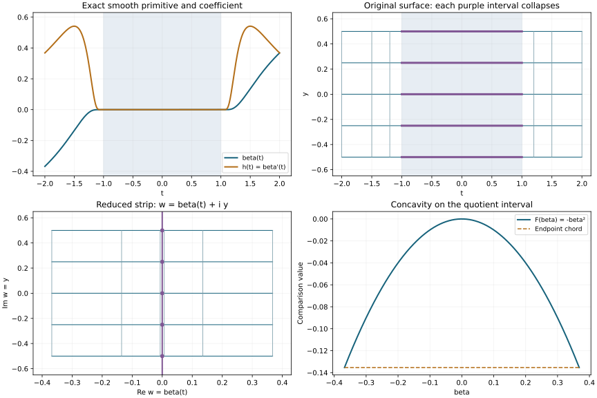

# One-dimensional descent and affine concavity

A characteristic curve can contain a whole interval on which its transverse quadratic form vanishes. The correct regularity statement collapses that interval before testing concavity. We prove the statement by adding one real variable, applying the two-dimensional propagation theorem, and returning to the original curve. The auxiliary variable changes neither the distribution's microlocal Sobolev index nor its source index.

The mathematical antecedent is Lars Hörmander, *The Analysis of Linear Partial Differential Operators IV*, 2009 edition, Theorem 26.9.4 and its descent argument, printed pages 144–145. The compact homogeneous normal form is Proposition 26.4.13, printed pages 101–102. Our argument supplies the tensor-product estimates, homogeneous localization, radial case and passage from local to global concavity explicitly.

We use the exact [indefinite factorization and affine geometry](../20261011-quadratic-affine-geometry/indefinite-quadratic-division-and-affine-parameters.html), QAF:F0 and T0–A0, [homogeneous characteristic tubes](../20261011-condition-psi-geometry/condition-psi-and-complex-characteristic-tubes.html), PSG:E0–N2, and [reduced-leaf propagation](../20261012-reduced-leaf-propagation/regularity-on-reduced-characteristic-leaves.html), RLP:T0 and A0. The [graph equivalence](../20261005-restored-graph-egorov/graph-operators-continuity-and-egorov.html) transports every real Sobolev order. Each dependency is pinned in the proof map.

This independent exposition, three complete solutions and original illustration are CC0-1.0. Linked components retain their terms. Human foundational proofs remain external. 

## 1. The interval and its actual quotient

**H0. Precise hypotheses and notation.** Let \(P\) be a properly supported scalar classical pseudodifferential operator of real order \(m\), with homogeneous principal symbol \(p\), satisfying condition (P). Let \(I\) be an embedded compact regular one-dimensional characteristic interval in \(\{p=0,dp\ne0\}\). The two endpoints are indefinite quadratic points: the intrinsic transverse Hessian of QAF:H0 and T1 is indefinite there. Thus these endpoints belong to the indefinite stratum \(N_{12}^{i}\), not merely to the semidefinite stratum. We retain the actual parametrized interval if a larger characteristic has a periodic continuation.

QAF:D0, F0 and T2 give, on an ordinary tube along \(I\), a fixed indefinite form \(Q\) and a smooth function \(h\ge0\), positive at the endpoints, such that the transported Hessian equals \(h(t)Q\). The quotient and an affine coordinate are

\[
 \beta(t)=\int_{t_*}^{t}h(r)\,dr,\qquad
 \widetilde I=\beta(I),\qquad
 t\sim t'\ \Longleftrightarrow\ \beta(t)=\beta(t'). \tag{OD1}
\]

The fibers are precisely the maximal intervals on which \(h=0\), together with singletons. They are compact, and the endpoint fibers are singletons because \(h>0\) there. QAF:A0 proves that other intrinsic affine coordinates have nonzero constant affine transition maps. Neither an arbitrary reparametrization nor the uncollapsed time coordinate is an affine coordinate.

For a distribution \(v\), define

\[
 s_v^*(\rho)=\sup\{r\in\mathbb R:v\text{ is microlocally }H^r
       \text{ at }\rho\},\qquad
 s_v(b)=\inf_{\beta(t)=b}s_v^*(\gamma(t)). \tag{OD2}
\]

The supremum does not assert membership at its endpoint. Values lie in \((-\infty,+\infty]\) locally; compactly localized distributions have a finite negative Sobolev lower bound, as proved in LPE:V0.

**H1. Lower semicontinuity and the conclusion.** The function in (OD2) is lower semicontinuous. Indeed, if its value at \(b_0\) exceeds \(a\), the whole compact fiber lies in the open microlocal regularity set \(\{s_v^*>a\}\). Otherwise a sequence \(b_j\to b_0\) would have preimages outside that open set. Compactness of \(I\) gives a convergent subsequence, whose limit is in the fiber at \(b_0\), a contradiction. The same argument works on every smaller quotient neighborhood.

Let \(s:\widetilde I\to(-\infty,+\infty]\) be concave and assume \(s_{Pu}\ge s\). Then the theorem to be proved is

\[
 F(b)=\min\{s_u(b),s(b)+m-1\}
             \quad\hbox{is concave on }\widetilde I. \tag{OD3}
\]

Here concavity includes its ordinary extended-value meaning: for \(0<\theta<1\), \(F((1-\theta)a+\theta b)\ge(1-\theta)F(a)+\theta F(b)\). There is no subtraction of infinities. A finite concave function is continuous on the interior by the chord-slope proof in RLP:A0. If a concave function is infinite at an interior point, its chord inequalities make it infinite at every interior point: to cover a point on either side, use a still farther point on that side and the given infinite point. Endpoint values are at most the interior lower limits, directly by the chord inequality with one fixed interior point. Consequently \(s\), and then \(F\), are lower semicontinuous, including endpoints. Both have finite lower bounds on compact intervals.

## 2. Homogeneous coordinates without losing a fiber

**G0. Radial curves already have the required concavity.** Suppose the characteristic line is radial at one point of \(I\). Homogeneity makes the entire positive ray through that point characteristic, with the same radial complex Hamilton line. Locally choose a smooth real nonzero combination of the real and imaginary Hamilton fields; it is tangent to that ray. Uniqueness of its flow keeps the characteristic on the ray. This property continues across overlapping flow neighborhoods along the connected interval. Thus all of \(I\) is radial.

Microlocal Sobolev regularity is conic in the nonzero covector, so \(s_u^*\) and \(s_{Pu}^*\) are constant along this ray. Their infima over any quotient fiber have those same values. Therefore \(F=\min(c,s+m-1)\), with \(c\in(-\infty,+\infty]\), is concave: if \(c\) is finite, each of \(c\) and \(s+m-1\) is at least the chord between the two endpoint values of their minimum; taking the minimum preserves this inequality. If \(c=+\infty\), the conclusion is the assumption on \(s\). This proves (OD3) for radial intervals without a homogeneous time-flow coordinate.

**G1. Each nonradial collapsed fiber has an embedded cosphere projection.** Assume henceforth that \(I\) is nonradial, and fix an interior point of the reduced interval. First let its fiber \(J\) be nontrivial. It lies in the zero-Hessian stratum and is bounded on both sides by points with nonzero Hessian arbitrarily nearby. These assertions follow from \(h\ge0\), maximality of its zero interval, and positivity at the endpoints of \(I\). All subsequent extensions \(J'\) are chosen inside the original interval \(I\); its endpoint conclusion will follow separately by lower semicontinuity.

The projection of \(J\) to the cosphere bundle is regular. At a radial point the preceding uniqueness argument would make all of \(I\) radial. Its projection is also injective. Here are the needed details. Homogeneity makes the projected characteristic line independent of positive covector scale. A local homogeneous real combination gives a smooth nonzero projected vector field. Thus any two projected curve germs through a point agree as unparametrized germs, by ordinary flow uniqueness.

Parametrize the projected curve by arclength. A first repeated point with opposite tangent would give the identity between the two curve germs with reversed parameters. Continue this identity toward their middle: equality is closed by continuity and extends at every endpoint by local uniqueness. At the middle the unit tangent would equal its negative, impossible. A return with the same tangent produces a closed projected curve. A first positive return exists: local regularity and compactness give a positive uniform time of local injectivity, and the set of return times is closed. The first-return image is an embedded circle with matching end germs.

The zero-Hessian property is invariant under positive covector dilation, by homogeneity and QAF:T1. Hence the entire conic lift of that circle consists of zero-Hessian characteristic points. Every local real Hamilton combination is tangent to the lift. Flow uniqueness and finite continuation keep the original characteristic in it, contradicting the neighboring indefinite points of \(I\). A repeated projected point is therefore impossible. This is the closed-curve argument of PSG:M1 with the invariant zero-Hessian stratum supplying the contradiction.

Choose a slightly larger compact interval \(J'\) with indefinite endpoints, still having injective regular cosphere projection. Such extensions can be arbitrarily small because \(J\) is a maximal zero interval. Embeddedness persists under a sufficiently small extension: otherwise colliding projected pairs would converge to a collision on \(J\); injectivity and a local inverse-function neighborhood exclude it. If the fiber is a singleton, use a small nonradial flow chart instead. When its Hessian vanishes, nearby indefinite points on both sides follow from maximality of the singleton fiber. Thus in every case there is one homogeneous tube around the **whole** fiber, bounded by indefinite points.

**G2. The exact homogeneous model and the source shift.** Apply PSG:N0–N2 on \(J'\), then the homogeneous version of QAF:F0. With canonical coordinates \((t,x;\tau,\xi)\) and central transverse mark \((0,e)\), the normalized degree-one principal symbol is

\[
 p_1=\tau+i h(t,x,\xi)g(x,\xi),\qquad
 h\ge0,\quad \deg h=0,\quad \deg g=1,\quad
 g(0,e)=dg(0,e)=0. \tag{OD4}
\]

Both factors are independent of \(\tau\); \(g\) is independent of \(t\). The restriction \(h(t,0,e)\) is positive at the ends of \(J'\). Its primitive gives the intrinsic affine coordinate, up to an affine change, by QAF:T2 and A0.

Here the normalization is an actual operator reduction. Choose a properly localized elliptic multiplier of order \(1-m\) with the prescribed nonzero principal factor, and the elliptic canonical graph operators and inverses in GE:D7–D11. Their complete parametrices preserve every real microlocal Sobolev index, with the exact order shift. After conjugation, the reduced unknown \(v\), operator \(P_1\) and source \(f=P_1v\) satisfy

\[
 s_v^*(t,0;0,e)=s_u^*(\gamma(t)),\qquad
 s_f^*(t,0;0,e)=s_{Pu}^*(\gamma(t))+m-1. \tag{OD5}
\]

Smooth errors have no effect on these indices. The complete lower-order symbol remains present; only its principal part is (OD4). Thus it suffices to prove the order-one assertion with the comparison function \(s_1=s+m-1\). The reduced index on a whole fiber is preserved because the graph is a single diffeomorphism on its whole neighborhood.

## 3. The constant-variable lemma

**T0. Define the extension and prove both Sobolev inequalities.** In local Euclidean coordinates \(z\in\mathbb R^n\), put \(V=v\otimes1\) on \(\mathbb R^n\times\mathbb R_y\). Its action on a test function is \(v(\int\phi(z,y)\,dy)\), a distribution by the test-function seminorm bounds for integration. For compact cutoffs \(\rho(z)\) and \(\chi(y)\), Fourier transformation gives

\[
 \widehat{\rho(z)\chi(y)V}(\zeta,\eta)
        =\widehat{\rho v}(\zeta)\widehat\chi(\eta). \tag{OD6}
\]

This follows first by the distributional Fourier definition on separated test functions, then on general test functions by the Fourier inversion and integration results P3:L1–L3 and M3–M4. Compact support gives polynomial growth of the first factor and rapid decay of the second, with every differentiated bound.

The [cone-localized Fourier criterion](../20261005-restored-sobolev-propagation/sobolev-regularity-along-real-characteristics.html), SP:S3, permits product base cutoffs supported in any prescribed small product neighborhood. Indeed choose them inside its base neighborhood; multiplication by such cutoffs preserves the smaller-cone estimate, using the compact Sobolev bound and the rapid off-diagonal Fourier tail CH:W1 in its proof. For every real \(r\),

\[
 C_r^{-1}\langle\zeta\rangle^{2r}
       \le \langle(\zeta,\eta)\rangle^{2r}
       \le C_r\langle\zeta\rangle^{2r}\quad (|\eta|\le R), \tag{OD7}
\]

where \(C_r\) may depend on \(R\). Without the restriction on \(\eta\), the upper bound holds with an additional factor \(\langle\eta\rangle^{2|r|}\). Both assertions follow from
\(1\le\langle(\zeta,\eta)\rangle/\langle\zeta\rangle\le\langle\eta\rangle\)
and reversal of inequalities for negative powers.

If \(v\) is microlocally \(H^r\) at \((z_0,\zeta_0)\), restrict \(\zeta\) to a smaller regularity cone and \(|\eta|<\epsilon|\zeta|\). Integrating the upper bound against \(|\widehat\chi|^2\), whose weighted integral is finite, proves the \(H^r\) estimate for \(V\) at \((z_0,y_0;\zeta_0,0)\).

Conversely suppose this estimate holds for \(V\). Choose a nonzero \(\chi\) near \(y_0\) and a product cutoff as above. Fourier inversion shows \(\widehat\chi\) is not identically zero. Thus for some finite \(R\),
\(c_\chi=\int_{-R}^{R}|\widehat\chi(\eta)|^2\,d\eta>0\).
For all sufficiently large \(|\zeta|\) in a smaller cone about \(\zeta_0\), the whole set \(|\eta|\le R\) lies in the regularity cone of \(V\). The lower estimate (OD7), followed by integration on this interval, bounds \(c_\chi\) times the required weighted cone integral of \(|\widehat{\rho v}|^2\). Bounded frequencies are harmless by smoothness and polynomial growth of this Fourier transform. Hence \(v\) is microlocally \(H^r\). We have proved, including every negative order,

\[
 v\in H^r_{\rm mic}(z_0,\zeta_0)
 \ \Longleftrightarrow\
 V\in H^r_{\rm mic}(z_0,y_0;\zeta_0,0),\qquad
 s_V^*(z_0,y_0;\zeta_0,0)=s_v^*(z_0,\zeta_0). \tag{OD8}
\]

**T1. The ordinary wavefront set and locality.** The same product formula proves

\[
 \operatorname{WF}(V)=
 \{(z,y;\zeta,0):(z,\zeta)\in\operatorname{WF}(v)\}. \tag{OD9}
\]

For the forward inclusion at \(\eta=0\), rapid decay of \(\widehat{\rho v}\) on a fixed cone and of \(\widehat\chi\) gives rapid decay of the product on the corresponding smaller product cone. For the reverse inclusion, fix one bounded \(\eta\) where \(\widehat\chi(\eta)\ne0\) and divide the rapid-decay estimate in (OD6) by that fixed nonzero number. This recovers rapid decay on a fixed smaller \(\zeta\)-cone. Finally, near any direction with \(\eta\ne0\), shrink the cone until \(|\eta|\ge c|(\zeta,\eta)|\). The rapid decay of \(\widehat\chi\) defeats any polynomial growth of \(\widehat{\rho v}\), proving smoothness there.

This proof uses fixed cones for all decay orders. It does not infer ordinary microlocal smoothness merely from the value \(s_v^*=+\infty\), whose defining neighborhoods could depend on the order. Both (OD8) and (OD9) are local, and hold unchanged after multiplying by a cutoff equal to one on the product neighborhood under consideration.

## 4. Lift to a two-dimensional characteristic

**L0. Construct a genuine classical operator.** Work in the tube (OD4). Extend \(h(t,x,\xi)\) to a real degree-zero homogeneous symbol \(H(t,x;\tau,\xi)\) on a conic neighborhood of the original curve, agreeing there with \(h\); smooth conic cutoffs and a low-frequency extension give such a symbol. Near that curve it is nonnegative. Choose a smooth \(\theta\) equal to one near zero and supported in \((-\epsilon,\epsilon)\), with \(\epsilon<1\). In the full cotangent variables \((\zeta,\eta)\), where \(\zeta=(\tau,\xi)\), use the complete left symbol

\[
 q(z,y;\zeta,\eta)=
 \theta\!\left(\frac{\eta}{\sqrt{|\zeta|^2+\eta^2}}\right)
 \bigl(p_{1,\mathrm{full}}(z,\zeta)+iH(z,\zeta)\eta\bigr), \tag{OD10}
\]

with a smooth cutoff near total frequency zero. On its high-frequency support,
\(|\zeta|\ge\sqrt{1-\epsilon^2}|(\zeta,\eta)|\).
Every derivative of the angular cutoff has the corresponding inverse total-frequency bound. Each homogeneous term of the old symbol, and its remainders with all derivatives, therefore has the required full-frequency symbol estimates. The second term is homogeneous of degree one. Thus (OD10) is a genuine classical order-one symbol, despite the unrepaired old symbol's possible failure of estimates when \(|\eta|\gg|\zeta|\). Extend it smoothly outside the smaller conic tube, and choose a properly supported quantization \(Q\).

Near \(\eta=0\) in the tube, its principal symbol is exactly

\[
 q_1=\tau+i h(t,x,\xi)\bigl(g(x,\xi)+\eta\bigr). \tag{OD11}
\]

The imaginary factor has a fixed weak sign along every \(\partial_t\)-orbit, since \(h\ge0\) and \(g+\eta\) is independent of \(t\). Apply PSG:E1 to this sign property and its reverse, equivalently to both \(\Psi\) sign conventions. This proves condition (P) for \(q_1\) on a neighborhood of the lifted compact interval. Also \(\partial_\tau q_1=1\), so this is a scalar principal-type symbol there.

**L1. The equation retains the exact source index.** Let \(V=v\otimes1\). In the unlocalized left quantization, its Fourier transform in \(y\) is supported at \(\eta=0\), with no derivative of that delta distribution. Consequently the term \(iH\eta\) annihilates it, and the angular cutoff equals one. The low-frequency modification contributes a smooth function. Hence, locally near the lifted curve,

\[
 QV=(P_1v)\otimes1+\text{a microlocally smooth term}. \tag{OD12}
\]

Here is the locality justification for properly supported operators and noncompact constant extensions. Localize \(v\) in a larger base box and replace \(V\) by \(v\otimes\chi\), with \(\chi=1\) on a smaller \(y\)-interval. The difference between the angularly cut symbol and the uncut expression is supported where \(|\eta|\ge c|\zeta|\). On that set every differentiated integrand has a polynomial bound in \((\zeta,\eta)\) times the rapidly decreasing \(\widehat\chi(\eta)\). It is therefore integrable with arbitrarily many frequency powers; differentiation under the integral proves that its output is smooth. The uncut expression applied to \(v\otimes\chi\) is \((P_1v)\otimes\chi+i(Hv)\otimes D_y\chi\), and the second term vanishes on the smaller interval. The compact-frequency modification is smooth as well.

Replacing the full quantization by its properly supported representative changes the localized kernel only away from the diagonal, hence gives a smooth output on these compactly supported inputs, by P2:OP4. The other base cutoffs may be chosen equal to one on smaller boxes; their complementary terms are again smooth between separated supports. Thus this computation proves (OD12) for the actual localized distributions, without applying a smoothing operator to an uncontrolled noncompact input.

Apply (OD8) to \(v\) and \(P_1v\). At every point on the lifted curve, \(s_V^*=s_v^*\) and \(s_{QV}^*=s_{P_1v}^*\). Infima on compact fibers preserve both equalities.

**L2. Identify the actual leaf and the collapsed fibers.** Along the surface

\[
 \Sigma=\{(t,0,y;0,e,0):t\in J',\ y\in(-a,a)\},
 \qquad H_{q_1}|_\Sigma=\partial_t+i h(t,0,e)\partial_y, \tag{OD13}
\]

we used \(g=dg=0\), so \(H_g=0\). The derivative of \(g+\eta\) is nevertheless nonzero: its \(\eta\)-derivative is one. Wherever \(h>0\), the two real Hamilton directions span this surface. Every zero interval of \(h\) is reached from these regions because \(h>0\) at the endpoints of \(J'\). Thus the local two-dimensional characteristic and its active reduced quotient in RLP:H0 are exactly this surface with each zero interval at fixed \(y\) collapsed. There is no additional unidentified fiber. In particular the full original fiber \(J\times\{y\}\) is compact in the local model.

Writing again \(\beta' =h(t,0,e)\), its reduced complex coordinate is

\[
 w=\beta(t)+iy,\qquad
 (\partial_t+i h\partial_y)w=h+i h i=0. \tag{OD14}
\]

The quotient is a strip in \((\beta,y)\), with the standard complex structure. This remains true across flat intervals: the quotient coordinate is \(\beta\), and no inverse derivative \(1/h\) is asserted on the original time interval. DAQ:Q0–Q3 and I0 give the proper local quotient interpretation used by RLP:T0.

## 5. Return to the entire affine interval

**C0. Apply the full propagation theorem on each quotient neighborhood.** A concave function of \(\beta\), independent of \(y\), is superharmonic on the strip; both directions, including extended values, were proved in RLP:A0. Lift the function \(s_1=s+m-1\) in this way. Equations (OD5), (OD8) and (OD12) show that the source-index hypothesis of RLP:T0 holds on the reduced strip. That theorem gives superharmonicity of

\[
 \min\{s_V(\beta,y),s_1(\beta)\}
       =\min\{s_u(\beta),s(\beta)+m-1\}. \tag{OD15}
\]

The equality includes the infimum over the entire compact fiber, by G2 and L2. The right side is independent of \(y\). The converse direction of RLP:A0 therefore makes it concave in the affine variable \(\beta\) on a neighborhood of the chosen reduced point. Affine coordinate changes preserve concavity, including orientation reversal. Every interior quotient point is covered by G1, so \(F\) is locally concave throughout the interior.

**C1. Local concavity, extended values and endpoints.** We give the gluing argument. For each finite \(N\), let \(F_N=\min(F,N)\). The minimum-with-a-constant argument in G0 makes this function locally concave; it is finite and locally bounded below. Its chord slopes show that it is locally continuous on the interior.

Take a compact interior interval \([a,b]\). A finite cover by open intervals of concavity has a positive mesh size such that every set of three consecutive points of a sufficiently fine uniform partition lies in one member of the cover. To see the uniform size directly, otherwise choose triples of shrinking diameter not contained in any cover member. A subsequence of their middle points converges in \([a,b]\); an open cover member containing the limit contains the whole triple eventually, a contradiction. The local chord inequalities now say that the slopes of the piecewise linear interpolant through the partition values are nonincreasing. Such an interpolant is concave: a secant slope is the length-weighted average of its segment slopes, and every slope to the left is at least every slope to the right. This proves its chord inequalities.

Uniform continuity of \(F_N\) on \([a,b]\) makes these interpolants converge uniformly to \(F_N\), so \(F_N\) is concave on \([a,b]\). Let \(N\) increase to infinity in each chord inequality. The finite lower bound prevents an indeterminate infinite sum, and monotone limits prove the same inequality for \(F\). Thus \(F\) is concave on the full open interval.

Finally retain a fixed point strictly between any chosen two points of the closed interval. Approximate either endpoint, if necessary, from the interior and use the interior chord inequality at that same fixed point; its chord weights converge to the required positive weights. Lower semicontinuity from H1 says the limiting lower bounds of the endpoint values are at least their actual values. This gives the desired chord inequality, also when an endpoint value is infinite. The cases of weight zero or coincident endpoints are identities. This proves (OD3) on the closed affine interval and completes Theorem 26.9.4.

**C2. What the factorization alone supplies.** The proof on a homogeneous tube requires only the exact form (OD4), \(h\ge0\), \(g=dg=0\) on the central curve, \(g\) independent of \(t\), and \(h>0\) at its endpoints. An indefinite Hessian is sufficient to produce that factorization and the canonical affine coordinate; the analytic descent itself uses none of its nonzero eigenvalues. Hence the same conclusion holds whenever such a tube and factorization are given, with affine coordinate \(\int h\,dt\). This statement does not infer the factorization for all semidefinite endpoints. [The semidefinite companion](../20261012-semiconcave-propagation/semiconcavity-and-semidefinite-characteristics.html) proves the general one-sided regularity theorem with its justified clock.

## 6. Three complete calculations

### Exercise 1. Adding a variable does not improve a delta singularity

**X1. A sharp tensor example.** For \(v(z)=\delta(z)\) on the line, compute its microlocal Sobolev index at a nonzero covector, and then that of \(V(z,y)=\delta(z)\otimes1\) at \((0,y_0;\zeta_0,0)\).

**Solution.** A cutoff equal to one at zero leaves the delta distribution unchanged. Its Fourier transform is a nonzero constant. On either ray its weighted integral at large frequency is a constant multiple of

\[
 \int_1^\infty r^{2s}\,dr<\infty
       \quad\Longleftrightarrow\quad s<-\tfrac12. \tag{OD16}
\]

For \(s=-1/2\) the integral is logarithmically divergent; for \(s>-1/2\) its elementary antiderivative diverges. Hence the index is exactly \(-1/2\), with no endpoint membership. T0 gives the identical index for \(V\). Explicitly, integration over a bounded \(\eta\)-interval with positive \(|\widehat\chi|^2\) mass gives the same divergence, while integration over all \(\eta\) with its rapid decay gives the same upper bound for \(s<-1/2\). The added dimension is smooth and adds no singular-frequency integration.

### Exercise 2. A flat collapsed interval and its lifted surface

**X2. Exact flat coordinates.** Define

\[
 \beta(t)=
 \begin{cases}
 -\exp(-1/(-t-1)),&t<-1,\\
 0,&|t|\le1,\\
 \exp(-1/(t-1)),&t>1,
 \end{cases}
 \qquad h(t)=\beta'(t). \tag{OD17}
\]

On \([-2,2]\), verify the geometry for \(p=\tau+i h(t)\rho(x_2^2-x_3^2)\), where \(\rho>0\) is a spectator covector component.

**Solution.** Outside the plateau, with \(a=|t|-1>0\), \(h=e^{-1/a}/a^2>0\). Each derivative is a finite sum of \(e^{-1/a}\) times powers of \(a^{-1}\), which tends to zero at \(a=0\): put \(r=1/a\), and bound \(r^k e^{-r}\) by a constant times \(e^{-r/2}\) using the exponential series. Thus \(h\) and \(\beta\) are smooth, and \(h=0\) precisely on \([-1,1]\). The endpoint values are \(h(\pm2)=e^{-1}\); the quotient interval is \([-e^{-1},e^{-1}]\).

At \(x_2=x_3=0\), the transverse Hessian is
\(2h(t)\rho(dx_2^2-dx_3^2)\), indefinite exactly outside the plateau. The lifted symbol is

\[
 q_1=\tau+i h(t)\{\eta+\rho(x_2^2-x_3^2)\},
 \quad H_{q_1}|_\Sigma=\partial_t+i h(t)\partial_y,
 \quad w=\beta(t)+iy. \tag{OD18}
\]

Every horizontal interval \([-1,1]\times\{y\}\) collapses to \((0,y)\). The map is one-to-one outside these intervals. The function \(F(\beta)=-\beta^2\) is concave; its circle average at \(\beta_0+iy_0\), radius \(r\), is \(-\beta_0^2-r^2/2\), at most its center value. The opposite sign gives a strict failure when \(r>0\). These are exact coordinate and comparison calculations, not an assertion that this chosen function is the index of a particular solution.

### Exercise 3. Why the radial case must not use a time-flow graph

**X3. A radial indefinite characteristic.** On \(\xi_1>0\), consider \(p=\xi_1\{x_1+i(x_2^2-x_3^2)\}\) along \(\gamma(t)=(0;e^{-t},0,0)\). Check the affine parameter and the regularity conclusion.

**Solution.** Direct differentiation gives \(H_p=-\xi_1\partial_{\xi_1}\) on this curve, so \(\gamma'=H_p\). The transverse form is \(2e^{-t}(dx_2^2-dx_3^2)\), and an affine coordinate is \(\beta=-e^{-t}=-\xi_1\), whose derivative is \(e^{-t}>0\). The curve projects to a single cosphere point, so PSG:N0 cannot apply to it. The indices of \(u\) and \(Pu\) are each constant by conicity. Therefore the conclusion is exactly the elementary concavity of \(\min(c,s+m-1)\) proved in G0. This example has indefinite endpoints and is not discarded by the theorem's hypotheses.

## 7. Read the coordinate figure

**F0. Exact collapse, lift and concavity.** The figure uses only the formulas in X2. It shows the primitive and its nonnegative derivative, sampled curves in the original \((t,y)\) surface and their image in \((\beta,y)\), and the exact concave comparison function. The highlighted rectangle is the union of collapsed horizontal fibers. Its image is the vertical line \(\beta=0\). The drawings are coordinate plots; the line samples do not approximate a numerical ODE solution.

[Computational material](figures/build_figure.py) accompanies the text. [Semidefinite propagation](../20261012-semiconcave-propagation/semiconcavity-and-semidefinite-characteristics.html) treats its full stated endpoint class with an admissible clock. [General quasiconcavity](../20261012-localized-quasiconcave-propagation/localized-weights-and-quasiconcave-propagation.html) uses constant comparisons without requiring an affine parameter.
