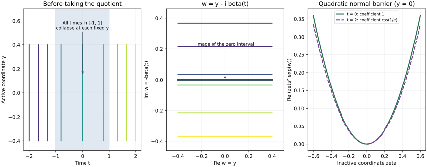

# Regularity on reduced characteristic leaves

At a degenerate characteristic interval, an entire compact curve becomes one point of a complex surface. Sobolev regularity must then be measured on the whole curve. We prove that this reduced regularity obeys harmonic comparison, including at the collapsed intervals. The proof combines an exact complex coordinate, a transverse damping weight, the complete localized estimates and a finite commutator expansion.

The mathematical antecedent is Hörmander IV, Theorem 26.9.1, printed pages 138 and 141–144 of the approved 2009 edition. The proof below also treats ordinary rank-two points by a short-time estimate and supplies the extended-valued concavity argument for conic leaves. It uses the corrected time-derivative estimate in LPE:H0–E1, not a spatial-only substitute. Book citations identify antecedents; the proof map binds the actual earlier programme proofs.

Original expression, exercises and illustration are CC0-1.0. Human foundation providers remain external, so internal export P514 closure is not claimed.  [One-dimensional descent](../20261012-one-dimensional-descent/one-dimensional-descent-and-affine-concavity.html) gives concavity on the stated affine tubes. [Semiconcavity and semidefinite characteristics](../20261012-semiconcave-propagation/semiconcavity-and-semidefinite-characteristics.html) supplies the justified clocks and endpoint alternatives.

## 1. The reduced index and the theorem

**H0. Geometric and operator hypotheses.** Let \(P\in\Psi^m_{1,0}(X)\) be a properly supported scalar operator with smooth homogeneous principal symbol \(p\) of real degree \(m\) and an order-\(m-1\) remainder. Assume principal type and condition (P) on the conic region in question. We use the exact definitions and the characteristic saturation proved in CPG:H0–L0. Let \(B\) be a two-dimensional characteristic leaf and let

\[
 \pi:B_{\mathrm{act}}\longrightarrow B_0
 \tag{RP1}
\]

be its reduced leaf. Here \(B_{\mathrm{act}}\) is the active part used in DAQ:Q0–I0: every fiber is a compact maximal rank-one interval, or a singleton, with activity on both sides when it is a nontrivial interval. No conclusion about an absent or noncompact reduced fiber is hidden in this notation. DAQ:Q2–Q3 proves that each point of \(B_0\) has a chart whose inverse images of compact subsets are compact in the original leaf. DAQ:A0–I0 proves the intrinsic complex structure, including at the collapsed fibers.

For \(u\in\mathcal D'(X)\), write \(s_u^*(q)\) for the microlocal Sobolev index at \(q\in T^*X\setminus0\), as defined and proved lower semicontinuous in LPE:H1. Define

\[
 s_u(y)=\inf_{q\in\pi^{-1}(y)}s_u^*(q),\qquad y\in B_0.
 \tag{RP2}
\]

This is the supremum of exponents attained at every point of the fiber. Indeed any exponent strictly below the displayed infimum is below the index at each point, so microlocal membership at that exponent holds there; the converse follows directly from the definition of the pointwise index. Neither statement asserts membership at the supremum.

**H1. Lower semicontinuity and the exact conclusion.** The reduced index is lower semicontinuous and locally bounded below. For the first assertion, let \(s_u(y_0)>a\). The compact fiber lies in the open set \(\{s_u^*>a\}\). In a chart with compact inverse images, a sequence \(y_j\to y_0\) with fibers meeting its closed complement would have a convergent sequence of such preimages, with limit in the fiber at \(y_0\); this is impossible. Shrink to a compact chart neighborhood to justify that subsequence. Thus \(s_u>a\) near \(y_0\). A compact localization of a distribution has some finite negative Sobolev order, by the Fourier proof in LPE:V0. Finitely many base charts cover each compact inverse image, giving the asserted lower bound.

Let \(\omega\subset B_0\) be open, and let \(s:\omega\to(-\infty,+\infty]\) be superharmonic in the comparison sense of CIP:H1 and P0–P1. If \(f=Pu\) and \(s_f\ge s\) on \(\omega\), then

\[
                 \min\{s_u,\ s+m-1\}
       \quad\hbox{is superharmonic on }\omega .
 \tag{RP3}
\]

The identically infinite function is allowed. If \(B\) is conic, let \(B_0^*\) be the further quotient by positive cotangent dilations, with the affine structure proved in DAQ:I1. When \(s\) is the lift of a concave function on \(B_0^*\), (RP3) is the lift of a concave function there. These are the full conclusions proved in this lesson.

## 2. Normalize the operator on the entire fiber

**G0. The order and the canonical graph.** Fix a point of \(B_0\). CPG:M0–M1 gives, on a common conic neighborhood of its entire compact fiber, a nonzero multiplier of degree \(1-m\) and a homogeneous canonical chart in which the new principal symbol is

\[
 p_1=\tau+i\gamma(x,\eta)\alpha(t,x,\eta),\qquad
 \alpha\ge0,\quad d\gamma\ne0,\quad
 \deg\gamma=1,\quad\deg\alpha=0.
 \tag{RP4}
\]

The coefficients are independent of \(\tau\), and \(\gamma\) is independent of \(t\). The fiber has coordinates \(\Gamma=\{(t,0;0,e):t\in I\}\), with \(e\ne0\). At a collapsed fiber, including a rank-one singleton, \(\alpha(t,0,e)=0\) for \(t\in I\). At a rank-two singleton the time interval is initially just one marked time and \(\alpha>0\) there. The point version in CPG:M1 supplies the same normal form in that case.

Quantize the multiplier by an elliptic operator \(Q\) of order \(1-m\). GE:D9–D11 supplies elliptic order-zero graph operators \(A,B\), inverse modulo smoothing, for the canonical chart. Put \(v=Bu\), \(P_1=BQPA\). Proper localization and the complete graph composition proof give

\[
 P_1v=BQf\pmod{C^\infty},\qquad
 s_v^*=s_u^*\circ\kappa,\qquad
 s_{P_1v}^*=s_f^*\circ\kappa+m-1.
 \tag{RP5}
\]

Both index equalities follow from Sobolev continuity at every real exponent, GE:D7, and the inverse graph estimates. Taking suprema does not require endpoint attainment. A smooth error has infinite index. The canonical map and the nonzero multiplier preserve the equation \(H_p w=0\) on the characteristic set, since \(H_{ap}=aH_p\) there; DAQ:I0 therefore identifies the reduced analytic structures. It is enough to prove (RP3) for order one, with (RP4) as principal symbol, and with \(s\) shifted by \(m-1\). We use \(u,P,f,s\) for these normalized objects below.

**G1. A gauge uniform on all frequencies.** In full left quantization write \(P=p_1(x,D)+r(x,D)\), modulo a microlocally smooth error, with \(r\in S^0_{1,0}\). We need its zeroth-order part small near \(\Gamma\), uniformly at high frequency. This can be achieved without assuming that the lower-order symbol is homogeneous.

Write \(\rho>1\) for the frequency scale on the marked ray, normalized so its point is \((0,\rho e)\). Fix \(t_*\in I\) and set

\[
 b(t,\rho)=r(t,0;0,\rho e),\qquad
 a_0(t,\rho)=\exp\left(i\int_{t_*}^t b(v,\rho)\,dv\right).
 \tag{RP6}
\]

On a fixed compact time interval, \(a_0,a_0^{-1}\in S^0\): the exponent is bounded, and each frequency derivative of its exponential is a finite sum of products with the required inverse-frequency powers. The same argument controls all base derivatives. Extend the exponent smoothly from the marked ray to a small angular tube, using \(\rho=|\eta|/|e|\) there and fixed cutoffs. Set it to zero outside a slightly larger tube and extend low frequencies smoothly. Its exponential stays elliptic. K:K2–K3 gives a two-sided order-zero parametrix for \(S=\operatorname{Op}(a_0)\).

The scalar product and commutator formulas P2:OP3 and WY:Q1–Q3 give for \(SPS^{-1}\) the order-zero representative

\[
             r_0=r+i\,a_0^{-1}H_{p_1}a_0,
             \qquad \widetilde r-r_0\in S^{-1}.
 \tag{RP7}
\]

At every point of a collapsed \(\Gamma\), \(H_{p_1}=\partial_t\); (RP6) gives \(r+i\,a_0^{-1}\partial_t a_0=r-b=0\). At a rank-two singleton, choose \(t_*\) to be its time. Then \(a_0=1\) there for every \(\rho\), all its transverse derivatives vanish there, and the same cancellation holds. Thus \(r_0=0\) on the whole marked fiber at all high-frequency scales.

The normalized derivatives of \(r_0(t,x;\sigma/\lambda,\eta/\lambda)\) are bounded uniformly in \(0<\lambda<1\) on fixed annuli. Taylor's formula from the compact central fiber consequently makes its maximum as small as desired in a sufficiently small fixed tube. The \(S^{-1}\) remainder is \(O(\lambda)\) on that tube. Gauge conjugation preserves both indices, using its elliptic inverse. Replace \(P,u,f\) by these conjugated objects. No higher-order cancellation, globally convergent symbol expansion or frequency-independent limiting value of \(r\) has been assumed.

## 3. The estimates needed in both geometric cases

**E0. Collapsed intervals and ordinary rank-two points.** Use normalized transverse phase variables \(z=(x,\eta)\), a fixed cutoff \(\psi(z)\) equal to one near the retained fiber and supported away from \(\eta=0\), and set

\[
 L_\lambda=D_t+i\operatorname{Op}^L_\lambda
                 (\lambda^{-1}\psi^4\alpha\gamma),\qquad
 D_{j,\lambda}=\operatorname{Op}^L_\lambda
                 (\lambda^{-1}\psi^4\gamma\,\partial_{Z_j}\alpha).
 \tag{RP8}
\]

Here \(Z=(t,x,\eta)\), so \(j=0,\ldots,2d\) includes the time derivative. These quantizations act in \(x\) at each fixed \(t\); all norms below include time. On a neighborhood of a collapsed interval, LPE:H0–E1 proves, after choosing the geometric width first and its frequency threshold second,

\[
 \|v\|\le C_0\|L_\lambda v\|,\qquad
 \sqrt\lambda\sum_{j=0}^{2d}\|D_{j,\lambda}v\|
                    \le C_1\|L_\lambda v\|.
 \tag{RP9}
\]

The input is smooth with compact support in the retained time strip. The same estimates hold near a rank-two singleton, after making its time strip short enough. Here is that additional argument, for which \(\alpha\) need not vanish at the mark.

Keep the transverse cutoff fixed and extend the smooth nonnegative coefficient with a fixed nonnegative cutoff on one fixed time neighborhood. Put \(Q_\lambda=\psi^w_\lambda\),

\[
 A(t)=Q_\lambda\alpha^w_\lambda(t)Q_\lambda+c\lambda^2I,\qquad
 B=\lambda^{-1}Q_\lambda\gamma^w_\lambda Q_\lambda .
 \tag{RP10}
\]

LPE:C1 makes \(A\ge0\), with one \(c\). The finite products in LPE:C0 and S1 give, uniformly for small \(\lambda\), bounds
\(\|A\|,\|[B,A]\|,\|[B,[B,A]]\|,\|AB-\operatorname{Op}^L_\lambda(\lambda^{-1}\psi^4\alpha\gamma)\|\le K\)
and \(\lambda\|B\|\le K\). All derivatives of the now fixed cutoff are finite constants; the scalar commutator cancellation removes each nominal inverse power of \(\lambda\). In the double commutator retain the first remainder as a symbol, exactly as in LPE:S1. These constants are fixed on the original time neighborhood before the support interval is shortened.

The product \(M=10\|A\|^{1/4}\|[B,A]\|^{1/2}\|[B,[B,A]]\|^{1/4}\) is at most another fixed \(K\). NTO:E1 has solution constant \(4T/(1-2TM)\) for support in \(|t-t_*|<T\). Choose \(T\) so \(2TK<1/2\) and \(8TK<1/2\). The first constant is at most \(8T\), so the error \(AB-P_\lambda\), of norm at most \(K\), is absorbed. This proves the first part of (RP9).

NTO:E3 and that solution estimate give
\(\int(ABv,Bv)\,dt\le C\lambda^{-1}\|L_\lambda v\|^2\).
The fixed full time-space gradient form LPE:C1, including \(\partial_t\alpha\), and the two palindromic energy products LPE:E0–E1 give

\[
 \sum_{j=0}^{2d}\|D_{j,\lambda}v\|^2
       \le C\int(ABv,Bv)\,dt+C\|v\|^2.
 \tag{RP11}
\]

Indeed their principal products agree, their first corrections vanish, and the second corrections and all later remainders are bounded at this fixed cutoff. The first corrections in the differentiated-coefficient product are also bounded. Multiplying (RP11) by \(\lambda\) proves the second estimate in (RP9). This supplies the rank-two case, including conic rank-two leaves; it does not infer it from a theorem restricted to nonradial leaves.

**E1. A small complete remainder at each shell.** Fix one of the neighborhoods and constants just obtained. By G1, choose a smooth cutoff \(\theta(t,x;\sigma,\eta)\), supported in a sufficiently small normalized tube around the fiber and equal to one on a smaller tube, so the complete normalized remainder there has maximum less than \(1/(4C_0)\) for small \(\lambda\). Set

\[
 R_\lambda=\operatorname{Op}^L_\lambda
   \bigl(\theta(t,x;\sigma,\eta)\,
          \widetilde r(t,x;\sigma/\lambda,\eta/\lambda)\bigr).
 \tag{RP12}
\]

This quantization acts in all base variables, including \(t\). Its symbol has uniformly bounded normalized derivatives at the fixed tube. LPE:C1, now in the full base dimension, gives its norm at most its symbol maximum plus \(O(\sqrt\lambda)\). Thus, after lowering the frequency threshold,

\[
 \|R_\lambda\|\le(2C_0)^{-1},\qquad
 \|v\|\le2C_0 M_\lambda,\qquad
 \sqrt\lambda\sum_j\|D_{j,\lambda}v\|\le2C_1 M_\lambda,
 \quad M_\lambda=\|(L_\lambda+R_\lambda)v\|.
 \tag{RP13}
\]

The first solution estimate follows by absorption in (RP9). Then
\(\|L_\lambda v\|\le M_\lambda+\|R_\lambda\|\|v\|\le2M_\lambda\),
which proves the derivative estimate. These are estimates for the complete operators. We have constructed a bounded shell-dependent remainder; no assertion about the global norm of an arbitrary fixed zeroth-order representative is needed.

## 4. Construct the weight on a neighborhood of a whole fiber

**W0. A complex coordinate with inactive parameters.** The nonzero transverse vector field \(H_\gamma\) is independent of \(t\). Its smooth flow and the inverse-function theorem, SN:F0 and U001:P3, give an ordinary transverse chart \((y,\zeta)\) with \(H_\gamma=\partial_y\), on one neighborhood of the marked transverse point. To check this construction, take a hyperplane complementary to \(H_\gamma\) at that point and map \((y,\zeta)\) to its time-\(y\) flow from that hyperplane. Its derivative is invertible at the mark. The flow law makes its \(y\) derivative exactly \(H_\gamma\). This chart is used only to construct scalar functions, so it need not be canonical.

Adjoin \(\sigma\), the momentum dual to \(t\), to the inactive coordinates, translated so that all inactive coordinates vanish on the local leaf. Denote this vector by \(\zeta\) as well. The leaf is \(\zeta=0\), and

\[
 \mathcal V=\partial_t+i\alpha H_\gamma
            =\partial_t+i a(t,y,\zeta)\partial_y,\qquad a\ge0.
 \tag{RP14}
\]

DCR:C1 constructs a smooth solution \(w\) of \(\mathcal Vw=0\) with \(w_y\ne0\), retaining all inactive parameters on one common strip. To apply its bounded-strip formulation on the full compact interval \(I\), translate and rescale \(t\) so a slightly larger interval lies in its standard strip, extend \(a\) by a fixed nonnegative cutoff, and retain the original coefficient on a smaller neighborhood. The rescaling multiplies \(a\) by a positive constant. DCR:S0 and C1 give full smoothness in every parameter and every time derivative; shrinking the transverse neighborhood does not shorten the retained compact interval.

On a collapsed \(\Gamma\), \(a=0\), so \(w_t=0\); subtract its constant value to make \(w=0\) on \(\Gamma\). At a singleton subtract its value there. Since \(\Gamma\) is compact, make the tube small enough that \(\operatorname{Re}(e^w)>c>0\). The function

\[
 w_0=|\zeta|^2e^w,\qquad
 \mathcal Vw_0=0,\qquad
 c_1\,\operatorname{dist}(q,B)^2
      \le\operatorname{Re}w_0(q)
      \le c_2\,\operatorname{dist}(q,B)^2
 \tag{RP15}
\]

has the required properties on a smaller fixed tube. The equation follows because every inactive coordinate is constant under \(\mathcal V\). The distance comparison follows from the smooth coordinate diffeomorphism on the compact retained tube, where \(B=\{\zeta=0\}\), and the positive upper and lower bounds on \(\operatorname{Re}e^w\). DAQ:Q0–A2 identifies the restriction of \(w\) with a genuine analytic coordinate on the reduced leaf, with compact inverse images.

**W1. Boundary collars and normal damping.** Choose a sufficiently small closed disk \(K\) in that reduced coordinate chart, with compact inverse image \(\widetilde K\subset B\), so its inverse image lies where \(\psi=1\), \(\theta=1\) and the estimates (RP13) apply. Let \(H=\operatorname{Re}F\), with \(F\) a holomorphic polynomial, and suppose

\[
 H<s_u,\quad H<s\quad\hbox{on }\partial K,\qquad
                 s_u^*>H\circ w-1\quad\hbox{on }\widetilde K.
 \tag{RP16}
\]

Superharmonicity of \(s\) gives \(s>H\) on \(K\): by compactness and lower semicontinuity its strict boundary margin has a positive lower bound, so compare with \(H+\varepsilon\) for a positive smaller margin. Since \(s_f\ge s\), this gives \(s_f^*>H\circ w\) on \(\widetilde K\).

Choose a compactly supported ambient cutoff \(\chi\), equal to one near \(\widetilde K\), whose intersection with \(B\) is confined to a small collar of \(\widetilde K\) and whose derivative support on \(B\) lies in a collar of \(\pi^{-1}(\partial K)\). For an explicit construction, take a planar cutoff equal to one near \(K\) and supported just outside it, compose with \(w\), and multiply by a bump in the inactive coordinates equal to one near zero. The transition of the first factor on \(B\) is near the boundary; the transition of the second misses \(B\). Compactness and lower semicontinuity let those collars retain all strict inequalities in (RP16) and the source inequality just obtained.

For some finite \(A>0\), put \(\phi=F(w)-Aw_0\) near \(\operatorname{supp}\chi\), and extend \(\phi\) smoothly with compact support away from the zero covector, preserving it on a neighborhood of that support. Then

\[
 \begin{gathered}
 \mathcal V\phi=0\text{ near }\operatorname{supp}\chi,\qquad
 \operatorname{Re}\phi=H\circ w\text{ on }B\text{ near }\operatorname{supp}\chi,\\
 s_u^*>\operatorname{Re}\phi\text{ on }\operatorname{supp}d\chi,\qquad
 s_f^*>\operatorname{Re}\phi\text{ on }\operatorname{supp}\chi,\qquad
 s_u^*>\operatorname{Re}\phi-1\text{ on }\operatorname{supp}\chi .
 \end{gathered}
 \tag{RP17}
\]

Here \(d\chi\) means all base and normalized frequency derivatives. To prove that a single finite \(A\) suffices, first use the strict inequalities on the compact intersections with \(B\) to obtain open neighborhoods where they already hold with \(A=0\). On the remaining compact sets, \(\operatorname{Re}w_0\) has a strictly positive minimum by (RP15). Both distribution indices have a finite common lower bound there, whereas \(\operatorname{Re}F(w)\) has a finite maximum. Choose \(A\) large enough using these three bounds. Increasing \(A\) cannot spoil any inequality, since \(\operatorname{Re}w_0\ge0\). This justifies the damping step even though the indices need not be continuous or finite.

## 5. The full spacetime commutator

**C0. Uniform errors on the actual distribution.** Localize the distribution to make \(u\in\mathcal E'\), retaining the equation microlocally on the fixed tube. Proper support and the off-diagonal kernel proof P2:OP4 make all errors smooth there. A further separated cutoff, if needed, makes \(f\) compactly supported without altering those microlocal indices. For some fixed \(M\), these compact distributions belong to \(H^{-M}\). Write \(\ell=\log\lambda\) and use full left quantization to set

\[
 q_\lambda(t,x;\tau,\xi)
   =\chi(t,x;\lambda\tau,\lambda\xi)
       \lambda^{-\phi(t,x;\lambda\tau,\lambda\xi)},\qquad
 v_\lambda=q_\lambda(t,x,D_t,D_x)u .
 \tag{RP18}
\]

For each positive \(\lambda\), this is a smooth function with compact base support, including compact time support, so it is an admissible input to (RP13). No distribution is restricted to a characteristic leaf.

We spell out the uniform error rule used below. If an amplitude and all its normalized derivatives are uniformly bounded and supported in a fixed compact annulus, then a term

\[
 \lambda^{j-\phi}\ell^k a_\lambda
 \tag{RP19}
\]

has bounded action on \(u\) whenever \(s_u^*>\operatorname{Re}\phi-j\) on its support. Cover that support by finitely many microlocal regions with attained Sobolev exponents strictly above \(\operatorname{Re}\phi-j\). A smaller positive margin absorbs every finite logarithmic power, using LPE:X3. The derivative estimates and finite partition argument of LPE:V0 give the operator bound on each region; its proof uses uniform seminorms and therefore applies equally to \(a_\lambda\). Separated terms have arbitrarily small powers of \(\lambda\) by P2:OP4.

All products below use only a finite number \(N\) of terms. Let \(m_+=\max\operatorname{Re}\phi\) on a slightly enlarged compact support. A remainder containing one order-one symbol and one weight has, for any fixed \(\epsilon>0\), normalized seminorms bounded by
\(C_N\lambda^{N-1-m_+-\epsilon}\).
The finite Weyl/left calculus LPE:C0 gives this bound, since each normalized product derivative gains \(\lambda\), the order-one factor costs \(\lambda^{-1}\), and the derivatives of the weight cost finitely many logarithms. Composition with the Sobolev multiplier for an \(H^{-M}\) input costs at most \(\lambda^{-M}\) on the enlarged annulus. Outside it, the full weighted-tail version of P2:OP4 gives the same bound after increasing the number of integrations by parts. Choose

\[
                    N>1+m_++M+\epsilon .
 \tag{RP20}
\]

The actual remainder on the fixed input is then bounded in \(L^2\). For \(D_t\), compute its commutator exactly instead of treating its unbounded linear symbol as a bounded normalized symbol. Every other first-order factor here is \(\lambda^{-1}\) times a bounded transverse symbol. This verifies the hypotheses behind each finite expansion.

**C1. Keep the time-frequency term.** In full normalized coordinates \((t,x;\sigma,\eta)\), use the bracket
\(\{a,b\}=\partial_\sigma a\,\partial_t b-\partial_t a\,\partial_\sigma b+
\sum_k(\partial_{\eta_k}a\,\partial_{x_k}b-\partial_{x_k}a\,\partial_{\eta_k}b)\).
Where \(\chi\) is supported, the cutoff in (RP8) is one. For \(p=\sigma+i\alpha\gamma\),

\[
 H_p=\mathcal V+i\gamma H_\alpha,\qquad
 H_p\phi=i\gamma\{\alpha,\phi\},\qquad
 \{\alpha,\phi\}
 =-\alpha_t\phi_\sigma+
       \sum_k(\alpha_{\eta_k}\phi_{x_k}
                    -\alpha_{x_k}\phi_{\eta_k}).
 \tag{RP21}
\]

The first-order commutator symbol for \(\operatorname{Op}^L_\lambda(\lambda^{-1}p)\) and \(\operatorname{Op}^L_\lambda(\chi\lambda^{-\phi})\) is therefore

\[
 \frac1i\{p,\chi\}\lambda^{-\phi}
       -\ell\,\gamma\{\alpha,\phi\}\chi\lambda^{-\phi}.
 \tag{RP22}
\]

Indeed \((1/i)(-\ell)H_p\phi=-\ell\gamma\{\alpha,\phi\}\); this fixes the sign without an implicit change of bracket convention. The first term is supported in \(\operatorname{supp}d\chi\), so (RP17) and C0 bound its action on \(u\). Every further commutator term contains at least one extra factor \(\lambda\) beyond (RP22), and is bounded by the last inequality of (RP17), (RP19), and the remainder choice (RP20).

Define smooth bounded multipliers in normalized phase space by

\[
 c_0=-\phi_\sigma,\qquad
 c_{x_k}=-\phi_{\eta_k},\qquad
 c_{\eta_k}=\phi_{x_k},
 \quad\hbox{so}\quad
 \gamma\{\alpha,\phi\}=\sum_{j=0}^{2d}c_j\gamma\,\partial_{Z_j}\alpha .
 \tag{RP23}
\]

Extend these multipliers with cutoffs equal to one on the support needed in (RP22). Their full semiclassical operators have uniformly bounded \(L^2\) norms. Apply the finite product formula to
\(-\lambda\ell\sum_j c_j^L{}_\lambda D_{j,\lambda}q_\lambda\).
Its principal symbol is exactly the second term in (RP22). Every subsequent term has an additional factor \(\lambda\), with finitely many logarithms, times the same weight; the separated cutoff errors are arbitrarily small. C0 and (RP17) bound their actions. We have thus proved the complete operator identity on the fixed input

\[
 [L_\lambda,q_\lambda]u
   =-\lambda\ell\sum_j c_j^L{}_\lambda D_{j,\lambda}v_\lambda
                       +e_\lambda,\qquad \|e_\lambda\|\le C_u .
 \tag{RP24}
\]

The symbols \(D_{j,\lambda}\) act transversely at fixed time, which is the same as their full quantization when their symbol is independent of \(\sigma\): Fourier inversion in \(\sigma\) gives the delta kernel in time. Thus (RP24) uses precisely the operators estimated in (RP13). Omitting \(j=0\) would omit \(-\alpha_t\phi_\sigma\) and would not prove this identity.

**C2. Absorb the complete error.** The zeroth-order symbol of \(R_\lambda\) and all its normalized derivatives are bounded. Its commutator with \(q_\lambda\) starts at order \(\lambda\), hence
\(\|[R_\lambda,q_\lambda]u\|\le C_u\)
by C0 and the last inequality in (RP17). Moreover \(\psi=\theta=1\) on a neighborhood of \(\operatorname{supp}\chi\). All coefficients in the finite expansion of
\(q_\lambda(L_\lambda+R_\lambda-P)\)
vanish there, since the full remainder used in (RP12) agrees with that of \(P\), and the homogeneous first-order symbols agree. The same finite-remainder and separated-support bounds give bounded action on \(u\); the microlocally smooth normal-form errors are handled in the same way. Therefore, with \(M_\lambda\) defined by (RP13),

\[
 M_\lambda\le \|q_\lambda f\|
       +C\sqrt\lambda\,|\log\lambda|\,M_\lambda+C_u .
 \tag{RP25}
\]

Here (RP24) contributes
\(\lambda|\ell|\sum_j C\|D_{j,\lambda}v_\lambda\|\),
and (RP13) gives exactly the displayed square-root factor. The constants may depend on the fixed cutoffs, the chosen comparison polynomial and \(u\), but not on \(\lambda\). The source inequality in (RP17) and LPE:V0 bound \(\|q_\lambda f\|\). Since \(\sqrt\lambda|\log\lambda|\to0\), choose \(\lambda\) so the middle coefficient is at most \(1/2\). Then \(M_\lambda\), and hence \(\|q_\lambda u\|\), are bounded.

LPE:V1–V2 now gives \(s_u^*\ge\operatorname{Re}\phi\) wherever \(\chi\ne0\). In particular

\[
                         s_u\ge H\quad\hbox{on }K .
 \tag{RP26}
\]

This proves harmonic comparison under the temporary one-order hypothesis in (RP16), with all complete operators and all full spacetime derivatives controlled.

## 6. Remove the temporary hypothesis and pass to the quotient

**B0. Use increments smaller than one.** Suppose only \(H<\min(s_u,s)\) on \(\partial K\). A finite lower bound for \(s_u^*\) on \(\widetilde K\) and a finite upper bound for \(H\) give an integer \(N\ge1\) such that
\(s_u^*\ge H\circ w-N/2\) there. Define \(H_j=H-(N-j)/2\), \(j=0,\ldots,N\).

Assume inductively \(s_u^*\ge H_{j-1}\circ w\) on the inverse image. Since

\[
                  H_{j-1}=H_j-\tfrac12>H_j-1,
 \tag{RP27}
\]

the temporary hypothesis for target \(H_j\) is strict. Its source and boundary inequalities also hold because \(H_j\le H\). Apply W1–C2 to this target, allowing new fixed cutoffs and damping constant, to obtain \(s_u^*\ge H_j\circ w\) on \(\widetilde K\). After finitely many steps \(j=N\), (RP26) holds for \(H\). This half-step induction avoids treating equality at one endpoint of a Sobolev improvement as a strict hypothesis for the next step.

**T0. Complete harmonic comparison.** The function \(\min(s_u,s)\) is lower semicontinuous and locally bounded below by H1 and the same properties of a superharmonic \(s\). We have proved that it lies above each harmonic polynomial whenever the polynomial lies strictly below it on the boundary of a sufficiently small closed coordinate disk: B0 gives the \(s_u\) inequality and superharmonicity of \(s\) gives the other one.

CIP:P0 proves that these polynomial tests imply all harmonic disk comparisons, by holomorphic polynomial approximation and arbitrarily small downward shifts. That proof also handles harmonic functions merely continuous on the closed disk. CIP:P1 proves coordinate invariance and comparison on subdomains; superharmonicity is consequently local. Our neighborhoods cover both the compact collapsed fibers and the rank-two singletons, by E0. Thus \(\min(s_u,s)\) is superharmonic on all of the normalized \(\omega\). Undo G0 and G1 using (RP5). This proves (RP3) for every real order \(m\).

**A0. Superharmonicity independent of the imaginary coordinate is concavity.** We give the extended-valued version needed for the conic conclusion. On a strip with coordinate \(z=\beta+i y\), let \(V(z)=F(\beta)\) be lower semicontinuous and locally bounded below, with values in \((-\infty,+\infty]\). Then

\[
             V\text{ is superharmonic}
               \quad\Longleftrightarrow\quad
             F\text{ is concave}.
 \tag{RP28}
\]

For the forward direction, replace \(V\) by \(V_N=\min(V,N)\), superharmonic by CIP:P1. This function is bounded on each compact substrip, hence locally integrable. Convolve with a nonnegative smooth radial kernel of total mass one, supported in a disk of radius \(\epsilon\). It gives a smooth function \(V_{N,\epsilon}(\beta)\), independent of \(y\), on the smaller strip. Integrating the circle mean inequality over the centers, justified by local boundedness and Fubini, gives the same inequality for this convolution. Taylor expansion on a circle of radius \(r\) gives

\[
 \frac1{2\pi}\int_0^{2\pi}
       V_{N,\epsilon}(\beta+r\cos\theta)\,d\theta
   =V_{N,\epsilon}(\beta)+\frac{r^2}{4}
            V_{N,\epsilon}''(\beta)+o(r^2).
 \tag{RP29}
\]

Thus \(V_{N,\epsilon}''\le0\), and integration of that derivative inequality proves concavity on each compact interval. Radial convolution is an average of circle means, so \(V_{N,\epsilon}\le V_N\). Lower semicontinuity gives the reverse limiting inequality at each point: values in a sufficiently small disk are at least the central value minus any prescribed positive number. Hence \(V_{N,\epsilon}\to V_N\) pointwise. Concavity passes to the limit, then to the increasing limit \(N\to\infty\), with the usual extended-value inequality for coefficients strictly between zero and one.

Conversely, if \(F\) is concave, then \(F_N=\min(F,N)\) is finite and concave on each compact interval. Its chord slopes decrease from left to right, directly by writing an intermediate point as a convex combination. On any smaller interval those slopes are trapped between the finite secant slopes to fixed outer points; hence \(F_N\) is locally Lipschitz and continuous. Finite Jensen inequalities follow by induction from two-point concavity. Approximate the circle average by equal-weight sums and use continuity and the identity that the mean of \(\cos\theta\) is zero. This gives the circle mean inequality for \(F_N(\beta)\). Monotone convergence after adding a local lower bound gives it for \(F\). CIP:P1 turns that inequality into superharmonicity, proving (RP28).

On a conic leaf, DAQ:I1 gives coordinates \(z=\beta(t)+i\log\rho\), with real-affine transition maps on \(\beta\) and positive dilation acting by imaginary translations. The pointwise Sobolev index is homogeneous of degree zero; dilation also carries each compact reduced fiber to the fiber on its ray. Therefore \(s_u\) and \(s_f\) are independent of the imaginary coordinate. If \(s\) is lifted from a concave function of \(\beta\), (RP28) makes it superharmonic. Apply (RP3), then (RP28) again. Real-affine coordinate changes, with either nonzero sign of their slope, preserve the concavity inequality. This proves the full conic assertion without requiring a global affine coordinate.

## 7. Three complete calculations and the geometry of the weight

**X1. A time term that cannot be discarded.** In one active transverse pair take \(\alpha=t^2\), \(\gamma=\eta\), and use a nonzero spectator covector to stay away from the zero section. Let \(\phi=\sigma\), so \(\mathcal V\phi=0\). Compute the weighted commutator near a region where the cutoff is one.

**Solution.** With \(p=\sigma+i t^2\eta\), \(q=e^{-\ell\sigma}\), the bracket is
\(\{\alpha,\phi\}=-2t\). Thus (RP22) has main term \(2\ell t\eta q\). The full left product differentiates \(p\) at most twice in \(t\). Direct calculation gives

\[
 [\lambda^{-1}p,q]_{\#_L}
       =2\ell t\eta q+i\lambda\ell^2\eta q .
 \tag{RP30}
\]

Indeed \(p\#_Lq=pq\), whereas
\(q\#_Lp=qp-2\lambda\ell t\eta q-i\lambda^2\ell^2\eta q\).
After subtracting and dividing by \(\lambda\), (RP30) follows. These are exact local polynomial product coefficients; cutoffs supply the legitimate bounded shell operators. The second term has the extra factor \(\lambda\) and logarithms controlled in C0. Every transverse derivative of \(\alpha\) is zero, so a spatial-only gradient estimate could not control the first term.

**X2. A genuinely frequency-dependent gauge.** On a high-frequency marked ray take the order-zero remainder \(b(t,\rho)=\sin(\log\rho)\), \(\rho>1\), and \(t_*=0\). Find the gauge and check its cancellation and symbol bounds.

**Solution.** Formula (RP6) gives \(a_0=e^{it\sin(\log\rho)}\). Its modulus and inverse modulus are one for real \(t\). Each differentiation in \(\rho\) gives a factor \(\rho^{-1}\) times a finite polynomial in \(t,\sin(\log\rho),\cos(\log\rho)\); induction gives the \(S^0\) estimates on compact time intervals. Also
\(i a_0^{-1}\partial_ta_0=-\sin(\log\rho)\), exactly canceling \(b\) on a collapsed fiber. The remainder has no limit as \(\rho\to\infty\); G1 needs uniform symbol estimates, which it has, and not such a limit.

**X3. A nontrivial collapsed interval and its concave index test.** Define the smooth flat primitive

\[
 \beta(t)=
 \begin{cases}
  -e^{-1/(-t-1)},&t<-1,\\
  0,&|t|\le1,\\
  e^{-1/(t-1)},&t>1.
 \end{cases}
 \qquad a(t)=\beta'(t)\ge0 .
 \tag{RP31}
\]

Describe the coordinate for \(\partial_t+i a(t)\partial_y\), its fibers and one concave comparison function.

**Solution.** Every derivative of \(e^{-1/s}\) for \(s>0\) is that exponential times a polynomial in \(s^{-1}\), and tends to zero as \(s\downarrow0\); exponential decay dominates each power, by repeated elementary maximization as in LPE:X3. Thus (RP31) and \(a\) are smooth at both joining points. Outside the interval, \(a=e^{-1/(|t|-1)}/(|t|-1)^2>0\). The function \(w=y-i\beta(t)\) satisfies \(w_y=1\) and
\(w_t+i a w_y=-ia+ia=0\).
For each fixed \(y\), precisely the interval \([-1,1]\) collapses to \(w=y\); outside it \(\beta\) is strictly increasing. All endpoint activity hypotheses are therefore explicit.

With one inactive coordinate \(\zeta\), the barrier is
\(\operatorname{Re}(\zeta^2e^w)=\zeta^2e^y\cos\beta(t)\).
On \(|t|\le2\), \(|y|\le 2/5\), it obeys the exact bounds

\[
 e^{-2/5}\cos(e^{-1})\,\zeta^2
       \le \operatorname{Re}(\zeta^2e^w)
       \le e^{2/5}\zeta^2 .
 \tag{RP32}
\]

The coefficient on the left is positive. Finally \(F(\beta)=-\beta^2\) is concave and its planar lift has Laplacian \(-2\); its circle mean is its central value minus \(r^2/2\). The opposite sign \(+\beta^2\) has mean greater by \(r^2/2\), so it fails harmonic comparison. This checks the sign in (RP28).

**F0. Read the exact figure.** The first panel plots the strip \((t,y)\) from X3 and marks the entire interval \(|t|\le1\). The second plots its coordinate image \(w=y-i\beta(t)\); each fixed time gives a horizontal segment in the image, and all marked times inside the zero interval give the same real segment. The last panel shows the normal barrier at \(y=0\), for \(t=0\) and \(t=2\): its exact coefficients are \(1\) and \(\cos(e^{-1})\). Curves are sampled for illustration; the smooth coordinate, fibers and bounds are proved in X3.

The [figure source](figures/build_figure.py), [finite identities](model-check.json), source credit, [proof review](proof-review.json) and [reader checks](reader-check.json) accompany the editable proof. [One-dimensional descent](../20261012-one-dimensional-descent/one-dimensional-descent-and-affine-concavity.html) gives concavity on the stated affine tubes. [Semiconcavity and semidefinite characteristics](../20261012-semiconcave-propagation/semiconcavity-and-semidefinite-characteristics.html) supplies the justified clocks and endpoint alternatives.
