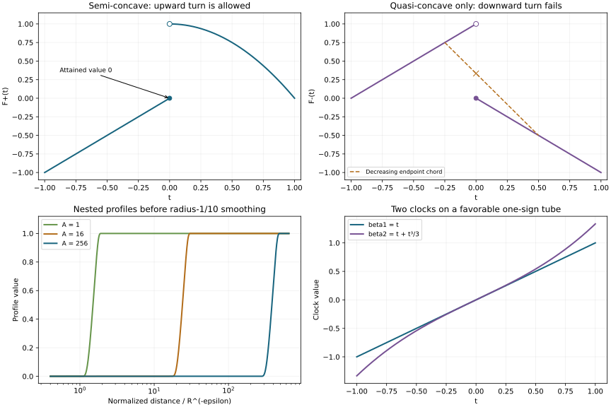

# Semi-concavity and semidefinite characteristics

A decreasing regularity profile obeys a stronger comparison rule than an increasing one. This asymmetry is the useful notion of semi-concavity in the principal-type propagation problem. We first prove its exact shape classification and endpoint rules. We then prove propagation on the entire semidefinite characteristic stratum, with the parameter construction justified separately from the analytic estimate.

The mathematical antecedent is Lars Hörmander, *The Analysis of Linear Partial Differential Operators IV*, 2009 edition, Definition 26.9.5, Proposition 26.9.6 and Theorem 26.9.7, printed pages 145–148. “Semi-concave” here means the decreasing-affine comparison property defined below; it does not mean the different convention of subtracting a quadratic function to obtain a concave function.

There is a necessary geometric correction. The broad Hessian-proportionality assertion on printed page 116 does not hold throughout the semidefinite stratum. The exact counterexample [CPG:X3](../20261011-condition-p-geometry/condition-p-and-characteristic-saturation.html) has a nonzero semidefinite Hessian whose rank changes along a persistent characteristic. We preserve that counterexample. Where the imaginary symbol has one favorable sign, forward propagation permits an arbitrary increasing clock. On the other portions, the flat-remainder division supplies the affine parameter actually needed for descent. The construction below combines these cases and covers every compact characteristic interval with the stated semidefinite endpoints; it does not assert a unique natural affine structure where that assertion fails.

The exact earlier proofs are [nonnegative semidefinite division](../20261011-semidefinite-quadratic-division/semidefinite-division-with-a-nonnegative-quotient.html), SQD:H1; [intrinsic quadratic transport](../20261011-quadratic-affine-geometry/indefinite-quadratic-division-and-affine-parameters.html), QAF:T0–T2; [one-direction propagation](../20261011-one-direction-propagation/one-direction-propagation-and-characteristic-strata.html), ODP:B0; [full cutoff energy](../20261011-complex-cutoff-energy/adaptive-square-roots-and-complex-cutoff-energy.html), CCE:P0; and [exact-factorization descent](../20261012-one-dimensional-descent/one-dimensional-descent-and-affine-concavity.html), ODD:C2. The proof map pins the complete receiving dependency chain.

This independent exposition, its three complete solutions and original figure are CC0-1.0. Linked components retain their terms. Human foundational proofs remain external, so internal export P514 closure is unclaimed. 

## 1. The two comparison properties

**H0. Definitions, including infinite values.** Let \(J\) be an interval and let \(F:J\to(-\infty,+\infty]\) be lower semicontinuous. Call it *semi-concave* if, for every compact \([a,b]\subset J\) and every real affine function \(L\) of nonpositive slope,

\[
 F(a)\ge L(a),\ F(b)\ge L(b)
       \quad\Longrightarrow\quad F(t)\ge L(t)\quad(a\le t\le b). \tag{SC1}
\]

Call it *quasi-concave* if the same assertion holds for constant \(L\). Equivalently,

\[
 F(y)\ge\min\{F(x),F(z)\}\qquad(x<y<z). \tag{SC2}
\]

To prove the equivalence, compare with every finite constant below the endpoint minimum, then increase that constant to the minimum. Conversely (SC2) directly gives every constant comparison. In particular the equivalence includes an infinite endpoint minimum.

Strictly decreasing affine tests suffice in (SC1). For a constant \(L\) on \([a,b]\), the functions \(L-\varepsilon(t-a)\) have negative slope, are at most \(L\) at both ends, and increase to \(L\) as \(\varepsilon\downarrow0\). Thus the strict-slope convention gives the same property.

**H1. Elementary closure properties.** Semi-concavity is invariant under increasing affine changes of the independent variable. Quasi-concavity is invariant under every strictly monotone continuous change, including reversal: (SC2) is an order statement symmetric in its two outer points. Semi-concavity need not survive reversal.

The minimum of two semi-concave functions is semi-concave, and the analogous assertion holds for quasi-concavity. Indeed an admissible endpoint bound for the minimum is an endpoint bound for both functions, so each dominates the comparison inside. Their minimum remains lower semicontinuous. In particular every finite truncation

\[
 F_N=\min(F,N) \tag{SC3}
\]

retains either property. Lower semicontinuity and compactness give a finite lower bound on each compact interval: finitely many neighborhoods on which the function exceeds some finite bound cover that interval. Increasing limits preserve the comparison inequalities; when the limit is also lower semicontinuous, it retains the property.

## 2. The complete shape classification

**Q0. Quasi-concavity on an open interval.** A lower semicontinuous function on an open interval is quasi-concave precisely when it has one of these forms:

1. It is nondecreasing and continuous from the left.
2. It is nonincreasing and continuous from the right.
3. There is an interior point \(c\) such that it is nondecreasing and left-continuous to the left of \(c\), nonincreasing and right-continuous to its right, and

\[
 F(c)=\min\{F(c-),F(c+)\}. \tag{SC4}
\]

One-sided limits and continuity here are in the extended real sense. To prove necessity, let \(A\) consist of the earlier points of strict increasing pairs: \(t\in A\) if \(F(t)<F(t')\) for some \(t'>t\). If \(A\) is empty, the function is nonincreasing. For \(t\in A\), (SC2) first implies \(F(y)\le F(t)\) for \(y<t\); otherwise \(t\) is a strict valley between \(y\) and \(t'\). It then implies \(F(x)\le F(y)\) for \(x<y\le t\), since a failure would make \(y\) a strict valley between \(x\) and \(t'\). Thus every such initial portion is nondecreasing.

Set \(c=\sup A\), allowing the right endpoint of the open interval as an extended possibility. The initial-portion observation makes \(F\) nondecreasing to the left of \(c\). To its right there are no strict increasing pairs, so it is nonincreasing. If \(c\) is the right endpoint, this is the first alternative. On a monotone branch, lower semicontinuity is exactly the stated one-sided continuity: the appropriate one-sided limit is bounded above by the value by monotonicity, and bounded below by the value by lower semicontinuity.

For an interior \(c\), lower semicontinuity gives \(F(c)\le\min(F(c-),F(c+))\). If this inequality were strict, choose one finite level strictly between the two sides. Points sufficiently close on both sides would lie above that level, contradicting (SC2) at \(c\). This proves (SC4), including infinite limits.

Conversely a point on either monotone branch is at least the corresponding outer endpoint value. At the turn, the left limit is at least the left outer endpoint and the right limit is at least the right outer endpoint. Equation (SC4) therefore gives (SC2) at the turn as well. The stated continuity and turn value give lower semicontinuity. All three alternatives are sufficient.

**Q1. What decreasing affine tests add.** For semi-concavity, the second alternative becomes “nonincreasing and concave.” In the third alternative the right branch is nonincreasing and concave, and its joining rule becomes

\[
 F(c)=F(c-)\le F(c+). \tag{SC5}
\]

Indeed semi-concavity implies quasi-concavity. On any nonincreasing branch the chord between two finite values is an admissible affine test, so (SC1) is the concavity inequality. Apply this argument first to the finite truncations (SC3) and let \(N\) increase to obtain the same inequality for extended values.

Write \(A_-=F(c-)\), \(A_+=F(c+)\). If \(A_->A_+\), then \(A_+\) is finite and (SC4) gives \(F(c)=A_+\). Choose a finite \(C\) with \(A_+<C<A_-\), and a fixed point \(t>c\) with \(F(t)<C\). For sufficiently small \(\varepsilon>0\), \(F(c-\varepsilon)\ge C\). The affine chord from value \(C\) at \(c-\varepsilon\) to value \(F(t)\) at \(t\) is decreasing and lies below \(F\) at its endpoints. At \(c\) its value tends to \(C\), contradicting \(F(c)=A_+<C\). Thus \(A_-\le A_+\), and (SC4) gives (SC5). This argument also covers \(A_-=+\infty\).

**Q2. The converse semi-concavity statement.** A nondecreasing left-continuous function satisfies (SC1), since throughout the interval it is at least its left endpoint value while \(L\) is at most its left endpoint value. A nonincreasing concave function also satisfies (SC1) by its chord inequality.

For the joined form, the same increasing-branch argument proves comparison up to the turn, including \(F(c)\). The right limit in (SC5) is at least \(L(c)\). Concavity on the right branch and the prescribed right endpoint bound then give comparison to the right: apply its chord inequality from \(c+\varepsilon\) to that endpoint and let \(\varepsilon\downarrow0\), holding the interior evaluation point fixed. If the right limit is infinite, the same inequalities use arbitrary finite lower bounds for that limit. Thus every form listed in Q1 is semi-concave. This proves both directions of Proposition 26.9.6 on the open interior.

**Q3. Included endpoints need their own rule.** For an interval with an included left or right endpoint, the interior classification is supplemented by

\[
 F(a)\le\liminf_{t\downarrow a}F(t),\qquad
 F(b)\le\liminf_{t\uparrow b}F(t), \tag{SC6}
\]

whenever the respective endpoint is included. These are exactly the lower-semicontinuity requirements there. They are also sufficient for either comparison property. Given an endpoint comparison, lower its affine function by a positive constant \(\delta\). Condition (SC6) allows the endpoint to be moved slightly inward while preserving this strict comparison. Apply the interior property with these moved endpoints, keeping any desired interior evaluation point between them, and let \(\delta\downarrow0\). The original endpoints already satisfy the assumption.

This endpoint completion matters on compact characteristic intervals. A permitted downward value at a closed endpoint is not an interior downward turning jump. The example in X1 distinguishes them. A singleton interval has no interior comparison and requires no extra condition.

**Q4. Local semi-concavity is global.** Suppose \(F\) is lower semicontinuous and semi-concave in a neighborhood of each interior point. It is then semi-concave on the entire interval, subject to (SC6). It suffices to consider a compact interval and a strictly decreasing test \(L\). Suppose the endpoint comparisons hold but \(F(t_0)<L(t_0)\) inside. Choose \(\delta>0\) small enough that

\[
 \phi(t)=L(t)-\delta(t-a)(b-t) \tag{SC7}
\]

is still strictly decreasing and \(F(t_0)<\phi(t_0)\). The lower semicontinuous function \(F-\phi\) has a finite negative minimum \(m\) at an interior point \(t\). Existence follows from compactness; finiteness follows from its finite lower bound and its negative value at \(t_0\).

For a sufficiently small \(h>0\), the points \(t-h,t+h\) lie in one neighborhood of semi-concavity. Let \(A\) be the affine chord through \(\phi(t-h)+m\) and \(\phi(t+h)+m\). It has negative slope, and \(A\le F\) at those endpoints by minimality. But the second derivative of \(\phi\) is \(2\delta\), so

\[
 A(t)=\phi(t)+m+\delta h^2=F(t)+\delta h^2>F(t), \tag{SC8}
\]

a contradiction. Constant tests follow from H0. Finally use Q3 for included boundary points. This local-to-global argument is specific to semi-concavity; no analogous claim about local quasi-concavity has been used.

## 3. A justified clock on the full semidefinite stratum

**G0. Orient the curve and identify the zero fibers.** Let \(I\) be an embedded compact regular one-dimensional characteristic interval for a scalar homogeneous principal symbol satisfying (P). Both endpoints belong to \(N_{12}\setminus N_{12}^{i}\): their intrinsic transverse quadratic forms are nonzero and semidefinite. We work inside the regular persistent locus of ODP:G0.

Use the ordinary full-interval canonical tube QAF:D0. After a nonzero multiplier its symbol is \(\tau+i f(t,Y)\), with \(f=df=0\) along \(Y=0\). Reverse the orientation if necessary so that the initial nonzero form \(Q_{t_0}=f_{YY}''(t_0,0)\) is negative semidefinite. Condition (P) says that \(f(t,Y)f(t_0,Y)\ge0\). For every vector \(v\) outside \(\ker Q_{t_0}\), \(f(t_0,rv)<0\) for sufficiently small nonzero \(r\). Therefore \(f(t,rv)\le0\), and taking its second-order limit gives \(Q_t(v,v)\le0\). The complement of that proper kernel is dense, so the inequality holds for all vectors. Hence

\[
 Q_t\le0\text{ for every }t\in I,\qquad Q\ne0
       \text{ at the two endpoints}. \tag{SC9}
\]

QAF:T1 shows that this is an intrinsic orientation convention. It does not say that the forms are proportional.

In the fixed real transverse frame of this ordinary tube, set

\[
 k(t)=\sum_{j,l}(Q_t)_{jl}^2,\qquad
 \beta_0(t)=\int_{t_*}^{t}k(r)\,dr. \tag{SC10}
\]

The fibers of \(\beta_0\) are exactly the maximal zero-\(Q\) intervals and the remaining singletons. The endpoint fibers are singletons. This defines the topological quotient without making any affine invariance claim. Its fibers are compact, and their infimum regularity indices are lower semicontinuous by ODD:H1.

**G1. Whole-fiber homogeneous tubes.** If one point of the characteristic is radial, homogeneous flow uniqueness makes the whole interval radial, as in ODD:G0. We handle that case directly in P0 below.

In the nonradial case, every zero-\(Q\) fiber has injective regular cosphere projection. The proof of ODD:G1 uses precisely the invariant zero-Hessian set and applies with “nonzero” in place of “indefinite” at the adjacent points: a radial point would force a ray; opposite tangent returns contradict unit-speed flow uniqueness; a same-tangent return would trap the characteristic in the conic lift of a closed zero-Hessian projected orbit. Its continuation could not reach the nearby nonzero-\(Q\) points, a contradiction. Maximality of a zero fiber and the endpoint condition in (SC9) supply those nearby points on both sides.

Consequently a fiber over an interior quotient point has a slightly larger compact homogeneous tube, with nonzero-\(Q\) endpoints inside \(I\). Compact embeddedness persists under a sufficiently small extension, by the collision-limit and inverse-function argument in ODD:G1. A singleton uses a small nonradial flow chart; if its form is zero, maximality again gives nonzero forms arbitrarily nearby on both sides. PSG:N0–N2 supply the canonical coordinates on the whole selected tube.

**G2. The division gives an exact dichotomy.** On this tube, SQD:H1 yields

\[
 p_1=\tau+i f(t,x,\eta),\qquad
 f=g(x,\eta)h(t,x,\eta)+r(t,x,\eta),\quad
 h\ge0,\quad r=0\text{ where }g>0. \tag{SC11}
\]

Here \(g=f(t_0,\cdot)\) at a nonzero-\(Q\) mark, \(g=dg=0\) there, and its Hessian is negative semidefinite and nonzero. The degrees of \(g,r,h\) are \(1,1,0\). All are independent of \(\tau\), and \(g\) is independent of \(t\).

There is a transverse direction with a strictly negative second derivative of \(g\), on a small normalized-frequency neighborhood. Thus every zero of \(g\) in that neighborhood is a limit of negative values: if its first derivative in that direction is nonzero, use the appropriate small displacement; if it is zero, strict concavity gives negative values on both sides. It follows from the sign condition and continuity that

\[
 g\le0\quad\Longrightarrow\quad f(t,x,\eta)\le0
       \text{ throughout the common time interval}. \tag{SC12}
\]

If \(g\le0\) near the mark, the entire fiber has a favorable one-sign neighborhood. Otherwise positive values of \(g\) approach the mark. Since every derivative of \(r\) vanishes on the open set \(g>0\), continuity makes every such derivative vanish on its closure, including the mark, for all times. Thus \(r\) is flat on the central interval. The variational equation and transported-Hessian calculation QAF:T0–T2 depend only on the two-jet, so in this second case they give exactly

\[
 \text{transported }Q_t=h(t,0,e)Q_*,\qquad
 h(t,0,e)>0\text{ at the selected endpoints}. \tag{SC13}
\]

The endpoint positivity follows because \(Q_*\ne0\) and the endpoint forms are nonzero. This is the affine assertion needed in the sign-changing case. It has not been inferred in the one-sign case.

**G3. Construct one admissible clock.** The following construction makes the distinction global on the compact interval. Let \(B\) be the union of the inverse images of open quotient neighborhoods whose **whole fibers** lie in a common favorable one-sign homogeneous tube. This is an open saturated subset of \(I\): any fiber meeting it is wholly contained in it. The open neighborhoods can be taken from the interiors of the tubes in G1, whose nonzero-\(Q\) endpoints ensure that they contain whole nearby fibers.

Let \(T(t)\) be the exact complex symplectic transport from the fixed initial transverse space in QAF:T0, expressed in the ordinary tube's frame, and set

\[
 b(t)=\left\|T(t)^TQ_tT(t)\right\|_{\mathrm F}, \tag{SC14}
\]

where the norm is the square root of the sum of squared absolute values of the complex matrix entries. It is continuous, positive exactly where \(Q_t\ne0\), and smooth near every nonzero form. If a whole fiber is outside \(B\), G2 must be in its second case; otherwise that fiber would belong to \(B\). Write \(\theta\) for the increasing time coordinate of its homogeneous tube if that coordinate differs from the original \(t\). Formula (SC13), multiplier invariance and the reparametrization rule QAF:T1 give
\(b(t)\,dt=c\,h(\theta,0,e)\,d\theta\) with one positive constant \(c\). Indeed the pulled-back base matrix is fixed, while \(Q_t=(d\theta/dt)Q_\theta\); its norm multiplies by the positive derivative. Thus \(b\) is smooth on an open set \(D\) containing \(I\setminus B\), as well as the two endpoints.

The compact residual set \(K=I\setminus D\) is contained in \(B\). Choose a smooth \(0\le\alpha\le1\), equal to one near \(K\), whose support relative to \(I\) is contained in \(B\). The compact cutoff construction gives an extension to a neighborhood of \(I\). Define

\[
 \omega(t)=(1-\alpha(t))b(t)+\alpha(t)k(t),\qquad
 \beta(t)=\int_{t_*}^{t}\omega(r)\,dr. \tag{SC15}
\]

The first term is zero near every possible nonsmooth point of \(b\); elsewhere \(b\) is smooth. Therefore \(\omega\) is smooth. It is nonnegative and vanishes exactly where \(Q_t=0\). It gives the same topological fibers as \(\beta_0\).

A fiber outside \(B\) is compact and disjoint from the closed relative support of \(\alpha\), so an entire neighborhood of that fiber has \(\alpha=0\). On its homogeneous tube, \(\omega(t)\,dt=c\,h(\theta,0,e)\,d\theta\). Thus \(\beta\) is an affine coordinate for the exact descent there. A fiber inside \(B\) uses one-sign propagation and needs only the monotonicity of \(\beta\).

We call (SC15) an *admissible clock*. In the term supported in \(B\), \(k\) may be replaced by any smooth nonnegative function with the same zero set. The proof is unchanged. There is no uniqueness claim on \(B\). In particular this construction does not restore the false blanket proportionality disproved by CPG:X3.

**T0. The full propagation statement with its clock specified.** Let \(P\) be a properly supported scalar classical operator of real order \(m\), satisfying (P), and let \(I\) have the semidefinite endpoints above. On its quotient choose an admissible clock \(\beta\); for a radial interval any increasing smooth clock is permitted. For a distribution \(v\), write

\[
 s_v(b)=\inf_{\beta(t)=b}s_v^*(\gamma(t)).
 \qquad
 s_{Pu}\ge s,\ s\text{ semi-concave}
 \ \Longrightarrow\
 \min(s_u,s+m-1)\text{ semi-concave}. \tag{SC16}
\]

Every interval with the stated endpoints has the clock just constructed, so the statement covers the entire semidefinite case. It is the propagation conclusion of Theorem 26.9.7 with the parameter's actual scope made explicit.

The exact elliptic order reduction and canonical graph equivalence ODD:G2, SP:S2 and SP:S4 reduce each whole-fiber argument to \(m=1\). The unknown index is unchanged and the source index becomes \(s_{Pu}+m-1\). Accordingly replace \(s\) by \(s+m-1\). Smooth inverse defects do not affect either index. In what follows \(P\) has order one and its full lower-order symbol remains present.

## 4. Comparisons where the symbol has one sign

**P0. Favorable tubes and radial intervals.** Fix a fiber with a favorable one-sign tube and let \(L(\beta)\) be a decreasing affine test with strict endpoint bounds for both the source comparison \(s\) and the unknown index. Semi-concavity of \(s\), applied after a sufficiently small constant upward shift of \(L\), gives a uniform strict source bound throughout the quotient interval.

For a target point \(t\), \(L(\beta(r))\ge L(\beta(t))\) at every earlier \(r\), because \(\beta\) is nondecreasing. Choose a fixed real order slightly above \(L(\beta(t))\), below the source index on the compact incoming segment and below the initial unknown index. Compact lower semicontinuity and the strict margins permit this choice. ODP:B0 propagates that actual Sobolev order forward to \(t\). The same fixed margin works over each compact target fiber, so its infimum index is strictly above the comparison. This proves the local semi-concavity test on the whole fiber, even if the clock is constant on it.

For a radial interval, both microlocal indices are constant along the ray by conicity. The function in (SC16) is the minimum of a constant and the semi-concave source comparison, hence is semi-concave by H1. No homogeneous time-flow coordinate is used in this case.

## 5. Cut away the favorable side at a shrinking scale

**A0. A temporary regularity assumption.** Consider a fiber outside \(B\), use its single homogeneous tube (SC11), and take a compact subinterval with nonzero-\(Q\) endpoints around it. On this tube \(\beta\) is an affine function of \(\int h(t,0,e)\,dt\). Let \(L(\beta)\) be decreasing and strictly below the source comparison and the unknown index at both endpoints. Its lifted function \(L(t)\) is nonincreasing. First impose

\[
 s_u^*>L(t)-\tfrac18
       \quad\text{on the compact central interval}. \tag{SC17}
\]

This will be removed by a finite bootstrap. Since the source comparison is semi-concave, its strict endpoint bounds imply \(s_{Pu}^*>L(t)\) throughout, with a uniform positive margin after a small upward shift of the test. All assertions remain on the original interval; no source information beyond its endpoints is assumed.

**A1. Three nested distance cutoffs.** Put \(F=\overline{\{g>0\}}\) in the transverse phase variables. Extend the local conic data to a slightly larger chart before making cutoffs. Regions outside that chart are separated from the final retained tube. Fix

\[
 0<\varepsilon\le\tfrac14,\qquad
 \rho=1-\varepsilon,\quad\delta=\varepsilon,\quad
 \kappa=1-2\varepsilon. \tag{SC18}
\]

We construct real time-independent cutoffs \(\chi_0,\chi_1,\chi_2\) of class \(S^0_{\rho,\delta}\), with \(\chi_{j+1}=1\) near \(\operatorname{supp}\chi_j\), each supported outside \(F\), and with \(1-\chi_0\) confined near \(F\) at high frequency.

Here is a direct construction, including derivative and plateau bounds. On the dyadic band \(|\eta|\asymp R\), use \(Z=(x,\eta/R)\), \(d_R=\operatorname{dist}(Z,F)\), and \(a_R=R^{-\varepsilon}\). Homogeneity identifies the rescaled closed positive set with the same closed cone. Its distance is 1-Lipschitz, by the triangle inequality and infimum definition. For \(A_0=256,A_1=16,A_2=1\), choose a profile zero up to \(A_j a_R\) and one beyond \(2A_j a_R\), and convolve it in \(Z\) with a nonnegative smooth unit-integral bump supported in the ball of radius \(a_R/10\). Call the result \(\chi_{j,R}\). Differentiating the convolution kernel gives

\[
 |\partial_Z^\nu\chi_{j,R}|\le C_\nu R^{\varepsilon|\nu|},\quad
 \chi_{j,R}=0\text{ if }d_R\le(A_j-\tfrac1{10})a_R,\quad
 \chi_{j,R}=1\text{ if }d_R\ge(2A_j+\tfrac1{10})a_R. \tag{SC19}
\]

The support assertion follows because every point entering the convolution then lies in the original zero region; the identity assertion follows in the same way. Derivative estimates use boundedness of the profile and the scaled integral of each kernel derivative; no differentiability of distance is needed.

Sum these symbols against one nonnegative dyadic frequency partition. Overlapping bands have \(R/S\) between \(1/4\) and \(4\). Rescaling the frequency coordinate maps \(F\) to itself, so their distances differ by at most a factor \(4\), and their \(a_R\) by at most \(4^{1/4}=\sqrt2\). If \(\chi_{j,R}\) is nonzero, every overlapping \(\chi_{j+1,S}\) is one: for \(j=0,1\),

\[
 \frac{A_j-\tfrac1{10}}{4\sqrt2}
       >2A_{j+1}+\tfrac1{10}. \tag{SC20}
\]

The strict inequalities also give a neighborhood of the closed support. Thus the summed cutoffs have the promised plateaus. Each base derivative costs \(R^\varepsilon\), each frequency derivative costs \(R^{-1+\varepsilon}\); derivatives of the dyadic partition have smaller costs. Finite overlap proves the full symbol estimates. Low frequencies are smoothed separately.

On a smaller retained conic tube,

\[
 1-\chi_0\ne0
 \quad\Longrightarrow\quad
 \operatorname{dist}_{0}((x,\eta),F)\le C R^{-\varepsilon}, \tag{SC21}
\]

where \(\operatorname{dist}_0\) means distance in the normalized coordinates at that band. Indeed beyond that bound every active band profile is one. Constants and the initial high-frequency threshold may depend on \(\varepsilon\). We fix \(\varepsilon\) before taking frequency to infinity.

**A2. Full-frequency symbols and the sign region.** Choose nested ordinary real conic cutoffs \(\psi_0,\psi_1,\psi_2\), independent of \(t\), equal to one near the central transverse mark, with \(\psi_{j+1}=1\) near \(\operatorname{supp}\psi_j\). Restrict them to a full-frequency cone where \(|\eta|\) is comparable to \(|(\tau,\eta)|\), and put

\[
 c_j(x;\tau,\eta)=\psi_j(x;\tau,\eta)\chi_j(x,\eta),
 \qquad C_j=\operatorname{Op}(c_j),\quad j=0,1,2. \tag{SC22}
\]

The full symbols are in \(S^0_{\rho,\delta}\), including \(\tau\)-derivatives of \(\psi_j\); they are independent of \(t\). Each \(c_{j+1}\) is one near the support of \(c_j\). Their supports avoid \(F\), and hence \(g\le0\) there. Formula (SC12) gives \(f\le0\) on the support of \(c_2\), throughout the required time interval.

All later operator statements use proper representatives and compact base localizations. SCE:C0 proves the full ordinary/exotic product expansions and all-real Sobolev mapping. Separated cone or base supports give smooth errors by taking arbitrary orders in those expansions and by the off-diagonal kernel argument. In each use choose the finite expansion depth larger than the actual distribution's negative Sobolev order and the requested output order. This also proves the usual smaller-cone microlocal mapping for these particular exotic cutoffs.

**E0. Recover the measured favorable part.** Fix a target time \(t\), and set \(s_0=L(t)\). On the incoming prefix, monotonicity of \(L\) and (SC17) give actual microlocal \(H^{s_0-1/8}\) regularity. The strict source bound gives actual \(H^{s_0}\) source regularity, and the incoming endpoint has actual \(H^{s_0}\) regularity. Choose time windows and the common transverse cutoffs inside these open regularity neighborhoods.

Apply CCE:P0 to the real symbol \(\langle(\tau,\eta)\rangle^{s_0}c_0\), with plateau \(c_1\), and separately to \(\langle(\tau,\eta)\rangle^{s_0}c_1\), with plateau \(c_2\). Its exact weak-order requirement is

\[
 s_0+\frac{3\varepsilon-1}{2}\le s_0-\tfrac18
       \qquad(0<\varepsilon\le\tfrac14). \tag{SC23}
\]

Its measured forcing and incoming terms are in \(L^2\) by the full Sobolev bounds of SCE:C0. The localization step ODP:L0 makes the actual input compact and globally in the required weak space: a proper cutoff is the identity on a larger working tube, and every complementary source or commutator term is smooth on the measured support. Thus no derivative of the measured forcing has been added. The source's left regularizer and limit theorem apply exactly.

For a target at the edge of a chosen window, the strict index margins permit a slightly larger window. This gives microlocal regularity at the target itself. For all targets in the compact interval, one transverse tube and the three symbols may be retained: lower semicontinuity applied to the continuous thresholds \(L(t)\) and \(L(t)-1/8\) gives a common smaller tube. The time windows and fixed orders can vary with the target.

The conclusion is that both measured weighted operators applied to \(u\) are in \(L^2\) there. The mixed product theorem also gives

\[
 \langle D\rangle^{s_0}C_j-
 \operatorname{Op}(\langle\xi\rangle^{s_0}c_j)
       \in\Psi^{s_0+\varepsilon-1}_{\rho,\delta},
       \qquad j=0,1. \tag{SC24}
\]

Applied to \(H^{s_0-1/8}\), the difference is in \(H^{7/8-\varepsilon}\subset L^2\). Consequently

\[
 C_0u,\ C_1u\text{ are microlocally }H^{L(t)}
       \text{ at every point of the central interval}. \tag{SC25}
\]

This is an actual-order statement, and includes every point of each collapsed fiber.

## 6. Remove the flat remainder and descend

**E1. The complete spacetime commutator.** Set \(v=(I-C_0)u\). The exact operator equation is

\[
 Pv=(I-C_0)Pu-[P,C_0]u. \tag{SC26}
\]

The full principal commutator symbol is \(a=\{f,c_0\}\). It includes the temporal-frequency term:

\[
 a=-f_t(c_0)_\tau+
       \sum_j\bigl(f_{\eta_j}(c_0)_{x_j}
                         -f_{x_j}(c_0)_{\eta_j}\bigr)
       \in S^\varepsilon_{\rho,\delta}. \tag{SC27}
\]

Indeed \(\partial_t c_0=0\), so \((1/i)\{\tau+i f,c_0\}=\{f,c_0\}\). The full mixed remainder after this bracket has order \(2\varepsilon-1\), by SCE:C0. The complete lower-order part of \(P\) contributes a commutator of order at most \(\varepsilon-1\).

Since \(c_1=1\) near the support of \(c_0\), including all its differentiated supports, \(ac_1=a\). Composing \(\operatorname{Op}(a)\) with \(C_1\) costs one exotic product remainder of order \(\varepsilon-\kappa=3\varepsilon-1\). Therefore the actual operators satisfy

\[
 [P,C_0]=Q_1C_1+Q_2,\qquad
 Q_1\in\Psi^\varepsilon_{\rho,\delta},\quad
 Q_2\in\Psi^{3\varepsilon-1}_{\rho,\delta}. \tag{SC28}
\]

All terms are full-symbol statements, not only principal identities. By (SC25), the first term applied to \(u\) is \(H^{L(t)-\varepsilon}\). By (SC17), the second is at least \(H^{L(t)+7/8-3\varepsilon}\), which is stronger than required. The localized source term in (SC26) is \(H^{L(t)}\). We obtain

\[
 Pv\text{ is microlocally }H^{L(t)-\varepsilon}
       \text{ along the interval}. \tag{SC29}
\]

At both endpoints, \(v\) has index strictly greater than \(L\): the original unknown does, and the order-zero smaller-cone mapping in A2 preserves that endpoint margin.

**E2. Flatness controls the actual operator error.** Every derivative of \(r\) vanishes on \(F\), uniformly on compact time intervals. Taylor expansion about a nearest point of this closed set, on a slightly larger normalized chart, gives for every derivative order and every integer \(N\)

\[
 R^{-1}|\partial_Z^\nu\partial_t^j r|
       \le C_{\nu,j,N}\operatorname{dist}_0(F)^N. \tag{SC30}
\]

Segments to these nearest points stay in the larger chart when the distance is small; outside that small neighborhood the estimate follows by increasing the constant. On the support of \(1-c_0\) near the central cone, \(\psi_0=1\) at high frequency, so (SC21) applies. Thus (SC30) defeats every polynomial frequency loss, including all differentiated cutoff factors.

Every finite coefficient in the full product \(r\#(1-c_0)\) is rapidly decreasing. Its unexpanded remainder can be taken of arbitrarily low order by the full mixed calculus. For an actual compactly localized input in \(H^{-M}\), choose depth \(N\) so that

\[
 N(1-2\varepsilon)>1+M+\max_I|L|+2. \tag{SC31}
\]

Increasing it further gives any requested output Sobolev order. Hence the complete operator \(\operatorname{Op}(r)(I-C_0)\) is microlocally smoothing on the retained tube, and in particular its action on this actual \(u\) is smooth. No convergence of a formal infinite symbol sum has been presumed.

**D0. Apply the exact-factorization theorem.** Let
\(\widehat P=P-i\operatorname{Op}(r)\), with the same proper localizations. Its principal symbol is exactly \(\tau+i gh\) on the working tube. It satisfies (P), since \(h\ge0\) and \(g\) is independent of \(t\), by PSG:E1 in both sign orientations. Its source on \(v\) has index at least \(L-\varepsilon\), by E1–E2.

The clock is affine in \(\int h\,dt\) on this entire tube. Apply ODD:C2 to \(v,\widehat P\) and the affine comparison \(L-\varepsilon\). The endpoint indices of \(v\) exceed \(L\). Consequently the concave function
\(\min(s_v,L-\varepsilon)\) has the same endpoint values as \(L-\varepsilon\), and its endpoint chord forces

\[
 s_v\ge L-\varepsilon,\qquad
 s_u\ge L-\varepsilon
       \text{ on the full reduced interval}. \tag{SC32}
\]

The second inequality uses (SC25) and \(u=v+C_0u\); addition preserves every Sobolev order strictly below the smaller index. Each \(\varepsilon\in(0,1/4]\) has its own valid cutoffs and frequency threshold. Letting \(\varepsilon\downarrow0\) proves \(s_u\ge L\). No uniform endpoint Sobolev membership is inferred from this limiting index statement.

**B0. Remove the temporary assumption and restore strict comparison.** A compact localization supplies one finite negative-Sobolev lower bound for the unknown. Choose a finite integer \(N\) large enough that this bound exceeds \(L-N/16\) on the entire interval. Apply the preceding argument successively to

\[
 L_j=L-\frac{N-j}{16},\qquad j=0,\ldots,N. \tag{SC33}
\]

At the first step (SC17) holds by the chosen lower bound. After a conclusion \(s_u\ge L_j\), the next assumption is strict because \(L_j=L_{j+1}-1/16>L_{j+1}-1/8\). The endpoint and source bounds remain valid for every lowered comparison. Finitely many steps yield \(s_u\ge L\).

If the initial comparison is strict at the endpoints, increase \(L\) by a sufficiently small positive constant before starting. Semi-concavity of the source comparison preserves a strict source bound for this raised test throughout the interval; the endpoint unknown margins persist. The same bootstrap then gives \(s_u>L\). Thus we have the strict local comparison needed in (SC1).

The set of quotient points with nonzero \(Q\) is dense. Otherwise an open interval of quotient values would have only zero-\(Q\) preimages, on which the clock has derivative zero; its image would be a single point, a contradiction. More explicitly, if two distinct quotient values bound such an interval, integrating \(\omega\) between their preimages gives a positive difference, so \(\omega>0\), and hence \(Q\ne0\), somewhere between. Lower semicontinuity allows strict comparison endpoints to be moved to these dense nonzero-\(Q\) points while retaining any fixed interior evaluation point. Thus the argument covers tests with arbitrary quotient endpoints, including collapsed fibers. Weak endpoint bounds follow by first lowering the comparison by a positive constant and then taking its limit.

**T1. Finish the entire interval.** Every interior quotient fiber belongs either to a favorable tube in \(B\), handled by P0, or to a whole-fiber exact clock tube outside \(B\), handled by A0–B0. The resulting function \(\min(s_u,s)\) is lower semicontinuous by compactness of its fibers and H1. It is locally semi-concave everywhere. Q4 proves global semi-concavity, and Q3 supplies the included endpoints. Undo the order reduction in T0 to obtain (SC16).

This completes the full semidefinite propagation argument, including changing-rank one-sign portions and flat collapsed intervals. The admissible-clock qualification is essential mathematical information about the parameter, not a restriction to a smaller set of characteristic endpoints.

## 7. Three complete calculations

### Exercise 1. A closed endpoint is not an interior turn

**X1. An admissible endpoint cap.** On \([0,1]\), put \(F(t)=t\) for \(t<1\), and \(F(1)=-1\). Is this semi-concave?

**Solution.** Its interior is increasing and continuous. At zero the value agrees with the interior limit; at one it is smaller than the interior limit \(1\). The function is therefore lower semicontinuous, and Q3 proves semi-concavity. Directly, a nonincreasing comparison line below \(F\) at the left endpoint of a test interval lies below every subsequent interior value, while its right endpoint is already controlled by assumption. The endpoint drop violates neither requirement. Applying the interior joining rule (SC5) at the closed right endpoint would incorrectly exclude this example.

### Exercise 2. The direction of the turning jump matters

**X2. Two exact jump profiles.** On \((-1,1)\), compare

\[
 F_+(t)=
 \begin{cases}t,&t\le0,\\1-t^2,&t>0,\end{cases}
 \qquad
 F_-(t)=
 \begin{cases}1+t,&t<0,\\-t,&t\ge0.\end{cases} \tag{SC34}
\]

**Solution.** Both are lower semicontinuous and satisfy the quasi-concavity classification. For \(F_+\), the left limit and attained value at zero are \(0\), while the right limit is \(1\). Its right branch has derivative \(-2t\le0\) and second derivative \(-2\), so (SC5) gives semi-concavity.

For \(F_-\), the left limit is \(1\), while the right limit and attained value are \(0\). The chord from \((-1/4,3/4)\) to \((1/2,-1/2)\) is

\[
 L(t)=\tfrac13-\tfrac53t,\qquad L(0)=\tfrac13>F_-(0)=0. \tag{SC35}
\]

It is decreasing and agrees with both endpoint values, so it disproves semi-concavity. This failure occurs despite a linear, hence concave, right branch: it is exactly the wrong joining inequality.

### Exercise 3. Two valid clocks without Hessian proportionality

**X3. A changing-rank favorable symbol.** On \(\kappa>0\), take

\[
 p=\tau-i\kappa(x^2+t^2y^2+y^4),\qquad
 \gamma(t)=(t,0,0;0,0,1). \tag{SC36}
\]

Compare its transverse Hessian and the clocks \(\beta_1=t\), \(\beta_2=t+t^3/3\).

**Solution.** This is the conjugate sign of CPG:X3. The zero set is invariant under every real Hamilton combination, which proves (P) exactly as there. Its intrinsic form is

\[
 Q_t=-2\,dx^2-2t^2\,dy^2. \tag{SC37}
\]

It has rank one at zero and rank two elsewhere. Every invertible complex pullback preserves rank, so these nonzero forms cannot all be scalar multiples of \(Q_0\). Nevertheless the imaginary symbol is nonpositive on the whole cone. P0 therefore proves the regularity comparison for either clock. Their derivatives are \(1\) and \(1+t^2>0\), and their ratio is nonconstant, so the clocks are not affinely related. Both fit the one-sign freedom in G3. The propagation conclusion survives; uniqueness of the asserted parameter does not.

## 8. Read the exact figure

**F0. Jumps, cutoff plateaus and clock choices.** The figure plots the two functions in (SC34), marking the actual value and the missing one-sided limit at the jump. It displays nested smooth cutoff profiles against normalized distance, and the two clock functions from X3. These are sampled graphs of explicit formulas. The proof of the true distance cutoffs, including the overlap constants and all derivative bounds, is A1; the profile drawing does not replace it.

The [figure generator](figures/build_figure.py), [finite checks](model-check.json), source record, [proof review](proof-review.json) and [reader checks](reader-check.json) accompany the lesson. [General one-dimensional quasiconcavity](../20261012-localized-quasiconcave-propagation/localized-weights-and-quasiconcave-propagation.html) requires no affine parameter. [Escape regularity and semi-global solutions](../20261015-escape-regularity-and-solvability/escape-arcs-regularity-and-semiglobal-solutions.html) uses the full propagation results and exact two-ended geometry.
