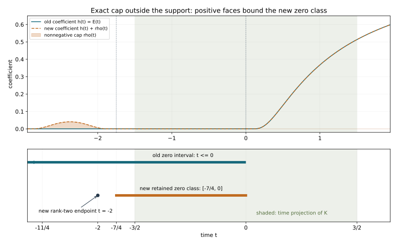

# Escape arcs, regularity and semi-global solutions

An escape arc carries information from outside a compact support to a characteristic point inside it. A rank-one arc uses quasi-concavity. A rank-two leaf uses the stronger minimum principle on its reduced complex surface. We prove the compact-support regularity conclusion with the actual endpoint geometry, then discharge the adjoint gain assumed in the preceding strict-loss lesson.

The antecedents are Hörmander IV, Theorems 26.11.2–3 and the two-ended condition in Theorem 26.11.1(i), printed pages 161–163 of the 2009 eBook, ISBN 978-3-642-00136-9. The endpoint factorization is Proposition 26.5.5, printed 113. We use the exact earlier programme proofs in the proof map. Our argument checks comparison locally on every affected compact fiber; it does not assume that a patched symbol satisfies condition (P) on unrelated curves.

The regularity and existence theorems under the two-ended arc condition are proved below. [Strict-loss solvability](../20261015-strict-loss-solvability/strict-sobolev-loss-and-compact-solvability.html) supplies the analytic construction with its gain discharged here. [The trapping criterion](../20261015-trapped-characteristics-and-principal-type/trapped-characteristics-and-the-escape-criterion.html) proves the geometric equivalence with the stationary singleton convention. The compact-support gain includes the nonproper case in PR0; existence retains proper support.

Original exposition, proofs, solutions and figure are CC0-1.0.  The remaining human foundations are external.

## 1. The exact escape hypothesis

**H0. The operator and its arcs.** Let \(X\) be a Hausdorff second-countable smooth manifold without boundary, and let \(P\in\Psi^m_{\mathrm{phg}}(X)\) be a properly supported scalar operator on complex half-densities, \(m\in\mathbb R\). Write \(p\) for its homogeneous principal symbol and assume condition (P) in the precise all-multiplier sense CPG:H0. Use \(D=-i\partial\) and
\[
 H_a=\sum_j(a_{\xi_j}\partial_{x_j}-a_{x_j}\partial_{\xi_j}),
 \qquad \{a,b\}=H_ab,\qquad N=\{p=0,\ \xi\ne0\}.
 \tag{ER1}
\]

Let \(K\subset X\) be compact. Our hypothesis is:

\[
 \begin{gathered}
 \text{Every }z\in N\cap T^*_KX\text{ is an interior point of a compact}\\
 \text{regular semibicharacteristic interval }\Gamma
 \text{ whose endpoints lie in }\{p\ne0\}\cup T^*_{X\setminus K}X .
 \end{gathered}
 \tag{ER2}
\]

A semibicharacteristic is an orbit of \(H_{\operatorname{Re}(qp)}\) in its real zero level, with smooth nonzero \(q\) on a neighborhood of the arc. The real field is nonzero there. Multipliers need not be homogeneous. Thus (ER2) itself excludes a characteristic point at which \(dp=0\). We do not silently infer regularity from the sign restriction alone.

CPG:T0–L0 proves that the saturation \(S=N_2^e\) of
\[
 N_2=\{p=0:\ d\operatorname{Re}p,\ d\operatorname{Im}p
                     \text{ are real-linearly independent}\}
 \tag{ER3}
\]
is a smooth coisotropic manifold of codimension two, with two-dimensional characteristic leaves. A semibicharacteristic meeting \(N_2\) remains in \(N\), lies in \(S\), and follows one such leaf. Its rank-one portions follow the unique complex Hamilton line.

**H1. The regularity assertion.** Let \(u\in\mathcal E'_K(X)\). If \(s_{Pu}^*\ge s\) at every nonzero covector, with \(s\in\mathbb R\cup\{+\infty\}\), then
\[
                            s_u^*\ge s+m-1 .
 \tag{ER4}
\]
This is a statement about indices; membership at a finite supremum is not asserted. The proof will test a finite level strictly below the right side.

## 2. What comparison needs on one compact fiber

**L0. A local model contract.** Consider an open piece of a coisotropic characteristic leaf, with its rank-one intervals collapsed. Suppose that every fiber in question is compact and has a homogeneous canonical neighborhood in which a nonzero order-\(1-m\) multiplier puts the principal symbol in the form
\[
                  \tau+i g(Y)h(t,Y),\qquad
 h\ge0,\quad dg\ne0,\quad
 \deg g=1,\quad\deg h=0.
 \tag{ER5}
\]
Here \(Y=(x,\eta)\), \(g\) is independent of \(t\), and both coefficients are independent of \(\tau\). A nontrivial fiber is a maximal zero interval with positive coefficient at nearby times on both sides; a rank-two fiber is a singleton. The normal form holds on one neighborhood of the entire compact fiber.

Under this contract, the local conclusion of RLP:T0 is valid:
\[
 s_{Qu}\ge\sigma
 \quad\Longrightarrow\quad
 \min\{s_u,\sigma+m-1\}\text{ is superharmonic on the reduced chart.}
 \tag{ER6}
\]
Here \(Q\) is the actual operator with that principal symbol, including arbitrary lower terms; \(s_u\) and \(s_{Qu}\) on the chart are infima of the pointwise indices over the entire fiber.

We check why the earlier proof has precisely these hypotheses. RLP:G0 uses the compact homogeneous graph and order reducers to obtain (ER5), with the source shift \(m-1\). RLP:G1 removes the complete order-zero value by its all-frequency elliptic gauge. RLP:E0 treats both a collapsed interval and an ordinary rank-two singleton; the coefficient estimate includes the time derivative of \(h\). DAQ:Q0–I0 constructs the actual quotient chart and intrinsic complex structure from this nonnegative coefficient and its two positive faces. RLP:W0–B0 constructs the weighted tests, retains the full spacetime bracket and its differentiated coefficient factors, absorbs the complete remainders, and bootstraps the index. RLP:T0 completes every harmonic comparison.

After the normal form has been obtained, none of those steps uses the behavior of the symbol on a different curve or outside the fiber neighborhood. Their estimates allow arbitrary lower-order terms. Consequently the same complete receiving proof proves (ER6) whenever (ER5) and the stated compact-fiber geometry are verified directly. In particular it is unnecessary to assert condition (P) globally for an auxiliary symbol assembled outside the support.

**L1. A strong minimum from the circle means.** Let \(V\) be a lower semicontinuous superharmonic function on a connected reduced surface, bounded below by a finite constant \(c\). If \(V(a)=c\), then \(V\equiv c\). To prove this, use the circle mean inequality CIP:P1 in a complex chart about \(a\). If \(V(b)>c\) at a nearby point, lower semicontinuity gives a neighborhood of \(b\) on which \(V\ge c+\delta\) for some \(\delta>0\). The circle centered at \(a\) through \(b\), chosen inside the chart, meets that neighborhood in an arc of positive length. Its mean is therefore strictly greater than \(c\), whereas superharmonicity bounds the mean above by \(V(a)=c\). This is impossible.

Thus the minimum set is open. It is also closed, since \(\{V>c\}\) is open. Connectedness makes it the whole surface. The proof permits \(+\infty\) elsewhere: that only increases the relevant circle mean. Only the attained minimum \(c\) is required to be finite.

## 3. Caps outside the support

**C0. The terminal factor chart.** Let a compact characteristic semibicharacteristic \(\Gamma\) meet \(N_2\), and suppose its endpoints project outside \(K\). A rank-two endpoint needs no change. At a rank-one endpoint, take its terminal rank-one component along the arc, extending the arc slightly at that endpoint inside the open complement of \(K\). Toward an interior rank-two point, this component has a finite end past which it cannot remain rank one; rank-two times may approach that end without the end itself being rank two.

The endpoint may first be moved slightly in the open complement of \(K\). If rank-two times approach it along the extended arc, choose one of them as the endpoint and no cap is needed there. Otherwise choose the endpoint in the interior of its rank-one interval. Its projected germ is nonradial: a radial rank-one germ would remain on its positive ray and could not reach the rank-two part, by homogeneity and flow uniqueness. Every return of the compact projected arc to that germ is again a rank-one germ, by the same uniqueness. Compactness therefore lets us choose its small conic cap neighborhood meeting the original arc only in rank-one portions. Indeed a sequence of rank-two contact times in arbitrarily small such neighborhoods would have a limiting parameter at a return to the interior rank-one germ, where the original flow is rank one on a parameter neighborhood.

CPG:M0–M1 applies to the compact terminal rank-one interval with its nonextendible interior end. It provides a homogeneous canonical chart and a nonzero multiplier \(a\) in which
\[
                       ap=\tau+i g(Y)h(t,Y)
 \tag{ER7}
\]
with the exact properties (ER5). The curve has fixed transverse coordinates \(Y_0\), \(g(Y_0)=0\), and the retained zero interval has \(h(t,Y_0)=0\). The chart extends toward the interior to a time at which \(h>0\). Shrink the transverse domain so this attaching time has a uniform positive coefficient. The full interval, all cutoffs and the attaching collar lie in this one chart.

Choose a small conic neighborhood \(C\) of the terminal point with compact base projection in \(X\setminus K\). In the chart choose a smooth degree-zero function
\[
 \rho(t,Y)\ge0,\qquad
 \rho>0\text{ near the terminal mark},\qquad
 \operatorname{supp}\rho\subset C ,
 \tag{ER8}
\]
independent of \(\tau\) on the retained cone. A nonnegative product of the exact programme bump functions gives it. Extend the symbol change by a larger angular cutoff equal to one on the work cone. The larger cutoff makes extension by zero smooth and homogeneous, without changing the displayed formulas near the retained leaf.

On that work cone replace (ER7) by
\[
                     a\widetilde p=\tau+i g(Y)(h(t,Y)+\rho(t,Y)).
 \tag{ER9}
\]
The coisotropic surface \(\{\tau=g=0\}\) is unchanged. Its coefficient remains nonnegative. At the old terminal mark it is positive, so \(d\tau\) and \(g_Y(h+\rho)\,dY\) are independent: that endpoint is now rank two. Both faces of the retained terminal zero interval can be chosen at positive coefficient, one in the old attaching collar and one in the new cap.

**C1. Keep the actual curve and its whole fibers.** Write \(Q=q/a\) for the original multiplier in (ER7). At every contact of the original arc with the cap neighborhood, \(g=0\), \(h=0\), and its real Hamilton field is \(\operatorname{Re}Q\,\partial_t\). Regularity makes this real coefficient nonzero. Choose a smooth cutoff \(\theta\) equal to one near the support of \(\rho\), supported in the larger neighborhood whose contacts with the arc are all rank one. Replace \(Q\) there by
\[
       Q_{\rm new}=\operatorname{Re}Q+
                                  i(1-\theta)\operatorname{Im}Q .
\]
The real part is unchanged and nonzero at every affected curve point, so the new multiplier remains nonzero on a neighborhood of the compact curve. Where \(\rho\ne0\), it is real, and the Hamilton field of the real part of \(Q_{\rm new}(\tau+i g(h+\rho))\), restricted to the central curve, is exactly \(\operatorname{Re}Q\,\partial_t\). Where \(\theta\) changes, \(\rho=0\) and \(h=0\) on the curve, giving that same field. Away from the larger neighborhood the multiplier and symbol are unchanged. Thus the actual parametrized curve is retained, including any returns, and its capped endpoint is now rank two.

The operations are confined to terminal germs outside \(K\). If the two conic terminal zero tails overlap, rank-one uniqueness identifies them as pieces of the same zero interval; use its common CPG:M0–M1 factor chart and one nonnegative cap function with both required terminal bumps. Otherwise choose disjoint terminal neighborhoods. The displayed multiplier formula is one smooth function on each such neighborhood, including every return of the original arc, so no independent prescriptions at repeated points are required.

Every affected fiber near the retained curve has the two positive faces just constructed. Choose the transverse footprint small enough that their positivity is uniform. Its entire maximal zero interval then lies between those faces in the same factor chart; it cannot exit laterally, since rank-one motion there has fixed \(Y\). Fibers along the unmodified part retain their original CPG:M1 charts. Rank-two points use the singleton charts in RLP:E0.

The new curve has rank-two endpoints. Therefore each of its points is in the active part of the leaf: the curve itself supplies rank-two witnesses on both sides, with each rank-one component having compact zero fibers. The intrinsic quotient construction DAQ:Q0–I0 applies in these whole-fiber charts. On overlaps, the principal symbol determines the same equation \(H_{\widetilde p}w=0\) on the leaf; multiplying by the nonzero canonical factor does not alter that equation. The transition and inverse-transition proof DAQ:A0–I0 consequently makes the charts one complex surface. Take the union of sufficiently small quotient charts covering the compact image of the retained curve, and restrict to its connected component containing that image. All fibers used are the whole fibers just checked; no property of a remote part of the leaf is being assumed. Its endpoints and every interior fiber belong to this component, because the quotient map is continuous.

This construction verifies the hypotheses of L0 on the whole surface neighborhood being used. It makes no statement about condition (P) for auxiliary curves elsewhere in the punctured cotangent bundle.

**C2. Quantize with an input cutoff.** The principal correction \(\delta p=\widetilde p-p\) in a cap is a smooth homogeneous symbol of order \(m\), supported over a compact subset of \(X\setminus K\). Choose a properly supported classical quantization \(A\) of \(\delta p\), and choose \(\chi\in C^\infty_c(X\setminus K)\) equal to one near that base support. Define the actual operator correction on the right:
\[
                              B=A\chi .
 \tag{ER10}
\]
The full proper product has principal symbol \(\delta p\,\chi=\delta p\). Its lower terms are retained, not discarded. For \(u\in\mathcal E'_K\), multiplication by \(\chi\) is exactly zero, so
\[
                   Bu=A(\chi u)=0,\qquad
                   \widetilde P u=Pu,\qquad
                   \widetilde P=P+\sum B .
 \tag{ER11}
\]
This is an exact distributional identity, not only an assertion modulo smooth errors. Ordinary proper composition and quantization are P2:OP3–OP4. The local comparison contract allows every lower term introduced by the product. At each cap the principal symbol has exactly (ER9), so L0 applies there; away from the caps it is the original principal symbol. Thus no unproved global sign assertion about \(\widetilde p\) is needed in the regularity argument.

## 4. A finite minimum cannot stay on the compact support

**R0. Choose a strict comparison level.** A compact distribution has some finite negative Sobolev order, by KS:S1. Its microlocal index is homogeneous of degree zero and lower semicontinuous, by LPE:H1. Suppose (ER4) fails. The index over the compact positive cosphere of \(K\) attains a finite minimum \(c\), and this is also its minimum over the full punctured cotangent bundle because \(u\) is smooth outside \(K\). Choose finite \(\mu\) with
\[
 c<\mu<s+m-1,\qquad
 \sigma=\mu-m+1<s.
 \tag{ER12}
\]
When \(s=+\infty\), any finite \(\mu>c\) is suitable. Let \(z_0\) realize \(c\). Elliptic regularity gives \(s_u^*\ge s+m>\mu\) at a noncharacteristic covector, so \(z_0\in N\). Choose an escape interval \(\Gamma\) through it by (ER2).

Every endpoint of \(\Gamma\) has index greater than \(\mu\). At a point over \(X\setminus K\), \(u\) vanishes on a neighborhood. At a noncharacteristic point, an elliptic parametrix gives the stronger source shift \(m\). The strict inequality \(\sigma<s\) ensures actual local \(H^\sigma\) forcing whenever a fixed-order propagation theorem is used. Compactness gives its common finite cover. We never require forcing membership at its index supremum.

**R1. An arc that leaves the characteristic set.** Suppose \(\Gamma\not\subset N\). The connected zero component containing \(z_0\) belongs to the escaping rank-one set \(N_{11}\), by CPG:C0. IDP:O0–O1 fixes its intrinsic orientation, independent of the multiplier used to describe \(\Gamma\). At the incoming end of that component there are two possibilities.

If the incoming end is interior to \(\Gamma\), noncharacteristic points occur arbitrarily close on that side; IDP:E0–E1, the entering theorem, gives regularity into the component. If it is an endpoint of \(\Gamma\), the endpoint already has index greater than \(\mu\). IDP:P0 then propagates this entering regularity along the compact zero component. Apply the fixed-order result at every exponent just below \(\mu\), with forcing order correspondingly just below \(\sigma\). This yields \(s_u^*(z_0)\ge\mu\), contrary to \(c<\mu\). The point component is included in the entering theorem.

**R2. A wholly rank-one characteristic arc.** Suppose \(\Gamma\subset N\), with rank one everywhere. The regular real tangent and \(H_p\) are complex-proportional, so \(\Gamma\) is a one-dimensional bicharacteristic in the exact sense CPG:H0. LQP:Q0 applies to the full compact interval, including radial curves or repeated cosphere points. The forcing index is at least \(\sigma\), and both endpoint indices exceed \(\mu=\sigma+m-1\). Its compact constant-comparison form gives
\[
                             s_u^*\ge\mu\quad\text{on }\Gamma,
 \tag{ER13}
\]
again contradicting the marked minimum. No stronger one-dimensional minimum principle is assumed.

**R3. A characteristic arc meeting rank two.** The remaining case has \(\Gamma\subset S\), on one two-dimensional leaf, and at least one rank-two point. Its characteristic endpoints project outside \(K\), by (ER2). Use C0–C2 to make any rank-one endpoints rank two while retaining the curve and the full forcing identity. Let \(\pi\) be the active reduced-leaf projection in C1, and define
\[
 s_u(y)=\inf_{z\in\pi^{-1}(y)}s_u^*(z),\qquad
 V(y)=\min\{s_u(y),\mu\}.
 \tag{ER14}
\]
Every fiber is compact. The finite-preimage and lower-semicontinuity argument RLP:H0–H1 shows that \(s_u\) is lower semicontinuous and locally bounded below. Globally \(s_u\ge c\), while the fiber through \(z_0\) has infimum exactly \(c\).

By (ER11), \(s_{\widetilde Pu}^*=s_{Pu}^*\ge s>\sigma\). On each whole-fiber chart L0 therefore makes \(V\) superharmonic. The quotient charts have the same intrinsic complex structure, so these local comparisons define one superharmonic function on the connected component in C1. It has the finite minimum \(c\). L1 forces \(V\equiv c\).

At either new rank-two endpoint the fiber is a singleton over \(X\setminus K\), where \(u\) is smooth. There \(s_u=+\infty\), so \(V=\mu>c\), a contradiction. This proves that the proposed minimum cannot exist.

R1–R3 exhaust the escape arc, and prove (ER4) for every finite \(s\). The same finite-\(\mu\) contradiction proves the index conclusion for \(s=+\infty\). Since the support is compact, H1 of SLS then turns all finite global norms into smoothness when appropriate.

### Compact-support regularity without properness

**PR0. Compact cutoff reduction for the regularity statement.** Let the original scalar classical \(P\) satisfy (P) and the stated escape condition over \(K\), and let \(u\in\mathcal E'_K\). Proper support of \(P\) is not assumed in this paragraph.

The finite-flow-family construction SLS:G0 uses only the principal symbol and its escape arcs. Shrink its finitely many initial phase neighborhoods to have compact closures inside their common finite flow domains. Their flow images, over the finitely many closed time intervals, are compact. Every characteristic unit covector over \(K\) belongs to one of these retained neighborhoods. Thus the base projections of all these arcs lie in one compact set \(B\). Choose a real \(0\le\chi\in C_c^\infty(X)\), equal to one on a neighborhood of \(B\cup K\), and define

\[
                         Q=\chi P\chi,\qquad w=\chi^2.
\]

Its kernel is supported in \(\operatorname{supp}\chi\times\operatorname{supp}\chi\), so both kernel projections are proper. The compact-amplitude and off-diagonal kernel proof, P2:OP4, shows that \(Q\) is classical of order \(m\), with principal symbol \(wp\). Near the diagonal its amplitude is \(\chi(x)\chi(y)p(x,\xi)\), whose leading reduced symbol is \(\chi(x)^2p\); the off-diagonal part is smooth. Finite charts suffice on the compact product.

We verify (P) for \(wp\). For any smooth nonzero complex multiplier \(a\), set \(r=\operatorname{Re}(ap)\). On \(w>0\) and \(wr=0\),

\[
 H_{wr}=wH_r+rH_w=wH_r,\qquad
 \operatorname{Im}(awp)=w\operatorname{Im}(ap).
\]

The real orbits are positive reparametrizations of the old ones and the imaginary signs agree. At \(w=0\), also \(dw=0\), since \(w=\chi^2\); therefore \(H_{wr}=0\). A regular orbit cannot meet such a stationary point in finite time, by local flow uniqueness. A constant orbit there has zero imaginary part. Thus no forbidden sign change is introduced anywhere, and \(wp\) satisfies (P).

On every retained escape arc, \(\chi=1\) on an open base neighborhood, so \(wp=p\) with all first derivatives. The arcs and their endpoint alternatives are unchanged. Fiber dilation leaves their bases unchanged and recovers every positive covector scale. Since \(\chi=1\) near \(K\), the characteristic covectors over \(K\) are exactly the original ones. Hence \(Q\) has the full escape condition over \(K\).

Finally \(\chi u=u\), so the actual distributional identity is

\[
                              Qu=\chi Pu.
\]

Multiplication by a smooth cutoff does not lower the Sobolev index. For completeness, the Fourier weight inequality, KS:S1, bounds the weighted Fourier transform of a product by convolution of the weighted transform with an integrable, rapidly decreasing kernel. The inequality
\(\|k*g\|_2\le\|k\|_1\|g\|_2\)
follows by weighted Cauchy–Schwarz under the convolution and then Fubini. Apply finite microlocal covers at every order strictly below the index, as in SLS:H1. Thus \(s_{Qu}^*\ge s\) whenever \(s_{Pu}^*\ge s\), also for infinite \(s\). The proper-operator regularity theorem ERS:H1–R3 applied to \(Q\) gives the claimed gain for \(u\). This proves the full nonproper domain of the compact-support regularity statement. It does not remove properness from the separate existence theorem below.

## 5. Discharge the adjoint gain and solve the equation

**A0. The adjoint has the same escape arcs.** The principal symbol of \(P^*\) is \(\overline p\), by the full half-density adjoint formula. Conjugation preserves condition (P), by CPG:H0. The real Hamiltonians defining semibicharacteristics have the same set of possibilities:
\[
                      \operatorname{Re}(q\overline p)
                        =\operatorname{Re}(\overline q\,p).
 \tag{ER15}
\]
The zero set, regular arcs and endpoint alternatives in (ER2) are unchanged. Thus the regularity theorem just proved applies to \(P^*\).

SLS:G0 gives a compact neighborhood \(A_0\) of \(K\) still satisfying (ER2). For \(v\in\mathcal E'_{A_0}\), properness puts \(P^*v\) in one fixed output support \(L\). If \(P^*v\in H^r_L\), the theorem for \(P^*\) gives \(s_v^*\ge r+m-1\). The exact finite-cover argument SLS:H1 consequently yields
\[
 P^*v\in H^r_L
 \quad\Longrightarrow\quad
 v\in H^{r+m-1-\varepsilon}_{A_0}
             \quad(r\in\mathbb R,\ \varepsilon>0).
 \tag{ER16}
\]
This is precisely SL1, now proved from the original operator, condition (P) and its actual two-ended escape geometry.

**A1. Semi-global existence with the actual obstruction.** The full strict-loss theorem SLS:D0–J4 now applies with its hypothesis discharged. The space
\[
                 N(K)=\{v\in\mathcal E'_K:P^*v=0\}
 \tag{ER17}
\]
is finite-dimensional and smooth, and annihilates \(P\mathcal D'(X)\). For every \(f\in H^s_{\mathrm{loc}}(X)\) annihilating \(N(K)\), and every real \(t<s+m-1\), there is \(u\in H^t_{\mathrm{loc}}(X)\) satisfying \(Pu=f\) on a neighborhood of \(K\). For smooth compatible \(f\), there is one smooth solution.

All receiving functional steps are already complete programme proofs: SLS:N0–N2 gives finite dimension and exact neighborhood stabilization at \(N(K)\); SLS:D1–D2 gives the reciprocal-order Hahn–Banach construction; SLS:J0–J4 gives the actual flat-jet quotient and every-seminorm convergent correction producing one smooth solution. The loss is still strict. Neither index regularity nor the smooth solution argument supplies a finite endpoint estimate at \(t=s+m-1\).

[The complete trapping criterion](../20261015-trapped-characteristics-and-principal-type/trapped-characteristics-and-the-escape-criterion.html) proves the equivalence with (ER2), including stationary singletons under the regular-curve convention. The existence theorem uses this full condition, including all one-dimensional and two-dimensional cases.

## 6. Three solved checks on the mechanism

**X1. Cap a one-ended zero interval.** On \(\xi>0\), use coordinates \((t,x;\tau,\xi)\), and define
\[
 E(a)=\begin{cases}e^{-1/a},&a>0,\\0,&a\le0,\end{cases}
 \quad h(t)=E(t),\quad
 \rho(t)=E(t+3)E(-7/4-t),\quad
 p=\tau+i x\xi h(t).
 \tag{ER18}
\]
Take \(K=[-3/2,3/2]\times[-1,1]\) and the curve \(x=\tau=0,\xi=1\). Describe the cap, its zero class and the Hamilton signs. Smooth angular and \(x\) cutoffs equal to one near this curve are understood outside the displayed work cone.

**Solution.** The elementary flat-exponential proof in PSG:X2 gives smoothness of \(E\), with all derivatives zero at the joining point. Both coefficients are nonnegative. The cap is supported in \([-3,-7/4]\), with positive interior, disjoint from the time projection of \(K\). It is positive at \(t=-2\). In the work strip \(-3<t<2\), the new coefficient \(h+\rho\) vanishes exactly on \([-7/4,0]\). This class is compact, with positive coefficient at times on both sides.

Put \(a(t)=h(t)+\rho(t)\). Direct Hamilton differentiation gives
\[
 H_{\tau+i x\xi a}
  =\partial_t+i\bigl(xa\,\partial_x-x\xi a'\,\partial_\tau
                                      -\xi a\,\partial_\xi\bigr).
 \tag{ER19}
\]
On the leaf \(x=\tau=0\), let \(r=\log\xi\), \(\beta(t)=\int_0^t a(s)\,ds\), and \(w=r+i\beta(t)\). Then
\[
 H_{\tau+i x\xi a}|_{\text{leaf}}=\partial_t-i a(t)\partial_r,
 \qquad H_{\tau+i x\xi a}w=ia-ia=0.
 \tag{ER20}
\]
The rank is two precisely where \(a>0\). The capped zero interval gives one reduced point at each fixed \(r\). Before the cap the entire half-line \(t\le0\) is a zero interval; it has no positive face on the left and is not an active compact fiber. This is the endpoint defect the cap repairs.

**X2. Quasi-concavity has no strong minimum principle.** Let \(v(t)=\max(0,t)\). Prove that it is quasi-concave, but that \(V(z)=v(\operatorname{Re}z)\) is not superharmonic near zero.

**Solution.** A nondecreasing function has its minimum on an interval at the left endpoint. Thus \(v\) satisfies every compact constant-comparison test for quasi-concavity. It attains its minimum zero at every negative interior point, and is nonconstant. On the circle of radius \(R\) centered at zero,
\[
 \frac1{2\pi}\int_0^{2\pi}V(Re^{i\theta})\,d\theta
     =\frac R{2\pi}\int_{-\pi/2}^{\pi/2}\cos\theta\,d\theta
     =\frac R\pi>V(0)=0.
 \tag{ER21}
\]
This violates the superharmonic mean inequality. The rank-two argument needs the reduced-leaf comparison theorem; a one-dimensional quasi-concavity statement alone cannot replace L1.

**X3. The cutoff must be on the input.** Why does \(A\chi\) in (ER10) annihilate a distribution supported in \(K\), even when \(A\) is nonlocal? Give an example showing why \(\chi A\) need not do so.

**Solution.** For every compact test \(\phi\), \(\chi\phi\) vanishes near \(K\). Hence \(\langle\chi u,\phi\rangle=\langle u,\chi\phi\rangle=0\). This proves \(\chi u=0\) before \(A\) acts, for arbitrary distributional order.

Choose smooth compact functions \(b\) supported in the interior of \(K\) and \(a\) supported in \(X\setminus K\), with \((b,b)=1\), and choose \(\chi=1\) near \(\operatorname{supp}a\). The smooth compact-kernel operator \(Av=(v,b)a\) is properly supported. For \(u=b\),
\[
                           A\chi u=0,\qquad
                           \chi Au=a\ne0 .
 \tag{ER22}
\]
Thus a statement about the base support of a symbol does not by itself justify discarding a full operator correction. The ordered input cutoff proves the exact identity needed in (ER11), while proper composition retains every lower term.

## 7. The exact cap in coordinates

**F0. What the illustration shows.** The upper panel samples the exact nonnegative formulas \(h(t)\) and \(\rho(t)\) from X1. The lower panel marks their zero intervals in the retained strip, the compact time support of \(K\), and the marked new rank-two endpoint \(t=-2\). The new retained zero class is exactly \([-7/4,0]\); this is a proved support statement, not an inference from numerical resolution. Outside the displayed work strip the coefficient can have other zeros, to which the figure makes no active-fiber claim.

[Computational material](figures/build_figure.py) accompanies the text. [Strict-loss solvability](../20261015-strict-loss-solvability/strict-sobolev-loss-and-compact-solvability.html) supplies the analytic construction with its gain discharged here. [The trapping criterion](../20261015-trapped-characteristics-and-principal-type/trapped-characteristics-and-the-escape-criterion.html) proves the geometric equivalence with the stationary singleton convention. The compact-support gain includes the nonproper case in PR0; existence retains proper support.
