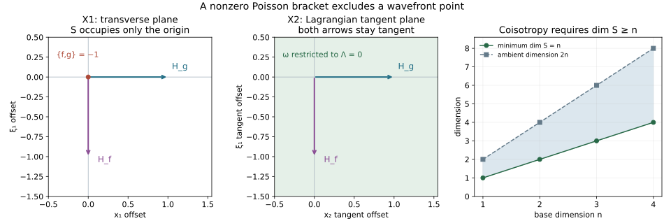

# Iterated regularity and the Poisson obstruction

An intrinsic regularity condition can be tested on a conic submanifold before assuming that it is Lagrangian. Repeated commutators then impose a geometric restriction: any point of its wavefront set must be a coisotropic point of that submanifold. A set of dimension below half the ambient symplectic dimension cannot support a singularity satisfying all these tests. At the minimal possible dimension, the allowed tangent spaces are Lagrangian.

The mathematical antecedent is Lars Hörmander, *The Analysis of Linear Partial Differential Operators IV*, Springer 2009 eBook, ISBN 978-3-642-00136-9, the remark after Lemma 25.1.2 on printed page 5. This is an independent proof of that remark, including the construction of the homogeneous test symbols and its precise pointwise scope.

Exact earlier proofs are the dyadic endpoint and Sobolev comparison, ordinary composition and commutators, proper conic parametrices, [symplectic complements, Hamilton fields and conic slices](../20261005-restored-phase-space/phase-space-and-generating-families.md), and [ordinary intrinsic regularity and its phase criterion](../20261005-restored-intrinsic-regularity/intrinsic-lagrangian-regularity.md). Their exact current sources and full dependencies are in the proof map. Required human foundations remain external.

## 1. A fixed endpoint for every finite word

**H0. State the condition without Lagrangian geometry.** Let \(X\) have dimension \(n\geq1\), let \(E\) be a smooth finite-rank complex bundle, and let \(S\subset T^*X\setminus0\) be a smooth closed conic submanifold. It need not be isotropic or involutive. Fix any real \(s\). Let \(\mathcal J(S)\) be the properly supported ordinary first-order pseudodifferential operators on \(E\) whose homogeneous order-one principal symbols vanish on \(S\). It is enough for the argument to use the scalar-principal subset.

Suppose
\[
L_1\cdots L_Nu\in B^s_{2,\infty,\mathrm{loc}}(X;E)
\quad\text{for every }N\geq0,\quad L_j\in\mathcal J(S).
\tag{PO1}
\]
The empty word is included. Constants can depend on the word and compact set. The endpoint proof P1:B1 gives
\[
B^s_{2,\infty,\mathrm{loc}}\subset H^{s-\eta}_{\mathrm{loc}}
\quad\text{for every }\eta>0.
\tag{PO2}
\]
For the ordinary Lagrangian convention take \(s=-m-n/4\). The argument below works at any one fixed \(s\); its geometry does not depend on that value.

Use the cotangent convention
\[
\omega=\sum_jd\xi_j\wedge dx_j,\qquad
H_f=\sum_j(f_{\xi_j}\partial_{x_j}-f_{x_j}\partial_{\xi_j}),\qquad
\{f,g\}=H_fg.
\tag{PO3}
\]
Thus \(\iota_{H_f}\omega=-df\). For a tangent subspace \(V\), write \(V^\omega=\{w:\omega(w,v)=0\text{ for all }v\in V\}\). Coisotropy means \(V^\omega\subset V\).

## 2. An elliptic admissible test excludes points outside S

**W0. Prove wavefront containment first.** Fix a covector \(\gamma\notin S\). Closedness gives a conic neighborhood disjoint from \(S\), with smaller compact base/angular margins. Choose a scalar degree-zero cutoff \(a\), supported in that neighborhood and equal to one near \(\gamma\), and a positive homogeneous frequency norm \(r\) there. Quantize \(ar\) times the identity with proper support, retaining its homogeneous principal symbol. This gives \(L\in\mathcal J(S)\) elliptic near \(\gamma\). Its actual \(N\)-th product is proper and elliptic of order \(N\).

The full ordinary composition and conic-parametrix proofs P2:OP6 and K:K3 give a microlocal inverse of order \(-N\), with a smoothing reconstruction error on a smaller cone. Its Sobolev mapping, proved in P1:B4–B6, and (PO1)–(PO2) yield
\[
u\in H^{s+N-\eta}\text{ microlocally near }\gamma
\qquad(N\geq0,\ \eta>0).
\tag{PO4}
\]
The remaining smoothing term has every local Sobolev order. Taking \(N\) arbitrarily large excludes \(\gamma\) from the wavefront set, by the earlier Fourier characterization CH:W1. Consequently
\[
\operatorname{WF}(u)\subset S.
\tag{PO5}
\]
No Lagrangian property was used.

## 3. A commutator need not itself be an admissible test

**C0. Expand its powers into actual admissible words.** Let \(f,g\) be real, smooth, degree-one homogeneous functions vanishing on \(S\), supported in a compact base/angular patch. Smooth low-frequency extensions and proper quantizations give \(L_f,L_g\in\mathcal J(S)\), with scalar principal symbols \(fI_E,gI_E\). Put
\[
C=[L_f,L_g]=L_fL_g-L_gL_f.
\tag{PO6}
\]
The highest matrix product cancels because these principal symbols are scalar. The full ordinary commutator formula is therefore
\[
C\in\Psi^1,\qquad
\sigma_1(C)=\frac1i\{f,g\}\,I_E.
\tag{PO7}
\]
The sign follows from \(D=-i\partial\) and (PO3); for example \(\sigma([x_1,D_1])=i\) and \(\{x_1,\xi_1\}=-1\). Complete lower terms and proper realizations are retained in the actual operator \(C\).

We cannot assume that \(C\in\mathcal J(S)\), since its principal bracket may fail to vanish. Instead expand its actual power:
\[
C^N=\sum_{\nu\in\{+,-\}^N}(-1)^{\#\{j:\nu_j=-\}}\,W_\nu,
\quad
W_\nu=\prod_{j=1}^N
\begin{cases}L_fL_g,&\nu_j=+,\\L_gL_f,&\nu_j=-.\end{cases}
\tag{PO8}
\]
This finite identity follows by distributivity, with the displayed order of factors unchanged. Every \(W_\nu\) is an admissible word of length \(2N\). Hence \(C^Nu\in B^s_{2,\infty,\mathrm{loc}}\) for every \(N\).

If \(\{f,g\}(\gamma)\ne0\), then \(C\) is elliptic near \(\gamma\). The same actual-product, parametrix and Sobolev argument as W0 gives (PO4), now at that point of \(S\). It cannot be a wavefront point. We have proved
\[
\{f,g\}(\gamma)=0
\quad\text{for all such }f,g,\qquad \gamma\in\operatorname{WF}(u).
\tag{PO9}
\]
Only scalar-principal tests were needed. Thus the conclusion applies equally when the original hypothesis allows all matrix-valued admissible tests.

## 4. Homogeneous tests realize every conormal covector

**J0. Construct the required first jets.** Fix \(\gamma\in S\). Let \(R\) be the nonzero radial vector field generating positive cotangent dilations. Conicity gives \(R_\gamma\in T_\gamma S\). Choose a smooth positive degree-one frequency radius \(r\), and rescale it so \(r(\gamma)=1\). The local slice \(\Sigma=\{r=1\}\) is transverse to \(R\). The complete conic-slice theorem G2:G41 identifies a neighborhood with \((0,\infty)\times\Sigma\), using dilation, and
\[
S=(0,\infty)\times(S\cap\Sigma)
\quad\text{in these coordinates}.
\tag{PO10}
\]
The intersection is a smooth submanifold: the differential of \(r|_S\) is nonzero on the radial vector.

Take any \(\alpha\in N_\gamma^*S\). It annihilates \(R_\gamma\). In ordinary submanifold coordinates \((y,z)\) on the slice, with \(S\cap\Sigma=\{z=0\}\), its restriction is a linear combination \(\sum_kc_k\,dz_k\) at \(\gamma\). A smooth cutoff \(\chi=1\) near \(\gamma\), supported inside this slice chart, gives \(f_0=\chi\sum_kc_kz_k\). It vanishes on \(S\cap\Sigma\), has the required differential there at \(\gamma\), and extends by zero smoothly inside the larger slice. Define
\[
f(r,\theta)=r f_0(\theta).
\tag{PO11}
\]
This is degree one, vanishes on \(S\), and has \(df_\gamma=\alpha\). The radial derivative is zero there because \(f_0(\gamma)=0\); the slice derivative is the chosen one. Extend conically with the interior cutoff, and through bounded frequencies for quantization. Its conic base/angular support is compact. Thus every conormal first jet is realized by an admissible scalar principal symbol, with all proper and support conditions used in C0.

The construction uses only the submanifold coordinate theorem, the explicit conic slice and smooth cutoffs. It does not assume that \(S\) is coisotropic.

## 5. The exact pointwise geometric conclusion

**G0. Convert Poisson vanishing into coisotropy.** Put \(V=T_\gamma S\). The nondegenerate form identifies each \(\alpha\in N_\gamma^*S\) with a unique \(H_f(\gamma)\), through \(\iota_{H_f}\omega=-\alpha\). These vectors are precisely \(V^\omega\), by definition and J0. For two such symbols, the sign conventions give
\[
\omega(H_f,H_g)=\{f,g\}.
\tag{PO12}
\]
Indeed \(\omega(H_f,H_g)=-df(H_g)=-H_gf=\{f,g\}\). Formula (PO9) therefore says that \(V^\omega\) is isotropic. The complete symplectic-complement proof G2:G21 gives \((V^\omega)^\omega=V\), so
\[
V^\omega\subset(V^\omega)^\omega=V
\qquad(\gamma\in\operatorname{WF}(u)).
\tag{PO13}
\]
This is exactly coisotropy at the wavefront point.

The dimension identity \(\dim V^\omega=2n-\dim V\) yields
\[
\dim S\geq n\text{ at every wavefront point}.
\tag{PO14}
\]
Thus if every component of \(S\) has dimension below \(n\), (PO5) and (PO14) force \(\operatorname{WF}(u)=\varnothing\), so \(u\) is smooth. If \(\dim S=n\), (PO13) is equality and \(T_\gamma S\) is Lagrangian at every wavefront point.

If the test condition is intended to permit a wavefront point at every point of \(S\), it follows that \(S\) is coisotropic everywhere. Equivalently its vanishing ideal is closed under Poisson brackets: differentials of vanishing functions are conormal, and the just-proved linear identity gives both implications. This is the involutive sense of the source remark. We have not asserted coisotropy at points that are absent from every allowed wavefront set.

Lagrangian submanifolds have the smallest possible dimension for this condition to allow unrestricted points of the proposed singular set. They actually support nontrivial examples, as the following conormal model shows. Coisotropy alone is not a proof of any converse phase representation; the precise Lagrangian converse remains the earlier ordinary intrinsic theorem.

## 6. Three complete solutions

**X1. A two-dimensional set that excludes all singularities.** In \(T^*\mathbb R^2\setminus0\), let
\[
S=\{x_1=0,\ \xi_1=0,\ \xi_2\ne0\}.
\tag{PO15}
\]
Find two admissible first-order principal symbols with an elliptic commutator, and compute the restricted form.

**Solution.** Take \(f=x_1|\xi|\), \(g=\xi_1\), with local conic cutoffs equal to one near the marked point. Both vanish on \(S\), but
\[
\{f,g\}|_S=-|\xi|,\qquad
\sigma_1([L_f,L_g])|_S=i|\xi|,\qquad
\omega|_S=d\xi_2\wedge dx_2.
\tag{PO16}
\]
Thus the commutator is elliptic near every point of \(S\). Its actual powers are sums of admissible words by C0, so any \(u\) satisfying (PO1) is smooth. Geometrically \(S\) has dimension two, but its tangent plane is symplectic rather than Lagrangian; its symplectic orthogonal is spanned by \(\partial_{x_1},\partial_{\xi_1}\), neither of which is tangent. At \((x,\xi)=(0,0;0,1)\), \(H_f=-\partial_{\xi_1}\) and \(H_g=\partial_{x_1}\), so the failed directions are explicit.

One can also keep an exact proper commutator. The compact-kernel regularization proved in IR:R2, applied to \(\langle\xi\rangle\), gives a real ordinary \(h\) with compact inverse Fourier kernel and \(h-\langle\xi\rangle\in S^{-\infty}\). Then \(L_f=x_1h(D)\), \(L_g=D_1\) are proper, have the same homogeneous principal symbols, and \([L_f,L_g]=ih(D)\) exactly. Ellipticity holds at every high-frequency point. This exact operator calculation confirms that no discarded residual term creates the obstruction.

**X2. The minimal dimension can support a singularity.** In the same space let
\[
\Lambda=\{x_1=0,\ \xi_2=0,\ \xi_1\ne0\}.
\tag{PO17}
\]
Check its tangent geometry and show that \(u(x)=\delta(x_1)a(x_2)\), with nonzero \(a\in C_c^\infty\), satisfies the ordinary test condition at a definite order.

**Solution.** Its tangent coordinates are \((x_2,\xi_1)\). The restricted symplectic form is zero and its dimension is two, so it is Lagrangian. At the point with \(\xi_1=1\), the defining symbols \(f=x_1|\xi|\), \(g=\xi_2\) have Hamilton vectors \(-\partial_{\xi_1}\) and \(\partial_{x_2}\), both tangent. Their bracket vanishes on \(\Lambda\).

The actual oscillatory representation is
\[
u=(2\pi)^{-1}\int e^{ix_1\theta}a(x_2)\,d\theta.
\tag{PO18}
\]
Its ambient dimension is \(n=2\), frequency dimension is one, and the normalized prefactor is \((2\pi)^{-(2+2)/4}=(2\pi)^{-1}\). Amplitude order zero gives \(m+(2-2)/4=0\), hence \(m=0\). The earlier nondegenerate phase criterion IR:R5 and ordinary intrinsic converse IR:R3 prove (PO1) for all finite admissible words with \(s=-m-n/4=-1/2\). A compact cutoff in \(x_1\) equal to one near zero leaves \(u\) unchanged. Near a point where \(a\ne0\), any nonzero tangential localization \(a_0\) has a Fourier value \(\widehat a_0(\lambda)\ne0\), by Fourier inversion. The localized transform equals \(\widehat a_0(\xi_2)\), independent of \(\xi_1\), so it does not decay along \((\xi_1,\xi_2)=(\pm R,\lambda)\). These frequencies lie in every cone about the corresponding conormal direction for large \(R\). Hence the conormal wavefront is nonzero there. This demonstrates actual singularities at the minimal geometric dimension, with all normalization and endpoint orders fixed.

**X3. Four ordered words give one elliptic gain.** Write \(A=L_f\), \(B=L_g\). Expand \([A,B]^2\), count the words in the general \(N\)-th power, and state the Sobolev regularity obtained where its scalar principal bracket is nonzero.

**Solution.** Distributivity gives the exact noncommutative identity
\[
[A,B]^2=ABAB-ABBA-BAAB+BABA.
\tag{PO19}
\]
In the general expansion each of the \(N\) ordered slots selects either \(AB\) or \(BA\), giving \(2^N\) terms of length \(2N\), with the sign in (PO8). No factors have been commuted while expanding. Each term applied to \(u\) has the fixed endpoint. The scalar-principal commutator itself has order one, so its \(N\)-th power is elliptic of order \(N\), not \(2N\), on the chosen cone. Parametrix reconstruction therefore gives
\[
u\in H^{s+N-\eta}\text{ there for every }\eta>0.
\tag{PO20}
\]
The \(2N\) counts admissible factors; the \(N\) counts elliptic order after principal cancellation. Arbitrarily large \(N\) prove smoothness. One must not infer endpoint \(H^{s+N}\) from the Besov bound, or treat the commutator as admissible before proving its bracket vanishes.

## 7. The geometry in the illustration

**F0. Exact diagram interpretation.** The first panel is the transverse \((x_1,\xi_1)\) plane at \((0,0;0,1)\) in X1. The proposed set occupies its origin; \(H_g=(1,0)\), \(H_f=(0,-1)\) leave that origin, and the Poisson bracket has value \(-1\). The remaining \((x_2,\xi_2)\) tangent plane is symplectic. The second panel is the actual tangent \((x_2,\xi_1)\) parameter plane of X2 at \(\xi_1=1\). Its two arrows are tangent, and \(\omega|_\Lambda=0\). These panels are specified two-dimensional sections of four-dimensional phase space. The third panel plots the exact lower bound \(\dim S\geq n\) for \(n=1,\ldots,4\), with the ambient dimension \(2n\) also labeled; equality gives a Lagrangian tangent plane under (PO13). The diagram illustrates the proven linear identities and is not a proof by plotting.
Related proofs: [editable source](iterated-regularity-and-the-poisson-obstruction.md).
Original exposition, proof, examples and illustration: CC0-1.0.  The ordinary geometric argument does not assert the false general-\(\rho\) fixed-endpoint converse; its separate [packet counterexample and exact cell criterion](../20261015-rho-iterated-packets/iterated-tests-and-frequency-packet-regularity.md) remain available. The conclusion concerns the stated ordinary geometric setting.
