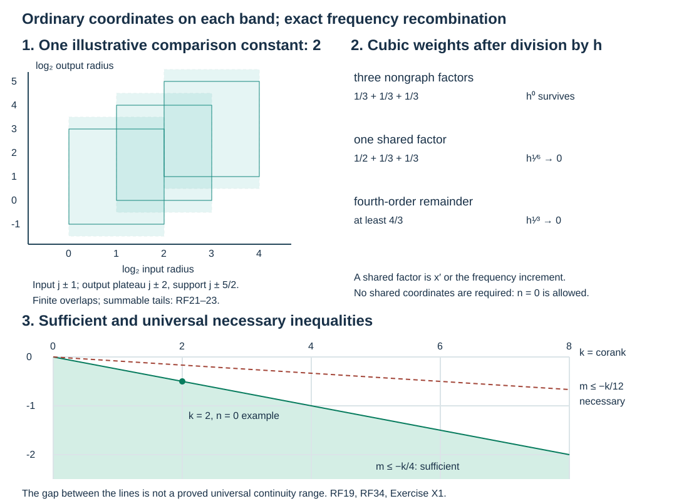

# Corank estimates without radial restrictions

An ordinary canonical relation can have zero restricted canonical one-form. Its tangent relation still has a symplectic splitting, but a homogeneous change of coordinates cannot give its quotient a nonzero radial vector. We use ordinary affine symplectic coordinates on bounded frequency bands instead. Exact unitary quantizations make their estimates uniform in the band, and frequency orthogonality recombines the bands.

The primary antecedent is Hörmander, *The Analysis of Linear Partial Differential Operators IV*, §25.3, the remark after Theorem 25.3.9, printed 32, in the Springer eBook, ISBN 978-3-642-00136-9. The independent argument below proves both estimates referred to in that remark. It is course exposition, not a transcription of the book.

The exact earlier proofs used here are the [linear symplectic relation splitting](../20261005-restored-corank-continuity/corank-geometry-and-sufficient-continuity.md), the [diagonal-complement lemma](../20261005-restored-subprincipal-transport/hamilton-fields-and-subprincipal-transport.md), [closed-form primitives](../20261005-restored-phase-space/differential-forms-and-flow-pullbacks.md), kernel action and axis estimates, [uniform stationary phase](../20261004-free-stationary-phase/stationary-phase-and-critical-manifolds.md), Fourier bounds, dyadic and Schur bounds, and [proper Sobolev reconstruction](../20261005-restored-graph-egorov/graph-operators-continuity-and-egorov.md). Their exact versions and individual locators are in the proof map. The 92 transitive human foundations remain explicitly external.

## 1. The two conclusions and their hypotheses

**H0. Keep the full canonical relation but drop the radial exclusions.** Let
\[
 C\subset(T^*X\setminus0)\times(T^*Y\setminus0),\qquad
 C'=\{(x,y;\xi,-\eta):(x,\xi;y,\eta)\in C\}
 \tag{RF1}
\]
be a smooth embedded simultaneously conic canonical relation, with \(C'\) closed in the whole \(T^*(X\times Y)\setminus0\). Let \(n_X=\dim X\), \(n_Y=\dim Y\), \(d=n_X+n_Y\). Write
\[
 \sigma_C=\pi_X^*\omega_X=\pi_Y^*\omega_Y,\qquad
 \operatorname{rank}\sigma_C(c)=2n(c),\qquad
 k(c)=d-2n(c).
 \tag{RF2}
\]
Our sign is \(\omega=d\xi\wedge dx\), and the product form is \(\omega_X-\omega_Y\). There is no requirement that either individual radial vector avoid \(T_cC\). In particular \(n(c)=0\) is allowed.

We prove the following ordinary-symbol assertions.

* If \(m\le-k(c)/4\) at every point, every \(A\in I^m(X\times Y,C';\Omega^{1/2}\otimes\operatorname{Hom}(E,F))\) maps \(L^2_{\rm comp}(Y)\) continuously to \(L^2_{\rm loc}(X)\).
* If every scalar operator in this order class has that continuity, then \(k(c)\le-12m\) at every point. The same necessity holds for bundle operators when both ranks at the tested point are positive.

Neither conclusion asserts optimality for every varying-rank relation. The hypothesis in the second is about **every operator**, not every choice of a declared order for one smoothing operator. We retain all ordinary symbol derivatives; the \(\rho<1\) symbol class is a separate question.

Localize the kernel by fixed compact input and output multipliers. Full closure and the two missing axes make the normalized kernel relation compact and give constants
\[
 0<c\le |\xi|/|\eta|\le C<\infty
 \tag{RF3}
\]
there. This is the compactness argument in the exact kernel provider. All assertions below concern these fixed compact localizations. A finite partition in charts and normalized directions suffices; compact smooth residual kernels are retained.

## 2. Uniform elementary operators at scale h

**K0. Establish the bounded operators before changing coordinates.** Put \(0<h\le1\). If \(q_h(x,\zeta)\) is supported in fixed compact sets and has uniformly bounded derivatives of every order, set
\[
 \operatorname{Op}_h(q_h)f(x)
  =(2\pi h)^{-r}\iint
    e^{i(x-z)\cdot\zeta/h}q_h(x,\zeta)f(z)\,dz\,d\zeta.
 \tag{RF4}
\]
Repeated integration in \(\zeta\), using
\((1-\Delta_\zeta)^N e^{i(x-z)\zeta/h}
=(1+|x-z|^2/h^2)^N e^{i(x-z)\zeta/h}\),
gives a kernel bound
\[
 |K_h(x,z)|\le C_Nh^{-r}(1+|x-z|/h)^{-2N}.
 \tag{RF5}
\]
The same estimate holds for an amplitude depending on \(x,z,\zeta\), with fixed compact \(\zeta\) support and uniform derivatives in those variables. Both kernel marginals are bounded when \(2N>r\), by \(z=x+hw\) and the reverse change. The proved Schur inequality gives a uniform \(L^2\) norm, controlled by finitely many derivatives. Fixed finite matrices follow entry by entry.

We also use a precise remainder convention. A kernel is \(O(h^\infty)\) in Schwartz seminorms if for every \(L\), every derivative and every polynomial weight in both base variables its weighted supremum is \(O(h^L)\). Such kernels have \(L^2\) operator norm \(O(h^L)\) for every \(L\): choose the two spatial decay powers larger than the respective dimensions and use Schur or their \(L^2\) kernel norm. Multiplication or differentiation by any fixed power of \(h^{-1}\) preserves this property, after increasing the requested \(L\).

Nonstationary compact phase integrals have this remainder property away from their critical image. Use the full transpose of
\((h/i)|d\Phi|^{-2}d\Phi\cdot\partial\); on a fixed separated compact region each repetition gains \(h\). For unbounded external variables whose phase derivative grows linearly, it also gains their inverse weight. Derivatives cost fixed powers of \(h^{-1}\), absorbed by more repetitions. This is the parameter nonstationary estimate Q9, including its full transposed coefficients, with \(1/h\) as its large parameter.

## 3. Exact unitary affine symplectic changes

**U0. Quantize a fixed linear change without an order loss.** On \(L^2(\mathbb R^r)\) the following operators are exactly unitary:
\[
 \begin{split}
 (\mathcal F_hf)(\zeta)&=(2\pi h)^{-r/2}
                      \int e^{-ix\cdot\zeta/h}f(x)\,dx,\\
 (M_Qf)(x)&=e^{ix^TQx/(2h)}f(x),\qquad Q=Q^T,\\
 (T_Bf)(x)&=|\det B|^{-1/2}f(B^{-1}x),\qquad B\text{ invertible},\\
 (W_{a,b}f)(x)&=e^{ib\cdot x/h}f(x-a).
 \end{split}
 \tag{RF6}
\]
Plancherel and real change of variables prove the first and third identities; the other two are multiplication by a unit-modulus function and translation. Their phase equations give, respectively,
\[
 J(x,\xi)=(\xi,-x),\quad
 L_Q(x,\xi)=(x,\xi+Qx),\quad
 D_B(x,\xi)=(Bx,B^{-T}\xi),\quad
 (x,\xi)\mapsto(x+a,\xi+b).
 \tag{RF7}
\]
For example the new covector for the Fourier phase \(-x\cdot\zeta\) is \(-x\), and stationarity against the old covector gives \(\zeta=\xi\). These signs also determine the inverse operators.

Here is a finite factorization for every real symplectic matrix \(S=\left(\begin{smallmatrix}A&B\\C&D\end{smallmatrix}\right)\). The Lagrangian \(S^{-1}\{\delta x=0\}\) has a diagonal graph complement by ST:T4. Thus a symmetric diagonal \(Q\) can be chosen so that \(A+BQ\) is invertible. Replace \(S\) temporarily by \(S L_Q\). For a symplectic matrix with \(A\) invertible,
\[
 S=L_{CA^{-1}}\,
       D_A\,
       U_{A^{-1}B},\qquad
 U_E=\begin{pmatrix}I&E\\0&I\end{pmatrix}
       =J^{-1}L_{-E}J .
 \tag{RF8}
\]
The symplectic identities imply that \(CA^{-1}\) and \(A^{-1}B\) are symmetric and that \(D=CA^{-1}B+A^{-T}\); direct multiplication proves (RF8). Undo the preliminary \(L_Q\). Formula (RF6) therefore quantizes \(S\), and any fixed affine symplectic change, by a finite product of exact unitaries. No nonlinear quantization theorem or homogeneous graph estimate is being presumed. In dimension zero all these operators are the identity on the one-point space.

They preserve Schwartz functions. For Fourier transformation this is the full earlier Fourier differentiation/inversion proof; multiplication by a quadratic chirp differentiates to polynomial factors, and the other formulas are immediate substitutions. Their Schwartz seminorms cost at most a fixed power of \(h^{-1}\) for each fixed seminorm. Consequently they preserve \(O(h^\infty)\) Schwartz kernels, including when applied on either side.

## 4. Extracting an annular family from one ordinary kernel

**B0. Retain the actual band of the original operator.** Let \(A\) have compactly localized kernel \(K\). Choose an input annular multiplier \(\psi(hD_Y)\), where \(\psi\) has fixed compact support away from zero, and, when needed, compact phase-space cutoffs near a selected normalized point. The resulting kernel is a finite sum of
\[
 K_h(x,y)=(2\pi h)^{-(d+2N)/4}h^{-m}
              \int e^{i\Phi(x,y,\theta)/h}
                         a_h(x,y,\theta)\,d\theta
 \tag{RF9}
\]
and \(O(h^\infty)\) Schwartz kernels. The phase variables and base variables in each integral have fixed compact supports; the \(\theta\) support stays away from zero. Every derivative of \(a_h\) is bounded uniformly. The critical map is the corresponding normalized part of the original \(C'\).

To prove this, use the exact nondegenerate phase representation of \(K\), with ordinary amplitude order
\(\mu=m+(d-2N)/4\). Inserting \(\psi(hD)\) means an additional integration over an intermediate compact input point and a frequency \(\eta\) with \(|\eta|\asymp h^{-1}\). On the phase support the original nonzero input covector gives \(|\Phi_y|\asymp|\theta_{\rm old}|\). Outside a fixed comparison region
\(|\theta_{\rm old}|\asymp|\eta|\), the intermediate-base phase gradient is bounded below by a fixed multiple of \(|\theta_{\rm old}|+|\eta|\). The full transposed field there gains the inverse joint radius at each repetition.

For negative individual orders bound the original amplitude by a fixed nonnegative power \(P\) of the joint radius, as in RC:C5. Put \(\lambda=h^{-1}\). After \(L\) transposed integrations and a fixed derivative cost \(J\), the absolute frequency integral is bounded by
\[
 C_{J,L}\int_{|\eta|\asymp\lambda}
       \int (1+|\theta_{\rm old}|+\lambda)^{P+J-L}
                       \,d\theta_{\rm old}\,d\eta
 \le C'_{J,L}\lambda^{N+n_Y+P+J-L},
\]
provided \(L>P+J+N\). This follows by scaling \(\theta_{\rm old}=\lambda w\), bounding the \(\eta\) annulus by its volume, and integrating the resulting negative power of \(1+|w|\). Thus \(L\) can make the result any required power of \(h\). Derivatives of the annular cutoff have stronger inverse-radius estimates. If an exterior input point leaves a larger compact neighborhood of the original input support, integration in its annular frequency gives arbitrary spatial decay and powers of \(h\); each derivative or polynomial weight costs only a fixed extra power of \(\lambda\). Apply the same bound with that larger \(J\). This proves the stated Schwartz remainders, not merely pointwise decay on a compact product.

In the comparison region put \(\theta_{\rm old}=\theta/h\). Directly,
\[
 a_h=h^\mu a(x,y,\theta/h),\qquad
 h^{-N-\mu}=h^{-m-(d+2N)/4}.
 \tag{RF10}
\]
Every \(\theta\) derivative brings \(h^{-1}\), exactly canceled by its ordinary symbol order drop. All base derivatives remain bounded. Thus (RF9) has the exact claimed normalization. The input cutoff composition has a nondegenerate intermediate critical block; ordinary uniform stationary phase gives its complete \(h\)-expansion with bounded differentiated remainders. The leading multiplier is \(\psi(-\Phi_y)\). The factor \((2\pi h)^{-\dim Y}\) from that composition is canceled by its \(2\dim Y\) stationary variables. A compact cutoff equal to one on a slightly larger critical neighborhood makes all its noncritical pieces the remainders just estimated.

The same argument proves the assertion for fixed compact \(\operatorname{Op}_h(q)\) factors on either side: their critical equations set the intermediate point equal to the exterior point and their frequency equal to the adjacent phase covector. Their leading amplitudes multiply by \(q\) restricted there. All expansions use finitely many uniform derivatives for each fixed remainder; no convergence of a formal expansion is required.

If the original amplitude is chosen classical with a nonzero homogeneous leading term, these families have \(a_h=a_0+O(h)\) with every fixed derivative. At a retained critical point, cutoffs equal to one preserve its nonzero leading coefficient. This additional assertion will be used only for the necessary estimate.

## 5. Ordinary tangent coordinates include a zero shared block

**N0. Apply linear symplectic geometry without preserving radial vectors.** Fix a normalized point \(c_0\). CR:L1 gives separate linear symplectic isomorphisms taking \(T_{c_0}C\) to
\[
 \delta x'=\delta y',\quad
 \delta\xi'=\delta\eta',\quad
 \delta\xi''=0,\quad\delta\eta''=0,
 \quad
 n_X=n+a,\quad n_Y=n+b,\quad k=a+b.
 \tag{RF11}
\]
Translate the two normalized phase points to zero. All these affine changes are fixed, independent of \(h\), and are quantized by U0. They are permitted to send nonzero normalized covectors to zero: we are working on a bounded semiclassical patch, not claiming a homogeneous map of punctured cotangents.

On the transformed **ordinary** relation the variables
\(q=(x',x'',y'',\eta')\) are local coordinates. Their differential is invertible in (RF11), so the inverse theorem supplies an actual neighborhood. The restricted one-form
\[
 \beta=\xi\,dx-\eta''\,dy''+y'\,d\eta'
 \tag{RF12}
\]
is closed: its differential is the signed product symplectic form on the relation. In a star-shaped \(q\) neighborhood the explicit radial homotopy primitive gives a smooth real \(\phi\) with \(d\phi=\beta\); choose \(\phi(0)=0\). Hence the whole local relation, not just its tangent plane, is
\[
 \xi=\phi_x,\qquad y'=\phi_{\eta'},\qquad
 \eta''=-\phi_{y''}.
 \tag{RF13}
\]
The marked points are zero, and differentiating (RF13) using (RF11) shows
\[
 \phi=x'\cdot\eta'+H,\qquad
 H(0)=dH(0)=d^2H(0)=0,\qquad
 \phi_{x'\eta'}(0)=I_n.
 \tag{RF14}
\]
This construction has no requirement \(n\ge1\). When \(n=0\), \(\phi(x'',y'')\) is an ordinary base phase, with zero two-jet. The inverse theorem and the closed-form primitive are the exact earlier results; neither the form nor the coordinates are declared homogeneous.

## 6. Actual transformed kernels and the partial normal form

**P0. Reduce the kernel as well as its tangent relation.** Apply the U0 operators on the two sides of (RF9), with smaller compact \(\operatorname{Op}_h\) cutoffs whose symbols equal one near the marked points. Modulo \(O(h^\infty)\) Schwartz kernels, the transformed piece has the actual form
\[
 (B_hu)(x',x'')=
 (2\pi h)^{-n-k/4}h^{-m}
 \iint e^{i\phi(x',x'',y'',\eta')/h}
 b_h(x',x'',y'',\eta')\,
 \widehat u_h(\eta',y'')\,d\eta'\,dy'',
 \quad
 \widehat u_h=\int e^{-iy'\eta'/h}u(y',y'')\,dy'.
 \tag{RF15}
\]
Here \(b_h\) has uniformly bounded derivatives, fixed compact support in all its variables and an invertible mixed matrix \(\phi_{x'\eta'}\) on a slightly larger patch. If the original chosen leading coefficient is nonzero, then \(b_h=b_0+O(h)\) with \(b_0(0)\ne0\).

We justify the transformations and reduction explicitly. Chirps, affine changes and translations in U0 add their exact quadratic or linear phases and nonzero constant Jacobians. A semiclassical Fourier transform in an \(r\)-dimensional base adds that old base as \(r\) auxiliary variables and adds the phase \(-x_{\rm old}\cdot x_{\rm new}\); its prefactor is \((2\pi h)^{-r/2}\). Thus the normalization in (RF9) is preserved with \(N\) replaced by \(N+r\). The old critical equations remain independent, and the new equations have derivative \(-I_r\) in the new exterior base variables, so the phase remains nondegenerate. The canonical map is precisely J from (RF7), including on the input side by the inverse Fourier formula.

One may insert compact base and phase-space cutoffs around the successive images of the original critical support. Choose their **full** symbols identically one on an open neighborhood of the retained critical support, after shrinking that support inside the neighborhood. Every derivative of the difference from one then vanishes there. The complete diagonal stationary expansion in B0 makes each inserted cutoff the identity to all orders on that piece; its complementary phase has no critical point. All old integration supports before a Fourier transform are compact; outside a larger new base set its gradient in the old base is bounded below by a multiple of the new base size. K0 gives \(O(h^\infty)\) with arbitrary new-base weights. Frequency localization by \(\operatorname{Op}_h(q)\) is the explicitly proved diagonal composition in B0. Inducting through the finite U0 factorization proves the transformed phase assertion with uniform Schwartz errors. It does not apply a homogeneous FIO theorem to a nonhomogeneous change.

Now Fourier transform this transformed kernel in its input variables \(y'\), with the positive exponential \(e^{iy'\eta'/h}\). The critical equations in the \(N\) old auxiliary variables and \(y'\) describe points of the transformed relation over fixed \((x,y'',\eta')\). Their Hessian is nonsingular. Indeed a vector in its kernel would be a tangent vector to that phase critical manifold with zero variation of these parameters. The phase's critical parametrization is an immersion, and (RF13) projects it diffeomorphically onto those parameters. Its vector must therefore be zero. This proves Hessian invertibility, not just a dimension count. Shrink to one critical branch.

Uniform stationary phase in these \(N+n\) variables yields a smooth bounded family \(b_h\), with a remainder of arbitrary prescribed order and every derivative. Its leading factor is the nonzero input coefficient times the inverse square-root absolute Hessian determinant and \(e^{i\pi\,\operatorname{sgn}/4}\). The new critical value has differential (RF12), hence is \(\phi\) up to a constant. The constant gives a unit-modulus \(h\)-dependent scalar and may be retained or removed; it has no effect on the estimates or on the nonzero amplitude.

The power calculation is
\[
 -\frac{d+2N}{4}+\frac{N+n}{2}=-\frac{k}{4}.
 \tag{RF16}
\]
Partial Fourier inversion then contributes \((2\pi h)^{-n}\), proving (RF15). All coefficients have one fixed slightly larger compact support by choosing parameter cutoffs once; the region outside has no critical point. To obtain an exact \(b_h\) modulo \(O(h^\infty)\), rather than a formal list, take the actual compact stationary integral multiplied by its inverse critical exponential and its known power of \(h\). The full stationary-phase remainder theorem gives all its uniform derivatives and its finite expansions. This also proves \(b_h=b_0+O(h)\) in the classical case. There is no unsupported asymptotic summation in this reduction.

When \(n=0\), this same argument Fourier transforms no input variables and reduces \(N\) stationary variables; (RF16) still holds. No inverse of a missing shared-frequency coordinate is used.

## 7. Uniform compact-frequency graph families

**G0. Prove the finite-frequency graph estimate directly.** For fixed \((s,t)=(x'',y'')\) set
\[
 (T_{h,s,t}v)(x')=(2\pi h)^{-n}
       \int e^{i\phi(x',s,t,\eta')/h}
               b_h(x',s,t,\eta')\widehat v_h(\eta')\,d\eta'.
 \tag{RF17}
\]
Then \(\|T_{h,s,t}\|_{2\to2}\le M\), uniformly for \(h\) and the compact parameter sets. This includes \(n=0\), where the operator is multiplication on the one-point Hilbert space.

For \(n>0\), fixed \(h\) gives an \(L^2\) kernel: Plancherel in the input variable gives squared kernel norm \((2\pi h)^{-n}\int|b_h|^2dx'\,d\eta'<\infty\). Its adjoint product is therefore already defined. Its \(TT^*\) phase is
\(\phi(x',s,t,\eta')-\phi(z',s,t,\eta')=(x'-z')\cdot F\), where
\[
 F=\int_0^1\phi_{x'}(z'+\tau(x'-z'),s,t,\eta')\,d\tau.
 \tag{RF18}
\]
Shrink a convex frequency and base patch so \(F_{\eta'}\) is uniformly close to one fixed invertible matrix. Integrating that derivative on a frequency segment gives a uniform injectivity lower bound. The inverse theorem gives its inverse with all derivatives uniformly bounded on interior supports. The change \(\zeta=F\) turns the \(TT^*\) kernel into a compact-frequency amplitude kernel (RF4), with coefficient
\(b_h(x',s,t,\eta')\overline{b_h(z',s,t,\eta')}|\det F_{\eta'}|^{-1}\).
Its derivatives are uniformly bounded. Extension by zero is smooth because the original frequency support is interior. K0 bounds \(TT^*\) uniformly, hence \(T\), with a finite number of derivatives. Matrix components give the same finite-rank estimate. The argument is the compact-frequency analogue of the exact earlier graph proof, with all needed bounds supplied here.

## 8. The sufficient estimate on each band

**S0. Integrate a graph family with its precise loss.** Let the fixed compact parameter sets in (RF15) have volumes \(V_X,V_Y\). The actual Hilbert-valued integral, first for smooth inputs, gives
\[
 \|B_hu\|_2\le
 (2\pi)^{-k/4}h^{-m-k/4}
 M\sqrt{V_XV_Y}\,\|u\|_2+O(h^\infty)\|u\|_2.
 \tag{RF19}
\]
For fixed \(h\), compact frequency makes the outputs continuous in the parameters on smooth inputs, with common compact output support. Finite Riemann sums converge in \(L^2(dx')\); completeness and the triangle inequality followed by Cauchy–Schwarz in \(y''\) give (RF19), exactly as in CR:I1. Density extends it. A zero-dimensional parameter set has volume one.

Use a finite cover of the original normalized relation, each with the ordinary tangent coordinates at its own marked point. At that point the assumed inequality makes \(m+k/4\le0\); its phase and mixed Hessian remain valid on a neighborhood even if rank increases nearby. All cutoffs and affine matrices are fixed independently of \(h\). Their quantizations and inverse quantizations are uniformly bounded by K0 and U0, so (RF19) gives
\[
 \|K\,\psi(hD_Y)\|_{2\to2}\le C_\psi
 \quad\text{for }0<h\le1.
 \tag{RF20}
\]
The whole compact normalized support has finitely many patches; their remainders and the original smooth kernel obey the stated bounds. A slightly larger cutoff is one on each retained patch, so the inverse affine change recovers its actual kernel modulo the \(O(h^\infty)\) errors proved in P0. Thus this inference uses complete kernels, not just leading symbols or tangent normal forms.

## 9. Recombination is an operator proof

**D0. Sum the actual bands, including their tails.** Choose a smooth Fourier partition \(1=\psi_0+\sum_{j\ge1}\psi_j\), with \(\psi_j(\eta)=\psi(2^{-j}\eta)\) supported in a fixed annular ratio and uniformly bounded overlap. The earlier dyadic construction provides it. Let \(h_j=2^{-j}\). Choose \(\widetilde\psi_j=1\) on \(\operatorname{supp}\psi_j\), with a slightly larger fixed annular ratio. The output cutoffs \(q_j(\xi)=q(2^{-j}\xi)\) equal one on a sufficiently wide comparable annulus from (RF3), and also have uniformly bounded overlap.

Writing
\[
 B_j=q_j(D_X)K\psi_j(D_Y),\qquad
 R_j=(I-q_j(D_X))K\psi_j(D_Y)
 \tag{RF21}
\]
gives \(\|B_j\|\le C\) by (RF20) and Plancherel. Also \(B_ju=B_j\widetilde\psi_j(D_Y)u\). If \(L_X,L_Y\) bound the output and enlarged-input overlaps, pointwise finite-sum Cauchy–Schwarz on the output Fourier side gives
\[
 \left\|\sum_j B_ju\right\|_2^2
 \le L_X\sum_j\|B_ju\|_2^2
 \le C^2L_XL_Y\|u\|_2^2.
 \tag{RF22}
\]
The same estimate on tails proves strong convergence of the sum for each \(u\): the square-sum of the enlarged input bands tends to zero. A uniform bound on isolated bands alone would not have justified this step.

The full Fourier transform of the fixed compact kernel \(K\) is rapidly decreasing outside the frequency comparability region, by the two-axis Fourier estimate RC:C1. In the Fourier kernel of \(R_j\), \(|\eta|\asymp2^j\) and \(\xi\) is outside a larger comparable annulus. Thus for every \(N\) it is bounded by
\(C_N\langle(\xi,\eta)\rangle^{-N}\).
Integrating its square gives
\[
 \|R_j\|_{2\to2}\le\|R_j\|_{\rm HS}
       \le C_N2^{\,j(d/2-N)}.
 \tag{RF23}
\]
For example first integrate \(\xi\) using
\(\int(\langle\eta\rangle+|\xi|)^{-2N}d\xi
\le C\langle\eta\rangle^{n_X-2N}\), then the input annulus volume. Taking \(N\) arbitrarily large proves absolute summability in operator norm. The low input-frequency piece \(K\psi_0(D_Y)\) has an \(L^2\) Fourier kernel by the same axis estimate for large \(\xi\), with bounded \(\eta\); hence it is bounded.

On Schwartz inputs the dyadic partition converges in the Schwartz topology. The original kernel acts continuously there after its compact input localization. Its distributional value is therefore the limit of its bands. The bounded strong sum in (RF22), plus the norm-convergent sum (RF23) and the low piece, is that same limit. Density proves the claimed bounded extension. Fixed compact input/output localizations, finite bundle frames and manifold charts give the first assertion in H0, with neither radial hypothesis.

## 10. All-real Sobolev consequence

**S1. Retain both elliptic reconstruction errors.** If \(k(c)\le k_*\) on the relevant normalized relation, then
\[
 A:H^s_{\rm comp}(Y)\longrightarrow
       H^{\,s-m-k_*/4}_{\rm loc}(X),\qquad s\in\mathbb R .
 \tag{RF24}
\]
Take proper real-order reducers on the input and output and a full input parametrix, exactly as in GE:D7. The conjugated FIO has order \(-k_*/4\), satisfying H0's sufficient condition. Both the input recovery error and the output elliptic recovery error have smooth localized kernels, by the already proved smooth-input/adjoint mapping and full proper inverses. Their Fourier decay bounds every real input-to-output Sobolev norm on the chosen compact sets. Common-support smooth approximation converges in \(H^s\) and as a compact distribution, so the estimate agrees with the original kernel action. These exact reconstruction steps are the earlier proof; only its order-zero middle estimate is replaced by D0.

## 11. Choosing one fixed operator for necessity

**N1. Do not replace the universal hypothesis by a varying family of operators.** Assume the universal boundedness in H0, and fix \(c_0\). Choose one nondegenerate phase patch of the original homogeneous \(C'\). In its fixed base and angular interior choose a classical amplitude of order \(m+(d-2N)/4\), nonzero at that point at high frequency. Such an amplitude is a compact base/angular cutoff times a positive homogeneous power of the phase radius, with a low-frequency cutoff. Its phase integral is in \(I^m(C')\) by the exact prescribed-phase theorem. Multiply by compact base cutoffs equal to one near the point and extend by zero inside the original chart. This defines **one fixed** \(A\), independent of \(h\). The universal assumption makes its compactly localized \(L^2\) norm finite.

Normalize the input covector of \(c_0\) to length one by simultaneous dilation. Choose fixed compact symbols \(q_X,q_Y\) supported near its two normalized phase points, equal to one on smaller neighborhoods. The operators
\[
 A_h=\operatorname{Op}_h(q_X)\,A\,\operatorname{Op}_h(q_Y)
 \tag{RF25}
\]
have uniformly bounded norms by K0 and the one fixed norm of \(A\). Compact output support of the input cutoff makes the original compact-to-local assumption sufficient. On the other side all base supports have already been compactly localized.

B0 and P0, with the fixed affine unitaries and smaller new-coordinate cutoffs, give actual \(B_h\) of the form (RF15), with uniformly bounded norms if \(A\) is bounded. Their amplitudes have
\[
 b_h=b_0+O(h)\text{ in every fixed }C^r\text{ norm},
 \qquad b_0(0)\ne0,
 \tag{RF26}
\]
after removal of the harmless constant critical exponential. The nonzero leading Hessian determinant, its unimodular signature and the cutoffs equal to one prove the last inequality. The original chosen \(A\) has not changed with \(h\); only uniformly bounded probes and exact unitaries change. This is the necessary link between the ordinary universal hypothesis and the semiclassical packets below.

## 12. The cubic packet limit in ordinary coordinates

**C0. Keep the shared and nongraph scales distinct.** Put
\[
 u_h(y',y'')=u(y'/h^{1/2},\,y''/h^{1/3}),
 \qquad u\in C_c^\infty(\mathbb R^n\times\mathbb R^b).
 \tag{RF27}
\]
The transformed phase points are zero, so no additional central modulation is needed here. Their corresponding original covectors are still of size \(h^{-1}\), because of the affine unitaries in N1. Exactly,
\[
 \|u_h\|_2=h^{\,n/4+b/6}\|u\|_2,\qquad
 \widehat u_{h,h}(\eta',y'')
      =h^{n/2}\widehat u(\eta'/h^{1/2},y''/h^{1/3}).
 \tag{RF28}
\]
The second hat uses the transform in (RF15), whereas the profile hat uses the ordinary Fourier transform with inverse factor \((2\pi)^{-n}\).

Set \(x'=h^{1/2}X'\), \(x''=h^{1/3}X''\), \(y''=h^{1/3}Y''\), \(\eta'=h^{1/2}\zeta\) in (RF15). Its shared Fourier Jacobian cancels \(h^{-n}\). Define the pure nongraph cubic
\[
 Q(X'',Y'')=\frac16D^3H(0)
 [(0,X'',Y'',0),(0,X'',Y'',0),(0,X'',Y'',0)] .
 \tag{RF29}
\]
Taylor's formula and (RF14) give, uniformly on compact sets,
\[
 h^{-1}H(h^{1/2}X',h^{1/3}X'',h^{1/3}Y'',h^{1/2}\zeta)
       \longrightarrow Q(X'',Y'').
 \tag{RF30}
\]
A pure nongraph cubic has total weight \(1\). Every other cubic has weight at least \(1/2+1/3+1/3=7/6\). The fourth-order remainder has weight at least \(4/3\). After division by \(h\) they give errors \(O(h^{1/6})\) and \(O(h^{1/3})\), respectively. This includes \(n=0\).

By (RF26) the scaled amplitude tends to \(b_0(0)\). It is uniformly bounded on the whole rescaled frequency integral: each \(b_h\) has bounded sup norm and fixed compact support. The profile \(\widehat u(\zeta,Y'')\) decreases faster than every power of \(\zeta\) with common compact \(Y''\) support. Thus a single integrable majorant handles **all** \(\zeta\), not just a central bounded set. Every real \(m\) has already been factored into \(h^{-m}\) in (RF15), so no negative-order frequency comparison is being omitted.

Dominated convergence, followed by the exact profile Fourier inversion, proves
\[
 \begin{split}
 &h^{m+k/4-b/3}
   (B_hu_h)(h^{1/2}X',h^{1/3}X'')\\
 &\quad\longrightarrow
 G(X',X'')=(2\pi)^{-k/4}b_0(0)
       \int e^{iQ(X'',Y'')}u(X',Y'')\,dY''.
 \end{split}
 \tag{RF31}
\]
Convergence is uniform on compact output sets: make the large-\(\zeta\) tail uniformly small with the Schwartz majorant, then use uniform convergence on its bounded complement. The \(O(h^\infty)\) kernel error in P0 contributes \(O(h^L)\|u_h\|_2\) to the unscaled output for every \(L\). Choose \(L\) larger than all the fixed normalization powers in (RF31), so it does not affect this limit or the lower bound below. Weighted derivative kernel bounds also give uniform pointwise decay after that normalization if required.

## 13. A nonzero limit and the two norm Jacobians

**C1. Prove a lower bound before comparing exponents.** Choose \(v\in C_c^\infty(\mathbb R^n)\) with \(v(0)\ne0\), and a nonnegative compact \(\rho\) on \(\mathbb R^b\) with positive integral. Take
\[
 u(X',Y'')=v(X')e^{-iQ(0,Y'')}\rho(Y'').
 \tag{RF32}
\]
For a zero-dimensional factor use its one-point integral and value one. Then \(G(0,0)\ne0\), since \(b_0(0)\ne0\). Continuity gives one fixed compact output box \(D\) of positive measure with \(\|G\|_{L^2(D)}>0\). Uniform convergence in (RF31) gives a positive eventual lower bound on that norm. The output coordinate Jacobian is \(h^{n/2+a/3}\), so
\[
 \|B_hu_h\|_{L^2(D_h)}
 \ge c\,h^{-m-k/4+b/3+n/4+a/6}.
 \tag{RF33}
\]
The input norm has the different exponent \(n/4+b/6\) from (RF28). Their ratio is therefore bounded below by
\[
 c'\,h^{-m-k/4+(a+b)/6}
       =c'\,h^{-m-k/12}.
 \tag{RF34}
\]
All test inputs have supports in one fixed compact set. Each \(B_h\) is a uniformly bounded probe of the **same** original \(A\), so (RF34) can stay bounded as \(h\downarrow0\) only if \(m\le-k/12\). If it failed, the explicit packets would contradict that fixed operator's bound. Dyadic \(h=2^{-j}\) alone already supplies the contradiction.

**N2. Return the exact quantifiers to the relation.** The marked point was arbitrary, and no constant-rank neighborhood or radial exclusion was used. Hence \(k(c)\le-12m\) at every point. For positive-rank bundles place the scalar amplitude in one input/output component in compact frames. Smooth compact metric equivalence preserves the packet lower bound and all probe estimates. A zero-rank bundle has no such nonzero test, so it is correctly excluded from necessity.

Together D0 and N2 prove both conclusions in H0 and the hypothesis-removal remark on IV32. The ordinary radial-compatible proofs remain useful alternatives.

## 14. Three calculations with complete solutions

**X1. A closed relation with an actual zero shared block.** Let \(X=Y=\mathbb R\), \(R>0\), \(1/2<t<2\). Choose smooth cutoffs \(\chi_L,\chi_R\), equal to one near the left and right endpoint, respectively, and supported near those endpoints, so that
\[
 F(t)=\frac{\chi_L(t)}{t-1/2}+\frac{\chi_R(t)}{2-t}
 \quad\text{is identically zero near }t=1.
 \tag{RF35}
\]
Set
\[
 C=\{(x=F-tF',\,\xi=R;\ y=-F',\,\eta=Rt):
                     R>0,\ 1/2<t<2\}.
 \tag{RF36}
\]
Verify its closure, canonical property and corank, and describe the two bounds at \(t=1\).

**Solution.** The frequency pair recovers \(R=\xi\), \(t=\eta/\xi\), giving an embedding. It is simultaneously conic. With \(H(\xi,\kappa)=\xi F(-\kappa/\xi)\), its kernel twist is the frequency graph \((x,y)=H_{(\xi,\kappa)}\), \(\kappa=-\eta\), hence is Lagrangian. Directly,
\[
 \xi\,dx=\eta\,dy=-RtF''(t)\,dt,\qquad
 \sigma_C=-tF''(t)\,dR\wedge dt.
 \tag{RF37}
\]
As either endpoint is approached, \(|F'|\to\infty\), so no finite base limit exists there. Any finite nonzero joint-covector limit with bounded bases has \(R\) bounded away from zero and \(t\) in a compact interior interval: if \(R\to0\), both covectors tend to zero; if \(R\) is unbounded, no finite covector limit exists. Thus \(C'\) is closed in the full joint puncture and both axes are absent. This addresses a defect of simply taking the whole positive product of two conormal fibers, which would have forbidden axis limits.

Near \(t=1\), \(x=y=0\), \(\sigma_C=0\), both individual radial directions are tangent, \(n=0\) and \(k=2\). Sufficiency gives \(m\le-1/2\); the general necessary inequality gives \(m\le-1/6\). They are different universal bounds. On this flat germ the stronger sufficient threshold is sharp: choose the original fixed amplitude nonzero and supported in the flat interior. Fourier transformations on both sides make its band phase zero, and (RF15) is
\((2\pi)^{-1/2}h^{-m-1/2}\) times a compact integral kernel with nonzero limiting coefficient. Choose a fixed compact input whose limiting output is nonzero; such a choice follows by taking a small neighborhood of a point where that coefficient is nonzero and matching its constant phase. Uniform convergence then gives norm bounded below by a positive constant times \(h^{-m-1/2}\). N1 transfers this to one fixed original operator, proving unboundedness if \(m>-1/2\). This example requires the zero shared block in the proof.

**X2. Check the cubic exponent with no graph variables.** In the finite-frequency normal form take \(a=b=1\), \(n=0\), \(\phi(x,y)=x^2y\), and a compact amplitude \(b_h\) equal to one near zero. Compute the packet limit and its norm ratio. This is a calculation in the ordinary semiclassical normal form, not a claim that this polynomial by itself is a globally conic relation in the original punctured cotangents.

**Solution.** The two-jet of \(\phi\) vanishes, \(Q(X,Y)=X^2Y\), and
\[
 h^{-1}\phi(h^{1/3}X,h^{1/3}Y)=X^2Y.
 \tag{RF38}
\]
With \(u_h(y)=\rho(y/h^{1/3})\), \(\rho\ge0\) compact and nonzero, the normalized output tends to
\((2\pi)^{-1/2}\int e^{iX^2Y}\rho(Y)dY\), nonzero at \(X=0\). The input norm is \(h^{1/6}\|\rho\|_2\); the output amplitude factor is \(h^{-m-1/2+1/3}\), and its output norm contributes another \(h^{1/6}\). Division by the input norm gives precisely \(h^{-m-1/6}\). There is no hidden graph-frequency integral or positive shared dimension.

**X3. Why the enlarged input band matters.** Suppose \(\|B_j\|\le M\), the output frequency supports overlap at most \(L_X\) times, and \(B_j=B_j\widetilde\psi_j(D)\), with enlarged input overlaps at most \(L_Y\). Give the sum bound and explain what is missing if only the first assertion is known.

**Solution.** Pointwise Fourier Cauchy–Schwarz followed by Plancherel gives
\[
 \left\|\sum_jB_ju\right\|_2
 \le M\sqrt{L_XL_Y}\,\|u\|_2.
 \tag{RF39}
\]
Both overlap constants enter: \(L_X\) bounds the output sum, while \(L_Y\) bounds \(\sum_j\|\widetilde\psi_j(D)u\|_2^2\). A uniform band norm alone gives only the divergent estimate \(\sum_jM\|u\|_2\). The actual Fourier support identity, the tail square-sum and the summable off-band remainders in D0 supply convergence and identify the result with \(K\). Thus (RF39) is an operator conclusion about the original kernel, not a formal band estimate.

## 15. Coordinates, scales and the two bounds

**F0. Exact diagram interpretation.** The first panel illustrates dyadic log-frequency bands with comparison constant two and a larger output cutoff; it is a normalized schematic of (RF21)–(RF23), not a claim that every relation has that constant. The second panel gives the exact exponent sums in (RF30): pure nongraph cubics survive, while a cubic with a shared variable or frequency increment decays by at least \(h^{1/6}\). The last panel plots the actual inequalities \(m\le-k/4\) and \(m\le-k/12\), including the zero-shared-block example \(k=2\). The gap is not shaded as a proved continuity range. The [figure generator](figures/build_figure.py) preserves these coordinates and constants.

The [finite checks](model-check.json) verify symplectic factorization signs, dimension and normalization powers, cubic weights, both norm Jacobians and finite overlap inequalities. They do not establish the analytic estimates, uniform stationary reductions or fixed-operator contradiction; those proofs are above. Original expression and figure are CC0-1.0, with accurate source credit and linked component terms retained.
