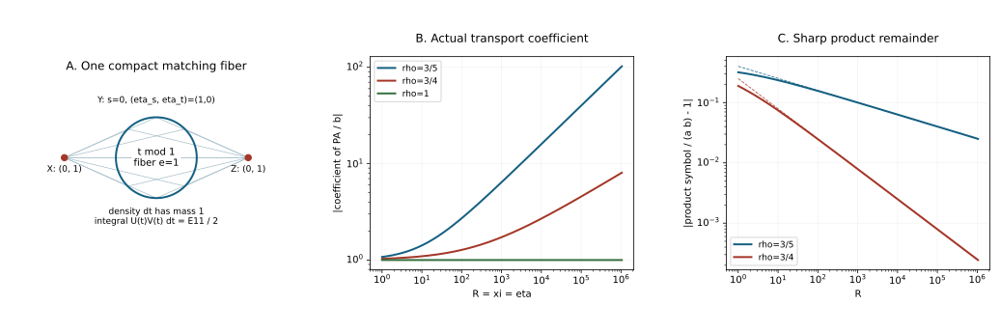

# Clean FIO composition and transport with derivative loss

Composing two Fourier-integral operators matches their middle covectors. A clean family of matches contributes half its dimension to the order. That geometry survives a symbol class with growing base derivatives; its remainders have a smaller drop. Transport also changes: differentiating a general symbol along a characteristic field does not have the ordinary-symbol order.

Independent exposition, proofs, three complete solutions and reproducible illustration: GPT-6.1 Sol (OpenAI), Ultra, 15 October 2026. CC0-1.0. Earlier linked components retain their terms.

The antecedent is Lars Hörmander, *The Analysis of Linear Partial Differential Operators IV*, the exact approved Springer 2009 eBook, §25.2, printed 17–24: kernel correspondence and axis exclusions, adjoints, clean composition, density differentiation, the separate-coordinate lemma and subprincipal transport.  The last paragraph on page 24 motivates the general-\(\rho\) remainder extension. The actual transport orders below are derived, with an explicit example showing why its ordinary index cannot be copied unchanged.

The exact earlier programme proofs are [general-symbol stationary phase and Lagrangian symbols](../20261015-rho-stationary-phase-and-symbols/stationary-phase-and-symbols-with-derivative-loss.md), [homogeneous symbol transport](../20261004-free-canonical-composition/homogeneous-symbol-transport.md), [kernel maps and ordinary composition](../20261005-restored-analytic-composition/clean-composition-of-fourier-integral-operators.md), [linear density/Maslov reduction](../20261005-restored-linear-reduction/reduction-and-linear-symbol-composition.md), and [density differentiation, separate coordinates and scalar subprincipal invariance](../20261005-restored-subprincipal-transport/hamilton-fields-and-subprincipal-transport.md). We reuse their exact geometry and kernel arguments and prove the changed analytic estimates here. The proof map binds the current versions and all dependencies. The 92 human foundations remain external; internal export P514 closure is not claimed.

## 1. Classes, axes and actual supports

**H0. Fix the full symbol range.** Throughout,
\[
 \frac12<\rho\le1,\qquad \delta=1-\rho,\qquad
 \epsilon=2\rho-1>0,\qquad D=-i\partial.
 \tag{FC1}
\]
Use the general class \(I_\rho^m\) just proved, with local phase amplitudes in \(S_{\rho,\delta}^{m+(d-2N)/4}\) for a nondegenerate phase on a base of dimension \(d\). All estimates include every symbol derivative on compact normalized subsets inside the working conic domains.

Let \(C\) be a smooth embedded homogeneous canonical relation from \(T^*Y\setminus0\) to \(T^*X\setminus0\). For global statements, its primed version
\[
 C'=\{(x,\xi;y,-\eta):(x,\xi;y,\eta)\in C\}
 \tag{FC2}
\]
is closed in \(T^*(X\times Y)\setminus0\), and contains no nonzero covector on either zero-component axis. Local branches are treated on compact normalized subsets of open cones. \(E,F,G\) below are smooth finite-rank complex vector bundles.

Proper support of a kernel means that both base projections of its closed support are proper. Properness of a matching cotangent map, used later, is an additional condition. Every support condition applies to the actual closed amplitude or kernel support, not to a formal critical set with unwanted tails left over.

## 2. Kernel maps do not require ordinary amplitude derivatives

**K0. Apply the exact axis-free kernel theorem.** A kernel
\[
 K_A\in I_\rho^m(X\times Y,C';
               \Omega_{X\times Y}^{1/2}\otimes\operatorname{Hom}(F,E))
 \tag{FC3}
\]
defines a continuous map from compact smooth input half-densities to smooth output half-densities, extends continuously from compactly supported distributions to distributions, and satisfies
\[
 \operatorname{WF}(Au)\subset C(\operatorname{WF}(u)).
 \tag{FC4}
\]
These statements use the already proved scalar kernel correspondence and strong test/distribution topologies, applied in finitely many bundle frames. Their hypotheses are precisely the wavefront inclusion \(\operatorname{WF}(K_A)\subset C'\), the two missing axes and compact input localization. General-symbol oscillatory existence and wavefront bounds give that inclusion for (FC3). The kernel theorem itself uses compact Fourier polynomial bounds and rapid decay in the complementary cones, not an ordinary-symbol derivative assumption. Thus its exact earlier proof applies.

One useful estimate can also be read directly. Near the phase-critical support, the nonzero input covector makes the input base gradient of the phase at least \(c|\theta|\). Its full transposed integration field gains one inverse frequency, and any derivative on the amplitude costs at most \(|\theta|^\delta\). Repeating therefore gains \(|\theta|^{-\rho}\) per step. After any fixed output derivatives, take more steps to obtain absolute frequency integrability. This bounds every compact smooth output seminorm by finitely many input smooth and amplitude seminorms. Pieces off the phase-critical set are smooth by the general nonstationary proof.

This estimate is uniform for smooth frequency truncations of the amplitude. On a fixed compact input support those truncated operators converge in every compact output smooth seminorm. These precise bounds will identify the composition with its actual operator product.

## 3. Adjoint kernels and their symbols

**A0. Keep the antidual bundles explicit.** Write \(E^\dagger\) for the bundle of conjugate-linear functionals on \(E\). The adjoint of a linear map \(a:F_y\to E_x\) is \(a^\dagger:E_x^\dagger\to F_y^\dagger\), defined by composition with \(a\). In local frames it is the conjugate transpose. Hermitian identifications recover the usual metric adjoint, if metrics are chosen.

The distributional kernel adjoint is
\[
 K_{A^\dagger}(y,x)=K_A(x,y)^\dagger,
 \qquad
 A^\dagger\in I_\rho^m
 (Y\times X,(C^{-1})';
  \Omega^{1/2}\otimes\operatorname{Hom}(E^\dagger,F^\dagger)).
 \tag{FC5}
\]
To prove its class, take a local real phase \(\phi(x,y,\theta)\). The new phase is \(-\phi(x,y,\theta)\), in the swapped base variables, and the new amplitude is \(a^\dagger\). Conjugation, finite matrix transpose and base swap preserve every \(S_{\rho,\delta}\) seminorm. The phase critical map is precisely the primed inverse relation. Distributional adjunction follows first for smooth truncations from the defining input/output pairing, then for the kernels by oscillatory continuity.

If \(s:C^{-1}\to C\) swaps the two cotangent factors, its symbol is
\[
 \sigma_\rho(A^\dagger)=s^*(\sigma_\rho(A)^\dagger)
       \quad\bmod S_\rho^{m+(\dim X+\dim Y)/4-\epsilon}.
 \tag{FC6}
\]
Here the dagger includes conjugation of the Maslov factor, its canonical identification with the inverse relation's line, and the antidual bundle map. A quadratic normal form changes its signature to its negative; its Gaussian factor is conjugated. Positive half-density Jacobians are unchanged. These are the exact earlier Gaussian-line reflection and base-swap identities, so the general symbol remainder proved in the preceding lesson gives (FC6). Properness is preserved when present, and double adjunction returns the original kernel under the canonical finite-dimensional double-antidual identification.

## 4. The clean geometry and the theorem

**G0. Do not infer embeddedness from cleanness alone.** Let \(C_1:Y\to X\) and \(C_2:Z\to Y\) have the closure and axis properties in H0. Their matching space is
\[
 \mathcal F=\{(\gamma_1,\gamma_2)\in C_1\times C_2:
                    \text{their }Y\text{ covectors agree}\},
 \qquad q:\mathcal F\longrightarrow C_1\circ C_2 .
 \tag{FC7}
\]
Assume the intersection is clean, the image \(C\) is an embedded canonical relation, and \(q\) is a submersion with constant fiber dimension \(e\) on the selected component. Require \(q\) proper on the critical supports actually composed. The previously proved proper-connected-fiber criterion supplies embeddedness and the submersion statement in the source's global proper connected case; it includes compact \(Y\) under the full cotangent closure and missing-axis hypotheses. That criterion is geometric and unchanged here. More generally, the theorem applies to any fixed embedded branch satisfying the stated conditions.

**C0. Order and the exact leading fiber density.** Suppose \(A_1,A_2\) are properly supported and
\[
 A_1\in I_\rho^{m_1}(X\times Y,C_1';
                 \Omega^{1/2}\otimes\operatorname{Hom}(F,E)),
 \quad
 A_2\in I_\rho^{m_2}(Y\times Z,C_2';
                 \Omega^{1/2}\otimes\operatorname{Hom}(G,F)).
 \tag{FC8}
\]
Then the actual product is properly supported and
\[
 A_1A_2\in I_\rho^M(X\times Z,C';
                    \Omega^{1/2}\otimes\operatorname{Hom}(G,E)),
 \qquad M=m_1+m_2+e/2.
 \tag{FC9}
\]
Let \(\mathfrak b\) be the exact geometric density/Maslov product of the two tangent canonical relations, followed by the bundle-map product in operator order. Use its unscaled geometric convention. Then
\[
 \sigma_\rho(A_1A_2)(\gamma)
 =(2\pi)^{-e/2}\int_{\mathcal F_\gamma}
             \mathfrak b(\sigma_\rho(A_1),\sigma_\rho(A_2))
       \quad\bmod S_\rho^{\,M+(\dim X+\dim Z)/4-\epsilon}.
 \tag{FC10}
\]
Equivalently one may include \((2\pi)^{-e/2}\) in the definition of the symbol product, as in the earlier restored lesson, and omit it outside the integral. It occurs once.

The proof of (FC9)–(FC10), including all differentiated remainders and the identification with the operator product, occupies the next five sections.

## 5. Unequal phase frequencies give a smooth kernel

**C1. Use the reduced integration gain \(\rho\).** Work in compact base charts with nondegenerate phase representations \(\phi(x,y,\theta)\), \(\psi(y,z,\tau)\). They can be chosen by the full prescribed-phase theorem. Put
\[
 \mu_1=m_1+\frac{n_X+n_Y-2N_1}{4},\qquad
 \mu_2=m_2+\frac{n_Y+n_Z-2N_2}{4},
 \qquad a_i\in S_{\rho,\delta}^{\mu_i}.
 \tag{FC11}
\]
Keep matrix products in the order \(a_1a_2\). Remove bounded phase frequencies into smooth kernels. Shrink the remaining conic supports near their critical sets so that throughout them
\[
 c_1|\theta|\le|\phi_y|\le C_1|\theta|,
 \quad c_2|\tau|\le|\psi_y|\le C_2|\tau|,
 \quad |\phi_x|\ge c_X|\theta|,
 \quad |\psi_z|\ge c_Z|\tau|.
 \tag{FC12}
\]
The first two follow from the missing middle axes; the other two follow from the external ones. Compact normalized supports make the inequalities uniform.

Write \(\Phi=\phi+\psi\). A fixed degree-zero ratio cutoff \(\chi(\theta,\tau)\), equal to one on a sufficiently large comparable-frequency region, can be chosen so that
\[
 |\Phi_y|\ge cR\quad\text{on }(1-\chi)a_1a_2,\qquad
 R=(|\theta|^2+|\tau|^2)^{1/2}.
 \tag{FC13}
\]
Indeed if \(C_1|\theta|\le c_2|\tau|/2\), the triangle inequality gives \(|\Phi_y|\ge c_2|\tau|/2\). The opposite extreme is identical. Choose the transition of \(\chi\) inside these separated regimes.

Integrate in \(y\) using the full transpose of
\[
 L=\frac{\Phi_y\cdot\partial_y}{i|\Phi_y|^2},
 \qquad
 L^t b=-\operatorname{div}_y
                      \left(\frac{\Phi_y}{i|\Phi_y|^2}b\right).
 \tag{FC14}
\]
Every fixed \(y\) derivative of its coefficient is \(O(R^{-1})\), including when one phase frequency is much smaller than the other. On compact base sets, amplitude products obey
\[
 |\partial_y^\gamma(a_1a_2)|
 \le C_\gamma R^{P+\delta|\gamma|},
 \qquad P=\max(\mu_1,0)+\max(\mu_2,0).
 \tag{FC15}
\]
Negative individual orders cause no problem because both individual radii are at least one. Each transposed integration therefore gains \(R^{-\rho}\), since \(1-\delta=\rho\). A fixed output derivative of the phase costs at most one additional \(R\); an output derivative of an amplitude costs at most \(R^\delta\). Consequently, after \(J\) output derivatives and \(L\) integrations, the \(y\) integral is bounded by
\[
 C_{J,L}R^{P+J-L\rho}.
 \tag{FC16}
\]
The product rule on the coefficients only improves that bound. Choose \(L\rho>P+J+N_1+N_2\), with a strict margin, to obtain absolute integrability in \((\theta,\tau)\). This works for every \(J\), uniformly for frequency cutoffs. Compact \(y\) support removes all integration boundary terms. The unequal-frequency contribution is thus a smooth kernel, continuously controlled by finitely many input seminorms.

## 6. Turn the middle base into a homogeneous auxiliary variable

**C2. Prove the joint symbol estimate.** On the comparable part both individual radii are comparable to
\(R=(|\theta|^2+|\tau|^2)^{1/2}\). Thus \(\chi a_1a_2\) is a joint symbol of order \(\mu_1+\mu_2\): each \(\theta\) or \(\tau\) derivative gains \(\rho\), each base derivative costs \(\delta\), and the ratio cutoff has stronger ordinary degree-zero estimates.

Set
\[
 v=Ry,\qquad w=(v,\theta,\tau),\qquad
 N=N_1+N_2+n_Y,\qquad dy=R^{-n_Y}\,dv.
 \tag{FC17}
\]
On the compact \(y\) support, \(|w|\asymp R\). The new phase
\[
 \widetilde\Phi(x,z,w)=
    \phi(x,v/R,\theta)+\psi(v/R,z,\tau)
 \tag{FC18}
\]
is homogeneous of degree one in \(w\). The transformed amplitude is
\[
 b(x,z,w)=R^{-n_Y}\chi(\theta,\tau)
          a_1(x,v/R,\theta)a_2(v/R,z,\tau),
 \quad
 b\in S_{\rho,\delta}^{\mu_1+\mu_2-n_Y}.
 \tag{FC19}
\]
Here is the derivative budget. A \(v\) derivative produces \(R^{-1}\partial_y\), of net gain \(1-\delta=\rho\). A \(\theta\) or \(\tau\) derivative either differentiates its own amplitude frequency, gaining \(\rho\), or differentiates \(v/R\), whose derivative is \(O(R^{-1})\) on this support, with the same net gain. Derivatives of \(R^{-n_Y}\) or the ratio cutoff have stronger ordinary gain one. The iterated product and chain rules give every mixed estimate; they do not replace \(R\) by a small individual radius.

**C3. Clean rank and normalization.** The phase-critical equations of \(\widetilde\Phi\) are equivalent to
\(\phi_\theta=0\), \(\psi_\tau=0\), \(\phi_y+\psi_y=0\). For example the \(v\) equation gives \(R^{-1}\Phi_y=0\), after which the compensating derivatives of \(v/R\) in the other equations vanish. The exact clean phase-addition theorem then identifies its critical map with \(q\), its excess with \(e\), and its external critical covectors with the composed relation. Nonzero external covectors make its full phase differential nonzero on this critical neighborhood. These are geometric facts already proved for arbitrary smooth phases.

With the earlier clean normalization, the comparable kernel is
\[
 c_{d,N,e}\int e^{i\widetilde\Phi}
                      (2\pi)^{-e/2} b\,dw,\qquad
 d=n_X+n_Z,\quad
 c_{d,N,e}=(2\pi)^{-(d+2N-2e)/4}.
 \tag{FC20}
\]
To check the constant, multiply the two original factors
\((2\pi)^{-(n_X+n_Y+2N_1)/4}\) and
\((2\pi)^{-(n_Y+n_Z+2N_2)/4}\), and divide by \(c_{d,N,e}\). The result is \((2\pi)^{-e/2}\). The amplitude order in (FC19) is exactly
\[
 \mu_1+\mu_2-n_Y
 =M+\frac{d-2N-2e}{4},\qquad
 M=m_1+m_2+e/2.
 \tag{FC21}
\]
The full general-symbol clean representation theorem therefore gives (FC9) locally. Its normal stationary expansion and all output derivatives have successive drop \(\epsilon\).

## 7. Identify the constructed kernel with the actual product

**C4. Take the operator limit as well as the distribution limit.** Multiply the two amplitudes by smooth cutoffs \(h(\theta/T)\), \(h(\tau/T)\), where \(h=1\) near zero. The compact-frequency kernels are smooth, and their compact base supports permit ordinary Fubini. Their product is precisely the sum of the comparable kernel (FC20) and the unequal-frequency kernel from C1.

These truncated amplitudes stay bounded in their original symbol spaces and converge in every slightly higher order:
\[
 h(\theta/T)a\longrightarrow a
          \quad\text{in }S_{\rho,\delta}^{\mu+\eta},
 \qquad \eta>0.
 \tag{FC22}
\]
For each seminorm the difference is supported where \(|\theta|\ge cT\); the extra order \(\eta\) supplies \(O(T^{-\eta})\). Derivatives of the cutoff have ordinary inverse-radius bounds, stronger than required. This is also the exact earlier frequency-cutoff theorem. It does not assert same-order density of smoothing symbols.

Oscillatory continuity in these slightly higher spaces gives distributional convergence of the constructed kernels. Their actual original orders were already proved directly in C1–C3 and are not increased by this convergence argument.

There is convergence on compact smooth inputs as well. Integrate in the input base variable using (FC12) and its analogue for \(A_2\). Each step gains at least \(\rho\), with finitely many derivatives of that smooth input. For any output seminorm, enough steps make the truncated frequency tail arbitrarily small, uniformly on fixed input supports. Compact local base supports put \(A_{2,T}f\) and \(A_2f\) in one common compact input support for \(A_1\). Hence
\[
 A_{1,T}A_{2,T}f-A_1A_2f
 =A_{1,T}(A_{2,T}f-A_2f)
       +(A_{1,T}-A_1)A_2f\longrightarrow0
 \tag{FC23}
\]
in every compact output smooth seminorm. The uniform seminorm bounds just proved control the first term; the convergence for the fixed smooth input \(A_2f\) controls the second. Equality on compact input/output product tests, and the earlier proved uniqueness of the kernel correspondence, identify the limiting kernel with \(A_1A_2\). No undefined product of singular distributions was used.

## 8. Global assembly and actual proper support

**C5. Use compactness at both levels.** First localize the external base supports. Proper support of both kernels confines the middle base points to a compact set. The earlier locally finite phase partition reduces the relevant compact base/direction pieces to finite phase sums and smooth residual kernels.

Over a compact normalized external cotangent set, properness of \(q\) makes its matching critical preimage compact. Finitely many matched phase patches cover it. Pairs away from that preimage are microlocally smooth at the selected output cone, by the full-gradient nonstationary argument: the normalized product phase has no critical point there, so the same positive integration gain makes every tested Fourier derivative rapid. Smooth residual kernels compose smoothly by K0 and A0, with differentiation of their compact smooth test families.

Thus the local class and symbol statements assemble at every relevant covector. The resulting operator is proper. Above a compact output base set, the first kernel permits middle points only in a compact set; the second then permits input points only in a compact set. Reverse the argument for the other projection. The projected support relation is closed on these compact regions, since a converging external sequence has a converging subsequence of middle points. Its two base projections are therefore proper. The distributional kernel support lies in that relation, proving proper support of the product.

## 9. Leading symbols and every remainder order

**C6. Integrate the geometric product once.** At a matching point the tangent canonical relations reduce to the tangent relation of \(C\); the radical of their reduction is \(\ker dq\), of dimension \(e\). The exact linear Gaussian/density theorem identifies the normal stationary quotient density with
\[
 \mathfrak b(a_1,a_2)\in
 q^*(M_C\otimes\Omega_C^{1/2}\otimes\operatorname{Hom}(G,E))
                  \otimes\Omega(\ker dq).
 \tag{FC24}
\]
The map multiplies the bundle coefficients in the order \(a_1a_2\). This finite-dimensional identity depends on the phases, tangent spaces and density Jacobians, and is unchanged by the symbol derivative bounds.

Apply the preceding full general-symbol clean stationary theorem to (FC20). Its leading coefficient is the integral in (FC10). The explicit factor in (FC20) is exactly the linear reduction convention difference described in C0; inserting it again would double it.

Fiber integration preserves the required seminorms. Over a compact normalized output set, cover its proper preimage by finitely many submersion charts \((\gamma,s)\mapsto\gamma\). All \(s\) supports are compact and fixed after a finite partition. Homogeneous pullback preserves \(S_\rho\), including its frequency and base derivative losses. Differentiation under the finite compact \(s\) integrals gives every output seminorm. The already proved dilation degree of the geometric density product is \((e-n_Y)/2\); with the two input symbol degrees it gives
\[
 \left(m_1+\frac{n_X+n_Y}{4}\right)
 +\left(m_2+\frac{n_Y+n_Z}{4}\right)
 +\frac{e-n_Y}{2}
      =M+\frac{n_X+n_Z}{4}.
 \tag{FC25}
\]
This agrees with the direct amplitude count.

There is a full expansion in any fixed output graph/phase chart: its \(j\)-th normal stationary coefficient has distribution order \(M-j\epsilon\), with the remainder after \(J\) coefficients of order \(M-J\epsilon\), in every symbol derivative. To see this concretely, take the exact output Fourier reduction of (FC20). Each normal stationary pair costs one inverse output radius and at most two degree-zero amplitude derivatives, giving precisely \(\epsilon\); the previously proved differentiated remainder theorem includes all coordinate and Jacobian derivatives. Reconstructing a prescribed output phase uses the already complete supported asymptotic-sum and prescribed-phase proofs. Higher coefficients depend on that chosen phase; the leading quotient (FC10) is intrinsic.

Changing an input representative by its lower-\(\epsilon\) class changes the product by order \(M-\epsilon\), directly from (FC19)–(FC21). Thus (FC10) is well-defined on the principal symbol quotients. If the fiber integral vanishes in that quotient, the product has order \(M-\epsilon\), not necessarily a smooth kernel. All finite remainder and smoothing estimates are continuous in finitely many input amplitude seminorms for the fixed phase/support data.

## 10. The scalar operator for transport

**T0. State the symbol data before computing the index.** Let \(P\) be a properly supported scalar pseudodifferential operator on half-densities over \(X\), of ordinary order \(s\). In each working half-density chart suppose its full left symbol is
\[
 P(x,\xi)=p(x,\xi)+r(x,\xi)+r_2(x,\xi),
 \quad
 r\in S_{1,0}^{s-1},\quad r_2\in S_{1,0}^{s-2}.
 \tag{FC26}
\]
Here \(p\) is its chosen smooth homogeneous degree-\(s\) principal symbol. The classical step-one case is included; a full higher homogeneous expansion is unnecessary for this proof. Set
\[
 c=r+\frac i2\sum_jp_{x_j\xi_j}
                     \quad\bmod S_{1,0}^{s-2}.
 \tag{FC27}
\]
This is the intrinsic scalar subprincipal class. The exact earlier first coordinate-correction proof applies to general ordinary \(r\): its correction uses only \(p\), since the frequency derivatives of \(r\) in that correction already have order \(s-2\). Its half-density Jacobian cancellation is algebraic and does not require \(r\) homogeneous. Thus (FC27) has the same scalar coordinate transformation modulo \(S^{s-2}\).

Suppose \(p\) vanishes on the \(X\)-projection of \(C\), and let \(A\in I_\rho^m(X\times Y,C';\Omega^{1/2})\). \(A\) need not be proper. K0 and properness of \(P\) define \(PA\) on compact smooth inputs and as a kernel. Additional proper support of \(A\) implies that of \(PA\).

The lifted \(H_p\) is tangent to \(C'\): \(p=0\) there implies \(dp\) annihilates its tangent space, and a Lagrangian tangent space equals its symplectic orthogonal. For complex \(p\), apply this separately to its real and imaginary parts and use the complexified tangent bundle. Lie differentiation of Maslov-valued half-densities uses the earlier exact formula
\[
 \mathcal L_W(b|du|^{1/2})
       =\left(Wb+\frac12\operatorname{div}W\,b\right)|du|^{1/2}
 \tag{FC28}
\]
in a flat Maslov frame, extended complex linearly when needed. A real flow for a complex vector field is not required.

## 11. Separate coordinates and one exact integration by parts

**T1. Keep \(P\) acting on its own base.** The exact separate-coordinate theorem makes \(C'\) a frequency graph by independent changes on \(X\) and \(Y\); both nonzero external covectors are essential. Its proof uses the proved almost-everywhere diagonal complement lemma and two explicit quadratic base-coordinate changes. It does not depend on the amplitude class.

Write \(d=n_X+n_Y\), \(\Theta=(\xi,\eta)\), \(R=|\Theta|\), and
\[
 \Phi=x\cdot\xi+y\cdot\eta-H(\xi,\eta),\qquad
 K_A=(2\pi)^{-3d/4}\int e^{i\Phi}b(\xi,\eta)\,d\xi\,d\eta,
 \quad b\in S_\rho^q,\quad q=m-d/4.
 \tag{FC29}
\]
This is the complete frequency normal form proved in the preceding general-symbol lesson. Compact base cutoffs equal to one near the graph are understood. On its angular support \(|\xi|\asymp R\).

Proper localization of \(P\) confines intermediate \(X\) points to compact sets. Its action on an \(X\) plane wave gives its exact full left symbol. Cutoff errors away from the retained graph are microlocally smooth: the proper pseudodifferential kernel is smooth off its diagonal, and the missing FIO axes make its compact smooth input families smooth under \(A\) and its adjoint. Thus the product is represented microlocally by amplitude \(P(x,\xi)b(\xi,\eta)\).

Since \(p(H_\xi,\xi)=0\), Taylor's integral identity gives
\[
 p(x,\xi)=\sum_j(x_j-H_{\xi_j})p_j(x,\xi,\eta),
 \qquad
 p_j=\int_0^1p_{x_j}(H_\xi+t(x-H_\xi),\xi)\,dt.
 \tag{FC30}
\]
Each \(p_j\) is an ordinary symbol of order \(s\) in the joint frequencies, with ordinary bounds for every base derivative. The segment lies in a fixed slightly larger base chart.

The identity
\((x_j-H_{\xi_j})e^{i\Phi}=i^{-1}\partial_{\xi_j}e^{i\Phi}\)
and integration by parts replace \(p\,b\) by
\[
 i\sum_j\partial_{\xi_j}(p_jb).
 \tag{FC31}
\]
Smooth frequency cutoffs justify this as an equality of oscillatory distributions: their derivative terms tend to zero in a slightly higher symbol topology and the positive nonstationary gain gives the distributional limit. The full amplitude for \(PA\) is therefore
\[
 t_0+t_1+t_2,\quad
 t_0=i\sum_jp_j\,\partial_{\xi_j}b,\quad
 t_1=\left(r+i\sum_j\partial_{\xi_j}p_j\right)b,\quad
 t_2=r_2b.
 \tag{FC32}
\]
The derivatives of \(p_j\) here hold \(x,y\) fixed.

## 12. An improved restriction estimate for an ordinary coefficient

**T2. Account for which factor has the base derivatives.** In the graph phase (FC29), let \(a(x,y,\Theta)=f(x,y,\Theta)g(\Theta)\), where \(f\) is ordinary of order \(u\), with all its base derivatives of the same ordinary order, and \(g\in S_\rho^v\). Replacing \(a\) by
\[
 f(H_\Theta,\Theta)\,g(\Theta)
 \tag{FC33}
\]
changes the kernel by \(I_\rho^{u+v+d/4-\rho}\).

Indeed Taylor expansion about the base graph writes the difference as
\(\sum_\ell((x,y)_\ell-H_{\Theta_\ell})f_\ell g\), with \(f_\ell\) still ordinary of order \(u\). Integration by parts in \(\Theta_\ell\) leaves derivatives either on \(f_\ell\), gaining one, or on \(g\), gaining \(\rho\). Thus every remaining amplitude is in \(S_{\rho,\delta}^{u+v-\rho}\); the proved phase representation theorem gives the claimed kernel order. Compact conic support and slightly larger cutoffs justify the segment and frequency integration as in T1. This is a complete estimate for this special amplitude, not a claim of a \(\rho\) drop for every general-symbol stationary amplitude.

Apply it separately to (FC32). The orders and the worst discarded coefficient order are
\[
 \begin{array}{c|c|c}
  \text{term}&\text{amplitude order}&
             \text{error after restriction}\\ \hline
  t_0&q+s-\rho&q+s-2\rho\\
  t_1&q+s-1&q+s-1-\rho\\
  t_2&q+s-2&\text{retained in the remainder}.
 \end{array}
 \tag{FC34}
\]
Because \(\rho\le1\), the last two remainders have order at most \(q+s-2\rho\). Only the coefficient factor is differentiated in the base; assigning a \(\delta\) loss to a nonexistent base derivative of \(g\) would obscure this stronger bound.

## 13. Recover the divergence and the subprincipal term

**T3. Compare fixed-base and graph derivatives.** Put
\[
 F_j(\xi,\eta)=p_{x_j}(H_\xi,\xi)=p_j(H_\xi,\xi,\eta).
 \tag{FC35}
\]
On the graph, the lifted Hamilton field is
\(W=-\sum_jF_j\partial_{\xi_j}\), with \(W\eta=0\).
Differentiating \(p(H_\xi,\xi)=0\) verifies that the induced base components are \(p_\xi\) in \(X\) and zero in \(Y\), so this is exactly \(H_p\).

The restricted coefficient of \(t_0+t_1\) is
\[
 i\sum_jF_j\partial_{\xi_j}b+
       \left(r+i\sum_j
       (\partial_{\xi_j}p_j)|_{x=H_\xi}\right)b.
 \tag{FC36}
\]
Let \(S=\sum_j(\partial_{\xi_j}p_j)|_{x=H_\xi}\) and
\(T=\sum_{j,k}(\partial_{x_k}p_j)H_{\xi_k\xi_j}\), evaluated on that graph. The chain rule gives
\(\sum_j\partial_{\xi_j}F_j=S+T\).
Differentiate (FC30) first in \(x_k\), then in \(\xi_k\), at fixed \(x\), and restrict to the graph. The vanishing base factors drop out, and summing gives
\(\sum_kp_{x_k\xi_k}=S-T\).
These two exact identities imply
\[
 r+iS=c+\frac i2\sum_j\partial_{\xi_j}F_j.
 \tag{FC37}
\]
Formula (FC28), with \(W=-\sum F_j\partial_{\xi_j}\), now identifies (FC36) as the coefficient of
\[
 \left(\frac1i\mathcal L_{H_p}+c\right)
                 \bigl(b|d\xi\,d\eta|^{1/2}\bigr).
 \tag{FC38}
\]
The sign, half-divergence and \(i/2\) in (FC27) have all been determined by the actual integration by parts. No phase-convention change is implicit.

## 14. Transport theorem and the precision of its symbol

**T4. Retain the correct general-symbol index.** Equations (FC32)–(FC38) prove
\[
 PA\in I_\rho^{m+s-\rho}(X\times Y,C';\Omega^{1/2}).
 \tag{FC39}
\]
If \(a\) is any representative of \(\sigma_\rho(A)\), of intrinsic degree
\(\nu=m+d/4\), then
\[
 \sigma_\rho(PA)=
           \frac1i\mathcal L_{H_p}a+c\,a
    \quad\bmod S_\rho^{\,\nu+s-\rho-\epsilon}.
 \tag{FC40}
\]
Indeed in frequency coordinates \(F_j\) has ordinary order \(s\), so \(F_j\partial_{\xi_j}b\) has order \(q+s-\rho\). The divergence and subprincipal multiplication terms have the smaller order \(q+s-1\). Their sum therefore has exactly the required upper order, and (FC34) puts the actual kernel error in
\[
 I_\rho^{m+s-2\rho}.
 \tag{FC41}
\]
This is lower than the principal quotient error because \(\rho\ge\epsilon\).

The precision statements must be distinguished. For the actual full coefficient \(b\) in the selected graph normal form, the coordinate calculation has remainder (FC41). A principal symbol representative is known only modulo \(S_\rho^{\nu-\epsilon}\). Applying \((i^{-1}\mathcal L_{H_p}+c)\) to such a change gives \(S_\rho^{\nu+s-\rho-\epsilon}\). Thus the intrinsic principal formula is (FC40), and a finer invariant claim does not follow from that principal class alone.

Changing a subprincipal representative by \(S^{s-2}\) contributes \(S_\rho^{\nu+s-2}\), contained in the error of (FC40), since \(2\ge\rho+\epsilon\). Exact scalar half-density coordinate invariance of \(c\), the already proved geometric Maslov transitions and the coordinate-independent Lie derivative therefore patch the formula. Complex \(p\) is handled by complex linearity of all these calculations. Scalar half-density operators are the scope of this transport theorem; systems require their own output frame or connection terms.

At \(\rho=1\), (FC39) becomes the ordinary order \(m+s-1\), and (FC40) is its usual subprincipal symbol formula. For \(\rho<1\), the derivative term can attain order \(m+s-\rho\). The next exercise proves that the ordinary index would then be false.

## 15. Three calculations with complete solutions

**X1. A transport coefficient that attains the larger order.** Let \(X=Y=\mathbb R\), take the graph phase \(x\xi+y\eta\), and choose high-frequency support in an interior cone with \(\xi\asymp\eta>0\). Let \(0<\delta=1-\rho<1/2\), and let
\[
 b(\xi,\eta)=\chi(\xi/\eta)\,h(\eta)e^{i\xi^\delta},
 \tag{FC42}
\]
where \(\chi=1\) near ratio one and \(h=1\) at high positive frequencies. Localize both base variables by compact cutoffs equal to one near zero. Determine the orders of \(A\) and \(PA\) for \(P=xD_x\), and check the subprincipal term.

**Solution.** Each frequency derivative of \(b\) costs at least \(\rho\); derivatives of its angular or low-frequency cutoffs have stronger ordinary bounds. Thus \(b\in S_\rho^0\). With total base dimension \(d=2\), \(A\in I_\rho^{1/2}\). Its kernel relation is conormal to \((x,y)=(0,0)\), restricted to the selected cone; both covector components are nonzero.

The principal symbol \(p=x\xi\) vanishes there. In the fixed half-density chart \(r=0\), hence \(c=i/2\). The actual full coefficient of \(PA\) is
\[
 i\partial_\xi(\xi b).
 \tag{FC43}
\]
On the inner cone \(\xi=\eta=R\), where the cutoffs are one, it is
\[
 (i-\delta R^\delta)e^{iR^\delta},
 \qquad
 \left|\,i-\delta R^\delta\,\right|
                       =\sqrt{1+\delta^2R^{2\delta}}.
 \tag{FC44}
\]
It has order \(\delta\) and fails to have order zero. Derivative bounds follow by differentiating \(R^\delta b\); the magnitude lower bound along this ray proves the failure. Thus \(PA\) can have order \(1/2+\delta=m+1-\rho\), and need not be in \(I_\rho^{1/2}\). Base cutoff derivatives are away from the sole phase-critical base point and leave only microlocally smooth terms.

Here \(F=\xi\), \(W=-\xi\partial_\xi\). The half-divergence contributes \(i/2\) and \(c\) contributes another \(i/2\), so (FC38) gives \(i\xi b_\xi+i b\), precisely (FC43). Omitting either half would give the wrong multiplication coefficient.

**X2. The first composition remainder can have order \(-\epsilon\).** In one positive-frequency coordinate, consider
\[
 a(\xi)=e^{i\xi^\delta},\qquad
 b(x,\eta)=e^{ix\eta^\delta},\qquad 0<\delta<1/2.
 \tag{FC45}
\]
Smoothly fill low frequencies, and localize microlocally in a compact base chart. Compute the full symbol of \(a(D)\operatorname{Op}(b)\) and compare it with \(a(\eta)b(x,\eta)\).

**Solution.** On the high positive cone both symbols are in \(S_{\rho,\delta}^0\). The second operator sends the plane wave of frequency \(\eta\) to that of frequency \(\eta+\eta^\delta\). The first then multiplies it by \(a(\eta+\eta^\delta)\). This computation is rigorous first on inputs whose Fourier transforms have compact support in a finite positive-frequency interval; the plane-wave integrals are absolute after testing. They determine the kernel and symbol there, and an exhaustion covers the positive cone. Thus the high-frequency symbol is
\[
 c(x,\eta)=e^{ix\eta^\delta+i(\eta+\eta^\delta)^\delta}.
 \tag{FC46}
\]
It follows that
\[
 \frac{c}{a(\eta)b(x,\eta)}
 =e^{i\Delta(\eta)},\qquad
 \Delta(\eta)=(\eta+\eta^\delta)^\delta-\eta^\delta
 =\delta\eta^{-\epsilon}+O(\eta^{3\delta-2}).
 \tag{FC47}
\]
Taylor's integral remainder for \((1+t)^\delta\), with \(t=\eta^{\delta-1}\), proves the last expression. Since \(3\delta-2\le-2\epsilon\), Taylor's formula for the exponential gives
\[
 \frac{c}{ab}-1
       =i\delta\eta^{-\epsilon}+O(\eta^{-2\epsilon}).
 \tag{FC48}
\]
The nonzero leading coefficient shows that a larger uniform remainder drop is impossible. Every differentiated version follows from the same integral remainders and the product rule. The first usual symbol correction is
\(i^{-1}a'(\eta)b_x=i\delta\eta^{-\epsilon}ab\), confirming the sign.

For the plot and a global bound, concavity of \(t^\delta\) on \(t>0\) gives
\(0<\Delta(\eta)\le\delta\eta^{-\epsilon}\) for \(\eta\ge1\). This follows directly by integrating the decreasing derivative \(\delta t^{\delta-1}\) over \([\eta,\eta+\eta^\delta]\). Hence
\(|e^{i\Delta}-1|\le\Delta\le\delta\eta^{-\epsilon}\).

The example also has proper representatives with the same asymptotic symbol. Here are the needed tail estimates. The multiplier kernel \(k(x-x')\) of \(a(D)\) is smooth and rapidly decreasing with every derivative when \(|x-x'|\ge c>0\): each frequency integration gains \(\rho\), and sufficiently many differentiated symbol factors are integrable. Repetition gives every inverse distance power. For \(x'\) in a fixed compact set, the same proof makes the kernel of \(\operatorname{Op}(b)\) rapidly decreasing with every derivative in its input variable away from the diagonal.

Choose a compact middle cutoff equal to one near the output base patch, and a larger compact input cutoff equal to one near that middle support. The error made by the input cutoff on a plane wave is the Fourier transform of a smooth rapidly decreasing off-diagonal kernel, hence is rapid in \(\eta\), with all base and frequency derivatives. K0 controls its image under the compactly localized first operator. The remaining middle-cutoff error in applying \(a(D)\) is
\(\int k(x-x')(1-\chi(x'))e^{ix'(\eta+\eta^\delta)}\,dx'\).
Its coefficient is a smooth rapidly decreasing function of \(x'\), uniformly for \(x\) in the output patch. Repeated integration in \(x'\) proves rapid decrease in \(\eta\), including every derivative; polynomial factors in \(x'\) remain integrable. All three base cutoffs are now compact, so the resulting two kernels are proper and their high-frequency product symbol differs from (FC46) only by \(S^{-\infty}\). This proves the sharp example within the actual calculus of C0.

**X3. A compact clean fiber with noncommuting matrices.** Let \(X=Z=\mathbb R\), \(Y=\mathbb R_s\times(\mathbb R/\mathbb Z)_t\), with positive density \(ds\,dt\). Put
\[
 U(t)=\cos(2\pi t)\begin{pmatrix}0&1\\0&0\end{pmatrix},
 \qquad
 V(t)=\cos(2\pi t)\begin{pmatrix}0&0\\1&0\end{pmatrix}.
 \tag{FC49}
\]
In the corresponding half-density frames define
\[
 (A_2g)(s,t)=V(t)g(s),\qquad
 (A_1f)(x)=\int_0^1U(t)f(x,t)\,dt.
 \tag{FC50}
\]
Compute the excess, orders, exact product and Gaussian normalization.

**Solution.** The kernels are \(U(t)\delta(x-s)\) and \(V(t)\delta(s-z)\). The circle is compact, so both are properly supported. Each phase has one frequency variable on a three-dimensional kernel base; a smooth order-zero amplitude therefore corresponds to operator order \(-1/4\). Matching identifies the shared real frequency and leaves \(t\) free, so \(e=1\). The output order is
\(-1/4-1/4+1/2=0\).

Matrix multiplication gives \(U(t)V(t)=\cos^2(2\pi t)E_{11}\). The exact product is
\[
 A_1A_2=\frac12E_{11}\operatorname{Id}.
 \tag{FC51}
\]
The integral of \(\cos^2(2\pi t)\) over \([0,1]\) is \(1/2\), by the proved double-angle identity and period integral. Reversing the two matrix factors would give \(E_{22}/2\), a different operator.

With Lebesgue half-density frames in local circle coordinates, each normalized phase amplitude is \((2\pi)^{1/4}\) times its matrix coefficient. Their product has factor \((2\pi)^{1/2}\). The sole clean symbol factor \((2\pi)^{-e/2}\) cancels it, leaving the fiber density \(U(t)V(t)\,dt\), exactly as (FC51). A local circle partition sums to one and introduces no additional factor; \(dt\) has total mass one. This checks the excess order, density, coefficient order and Gaussian constant in the same actual example.

## 16. Read the geometry and the two sharp losses

**F0. Exact figure data.**

Panel A displays the base projection of X3's matching fiber at \(x=s=z=0\), with fixed external covectors \(\xi=\zeta=1\) and middle covector \((\eta_s,\eta_t)=(1,0)\). Its circle is parametrized by \(t\in\mathbb R/\mathbb Z\), with integration density \(dt\) of total mass one. Every point maps to the same output canonical state. The shared fiber has dimension one.

Panel B samples the exact coefficient ratio \(\sqrt{1+\delta^2R^{2\delta}}\) from X1. It grows for every displayed \(\rho<1\), explaining the actual transport order \(m+s-\rho\). Panel C samples \(2\sin(\Delta(R)/2)\) from X2 and its proved upper bound \(\delta R^{-\epsilon}\). The nonzero first coefficient proves the sharp \(\epsilon=2\rho-1\) drop; the sampled curves do not prove an asymptotic theorem. The [generator](figures/build_figure.py) records all coordinates and formulas.

## 17. Scope and continuing work

The general-\(\rho\) kernel maps, adjoint, clean composition, leading density product, full phase remainders and scalar subprincipal transport are proved here with actual supports, all symbol derivatives and exact order qualifications. The ordinary results remain special cases and retained alternatives.

The general-\(\rho\) continuity ranges and the iterated characterization with order-\(2\rho-1\) test operators remain receiving obligations. The full original chapter audit, exact manifold assembly review and external foundations also remain active. Neither a full-course completion nor internal P514 export closure is claimed.

See source credit, [proof review](proof-review.json), [finite checks](model-check.json) and [reader checks](reader-check.json). Original expression is CC0-1.0.  