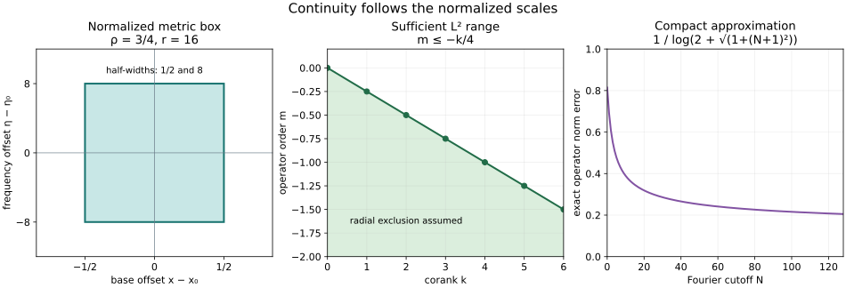

# General-symbol graph and corank continuity

A graph operator of order zero is bounded on \(L^2\), even when base derivatives of its amplitude grow with frequency. A general canonical relation introduces an exact quarter-corank shift. This lesson proves both statements for \(1/2<\rho\leq1\), including localized compactness, every real Sobolev shift, elliptic graph inverses and ordered Egorov. The proof keeps the symbol topology needed for uniform operator norms.

The primary mathematical antecedent is Lars Hörmander, *The Analysis of Linear Partial Differential Operators IV*, Springer 2009 eBook, ISBN 978-3-642-00136-9, §25.3, printed 24–31: Theorem 25.3.1, Corollary 25.3.2, Proposition 25.3.3, Definition 25.3.4, Theorem 25.3.5, Lemma 25.3.6, Proposition 25.3.7 and Theorem 25.3.8. We derive the general-symbol version with the calculus already proved in the programme. The converse and fold statements on printed 31–35 are distinguished at the end. 

Exact earlier proofs are [general stationary phase and symbols](../20261015-rho-stationary-phase-and-symbols/stationary-phase-and-symbols-with-derivative-loss.md), [general-symbol composition and adjoints](../20261015-rho-fio-composition-and-transport/clean-fourier-integral-composition-and-rho-transport.md), [uniform metric operator bounds, Section 7](../20261005-metric-positivity/metric-operator-bounds.md), [classical metric verification, Section 9](../20261005-metric-positivity/scalar-fefferman-phong.md), [quantization conversion](../20261005-metric-weyl-calculus/reflection-and-quantization.md), [homogeneous symbol operations](../20261004-free-canonical-composition/homogeneous-symbol-transport.md), [ordinary graph geometry and inverses](../20261005-restored-graph-egorov/graph-operators-continuity-and-egorov.md), [corank geometry and vector integration](../20261005-restored-corank-continuity/corank-geometry-and-sufficient-continuity.md), and [Hilbert compactness](../20261004-free-canonical-composition/compactness-and-essential-norms.md). The proof map binds exact current bytes and locators. Its 92 human foundation providers remain external.

## 1. The symbol and support hypotheses

**H0. Fix the range and the meaning of a local bound.** Write
\[
\delta=1-\rho,\qquad \epsilon=\rho-\delta=2\rho-1>0,\qquad r=\langle\eta\rangle.
\tag{GC1}
\]
The class \(S_\rho^q=S_{\rho,\delta}^q\) has estimates
\[
|\partial_z^\beta\partial_\eta^\alpha a|
\leq C_{\alpha\beta}r^{q-\rho|\alpha|+\delta|\beta|}.
\tag{GC2}
\]
Bundle coefficients have finite rank and smooth Hermitian metrics. We act on half densities, with \(D=-i\partial\), Fourier phase \(-y\cdot\eta\) and inverse factor \((2\pi)^{-n}\).

All canonical relations are real, homogeneous and embedded, with their twisted relation closed in the whole punctured cotangent bundle of the product. Both component covectors are nonzero. A local microlocal assertion uses a compact normalized subcone strictly inside a larger available cone, with smooth cutoffs and a slightly larger compact base support. Global-over-compacts assertions assume this closure and both axis exclusions throughout the relevant relation. Then its normalized portion over a compact base product is compact, admits a finite phase cover, and has comparable input and output covector lengths. This follows by normalizing their joint length to one: a limiting zero component would violate the axis exclusion. No estimate uniform over a noncompact manifold is asserted.

For fixed compact input support \(K\) and compact output cutoff \(\chi\), continuity means \(\|\chi Au\|_2\leq C_{K,\chi}\|u\|_2\). Compactness means the resulting localized map is compact. Proper representatives are used whenever an unlocalized product or a parametrix is taken.

## 2. The precise pseudodifferential input

**P0. Apply the metric estimate in its actual symbol topology.** On \(\mathbb R^n\) set
\[
g=r^{2\delta}|dx|^2+r^{-2\rho}|d\eta|^2,\qquad
g^\sigma=r^{2\rho}|dx|^2+r^{-2\delta}|d\eta|^2,\qquad h=r^{-\epsilon}\leq1.
\tag{GC3}
\]
The earlier metric verification MP:F7 proves slow variation, symplectic temperateness, weight temperateness and the equivalence of metric and coordinate derivative seminorms for this exact metric. The complete operator theorem MP:B7 consequently bounds Weyl quantization by finitely many normalized coordinate derivatives. The full reflection-compatible conversion WY:Q1–Q3 sends left symbols of order zero continuously to Weyl symbols of order zero, with each mixed correction dropping \(\epsilon\). Thus, for fixed support data, some finite \(J\) and \(C\) satisfy
\[
\|\operatorname{Op}(b)\|_{2\to2}\leq C p_J(b),\qquad
p_J(b)=\max_{|\alpha|+|\beta|\leq J}\sup_{x,\eta}
r^{\rho|\alpha|-\delta|\beta|}
|\partial_x^\beta\partial_\eta^\alpha b|.
\tag{GC4}
\]
Cut off and extend the symbol within its larger compact base and angular patch before applying the theorem. Extension by fixed smooth cutoffs preserves every seminorm. Smooth compactly supported kernel errors have norm at most their kernel \(L^2\) norm, by Cauchy–Schwarz. Finite matrix components give the same estimate for finite bundles, with a fixed dimensional constant.

This is an application of the complete earlier metric proof, including its finite derivative dependence. An ordinary \(S_{1,0}\) estimate alone would not prove (GC4). Both the metric constants and the required number of derivatives may depend on the fixed \(\rho\).

## 3. Graph normalization and a full left form

**G0. Separate geometry from amplitude regularity.** For a local canonical graph \(C\), the two bases have dimension \(n\). Its symplectic half volume \(v_C^{1/2}=|\omega_C^n/n!|^{1/2}\) has degree \(n/2\). Dividing the intrinsic symbol of degree \(m+n/2\) by it gives a reduced graph symbol
\[
\alpha\in S_\rho^m(C;M_C\otimes\operatorname{Hom}(F,E))
\big/S_\rho^{m-\epsilon}.
\tag{GC5}
\]
The earlier graph-coordinate proof GE:D1 changes input base coordinates while retaining output base coordinates and yields
\[
C=\{(x,\phi_x;y=\phi_\eta,\eta)\},\qquad
\det\phi_{x\eta}\ne0,\qquad \phi(x,t\eta)=t\phi(x,\eta).
\tag{GC6}
\]
It uses only homogeneous canonical geometry and is independent of \(\rho\). The general-symbol prescribed-phase converse RSP:R1 gives
\[
K_A=(2\pi)^{-n}\int e^{i(\phi-y\cdot\eta)}a(x,y,\eta)\,d\eta,\qquad a\in S_\rho^m,
\tag{GC7}
\]
modulo a smooth kernel. The critical density is \(|dx\,d\eta|\), so in this phase frame
\[
\alpha=a(x,\phi_\eta,\eta)|\det\phi_{x\eta}|^{-1/2}
\pmod{S_\rho^{m-\epsilon}}.
\tag{GC8}
\]
The density contraction for a graph factor, already proved in LR:R11, makes reduced symbols compose by ordinary ordered bundle maps. The matching excess is zero and the Gaussian factor is one.

**G1. Prove the general-symbol left reduction.** Let \(a_0(x,\eta)=a(x,\phi_\eta,\eta)\). The homogeneous chain rule HT:H2 proves \(a_0\in S_\rho^m\): for example a frequency derivative falling on \(\phi_\eta\) contributes \(r^{-1}\) followed by a base derivative costing \(r^\delta\), hence \(r^{-\rho}\). Taylor's integral formula gives
\[
a-a_0=\sum_j(y_j-\phi_{\eta_j})c_j,\qquad
c_j\in S_\rho^{m+\delta},\qquad
(y_j-\phi_{\eta_j})e^{i(\phi-y\cdot\eta)}
=-\frac1i\partial_{\eta_j}e^{i(\phi-y\cdot\eta)}.
\tag{GC9}
\]
After integration by parts, the replacement amplitude is \((1/i)\sum_j\partial_{\eta_j}c_j\), of order \(m-\epsilon\). Taylor interpolation stays in a fixed interior neighborhood; insert cutoffs equal to one there. Terms outside this neighborhood are nonstationary and smooth by the full general-symbol phase estimate RSP:M1. Iterating gives successive left coefficients of orders \(m-j\epsilon\). Their supported asymptotic sum HT:H6 gives \(b(x,\eta)\in S_\rho^m\); the remaining kernel belongs to every lower Lagrangian order and is smooth by RSP:S1. Therefore
\[
Au(x)=(2\pi)^{-n}\int e^{i\phi(x,\eta)}b(x,\eta)\widehat u(\eta)\,d\eta
\quad\pmod{\text{smooth kernels}}.
\tag{GC10}
\]
All constructions have finite-seminorm bounds at each requested finite order; this follows from Taylor's compact integral, the homogeneous chain rule, the full finite remainders and the supported sum. They are uniform in extra parameters in a compact set when phase determinants remain separated from zero. Proper base cutoffs on both sides of (GC10) are retained. The reduction is microlocal; it does not assert that an input cutoff can be discarded globally.

## 4. The graph estimate before extension to L2

**G2. Use the actual smooth-input adjoint identity.** Localize \(A\in I_\rho^0(C')\) to one sufficiently small graph cone and a compact base product, obtaining \(T\). The proved general adjoint and clean-composition theorems RFC:A0 and RFC:C0 apply to \(T^\dagger T\), with both base supports proper, embedded identity composition and excess zero. Thus
\[
T^\dagger T\in I_\rho^0(\Delta')=\Psi_{\rho,\delta}^0,\qquad
\sigma_{\mathrm{red}}(T^\dagger T)=\alpha^\dagger\alpha
\pmod{S_\rho^{-\epsilon}}.
\tag{GC11}
\]
The equality with the PDO class follows from (GC7)–(GC10) for the identity phase \(x\cdot\eta-y\cdot\eta\); the converse is its defining oscillatory kernel. Formula (GC4) bounds this actual PDO. For compact smooth \(u\), the kernel maps RFC:K0 give smooth compact outputs and justify the antidual pairing identity
\[
\|Tu\|_2^2=(T^\dagger Tu,u)\leq C\,p_J(a)^2\|u\|_2^2.
\tag{GC12}
\]
Here one finite amplitude seminorm suffices after increasing \(J\): the composition estimates are bilinear, and (GC4) is linear. We have not assumed a bounded extension of \(T\) in order to construct its product. Smooth density now gives its unique \(L^2\) extension and the finite-seminorm graph bound.

For compact input and output localizations of the original operator, the normalized relation is compact by H0. A finite graph partition expresses it as a finite sum of pieces of this kind and a smooth compact kernel. Estimate each piece separately and use the triangle inequality. Cross-products between different graph branches need not be identity PDOs and are not used. This proves \(A:L^2_{\rm comp}\to L^2_{\rm loc}\) for every locally graph relation in the stated global support setting. Finite bundle frames and compact metric equivalence give the bundle statement.

## 5. Small symbols in the normalized topology

**C0. Prove the scaled jet lemma.** Suppose \(b\in S_\rho^0\) is supported in a fixed compact base and compact angular interior patch and tends uniformly to zero at high frequency. Every fixed normalized derivative also tends uniformly to zero:
\[
\sup_{\substack{x,\eta\\|\eta|\geq R}}
r^{\rho|\alpha|-\delta|\beta|}
|\partial_x^\beta\partial_\eta^\alpha b(x,\eta)|\longrightarrow0.
\tag{GC13}
\]
Extend by the fixed cutoffs as above. At a center \((x_0,\eta_0)\), put \(r_0=\langle\eta_0\rangle\) and
\[
F_{x_0,\eta_0}(s,t)=
b(x_0+r_0^{-\delta}s,\eta_0+r_0^\rho t).
\tag{GC14}
\]
On a fixed sufficiently small ball, \(r\) is uniformly comparable to \(r_0\), also when \(\rho=1\). All derivatives of \(F\) are uniformly bounded by (GC2). Its sup norm tends to zero uniformly in the centers at infinity. Taylor's one-dimensional estimate, for any unit direction and a smaller ball, is
\[
|\partial_vF|\leq 2h^{-1}\|F\|_\infty+
\tfrac12h\|\partial_v^2F\|_\infty,\qquad 0<h<h_0.
\tag{GC15}
\]
First choose \(h\) small, then the frequency threshold large. This proves that first derivatives tend to zero. Apply the same estimate to each already controlled derivative, on finitely many nested balls, using the available higher derivative bounds. Induction gives every fixed jet at the center. The chain rule in (GC14) is precisely the weight in (GC13).

For a fixed \(h_1\in C_c^\infty\) equal to one near zero, the product rule gives
\[
p_J\big((1-h_1(\eta/R))b\big)\longrightarrow0.
\tag{GC16}
\]
Indeed derivatives of the cutoff occur where \(|\eta|\asymp R\); their normalized frequency cost is \(R^{\rho-1}\leq1\), while each remaining normalized jet tends to zero. For negative order \(b\in S_\rho^{-\gamma}\), \(\gamma>0\), the same estimate follows directly with \(O(R^{-\gamma})\). No unscaled base-derivative smallness is claimed.

## 6. Graph compactness

**C1. Approximate in operator norm.** Let \(A\in I_\rho^0(C')\) have reduced principal symbol tending uniformly to zero over compact base products. The statement is independent of representative, since a change of order \(-\epsilon\) tends to zero. In each left graph form (GC10), (GC8), the smooth nonvanishing determinant factor and the order-\(-\epsilon\) error imply \(b\to0\). Apply (GC16) and the finite-seminorm graph estimate to the high-frequency part. Its operator norm tends to zero. The bounded-frequency part, with both base cutoffs, has a smooth compact kernel. Such a kernel is compact: approximate it in \(L^2(X\times Y)\) by finite sums of product functions; the corresponding finite-rank operators converge in norm by the kernel \(L^2\) estimate. These Hilbert approximation facts are proved in CT:T2.

Each graph piece is consequently a norm limit of compact operators; so are their finite sum and the smooth residual kernel. This proves localized graph compactness. In particular every localized graph operator of strictly negative order is compact. The same argument works uniformly in compact parameter sets if the symbol vanishing and all initial symbol bounds are uniform there.

## 7. Sobolev continuity and distributional agreement

**S0. Retain both reconstruction errors.** If \(A\in I_\rho^m(C')\) is locally graph, then for every real \(s\)
\[
A:H^s_{\rm comp}(Y)\longrightarrow H^{s-m}_{\rm loc}(X).
\tag{GC17}
\]
Choose proper ordinary elliptic reducers \(B_Y\in\Psi^s\), \(B_X\in\Psi^{s-m}\) and an input parametrix \(C_Y\in\Psi^{-s}\), with \(C_YB_Y-I\) smoothing. Their complete constructions and local norm characterizations are supplied by GE:D7, GE:G0 and WM:W6. Ordinary symbols are in our general-symbol classes. Composition gives \(B_XAC_Y\in I_\rho^0(C')\), so G2 bounds it on \(L^2\). On a fixed compact input support,
\[
B_XA=(B_XAC_Y)B_Y+B_XA(I-C_YB_Y).
\tag{GC18}
\]
The second term is smooth on the chosen compact output region: the proper smoothing input term followed by the smooth-input kernel map has each required seminorm bounded by the \(H^s\) input norm. Output elliptic reconstruction gives the desired local norm, with its smoothing reconstruction error bounded on these same supports. These are exactly the proper reconstruction operations in GE:D7; no general FIO Sobolev assertion is used as an input.

For all real \(s\), compact smooth approximants converge in \(H^s\) with support in one larger compact set, by WM:W6. The bound extends \(A\) uniquely. This extension agrees with its distributional kernel action: test the output against a compact smooth function and use the adjoint smooth-input map RFC:K0 to pass to the input distribution limit. Thus (GC17) applies to the original operator. The same argument applies to finite bundle frames.

## 8. General-symbol graph parametrices and Egorov

**E0. Correct the inverse by epsilon steps.** For a global homogeneous graph bijection and a proper elliptic \(A\in I_\rho^m(C')\), assume a representative \(\alpha\) of its reduced symbol is invertible at large frequency and its inverse has order \(-m\). Uniform matrix inversion and differentiated inversion preserve all symbol estimates; this is also a sufficient formulation of ellipticity. The inverse Maslov line and the exact graph symbol contraction identify \(\alpha^{-1}\) with an inverse-relation symbol. Symbol surjectivity RSP:S1 gives \(B_0\in I_\rho^{-m}((C^{-1})')\). The closed proper graph-base relation and cutoff construction GE:D8 give a proper representative. Composition yields
\[
R=I-B_0A\in\Psi_{\rho,\delta}^{-\epsilon}.
\tag{GC19}
\]
The supported symbol sum of \(I+R+R^2+\cdots\) exists in \(\Psi_{\rho,\delta}^0\): finite products have decreasing orders \(-j\epsilon\), their left symbols have full asymptotic remainders by the proved composition calculus and G1, and HT:H6 sums them with the prescribed proper supports. If \(Q\) is this sum, the finite identity \((I+\cdots+R^{N-1})(I-R)=I-R^N\) implies \(Q(I-R)-I\in\Psi^{-N\epsilon}\) for every \(N\). It is smoothing. Therefore \(B=QB_0\) is a left inverse modulo smoothing.

Run the same construction on \(I-AB_0\) to obtain a proper right inverse \(B'\). Associativity of actual proper products and their smoothing ideal gives \(B-B'=B(I-AB')+(BA-I)B'\), smoothing. Hence \(B\) is two-sided. The local version uses cutoffs equal to one on a smaller cone; every correction and residual is supported in the fixed larger cone, so the same comparison proves microlocal inversion. This does not assert extension of arbitrary symbols across an uncontrolled open cone boundary.

**E1. Keep the bundle product ordered.** Let \(A\in I_\rho^m(C')\), \(B\in I_\rho^{-m}((C^{-1})')\) be proper, with reduced symbols \(\alpha,\beta\), and let \(P\in\Psi_{\rho,\delta}^q(X)\) be proper with principal representative \(p\). Composition gives
\[
Q=BPA\in\Psi_{\rho,\delta}^q(Y),\qquad
\sigma(Q)=\beta\,(p\circ\chi)\,\alpha
\pmod{S_\rho^{q-\epsilon}}.
\tag{GC20}
\]
Both compositions have excess zero; the second relation is the identity graph. Pullback by the homogeneous canonical map preserves \(S_\rho^q\) by HT:H2. The density/Maslov contraction in G0 supplies precisely the displayed ordered product. If \(p\) is scalar this is \(c(p\circ\chi)\), \(c=\beta\alpha\); if \(B\) is an inverse of \(A\), \(c=I\) modulo the indicated precision. For a matrix \(p\), inversion gives \(\alpha^{-1}(p\circ\chi)\alpha\). Associativity, properness and the smoothing ideal were already established for the actual products; no formal conjugation substitutes for them.

## 9. A partial graph form at an arbitrary corank

**R0. Use the actual tangent normal form.** Put
\[
k(c)=\operatorname{corank}\omega_C(c),\qquad
2n(c)=\operatorname{rank}\omega_C(c),\qquad
k(c)=n_X+n_Y-2n(c).
\tag{GC21}
\]
Here \(\omega_C=\pi_X^*\omega_X=\pi_Y^*\omega_Y\) as two forms on the relation. Assume that neither individual radial vector \((R_X,0)\), \((0,R_Y)\) is tangent to \(C\). This is stronger than the paired radial tangency supplied by homogeneity. The complete linear splitting CR:L1, radial characterization CR:R1 and realizable homogeneous coordinates CR:R2 give the following at any marked point: split \(x=(x',x'')\), \(y=(y',y'')\), with \(n=n(c)\) prime variables, and obtain a degree-one generator
\[
C=\{(x',s,\phi_{x'},\phi_s;\ \phi_{\eta'},t,\eta',-\phi_t)\},
\quad s=x'',\quad t=y'',\quad \det\phi_{x'\eta'}\ne0.
\tag{GC22}
\]
The complete proof of this generator, its signs, radial normalization and open invertibility is CR:P1 and uses geometry only. The general prescribed-phase converse RSP:R1 and the reduction G1 now give
\[
Au(x',s)=(2\pi)^{-n-k_0/4}
\iint e^{i\phi(x',s,t,\eta')}a(x',s,t,\eta')
\widehat u(\eta',t)\,d\eta'\,dt,\qquad
a\in S_\rho^{\mu},\quad \mu=m+k_0/4,\quad k_0=k(c).
\tag{GC23}
\]
This follows from ambient dimension \(n_X+n_Y\), frequency dimension \(n\), and amplitude order \(m+(n_X+n_Y-2n)/4\). The actual prefactor is \((2\pi)^{-(n_X+n_Y+2n)/4}=(2\pi)^{-n-k_0/4}\). Critical density is \(|dx'\,ds\,dt\,d\eta'|\). As in G1, each eliminated \(y'\) derivative costs \(\delta\) and its integration by parts gains \(\rho\), giving \(\epsilon\), not one.

For compact smooth input, its partial Fourier transform is rapidly decreasing in \(\eta'\), uniformly in the compact \(t\) support. All differentiated amplitudes and phases grow by a fixed polynomial. The regularized integrals therefore converge with every output derivative; dominated convergence and Fubini identify (GC23) with the actual kernel action. Retain compact cutoffs in \(x'\) and \(y'\), the latter acting on the input before its partial Fourier transform. The identity is microlocal modulo a smooth compact kernel.

## 10. The uniform family and its integral

**R1. Integrate a bounded graph family in Hilbert space.** Suppose \(\mu\leq0\). For fixed \((s,t)\), the shared-variable operator in (GC23), normalized by \((2\pi)^{-n}\), is a graph FIO \(T_{s,t}\) of order \(\mu\). On sufficiently small compact parameter sets, the mixed determinant stays separated from zero and all finite symbol seminorms in the shared variables are uniformly bounded by the joint symbol estimates. G2 consequently gives a common norm bound \(M\). Thus, including the input and output cutoffs, (GC23) says
\[
(Au)_s=(2\pi)^{-k_0/4}\int T_{s,t}u_t\,dt,\qquad
\|A\|_{2\to2}\leq(2\pi)^{-k_0/4}M\sqrt{V_sV_t},
\tag{GC24}
\]
where \(V_s,V_t\) are the measures of the compact parameter sets. In zero parameter dimension the corresponding volume and integral are one.

The integral is an actual Hilbert-valued integral. For compact smooth shared input, the earlier smooth-input estimates and compact support make \((s,t)\mapsto T_{s,t}v\) continuous in \(L^2\); the dominated differentiated partial Fourier integral gives this directly. Approximate an arbitrary fixed \(v\in L^2\) by such inputs. The uniform norm bound gives uniform convergence of these vector-valued maps, hence strong continuity. For a strongly measurable \(u_t\), simple-function approximation and the same bound give strong measurability of \(T_{s,t}u_t\). Its norm is bounded by \(M\|u_t\|_2\), integrable over the finite-measure set by Cauchy–Schwarz. The complete construction CR:I1 therefore defines the integral. Its triangle inequality followed by Cauchy–Schwarz in \(t\) and integration in \(s\) proves (GC24). Density and the adjoint test argument of S0 identify the bounded extension with the original distributional action.

No derivative in \(s,t\) is required to be uniformly order zero after differentiation. The joint \(S_\rho^\mu\) estimates give exactly the shared-variable bounds used here. They also give the continuity for smooth inputs just used.

## 11. Changing rank, global localizations and strict compactness

**R2. Restore the coordinates without freezing the rank nearby.** At a marked point choose the normal form R0 using its \(k_0\). The phase remains a graph in the shared variables for nearby parameters by open determinant invertibility, whether the rank of \(\omega_C\) changes or not. If \(m\leq-k(c)/4\) at every point, then \(\mu=m+k_0/4\leq0\) on the selected patch's representation. R1 applies on that patch.

The separate homogeneous coordinate changes are quantized by proper ordinary elliptic order-zero graph operators with proper microlocal inverses, proved in GE:D11. These four operators are \(L^2\) bounded by G2 (or its earlier ordinary case). Compose to normalize \(A\) and undo the changes. The general composition theorem preserves its order and relation. On a smaller cone the inverse identities give the original \(A\) modulo a smooth kernel; axis exclusions and the exact wavefront mapping control the residual terms. Compact kernel localizations of these proper products give the required compact support data for every bound. Finally take a finite partition of the normalized relation as in G2. This proves
\[
m\leq-\tfrac14 k(c)\ \text{on the working relation}
\quad\Longrightarrow\quad A:L^2_{\rm comp}(Y)\longrightarrow L^2_{\rm loc}(X).
\tag{GC25}
\]
It does not assume constant rank. In particular a uniform upper bound \(k(c)\leq k_*\) gives sufficiency for \(m\leq-k_*/4\).

If \(m<-k_*/4\), then on every such patch \(\mu\leq-\gamma\), with \(\gamma=-m-k_*/4>0\). Cutting off \(\eta'\) at frequency \(R\) leaves joint normalized shared-variable seminorms \(O(R^{-\gamma})\), uniformly in \(s,t\). G2 and (GC24) show that the high-frequency operator norm tends to zero. The bounded-frequency kernel, with all base cutoffs, is smooth compact in the full pair \((x,y)\), and hence compact. Undoing the bounded graph changes and summing proves localized compactness under this strict inequality. This also explains why compactness of each separate family member alone would not have sufficed without a uniform tail estimate.

## 12. Every corank Sobolev shift

**R3. Reduce the order by the full loss.** If \(k(c)\leq k_*\) and the radial hypothesis holds, then
\[
A:H^s_{\rm comp}(Y)\longrightarrow H^{s-m-k_*/4}_{\rm loc}(X)
\qquad(s\in\mathbb R).
\tag{GC26}
\]
Use proper ordinary reducers of orders \(s\) on the input and \(s-m-k_*/4\) on the output, with an input inverse of order \(-s\). The resulting FIO has order \(-k_*/4\). Apply R2. Both proper smoothing reconstruction errors and compact approximation are controlled exactly as in the complete proof S0, which used only the smooth-input and adjoint maps and not a graph assumption for those error terms. This proves (GC26) for the actual distributional operator. If the order is lowered further by any \(\gamma>0\), the same reduced operator is localized compact by R2, giving the corresponding compact map between these localized Sobolev spaces.

## 13. Three complete solutions

**X1. A general-symbol compact operator at the borderline order.** On the circle of length \(2\pi\), use the orthonormal Fourier basis \(e_j=(2\pi)^{-1/2}e^{ijx}\). Set \(\delta=1-\rho\) and
\[
Te_j=\lambda_j e_j,\qquad
\lambda_j=\frac{\exp(i\langle j\rangle^\delta)}{\log(2+\langle j\rangle)}.
\tag{GC27}
\]
Show boundedness, compactness, and, for \(1/2<\rho<1\), why this is an order-zero symbol that need not be an ordinary order-zero symbol. Give an explicit finite-rank approximation error.

**Solution.** Extend the formula smoothly to real \(\eta\), with \(r=\langle\eta\rangle\). Each derivative of \(r^\delta\) of positive order \(a\) is \(O(r^{\delta-a})\). In the \(a\)-th derivative of its exponential, a term with \(\ell\leq a\) differentiated phase factors has size \(r^{\ell\delta-a}\leq r^{-\rho a}\). Derivatives of the logarithmic factor obey \(O(r^{-a}/\log(2+r))\) at high frequency, hence the product has every \(S_\rho^0\) estimate and tends to zero. For \(0<\delta<1/2\), its first derivative has a phase contribution of magnitude comparable to \(r^{-\rho}/\log r\); the derivative of the positive modulus is only \(O(r^{-1}/\log^2r)\). Therefore \(r|b'(\eta)|\) is unbounded, so it is not \(S_{1,0}^0\). At \(\rho=1\) the exponential is constant and this last distinction is absent.

Parseval, whose full circle-basis proof is GE:G0, gives \(\|T\|=\sup_j|\lambda_j|=1/\log3\). The projection \(P_N\) to \(|j|\leq N\) has finite rank and
\[
\|T-TP_N\|=\sup_{|j|>N}|\lambda_j|
=\frac1{\log(2+\sqrt{1+(N+1)^2})}\longrightarrow0.
\tag{GC28}
\]
This directly proves compactness and supplies an exact error, including \(N=0\). Its diagonal graph has corank zero. The periodic quantization proof in GE:G0 identifies the multiplier with its general-symbol diagonal kernel: periodize a localized inverse Fourier kernel; all nonzero translates are smooth by repeated frequency integration by parts, each gaining \(\rho>0\). The multiplier and local symbol consequently agree modulo smoothing on a coordinate patch. This is also an example covered by C1; the explicit Fourier proof is independent confirmation.

**X2. An odd corank with an exact threshold.** Let \(Y=\mathbb R\), \(X=\mathbb R^2\), take \(0\ne h\in C_c^\infty(\mathbb R)\), and define \(Au(x_1,x_2)=h(x_2)u(x_1)\). Determine its order, corank, norm and Sobolev shift.

**Solution.** Its kernel is \(h(x_2)\delta(x_1-y)\), so its phase is \((x_1-y)\eta\), with one frequency variable and ambient dimension three. In the normalized convention \((2\pi)^{-5/4}\int e^{i(x_1-y)\eta}a\,d\eta\), the amplitude is \(a=(2\pi)^{1/4}h(x_2)\). Its order equation \(0=m+(3-2)/4\) gives \(m=-1/4\). It belongs to every fixed \(I_\rho^{-1/4}\).
\[
C=\{(x_1,x_2,\eta,0;\ x_1,\eta):\eta\ne0\},\quad
\omega_C=d\eta\wedge dx_1,\quad k=3-2=1,\quad
\|Au\|_2=\|h\|_2\|u\|_2.
\tag{GC29}
\]
Neither individual radial vector is tangent: varying the nonzero \(\eta\) necessarily changes both covectors. Relation closure and both axis exclusions hold, and the compact \(x_2\) support makes the actual kernel proper in both directions. Theorem R3 gives \(H^s_{\rm comp}(\mathbb R)\to H^s_{\rm loc}(\mathbb R^2)\), since \(m+k/4=0\).

More generally replace \(u\) by \(q(x_1)\langle D\rangle^\mu(q_0u)\), with fixed compact cutoffs \(q_0=1\) near the nonzero support of \(q\). The order becomes \(m=\mu-1/4\), the relation stays the same microlocally where the cutoffs are nonzero, and the sufficient threshold is \(\mu\leq0\). It is sharp for this family. Choose \(v\in C_c^\infty\) with \(qv\ne0\), supported where \(q_0=1\), and set \(u_R=e^{iRy}v(y)\). Its norm is fixed. Demodulating and dividing the multiplier by \(R^\mu\) gives Fourier multiplier \(\langle R+\zeta\rangle^\mu/R^\mu\), which tends to one and, for \(R\geq1,\mu>0\), is bounded by \(C_\mu\langle\zeta\rangle^\mu\). Rapid decay of \(\widehat v\) and dominated convergence give output norm divided by \(R^\mu\) tending to \(\|h\|_2\|qv\|_2>0\). Thus \(\mu>0\) is unbounded. This ordinary subclass is available in every \(S_\rho\) class.

**X3. The parameter factor can be exact.** In the partial graph formula let the shared space be a circle and take both parameter spaces to be circles of measure one. Use the normalized amplitude \((2\pi)^{1/2}\) and phase \((x'-y')\eta'\), with equal base dimensions two and \(n=1\). Find the full operator and its norm, then compare a symbol with the factors reversed.

**Solution.** Here \(k=2\), kernel normalization is \((2\pi)^{-3/2}\), and the amplitude has order zero, so \(m=-1/2\). Its factor \((2\pi)^{1/2}\) makes the shared Fourier normalization exactly \((2\pi)^{-1}\). The actual global periodic operator is
\[
(Au)(x',s)=\int_0^1u(x',t)\,dt,\qquad \|A\|_{2\to2}=1.
\tag{GC30}
\]
Cauchy–Schwarz proves the upper bound and a nonzero input constant in \(t\) attains it. In (GC24) the graph norm is \(M=(2\pi)^{1/2}\), so \((2\pi)^{-k/4}M\sqrt{V_sV_t}=1\) exactly. One must include this amplitude in the family norm rather than count the normalization twice.

For a finite bundle, set \(T_{s,t}=(2\pi)^{1/2}UV\) with \(U=E_{12}\), \(V=E_{21}\). The same formula gives output \(E_{11}\int u\,dt\) and norm one. Reversing the ordered coefficients gives \(E_{22}\int u\,dt\). Their norms coincide but their ranges differ. This verifies both the exact volume normalization and the significance of ordered products. The periodic local kernels are justified by the same periodization argument as X1.

## 14. Read the exact scales in the figure

**F0. Exact figure data.** The first panel draws the normalized metric box with side half-widths \(r^{-\delta}\) and \(r^\rho\) in the actual base and frequency offsets for \(\rho=3/4,r=16\). It labels these exact half-widths \(1/2\) and \(8\); this is a box of uniformly bounded metric size, not a canonical relation. The second panel plots \(m=-k/4\) at integer \(k=0,\ldots,6\); shaded space below it is the sufficient \(L^2\) range under the radial hypothesis, without an optimality claim for arbitrary varying rank. The third panel plots the exact finite-rank error in (GC28), without replacing it by an asymptotic rate. All data and plotting instructions are in the original figure script.

## 15. What is proved and what remains

Graph continuity and localized compactness, every real Sobolev shift, the full left form, general-symbol graph inverses and ordered Egorov, and the sufficient quarter-corank estimate with changing rank have complete receiving proofs above. The exact thresholds use the same order convention as the source. They rely on the complete general-symbol metric PDO bound, not on assuming that a base derivative preserves ordinary order.

The source's separate necessary condition at arbitrary varying rank (Theorem 25.3.9) concerns an ordinary-symbol subclass, and its fold representation and sharp \(1/6\) loss (Theorems 25.3.10–11) require the specific fold analysis. Their existing ordinary lessons are [concentrated packets](../20261005-restored-cubic-scaling/cubic-scaling-and-necessary-continuity.md), [Airy model operators](../20261005-restored-airy-models/airy-functions-and-fold-model-operators.md) and [invariant fold transfer](../20261005-restored-invariant-folds/invariant-fold-continuity-and-sobolev-transfer.md). This lesson does not infer an unrestricted general-\(\rho\) fold improvement from the graph estimate.

The intrinsic tests of order \(\epsilon\), both scaled cutoff families and the precise fixed-endpoint limitation are treated in [iterated tests and frequency packets](../20261015-rho-iterated-packets/iterated-tests-and-frequency-packet-regularity.html#1-state-the-endpoint-and-the-vanishing-condition-exactly). Its Sections 5–9 prove the counterexample and the exact frequency-cell replacement. The 92 human providers remain external to this CC0 export and have exact [earlier C10/C20 programme proof routes](../20261004-free-stationary-phase/proof-map.html). The graph and corank conclusions here retain their stated hypotheses and Sobolev orders.
Related proofs: [editable source](general-symbol-graph-and-corank-continuity.md).
Original expression, examples and illustration: CC0-1.0. Earlier linked components retain their recorded terms.
