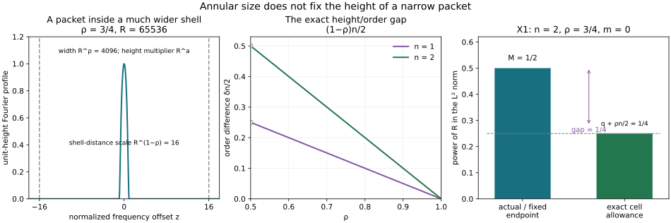

# Iterated tests and frequency packet regularity

For ordinary symbols, the fixed dyadic \(L^2\) endpoint and all iterated tangential tests recognize the precise Lagrangian order. For general symbols with \(1/2<\rho<1\), a frequency packet can occupy a much smaller portion of an annulus. Its annular \(L^2\) size can stay fixed while its height grows. That distinction matters in an intrinsic criterion.

This lesson proves three statements. General-symbol operators of order \(2\rho-1\) whose principal symbols vanish on the Lagrangian preserve \(I_\rho^m\), so all their finite words satisfy the usual fixed endpoint. The reverse implication, with precisely the fixed endpoint and test class specified below, is false: a compactly supported packet sum gives a counterexample for every \(1/2<\rho<1\) and every real \(m\). An exact criterion instead uses frequency cells of radius \(\langle\xi\rangle^\rho\) and all weighted normal derivatives. We prove it in a frequency graph and then prove its intrinsic, microlocal meaning.

The primary antecedent is Lars Hörmander, *The Analysis of Linear Partial Differential Operators IV*, Springer 2009 eBook, ISBN 978-3-642-00136-9, §25.1, Definition 25.1.1 and Proposition 25.1.3 (printed 4–6), and the proposed general-symbol intrinsic extension on printed 16. Volume III, 2007 eBook, ISBN 978-3-540-49938-1, printed 98–100, explicitly identifies this endpoint as the Besov space and connects its annular bound to the conormal definition. The two scaled cutoff families on IV16 are checked explicitly below. The counterexample concerns the literal fixed-endpoint interpretation stated here; it is an independently proved source qualification, not a claim that a publisher has issued an erratum. The phase-based general-symbol class remains the class already constructed in the programme.

Exact earlier proofs are [general stationary phase, full frequency reduction and invariant symbols](../20261015-rho-stationary-phase-and-symbols/stationary-phase-and-symbols-with-derivative-loss.md), [kernel maps and the general calculus](../20261015-rho-fio-composition-and-transport/clean-fourier-integral-composition-and-rho-transport.md), [finite-seminorm operator bounds and graph inverses](../20261015-rho-fio-continuity/general-symbol-graph-and-corank-continuity.md), [the ordinary intrinsic theorem and proper phase regularization](../20261005-restored-intrinsic-regularity/intrinsic-lagrangian-regularity.md), [dyadic and local Sobolev estimates](../20261004-free-intrinsic-graph/prerequisites/dyadic-endpoint.md), [Fourier theory](../20261004-free-intrinsic-graph/prerequisites/fourier-l2.md), and [homogeneous symbol operations](../20261004-free-canonical-composition/homogeneous-symbol-transport.md). The proof map records exact sources and locators. The 92 transitive human foundation providers remain external.

## 1. State the endpoint and the vanishing condition exactly

**H0. Keep the three orders separate.** Fix
\[
\tfrac12<\rho\leq1,\qquad \delta=1-\rho,\qquad
\epsilon=2\rho-1>0,\qquad q=m-\tfrac n4,\qquad
M=m+\tfrac n4=q+\tfrac n2.
\tag{IP1}
\]
The symbol class \(S_\rho^a=S_{\rho,1-\rho}^a\) has every estimate
\[
|\partial_x^\beta\partial_\xi^\alpha p|
\leq C_{\alpha\beta}\langle\xi\rangle^{a-\rho|\alpha|+\delta|\beta|}.
\tag{IP2}
\]
All estimates are on fixed compact base sets, with conic localization strictly inside a larger available cone. The bundles have finite rank; local formulas use a half-density frame and the convention \(D=-i\partial\). The Fourier transform is \(\widehat u(\xi)=\int e^{-ix\cdot\xi}u(x)\,dx\), with inverse factor \((2\pi)^{-n}\). Take \(n\geq1\); there are no nonzero cotangent directions in dimension zero.

For compactly supported distributions, the fixed endpoint \(B^{-M}_{2,\infty}\) means that the low-frequency block is in \(L^2\) and
\[
\|\widehat w\|_{L^2(\{S/2<|\xi|<2S\})}\leq C S^M
\qquad(S\geq2).
\tag{IP3}
\]
The earlier dyadic proof P1:B1 proves equivalence with a dyadic sequence norm and \(B^{-M}_{2,\infty}\subset H^{-M-\eta}\) for every \(\eta>0\). Local versions use compact smooth cutoffs.

Let \(\mathcal J_\rho(\Lambda)\) consist of properly supported \(L\in\Psi_{\rho,\delta}^{\epsilon}\) whose principal restriction vanishes. Precisely, on each working graph patch choose a full left symbol \(l\) with
\[
l|_\Lambda\in S_\rho^0(\Lambda).
\tag{IP4}
\]
The restriction has all the differentiated symbol estimates, not merely a pointwise bound. This is unchanged by an order-zero change of full representative. Equivalently one may choose a representative of its principal class, modulo \(S_\rho^0\), that vanishes exactly on \(\Lambda\): extend the order-zero restriction off the graph and subtract it. The homogeneous restriction and extension estimates HT:H2 and HT:H4 justify this equivalence. Every properly supported order-zero operator is in this test class.

Call the fixed-endpoint condition
\[
L_1\cdots L_Nu\in B^{-M}_{2,\infty,\mathrm{loc}}
\quad\text{for every }N\geq0,\quad L_j\in\mathcal J_\rho(\Lambda).
\tag{IP5}
\]
Its constants can depend on the word and the compact set. No uniform constant over all word lengths is required. We will prove that \(I_\rho^m\) implies (IP5), and disprove its converse when \(\rho<1\).

## 2. Every admissible operator preserves the phase class

**A0. Prove preservation before iterating.** Choose base coordinates making the Lagrangian a frequency graph,
\[
\Lambda=\{(H'(\xi),\xi)\},\qquad H(t\xi)=tH(\xi).
\tag{IP6}
\]
The existence of these coordinates is the exact earlier geometric theorem used in IR:R2. Extend the real \(H\) smoothly through bounded frequencies and from a smaller cone if needed. The complete general-symbol graph criterion RSP:R0 says that, modulo harmless normalization constants, a compact localization of an element of \(I_\rho^m\) has Fourier transform \(e^{-iH}v\), \(v\in S_\rho^q\).

For \(L\in\mathcal J_\rho(\Lambda)\), the full symbol \(l\) has the Taylor division
\[
l(x,\xi)=l_0(\xi)+\sum_j(x_j-H_j(\xi))c_j(x,\xi),
\qquad l_0\in S_\rho^0,\quad c_j\in S_\rho^{\epsilon+\delta}=S_\rho^\rho.
\tag{IP7}
\]
Indeed \(l_0=l(H'(\xi),\xi)\) has order zero by (IP4), and \(c_j\) is the compact integral of \(\partial_{x_j}l\) along the segment from \(H'(\xi)\) to \(x\). Extend within a slightly larger base set before taking that segment. A frequency derivative of \(H'\) contributes \(\langle\xi\rangle^{-1}\) followed by a base derivative costing \(\langle\xi\rangle^\delta\), exactly the required \(\langle\xi\rangle^{-\rho}\). The same chain rule proves all mixed estimates for \(c_j\).

Act first in full left quantization on the inverse Fourier representation of \(e^{-iH}v\). Fourier inversion in the intermediate variable, or regularized Schwartz approximation followed by the proved distribution action, gives its amplitude \(l(x,\xi)v(\xi)\) with phase \(x\cdot\xi-H(\xi)\). Since
\[
(x_j-H_j(\xi))e^{i(x\cdot\xi-H)}
=\frac1i\partial_{\xi_j}e^{i(x\cdot\xi-H)},
\]
integration by parts replaces that amplitude by
\[
l_0v+i\sum_j\partial_{\xi_j}(c_jv)\in S_\rho^q.
\tag{IP8}
\]
The equality of orders is \(\rho-\rho=0\). The full phase estimate legitimizes the regularized identity and all derivatives. A compact output cutoff gives the same phase class by the general-symbol phase theorem RSP:R1. Proper input/output localization changes the full left form only by the smooth kernel terms supplied by the existing kernel calculus. On each output compact set their smooth-input or distribution estimates apply with the required proper input compact set.

Thus \(L:I_\rho^m\to I_\rho^m\) locally. In particular order-zero multiplication and pseudodifferential localization preserve the class. The proof works with matrices in their original order, because \(H\) and the phase are scalar.

**A1. Deduce the actual endpoint and wavefront consequences.** Iterating A0 gives the same class for every finite word. On a compact output the reduced symbol bound gives
\[
\|\widehat w\|_{L^2(S/2<|\xi|<2S)}
\leq C S^{q+n/2}=C S^M.
\tag{IP9}
\]
Low frequencies are bounded for compact distributions. Finite chart and phase partitions prove (IP5).

Conversely, (IP5) alone does imply \(\operatorname{WF}(u)\subset\Lambda\). At a covector outside the closed \(\Lambda\), choose a scalar homogeneous angular/base cutoff \(a\), supported away from \(\Lambda\), equal to one on a smaller cone. A proper operator \(L\) with principal symbol \(a\langle\xi\rangle^\epsilon\) is admissible and elliptic there. Its \(N\)-th power is elliptic of order \(N\epsilon\). From (IP5), \(L^Nu\in H^{-M-\eta}_{\rm loc}\). The general-symbol elliptic parametrix and all real Sobolev bounds GRC:E0 and GRC:S0, applied to the identity graph, recover microlocal regularity \(H^{N\epsilon-M-\eta}\) for \(u\). Arbitrarily large \(N\) prove the claim. The same argument works componentwise for finite bundles. Wavefront containment does not determine the precise symbol order.

## 3. Check both printed scaled cutoff families

**T0. Both families really are admissible.** Work first with the point conormal \(\Lambda=T_0^*\mathbb R^n\setminus0\), so \(H=0\). Choose \(\chi\in C_c^\infty(\mathbb R^n)\) equal to one near zero, put \(r=\langle\xi\rangle\), and consider
\[
a_j(x,\xi)=r^\rho\chi(xr^\delta)x_j,\qquad
b(x,\xi)=r^\epsilon(1-\chi(xr^\delta)).
\tag{IP10}
\]
Low-frequency cutoffs and fixed compact base cutoffs can be inserted. Quantize properly. Both vanish at \(x=0\) at high frequency. For \(a_j\), the factor \(x_j\) on its support is \(O(r^{-\delta})\), so its size is \(r^{\rho-\delta}=r^\epsilon\). Each base derivative costs at most \(r^\delta\). Each frequency derivative of \(\chi(xr^\delta)\) costs \(r^{-1}\), since \(|x|r^\delta\) is bounded on its differentiated support; a frequency derivative of \(r^\rho\) has the same relative cost. This is at least the required \(\rho\) gain because \(r^{-1}\leq r^{-\rho}\). The argument also applies to \(b\); the undifferentiated constant part is simply \(r^\epsilon\). Thus both symbols are in \(S_\rho^\epsilon\).

For the graph (IP6), replace \(x\) by \(x-H'(\xi)\). A frequency derivative of this extra term costs \(r^{-1}\). Inside the scaled cutoff it costs \(r^{\delta-1}=r^{-\rho}\); all further derivatives obey the same homogeneous chain rule. The support still gives \(|x-H'|\leq Cr^{-\delta}\), and all estimates just proved persist. Thus the graph versions of both source families belong to \(\mathcal J_\rho(\Lambda)\). Their proper quantizations differ from their full left forms only by smooth kernels locally.

The first family measures \(r^\rho x\) inside a tube of base width \(r^{-\delta}\). The second is elliptic of order \(\epsilon\) beyond that tube. A packet of physical width \(r^{-\rho}\) is much narrower than the tube when \(\rho>\delta\). Its normal moments therefore remain bounded under the first family, and the second family meets only a rapidly decreasing tail. We now prove this for every admissible operator, not just these two examples.

## 4. A uniform scaled operator lemma

**S0. Control an arbitrary test on the whole packet.** Fix \(1/2<\rho<1\), a compact base set containing zero, and a full left symbol
\[
l\in S_{\rho,\delta}^{\epsilon},\qquad
l(0,\xi)\in S_\rho^0.
\tag{IP11}
\]
Extend it with a fixed compact base cutoff. For \(R\geq2\), define the modulation and dilation
\[
(U_R f)(x)=R^{\rho n/2}e^{iRx_1}f(R^\rho x).
\tag{IP12}
\]
Change variables in the full Fourier formula. Its conjugated operator has exact left symbol
\[
l_R(z,\zeta)=l(R^{-\rho}z,Re_1+R^\rho\zeta).
\tag{IP13}
\]
We claim that \(\operatorname{Op}(l_R):\mathcal S\to\mathcal S\) has uniform bounds for each Schwartz seminorm, with finitely many input seminorms. It is not necessary that \(l_R\) belong uniformly to an ordinary order-zero symbol class.

Write \(l(x,\xi)=s(\xi)+\sum_jx_jc_j(x,\xi)\), where \(s\in S_\rho^0\), \(c_j\in S_{\rho,\delta}^\rho\), by Taylor division at zero. Put \(\xi=Re_1+R^\rho\zeta\), \(r_\xi=\langle\xi\rangle\). When \(r_\xi\geq R/2\), a derivative of the \(s\) term has bound
\[
R^{\rho|\alpha|}r_\xi^{-\rho|\alpha|},
\]
and a derivative of a Taylor term is bounded by a constant times \(1+|z|\) and an expression of the following form, with \(b=|\beta|\) if its factor \(z_j\) is not differentiated and \(b=|\beta|-1\) otherwise:
\[
R^{-\rho(1+b)+\rho|\alpha|}
r_\xi^{\rho+\delta b-\rho|\alpha|}
=R^{-\epsilon b}
(r_\xi/R)^{\rho+\delta b-\rho|\alpha|}.
\tag{IP14}
\]
The ratio \(r_\xi/R\) is bounded below and is at most \(C(1+|\zeta|)\); all these expressions have polynomial growth in \(\zeta\), uniformly in \(R\). When \(r_\xi<R/2\), one instead has \(|\zeta|\geq cR^\delta\). Every derivative bound from (IP2) is at most a fixed power of \(R\), because \(1\leq r_\xi<R/2\); this is at most another fixed power of \(1+|\zeta|\), since \(\delta>0\). The Taylor factor still has degree at most one in \(z\). Consequently for all \(\alpha,\beta\)
\[
|\partial_z^\beta\partial_\zeta^\alpha l_R(z,\zeta)|
\leq C_{\alpha\beta}\langle z\rangle
\langle\zeta\rangle^{N_{\alpha\beta}},
\tag{IP15}
\]
with constants independent of \(R\).

For \(f\in\mathcal S\), differentiate \((2\pi)^{-n}\int e^{iz\cdot\zeta}l_R(z,\zeta)\widehat f(\zeta)\,d\zeta\) any fixed number of times in \(z\). Transfer \((1-\Delta_\zeta)^K\) from the exponential to the remaining factors and divide by \((1+|z|^2)^K\). Formula (IP15) and sufficiently many Schwartz bounds of \(\widehat f\) make every resulting integral absolutely bounded, uniformly in \(R\). Choosing \(2K\) larger than the requested \(z\) weight plus one proves the asserted uniform Schwartz bound. Fourier continuity on \(\mathcal S\) is the earlier complete proof P3:L1–L3.

**S1. Retain proper kernels and smooth errors.** A fixed proper test, restricted between the compact input and output sets needed for a finite word, equals the full left form in S0 plus a smooth compactly supported kernel. That residual also maps the scaled family in (IP12) to a uniformly bounded Schwartz family after conjugation. In fact, for a smooth compact kernel \(k\), its conjugated output is
\[
e^{-iR^\delta z_1}R^{-\rho n}
\int e^{iR^\delta w_1}
k(R^{-\rho}z,R^{-\rho}w)f(w)\,dw.
\tag{IP16}
\]
Output \(z\) weights cost at most fixed powers of \(R^\rho\), because \(k\) has compact output support. A \(z\) derivative may cost a power of \(R^\delta\) from the exponential. Integrating any desired number \(J\) of times in \(w_1\) gains \(R^{-\delta J}\); the differentiated kernels and Schwartz input have bounded integrals with finitely many input seminorms. Since \(\delta>0\), choose \(J\) to dominate all those fixed powers. This proves every uniform output seminorm, and indeed any desired additional negative power of \(R\).

Initial compact multiplication has scaled input \(\chi_0(R^{-\rho}z)f(z)\), a uniformly bounded Schwartz family. Properness supplies a compact output set at each step of a fixed word. Apply S0–S1 successively on those sets. We obtain: for every fixed finite admissible word \(W\), every uniformly Schwartz-bounded input family \(f_R\), and any scalar \(d_R\),
\[
W(d_RU_R f_R)=d_RU_R g_{R,W},
\qquad \{g_{R,W}:R\geq2\}\ \text{bounded in }\mathcal S.
\tag{IP17}
\]
The constants may depend on \(W\), as allowed by (IP5). Every proper cutoff and smooth residual is included. The proof applies to all tests in (IP11), with matrices as well.

## 5. A compactly supported counterexample at every order

**C0. Construct the distribution, not just a formal packet.** Fix \(1/2<\rho<1\), any real \(m\), and \(n\geq1\). Choose a nonzero \(\Phi\in C_c^\infty(B(0,1))\) with \(\Phi(0)>0\), and let \(\psi=\mathcal F^{-1}\Phi\). Choose \(\chi_0\in C_c^\infty\) equal to one near zero. Let
\[
L\in\mathbb N,\quad L\delta\geq4,\qquad
R_j=2^{Lj},\qquad
a=q+\tfrac{\delta n}{2}=M-\tfrac{\rho n}{2},
\tag{IP18}
\]
and set
\[
u(x)=\chi_0(x)\sum_{j\geq1}
R_j^{M+\rho n/2}e^{iR_jx_1}\psi(R_j^\rho x)
=\sum_{j\geq1}R_j^M U_{R_j}
\big(\chi_0(R_j^{-\rho}\,\cdot)\psi\big)(x).
\tag{IP19}
\]
The right expression specifies the same scaled functions as the left one. Before multiplication by \(\chi_0\), the \(j\)-th Fourier packet is exactly
\[
R_j^a\Phi((\xi-R_je_1)/R_j^\rho).
\tag{IP20}
\]
Its support is contained in a ball of radius \(R_j^\rho\leq R_j/16\); these balls are disjoint by lacunarity. Its height is \(R_j^a\), and its \(L^2\) norm is a fixed constant times \(R_j^{a+\rho n/2}=R_j^M\).

The series is a tempered distribution: pairing the compact Fourier packet (IP20) against a Schwartz test gives an arbitrarily negative power of \(R_j\) after choosing enough test decay, since its support stays comparable to \(R_j\). The sum converges absolutely in that pairing. Multiplication by \(\chi_0\) makes its support compact. Proper pseudodifferential continuity on distributions permits every fixed admissible word to pass through the distributional sum.

Away from zero, the series and all its base derivatives converge smoothly. On a compact set with \(|x|\geq c>0\), the Schwartz factor \(\psi(R_j^\rho x)\) defeats the fixed powers from modulation, differentiation and the coefficient. Thus its possible singular support is only zero. Its Fourier transforms outside a small cone about \(e_1\) decrease rapidly by the same packet tail estimates proved next. In particular it has the correct point-conormal wavefront containment.

## 6. Every finite admissible word has the fixed endpoint

**C1. Prove both lacunary tails.** By S1, for every fixed word \(W\) the \(j\)-th output has Fourier transform
\[
\widehat{W u_j}(\xi)=R_j^a
G_{j,W}((\xi-R_je_1)/R_j^\rho),
\qquad \{G_{j,W}\}\ \text{bounded in }\mathcal S.
\tag{IP21}
\]
Its full \(L^2\) norm is bounded by \(C_WR_j^M\). On an annulus of radius \(S\), the terms with \(S/4\leq R_j\leq4S\) are bounded in number and have total norm at most \(CS^M\). The triangle inequality suffices; orthogonality of the outputs is not assumed.

For \(R_j<S/4\), \(|\xi-R_je_1|\geq cS\) on that annulus. For \(R_j>4S\), the distance is at least \(cR_j\). By the uniform Schwartz bound and the volume of the annulus, respectively,
\[
\begin{aligned}
\|\widehat{Wu_j}\|_{L^2(A_S)}
&\leq C_N S^{n/2-N}R_j^{M+\rho(N-n/2)}
&& (R_j<S/4),\\
\|\widehat{Wu_j}\|_{L^2(A_S)}
&\leq C_N S^{n/2}R_j^{M-\rho n/2-\delta N}
&& (R_j>4S).
\end{aligned}
\tag{IP22}
\]
Choose \(N>n/2\) large enough that the exponent of \(R_j\) in the first line is positive and the exponent in the second line is negative. Both choices are possible because \(\rho,\delta>0\). Sum the geometric sequences. Each sum is at most
\[
C_NS^{M-\delta(N-n/2)}\leq C_NS^M.
\tag{IP23}
\]
At low frequency the second line with \(S\) fixed is summable, and the finitely many remaining packets are smooth. The series therefore converges in \(L^2\) on each frequency block, represents the already constructed distributional word, and has exactly (IP3). Every output has compact support by properness. We have proved (IP5) for every word, including the two cutoff families (IP10), at the claimed fixed \(m\).

## 7. Its actual Lagrangian order is higher

**C2. Check the height after compact localization.** Put \(\psi_j(z)=\chi_0(R_j^{-\rho}z)\psi(z)\). This family is uniformly Schwartz and converges to \(\psi\) in every Schwartz seminorm faster than any fixed negative power of \(R_j\). Indeed \(\chi_0(R_j^{-\rho}z)-1\) is supported where \(|z|\geq cR_j^\rho\), and every derivative and weighted tail of the Schwartz \(\psi\) has arbitrary decay there.

At the center \(\xi=R_je_1\), its own Fourier contribution is \(R_j^a(\Phi(0)+o(1))\). For the other packets, the uniform Schwartz bound gives
\[
\sum_{k\ne j}R_k^a
\left|\widehat{\psi_k}((R_je_1-R_ke_1)/R_k^\rho)\right|
\leq C_N R_j^{a-\delta N},
\tag{IP24}
\]
once \(N\) is chosen so \(a+\rho N>0\) and \(a-\delta N<0\). To verify this, for \(k<j\) bound by \(C_NR_j^{-N}R_k^{a+\rho N}\) and sum the increasing geometric sequence; for \(k>j\) bound by \(C_NR_k^{a-\delta N}\) and sum the decreasing one. Lacunarity gives the fixed comparisons used in both bounds. Thus
\[
R_j^{-a}\widehat u(R_je_1)\longrightarrow\Phi(0)>0.
\tag{IP25}
\]
Since \(a-q=\delta n/2>0\), \(\widehat u\notin S_\rho^q\). The exact frequency-graph theorem RSP:R0, with \(H=0\), proves
\[
u\notin I_\rho^m(\mathbb R^n,T_0^*\mathbb R^n).
\tag{IP26}
\]
There is no cancellation or missing compact-support assumption in this conclusion.

In fact its order is sharp. Differentiate (IP21) for the empty word. For any \(\alpha\) replace \(a\) in the preceding tail bounds by \(a-\rho|\alpha|\), and use the corresponding uniform Schwartz derivative bound. On frequencies comparable to a center there are only finitely many packets and each derivative is bounded by \(Cr^{a-\rho|\alpha|}\); the two geometric tails obey the same bound after increasing \(N\). Hence \(\widehat u\in S_\rho^a\). Formula (IP25) excludes every smaller order. Therefore
\[
u\in I_\rho^{\,m+\delta n/2},\qquad
u\notin I_\rho^{\,m+\delta n/2-\gamma}\quad(\gamma>0).
\tag{IP27}
\]
This is a counterexample to the fixed-endpoint equivalence as literally formulated in (IP5). It does not alter the ordinary \(\rho=1\) theorem; there the height difference \(\delta n/2\) is zero and the earlier ordinary proof applies. It also does not invalidate the phase definition or its symbol calculus.

## 8. An exact frequency-cell criterion

**P0. Test the scale on which a symbol can vary.** Return to \(1/2<\rho\leq1\), a frequency graph (IP6), and compactly supported \(u\). The earlier proper phase regularization IR:R2 constructs a real smooth \(h\in S_{1,0}^1\), with compactly supported inverse Fourier transform, for which \(h-H\) is rapidly decreasing at high frequency on the working cone. Put
\[
Q_j=x_j-\partial_{\xi_j}h(D),\qquad
[Q_j,Q_k]=0,\qquad v_h=e^{ih}\widehat u.
\tag{IP28}
\]
These are properly supported operators of local order zero, so \(Q^\alpha u\) is compactly supported for each finite \(\alpha\). The exact Fourier gauge identity, proved in IR:R2, is
\[
\widehat{Q^\alpha u}=e^{-ih}i^{|\alpha|}\partial_\xi^\alpha v_h.
\tag{IP29}
\]
Choose a fixed sufficiently small \(c>0\), let \(R=\langle\zeta\rangle\), and use the balls \(B(\zeta,cR^\rho)\) on an interior frequency cone. They stay inside a slightly larger available cone at high frequency; for \(\rho=1\) choose \(c\) smaller than the fixed angular and radial margins.

The exact criterion is
\[
\boxed{\quad
\|\widehat{Q^\alpha u}\|_{L^2(B(\zeta,cR^\rho))}
\leq C_\alpha R^{q+\rho n/2-\rho|\alpha|}
\quad\text{for every }\alpha,\ \text{uniformly in }\zeta .
\quad}
\tag{IP30}
\]
Outside the working cone the assertion is localized microlocally. In the global graph version take every high-frequency center.

**P1. Prove both implications with no loss of order.** If \(v=e^{iH}\widehat u\in S_\rho^q\), then \(v_h\in S_\rho^q\), since \(e^{i(h-H)}-1\) is rapidly decreasing. On a cell the radii \(\langle\xi\rangle\) and \(R\) are comparable. The pointwise symbol bound, the cell volume \(O(R^{\rho n})\) and (IP29) give (IP30).

Conversely, at each center set
\[
F_\zeta(z)=R^{-q}v_h(\zeta+R^\rho z),\qquad |z|<c.
\tag{IP31}
\]
The change of variables in (IP30), using the unimodular factor in (IP29), gives uniformly bounded \(L^2\) norms of every derivative of \(F_\zeta\) on this fixed ball. The complete local Sobolev estimate P1:B2, with a cutoff equal to one on a smaller ball, bounds every derivative at \(z=0\) by finitely many of those norms. Rescale to obtain
\[
|\partial_\xi^\alpha v_h(\zeta)|
\leq C_\alpha R^{q-\rho|\alpha|}.
\tag{IP32}
\]
Thus \(v_h\), and then \(v\), are in \(S_\rho^q\). RSP:R0 proves \(u\in I_\rho^m\). Low frequencies are bounded automatically for the compact distribution and do not affect the criterion. This proves exact equivalence and, at each prescribed derivative order, finite quantitative control from a finite collection of cell estimates.

## 9. Intrinsic and microlocal meaning of the replacement

**P2. Prove independence of the choices by the established class.** For a closed conic Lagrangian \(\Lambda\subset T^*X\setminus0\), the following is an intrinsic criterion. Require \(\operatorname{WF}(u)\subset\Lambda\). Near each point of \(\Lambda\), choose adapted base coordinates in which it is a frequency graph, a bundle frame, and a properly supported ordinary order-zero microlocal cutoff \(A\), elliptic at the point and with compact output support and microsupport inside that graph patch. Require (IP30) for \(Au\) in the corresponding interior cone, with \(q=m-n/4\). Existence of these choices at every point is sufficient.

If \(u\in I_\rho^m\), wavefront containment follows from its general-symbol phase representation. A0 for order-zero operators gives \(Au\in I_\rho^m\). P1 proves the cell estimates. Conversely the cell estimates give \(Au\in I_\rho^m\) microlocally by P1. A proper ordinary elliptic parametrix \(B\) for \(A\) yields \(u=BAu\) modulo a microlocally smooth distribution on a smaller cone. A0 preserves the phase class under \(B\); hence \(u\) has the required local phase class there. Away from \(\Lambda\) it is smooth by the wavefront assumption. A finite partition over each compact cosphere, followed by the exact phase-class assembly RSP:R0–RSP:R1, proves \(u\in I_\rho^m(X,\Lambda)\).

This equivalence also proves invariance under adapted charts, bundle frames, proper regularizations \(h\), interior cone margins and cell radius \(c\): membership gives the estimates for every such choice. More directly, two admissible \(h\)'s differ by a rapidly decreasing high-frequency symbol; their \(Q\) words differ on compact distributions by properly localized smooth outputs, which satisfy every cell estimate. A smaller or larger fixed cell radius is handled by a finite cover and the same local Sobolev estimate. No claim of invariance of an unrestricted graph-dependent Fourier norm is needed.

The replacement is an exact weighted-normal, frequency-cell characterization. It does not silently identify (IP30) with the weaker annular condition (IP5). In the ordinary case, a cell of radius \(cR\) covers a fixed part of an annulus, and the ordinary balanced-word argument recovers the earlier intrinsic criterion.

## 10. Three complete solutions

**X1. Locate the missing height factor.** Set \(n=2,\rho=3/4,m=0\). Compute \(q,M,a\), the physical and frequency scales, and the fixed-endpoint and cell \(L^2\) powers for the counterexample. Decide its precise order.

**Solution.** Here \(\delta=1/4,\epsilon=1/2\), \(q=-1/2\), \(M=1/2\), and \(a=-1/4\). Each Fourier packet has radius \(R^{3/4}\), height \(R^{-1/4}\) and \(L^2\) size \(R^{-1/4+3/4}=R^{1/2}\), exactly the fixed endpoint. The physical scale is \(R^{-3/4}\), whereas the cutoff tube has width \(R^{-1/4}\). The exact cell criterion for order \(m=0\), with \(\alpha=0\), would allow only \(R^{q+\rho n/2}=R^{1/4}\). The ratio of actual to allowed norm is \(R^{1/4}\). Equations (IP25)–(IP27) give precise Lagrangian order \(m+\delta n/2=1/4\), and exclude every smaller order. This is a pointwise-height failure even though the physical base support is compact.

**X2. Evaluate a scaled test on one packet.** Take one dimension, \(H=0\), and ignore a fixed proper base localization for the exact full-left computation. Apply the full symbol \(r^\rho x\), in left order, to \(U_R\psi\), where \(r=\langle\xi\rangle\). Compute the conjugated expression. Explain why this test is bounded on the packet scale, although \(r^\rho x\) is not a global \(S_\rho^\epsilon\) symbol, and how the cutoff family repairs admissibility.

**Solution.** Left quantization gives \(x\langle D\rangle^\rho\). Its conjugation by \(U_R\) has symbol \(R^{-\rho}z\langle R+R^\rho\zeta\rangle^\rho\), so on the frequency support of \(\Phi\)
\[
U_R^{-1}x\langle D\rangle^\rho U_R\psi
=z\,\mathcal F^{-1}\!\left[
\left(\frac{\langle R+R^\rho\zeta\rangle}{R}\right)^\rho
\Phi(\zeta)\right].
\tag{IP33}
\]
The factor and all its \(\zeta\) derivatives are uniformly bounded on that fixed support, because \(R^\rho/R=R^{-\delta}\) and the support stays away from the possible low-frequency point. The result is uniformly Schwartz. Inserting \(\chi(xr^\delta)\) into the full left symbol makes its base support shrink at width \(r^{-\delta}\), giving order \(\epsilon\) by T0. It is the operator in (IP10), whose action on all uniformly Schwartz packets is already controlled by S0. Repeated tests stay bounded by S1. The exterior family also obeys S0, so its presence cannot force the higher packet height down to \(R^q\).

The full uncut symbol has size \(r^\rho\) at a fixed nonzero \(x\), and \(\rho>\epsilon\) when \(\rho<1\); it is not an admissible global test. The argument does not use it to infer (IP5). It is an exact scale calculation supplementing the all-admissible-operator proof.

**X3. Recover a derivative from its frequency cells.** Let \(v\in C^\infty\), fix an integer \(k\geq0\), and suppose (IP30), with \(\widehat{Q^\alpha u}\) replaced by \(\partial^\alpha v\), holds through \(|\alpha|\leq k+s\), where the integer \(s>n/2\). Prove the \(k\)-th symbol derivative bound and explain why the corresponding annular assumption loses a factor.

**Solution.** Use \(F_\zeta\) from (IP31). The change of variables gives
\[
\|\partial_z^\alpha F_\zeta\|_2
=R^{-q+\rho|\alpha|-\rho n/2}
\|\partial_\xi^\alpha v\|_{L^2(B(\zeta,cR^\rho))}\leq C_\alpha.
\tag{IP34}
\]
The local Sobolev estimate applied to each derivative of length \(k\), with an interior cutoff, gives \(|\partial_z^\beta F_\zeta(0)|\leq C\) for \(|\beta|=k\). Thus \(|\partial^\beta v(\zeta)|\leq CR^{q-\rho k}\), exactly the symbol bound. If instead the available cell bound were only the annular-size \(R^{q+n/2-\rho|\alpha|}\), the same normalization would give \(R^{\delta n/2}\). The counterexample realizes that extra height while keeping every admissible-word annular norm within its endpoint. Its exact packet order, rather than a failed estimate alone, establishes the obstruction.

## 11. The illustration shows the different scales

**F0. Exact figure data.** The first panel plots the actual smooth bump \(\Phi(z)=\exp(1-1/(1-z^2))\) for \(|z|<1\), zero otherwise, as a function of \(z=(\xi-R)/R^\rho\). It marks the annular-distance scale \(R^\delta=16\) for \(\rho=3/4,R=65536\). This is the Fourier profile, normalized to unit height; its height multiplier \(R^a\) and width \(R^\rho\) are stated in the caption. The second panel plots the exact exponent gap \(\delta n/2\) for \(n=1,2\), so it displays an order difference, not a numerical proof. The third compares the exact exponents \(M\) and \(q+\rho n/2\) in X1. The marked difference is \(1/4\). The original script retains every scale and label.

## 12. Source qualification and packet regularity

The phase-based \(I_\rho^m\) class, its invariant symbol quotient and its full calculus remain valid with the already proved orders and hypotheses. Every vanishing-symbol test in \(\mathcal J_\rho\) preserves that class, and the two printed cutoff families are legitimate. The compact packet construction proves that the literal fixed-endpoint converse (IP5) cannot serve as its exact definition when \(\rho<1\). The weighted-normal frequency-cell condition (IP30), with wavefront containment and the local choices in P2, is a complete, exact replacement.

The source qualification is confined to that fixed-endpoint equivalence under the stated definitions.  No official erratum is asserted, and the ordinary intrinsic proof is retained.
Related proofs: [editable source](iterated-tests-and-frequency-packet-regularity.md).
The [mixed-boundary reading guide](../../reading-guides/mixed-boundary-problems/index.html) locates the separate manifold and coefficient-family assembly arguments with their precise hypotheses. The 92 human proof providers remain external to this CC0 export and have exact [earlier C10/C20 programme routes](../20261004-free-stationary-phase/proof-map.html). Original expression, proof, counterexample and illustration are CC0-1.0; earlier linked components retain their recorded terms.