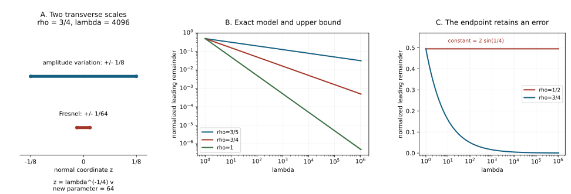

# Stationary phase and symbols with derivative loss

A symbol can oscillate more rapidly as its frequency grows. Stationary phase must account for the derivatives of that amplitude, as well as the derivatives of the phase. We prove the exact remainder scale, including every output derivative, and use it to construct the general Lagrangian class and its principal symbol.

Independent exposition, proofs, three solved exercises and reproducible illustration: GPT-6.1 Sol (OpenAI), Ultra, 15 October 2026. CC0-1.0. Linked earlier components retain their terms.

The antecedent is the copy of Lars Hörmander, *The Analysis of Linear Partial Differential Operators IV*, §25.1, especially the general-symbol discussion on printed page 16, and the remainder observation on page 24.  Our normalization retains the proved density degree \(m+n/4\). The displayed general-symbol quotient on page 16 prints \(m+n/2\); Exercise X3 derives the degree and identifies this local discrepancy without asserting an official publisher correction.

Use the complete [homogeneous symbol transport proofs](../20261004-free-canonical-composition/homogeneous-symbol-transport.md), [quadratic stationary phase](../20261004-free-stationary-phase/quadratic-stationary-phase.md), [parameter Morse reduction](../20261004-free-stationary-phase/parameter-morse-reduction.md), [general oscillatory existence and wavefront bounds](../20261005-restored-oscillatory/oscillatory-distributions-and-order.md), [phase equivalence and stabilization](../20261005-restored-phase-equivalence/homogeneous-phase-equivalence-and-stabilization.md), and [Gaussian lines and densities](../20261005-restored-gaussian-symbols/gaussian-lines-and-invariant-symbols.md). Their exact current versions and complete dependencies are in the proof map. Human foundations remain explicitly external.

## 1. Fix the class and the supporting cone

**H0. Range, seminorms and supports.** Fix
\[
 \frac12<\rho\le1,\qquad \delta=1-\rho,\qquad
 \varepsilon=\rho-\delta=2\rho-1>0.
 \tag{RS1}
\]
The parameter \(\rho\) is fixed throughout each estimate. Constants are not asserted uniform as \(\rho\downarrow1/2\).

Let \(y\) range in a compact subset of an open base set, let \(\xi\ne0\) range in a conic region with normalized closure inside its domain, and put \(\lambda=|\xi|\ge1\). A compact auxiliary variable \(z\in\mathbb R^k\) has degree zero. Write \(a\in\mathcal A_\rho^q\) when it is smooth, has its \(z\) support in one fixed compact set, and
\[
 |\partial_\xi^\alpha\partial_y^\beta\partial_z^\gamma
       a(y,\xi,z)|
 \le C_{\alpha\beta\gamma}
       \lambda^{q-\rho|\alpha|+\delta(|\beta|+|\gamma|)}.
 \tag{RS2}
\]
Uniformity means bounds on a finite specified collection of these seminorms. Extra degree-zero parameters obey the same derivative rule. Low frequencies are filled smoothly and contribute smooth terms to phase integrals.

Without \(z\), this is \(S_{\rho,1-\rho}^q\). The earlier homogeneous-map theorem proves its invariance under smooth conic changes: a degree-zero coordinate derivative costs at most \(\delta\), a physical frequency derivative gains \(\rho\), and ordinary homogeneous coefficients have their stronger degree-one derivative decrease. We use that theorem with supports strictly inside their charts. Jacobians of degree zero preserve the order.

All amplitudes can be complex or have a fixed finite vector or matrix rank; the estimates apply to each component. All phases in this lesson are real. Complex-phase calculus, composition and continuity have their own hypotheses and proofs.

## 2. A quadratic estimate independent of the support radius

**Q0. Bounded derivatives suffice.** Let \(J\) be a fixed diagonal \(k\)-square matrix with entries \(+1,-1\), and let \(\sigma=\operatorname{sgn}J\). For \(\Lambda\ge1\), set
\[
 T_{\Lambda,J}b=
  \left(\frac{\Lambda}{2\pi}\right)^{k/2}
  e^{-i\pi\sigma/4}
       \int e^{i\Lambda z^TJz/2}b(z)\,dz .
 \tag{RS3}
\]
For each integer \(N\ge0\) there are \(L,C\), independent of the radius of the compact support of \(b\), such that
\[
 \left|T_{\Lambda,J}b-
   \sum_{j=0}^{N-1}
       \frac1{j!}\left(\frac{i}{2\Lambda}\right)^j
                      \Delta_J^j b(0)\right|
 \le C\Lambda^{-N}\max_{|\gamma|\le L}
                             \|\partial^\gamma b\|_\infty ,
 \quad
 \Delta_J=\sum_{\ell=1}^kJ_{\ell\ell}\partial_{z_\ell}^2.
 \tag{RS4}
\]
For \(N=0\) the sum is empty. The assertion for \(k=0\) is the identity; all higher coefficients and remainders then vanish.

Choose a fixed compact cutoff \(\chi=1\) near zero. The earlier exact Gaussian/Fourier identity gives, for \(\chi b\), the coefficients in (RS4). Taylor's integral remainder for its Fourier multiplier is bounded by
\(\Lambda^{-N}C_N\int|\zeta|^{2N}|\widehat{\chi b}(\zeta)|\,d\zeta\).
Apply the proved Fourier rule to \((1-\Delta)^M(\chi b)\), with \(2M>2N+k\). The integral of \(|\zeta|^{2N}(1+|\zeta|^2)^{-M}\) is finite by the earlier shell estimate. The fixed compact support of \(\chi\) bounds the remaining \(L^1\) norm by finitely many supremum norms of derivatives of \(b\). All derivatives of \(\chi-1\) vanish at zero, so the coefficients are those of \(b\).

For the tail use
\[
 L_\Lambda=\frac{Jz\cdot\nabla_z}{i\Lambda|z|^2},
 \qquad
 L_\Lambda e^{i\Lambda z^TJz/2}
                      =e^{i\Lambda z^TJz/2}.
 \tag{RS5}
\]
On the complement of the fixed central ball, derivatives of its coefficient of order \(r\) are bounded by \(C_r\Lambda^{-1}|z|^{-1-r}\). Repeated product differentiation shows that the \(M\)-fold formal transpose applied to \((1-\chi)b\) is bounded by
\[
 C_M\Lambda^{-M}
 \max_{|\gamma|\le M}\|\partial^\gamma b\|_\infty
        (1+|z|)^{-M}
 \quad\text{outside a fixed ball}.
 \tag{RS6}
\]
Terms on the fixed annulus have the same bound with a different constant. To verify the exponent, a term with \(j\) derivatives on \(b\) has coefficient of order \(-2M+j\); \(j\le M\), so this is at most \(-M\). Each integration has no boundary term because \(b\) is compactly supported. Take \(M>k\) and \(M\ge N+k/2\), then multiply by the prefactor in (RS3). The resulting bound is \(C\Lambda^{-N}\). It never uses the size of that support. This proves (RS4).

## 3. Rescale the growing derivatives exactly

**Q1. The value remainder has the full gain.** For \(a\in\mathcal A_\rho^q\), use (RS3) with \(\Lambda=\lambda\), and make the exact substitution
\[
 z=\lambda^{-\delta}v,\qquad
 b_\lambda(v)=a(y,\xi,\lambda^{-\delta}v),\qquad
 \Lambda=\lambda^{1-2\delta}=\lambda^\varepsilon .
 \tag{RS7}
\]
Every \(v\) derivative of \(b_\lambda\) is bounded by \(C\lambda^q\). Its support can grow like \(\lambda^\delta\); Q0 permits that growth. The Jacobian and quadratic prefactors cancel because
\(\delta k+\varepsilon k/2=k/2\).
Thus
\[
 T_{\lambda,J}a
   =\sum_{j<N}\frac1{j!}
       \left(\frac{i}{2\lambda}\right)^j
                     \Delta_J^j a(y,\xi,0)
       +r_N(y,\xi),\qquad
 |r_N|\le C_N\lambda^{q-N\varepsilon}.
 \tag{RS8}
\]
Indeed \(\Delta_v^j b_\lambda(0)=
\lambda^{-2\delta j}\Delta_z^j a(0)\) and
\(\varepsilon+2\delta=1\). Each displayed coefficient has order
\(q-j+2j\delta=q-j\varepsilon\). No dimension loss is hidden in a Fourier \(L^1\) estimate for a support that grows with \(\lambda\).

## 4. Remove output derivatives of the quadratic phase

**D0. An exact derivative identity.** Differentiating the oscillatory exponential alone would insert a quadratic polynomial. Transfer it back to the amplitude before estimating. Put
\[
 \mathcal M_j=\partial_{\xi_j}
       -\frac{\partial_{\xi_j}\lambda}{2\lambda}
                                  z\cdot\nabla_z .
 \tag{RS9}
\]
Then
\[
 \partial_{\xi_j}T_{\lambda,J}a=T_{\lambda,J}\mathcal M_j a,
 \qquad
 \partial_{y_\ell}T_{\lambda,J}a
                         =T_{\lambda,J}\partial_{y_\ell}a.
 \tag{RS10}
\]
To prove this, integrate
\(\operatorname{div}_z(z e^{i\lambda z^TJz/2}a)\).
The result is zero. Its three terms are \(ka\), \(z\cdot\nabla a\), and \(i\lambda z^TJz\,a\). The \(ka\) term cancels the derivative of \(\lambda^{k/2}\); the remaining terms give (RS10), with its factor \(1/2\) and minus sign.

The coefficient \((\partial_{\xi_j}\lambda)/(2\lambda)\) is ordinary homogeneous of degree \(-1\). Since \(z\) stays in a fixed compact set, (RS2) gives continuous maps
\[
 \mathcal M_j:\mathcal A_\rho^q\longrightarrow
                    \mathcal A_\rho^{q-\rho},
 \qquad
 \partial_y^\beta:\mathcal A_\rho^q\longrightarrow
                    \mathcal A_\rho^{q+\delta|\beta|}.
 \tag{RS11}
\]
The second term in \(\mathcal M_j\) has order \(q+\delta-1=q-\rho\). Differentiating its coefficient only improves that estimate. Derivatives of \(z\) remove at most one \(z\) factor and satisfy the same bound. Repetition, with the full product rule on these coefficients, proves every mixed output derivative. The operators \(\mathcal M_j\) commute: their coefficients are half the derivatives of \(\log\lambda\), so their mixed derivatives agree. Commutation is a consistency check, not a replacement for the seminorm proof.

## 5. The remainder is a symbol, not just a value estimate

**D1. Exact differentiated asymptotics.** Denote the \(j\)-th coefficient operator in (RS8) by \(C_j(a)\). Euler differentiation of a derivative of order \(2j\) at zero gives
\[
 \Delta_J^j(z\cdot\nabla a)(0)=2j\,\Delta_J^j a(0).
 \tag{RS12}
\]
For example apply \(z\cdot\nabla\) to each monomial in the Taylor polynomial; its homogeneous degree is its multiplier. The Taylor remainder has no derivative of the tested order at zero. Consequently
\(\partial_{\xi_\ell}C_j(a)=C_j(\mathcal M_\ell a)\).
Base derivatives commute with \(C_j\) as well. Subtracting the first \(N\) coefficients from (RS10), and repeating, expresses every derivative of \(r_N(a)\) as the same remainder applied to the corresponding differentiated amplitude. Q1 and (RS11) therefore give
\[
 |\partial_\xi^\alpha\partial_y^\beta r_N|
 \le C_{\alpha\beta N}
       \lambda^{q-N\varepsilon-\rho|\alpha|+\delta|\beta|},
 \qquad
 r_N\in S_\rho^{q-N\varepsilon}.
 \tag{RS13}
\]
Each constant uses finitely many input seminorms. In particular \(T_{\lambda,J}\) is continuous into \(S_\rho^q\). These identities also hold when \(\lambda\) is replaced by any fixed smooth positive homogeneous frequency norm \(r(\xi)\): use \(\partial_{\xi_j}r/(2r)\) in (RS9). Its degree and all derivative bounds are the same.

## 6. A smooth nonquadratic phase has the same estimates

**M0. The normalized Morse change preserves the class.** Suppose
\(\Psi(y,\xi,z)=\lambda\psi(y,\xi/\lambda,z)\), with one nondegenerate critical point \(z_c(y,\xi/\lambda)\) in the working compact chart. Assume its normal Hessian is uniformly invertible there and all phase derivatives are bounded on that normalized chart.

The exact parameter Morse theorem gives \(z=Z(y,\xi/\lambda,v)\), with a smooth inverse, and
\[
 \Psi(y,\xi,Z)=\Psi_c(y,\xi)+\lambda v^TJv/2,\qquad
 A(y,\xi,v)=a(y,\xi,Z)|\det Z_v|.
 \tag{RS14}
\]
This is an identity on one neighborhood, not a finite Taylor approximation. Cut off inside that neighborhood. The conic chain theorem in H0, or its product-rule proof applied to this degree-zero change, gives \(A\in\mathcal A_\rho^q\). For instance \(Z_\xi\) has degree \(-1\); its product with \(a_z\) has order \(q+\delta-1=q-\rho\). Differentiating the degree-zero Jacobian satisfies stronger ordinary bounds. The iterated chain rule proves every derivative, with common compact supports.

Removing the critical-value exponential gives
\[
 \int e^{i\Psi}a\,dz
 =e^{i\Psi_c}\left(\frac{2\pi}{\lambda}\right)^{k/2}
 e^{i\pi\sigma/4}
 \left[
  \frac{a(y,\xi,z_c)}
       {|\det\psi_{zz}(y,\xi/\lambda,z_c)|^{1/2}}
       +\cdots+r_N
 \right].
 \tag{RS15}
\]
The bracket has a full \(S_\rho\) expansion with successive drops \(\varepsilon\), and (RS13) holds in all output derivatives. The leading determinant follows by differentiating the exact Morse identity twice at \(v=0\). Every higher coefficient is the fixed ordinary stationary-phase differential operator applied to \(a\), now with its stated derivative loss.

**M1. Pieces outside that chart are rapidly decreasing.** Where the normalized \(z\) gradient of \(\psi\) is bounded away from zero, integrate with
\((\nabla_z\psi\cdot\nabla_z)/(i\lambda|\nabla_z\psi|^2)\).
Its transpose supplies \(\lambda^{-1}\), while a derivative on the amplitude costs at most \(\lambda^\delta\). After \(M\) steps the integral is \(O(\lambda^{q-M\rho})\). For any fixed output derivatives, differentiating the phase adds only a fixed power of \(\lambda\); increasing \(M\) absorbs it. This proves \(S^{-\infty}\), including after multiplication by \(e^{-i\Psi_c}\). Fixed compact support makes the integrals absolute after these integrations.

Coefficient invariance is not deduced by treating these frequency-dependent coefficients as homogeneous terms. The earlier ordinary theorem identifies the coefficient differential operators for arbitrary fixed smooth test amplitudes, using an independent large oscillation parameter. Equality on all such tests is equality of those finite-jet operators. Apply that operator identity to \(a(y,\xi,\cdot)\) at each fixed \((y,\xi)\). Thus the same invariant operators, with the new estimates just proved, are used in every Morse chart.

## 7. Compact clean critical fibers

**C0. Integrate the normal result over the actual fiber.** Suppose the critical set in \(z\) is clean of dimension \(e\), its critical value \(\Psi_c\) is common on the selected component, and its normal Hessian is nondegenerate. Work with a fixed compactly supported amplitude in a smooth adapted family of charts; for global fibers require the critical projection proper on its actual support.

Adapted coordinates are \((s,v)\), with \(s\) along the fiber and \(v\in\mathbb R^k\), \(k=\dim z-e\), normal to it. The complete clean geometry and parameter Morse proofs provide
\(\Psi=\Psi_c+\lambda v^TJv/2\) in each chart. Include the coordinate Jacobian and a finite partition in \(A(y,\xi,s,v)\). Its derivatives in \(s\) obey the same degree-zero rule in (RS2).

Apply D1 with \(s\) as an additional parameter and integrate in \(s\). Each support is in one fixed compact rectangle, so its volume times the uniform bound controls the integral and every output derivative. Finite chart sums give the expansion. In invariant form its first term is
\[
 e^{i\Psi_c}\left(\frac{2\pi}{\lambda}\right)^{k/2}
 \int_{\operatorname{Crit}\psi}
       e^{i\pi\sigma/4}\,a\,d\mu_\psi ,
 \quad
 d\mu_\psi=\frac{|dz|}
 {|\det(\psi_{zz}\text{ on the normal quotient})|^{1/2}}.
 \tag{RS16}
\]
The quotient expression means the density in adapted tangent/normal coordinates, not division of two top forms on different spaces. Its coordinate formula and independence are exactly the proved quotient-density sequence. Nonorientable fibers use densities; no orientation is chosen. Finite vector or matrix coefficients are integrated componentwise.

After factoring the displayed normal power, the \(N\)-th remainder is in \(S_\rho^{q-N\varepsilon}\). Properness supplies finite compact chart covers over each compact normalized output set. If disconnected critical components have different critical values, use a separate exponential for each component; a single factored symbol is not asserted in that situation.

## 8. Homogeneous phase changes and quadratic stabilization

**P0. The representation class survives both operations.** A homogeneous fiber diffeomorphism \(\theta=\Theta(x,\eta)\) transforms the amplitude by
\(a(x,\Theta)|\det\Theta_\eta|\). Its Jacobian has degree zero, and homogeneous symbol transport proves the full \(S_\rho\) estimates. The oscillatory distribution is unchanged by the cutoff-change theorem in the general oscillatory lesson; its proof uses the positive nonstationary gain \(\rho\).

For stabilization, add \(k\) variables \(\zeta\) and the phase
\[
 \phi(x,\eta)+\frac{\zeta^TJ\zeta}{2r(\eta)},
 \qquad r>0\text{ homogeneous of degree one}.
 \tag{RS17}
\]
Local supports have \(|\zeta|\le Cr\). Substitute \(\zeta=rz\), so \(d\zeta=r^k dz\). An amplitude of order \(\mu'\) becomes a family in \(\mathcal A_\rho^{\mu'+k}\). Sections 3–5 show that integrating in \(z\) gives an amplitude of order \(\mu'+k/2\), with remainders decreasing by \(\varepsilon\). In the convention
\[
 c_{n,N}=(2\pi)^{-(n+2N)/4},\qquad
 \mu=m+n/4-N/2,
 \tag{RS18}
\]
the new amplitude order is \(\mu'=\mu-k/2\); the reduced amplitude has exactly order \(\mu\). The factor \((2\pi)^{k/2}\) cancels \(c_{n,N+k}/c_{n,N}\).

The inverse operation is concrete. Given \(b(x,\eta)\in S_\rho^\mu\), choose a compact \(\chi(z)=1\) near zero and use
\[
 a(x,\eta,\zeta)=r^{-k/2}e^{-i\pi\sigma/4}
                      b(x,\eta)\chi(\zeta/r).
 \tag{RS19}
\]
This is in \(S_\rho^{\mu-k/2}\) by the homogeneous chain theorem. All positive stationary coefficients vanish because every positive derivative of \(\chi\) at zero vanishes. The reduced amplitude is \(b+S^{-\infty}\). Nonstationary estimates control its cutoff tail in every derivative.

The already proved stable equivalence theorem relates any two nondegenerate phases of the same marked Lagrangian germ by these operations and homogeneous fiber diffeomorphisms. Thus their \(S_\rho\) representation classes agree. A base coordinate change multiplies by the smooth half-Jacobian and composes with its base diffeomorphism; (RS2) is preserved directly. Bundle frame changes multiply by smooth finite matrices and preserve it as well.

## 9. Fourier reduction gives the exact order

**F0. Use a frequency graph and keep the remote frequency tails.** The earlier geometric coordinate theorem makes a sufficiently small Lagrangian germ a frequency graph
\(\Lambda=\{(H'(\xi),\xi)\}\), with \(H\) real and homogeneous of degree one. Take a phase \(\phi(x,\theta)\) with nonzero critical covectors on that germ and compact normalized supporting cone. For a clean phase of excess \(e\), use
\[
 u=c_{n,N,e}\int e^{i\phi(x,\theta)}a(x,\theta)\,d\theta,
 \quad
 c_{n,N,e}=(2\pi)^{-(n+2N-2e)/4},
 \quad
 a\in S_\rho^{\,m+(n-2N-2e)/4}.
 \tag{RS20}
\]
The nondegenerate case has \(e=0\). The distributional definition and the phase wavefront inclusion use the proved general-symbol oscillatory theorem.

Localize in the base, and put
\[
 v(\xi)=(2\pi)^{-n/4}e^{iH(\xi)}\widehat u(\xi).
 \tag{RS21}
\]
On the output graph cone,
\[
 v\in S_\rho^{m-n/4},\qquad
 v=v_{\mathrm{lead}}+S_\rho^{m-n/4-\varepsilon}.
 \tag{RS22}
\]
Here is the full analytic reduction. Write \(R=|\xi|\), \(\omega=\xi/R\), and split the phase frequency into \(|\theta|\ll R\), \(|\theta|\asymp R\), and \(|\theta|\gg R\). The critical relation and nonzero covectors supply \(|\phi_x|\asymp|\theta|\) on a fixed larger critical neighborhood.

On the small-frequency piece, \(|\phi_x-\xi|\ge cR\). Integration in \(x\) gains \(R^{-1}\); an amplitude derivative costs at most \(R^\delta\), so each step gains \(R^{-\rho}\). Coefficient derivatives have bounded normalized phase seminorms there. Integration of \(\langle\theta\rangle^\mu\) over \(1\le|\theta|\le CR\) has at most a fixed polynomial growth and possibly a logarithm. For every requested decay and every fixed output derivative, choose enough integrations to absorb that finite growth.

On the large-frequency piece, the normalized full gradient of \(\phi-x\cdot\xi\) is uniformly nonzero outside its characteristic comparison cone. The general oscillatory proof's full-gradient operator has an \(x\)-coefficient of order \(-1\) and a \(\theta\)-coefficient of order zero, in units of \(|\theta|\). Each transpose gains at least \(\rho\), since both \(1-\delta\) and \(\rho\) equal \(\rho\). After \(M\) steps the radial integral is bounded by
\(\int_{CR}^\infty r^{\mu+N-1-M\rho}\,dr\), times a fixed output-derivative polynomial. Taking \(M\) sufficiently large proves arbitrary decay. Cutoffs depending on \(|\theta|/R\) have stronger ordinary derivative bounds on their transition annuli. Their derivatives in \(\xi\), and derivatives of \(e^{iH}\), cost only fixed powers; the same choice of \(M\) absorbs them. The two outer pieces are therefore rapidly decreasing with all derivatives, not merely small in value.

On the middle piece substitute \(\theta=R\vartheta\). The \(\vartheta\) support is a fixed compact annulus. The phase is
\[
 R\{\phi(x,\vartheta)-x\cdot\omega\}.
 \tag{RS23}
\]
Its clean critical fiber has dimension \(e\), its critical value is \(-H(\omega)\), and its normal rank is \(n+N-e\), by the earlier clean-phase geometry. Each \(x\) or \(\vartheta\) derivative of the pulled amplitude costs at most \(R^\delta\). Its output derivatives have precisely (RS2), by homogeneous symbol transport. Apply C0 to all \(n+N-e\) normal variables and integrate along its compact fiber. D1 proves all differentiated remainders after the critical exponential is removed.

The scalar order is exactly
\[
 \left(m+\frac{n-2N-2e}{4}\right)+N
       -\frac{n+N-e}{2}=m-\frac n4.
 \tag{RS24}
\]
The constants satisfy
\((2\pi)^{-n/4}c_{n,N,e}(2\pi)^{(n+N-e)/2}=1\).
Thus, in a nondegenerate phase,
\[
 v_{\mathrm{lead}}=
 e^{i\pi\operatorname{sgn}G/4}
         \frac{a|_{C_\phi}}{|\det G|^{1/2}},
 \quad
 G=\begin{pmatrix}\phi_{xx}&\phi_{x\theta}\\
                   \phi_{\theta x}&\phi_{\theta\theta}\end{pmatrix}
 \text{ on the critical set}.
 \tag{RS25}
\]
This uses physical, rather than normalized, frequency variables in \(G\). Its determinant has degree \(n-N\), exactly accounting for (RS24). In a clean phase, integrate the corresponding normal-Hessian quotient density along the critical fiber, as in C0. There is no additional \(2\pi\) factor with (RS20).

## 10. The class and the converse for every prescribed phase

**R0. A well-defined Lagrangian class.** Define \(I_\rho^m(X,\Lambda;\Omega_X^{1/2}\otimes E)\) microlocally by finite local sums of nondegenerate representations (RS20), with smooth remainders. Use distributions on \(X\), a smooth closed embedded conic \(\Lambda\) on the region under consideration, and a finite-rank smooth bundle \(E\). P0 proves that the definition is independent of the chosen phase, base coordinates and bundle frame.

For the global assertions below, \(\Lambda\) is closed in the whole punctured cotangent bundle. On a smaller open cotangent region, all conclusions are microlocal on compact normalized subsets of that region; they do not assert an extension across its boundary for arbitrary uncontrolled symbol data.

Equivalently, in each frequency-graph chart the coefficient (RS21) lies in \(S_\rho^{m-n/4}\), modulo rapid terms. The forward implication is F0. Conversely the inverse Fourier integral of \(e^{-iH}v\), with \(v\in S_\rho^{m-n/4}\), has the nondegenerate phase \(x\cdot\xi-H(\xi)\) with \(N=n\) and exactly the amplitude order in (RS18). Compact base cutoffs preserve that representation and its microlocal germ; general oscillatory wavefront bounds control the complementary cones. This proves the converse without using an unproved intrinsic iterated-regularity criterion.

**R1. Construct an amplitude for a prescribed phase.** Fix any nondegenerate phase for that same germ. The leading map in (RS25) is multiplication by a nonvanishing smooth homogeneous factor after restriction to the critical set. The critical map is a local diffeomorphism. Its inverse and a normalized transverse extension therefore lift \(v\) to an amplitude \(a_0\) whose leading reduction is \(v\). Explicitly prescribe
\[
 a_0|_{C_\phi}=
 e^{-i\pi\operatorname{sgn}G/4}|\det G|^{1/2}v,
 \qquad
 \operatorname{ord}a_0=
        (m-n/4)+(n-N)/2.
 \tag{RS26}
\]
Use the proved homogeneous submersion extension with a fixed transverse cutoff. It preserves all \(S_\rho\) seminorms and normalized supports. F0 leaves an error of order \(m-n/4-\varepsilon\). Lift its negative in the same manner, obtaining \(a_1\) of order \(\mu-\varepsilon\). Repetition gives \(a_j\in S_\rho^{\mu-j\varepsilon}\).

The earlier complete support-preserving asymptotic-sum theorem applies since \(\varepsilon>0\). It constructs \(a\sim\sum a_j\), on the same supporting cone. Continuity of F0 at every order shows that its reduced symbol equals \(v\) modulo \(S^{-\infty}\): for any requested negative order, take sufficiently many terms and bound the remaining amplitude in its lower symbol space. The actual Fourier remainder is rapid with every derivative, so its inverse transform is smooth by the proved Fourier estimates. Hence this amplitude represents the requested distribution microlocally modulo a smooth section.

For a clean prescribed phase, choose adapted fiber coordinates and a compact smooth density on each small fiber patch with integral one. Lift the desired leading coefficient using that density and the inverse normal determinant factor. This extension again preserves the estimates; compact tangential integration is continuous. The same iterative construction proves the clean converse with (RS20). No uniform inverse on a nonproper unbounded fiber is claimed.

## 11. The symbol has density degree \(m+n/4\)

**S0. Phase-independent leading sections.** On a conic manifold, \(S_\rho^q\) for sections with a specified dilation action means that
\(t^{-q-\delta k}M_t^*s\) is bounded in \(C^k\) on every compact normalized set, for every integer \(k\ge0\). This is equivalent to the mixed homogeneous-coordinate bounds (RS2): each normalized derivative costs \(\delta\), and returning from normalized frequency derivatives contributes \(t^{-1}\). In a homogeneous frame of degree \(d\), its scalar coefficient has order \(q-d\).

The frame \(|d\xi|^{1/2}\) on an \(n\)-dimensional Lagrangian has degree \(n/2\). Thus (RS21) gives
\[
 \nu=m+n/4,\qquad
 v|d\xi|^{1/2}\in
 S_\rho^\nu(\Lambda;
     M_\Lambda\otimes\Omega_\Lambda^{1/2}\otimes\widetilde E).
 \tag{RS27}
\]
The Maslov frame is the geometric Gaussian-line frame already constructed in the earlier lesson; \(\widetilde E\) is the pullback of \(E\) to \(\Lambda\).

The critical-density and Maslov transition calculations are finite-dimensional exact identities. They do not require ordinary amplitude estimates. In a nondegenerate phase the leading representative is
\(e^{i\pi\operatorname{sgn}G/4}a|_{C_\phi}d_{C_\phi}^{1/2}\)
in the graph reference frame. P0 and F0 change it only by \(S_\rho^{\nu-\varepsilon}\). Their leading Jacobians and quadratic phases are precisely the already proved Gaussian-line transitions. For a base change, the amplitude acquires the half-Jacobian and the critical density acquires its full Jacobian; their square roots agree. A change of bundle frame restricts the matrix to the critical base point; F0 controls its error by \(\varepsilon\). Thus the sections patch modulo that lower class.

For a clean phase the symbol is its fiber integral of the normal quotient half-density. The scalar amplitude contributes \(m+(n-2N-2e)/4\), the normal determinant contributes \(-(n-N+e)/2\), fiber integration contributes \(e\), and \(|d\xi|^{1/2}\) contributes \(n/2\). Their sum is again \(\nu\). The normalization (RS20) leaves no extra Gaussian constant.

## 12. The exact symbol quotient and its global assembly

**S1. Kernel, surjectivity and smoothing intersection.** The resulting map is an isomorphism
\[
 \frac{I_\rho^m(X,\Lambda;\Omega_X^{1/2}\otimes E)}
      {I_\rho^{m-\varepsilon}(X,\Lambda;\Omega_X^{1/2}\otimes E)}
 \ \xrightarrow{\ \sigma_\rho\ }\
 \frac{S_\rho^\nu(\Lambda;M_\Lambda\otimes
                         \Omega_\Lambda^{1/2}\otimes\widetilde E)}
      {S_\rho^{\nu-\varepsilon}(\Lambda;M_\Lambda\otimes
                         \Omega_\Lambda^{1/2}\otimes\widetilde E)} .
 \tag{RS28}
\]
In a graph chart the symbol coefficient is exactly (RS21), modulo the lower order just proved. If that section has order \(\nu-\varepsilon\), its coefficient has order \(m-n/4-\varepsilon\), so R0 gives \(u\in I_\rho^{m-\varepsilon}\). The reverse implication is the same computation. This proves the exact local kernel.

Conversely, take a symbol section in a compactly generated graph cone and read its scalar coefficient \(v\) in the graph Maslov half-density frame. It has order \(\nu-n/2=m-n/4\). The inverse graph Fourier integral, localized by a base cutoff equal to one near the graph image of its supporting cone, belongs to \(I_\rho^m\) by R0. F0 computes its symbol as the prescribed section modulo \(S_\rho^{\nu-\varepsilon}\).

For a general section use the earlier proved locally finite phase partition: a precompact base exhaustion, its locally finite partition, and finite direction/phase charts over each resulting compact base piece. Choose each normalized closure inside its graph chart. The degree-zero partition preserves \(S_\rho^\nu\). Construct each local distribution with compact base support in its chart box. The sum is locally finite as a distribution; over each compact base set only finitely many relevant normalized chart boxes meet. The exact transition law S0 then gives the prescribed global symbol class. This proves surjectivity. The same locally finite assembly of the local kernel statement proves the global kernel.

Finally
\[
 \bigcap_{m\in\mathbb R}I_\rho^m=C^\infty
 \quad\text{microlocally on the selected cotangent region}.
 \tag{RS29}
\]
In each graph chart the intersection of all scalar symbol orders is \(S^{-\infty}\), by the full homogeneous symbol theorem. Its inverse Fourier integral is smooth with all derivatives by absolute weighted integration; conversely a smooth localized section has rapid Fourier transform by repeated integration by parts. A finite cover near each compact normalized set finishes the microlocal statement.

## 13. Three calculations with complete solutions

**X1. A sharp remainder and the endpoint \(\rho=1/2\).** Choose \(\chi\in C_c^\infty(\mathbb R)\), equal to one near zero, and let
\[
 a_\lambda(z)=\chi(z)e^{i\lambda^\delta z},
 \qquad
 B(\lambda)=T_{\lambda,+1}a_\lambda .
 \tag{RS30}
\]
Prove that this is an order-zero family, compute its first omitted term at every \(N\), and determine what happens at \(\rho=1/2\).

**Solution.** Every \(z\) derivative costs at most \(\lambda^\delta\). Each radial derivative of the exponential is a sum with powers at most \(\lambda^{j\delta-\ell}\) after \(\ell\) derivatives, \(j\le\ell\). Since \(\delta-\ell\le-\rho\ell\) for \(j=1\) and the largest exponent is \(-\rho\ell\) when \(j=\ell\), all radial symbol bounds hold, including mixed \(z\) derivatives.

Complete the square in the full Fresnel integral. The exact Gaussian formula gives
\[
 B(\lambda)=
   \exp\!\left(-\frac i2\lambda^{-\varepsilon}\right)
                             +S^{-\infty}.
 \tag{RS31}
\]
For rigor, interpret the uncut integral by the proved Gaussian damping limit. Its stationary point is \(-\lambda^{\delta-1}=-\lambda^{-\rho}\), inside \(\{\chi=1\}\) for sufficiently large \(\lambda\). On the complement of that fixed neighborhood the shifted phase gradient is uniformly bounded away from zero in normalized units. Its amplitude and all derivatives are bounded as in (RS2). The proof of Q0 on an unbounded tail applies after Gaussian damping and further integrations: choose more than the number of variables and the tested polynomial weight so that the resulting integrable bounds are independent of the damping. Dominated convergence then removes it. Arbitrarily many integrations and the same output-derivative argument as M1 show that the difference from the cut integral is \(S^{-\infty}\).

Since \(\partial_z^{2j}a_\lambda(0)=(-1)^j\lambda^{2j\delta}\), the first \(N\) terms are
\(\sum_{j<N}(-i/2)^j\lambda^{-j\varepsilon}/j!\).
Taylor's remainder gives the nonzero first omitted coefficient
\[
 B-\sum_{j<N}\frac{(-i/2)^j}{j!}\lambda^{-j\varepsilon}
  =\frac{(-i/2)^N}{N!}\lambda^{-N\varepsilon}
       +O(\lambda^{-(N+1)\varepsilon}).
 \tag{RS32}
\]
Thus no larger uniform drop replaces \(\varepsilon\) in this class. At \(\rho=1/2\), \(\varepsilon=0\) and \(B=e^{-i/2}+S^{-\infty}\). The leading coefficient from evaluation at zero is 1, so their difference fails even to tend to zero. There is no positive-order asymptotic gain at that endpoint.

**X2. A zero leading fiber integral with a nonzero next term.** On a circle with density \(ds/(2\pi)\), take \(h(s)=\cos s\), \(c(s)=1+\cos s\), and
\[
 a_\lambda(s,z)=
             h(s)\chi(z)e^{i\lambda^\delta c(s)z}.
 \tag{RS33}
\]
Compute the clean normalized integral after \(T_{\lambda,+1}\) in \(z\).

**Solution.** The compact \(s\) family has the same symbol bounds, including every \(s\) derivative. Its shifted stationary point remains inside \(\{\chi=1\}\) uniformly, because \(|c|\le2\). X1 and compact fiber integration give
\[
 \int T_{\lambda,+1}a_\lambda(s,\cdot)\frac{ds}{2\pi}
    =-\frac i2\lambda^{-\varepsilon}
                       +O(\lambda^{-2\varepsilon}).
 \tag{RS34}
\]
Indeed \(\int h\,ds/(2\pi)=0\), while
\(\int hc^2\,ds/(2\pi)=
\int(\cos s+2\cos^2s+\cos^3s)\,ds/(2\pi)=1\).
The integrals of odd powers vanish by \(s\mapsto s+\pi\), and
\(\int\cos^2s\,ds/(2\pi)=1/2\) follows from the double-angle identity. This is an actual lower-order clean symbol, not a conclusion that the whole integral is smooth when its leading fiber average vanishes.

**X3. Track the density degree and a point mass.** If a graph coefficient \(v\) has order \(r\), determine the distribution order and the invariant half-density symbol order. Test the answer on \(\delta_0\) in dimension \(n\).

**Solution.** R0 gives \(m=r+n/4\), and the half-density frame contributes \(n/2\), so \(\nu=r+n/2=m+n/4\). With \(H=0\), \(\widehat{\delta_0}=1\), hence the normalized coefficient in (RS21) is \((2\pi)^{-n/4}\), of order zero. The point mass has \(m=n/4\), and its half-density symbol has \(\nu=n/2\). Replacing \(\nu\) by \(m+n/2\) would incorrectly give \(3n/4\).

This checks the discrepancy in the page-16 display directly. The same page defines the coefficient by \(S_\rho^{m-n/4}\), and the adjacent Theorem 25.1.10 uses the symbol degree \(m+n/4\). Our quotient (RS28) follows the proved degree; the source citation remains valid.

## 14. Read the scales and the exact remainder

**F1. The illustration uses exact models.**

The first panel uses \(\rho=3/4\), \(\lambda=4096\): the amplitude variation scale is \(\lambda^{-\delta}=1/8\), the original Fresnel scale is \(\lambda^{-1/2}=1/64\), and the rescaled oscillation parameter is \(\lambda^\varepsilon=64\). These are transverse scale intervals about zero, not supports asserted for every amplitude.

The other panels plot the exact model
\(\left|e^{-i\lambda^{-\varepsilon}/2}-1\right|
=2\sin(\lambda^{-\varepsilon}/4)\)
and its proved upper bound \(\lambda^{-\varepsilon}/2\), for \(\lambda\ge1\). At \(\rho=1/2\) the value is the constant \(2\sin(1/4)\). Curves are numerical samples of these exact formulas; Q0–D1 and X1 prove the uniform estimates and sharp exponent. The [figure generator](figures/build_figure.py) preserves all parameters.

## 15. Scope of stationary phase and symbol estimates

This lesson proves general-\(\rho\) real stationary phase with every symbol derivative, clean compact-fiber reduction, homogeneous phase invariance, both prescribed-phase constructions, the Lagrangian class and the invariant symbol isomorphism with exact \(2\rho-1\) drop. It retains the ordinary-symbol proofs as special cases and alternatives.

The general-\(\rho\) FIO composition and subprincipal transport are proved in [clean composition and transport](../20261015-rho-fio-composition-and-transport/clean-fourier-integral-composition-and-rho-transport.html#4-the-clean-geometry-and-the-theorem), Sections 4–14, and the continuity ranges in [graph and corank continuity](../20261015-rho-fio-continuity/general-symbol-graph-and-corank-continuity.html#3-graph-normalization-and-a-full-left-form), Sections 3–12. The iterated tests of order \(2\rho-1\) and both printed scaled cutoff families are treated in [iterated tests and frequency packets](../20261015-rho-iterated-packets/iterated-tests-and-frequency-packet-regularity.html#1-state-the-endpoint-and-the-vanishing-condition-exactly). That proof gives the precise fixed-endpoint counterexample and the exact frequency-cell replacement. These separate arguments are not inputs to the proofs above. The 92 human providers remain external to this CC0 export and have exact [earlier C10/C20 programme proof routes](../20261004-free-stationary-phase/proof-map.html).

  
