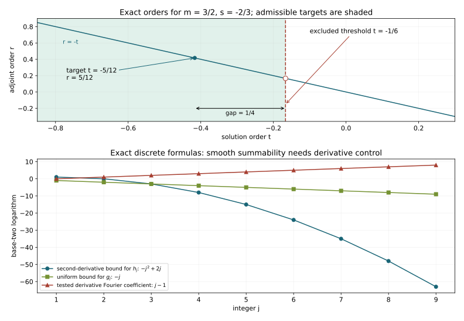

# Strict Sobolev loss and compact solvability

A regularity statement about compactly supported adjoint distributions can yield solutions near a compact set. When regularity is stated as a Sobolev index, its endpoint need not be attained. We retain that distinction throughout the duality argument. We also construct one smooth solution for smooth data by a convergent correction in every smooth seminorm.

The mathematical antecedent is Hörmander IV, Theorem 26.11.3 and its reference to the proof of Theorem 26.1.7, printed pages 162–163 and 63–64 of the approved 2009 eBook, ISBN 978-3-642-00136-9. The earlier [compact-support lesson](../20261005-restored-compact-solvability/compact-set-solvability-from-characteristic-escape.html) supplies its complete functional prerequisites. Here the principal symbol may be complex, and the adjoint regularity hypothesis has an arbitrarily small strict loss.

The analytic transfer is proved under the explicit hypothesis below. [Escape regularity](../20261015-escape-regularity-and-solvability/escape-arcs-regularity-and-semiglobal-solutions.html) proves the adjoint gain assumed here from condition (P) and the full two-ended escape geometry. [The trapping criterion](../20261015-trapped-characteristics-and-principal-type/trapped-characteristics-and-the-escape-criterion.html) gives the equivalent characteristic formulation. The finite Sobolev loss remains strict, and the smooth argument constructs one solution. The escape-stability lemma in Section 2 is proved here.

Original exposition, solutions and figure are CC0-1.0.  Exact earlier programme providers are bound in the proof map; the remaining human foundations are external, so internal P514 closure of this export is not claimed.

## 1. The precise regularity input

**H0. Operators, supports and pairings.** Let \(X\) be a Hausdorff second-countable smooth manifold without boundary. Work with complex scalar half-densities, \(D=-i\partial\), and the pairing \((u,v)\) linear in \(u\). Let \(P\in\Psi^m_{1,0}(X)\), \(m\in\mathbb R\), be properly supported. No reality assumption on its principal symbol is made in Sections 1 and 3–7. Choose a compact set \(K\) and a compact neighborhood \(A_0\) of \(K\).

For \(A\subset A_0\) compact, \(H^q_A\) is the closed Hilbert space of \(H^q\) distributions supported in \(A\). Fix the finite-chart norms proved in KS:S1–S4. Properness supplies a single compact set \(L\) containing the support of \(P^*v\) for every \(v\in\mathcal E'_{A_0}\): intersect the proper kernel support with the input support \(A_0\) and project to the output. Enlarge \(L\) to a compact neighborhood when choosing chart cutoffs.

The required input is

\[
 \begin{split}
 &r\in\mathbb R,\quad \varepsilon>0,\quad
 v\in\mathcal E'_{A_0},\quad P^*v\in H^r_L\\
 &\hspace{30mm}\Longrightarrow
 v\in H^{r+m-1-\varepsilon}_{A_0}.
 \end{split}
 \tag{SL1}
\]

We call (SL1) the **adjoint gain hypothesis**. It is an assumption of the analytic theorem, not a citation offered in place of its future geometric proof. It automatically applies to every smaller support \(A\), with the same output compact set \(L\).

**H1. What an index lower bound actually supplies.** Suppose a separate propagation argument proves, at every nonzero covector,
\[
 s_{P^*v}^*\ge r\quad\Longrightarrow\quad
 s_v^*\ge r+m-1
 \qquad(v\in\mathcal E'_{A_0}).
 \tag{SL2}
\]
Then it supplies (SL1). Indeed \(P^*v\in H^r_L\) gives the left index bound. Set \(q=r+m-1-\varepsilon\). At each covector over \(A_0\), the definition of the index gives microlocal \(H^q\) membership, since \(q\) is strictly below the lower bound. Its elliptic neighborhood may depend on the point and on \(q\). Compactness of the positive cosphere over \(A_0\) gives a finite cover for this fixed \(q\); the finite microlocal partition and Fourier localization argument SP:S1 converts these memberships into \(H^q_{A_0}\). Outside the support the distribution vanishes.

There is no claim of membership at \(r+m-1\). If all finite lower bounds are available, the preceding argument gives every finite global Sobolev norm on the fixed support. Fourier Cauchy–Schwarz with exponent larger than \(k+\dim X/2\) then gives every derivative of order \(k\). This proves smoothness. It does not identify an infinite pointwise index, on a varying family of cones, with a single smooth microlocal cutoff without an additional argument.

## 2. Escape persists on a neighborhood

**G0. A stable two-ended escape condition.** This paragraph concerns a smooth homogeneous principal symbol \(p\) satisfying the following condition on \(K\): every characteristic point over \(K\) lies in the interior of a compact regular semibicharacteristic interval whose endpoints either are noncharacteristic or project outside \(K\). A semibicharacteristic here is an orbit of \(H_{\operatorname{Re}(qp)}\) on its real zero level, with smooth nonzero \(q\) on a neighborhood of the interval. These are the exact curve conventions CPG:H0 and PSG:H0–H1.

There is a compact neighborhood \(A_0\) of \(K\) with the same escape condition. Choose the positive cotangent norm from KS:G0 and restrict initial covectors to its unit slice. Dilating a given interval to start on that slice preserves the condition: fiber dilation scales the symplectic form and homogeneity rescales \(p\); the resulting nonzero factor is absorbed into the new multiplier. No homogeneous extension of the original multiplier is needed.

Fix one initial characteristic covector \(z\) on this slice and its two-ended interval. The smooth flow theorem G2:NF1–NF7 gives a common finite flow domain for all initial points in a sufficiently small neighborhood \(V_z\). Shrink it so its entire compact family of arcs stays in the domain of \(q\), the real field stays nonzero, and \(q\) stays nonzero. For initial characteristic points the real Hamiltonian is initially zero and remains zero along the orbit, so these perturbed arcs are still semibicharacteristics.

An endpoint with nonzero \(p\) stays noncharacteristic after shrinking \(V_z\). For an endpoint over \(X\setminus K\), choose a relatively compact base neighborhood of that endpoint whose closure is disjoint from \(K\), and shrink \(V_z\) so all corresponding endpoints lie in it. Compactness of the characteristic part of the unit bundle over \(K\) gives finitely many initial neighborhoods \(V_1,\ldots,V_J\). There are consequently only finitely many such forbidden endpoint-base closures.

Take a relatively compact open neighborhood \(O\) of \(K\) disjoint from those closures. After shrinking \(O\), every characteristic unit covector over \(O\) lies in \(\bigcup_jV_j\). Otherwise a sequence of omitted covectors with bases approaching \(K\), in a fixed compact base neighborhood, has a convergent subsequence on the unit bundle. Its limit is characteristic over \(K\), and lies in one of the open \(V_j\), a contradiction. Finite charts and the explicit compact exhaustion in PS5 justify the required nested neighborhoods and this sequence argument.

Choose a compact neighborhood \(A_0\subset O\) of \(K\). Each characteristic unit covector over \(A_0\) now has a retained interval with no characteristic endpoint over \(A_0\). Dilate to recover every positive fiber scale. This proves the assertion, including an empty characteristic slice. We have used the two-ended condition itself; we have not assumed its equivalence with the absence of trapped leaves.

## 3. The estimate and its finite obstruction

**E0. A complete graph gives a quantitative estimate.** Assume (SL1). Fix a compact \(A\subset A_0\), \(r\in\mathbb R\) and \(\varepsilon>0\), and put
\[
 q=r+m-1-\varepsilon,\qquad
 \mathcal G=\{v\in H^{q-1}_A:P^*v\in H^r_L\},\qquad
 \|v\|_{\mathcal G}=\|v\|_{H^{q-1}_A}+\|P^*v\|_{H^r_L}.
 \tag{SL3}
\]
This is Banach. If \(v_j\) is Cauchy, its two limits \(v\in H^{q-1}_A\) and \(w\in H^r_L\) satisfy \(P^*v=w\) distributionally: proper Sobolev mapping gives
\[
 P^*:H^{q-1}_A\longrightarrow H^{q-1-m}_L
       =H^{r-2-\varepsilon}_L,
 \tag{SL4}
\]
and \(H^r_L\) embeds in this latter space. Support is preserved under distributional limits. Thus the limit belongs to \(\mathcal G\).

By (SL1) the identity \(\mathcal G\to H^q_A\) is everywhere defined. Its graph is closed, since the two candidate limits define the same distribution. Apply the proved closed-graph theorem KS:F3 to obtain
\[
 \|v\|_{H^q_A}\le C_{A,r,\varepsilon}
 \bigl(\|P^*v\|_{H^r_L}+\|v\|_{H^{q-1}_A}\bigr).
 \tag{SL5}
\]
The estimate holds for every distribution for which the right side is finite. In particular it holds for smooth supported tests. Its constant need not be uniform as \(\varepsilon\) decreases to zero.

**N0. The nullspace is finite and smooth.** Define
\[
 N(A)=\{v\in\mathcal E'_A:P^*v=0\}.
 \tag{SL6}
\]
Every member is smooth: apply (SL1), for example with \(\varepsilon=1\), to arbitrarily large \(r\), and use H1. The space is closed in \(L^2_A\), because \(P^*:L^2_A\to H^{-m}_L\) is continuous and its kernel is closed. Take \(q=0\), \(\varepsilon=1\), \(r=2-m\) in (SL5). On \(N(A)\) this gives
\[
                  \|v\|_{L^2_A}\le C\|v\|_{H^{-1}_A}.
 \tag{SL7}
\]
KS:S3 proves that \(L^2_A\hookrightarrow H^{-1}_A\) is compact. Any sequence in the \(L^2\) unit ball of \(N(A)\) has a subsequence Cauchy in \(H^{-1}\); (SL7) applied to differences makes it Cauchy in \(L^2\), with limit in that closed unit ball. Thus the ball is compact. An infinite-dimensional Hilbert space has an orthonormal sequence with pairwise distance \(\sqrt2\), contradicting compactness. Hence \(N(A)\) is finite-dimensional.

**N1. Remove the lower norm on the complement.** Let \(\Pi_q\) be the \(H^q_A\) orthogonal projection onto the finite-dimensional smooth space \(N(A)\). Then
\[
 \|v-\Pi_qv\|_{H^q_A}
          \le C'_{A,r,\varepsilon}\|P^*v\|_{H^r_L},
 \qquad q=r+m-1-\varepsilon.
 \tag{SL8}
\]
If this failed on its orthogonal complement, there would be \(v_j\) in that complement with \(H^q\) norm one and \(P^*v_j\to0\) in \(H^r\). Compactness \(H^q_A\hookrightarrow H^{q-1}_A\), valid also for negative \(q\), gives a Cauchy subsequence in the lower norm. Apply (SL5) to differences to get convergence in \(H^q_A\). The limit has norm one, is orthogonal to \(N(A)\), and solves \(P^*v=0\) distributionally. It therefore lies in \(N(A)\) and its orthogonal complement, an impossibility. Subtracting \(\Pi_qv\) proves (SL8). The projection is well-defined for every real \(q\); it is not assumed to be the same projection at different orders.

**N2. Stabilize on an actual neighborhood of \(K\).** Choose decreasing compact neighborhoods \(A_j\subset A_0\) of \(K\) with intersection \(K\), using the complement-exhaustion construction in KS:G3. All satisfy (SL1). The subspaces \(N(A_j)\) decrease inside the finite-dimensional \(N(A_0)\). Their integer dimensions eventually stabilize; thereafter inclusions are equalities. Their intersection is exactly \(N(K)\), since a distribution is supported in every \(A_j\) precisely when it is supported in \(K\). Choose one stabilized neighborhood \(A\). Then
\[
 K\subset\operatorname{int}A,\qquad N(A)=N(K).
 \tag{SL9}
\]
For every \(n\in N(K)\) and \(u\in\mathcal D'(X)\), proper adjointness gives
\[
                         (Pu,n)=(u,P^*n)=0.
 \tag{SL10}
\]
These pairings are legitimate because \(n\) is smooth and compactly supported. This proves the necessary compatibility condition and explains why an arbitrary larger support cannot be used in place of (SL9).

## 4. Solve at every order strictly below the threshold

**D0. The conditional solvability theorem.** Under (SL1), \(N(K)\) is a finite-dimensional subspace of smooth half-densities supported in \(K\). If \(f\in H^s_{\mathrm{loc}}(X)\) annihilates \(N(K)\), then, for every real
\[
                           t<s+m-1,
 \tag{SL11}
\]
there is \(u\in H^t_{\mathrm{loc}}(X)\) with \(Pu=f\) on a neighborhood of \(K\). If \(f\) is smooth and satisfies the same compatibility condition, one can choose a single smooth \(u\). Sections 4–5 prove these assertions.

**D1. Match the reciprocal exponents before extending.** Use \(A\) from (SL9), and set
\[
 \varepsilon=s+m-1-t>0,\qquad r=-t,\qquad
 q=r+m-1-\varepsilon=-s.
 \tag{SL12}
\]
For a smooth test \(v\) supported in \(A\), subtract \(\Pi_{-s}v\). Its adjoint output does not change, and \((f,\Pi_{-s}v)=0\), since the projection lies in \(N(A)=N(K)\). A cutoff equal to one near \(A\) reduces \(f\) to a compact \(H^s\) input. Fourier anti-duality KS:S1 and (SL8) give
\[
 |(f,v)|\le C_f\|v-\Pi_{-s}v\|_{H^{-s}_A}
                         \le C'_f\|P^*v\|_{H^{-t}_L}.
 \tag{SL13}
\]
Thus \(F(P^*v)=(f,v)\) is a well-defined conjugate-linear functional on the space of these adjoint outputs: two representatives with the same output differ by a smooth member of \(N(A)\). The right side of (SL13) is its actual continuity norm. Setting \(\varepsilon=0\) would use an unavailable hypothesis.

**D2. Represent the extension on the manifold.** Choose finitely many compact chart cutoffs defining the \(H^{-t}_L\) norm, and let \(Jw\) be the tuple of localized outputs extended by zero in those charts. It embeds the supported output space into a finite Hilbert sum of \(H^{-t}(\mathbb R^n)\). Extend \(FJ^{-1}\) to that sum by conjugating the proved complex Hahn–Banach theorem KS:F4. Reciprocal Fourier weights and Hilbert representation KS:S4 give representing components \(u_\alpha\in H^t(\mathbb R^n)\). Transpose the chart cutoffs and sum to obtain a global \(u\in H^t_{\mathrm{loc}}(X)\). Their compact chart supports ensure that extension by zero creates no chart-boundary defect.

For every smooth test supported in \(A\) the result satisfies
\[
                  (u,P^*v)=(f,v).
 \tag{SL14}
\]
In particular \(Pu=f\) on \(\operatorname{int}A\), a neighborhood of \(K\). This construction proves existence at each \(t\) in (SL11). It asserts neither uniqueness nor a bounded linear choice of solutions.

## 5. Construct one smooth solution

**J0. Use the actual smooth jet quotient.** Let \(E=C^\infty(X;\Omega^{1/2})\), and let \(Z_A\) consist of sections flat on \(A\), meaning all derivatives vanish at every point of \(A\). It is closed, since every derivative evaluation is continuous. KS:F5 and KS:J0–J1 prove that
\[
 F_A=E/Z_A,\qquad
 F_A'=\mathcal E'_A
 \tag{SL15}
\]
with the pairing \([h]\mapsto(h,v)\). The second equality is a representation of continuous linear functionals, with conjugation on the representing distribution as appropriate to our pairing.

The support statement does not require a regular boundary of \(A\). Briefly, a quotient functional pulls back to a compact distribution zero on tests outside \(A\). Conversely a distribution of finite order \(M\) supported in \(A\) annihilates a flat function: use a cutoff equal to one near its support, with width \(\delta\) and derivative bounds \(C_\alpha\delta^{-|\alpha|}\); Taylor flatness gives \(C^M\) size \(O(\delta^L)\) for the function on that neighborhood, for arbitrary \(L\). The product has \(C^M\) size \(O(\delta^{L-M})\). Take \(L>M\) and let \(\delta\) decrease to zero. The full finite-chart construction and all uniform Taylor bounds are KS:J1.

Set
\[
 Y_A=\{[h]\in F_A:(h,n)=0\ (n\in N(A))\},\qquad
 T:E\longrightarrow Y_A,\quad Th=[Ph].
 \tag{SL16}
\]
This is a continuous linear map into a closed Fréchet subspace. Properness and the all-real Sobolev mapping estimates imply continuity \(P:E\to E\), as in KS:J2. Equation (SL10) verifies that \(T\) takes values in \(Y_A\).

**J1. The seminorms and their dual bounds.** Use the exact increasing seminorms from KS:J3: on a compact exhaustion, start with a neighborhood of \(A_0\cup L\); for each family \(i\), take a finite chart partition and measure its components in \(H^i\). Let \(J_jh\) collect families \(i\le j\), and put
\[
 p_j(h)=\|J_jh\|_{\bigoplus_{i\le j,\alpha}H^i},\qquad
 q_j([h])=\inf_{z\in Z_A}p_j(h+z).
 \tag{SL17}
\]
The \(p_j\) give the complete smooth topology, and \(q_j\) give the quotient topology. The proof retains every compact derivative seminorm by taking \(i>k+\dim X/2\) and applying Fourier Sobolev embedding on the prescribed compact set.

Extend \(\ell\in Y_A'\) to \(F_A\) by the seminorm Hahn–Banach theorem. By (SL15) it is represented by \(v\in\mathcal E'_A\). The ambiguity is exactly \(N(A)\): a functional annihilating the common kernel of the finitely many independent pairings with a basis of \(N(A)\) factors through their finite-dimensional image. Its pullback \(\ell T\) is consequently represented by \(P^*v\), independent of the extension. Define
\[
 \sigma_j=\sup_{p_j(h)\le1}|\ell(Th)|.
 \tag{SL18}
\]
When this is finite, the same finite-Hilbert-sum extension used in D2 represents \(P^*v\) by transposed components of orders \(H^{-i}\), \(i\le j\). Restricting back to its known support \(L\) gives the proved estimate KS:J5,
\[
                         \|P^*v\|_{H^{-j}_L}\le C_j\sigma_j.
 \tag{SL19}
\]
The output cutoff is one near \(L\); bounded coordinate transfer at every real order justifies the stated fixed-support norm.

**J2. An explicit later seminorm absorbs the loss.** In (SL8) take
\[
              r=-j,\qquad\varepsilon=1,\qquad q=m-2-j.
 \tag{SL20}
\]
For \(v_0=v-\Pi_qv\), (SL19) gives
\[
                      \|v_0\|_{H^{m-2-j}_A}\le C'_j\sigma_j.
 \tag{SL21}
\]
For a representative \(h\) of \(y\in Y_A\), \((h,v)=(h,v_0)\). Choose an integer \(k(j)\) whose family covers a cutoff neighborhood of \(A\) and satisfies \(k(j)\ge j+2-m\). Finite-chart Sobolev pairing bounds this by \(B_j\sigma_j p_{k(j)}(h)\). Take the infimum over all representatives \(h+z\), \(z\in Z_A\), to obtain
\[
                       |\ell(y)|\le B_j\sigma_j q_{k(j)}(y).
 \tag{SL22}
\]
Choose \(B_j>0\). If \(\sigma_j=0\), (SL19) makes \(P^*v=0\), and \(v\in N(A)\); then \(\ell=0\) on \(Y_A\). Thus the zero-bound case is included. We need only a fixed positive loss for each smooth seminorm; no uniform estimate at zero loss has entered.

**J3. Obtain a neighborhood in the closure of each image.** Equation (SL22) implies
\[
 \{y:q_{k(j)}(y)<B_j^{-1}\}
            \subset\overline{T\{h:p_j(h)<1\}}.
 \tag{SL23}
\]
Here is the separation argument. The set on the right is closed, balanced and convex. If \(y\) were outside it, KS:J7, proved from the seminorm Hahn–Banach theorem, gives a continuous \(\ell\) with
\[
                    |\ell(y)|>
                    \sup_{p_j(h)<1}|\ell(Th)|=\sigma_j.
 \tag{SL24}
\]
For clarity, its separation uses the Minkowski seminorm of \(C+V\), where \(C\) is that closed balanced convex set and \(V\) is a sufficiently small balanced convex neighborhood. Choose \(\lambda>1\) with \(y/\lambda\notin C+V\). The seminorm is at most one on \(C\), and at least \(\lambda\) at \(y\); extend its value on the complex line through \(y\). This gives strict separation and a finite \(\sigma_j\). Scaling vectors toward zero equates the open- and closed-unit-ball suprema. But (SL22) makes \(|\ell(y)|<\sigma_j\) under the left condition in (SL23), unless \(\sigma_j=0\), in which case it makes \(\ell(y)=0\). Both contradict (SL24).

**J4. Remove the closure in every original seminorm.** Put \(U_j=\{h:p_j(h)<2^{-j}\}\). Scale (SL23) and choose a balanced open neighborhood \(V_j\subset\overline{TU_j}\), small enough also that \(q_i(y)<2^{-j}\) for \(i\le j\). For \(y\in V_1\), set \(r_0=y\). Inductively choose \(h_j\in U_j\) so that
\[
                        r_j=r_{j-1}-Th_j\in V_{j+1}.
 \tag{SL25}
\]
This is possible because \(r_{j-1}\in V_j\subset\overline{TU_j}\), and \(r_{j-1}-V_{j+1}\) is an open approximation neighborhood. For fixed \(i\), all terms with \(j\ge i\) satisfy \(p_i(h_j)\le p_j(h_j)<2^{-j}\). Completeness gives a single \(h=\sum_jh_j\in E\), with convergence in every \(p_i\). The bounds on \(V_{j+1}\) imply \(r_j\to0\) in every quotient seminorm. Continuity of \(T\) gives \(Th=y\). Since \(V_1\) absorbs every vector of \(Y_A\), scaling proves that \(T\) is onto.

If \(f\) is smooth and annihilates \(N(K)=N(A)\), its class is in \(Y_A\). Choose \(u\in E\) with \(Tu=[f]\). Then \(Pu-f\) is flat on \(A\), so it is zero on \(\operatorname{int}A\). This proves the smooth assertion of D0 with one solution, rather than a separate distribution for each finite order.

## 6. Three solved calculations

**X1. A negative threshold and the exact dual order.** Let \(m=3/2\), \(s=-2/3\), and target \(t=-5/12\). Compute the loss and the two adjoint orders. Does the same argument give the threshold \(t=-1/6\)?

**Solution.** The threshold is \(s+m-1=-1/6\), and
\[
 \varepsilon=\frac14,\qquad r=\frac5{12},\qquad
 q=\frac5{12}+\frac32-1-\frac14=\frac23=-s.
 \tag{SL26}
\]
Thus the functional is measured in \(H^{5/12}\), and its representative solution is in \(H^{-5/12}\). The adjoint test is controlled in \(H^{2/3}\), the reciprocal order to the datum. At \(t=-1/6\) the prescribed loss is zero, and (SL1) supplies no estimate. Constants depending on positive losses cannot be passed to that endpoint without additional control.

**X2. Why an arbitrary larger support creates a false compatibility demand.** On \(\mathbb R\), let \(K=[-1,1]\), \(A=[-1,4]\), and let \(b\in C^\infty_c((2,3))\) have \(L^2\) norm one. Define
\[
                     Pu=u-(u,b)b.
 \tag{SL27}
\]
Find \(N(K)\) and \(N(A)\), and compare solving \(Pu=b\) near \(K\) with solving it near \(A\).

**Solution.** The rank-one term has a smooth compact kernel \(b(x)\overline{b(y)}\). Hence \(P\) is properly supported, self-adjoint and elliptic of order zero, with principal symbol one. If \(Pv=0\), its distributional formula gives \(v=(v,b)b\); the full kernel is \(\mathbb Cb\). Consequently \(N(K)=0\), whereas \(N(A)=\mathbb Cb\). This operator satisfies (SL1): if \(Pv\in H^r\), then \(v=Pv+(v,b)b\in H^r\), which embeds into \(H^{r-1-\varepsilon}\).

Near \(K\), \(b=0\) and \(u=0\) solves the equation. Near \(A\), testing any proposed equation with \(b\) would give \((Pu,b)=0=(b,b)=1\), a contradiction. Thus the initial compatibility condition must be retained by the stabilized neighborhood; replacing it with an arbitrary large support would reject solvable data.

**X3. The smooth topology requires all tails.** On the circle of length \(2\pi\), compare
\[
 h_j(x)=2^{-j^2}\cos(2^jx),\qquad
 g_j(x)=2^{-j}\cos(2^{2j}x),\qquad j\ge1.
 \tag{SL28}
\]
Show that the first series converges smoothly, whereas uniform convergence of the second does not give even \(C^1\) regularity.

**Solution.** For every integer \(k\ge0\),
\[
 \|\partial_x^kh_j\|_\infty\le2^{-j^2+jk}
                      \le2^{-j^2/2}\quad(j\ge2k).
 \tag{SL29}
\]
For \(j\ge2\) the last bound is at most \(2^{-j}\). Thus each derivative series has a summable tail. Uniform convergence of consecutive derivative series and the fundamental theorem of calculus identify their limits as successive derivatives of the function series. This proves smooth convergence, including the finitely many initial terms for each \(k\).

The series \(\sum g_j\) converges uniformly by its geometric majorant. Uniform convergence allows termwise integration against each fixed exponential. Orthogonality of the distinct integer frequencies gives Fourier coefficient \(2^{-j-1}\) at \(n=2^{2j}\). If its sum \(g\) were \(C^1\), integration by parts over a period would give
\[
 |n\widehat g(n)|\le (2\pi)^{-1}\|g'\|_{L^1}.
 \tag{SL30}
\]
But at those frequencies the left side is \(2^{j-1}\), which is unbounded. This is impossible. J4 retains a summable tail in every \(p_i\), precisely the property that a sole uniform norm fails to guarantee.

## 7. Read the loss and the correction bounds

**F0. Exact coordinates in the figure.** The upper panel plots the exercise X1 orders and the identity \(r=-t\). The threshold \(-1/6\) is excluded; the marked admissible value is \(-5/12\), with gap \(1/4\). The lower panel plots the base-two logarithms of the exact majorants in X3: \(-j^2+2j\) for the second derivative of \(h_j\), \(-j\) for the uniform size of \(g_j\), and \(j-1\) for its tested derivative Fourier coefficient. These discrete samples illustrate formulas (SL29)–(SL30); the proofs of summability and failure of \(C^1\) are above.

The [figure generator](figures/build_figure.py) retains all rational coordinates and sequences. The [finite checks](model-check.json) check exact order identities and selected sequence inequalities; they do not establish propagation, compactness or functional-analytic completeness. [Escape regularity](../20261015-escape-regularity-and-solvability/escape-arcs-regularity-and-semiglobal-solutions.html) proves the adjoint gain assumed here from condition (P) and the full two-ended escape geometry. [The trapping criterion](../20261015-trapped-characteristics-and-principal-type/trapped-characteristics-and-the-escape-criterion.html) gives the equivalent characteristic formulation. The finite Sobolev loss remains strict, and the smooth argument constructs one solution.
