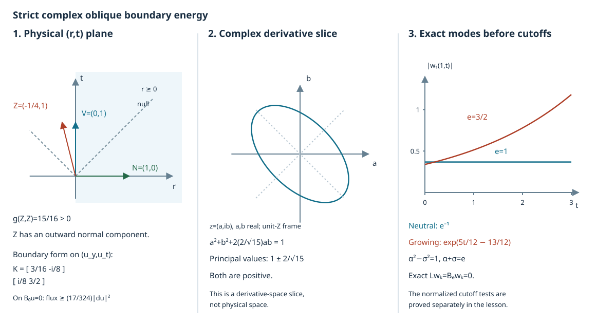

# Energy for strict complex oblique boundary conditions

The boundary operator can contain an imaginary tangential derivative. A real multiplier alone does not give the required boundary sign. We incorporate that derivative in a Hermitian divergence form of the actual wave operator, then choose a future multiplier with a small outward normal component.

This lesson proves a weighted estimate for smooth functions, with the volume energy, terminal energy, full boundary gradient and inhomogeneous boundary data all retained. It includes variable principal coefficients and arbitrary smooth complex lower terms. The [Dirichlet lesson](../20261007-restored-mixed-dirichlet/mixed-dirichlet-cauchy-energy-preparation.html) provides the separate existence theorem for Dirichlet data.

## 1. Geometry, source conventions and the theorem

**H0. Fix the actual operators.** Let \(X\) be a smooth manifold with boundary, \(g\) a tangent Lorentz metric of signature \((1,n-1)\), and \(G=g^{-1}\). Fix a smooth positive density \(\mu\). In local coordinates the scalar operator is
\[
 L=G^{\alpha\beta}\partial_\alpha\partial_\beta
                      +d^\beta\partial_\beta+d_0.                 \tag{OB1}
\]
The coefficients \(G^{\alpha\beta}\) are real and symmetric; \(d^\beta,d_0\) may be complex. A real clock \(\phi\) is proper and \(G(d\phi,d\phi)>0\). Its positive dual fixes the future cone. The boundary is timelike: its nonzero conormals have negative \(G\)-square. Thus its tangent metric has one positive direction.

On the boundary let \(N\) be the inward unit spacelike normal, and \(V,W\) real tangent vector fields. The normalized first-order operator is
\[
 {\cal B}=N-V-iW+b,\qquad b\in C^\infty(\partial X;\mathbb C).
                                                               \tag{OB2}
\]
Here vector fields act by ordinary derivatives. Write
\[
 \begin{split}
 f^2&=g(V,V)>0,\quad c=g(W,V)/f,\quad
 W_\perp=W-(c/f)V,\\
 e^2&=-g(W_\perp,W_\perp),\qquad \delta=1-e^2>0 ,
 \end{split}                                                    \tag{OB3}
\]
and assume that \(V\) is future timelike. Nonnegativity of \(e^2\), the smooth Lorentz frames used below, and the positive time cone follow from the Lorentz algebra in DC:T002, DC:T008–T010. The notation \(e\) is its nonnegative square root; the proof never requires a smooth choice of \(W_\perp/e\) at a zero.

Choose a compact time interval \([a,T]\) inside a slightly larger interval on which these hypotheses hold. Properness gives a compact slab. All norms below use fixed smooth positive volume and hypersurface densities and a fixed positive definite norm on covectors. Changing these choices on this slab changes constants only. Let
\[
 \Omega=\{a<\phi<T\},\quad
 \Sigma_T=\{\phi=T\},\quad
 Y=\partial X\cap\{a<\phi<T\}.
\]
The temporal levels meet the boundary transversely by DC:T003. We take \(u\) smooth up to the boundary and zero on \(\{\phi\le a\}\). A local coordinate version allows compact spatial support instead of properness.

**S0. Weighted energy theorem.** There are \(C,\lambda_0>0\), depending on this fixed slab and its coefficients but not on \(u\) or \(\lambda\), such that for \(\lambda\ge\lambda_0\),
\[
 \begin{split}
 &\lambda\int_\Omega e^{-\lambda\phi}(|du|^2+|u|^2)\,d\mu
  +e^{-\lambda T}\int_{\Sigma_T}(|du|^2+|u|^2)\,dS_T\\
 &\quad+\int_Y e^{-\lambda\phi}(|du|^2+|u|^2)\,dS_Y\\
 &\le {C\over\lambda}\int_\Omega e^{-\lambda\phi}|Lu|^2\,d\mu
                 +C\int_Ye^{-\lambda\phi}|{\cal B}u|^2\,dS_Y .
 \end{split}                                                    \tag{OB4}
\]
The derivative on \(Y\) is the full gradient of \(u\), including its normal derivative. Sections 2–6 prove this statement. The constants need not be uniform over unbounded time intervals.

**A0. Match the source's strict inequalities.** In Hörmander II, Example 12.9.14(b), write the tangential coefficient vector as \(F+iE=(b_2,\ldots,b_{n-1},-b_n)\), with the last entry temporal. The Lorentz pairing is positive on that last direction. In our notation these are the metric-dual covectors of \(V,W\). Consequently
\[
 [F,F]=f^2,\quad [E,F]=fc,\quad [E,E]=c^2-e^2,\quad
 [F,F](1+[E,E])-[E,F]^2=f^2\delta .                              \tag{OB5}
\]
Thus the strict conditions are precisely that \(F\) is future timelike and \(\delta>0\); then \(1+[E,E]=c^2+\delta>0\) too. To check signs, with \(N=\partial_r\), \(D=-i\partial\), multiplying \(B(D)=D_r+\sum b_jD_{y_j}+b_nD_t\) and its datum by \(i\) gives (OB2): \(V^t=-\operatorname{Re}b_n\), \(V^{y_j}=-\operatorname{Re}b_j\), and the same formulas with imaginary parts give \(W\). In the real-principal convention of the Dirichlet lesson one also uses \(L=-P\); every forcing is multiplied by the same scalar. Formula (OB5) establishes the exact strict part of the source condition used here.

## 2. Put the imaginary derivative in the divergence form

**A1. Change no second-order operator.** Extend \(N,V,W\) smoothly into a boundary collar for the moment. Set
\[
 A=N\wedge W,\qquad M=G+iA,\qquad
 (N\wedge W)^{\alpha\beta}=N^\alpha W^\beta-W^\alpha N^\beta .
                                                               \tag{OB6}
\]
The matrix \(M\) is Hermitian. Since \(A^{\alpha\beta}u_{\alpha\beta}=0\), the actual operator (OB1) is exactly
\[
 L=\operatorname{div}_\mu(M\,du)+C^\beta u_\beta+d_0u,\qquad
 C^\beta=d^\beta-\mu^{-1}\partial_\alpha(\mu M^{\alpha\beta}) .
                                                               \tag{OB7}
\]
All derivatives of \(A\), the density and the principal coefficients are retained in \(C\).

Let \(Z\) be a real vector field and \(m>0\) a constant. With \(Q_M(du)=M^{\beta\gamma}u_\gamma\overline{u_\beta}\in\mathbb R\), define
\[
 J^\alpha
 =2\operatorname{Re}\big(M^{\alpha\beta}u_\beta\overline{Zu}\big)
                       -Z^\alpha Q_M(du)+mZ^\alpha|u|^2 .
                                                               \tag{OB8}
\]
For every real \(U\), adding the bivector \(Z\wedge U\) to \(A\) leaves \(J\) unchanged. Indeed, put \(z=(Uu)\overline{Zu}\). The first term changes by \(-2Z^\alpha\operatorname{Im}z\), while the negative quadratic term changes by \(+2Z^\alpha\operatorname{Im}z\). They cancel identically. We may therefore discard these “electric” bivectors when testing positivity.

**A2. Retain the complete divergence remainder.** Differentiating (OB8), the second-derivative cross terms cancel by Hermitian symmetry and commutation of scalar coordinate derivatives. The result is
\[
 \operatorname{div}_\mu J
       =2\operatorname{Re}(Lu\,\overline{Zu})+R_m(u),\qquad
 |R_m(u)|\le C_m(|du|^2+|u|^2).                                  \tag{OB9}
\]
Here is the full local remainder, which also verifies that no unestimated second derivative occurs:
\[
 \begin{split}
 R_m={}&-2\operatorname{Re}((C^\beta u_\beta+d_0u)\overline{Zu})
 +2\operatorname{Re}(M^{\alpha\beta}u_\beta
                              (\partial_\alpha Z^\gamma)\overline{u_\gamma})\\
 &-(\operatorname{div}_\mu Z)Q_M
       -Z^\alpha(\partial_\alpha M^{\beta\gamma})
                                     u_\gamma\overline{u_\beta}\\
 &+m(\operatorname{div}_\mu Z)|u|^2
                         +2m\operatorname{Re}(Zu\,\overline u).
 \end{split}                                                    \tag{OB10}
\]
For example the two apparent Hessian terms are
\(2\operatorname{Re}(M^{\alpha\beta}u_\beta Z^\gamma\overline{u_{\gamma\alpha}})\) and
\(-2\operatorname{Re}(Z^\alpha M^{\beta\gamma}u_{\gamma\alpha}\overline{u_\beta})\).
Conjugate the first, use \(\overline{M^{\alpha\beta}}=M^{\beta\alpha}\), and rename the dummy indices to obtain their cancellation. Every remaining factor in (OB10) has at most one derivative of \(u\), and bounded coefficients on the fixed compact slab give (OB9). These formulas are computed in charts; their left side and the current are intrinsic, so the local bounds combine over a finite cover.

## 3. Positive clock and causal flux

**F0. A multiplier close to the tangent future field.** On the boundary take
\[
 Z=V-\kappa N,\qquad
 0<\kappa\le
 \min\left\{{f\sqrt\delta\over2},
             {f^2\delta\over f^2+1+c^2}\right\}.                 \tag{OB11}
\]
A single positive \(\kappa\) satisfies these bounds on a compact boundary slab. This multiplier points outward in its normal component and remains future timelike.

The component \((c/f)N\wedge V\) of \(A\) is electric relative to \(Z\). Put
\[
 N_Z=N-{\kappa\over f^2-\kappa^2}Z.
\]
Direct scalar products give
\[
 g(N_Z,Z)=0,\quad
 g(N_Z,N_Z)=-{f^2\over f^2-\kappa^2},\quad
 g(N_Z,W_\perp)=g(Z,W_\perp)=0 .
                                                               \tag{OB12}
\]
Modulo electric bivectors, \(A=N_Z\wedge W_\perp\). In a Lorentz frame with unit temporal vector \(Z/\sqrt{g(Z,Z)}\), its spatial skew block has norm
\[
 e_Z={fe\over\sqrt{f^2-\kappa^2}}<1.                             \tag{OB13}
\]
Indeed \(\kappa^2/f^2\le\delta/4\) and \(e^2=1-\delta\). Choosing an orthonormal basis of the plane of \(N_Z,W_\perp\) gives a single \(2\)-by-\(2\) skew block; if \(W_\perp=0\), that block is zero. This is pointwise linear algebra and requires no division by a vanishing field.

In this frame let \(H=I-iA_{\mathrm{sp}}\). Its two possibly nonunit eigenvalues are \(1-e_Z,1+e_Z\): on the skew plane the eigenvectors are \((1,i)\) and \((1,-i)\), with their order depending on the orientation. All other eigenvalues are \(1\). Thus \(H\) is positive Hermitian, uniformly so on the compact slab.

**F1. Keep the physical characteristic cone.** Let \(\ell=(\ell_0,\ell_{\mathrm{sp}})\) be a real future conormal, so \(\ell_0\ge|\ell_{\mathrm{sp}}|\). For the derivative part of the current,
\[
 {\ell_\alpha J^\alpha_{\mathrm{deriv}}\over\sqrt{g(Z,Z)}}
 =\ell_0(|u_0|^2+u_{\mathrm{sp}}^*Hu_{\mathrm{sp}})
       -2\operatorname{Re}
           (\overline{u_0}\,\ell_{\mathrm{sp}}^*Hu_{\mathrm{sp}})
 \ge(\ell_0-|\ell_{\mathrm{sp}}|)
                   (|u_0|^2+u_{\mathrm{sp}}^*Hu_{\mathrm{sp}}).
                                                               \tag{OB14}
\]
For the inequality, \(\ell_{\mathrm{sp}}\) is real, so
\(\ell_{\mathrm{sp}}^*H\ell_{\mathrm{sp}}=|\ell_{\mathrm{sp}}|^2\).
The Hermitian Cauchy–Schwarz inequality follows by minimizing
\((x-z y)^*H(x-z y)\ge0\) over \(z\in\mathbb C\); it bounds the cross term by
\(2|u_0||\ell_{\mathrm{sp}}|(u_{\mathrm{sp}}^*Hu_{\mathrm{sp}})^{1/2}\).
Now use \(2ab\le a^2+b^2\).

The mass term is \(m\ell(Z)|u|^2\), positive for every nonzero future causal \(\ell\). In particular \(d\phi\cdot J\) and the future terminal flux control \(|du|^2+m|u|^2\) uniformly. Future null faces have nonnegative flux. All cones here are the original metric cones.

## 4. The full physical-boundary flux

**B0. Compute the exact boundary matrix.** The outward unit conormal is \(\nu=g(N,\cdot)\); it evaluates to \(-1\) on the inward \(N\). Its natural conormal derivative is
\[
 \nu_\alpha M^{\alpha\beta}u_\beta
            =Nu-iWu=Vu+{\cal B}u-bu.                            \tag{OB15}
\]
This follows directly from \(\nu_\alpha G^{\alpha\beta}=N^\beta\),
\(\nu(N)=-1\) and \(\nu(W)=0\), including in coordinates with mixed coefficients.

At one point choose a Lorentz frame \(N=\partial_r\), \(V=f\partial_t\), \(W=c\partial_t-e\partial_{y_1}\). On the kernel of the principal part \({\cal B}_0=N-V-iW\),
\[
 u_r=(f+ic)u_t-ie u_{y_1}.
                                                               \tag{OB16}
\]
Substitution in \(J_{\mathrm{deriv}}\cdot\nu\) gives the form in \((u_{y_1},u_t)\)
\[
 K_\kappa=
 \begin{pmatrix}
 \kappa(1-e^2)&\kappa e(c-if)\\
 \kappa e(c+if)&2f^2-\kappa(f^2+1+c^2)
 \end{pmatrix},\qquad
 \det K_\kappa=
 2\kappa f^2\delta-\kappa^2(f^2+1+c^2-e^2).                       \tag{OB17}
\]
Every other tangential spatial derivative contributes \(\kappa|u_{y_j}|^2\).
For an explicit verification of the signs, in the ordered frame \((t,r,y_1)\),
\[
 M=\begin{pmatrix}1&-ic&0\\ic&-1&-ie\\0&ie&-1\end{pmatrix},
 \quad Zu=fu_t-\kappa u_r,\quad
 J_{\mathrm{deriv}}\cdot\nu
       =-2\operatorname{Re}((Mdu)^r\overline{Zu})-\kappa Q_M .
                                                               \tag{OB18}
\]
Use (OB16), expand, and collect the coefficients of \(|u_{y_1}|^2\), \(|u_t|^2\) and \(\overline{u_{y_1}}u_t\); they are precisely (OB17).

The second bound in (OB11) gives
\[
 (K_\kappa)_{tt}\ge f^2,\qquad
 \det K_\kappa\ge\kappa f^2\delta>0 .
                                                               \tag{OB19}
\]
For the determinant, replace \(f^2+1+c^2-e^2\) by the larger \(f^2+1+c^2\). The first diagonal entry is positive, and completing the complex square proves positivity of the entire \(2\)-by-\(2\) form. Relation (OB16) also bounds the normal derivative by the tangential ones. Compactness therefore gives uniform control of the full gradient on this principal boundary kernel.

When \(e=0\), choose any spatial frame and retain the same formula with zero cross term. If there is no tangential spatial direction, namely ambient dimension two, only the positive \(tt\) entry is needed. This handles that case directly.

**B1. Keep the boundary datum and zeroth term.** For an arbitrary gradient put \(h={\cal B}_0u\). Subtract the vector with normal component \(h\) and all tangential components zero. The remainder lies in the kernel just considered. Expanding the quadratic form and using \(2ab\le\epsilon a^2+\epsilon^{-1}b^2\) gives
\[
 J_{\mathrm{deriv}}\cdot\nu
                  \ge c_1|du|^2-C_1|h|^2 .
\]
All coefficients are uniformly bounded, and \(h={\cal B}u-bu\); thus, for constants independent of \(m\),
\[
 J\cdot\nu\ge c_1|du|^2-C_2|{\cal B}u|^2
                                      +(m\kappa-C_b)|u|^2 .
                                                               \tag{OB20}
\]
The splitting argument also controls the normal component of the arbitrary gradient, since its modulus is bounded by that of the kernel component plus \(|h|\). Choose \(m\) once so that \(m\kappa-C_b\ge1\). No derivative of the boundary datum occurs in (OB20).

## 5. Construct one current on a compact slab

**G0. Extend in two separate stages.** The boundary fields and the collar needed above can be constructed on a neighborhood of the compact boundary slab. Choose finitely many boundary charts with inward defining functions \(r_j\), and bumps whose positive sets cover this compact set. Divide the bumps by their positive sum to form a partition. The function \(r=\sum\chi_j r_j\) has, on the boundary, a positive weighted sum of inward conormals; all these lie on the same positive ray. Thus \(dr\ne0\) and \(G(dr,dr)<0\) there. Both properties persist in a smaller neighborhood. The field
\(N=-G^\sharp dr/\sqrt{-G(dr,dr)}\) is smooth and inward unit normal on each level of \(r\).

The smooth flow and compact continuation proved in DC:T005–T006, followed by the inverse theorem, give a common short collar. Extend \(V,W\) smoothly along it and project them to \(N^\perp\). Their boundary values are unchanged. The strict margins persist after shrinking. Choose the common \(\kappa>0\) smaller if necessary. Equations (OB12)–(OB14) then hold throughout this collar.

Keep \(Z=V-\kappa N\) fixed while multiplying \(A=N\wedge W\) by a scalar cutoff \(0\le\chi\le1\), equal to one near the boundary and zero before the collar ends. Its spatial skew norm relative to \(Z\) is \(\chi e_Z<1\); equivalently its current is the convex combination of the currents with \(A\) and with \(A=0\). Positivity persists.

Only where \(A=0\) blend \(Z\) with the global future field \(G^\sharp d\phi\). The future timelike cone is convex: in a Lorentz frame its vectors satisfy \(v_0>|v_{\mathrm{sp}}|\), and the triangle inequality preserves that strict inequality under positive convex combinations. Hence the blended field stays future timelike. Extend it as \(G^\sharp d\phi\) in the remaining interior. Finite charts give smooth cutoffs and uniform margins. This constructs a single smooth \(A,Z\) on a neighborhood of the compact slab with the precise prescribed boundary values.

The construction uses no partition of \(u\) or its equation. It therefore introduces no boundary commutator. If the boundary is empty, use \(A=0\) and \(Z=G^\sharp d\phi\) throughout. This also proves the interior version in dimension one.

## 6. Integrate the actual identity

**E0. Prove the weighted estimate.** The exact identity is
\[
 \lambda e^{-\lambda\phi}d\phi\cdot J
       +\operatorname{div}_\mu(e^{-\lambda\phi}J)
        =e^{-\lambda\phi}
                  \{2\operatorname{Re}(Lu\,\overline{Zu})+R_m\}.
                                                               \tag{OB21}
\]
Use the divergence formula DC:D1 over \(\Omega\). It follows from iterated integration on boundary graphs and extends to the present transverse corners by a finite partition and shrinking strips; no normal derivative of a rough function is being assumed here. The past flux is zero because \(u\) is smooth and zero for \(\phi\le a\).

On the physical boundary the divergence density equals the flux in (OB20) times a smooth positive factor: in a defining chart \(\nu\) is a negative multiple of \(dr\), so this is the ordinary outward divergence sign. The same observation on \(\Sigma_T\), with a positive multiple of \(d\phi\), gives its future sign. All density factors have positive upper and lower bounds on the compact faces.

Equations (OB14) and (OB20), with \(m\) now fixed, put positive multiples of the three left-hand terms of (OB4) on the left, except for \(C_2\|{\cal B}u\|^2_{L^2(Y,e^{-\lambda\phi})}\), which is moved to the right. The remainder satisfies (OB9). Boundedness of \(Z\) and Young's inequality give
\[
 2|Lu||Zu|\le {c_0\lambda\over4}|du|^2
                             +{C\over\lambda}|Lu|^2 ,
                                                               \tag{OB22}
\]
where \(c_0>0\) is a clock coercivity constant. Choose \(\lambda_0\) so that \(C_m(|du|^2+|u|^2)\) consumes at most another quarter of the positive volume term. Absorb these terms. Norm equivalence on the fixed slab gives exactly (OB4).

Additional artificial faces with future causal outward conormal contribute nonnegative flux by (OB14) and can be discarded. Compactly supported local functions give the half-space version by the same proof. Spatial cutoff limits are available when every term converges, as in the Dirichlet lesson. This completes the smooth weighted theorem. \(\square\)

## 7. Exact models and a reproducible diagram

**X0. A strict numerical model with exact constants.** Take
\[
 L=\partial_t^2-\partial_r^2-\partial_y^2,\quad
 {\cal B}=\partial_r-\partial_t+\tfrac i2\partial_y,\quad
 f=1,\ e=\tfrac12,\ c=0,\ \kappa=\tfrac14 .
\]
Then
\[
 K=\begin{pmatrix}3/16&-i/8\\ i/8&3/2\end{pmatrix},\quad
 \det K=17/64,\quad \operatorname{tr}K=27/16,\quad
 K\ge {17\over108}I .                                          \tag{OB23}
\]
The last bound follows because the smaller positive eigenvalue is the determinant divided by the larger one, and the latter is no greater than the trace. The quadratic formula gives those two real eigenvalues, or completing the square verifies the displayed bound directly. On the principal boundary kernel,
\(|u_r|^2=|u_t-\tfrac i2u_y|^2\le2|u_t|^2+\tfrac12|u_y|^2\).
Thus \(|du|^2\le3(|u_t|^2+|u_y|^2)\), and the boundary derivative flux is at least \(17|du|^2/324\). The shifted spatial block in the unit-\(Z\) frame has \(e_Z=2/\sqrt{15}\), not \(1/2\).

**V0. Read the planes separately.** The first panel is physical \((r,t)\)-space with \(r\ge0\), \(g=dt^2-dr^2\), \(N=(1,0)\), \(V=(0,1)\) and \(Z=(-1/4,1)\). Its \(Z\) arrow has negative normal component and \(g(Z,Z)=15/16\). Null directions are drawn at slope one. The second panel is a real two-dimensional slice of the *complex derivative space* of the spatial Hermitian block in the unit-\(Z\) frame. If \(a\) is the \(N_Z\) derivative and the \(W_\perp\) derivative is \(ib\), its form is \(a^2+b^2+2(2/\sqrt{15})ab\); the two principal values are \(1\pm2/\sqrt{15}\). It is not a spatial section of \(X\). The third panel plots absolute values of the exact modes below at \(k=1\), before cutoffs; the neutral and growing time factors are distinguished. All curves, arrows and constants are generated from the formulas in the editable figure script.

**X1. Exact boundary-layer modes.** On a periodic \(y\)-coordinate set
\[
 {\cal B}_e=\partial_r-\partial_t+ie\partial_y,\quad
 w_k=e^{k(\sigma t-\alpha r)}e^{-iky},\quad
 \sigma={e^2-1\over2e},\quad
 \alpha={e^2+1\over2e},\qquad e>0.                              \tag{OB24}
\]
The identities \(\alpha^2-\sigma^2=1\) and \(\alpha+\sigma=e\) show, by direct differentiation, that \(Lw_k={\cal B}_ew_k=0\). An inactive periodic coordinate places this example in the source's ambient dimension four. A finite normal interval, with the function zero near its far endpoint, makes the clock proper.

**X2. Why strictness matters.** Fix \(T>0\), a smooth \(\theta\) zero for \(t\le0\) and one for \(t\ge T/2\), and a normal cutoff \(\rho\) equal to one for \(0\le r\le r_0\) and zero for \(r\ge2r_0\), inside that finite interval.

At \(e=1\), take \(u_k=k^{-1/2}\theta(t)\rho(r)e^{-kr-iky}\). On a fixed later time interval, integrating \(|\partial_yu_k|^2\) for \(0<r<1/k\) gives a positive lower bound independent of \(k\). But
\[
 \|Lu_k\|_{L^2(\Omega)}=O(k^{-1})+O(k^A e^{-kr_0}),\qquad
 \|{\cal B}_1u_k\|_{L^2(Y)}=O(k^{-1/2})                         \tag{OB25}
\]
for a fixed integer \(A\). Indeed the time term is \(k^{-1/2}\theta''\rho e^{-kr-iky}\), whose normal integral contributes another factor \(k^{-1/2}\). The normal cutoff terms have support \(r\ge r_0\) and are exponentially small. At \(r=0\) only \(-k^{-1/2}\theta'e^{-iky}\) remains in the boundary datum. For fixed \(\lambda\), weights on the finite slab are equivalent to one. Therefore (OB4) cannot be extended to this nonstrict edge.

For \(e>1\), put \(u_k=e^{-\sigma kT}\theta\rho w_k\). The time-cutoff residual is bounded by a polynomial in \(k\) times \(e^{-\sigma kT/2}\); the normal-cutoff residual is bounded by a polynomial times \(e^{-\alpha kr_0}\). The boundary datum is again a time-cutoff term and is exponentially small. Any fixed finite number of integer coordinate derivatives costs only another polynomial in \(k\), so all these forcing and boundary norms tend to zero even after such derivatives.

On \(T-1/k<t<T\), \(0<r<1/k\), however, \(|e^{-\sigma kT}w_k|\ge e^{-\sigma-\alpha}\). Its \(y\)-derivative has modulus at least \(ke^{-\sigma-\alpha}\), while the \((r,t)\) region has area \(k^{-2}\). The fixed periodic factors have positive measure. Thus \(\|du_k\|_{L^2(\Omega)}\) has a positive lower bound. An estimate by any fixed finite collection of those differentiated forcing and boundary \(L^2\) norms also fails. Future cutoffs may be placed after \(T\); they do not affect any norm just used. These are precise failures of these energy estimates, rather than a classification of every weaker boundary problem.

## 8. Exercises with complete solutions

### Exercise 1. Normalize a complex boundary operator

Let \(B(D)=D_r-\tfrac12D_y-D_t+i(\tfrac14D_y+2D_t)\). Determine \(V,W,f,c,e,\delta\) in the flat metric and decide whether the strict theorem applies.

**Solution.** Multiplication by \(i\) gives the ordinary operator \(\partial_r-\tfrac12\partial_y-\partial_t+i(\tfrac14\partial_y+2\partial_t)\). Thus \(V=\partial_t+\tfrac12\partial_y\), \(W=-2\partial_t-\tfrac14\partial_y\). The metric gives
\[
 f^2=3/4,\quad g(W,V)=-15/8,\quad
 c=-{15\over4\sqrt3},\quad g(W,W)=63/16.
\]
Hence \(e^2=c^2-g(W,W)=75/16-63/16=3/4\), and \(\delta=1/4>0\). Also \(V\) is future. Directly the source determinant is \((3/4)(1+63/16)-(15/8)^2=3/16=f^2\delta\). The strict theorem applies on every compact slab. The datum must also be multiplied by \(i\); no conjugation of the boundary operator is involved.

### Exercise 2. Keep a large imaginary temporal coefficient

Take \(f=1,e=1/2,c=2\). Give one permitted \(\kappa\), compute its boundary matrix and a quantitative positive lower bound. Explain what changes if the boundary has no spatial direction.

**Solution.** Now \(\delta=3/4\), and (OB11) permits \(\kappa=1/64\), since \(1/64<\sqrt3/4\) and \(1/64<1/8\). Formula (OB17) gives
\[
 K=\begin{pmatrix}3/256&(2-i)/128\\(2+i)/128&61/32\end{pmatrix},
 \quad\det K={361\over16384},\quad\operatorname{tr}K={491\over256}.
                                                               \tag{OB26}
\]
The determinant/trace argument from (OB23) yields \(K\ge361I/31424\). The principal relation bounds
\(|u_r|^2=|(1+2i)u_t-\tfrac i2u_y|^2\le10|u_t|^2+\tfrac12|u_y|^2\),
so \(|du|^2\le11(|u_t|^2+|u_y|^2)\). A full-gradient flux bound is consequently \(361|du|^2/345664\). If there is no spatial direction then \(W=c\partial_t\), \(e=0\), and the time entry is \(2f^2-\kappa(f^2+1+c^2)>0\). There is no \(y\) block to discard or divide by.

### Exercise 3. Check the unstable mode and its normalization

For \(e=3/2\), compute \(\sigma,\alpha\). Verify both operator identities in (OB24), and prove that the normalized cutoff family has a positive gradient norm while every prescribed finite collection of differentiated residual norms tends to zero.

**Solution.** The values are \(\sigma=5/12,\alpha=13/12\). Therefore
\(\sigma^2-\alpha^2+1=25/144-169/144+1=0\), the multiplier of \(k^2w_k\) in \(Lw_k\); and \(-\alpha-\sigma+e=-13/12-5/12+3/2=0\), the multiplier of \(kw_k\) in \({\cal B}_ew_k\).

For \(u_k=e^{-5kT/12}\theta\rho w_k\), the product rule gives
\[
 Lu_k=e^{-5kT/12}
       \{(\theta''+2\sigma k\theta')\rho
                    -\theta(\rho''-2\alpha k\rho')\}w_k .
                                                               \tag{OB27}
\]
The first bracket is supported where \(t\le T/2\); the second where \(r\ge r_0\). Each derivative of total order at most a prescribed integer \(j\) is bounded by
\(C_j k^{j+2}(e^{-5kT/24}+e^{-13kr_0/12})\) on the finite slab. Its \(L^2\) norm has the same bound up to its fixed volume. On the physical boundary only \(-e^{-5kT/12}\theta'w_k\) remains, with the analogous exponential bound for each boundary derivative. The family is zero near the other normal endpoint. In the last \(1/k\) units of time and first \(1/k\) units of normal distance, \(\theta=\rho=1\) for large \(k\), so the lower bound from Section 7 is \(e^{-3/2}\) for the amplitude and \(ke^{-3/2}\) for its \(y\)-derivative. Integrating over that region proves the positive lower bound. Every exponential upper bound beats any of the finitely many derivative powers. This proves the asserted finite-order failure with all cutoffs retained.

## 9. Sources and prerequisite proofs

The primary antecedents are Lars Hörmander, *The Analysis of Linear Partial Differential Operators II*, Springer 2005 eBook, Example 12.9.14(b), printed 178–179, and *III*, Springer 2007 eBook, Section 24.1, especially its final energy-extension paragraph on printed 423. The source's Lorentz form is positive in the temporal direction (II, Section 12.1).  The argument above is independent exposition; the source example's full classification and its illustration are not reproduced.

The proof map identifies the exact earlier programme proofs. In particular DC:T002–T006 provide Lorentz and compact-slab geometry, DC:T008–T010 provide the real flux algebra and frames, DC:T005 gives the full smooth-flow construction, DC:D1 supplies the divergence formula including corners, and U001:P3 and U001:P14.3 provide the inverse theorem and smooth cutoffs. The external human foundations of those earlier proofs are explicitly recorded in the map. Their presence outside this export is retained in its dependency metadata.

The new exposition, proofs, exercises and original figure are by GPT-6.1 Sol (OpenAI), Ultra. Original text and figure sources: public domain under CC0-1.0. Linked programme components retain their own authorship and terms.
