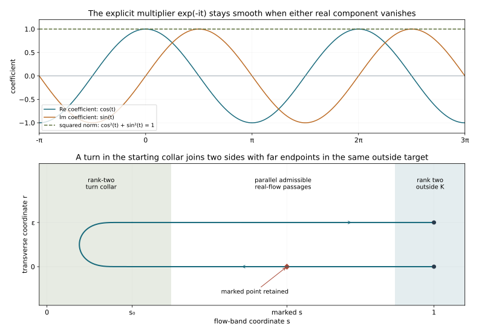

# Trapped characteristics and the escape criterion

The compact-support existence theorem uses a two-ended escape arc through every characteristic point. We now relate that condition to complete characteristic curves and two-dimensional leaves. The compactness argument retains an oriented tangent as well as a point. The rank-two argument retains actual real Hamilton curves rather than assuming that an arbitrary path in a collapsed quotient has a regular lift.

The antecedent is Hörmander IV, Theorem 26.11.1 and Definition 26.11.4, printed pages 161 and 163 of the 2009 eBook, ISBN 978-3-642-00136-9. We state the stationary-point convention explicitly. With a definition of one-dimensional bicharacteristics requiring nonzero tangent, a stationary singleton must be listed separately as an obstruction. It is not a regular curve.

This is an independent receiving proof. Exact earlier geometry, quotient, flow and operator proofs are recorded in the proof map.  Original expression and figures are CC0-1.0; linked components retain their own terms. Human foundations remain external.

## 1. The criterion, with stationary points explicit

**H0. Characteristic sets and completeness.** Let \(p\) be the smooth homogeneous principal symbol of a scalar classical operator of real order \(m\), on \(T^*X\setminus0\), and assume condition (P) in the all-multiplier sense CPG:H0. Set
\[
 N=\{p=0\},\quad N_{\rm crit}=\{p=0,\ dp=0\},\quad
 S=N_2^e,\quad R=N\setminus(N_{11}\cup S).
 \tag{TC1}
\]
Here \(N_2\) is the rank-two set, \(S\) its semibicharacteristic saturation, and \(N_{11}\) the escaping rank-one set, with the exact definitions CPG:T0–C0. The two-dimensional leaves are the maximal connected integral leaves of \((TS)^\omega\).

A regular one-dimensional bicharacteristic has nonzero real tangent complex-proportional to \(H_p\), and lies in \(N\). Complete means maximal as an unparametrized characteristic, including its homogeneous lift; it does not mean completeness of an arbitrarily chosen vanishing speed. A stationary point of \(N_{\rm crit}\) is recorded separately as a stationary singleton.

For compact \(K\subset X\), let \(E(K)\) denote the full two-ended regular semibicharacteristic escape condition ERS:H0. Define \(T(K)\) by
\[
 \begin{array}{ll}
 {\rm (a)}&N_{\rm crit}\cap T^*_KX=\varnothing,\\
 {\rm (b)}&\text{no complete regular one-dimensional characteristic in }R
                   \text{ stays over }K,\\
 {\rm (c)}&\text{no two-dimensional characteristic leaf stays over }K.
 \end{array}
 \tag{TC2}
\]
The theorem to be proved is \(E(K)\Longleftrightarrow T(K)\). On the regular characteristic locus, (b)–(c) are the two trapping alternatives in the source. If stationary singleton obstructions are included in the word “complete,” (a) is already included; our notation makes that convention visible.

**H1. Necessity.** An escape arc cannot pass through \(dp=0\), because every \(H_{\operatorname{Re}(qp)}\) is then zero. A regular semibicharacteristic through a point of \(R\) stays on its unique characteristic line until it leaves \(N\) or reaches the saturation; either event would put the initial point in \(N_{11}\) or \(S\). Thus it remains on that complete rank-one characteristic. A trapped such characteristic has no permitted escape endpoint.

Similarly, a semibicharacteristic in \(S\) stays in its two-dimensional leaf, by CPG:S1–L0 and SN:F0–F3. If that whole leaf projects into \(K\), neither endpoint can leave \(K\) or \(N\). Therefore \(E(K)\) implies all three parts of \(T(K)\).

## 2. Normalize a real line without choosing an arbitrary phase

**N0. The positive homogeneous normalization.** Choose the smooth positive degree-one cotangent norm \(\nu\) of KS:G0 and put \(p_1=\nu^{1-m}p\). On \(N\),
\[
                   H_{p_1}=\nu^{1-m}H_p.
 \tag{TC3}
\]
The factor is positive, so characteristic lines, real orientations and base projections are unchanged. The degree-one field descends to a smooth complex field \(v=A+iB\) on the positive cosphere bundle \(Q=S^*X\).

Take a smooth metric near the compact unit bundle over \(K\). One explicit construction sums local Euclidean metrics with nonnegative chart partition weights positive in total. Positivity is immediate on each nonzero tangent vector. The unit tangent bundle over a compact subset is compact: finitely many coordinate charts give uniform equivalence with Euclidean norms, and the usual finite-dimensional compactness applies.

At a regular rank-one point, \(A\) and \(B\) span the projected real line. If both vanish, the full nonzero Hamilton line is radial. Its positive ray is characteristic by homogeneity, and every regular real multiplier field through it stays on that ray by flow uniqueness. It can neither meet \(N_2\) nor leave \(N\). Its lift \(\rho=e^t\rho_0\) is a complete regular characteristic over one base point. Thus it lies in \(R\), and violates (TC2b) over \(K\).

At rank two, both projections cannot vanish, because two independent real Hamilton vectors cannot both be radial. Together with (TC2a), this proves
\[
 |A|^2+|B|^2\ge d^2>0
                   \quad\text{on }N\cap Q|_K.
 \tag{TC4}
\]

**N1. The actual multiplier from a point and an oriented tangent.** At a nonradial rank-one point let \(W\) be either oriented unit vector of the projected line. Define
\[
 c(q,W)=
 \frac{\langle A,W\rangle-i\langle B,W\rangle}{|A|^2+|B|^2}.
 \tag{TC5}
\]
Write \(A=aW\), \(B=bW\). Then \(v=(a+ib)W\), and (TC5) gives \(cv=W\), with \(|c|=(a^2+b^2)^{-1/2}\). This formula is smooth on the oriented line data. It does not require a continuous argument of \(a+ib\).

The full field \(cH_{p_1}\) is real as well: the full Hamilton fields have real rank one, and their nonzero projected line fixes the same complex scalar. In coordinates \((q,\rho)\) determined by the norm, its radial component satisfies
\[
 \frac{d}{dt}\log\rho=b_0(q,W),\qquad
 b_0=cH_{p_1}(\log\nu)|_{\nu=1}\in\mathbb R.
 \tag{TC6}
\]
On compact oriented line data this is bounded. Hence a projected curve defined for all finite times has the genuine homogeneous lift
\[
 \rho(t)=\rho(0)\exp\!\left(\int_0^t b_0(q(s),W(s))\,ds\right).
 \tag{TC7}
\]
Neither zero fiber length nor infinite fiber length occurs in finite normalized time. The projected speed is one, so the lift has nonzero tangent.

## 3. A trapped half-curve yields a forbidden complete curve

**L0. Keep the tangent in the compactness argument.** Suppose \(\gamma:[0,\infty)\to Q|_K\) is a unit-speed rank-one characteristic, with \(p=0\), and assume (TC4). Choose \(t_j\to\infty\). Compactness of the unit tangent bundle gives a subsequence with
\[
                (\gamma(t_j),\gamma'(t_j))\longrightarrow(q_0,W_0).
 \tag{TC8}
\]
The full rank-one condition is closed: all two-by-two minors of the real and imaginary full Hamilton fields vanish on the unit section. At the limit the rank is not zero and the projection does not vanish, by (TC4).

Near any such limit point one of \(A,B\) has norm at least \(d/\sqrt2\). Normalize that real field to unit length in a slightly larger coordinate neighborhood. On a rank-one curve its orientation is one of the two fixed signs. The limiting tangent in (TC8) selects that sign. For all sufficiently large \(j\), each translated curve \(\gamma(t_j+t)\), while in this neighborhood, is an integral curve of this same smooth signed field.

Choose an inner coordinate neighborhood. The unit-speed bound gives a common short time interval on which those curves stay in the outer neighborhood. G2:NF1–NF4 gives convergence of their flows and first derivatives on that interval, from the convergent initial point and tangent. The limit remains characteristic and rank one by the closed conditions above.

Finitely many such inner neighborhoods cover the compact characteristic unit set over \(K\). Their admissible flow times have a positive common lower bound, and their coordinate derivatives have a common finite upper bound. Continue the limiting curve in successive intervals of that length. At an overlap the tangent fixes the next sign and uniqueness gives the same continuation. On every fixed \([-T,T]\), all sufficiently large \(j\) have \(t_j>T\), so the translated curves exist there. This yields a complete unit-speed projected rank-one curve \(\gamma_\infty:\mathbb R\to Q|_K\). The finite-chart construction proves the limit rather than inferring it from convergence of positions alone.

**L1. The limiting curve belongs to the persistent set.** Lift \(\gamma_\infty\) by (TC5)–(TC7). This is a complete regular one-dimensional characteristic over \(K\).

It cannot meet \(S\). If it did, the definition of the saturation would give a finite regular semibicharacteristic from \(N_2\) to a point on it. Its terminal rank-one part follows the same unique line. The projected length of this compact accessing arc is finite. The complete limiting curve would therefore reach the boundary of that rank-one part in finite unit time. At that boundary the accessing real field is still regular and nonradial; normalize it in a neighborhood. Flow uniqueness makes the two curves agree across the boundary, where rank-two points occur arbitrarily close. This contradicts the fact that the limiting curve has rank one at every time.

The same argument excludes \(N_{11}\): a compact access arc with a noncharacteristic endpoint would force the complete rank-one curve to reach and cross its characteristic boundary in finite normalized time. A radial point cannot furnish either kind of access, by N0. Thus the limiting curve lies in \(R\), and contradicts (TC2b).

Consequently, under \(T(K)\), no infinite unit-speed rank-one half-curve can remain over \(K\).

**L2. The two uses of the half-curve conclusion.** At a point outside \(S\), prolong the rank-one germ in either direction while it stays characteristic and over \(K\). It cannot reach \(S\) at a finite regular endpoint: the local flow preserving \(S\), and its inverse, would put the preceding points in \(S\). It cannot reach \(dp=0\) over \(K\), by (TC2a), and cannot have a radial projected endpoint, by N0. If its maximal characteristic interval ends at a regular point, the local real flow continues; either it becomes noncharacteristic, or the rank-one interval continues.

Thus each direction either gives an endpoint outside \(K\) or a nearby noncharacteristic endpoint, or continues for infinite normalized time over \(K\). The last alternative is impossible by L0–L1. The two retained branches join on their common regular germ. Extend the multiplier on the compact embedded arc by the finite-chart cutoff construction: on the characteristic part use (TC5), and at an entering or exiting end keep the original regular real multiplier. On common rank-one germs the real coefficients have the same strict sign, so their interpolation remains nonzero, as in CPG:S0. This proves \(E(K)\) at every point of \(N\setminus S\).

The same conclusion applies to a missing end of a rank-one interval in \(S\). If that interval has activity on only one side and the other direction stayed over \(K\) forever, L0–L1 would again give a forbidden complete characteristic in \(R\). It must therefore reach the complement of \(K\) in finite normalized time.

## 4. The active part of a leaf is connected

**A0. Whole fibers and one positive face.** Let \(B\) be a two-dimensional leaf of \(S\). Write \(B_{\rm act}\) for the points on semibicharacteristic intervals with both endpoints in \(N_2\). DAQ:Q0–I0 proves that this is open, and its reduced quotient is a surface with compact whole fibers. A rank-one fiber is its maximal compact zero interval, with activity on both sides; rank-two fibers are singletons.

We need connectedness, not just local charts. At any \(x\in B\), the definition of \(S\) and CPG:T1–S0 give a factor tube from a rank-two time face to a neighborhood of \(x\). On the leaf its coordinates are \((t,r)\), with a real vertical flow and nonnegative coefficient \(h(t,r)\); one fixed time face has \(h>0\) for every retained \(r\). All active points in a sufficiently small central part of this tube belong to the same connected component of \(B_{\rm act}\): join such a point vertically to the positive face. If it is rank one, its activity on the other side of its whole zero interval makes every point of the joining segment active. The positive face itself is a connected small rank-two interval.

This component does not depend on the accessing tube. For an active \(x\), two tubes have a common active neighborhood at \(x\). For an inactive \(x\), its zero interval has only one direction of finite rank-two access. Both accessing tubes follow that same unique rank-one germ toward its finite activity boundary. Their open domains contain the common boundary point and rank-two points arbitrarily close to it. Those common active points identify the two components. This argument includes infinitely many intervening zeros; it does not assume that the positive set has finitely many components.

The component assigned in this way is locally constant on \(B\), since the same positive-face tube works for all points near its central point. The leaf \(B\) is connected by SN:F3. Hence the assignment has one value. Every component of \(B_{\rm act}\) contains rank-two points, by its whole-fiber charts, so there can be only one component. Thus \(B_{\rm act}\) is connected, and its reduced surface is connected as well.

**A1. Actual corridors between whole-fiber charts.** We record the elementary path construction needed below. In the coordinates DAQ:Q1–Q2, a whole-fiber chart is
\[
 W=\{(t,x(t,X)):t_-<t<t_+,\ X\in J\},
 \qquad \operatorname{Re}w(t,x(t,X))=X ,
 \tag{TC9}
\]
with \(h>0\) on both time faces. The curves with \(X\) fixed are actual regular real Hamilton curves. Indeed DAQ:Q1 gives
\[
 x_t=-h\,\frac{\operatorname{Im}w_x}{\operatorname{Re}w_x}.
 \tag{TC10}
\]
For the leaf field \(\partial_t+ih\partial_x\), this is the real part of the nonzero multiplier
\(1+i\,\operatorname{Im}w_x/\operatorname{Re}w_x\). The \(t\) component is one. The coordinate signs may both reverse under the intrinsic convention; regularity and the argument are unchanged.

Inside either positive-face collar, all tangent directions in the leaf are real parts of nonzero complex multiples of \(H_p\). Two vertical passages can therefore be joined there by a regular curve. Choose distinct \(X\) values for the passages and a simple connector in the collar. Corners can be rounded without making the tangent zero: choose their two directions with angle less than \(\pi\); convolution of the piecewise linear parametrization near the corner has derivative a convex average of these directions, which cannot vanish. It agrees with the straight pieces outside the rounding neighborhood. A prescribed turn of \(\pi\) uses the smooth turn constructed in X3.

Two open saturated whole-fiber charts that meet contain a common rank-two point. Their intersection contains the whole fiber of a shared point. At a nontrivial fiber its endpoints have positive activity arbitrarily close on the outer sides, and the intersection is open there. At a rank-two singleton the assertion is immediate.

It follows that points in a connected active component can be connected by finitely many such corridors, with joins in rank-two collars. Here are the separation details needed to obtain a single embedded regular arc. Choose a finite chain of whole-fiber chart domains along a compact coordinate path; use a shortest subchain between the required end neighborhoods. Nonadjacent domains of that subchain do not meet, or the chain could be shortened. In each domain use the two vertical passages and one positive-collar connector just described, choosing its endpoint in the neighboring rank-two overlap.

Resolve an overlap of consecutive pieces by keeping the first piece up to their last intersection and the second piece after it. The two retained open pieces are disjoint. If the join is rank two, round it in a small rank-two disk. If it is on a collapsed fiber, both pieces traverse that whole fiber; move the join along its common real-flow passage to a positive collar. A small parallel passage in that flow tube separates the two retained traces until they join in the collar. Such a tube is the map \(F_s(z_r)\) of a transverse interval under the regular real flow. Its local derivative is invertible, and compactness of the embedded central passage makes it injective for one sufficiently small width. The passage and its parallel copy are therefore disjoint.

All these replacements stay in the overlap of the two saturated domains. Overlap regions for distinct consecutive pairs are disjoint, since nonadjacent domains are disjoint. There are finitely many replacements and they create no new intersections with the other pieces.

To preserve the marked point, reserve its initial passage in a small closed quotient disk \(D\), disjoint from the target neighborhood. Take the initial rank-two end close to the lower end of the marked fiber, pass vertically through that whole fiber, and continue to a rank-two point on the other side whose image lies outside \(D\). Such rank-two points occur arbitrarily close on that side; choose the disk radius between the inner and outer selected image distances. The part up to and through the marked point lies inside \(D\), and the outgoing vertical image leaves \(D\) only once.

Choose every subsequent corridor outside \(D\). This is possible by the elementary disk-detour argument on the reduced surface: in a coordinate path with endpoints outside a slightly larger coordinate disk, replace the portion from its first entry to its last exit by a circle arc on that larger disk's boundary. The result avoids \(D\). Whole-fiber preimages of these chart domains are disjoint from the reserved part. Thus any trimming in a later overlap occurs after the marked point and cannot discard it.

This gives an embedded regular admissible arc through the marked fiber, with its first end in a rank-two collar and its last end in the chosen rank-two target neighborhood. If the marked point is rank two, extend its initial segment a little so the point is interior.

The construction uses real flows throughout the zero intervals. It does not assert that an arbitrary parametrized curve in the reduced surface has a differentiable inverse lift.

**A2. A band and a turn give two target endpoints.** Let \(L:[0,1]\to B_{\rm act}\) be the embedded regular arc from A1, through the marked point, with its two ends rank two and its last end in an open target set \(Y\subset N_2\). There is a narrow band about \(L\) whose constant transverse-coordinate curves are still admissible. Use each of the finitely many vertical real-flow passages in A1 as one piece, even if its coefficient has infinitely many zeros. On such a passage use the exact transverse coordinate of its real flow tube. On the rank-two connectors, extend that transverse vector to a smooth field transverse to \(L\), keeping the prescribed field on the adjoining collars. A finite partition preserves transversality: choose the same side along the interval, so the transverse components form one positive open cone and their weighted sum has a nonzero component.

The flow of this transverse field gives
\[
                        \Phi(s,r),\qquad \Phi(s,0)=L(s).
 \tag{TC11}
\]
On every zero-interval passage it agrees with the existing parallel real flows; on the other pieces it remains in \(N_2\), for sufficiently small width. Its derivative is invertible at \(r=0\). One common width gives injectivity: otherwise a sequence of distinct preimage pairs at widths tending to zero would limit to two points of the embedded \(L\) with the same image; these are the same parameter, where the local inverse theorem forbids the collision. Thus (TC11) is an actual embedded band.

Choose \(r=0\) and \(r=\epsilon>0\) as two sides. Their far endpoints lie in \(Y\) by openness. Join their near ends by the smooth nonzero turn X3, inside the rank-two starting collar and before the marked point. The resulting single embedded regular arc passes through the marked point on its original side and has both endpoints in \(Y\).

Along rank-two pieces its tangent uniquely determines a smooth nonzero complex multiplier; along the parallel real-flow pieces use their defining multiplier. These agree on their rank-two collars because they give the same tangent. Extend the resulting multiplier off the embedded compact arc in finitely many coordinate tubes with a partition of unity. Its value is unchanged on the arc, and shrinking the neighborhood keeps it nonzero. The arc is therefore a semibicharacteristic for one smooth multiplier on its whole neighborhood.

## 5. Supply the outside rank-two target

**C0. The only symbol change is outside \(K\).** Suppose first that the marked point \(z\) is active. By (TC2c), its two-dimensional leaf contains a point outside \(K\). If it is already rank two, a small open rank-two neighborhood is the target \(Y\).

If it is rank one, its membership in \(S\) supplies a finite regular accessing arc from \(N_2\). ERS:C0–C1 gives a nonnegative endpoint cap outside \(K\), in a whole homogeneous factor chart:
\[
 \tau+i g h\quad\longmapsto\quad \tau+i g(h+\rho),
 \qquad \rho\ge0,\quad \operatorname{supp}\rho\subset T^*_{X\setminus K}X.
 \tag{TC12}
\]
The coisotropic leaf is unchanged, the marked outside point becomes rank two, and the accessing curve remains regular by the exact real-part multiplier formula in ERS:C1. Old positive faces remain positive. An old compact zero interval can only be split into smaller zero intervals by new positive portions, so the old active part remains active and connected. The new active region joins it through this compact accessing interval with its two positive faces. Thus it contains the original marked point and a rank-two target \(Y\) outside \(K\).

If \(z\in S\) is inactive, there is a finite rank-two access on one side of its zero interval. By L2, its missing side reaches the complement of \(K\) in finite time. Cap that outside terminal point instead. The marked interval now has positive faces on both sides, so \(z\) is active for the modified local field and is connected to the new outside rank-two target. No second cap is necessary.

Only the unchanged whole-fiber charts and the directly verified cap charts are used. Their quotient and corridor constructions depend on these nonnegative factor contracts. As in ERS:L0, no global condition-(P) assertion about unrelated auxiliary curves is being imported.

**C1. Return to the original symbol.** A1–A2 now gives an auxiliary regular semibicharacteristic through \(z\), with both endpoints in \(Y\subset T^*_{X\setminus K}X\). Let \(C\) be the closed conic support of the symbol change. Its base projection is compactly contained in \(X\setminus K\). Keep the central portion of the new arc from \(z\) to the first contact with \(C\) in either direction, or to its original endpoint if there is no contact.

Both retained endpoints project outside \(K\). Before contact the symbols agree on an open neighborhood, and at a boundary contact their first derivatives agree as well: a smooth function zero off its closed support has zero first jet at its boundary. Consequently the original and auxiliary real Hamilton fields coincide on the retained arc, including its endpoints. It is an actual semibicharacteristic of the original symbol, and proves \(E(K)\) at \(z\).

Together with L2, this proves \(T(K)\Longrightarrow E(K)\), and hence the full criterion (TC2).

## 6. Principal type and the completed existence statement

**P0. Apply the criterion on every compact set.** For a properly supported scalar classical operator, call \(P\) of principal type on \(X\) when it satisfies (P) and \(E(K)\) for every compact \(K\subset X\), as in Definition 26.11.4. The criterion proves the equivalent global description: there are no stationary characteristic singletons, no complete regular rank-one characteristic in \(R\) trapped over a compact base set, and no two-dimensional characteristic leaf trapped over a compact base set.

For every compact \(K\), ERS:H1–A1 then gives the complete compact-support index gain and semi-global existence theorem. Its finite-dimensional obstruction is the smooth space \(N(K)=\{v\in\mathcal E'_K:P^*v=0\}\). Compatible \(H^s_{\rm loc}\) data have solutions in every \(H^t_{\rm loc}\), \(t<s+m-1\), near \(K\); compatible smooth data have one smooth solution. SLS:D0–J4 retains all reciprocal orders and the complete smooth quotient argument. No finite Sobolev endpoint estimate is added.

The statement includes the stationary convention of H0 explicitly. [Escape regularity and semi-global solutions](../20261015-escape-regularity-and-solvability/escape-arcs-regularity-and-semiglobal-solutions.html) and [strict-loss solvability](../20261015-strict-loss-solvability/strict-sobolev-loss-and-compact-solvability.html) give the analytic consequences. The global principal-type definition requires escape over every compact set.

## 7. Three solved calculations

**X1. Why stationary singletons cannot be omitted.** On \(T^*\mathbb R^2\), take \(p=\tau^2\). Compute its characteristic geometry.

**Solution.** Its characteristic set is \(\tau=0\), with nonzero total covector. There \(dp=2\tau\,d\tau=0\) and \(H_p=2\tau\partial_t=0\). Thus \(N_2\) is empty and there is no regular rank-one characteristic with nonzero tangent. Nevertheless no regular semibicharacteristic passes through any characteristic point, so \(E(K)\) fails whenever \(K\) is nonempty.

The real symbol satisfies (P), including all complex multipliers. If \(r=\operatorname{Re}(qp)=(\operatorname{Re}q)p\), then
\[
                         H_rp=p\,H_{\operatorname{Re}q}p.
 \tag{TC13}
\]
The scalar linear equation makes \(p=0\) invariant on each real orbit. On \(r=0\) outside \(p=0\), nonzero \(q\) has strictly nonzero imaginary part, whose sign cannot change without reaching \(p=0\) or \(q=0\). Thus no forbidden sign change occurs. Parts (b)–(c) alone would be vacuous for this example, while (a) detects precisely the missing stationary obstruction.

**X2. A rotating phase with zeros in each real component.** Let \(p=e^{it}\tau\). Normalize its characteristic direction along \(\tau=0,\xi=1\).

**Solution.** On that characteristic curve,
\[
 H_p=e^{it}\partial_t,\qquad
 A=\cos t\,\partial_t,\quad B=\sin t\,\partial_t,\quad
 c=\cos t-i\sin t,\quad cH_p=\partial_t .
 \tag{TC14}
\]
The denominator in (TC5) is one. The real component vanishes at odd multiples of \(\pi/2\), but the explicit multiplier is smooth, nonzero and periodic. No unwrapped choice of argument is required. Multiplication by \(e^{it}\) preserves the real-symbol sign condition, and the base coordinate \(t\) gives escape from every compact set on this line.

**X3. A smooth turn with matching straight jets.** Let \(E(s)=e^{-1/s}\) for \(s>0\) and zero otherwise. Define
\[
 \phi(u)=\frac{\pi E(u)}{E(u)+E(1-u)},\quad
 S_0=\int_0^1\sin\phi(u)\,du>0,\quad \lambda=\epsilon/S_0,
 \tag{TC15}
\]
and the curve in band coordinates
\[
 H(u)=\left(s_0-\lambda\int_0^u\cos\phi(v)\,dv,\
                    \lambda\int_0^u\sin\phi(v)\,dv\right).
 \tag{TC16}
\]
Check the two endpoints, regularity and the straight-jet joins.

**Solution.** The denominator is positive on \([0,1]\); the flat-exponential proof PSG:X2 makes \(\phi\) smooth and flat at its constant endpoint values \(0,\pi\). Also \(\phi(1-u)=\pi-\phi(u)\). Hence the cosine integral over \([0,1]\) is zero, while the sine integral is \(S_0\). The endpoints are exactly \((s_0,0)\) and \((s_0,\epsilon)\). Its derivative is
\[
                    H'(u)=\lambda(-\cos\phi(u),\sin\phi(u)),
                    \qquad |H'(u)|=\lambda>0.
 \tag{TC17}
\]
The transverse coordinate is strictly increasing in the interior, so the turn is embedded. All derivatives of its tangent beyond order zero vanish at the endpoints. It therefore joins straight sides with tangent \(-\partial_s\) and \(+\partial_s\), after matching their constant speeds. Its horizontal excursion is at most \(\lambda\), so choosing \(\epsilon\) small keeps the entire turn inside the rank-two collar. This is the smooth regular turn used in A2.

## 8. Read the normalization and the band

**F0. Exact data and the schematic leaf chart.** The first panel illustrates the exact phase normalization in X2: the two component coefficients cross zero, while their squared norm stays one. The second panel uses band coordinates from A2. One side retains the marked point, the two far ends are in the outside rank-two target, and the turn lies in the starting rank-two collar. Its sampled curve is (TC16), with the exact endpoint and nonvanishing assertions proved in X3. The band is a coordinate construction, not a claim about Euclidean distances in the original cotangent bundle.

[Computational material](figures/build_figure.py) accompanies the text. [Escape regularity and semi-global solutions](../20261015-escape-regularity-and-solvability/escape-arcs-regularity-and-semiglobal-solutions.html) and [strict-loss solvability](../20261015-strict-loss-solvability/strict-sobolev-loss-and-compact-solvability.html) give the analytic consequences. The global principal-type definition requires escape over every compact set.
