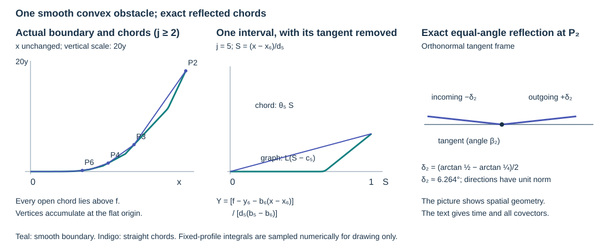

# A flat convex boundary with two characteristic continuations

A smooth convex obstacle can have infinitely many transverse reflections in a finite travel time. At their accumulation point the ordinary ray has contact of every order with the boundary. The reflected continuation and the boundary gliding continuation then pass through the same full characteristic state.

We construct the boundary, the polygon, its exact reflection law and both Hamilton lifts. The construction complements the variable-coefficient example in [Tangency, gliding and generalized characteristic motion](../20261007-restored-generalized-glancing/generalized-glancing-flow-preparation.md), Section 10. Its inputs are the contact-order calculation in that lesson's Section 2, its generalized-arc definition in Section 3, and ordinary smooth calculus and convergent series in the [stationary-phase foundations](../20261004-free-stationary-phase/stationary-phase-and-critical-manifolds.md). The exact earlier proofs are identified in the proof map.

Hörmander III, approved Springer 2007 edition, ISBN 978-3-540-49938-1, Example 24.3.11, printed 438, gives the convex-boundary nonuniqueness phenomenon. The formulas and interpolation below are independently chosen. The book is a valid approved source; its pages are not reproduced.

## 1. Prescribe chords and their reflecting tangents

**D0. A polygon accumulating at the origin.** For integers \(j\ge1\), set
\[
 x_j=\frac1j,\qquad d_j=x_j-x_{j+1}=\frac1{j(j+1)},\qquad
 m_j=2^{-j},\qquad
 y_j=\sum_{\ell=j}^{\infty}d_\ell m_\ell .
 \tag{CB1}
\]
The series converges absolutely. Its tail satisfies
\(0<y_j\le m_jx_j\). Hence \(P_j=(x_j,y_j)\) tends to the origin, and the segment from \(P_{j+1}\) to \(P_j\) has slope exactly \(m_j\). In increasing \(x\), the polygon's slopes increase. Put also \(m_0=1\), and define
\[
 \alpha_j=\arctan m_j,\qquad
 \beta_j=\frac{\alpha_{j-1}+\alpha_j}{2},\qquad b_j=\tan\beta_j .
 \tag{CB2}
\]
If a convex smooth graph through \(P_j\) has derivative \(b_j\) there, its tangent bisects the incoming and outgoing chord directions. The equal-angle reflection law will therefore hold exactly, rather than just asymptotically.

**D1. A uniformly interior interpolation parameter.** Set
\[
 \theta_j=\frac{m_j-b_{j+1}}{b_j-b_{j+1}},\qquad c_j=1-\theta_j .
 \tag{CB3}
\]
The denominator is positive. In fact
\(b_{j+1}<m_j<b_j\), and \(1/9\le\theta_j\le2/3\).
Here are bounds independent of \(j\). Write \(m=m_j\le1/2\).
On \([0,1]\) the derivative of \(\arctan\) lies between \(1/2\) and \(1\); on the corresponding angles the derivative of \(\tan\) lies between \(1\) and \(2\). Applying these bounds to the two half-angle differences gives
\[
 \frac m4\le b_j-m\le m,\qquad
 \frac m8\le m-b_{j+1}\le\frac m2 .
 \tag{CB4}
\]
Taking the ratio of the second gap to the sum proves the assertion. In particular \(1/3\le c_j\le8/9\). This uniform margin is what permits one smooth interpolation profile at every shrinking interval.

## 2. Construct the actual smooth convex graph

**I0. An exact moment profile.** Choose a nonnegative even smooth function \(\kappa\), positive on \((-a,a)\), supported in \([-a,a]\), with integral one, where \(a=1/32\). It can be obtained by normalizing
\(\exp[-1/(1-(u/a)^2)]\) for \(|u|<a\), extended by zero. Every derivative at an endpoint is zero: differentiation produces a rational power of the endpoint distance times the same exponential, and \(v^{-N}e^{-1/v}\to0\). The integral is positive and finite. Define
\[
 K(v)=\int_{-\infty}^v\kappa(u)\,du,\qquad
 L(v)=\int_{-\infty}^v K(u)\,du .
 \tag{CB5}
\]
For \(0\le s\le1\), put \(H_j(s)=K(s-c_j)\).
It is zero near zero, one near one, and nondecreasing. Its exact mean is
\[
 \int_0^1 H_j(s)\,ds
   =\int_{-a}^{a}(1-c_j-u)\kappa(u)\,du
   =1-c_j=\theta_j .
 \tag{CB6}
\]
The exchange of integrals can equally be checked by integration by parts on the compact rectangle; evenness gives the zero first moment. All derivatives of \(H_j\) have bounds depending only on their order, since these are translates of one fixed profile.

**I1. Match values, slopes and every higher derivative.** On \([x_{j+1},x_j]\) prescribe
\[
 \begin{split}
 g(x)&=b_{j+1}+(b_j-b_{j+1})
                   K\left(\frac{x-x_{j+1}}{d_j}-c_j\right),\\
 f(x)&=y_{j+1}+\int_{x_{j+1}}^x g(v)\,dv .
 \end{split}
 \tag{CB7}
\]
Formula (CB6) gives \(f(x_j)-f(x_{j+1})=d_jm_j\), so the endpoint values are exactly \(y_j,y_{j+1}\). Near either endpoint \(g\) is the corresponding constant \(b_j\) or \(b_{j+1}\). Neighboring intervals thus have identical first derivatives and zero derivatives of every order at least two at their shared endpoint. The resulting function is smooth on \(0<x\le1\), has \(f'=g\), and is convex since \(g'\ge0\). Extend it linearly past \(x_1\) with slope \(b_1\).

**I2. Verify smoothness and flatness at the accumulation point.** For every integer \(k\ge0\),
\[
 \sup_{[x_{j+1},x_j]}|g^{(k)}|
       \le C_k 2^{-j}[j(j+1)]^k .
 \tag{CB8}
\]
For \(k=0\), use \(0<b_{j+1}\le g\le b_j\le2m_j\); for \(k\ge1\), differentiate (CB7) and use the uniform profile bounds. The same bound for \(f^{(k+1)}\) tends to zero faster than every power of \(x\), since \(x\ge1/(j+1)\) and \(2^{-j}j^M\to0\) for each fixed \(M\). The latter limit follows, for example, from the ratio of successive terms tending to \(1/2\).

Set \(f(x)=0\) for \(x\le0\). Its value tends to zero, because \(0\le f(x)\le y_j\) on the \(j\)-th interval. The displayed bounds show that each right derivative tends to zero and is \(o(x)\). Inductively the difference quotient at zero gives the next derivative, also zero; on the negative side all derivatives vanish. Thus \(f\) is genuinely \(C^\infty\) and flat at zero. Its derivative is nondecreasing on the whole line, so its convexity persists through zero. No finite-order smoothing or formal series stands in for the actual graph.

## 3. Check the full billiard and wave characteristics

**R0. Chords lie strictly in the permitted interior.** Let
\[
 X=\{(x,y,t):y\ge f(x)\},\qquad \phi=y-f(x).
 \tag{CB9}
\]
Convexity places each chord above the graph. The inequality is strict between its endpoints. Indeed the graph derivative starts below the chord slope \(m_j\), ends above it, and is nondecreasing; the difference between chord and graph therefore first increases and then decreases, returning to zero only at the right endpoint. A nontrivial middle plateau cannot have zero difference, because the initial strict increase has already made it positive.

The unit velocity on chord \(j\) is \(v_j=(\cos\alpha_j,\sin\alpha_j)\). At \(P_j\), reflection in the tangent line of angle \(\beta_j\) takes direction \(\alpha_j\) to \(2\beta_j-\alpha_j=\alpha_{j-1}\). Equivalently it takes \(v_j\) to \(2(v_j\cdot T_j)T_j-v_j\), where \(T_j=(\cos\beta_j,\sin\beta_j)\). Thus it is the exact Euclidean specular reflection. The two normal components are nonzero because \(\alpha_j<\beta_j<\alpha_{j-1}\).

**R1. Use finite arclength as the Hamilton parameter.** Let
\[
 \ell_j=d_j\sqrt{1+m_j^2},\qquad
 s_j=\sum_{\ell=j}^{\infty}\ell_\ell,\qquad
 x_j\le s_j\le\sqrt{5/4}\,x_j .
 \tag{CB10}
\]
The polygon from the origin has finite length to every vertex. On \(s_{j+1}<s<s_j\), take
\((x(s),y(s))=P_{j+1}+(s-s_{j+1})v_j\), and set physical time \(t=s\). For the real homogeneous quadratic symbol
\[
 q(x,y,t;\xi,\eta,\tau)
       =\tfrac12(\xi^2+\eta^2-\tau^2),\qquad
 (\xi,\eta,\tau)=(v_j,-1),
 \tag{CB11}
\]
we have \(q=0\), \(H_q=(\xi,\eta,-\tau;0,0,0)\), and hence precisely the stated unit-speed Hamilton pieces.

At a reflection the tangential covector is unchanged: for the boundary tangent \((1,f'(x),0)\), the two velocities have the same scalar product, while \(\tau=-1\) remains fixed. Their difference is a multiple of \(d\phi=(-f',1,0)\). Thus they are the two distinct characteristic roots in the same boundary fiber. Also
\(H_\phi^2q=1+f'^2>0\), so the required double normal root is nondegenerate at every boundary point, and the boundary is noncharacteristic for the wave operator with symbol \(q\).

**R2. Check the generalized derivative at infinite contact.** On the \(j\)-th chord,
\[
 |v_j-(1,0)|\le C2^{-j},\quad
 |y(s)|\le C2^{-j}x_j,\quad
 |x(s)-s|\le C\,4^{-j}x_j .
 \tag{CB12}
\]
The last estimate follows by summing
\(0\le\ell_\ell-d_\ell\le d_\ell m_\ell^2/2\), including the current partial chord; for that partial chord use \(1-\cos\alpha_j\le m_j^2/2\). Since \(s\) is comparable to \(1/j\) between successive vertices, all three errors are smaller than every fixed power of \(s\). These bounds include both one-sided velocities at each reflection.

For \(s\le0\), continue by \(x=t=s,y=0,\xi=1,\eta=0,\tau=-1\). At zero the positions have derivative \((1,0,1)\) and the covectors derivative zero, including along the accumulating reflected pieces. The limiting full state is
\(q_0=(0,0,0;1,0,-1)\).
Along its ordinary Hamilton orbit, \(\phi(s)=-f(s)\). Flatness of \(f\) proves \(H_q^k\phi(q_0)=0\) for every \(k\); thus \(q_0\in G^\infty\). The gliding field there equals \(H_q\). The resulting reflected arc therefore satisfies the actual generalized-arc definition at its accumulation time. Its reflection times are isolated individually and accumulate only at zero, which is a glancing time, not a transverse reflection.

## 4. Construct the different continuation through the same state

**G0. The boundary arclength lift is a genuine gliding solution.** Parameterize the boundary graph by its signed arclength \(s\), with \(x(0)=0\). The inverse is smooth because
\(ds/dx=\sqrt{1+f'(x)^2}>0\). Set
\[
 y=f(x),\quad t=s,\quad
 \xi=(1+f'^2)^{-1/2},\quad
 \eta=f'(1+f'^2)^{-1/2},\quad \tau=-1.
 \tag{CB13}
\]
It has \(q=0\) and \(H_q\phi=0\). Direct calculation on these constraints gives
\[
 H_q^2\phi=-f''\xi^2,\qquad
 H_q^G=H_q-\frac{f''\xi^2}{1+f'^2}H_\phi,\qquad
 (\xi',\eta')=\frac{f''}{(1+f'^2)^2}(-f',1).
 \tag{CB14}
\]
Differentiating (CB13) with \(x'=(1+f'^2)^{-1/2}\) gives exactly the last formula. Its base derivatives are \((\xi,\eta,1)\), so this is the full restricted Hamilton equation. Where \(f''>0\) the state is strictly gliding; where \(f''=0\) it is in \(G^3\), and the same equation applies. This proves the gliding solution through every interpolation and flat segment.

At \(s=0\) this arc has the same full state \(q_0\) as the reflected arc and agrees with it for \(s\le0\). For every positive chord interval the reflected arc has \(y>f(x)\), whereas this one stays on the boundary. They are different continuations of the same smooth real constant-coefficient wave characteristic problem. Finite-contact uniqueness cannot be extended to all infinite-contact states.

**V0. What the diagram measures.** The left panel shows the actual vertices \(P_j\), straight chords and the smooth convex graph, with vertical coordinates multiplied by the stated factor. The middle panel subtracts the left tangent on the interval \(j=5\) and divides by \(d_j(b_j-b_{j+1})\): the chord is exactly \(\theta_j S\), the graph is \(L(S-c_j)\), and their difference is positive. The right panel uses an orthonormal frame at \(P_2\); its two unit directions have angles \(\pm(\alpha_1-\alpha_2)/2\) to the tangent. Numerical integration is used only to draw the fixed smooth profile; exact mean, convexity, flatness and reflection are proved above. The picture is a spatial section; physical time and covectors are supplied in (CB10)–(CB14).

## 5. Exercises with complete solutions

### Exercise 1. Track the normal reflection gap

For a vertex \(P_j\), compute the incoming and outgoing values of \(H_q\phi\), including their signs. Explain why their magnitudes agree.

**Solution.** Write \(\delta_j=(\alpha_{j-1}-\alpha_j)/2>0\).
Since \(f'(x_j)=\tan\beta_j\),
\(H_q\phi=\sin\alpha-\tan\beta_j\cos\alpha
=\sin(\alpha-\beta_j)/\cos\beta_j\).
The incoming value is \(-\sin\delta_j/\cos\beta_j\), the outgoing value is its positive opposite. Both are nonzero and tend to zero. This is the normal-root exchange for the defining function actually used, rather than a reflection of only the base velocity without its covector.

### Exercise 2. Remove a false finite-order conclusion

Show that the reflected arc approaches the tangent state faster than every algebraic power of time, although it is interior on infinitely many intervals in every positive neighborhood of zero.

**Solution.** On the \(j\)-th interval, \(s\ge1/(j+1)\). Multiplying the bounds (CB12) by \(s^{-N}\) gives at most \(C_N(j+1)^N2^{-j}\), or the still smaller analogous \(4^{-j}\) bound. Each tends to zero by its successive-term ratio. The same applies to the limiting one-sided momenta at the vertices. Yet \(s_j\downarrow0\), and strict chord separation in R0 gives an open interior interval \((s_{j+1},s_j)\) for every \(j\). Infinite-order contact therefore does not imply that the reflected curve equals the boundary curve on a positive neighborhood.

### Exercise 3. Why a linear derivative interpolation fails

Suppose one replaces \(H_j(S)\) by \(S\). Determine the obstruction to keeping both endpoints of the same chord, and explain why the shifted smooth profile fixes it.

**Solution.** Linear interpolation has mean \(1/2\); its total height is \(d_j(b_j+b_{j+1})/2\). The required height is \(d_jm_j\). These agree only if \(\theta_j=1/2\). Here, as \(j\to\infty\), \(b_j/m_j\to3/2\) and \(b_{j+1}/m_j\to3/4\), by differentiability of \(\tan\) and \(\arctan\) at zero. Thus \(\theta_j\to1/3\), and the endpoint error is of the same scale as the height itself. Moreover linear interpolation does not match all higher derivatives at the vertices. The translated fixed profile has exact mean \(\theta_j\) and is constant near both endpoints, simultaneously preserving the chord and every derivative match.

Independent exposition, proofs, exercises, figure and scripts by GPT-6.1 Sol (OpenAI), Ultra, October 2026, dedicated under CC0 1.0 Universal. Linked programme materials retain their recorded terms. The source credit concerns Hörmander III, Example 24.3.11; this construction does not assert approximation of every nonunique generalized arc by transverse broken rays.
