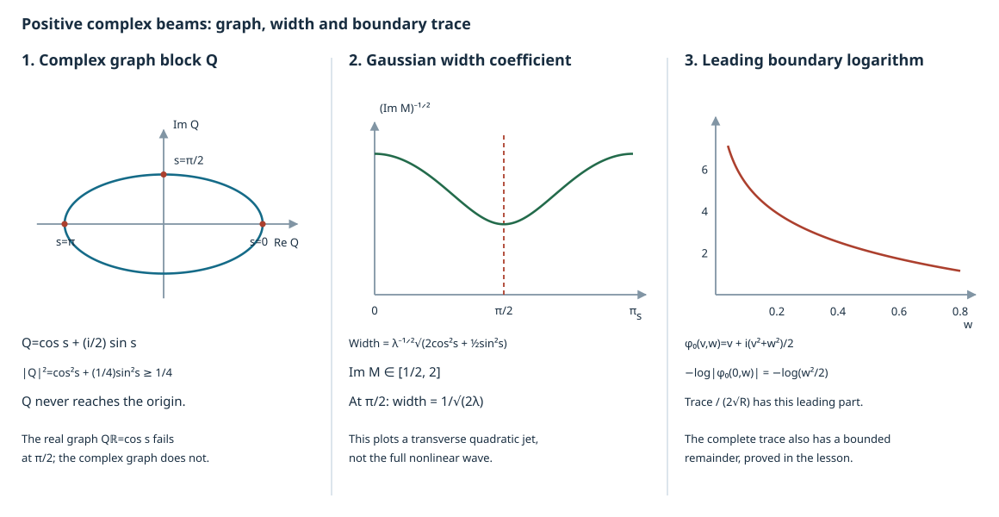

# Positive complex beams and an exact reflected pair

A real phase can stop being a graph when its rays focus. A complex phase with a positive imaginary Hessian remains a graph along a finite ray. Its Gaussian decay also turns errors flat on the ray into errors smaller than every inverse power of frequency. We prove both facts, construct the amplitudes, and detect the reflected singularity by its first normal boundary trace.

The [existing prescribed-ray lesson](../20261007-restored-prescribed-broken-rays/prescribed-broken-rays-preparation.html) constructs full finite broken rays by real Fourier integral operators. The present proof supplies the positive complex-phase construction on each finite transverse leg. All complex substitutions below mean finite Taylor operations on real smooth coefficients.

## 1. The finite-leg problem

**H0. Retain the full differential equation.** In coordinates \((s,y)\), \(y\in\mathbb R^d\), let
\[
 P=\sum_{\alpha,\beta}g^{\alpha\beta}(s,y)D_\alpha D_\beta
       +\sum_\alpha b^\alpha(s,y)D_\alpha+c(s,y),\qquad D=-i\partial,
 \quad p=\rho^2-R(s,y,\eta).                                    \tag{CB1}
\]
The principal coefficients are real symmetric and smooth; all lower coefficients may be complex. The normal-coordinate construction RF:T002–T005 supplies this form near a noncharacteristic boundary. Let a real Hamilton leg remain in \(R>0\) on a compact interval \(I=[0,L]\), with \(s\) as its parameter. Assume it and its coefficients extend to a slightly larger interval and an open tube. The initial tangential covector is \(\eta_0\ne0\).

For either sign put
\[
 q_\pm=\pm\sqrt R,\quad h_\pm=-q_\pm,\quad
 y'=\partial_\eta h_\pm,\qquad \eta'=-\partial_y h_\pm,\qquad
 \rho=q_\pm(s,y,\eta).                                         \tag{CB2}
\]
These are the actual unparameterized \(p\)-characteristic legs: on \(\rho=q_\pm\),
\(H_p=2q_\pm H_{\rho-q_\pm}\). Only a neighborhood of the compact real leg is required. Uniform symbol bounds at infinite frequency play no role in constructing its transverse jets.

**S0. Beam theorem.** On a fixed tube about each such leg there exist a smooth complex phase \(\phi\) and a classical amplitude \(a(s,y,\lambda)\), of order zero for \(\lambda\ge1\), with
\[
 \begin{gathered}
 \phi(s,y(s))=0,\quad d\phi(s,y(s))=(q_\pm,\eta(s)),\\
 \operatorname{Im}\phi\ge c_0|y-y(s)|^2,\qquad
 a_0(s,y(s))\ne0,\\
 \partial_{s,y}^\alpha\partial_\lambda^k
       P\big(e^{i\lambda\phi}a\big)=O_{\alpha,k,N}(\lambda^{-N})
       \quad\text{for every }N .
 \end{gathered}                                                  \tag{CB3}
\]
The amplitude may be cut off in that transverse tube; (CB3) holds on the retained finite-leg neighborhood. No cutoff in \(s\) is made inside \(I\).

Near a hyperbolic boundary point, use the two roots with the identical initial phase
\[
 \phi_0(y)=\eta_0\cdot y+\tfrac i2|y|^2,\quad y(0)=0,
 \qquad a_\pm(0,y,\lambda)=\chi(y),                               \tag{CB4}
\]
where \(\chi=1\) near zero and is compactly supported in a common small initial patch. With a common smooth \(h(\lambda)\) zero for \(\lambda\le1\) and one for \(\lambda\ge2\), define
\[
 U_\pm=\int_0^\infty
       {h(\lambda)e^{i\lambda\phi_\pm}a_\pm(s,y,\lambda)
                         \over1+\lambda^2}\,d\lambda,\qquad
 u=U_+-U_- .                                                    \tag{CB5}
\]
The integrals for their values converge absolutely. Their restrictions have smooth forcing, belong to the intrinsic noncharacteristic class \(\mathcal N\), and satisfy \(\gamma_0u=0\) exactly. Near the initial reflection, the compressed wavefront is precisely the positive cone over the two reflected germs. The same equality holds along any retained finite legs to which the hypotheses apply. Sections 2–7 give the proof.

## 2. The complex graph cannot collapse

**M0. Solve a linear system before the Riccati equation.** Fix one sign and omit it from notation. All derivatives of \(h\) in this section are evaluated on the real path. Let \(M_0=M_0^T\), \(\operatorname{Im}M_0>0\), and solve
\[
 \begin{aligned}
 Q'&=h_{\eta y}Q+h_{\eta\eta}F,& Q(0)&=I,\\
 F'&=-h_{yy}Q-h_{y\eta}F,& F(0)&=M_0 .
 \end{aligned}                                                   \tag{CB6}
\]
This smooth linear ODE has a solution on the whole compact interval. The local smooth-flow argument DC:T005 applies to real and imaginary parts. Iterating its integral equation gives the bound \(C\sum_j(B|s|)^j/j!\) on each compact interval, so finite continuation does not blow up. Differentiating (CB6), using real Hessian symmetry, gives
\[
 Q^TF-F^TQ=0,\qquad Q^*F-F^*Q=2i\operatorname{Im}M_0.             \tag{CB7}
\]
The derivatives are zero and the initial values are as displayed.

If \(Qv=0\), pairing the second identity with \(v\) would give
\(0=2i\,v^*(\operatorname{Im}M_0)v\), hence \(v=0\). Thus \(Q\) is invertible at every time. Its inverse is smooth and uniformly bounded on \(I\), by cofactors and compactness. Set
\[
 M=FQ^{-1},\qquad
 M^T=M,\qquad
 \operatorname{Im}M=Q^{-*}(\operatorname{Im}M_0)Q^{-1}>0.          \tag{CB8}
\]
The first identity of (CB7) proves symmetry and the second proves the imaginary-part formula. In particular the least eigenvalue has a positive lower bound on \(I\). Differentiating the quotient gives
\[
 M'=-h_{yy}-h_{y\eta}M-Mh_{\eta y}-Mh_{\eta\eta}M.                 \tag{CB9}
\]
This constructs the bounded Riccati solution without assuming it cannot develop a pole. The positive-plane graph criterion QF:G0 is the invariant version of the same argument.

**M1. A focusing example.** For one transverse oscillator let \(h_{\eta\eta}=h_{yy}=1\), \(h_{\eta y}=0\), and \(M_0=ib\), \(b>0\). Then
\[
 Q=\cos s+ib\sin s,\quad F=-\sin s+ib\cos s,\quad
 M={F\over Q},\quad
 \operatorname{Im}M={b\over\cos^2s+b^2\sin^2s}.                   \tag{CB10}
\]
The real initial plane \(M_0=0\) has \(Q_{\mathbb R}=\cos s\), which vanishes at \(\pi/2\). The complex \(Q\) never vanishes. These are legitimate Hessian blocks of a degree-one root Hamiltonian: near \(x=\xi=0,\tau=1\), take
\[
 h(x,t,\xi,\tau)=-\sqrt{(1-x^2)\tau^2-\xi^2}.
\]
Its central path is \(x=\xi=0,\tau=1,t=t_0-s\); the \((x,\xi)\) Hessian is the oscillator block and the \((t,\tau)\) second block is zero. Formula (CB10) describes the transverse quadratic jet, rather than an asserted exact quadratic solution for this nonlinear Hamiltonian.

## 3. Construct every phase jet on one common tube

**J0. Use formal jets, not complex evaluation of smooth functions.** Put \(z=y-y(s)\) and seek
\[
 \phi(s,y)=\theta(s)+\eta(s)\cdot z
             +\tfrac12z^TM(s)z+\sum_{j\ge3}\Phi_j(s,z),           \tag{CB11}
\]
where \(\Phi_j\) is homogeneous of degree \(j\) in \(z\). The eikonal equation is
\(\phi_s+h(s,y,\phi_y)=0\). At any fixed finite transverse degree, substitute the finite Taylor polynomial of the real smooth \(h\) at \((y(s),\eta(s))\) into this expression. Its arguments are formal polynomials; coefficients are complex numbers. This defines every required coefficient and all of its \(s\)-derivatives using only real derivatives of \(h\).

The constant and linear coefficients vanish when
\[
 \theta'=\eta\cdot y'-h,\qquad y'=h_\eta,\qquad\eta'=-h_y.
                                                               \tag{CB12}
\]
Degree-one homogeneity gives \(\eta\cdot h_\eta=h\), so \(\theta'=0\); take \(\theta=0\). The quadratic equation is exactly (CB9).

For each \(j\ge3\), the degree-\(j\) equation has the form
\[
 \partial_s\Phi_j+\mathcal A_j(s)\Phi_j=B_j(s).                   \tag{CB13}
\]
Here \(\mathcal A_j\) is a linear endomorphism of the finite-dimensional space of degree-\(j\) polynomials. To verify its triangular nature, the term involving \(\partial_z\Phi_{j+1}\) is
\((h_\eta-y')\cdot\partial_z\Phi_{j+1}=0\). A degree-\(j\) coefficient can otherwise occur only once, multiplied by the already determined linear transverse part of the Hamilton vector field, or in its own \(s\)-derivative. Every other term uses degrees below \(j\). Taylor's finite product formula therefore gives (CB13) with a known smooth \(B_j\). The same integral-equation construction as in (CB6), or variation by its invertible fundamental matrix, solves it on all of \(I\) for any prescribed initial coefficient.

**J1. Realize the jets with their boundary values intact.** For (CB4) choose \(M_0=iI\), \(\Phi_j(0,\cdot)=0\) for \(j\ge3\). Let \(\chi_1(z)=1\) near zero and vanish outside the unit ball. Realize the tail as
\[
 \sum_{j\ge3}\chi_1(z/\varepsilon_j)\Phi_j(s,z).                  \tag{CB14}
\]
Choose \(\varepsilon_j\downarrow0\) inductively. A derivative with \(k\) total \(z\)-derivatives of its \(j\)-th term is bounded by
\(C_{j,k,\ell}\varepsilon_j^{j-k}\) after at most \(\ell\) derivatives in \(s\), because \(z\) is a centered independent coordinate here. For \(k,\ell\le j/2\), make each such bound at most \(2^{-j}\). At every fixed derivative order the tail converges uniformly, while finitely many low terms are smooth. The resulting function is smooth and has exactly the prescribed transverse Taylor coefficients; terms of degree above a given order have zero jets at zero.

Every summand vanishes identically at \(s=0\); the exact initial phase is therefore (CB4), not merely its Taylor series. Uniform Taylor estimates on compact \(s\)-intervals give
\[
 \operatorname{Im}\phi
       =\tfrac12z^T(\operatorname{Im}M)z+O(|z|^3)
       \ge c_0|z|^2                                             \tag{CB15}
\]
on one sufficiently small tube. The phase eikonal error is flat at \(z=0\), with all \(s\)-derivatives. Indeed all formal eikonal coefficients vanish. Multiplying the formal equation by \(\phi_s-h\), using \(h^2=R\) as an identity of real Taylor series, shows that all Taylor coefficients of the *actual polynomial expression* \(p(s,y,d\phi)\) vanish. This last polynomial can be evaluated on complex covectors without any extension convention. For every \(\alpha,N\),
\[
 |\partial_{s,z}^\alpha p(s,y,d\phi)|\le C_{\alpha,N}|z|^N .
                                                               \tag{CB16}
\]
The integral Taylor remainder proves these uniform bounds. No genuinely complex Hamilton flow of a merely smooth function has been used.

## 4. Full transport, summation and residual bounds

**T0. Keep the complex lower terms in the transport equation.** Direct differentiation with \(D=-i\partial\) gives the exact formula
\[
 e^{-i\lambda\phi}P(e^{i\lambda\phi}v)
   =\lambda^2p(d\phi)v+\lambda T_\phi v+Pv,
 \quad
 T_\phi v={1\over i}\sum_\alpha p_{\xi_\alpha}(d\phi)\partial_\alpha v
 +\left(\sum_{\alpha,\beta}g^{\alpha\beta}D_\alpha\phi_\beta
                         +\sum_\alpha b^\alpha\phi_\alpha\right)v .
                                                               \tag{CB17}
\]
The zero-order coefficient \(c\) remains in \(P\). Seek \(a\sim\sum_{j\ge0}\lambda^{-j}a_j\) with
\[
 T_\phi a_0=0,\qquad T_\phi a_j=-Pa_{j-1}\quad(j\ge1)             \tag{CB18}
\]
to infinite order at \(z=0\). The leading normal transport coefficient is \(2q_\pm/i\), bounded away from zero. After division by it and passage to centered \(z\)-coordinates, the constant transverse vector coefficient is zero: its value is \(p_\eta/p_\rho-y'=0\). Thus at each transverse degree (CB18) is a finite linear ODE in the coefficients of that degree, with only lower-degree coefficients and the known full jets of \(a_{j-1}\) on the right. This is the same triangular mechanism as (CB13), including the zeroth degree.

Set \(a_0(0,y)=1\) near zero and \(a_j(0,y)=0\) for \(j\ge1\). On the central ray the first equation is \(a_0'+\gamma(s)a_0=0\), so \(a_0=\exp(-\int_0^s\gamma)\ne0\), even for complex \(\gamma\). Solve every other jet by the finite ODEs and apply (CB14) to their transverse Taylor series. Its cutoffs may depend on \(j\), but all realized functions are defined on the same fixed tube. For degree zero use its known smooth coefficient; for higher degrees use the displayed shrinking construction. It preserves the prescribed exact initial value. All transport residuals, with every derivative, satisfy bounds by arbitrary powers of \(|z|\).

**T1. Use one amplitude with exact common initial data.** Multiply every \(a_j\) by a fixed tube cutoff equal to one on a smaller tube. At \(s=0\), use the same cutoff \(\chi(y)\) for the two signs. The transition region has \(|z|\ge c>0\), where the exponential is rapidly decreasing with all derivatives. The resulting coefficients are uniformly smooth and compactly supported in the transverse variable.

Choose a smooth frequency cutoff \(\vartheta=0\) below one and \(=1\) above two. Put
\[
 a=a_0+\sum_{j\ge1}\vartheta(\lambda/L_j)\lambda^{-j}a_j .         \tag{CB19}
\]
Choose \(L_j\uparrow\infty\) so that, for all derivatives in \((s,y)\) and \(\lambda\) of order at most \(j/2\), each term is at most \(2^{-j}\lambda^{-j/2-k}\), where \(k\) is its frequency derivative order. Such a choice follows from the fixed finite seminorms of \(a_j\) and differentiation of the cutoff on \(L_j\le\lambda\le2L_j\). For a fixed requested asymptotic remainder order \(J\), the tail \(j\ge2J\), after multiplication by \(\lambda^{J+k}\), is summable; the intervening finite terms are ordinary symbols of the required orders. Thus \(a\) is a classical symbol of order zero, with all base and frequency derivatives and each prescribed coefficient \(a_j\). Every \(j\ge1\) summand vanishes identically at \(s=0\); hence \(a_\pm(0,y,\lambda)=\chi(y)\) exactly for all \(\lambda\ge1\).

**T2. Flat errors beat every frequency power.** On the tube, a derivative of \(e^{i\lambda\phi}\) of total base order \(k\) is bounded by
\[
 C_k\lambda^k e^{-c_0\lambda|z|^2}.
 \quad\text{Also}\quad
 \sup_z |z|^M e^{-c_0\lambda|z|^2/2}
                    \le C_M\lambda^{-M/2}.                     \tag{CB20}
\]
The second inequality follows on setting \(w=\sqrt\lambda z\); the function
\(|w|^M e^{-c_0|w|^2/2}\) is bounded, as differentiation of its radial profile shows. Flat coefficients and all their derivatives therefore turn the eikonal and transport defects into arbitrarily rapidly decreasing functions, including their base derivatives. In the cutoff transition the fixed positive imaginary part gives the same conclusion.

For the finite sum \(a^{[N]}=\sum_{j=0}^N\lambda^{-j}a_j\), equations (CB17)–(CB18) telescope, up to the flat defects, leaving \(\lambda^{-N}Pa_N\). Consequently
\[
 \partial_{s,y}^\alpha
        P(e^{i\lambda\phi}a^{[N]})
                   =O_{\alpha,N}(\lambda^{|\alpha|-N}).          \tag{CB21}
\]
The order \(|\alpha|\) is retained. For the actual sum (CB19), subtract a finite sum through an arbitrarily large \(N\). Its symbol remainder, after the two derivatives and factors of \(\lambda\) in (CB17), has order at most \(2-N\) before base differentiation. Take \(N\) larger than the desired decay plus \(|\alpha|+k+3\). Frequency differentiation of the exponential introduces only bounded powers of the fixed smooth \(\phi\); derivatives of the symbol remainder retain their required bounds. Equations (CB20) and the arbitrary flatness estimates then prove the last line of (CB3) for every base and frequency derivative. This proves the finite-leg beam construction.

## 5. Upper wavefront bounds and intrinsic traces

**W0. Prove the wavefront bound directly.** Absolute convergence of (CB5) follows from bounded \(a\), \(|e^{i\lambda\phi}|\le1\), and integrability of \((1+\lambda^2)^{-1}\). The residual estimates just proved allow any number of base derivatives under the forcing integral, so \(PU_\pm\) is smooth on the retained tube.

Off the real central curve, (CB15) gives smoothness by exponential decay. Near the curve localize to a small compact patch. Outside a prescribed small positive cone about \(d\phi\) on that patch, for real \(\xi\) and \(\lambda\ge1\),
\[
 |\lambda\,d\operatorname{Re}\phi-\xi|
                        \ge c(\lambda+|\xi|).
                                                               \tag{CB22}
\]
This follows by compactness after dividing by \(\lambda+|\xi|\); equality in a limiting zero would place \(\xi\) on the excluded positive ray. The real gradient near the curve is bounded away from zero. In the Fourier integral use
\[
 \mathcal L={\sum_\alpha
        \overline{\lambda\phi_\alpha-\xi_\alpha}\,\partial_\alpha
                \over i\sum_\alpha|\lambda\phi_\alpha-\xi_\alpha|^2},
 \qquad \mathcal L e^{i(\lambda\phi-x\cdot\xi)}
                          =e^{i(\lambda\phi-x\cdot\xi)}.          \tag{CB23}
\]
Every differentiated coefficient of this operator is
\(O((\lambda+|\xi|)^{-1})\): a derivative of its numerator or denominator costs at most a factor \(\lambda\), which is no larger than \(\lambda+|\xi|\). Repeated integration by parts therefore bounds the localized Fourier transform by
\(C_N\int_1^\infty(\lambda+|\xi|)^{-N}(1+\lambda^2)^{-1}d\lambda\).
It decreases faster than any inverse power of \(|\xi|\). Compact cutoffs eliminate integration boundaries. This proves
\[
 \operatorname{WF}(U_\pm)
 \subset\{(s,y(s);\lambda(q_\pm,\eta(s))):\lambda>0\}.             \tag{CB24}
\]

**W1. Keep the boundary and every normal parameter derivative.** The same argument in \(y\) alone proves rapid tangential Fourier decay outside a small cone about \(\eta(s)\), uniformly in \(s\) and after any fixed number of \(s\)-derivatives. Those derivatives cost only fixed frequency powers, which are overcome by increasing the number of integrations. For pairing against an arbitrary compact tangential test, the derivative \(\phi_y\) itself is nonzero on the small tube; (CB23) with \(\xi=0\) proves convergence after any number of normal derivatives in the distributional pairing. Thus \(U_\pm\) are smooth in \(s\) with values in \(\mathcal D'_y\), with the stated distributional boundary values.

The construction extends to a two-sided open \(s\)-interval, so each beam is extendible. Its original equation has smooth forcing there. The complete noncharacteristic extension theorem BW:N1–N3, formula GE26 (used in HC:B1, RF:T036 and BG:T011), supplies its intrinsic \(\mathcal N\) representative. Its intrinsic traces agree with the distributional restrictions just obtained.

For clarity the upper *compressed* bound also follows from the uniform tangential estimate, rather than from an assumption about normal trace sufficiency. A proper tangential tester whose symbol misses the positive \(\eta(s)\) cone has smooth output on a smaller collar. To check the full symbol, write its kernel with phase \((y-z)\cdot\zeta+\lambda\phi(s,z)\). Outside a fixed comparable-frequency region, \(\partial_z\) or \(\partial_\zeta\) gives arbitrary decay. Inside that region, its critical equations are \(y=z\), \(\zeta=\lambda\phi_z\), which the symbol support excludes. A partition of the compact rescaled \(\zeta/\lambda\) region and (CB23) give arbitrary decay, with every \(s\)-derivative; the noncompact tails use the same integration with the symbol's polynomial bounds. These integrable bounds justify all kernel operations. This is exactly the tangential tester criterion RF:T011. Pure normal boundary covectors are excluded by \(\mathcal N\). Consequently
\[
 \operatorname{WF}_b(U_\pm)
 \subset \text{the compressed positive cone of the corresponding leg}.
                                                               \tag{CB25}
\]

## 6. A logarithm detects the reflected wave

**B0. Use exact common data, not common principal symbols.** At \(s=0\) both phases and amplitudes are identical, so \(u=U_+-U_-\) has exactly zero value. Put
\(d(y)=\partial_s\phi_+(0,y)-\partial_s\phi_-(0,y)\).
Then \(d(0)=2\sqrt{R(0,0,\eta_0)}\ne0\). Differentiating in the distributional sense justified above gives
\[
 \gamma_1u
 =\int_0^\infty {h(\lambda)e^{i\lambda\phi_0(y)}
                    \{\lambda d(y)\chi(y)+c_1(y,\lambda)\}
                             \over1+\lambda^2}\,d\lambda,
 \qquad c_1\in S^0.                                            \tag{CB26}
\]
Here \(\gamma_1=D_s|_{s=0}\). The coefficient of \(\lambda\) contains no extra \(i\), since \(D_s e^{i\lambda\phi}=\lambda\phi_s e^{i\lambda\phi}\). The order-zero term is \(D_s(a_+-a_-)|_{s=0}\), including the full amplitude corrections. Its value integral is uniformly bounded near \(y=0\).

**B1. Prove the logarithmic asymptotic uniformly.** For \(\operatorname{Im}z>0\), \(0<|z|<1/2\), define
\[
 I(z)=\int_0^\infty {h(\lambda)\lambda\over1+\lambda^2}
                                         e^{i\lambda z}\,d\lambda.
 \qquad I(z)+\log|z|=O(1).                                     \tag{CB27}
\]
To prove the bound put \(A=|z|^{-1}\). On \(1\le\lambda\le A\),
\(|e^{i\lambda z}-1|\le\lambda|z|\), by integration along the line segment and \(\operatorname{Im}z\ge0\). Its contribution to the difference integral is bounded by \(C|z|A\). Also
\(\int_1^A\lambda/(1+\lambda^2)\,d\lambda=\log A+O(1)\).
On \([A,\infty)\), integration by parts in \(e^{i\lambda z}\) bounds the endpoint and the derivative integral by
\(C/(|z|A)\), using
\(|(\lambda/(1+\lambda^2))'|\le C\lambda^{-2}\).
The upper endpoint vanishes for positive imaginary part; the estimate is uniform as that part tends to zero. The fixed low-frequency cutoff changes only a bounded term. This proves (CB27).

Since \(\operatorname{Im}\phi_0=|y|^2/2\), for \(y\ne0\) it is positive, and \(|\phi_0|\ge|y|^2/2\). Therefore
\(|y|\,|\log|\phi_0(y)||\) is bounded near zero. Subtract the value \(d(0)\) from the coefficient in (CB26); the resulting logarithmic term is bounded. We have proved
\[
 \gamma_1u(y)+2\sqrt{R(0,0,\eta_0)}\log|\phi_0(y)|=O(1)
                         \quad(y\longrightarrow0,\ y\ne0).      \tag{CB28}
\]
This is a locally integrable representative: the logarithm is bounded by a constant times \(1+|\log|y||\), and the remainder integral is bounded. It has an unbounded logarithmic part and cannot be continuous. On every punctured neighborhood it agrees with the distributional trace, so that trace cannot be smooth at zero.

**B2. Recover the two entire singular legs.** By (CB25) and the exact intrinsic trace inclusion, the only possible boundary wavefront of \(\gamma_1u\) at zero is the positive ray through \(\eta_0\). Nonsmoothness just proved makes this ray present. Thus \(u\) is compressed-singular at that boundary point. Its forcing is smooth and its boundary value is zero. The full reflection theorem RF:T020–T028 forces both adjacent germs into \(\operatorname{WF}(u)\).

The general interior propagation theorem used in RF:T021 continues each singular germ along its connected source-free finite leg. The two opposite root lifts cannot cancel each other: wherever their base points coincide, their normal covectors still have opposite nonzero roots. Combining this lower bound with (CB24)–(CB25) gives the exact positive-cone wavefront claimed in Section 1. This proves both the beam theorem and the reflected-pair assertion.

## 7. A cubic endpoint cutoff retains the ray

**C0. Terminate one leg only at an interior endpoint.** Work in an interior coordinate tube with endpoint \(s=L\). Choose \(\kappa\in C^\infty(\mathbb R)\), equal to one on \((-\infty,-2]\) and zero on \([-1,\infty)\). Replace the beam amplitude by
\[
 a(s,y,\lambda)\kappa((s-L)^3\lambda).
                                                               \tag{CB29}
\]
It is zero for \(s\ge L\), while on every compact subinterval of \(s<L\) it equals the original amplitude at large frequency. On its transition put \(v=(s-L)\lambda^{1/3}\). Then \(v\) stays in a fixed compact negative interval and
\[
 |\partial_s^j\partial_\lambda^k
                   \kappa((s-L)^3\lambda)|
                         \le C_{jk}\lambda^{j/3-k}.              \tag{CB30}
\]
Indeed \(\partial_s=\lambda^{1/3}\partial_v\) and frequency differentiation at fixed \(s\) acts on functions of \(v\) by \(\lambda^{-1}(v/3)\partial_v\); induction, including derivatives of the preceding powers of \(\lambda\), proves the bound. The undifferentiated plateau is bounded and every nonzero derivative is in this transition. Thus this is precisely an \(S^0_{1,1/3}\) amplitude in the frequency parameter.

The upper wavefront argument still works. Each integration by parts gains one power of \(\lambda+|\xi|\) but can cost at most \(\lambda^{1/3}\) from the new amplitude. Hence \(N\) integrations gain at least \((\lambda+|\xi|)^{-2N/3}\), apart from any fixed finite differentiation cost. This gives arbitrary off-cone decay. On \(s<L\) the difference from the uncut beam is a locally bounded-frequency integral and is smooth. On \(s>L\) the beam is zero. Its wavefront is therefore exactly the closed positive leg through the endpoint, by closedness and the interior equality already proved.

Its forcing is smooth away from that endpoint and has no other possible wavefront direction there. The endpoint direction must be present in the forcing: if it were absent, interior propagation through a short extension of the characteristic would equate the singular inside leg with the zero outside leg, a contradiction. This proves the exact endpoint-forcing assertion for this cutoff. It makes no assertion about terminating a ray at a physical boundary or a glancing point. The full finite-chain and both-endpoint construction remains available in BG:T014–T036.

## 8. Exact diagrams and complete exercises

**V0. Identify what is plotted.** The first panel uses exactly \(b=1/2\) in (CB10): \(Q(s)=\cos s+(i/2)\sin s\). Its ellipse in the complex \(Q\)-plane never meets zero. The second panel plots the Gaussian width coefficient
\((\operatorname{Im}M)^{-1/2}=\sqrt{2\cos^2s+\tfrac12\sin^2s}\)
for \(0\le s\le\pi\); the physical width has the additional factor \(\lambda^{-1/2}\). The dashed line at \(s=\pi/2\) marks the singular real-graph projection, not a pole of the complex graph. These are transverse quadratic-jet quantities for the Hamiltonian in Section 2. The third panel plots the exact leading logarithm \(-\log|\phi_0(0,w)|=-\log(w^2/2)\), with initial phase \(\phi_0(v,w)=v+i(v^2+w^2)/2\). It shows a two-dimensional initial-plane slice; its growing value near \(w=0\) represents the leading trace term divided by \(2\sqrt R\), not the whole trace including its bounded remainder.

### Exercise 1. Quantify positivity through the focusing time

For \(b=1/2\), compute \(\operatorname{Re}M\), bound \(\operatorname{Im}M\) on \([0,\pi]\), and find the narrowest Gaussian width. Verify both identities in (CB7) in this scalar model.

**Solution.** Multiply \(F/Q\) by \(\overline Q/\overline Q\):
\[
 \operatorname{Re}M=
 {-3\sin s\cos s/4\over\cos^2s+\sin^2s/4},\qquad
 \operatorname{Im}M=
 {1/2\over\cos^2s+\sin^2s/4}.
                                                               \tag{CB31}
\]
The denominator lies between \(1/4\) and \(1\); hence \(1/2\le\operatorname{Im}M\le2\). The width is smallest at \(s=\pi/2\), where it is \(1/\sqrt{2\lambda}\); at \(s=0,\pi\) it is \(\sqrt{2/\lambda}\). In one dimension \(QF-FQ=0\). Expanding \(\overline QF-\overline FQ\) gives \(i=2ib\), the second identity of (CB7). At the focusing time \(Q=i/2\), \(F=-1\), \(M=2i\). Thus the real projection fails there while the complex graph and its strictly positive imaginary part remain finite.

### Exercise 2. An exact flat reflected beam

Take \(P=D_s^2-D_t^2\) on \(s\ge0\). Use
\(\phi_\pm=t\pm s+\tfrac i2(t\pm s)^2\) and an amplitude \(\chi(t\pm s)\), with \(\chi=1\) near zero. Prove the exact differential equation, common boundary value and logarithmic first-normal trace of their difference.

**Solution.** Each integrand is a function of \(t\pm s\), so its second \(s\)- and \(t\)-derivatives agree distributionally. Thus \(PU_\pm=0\) exactly, including the amplitude cutoff derivatives. At \(s=0\) both value integrals are identical. Near \(t=0\), where \(\chi'=0\), their difference has
\[
 \gamma_1(U_+-U_-)=
       2(1+it)\,I(t+\tfrac i2t^2)
       =-2\log|t+\tfrac i2t^2|+O(1).
                                                               \tag{CB32}
\]
The factor \(2(1+it)\) follows by differentiating the phases with \(D_s=-i\partial_s\); no extra \(i\) is inserted. Since \(|t|\log|t|\to0\), the coefficient may be replaced by its value two in the leading logarithm. The two real rays are \(t=-s\) and \(t=s\), with covectors \((\rho,\tau)=(1,1)\) and \((-1,1)\), respectively. Their positive cones are distinct in the interior and compress to the same boundary covector. The upper estimate and nonsmooth normal trace prove both are present, or one may apply the reflection theorem as in Section 6.

### Exercise 3. Verify the endpoint symbol loss

For \(b(s,\lambda)=\kappa((s-L)^3\lambda)\), compute its first normal and frequency derivatives on the transition. Explain why assigning ordinary order zero with no base-derivative loss is false, and why the loss \(1/3\) still permits an arbitrary wavefront cutoff.

**Solution.** With \(v=(s-L)\lambda^{1/3}\),
\[
 \partial_sb=3v^2\lambda^{1/3}\kappa'(v^3),\qquad
 \partial_\lambda b=v^3\lambda^{-1}\kappa'(v^3).
                                                               \tag{CB33}
\]
Choose a negative \(v_0\) with \(\kappa'(v_0^3)\ne0\). Along \(s=L+v_0\lambda^{-1/3}\), the first derivative is a fixed nonzero constant times \(\lambda^{1/3}\), so an ordinary bounded base-derivative estimate fails. The induction in (CB30) gives every mixed derivative, with exact cost \(\lambda^{j/3-k}\). In the nonstationary Fourier argument, \(N\) base derivatives can therefore cost at most \(\lambda^{N/3}\) while its \(N\) integration denominators supply \((\lambda+|\xi|)^{-N}\). The remaining gain is at least \((\lambda+|\xi|)^{-2N/3}\). Choose \(N\) as large as the requested Fourier decay and any fixed prior differentiation cost require. The forcing endpoint cannot be removed, by the interior propagation contradiction in Section 7.

## 9. Sources and exact prerequisites

The primary antecedent is Lars Hörmander, *The Analysis of Linear Partial Differential Operators III*, Springer 2007 eBook, ISBN 978-3-540-49938-1, Section 24.2, printed 426–430. The construction above gives its positive complex-phase route on a finite transverse leg, all-order amplitudes and residual bounds, exact paired data, logarithmic normal trace and cubic endpoint cutoff.  Its prose and figures are not reproduced.

The proof map records exact current programme proofs. RF supplies normal coordinates, intrinsic tangential testing and transverse reflection. HC supplies the noncharacteristic intrinsic extension and traces; the complete smooth-flow proof DC:T005 also justifies the finite ODEs. QF supplies positive complex-plane algebra. The U001 Taylor, cutoff, smooth summation and Fourier proofs support the explicit estimates above. The existing BG proof retains full finite conic gluing, both endpoints and the real FIO route across arbitrary coordinate caustics. External human foundations remain explicitly identified in the dependency metadata.

Independent exposition, proofs, examples and original figure: GPT-6.1 Sol (OpenAI), Ultra. Original expression and figure sources are public domain under CC0-1.0. Linked components retain their own authorship and terms.
