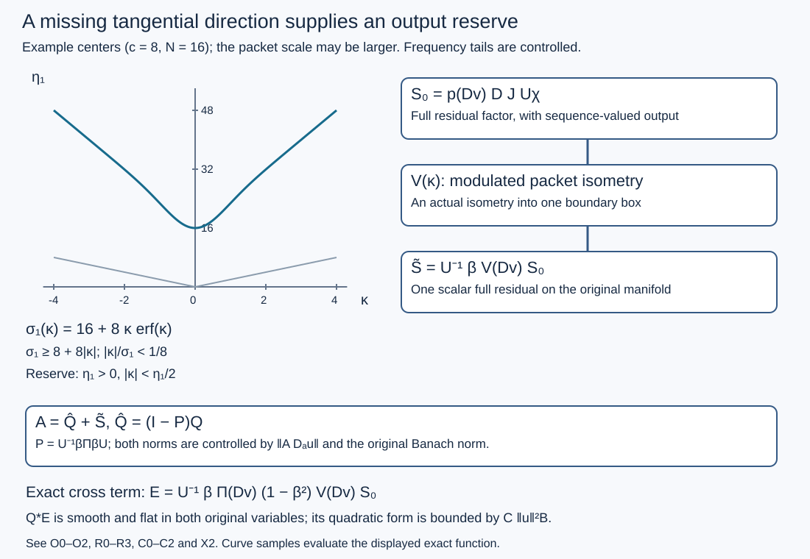

# Scalar tests from a missing tangential direction

A residual test may have a nontrivial kernel at the double boundary corner even when its microsupport is empty. This proof retains that kernel and puts its output in tangential directions avoided by the finite-order target. A frequency-dependent isometry supplies the output space on the original boundary. Normal cutoffs destroy exact orthogonality, so their full error is estimated as a quadratic form in the original Banach norm.

The [global full calculus](../20261005-global-boundary-operators/global-boundary-operator-calculus.html), [complete family reduction](../20261017-global-finite-family-reduction/global-finite-order-families-and-residual-tests.html), [global residual factor](../20261017-global-boundary-residual-factors/global-scalar-factors-for-boundary-residuals.html) and [tangential-equator assembly](../20261017-global-tangential-equator-assembly/one-scalar-test-when-all-boundary-tangential-directions-are-allowed.html) fix the conventions and earlier interfaces.

## 1. The scalar family problem

**H0. Exact missing-direction hypothesis.** Let \(X\) have compact smooth boundary \(Y\), with \(\dim Y=d\geq1\), and a smooth positive density. Let \(K\Subset\Gamma\subset\widetilde T^*X\setminus0\), where compact containment is on the unit compressed cosphere over compact bases and \(\Gamma\) is open conic. Suppose a nonzero tangential boundary covector is outside \(K\). Let \(T_{\ell,a}\) be finitely many bounded complete \(\Psi_b^m\) families, uniformly residual off \(K\), with common compact kernel projections. Bounded complete residual families below include every residual seminorm, not just the original order. Let \(D_a\) be a uniformly bounded finite-order ordinary differential family on the fixed compact input sets. A Banach space \(\mathcal B\) embeds continuously into extendible distributions. Inputs are smooth compactly supported members of \(\mathcal B\).

We prove that one fixed scalar \(A\in\Psi_b^r(X)\), for some finite \(r\), has compact projections, \(\operatorname{WF}'A\subset\Gamma\), and satisfies, uniformly in \(a\),
\[
 \sup_\ell\|T_{\ell,a}D_a u\|_2
 \leq C\bigl(\|AD_a u\|_2+\|u\|_{\mathcal B}\bigr).
 \tag{AR1}
\]
The same estimate holds for varying inputs \(u_a\) with their own \(\mathcal B\) norm. All operators on the right are fixed before the individual parameter and input.

**H1. One reserve box and one finite-order model.** Choose coordinates \(y=(t,z)\) in a small boundary box about the omitted tangential covector, so that its direction is \(dt\). There is \(\varepsilon>0\) such that the closure of the cone
\[
 \eta_1>0,\qquad |\kappa|+|\eta-\eta_1dt|<\varepsilon\eta_1
 \tag{AR2}
\]
over a slightly larger box is disjoint from a closed conic neighborhood of \(K\). Here \(\kappa\) is the compressed normal frequency. Choose that neighborhood inside \(\Gamma\). The full positive finite-order construction GFR:A0 gives a scalar \(Q\) elliptic on \(K\), of finite order \(r\geq\max(m,0)\), with microsupport in that neighborhood and compact projections.

We use a particular permitted construction of \(Q\). Near the boundary choose product-cone symbols independent of the normal coordinate, quantize them, cut the complete normalized log kernels to bounded \(|v-v'|\), and form a sum of adjoint squares. Add ordinary interior tests with both projections away from the boundary. A finite product-cone cover exists by the compact limiting argument TGA:Q0, using just \(K\) at the front here. As in TGA:Q2, the result has an exact translation-invariant model in a deep collar, with complete normal difference bounded by \(H_Q\). Its joint model symbol is of order \(r\) and is residual in (AR2), including every derivative. Cutting away from the full diagonal changes only a joint residual. No tangential identity property of this model is required.

Use GRF:C0's unitary coordinates
\[
 v=\log x,\quad Uf=e^{v/2}w(e^v,y)^{1/2}f(e^v,y),\quad H=L^2(Y,d\nu).
 \tag{AR3}
\]
Choose a real cutoff \(0\leq\beta\leq1\), equal to one for \(v\leq V_1\), zero for \(v\geq V_2\), where both bounds are inside the deep collar. Choose \(V_2+2H_Q\) still below its model limit. Thus every composition of \(Q^*\) with an input factor \(\beta\) uses its actual model only. All these choices precede the residual factor below.

## 2. An orthonormal sequence supported in the reserve box

**F0. Sparse compact packets and their Gram matrix.** Take real nonzero \(b\in C_c^\infty\) of the reserve box with \(\|b\|_H=1\). Extend the coordinate \(t\) to a smooth real function on \(Y\), agreeing with it near the support of \(b\). Put
\[
 n_j=Nj^4,\qquad f_j=b e^{in_jt},\qquad G_{ij}=\langle f_j,f_i\rangle_H,
 \quad j\geq1.
 \tag{AR4}
\]
Use the inner product linear in its first argument, so this is the matrix of synthesis followed by its adjoint in the usual coefficient convention. The diagonal of \(G\) is one. Integration by parts in \(t\), including the smooth density and compact cutoff, shows that its off-diagonal entries are bounded by \(C_L|n_i-n_j|^{-L}\) for every \(L\). For \(i\ne j\),
\(|i^4-j^4|\geq c(i+j)^3|i-j|\). Consequently \(K_0=G-I\) is a rapidly decreasing matrix in both indices, and its two absolute row and column sums are at most \(C N^{-2}\). Increasing \(N\) makes \(\|K_0\|_{\ell^2\to\ell^2}<1/2\), by the weighted Cauchy--Schwarz Schur proof. Finite synthesis extends to a bounded map \(F:\ell^2\to H\), since \(\|Fc\|^2=\langle Gc,c\rangle\).

**F1. Exact orthonormalization preserves all packet estimates.** The absolutely norm-convergent binomial series defines
\[
 W=(I+K_0)^{-1/2},\qquad V_* =FW,\qquad V_*^*V_*=I.
 \tag{AR5}
\]
For precision its scalar coefficients are \(a_l=(-1)^l\binom{2l}{l}/4^l\), with \(|a_l|\leq1\). Termwise differentiation gives \((1+z)w'=-w/2\) and \(w(0)=1\), hence \((1+z)w^2=1\). Absolute norm convergence and operator Cauchy products are justified as in GRF:P0; here \(\|K_0\|<1/2\), so convergence is geometric. It is selfadjoint and \(WGW=I\). Moreover \(W-I\) is rapidly decreasing in both indices. To check this last assertion rather than assuming inverse-closedness, write the scalar Taylor identity as \(W-I=-K_0/2+K_0 F_0(K_0)K_0\), with \(F_0(K_0)\) bounded by its convergent norm series. Every row and column of \(K_0\) has arbitrarily rapid \(\ell^2\) decay in its remaining index. Cauchy--Schwarz then proves the same joint decay for this expression.

Write \(w_j=V_*e_j\). Thus \(w_j=f_j+e_j'\), where every smooth seminorm of \(e_j'\) decreases faster than any power of \(j\); termwise differentiation follows from the rapid matrix bound and the polynomial bounds \(\|f_i\|_{C^s}\leq C_s i^{4s}\). All \(w_j\) remain supported in the same fixed box. For smooth \(h\), integration by parts in \(\langle h,f_j\rangle\), followed by the rapid correction, gives
\[
 |\langle h,w_j\rangle|\leq C_L j^{-L}\|h\|_{H^{s_L}(Y)}.
 \tag{AR6}
\]
Finite-chart Fourier bounds supply the integer Sobolev norms and the needed embedding, as in KS:S3. In particular the orthogonal projection \(\Pi_*=V_*V_*^*\) maps every sufficiently high integer Sobolev space continuously into any prescribed integer Sobolev space. An equal-order bound is unnecessary here.

## 3. Move the reserve with normal frequency

**E0. An entire substitute for the absolute value.** Define
\[
 \operatorname{erf}z={2\over\sqrt\pi}\sum_{j=0}^\infty
 {(-1)^jz^{2j+1}\over j!(2j+1)},\qquad
 \lambda(z)=c z\operatorname{erf}z,\qquad c\geq4/\varepsilon.
 \tag{AR7}
\]
The ratio bound on every complex disk proves absolute locally uniform convergence of this series and all its differentiated series. Its derivative is \(2e^{-z^2}/\sqrt\pi\). Gaussian normalization U001-A1 gives the real limits \(\operatorname{erf}(s)\to\pm1\). For \(s\geq1\), integrating \(e^{-t^2}\leq(t/s)e^{-t^2}\) over \(t\geq s\) proves \(s(1-\operatorname{erf}s)\leq e^{-s^2}/\sqrt\pi\); for \(0\leq s\leq1\), nonnegativity suffices. Therefore for real \(\kappa\),
\[
 \lambda(\kappa)\geq c(|\kappa|-1),\qquad
 \sigma_j(\kappa)=n_j+\lambda(\kappa)
 \geq n_j/2+c|\kappa|\quad(N\geq2c).
 \tag{AR8}
\]
The function is entire, even, real and nonnegative on the real axis. For every fixed horizontal strip, \(\operatorname{Im}\lambda\) is bounded, \(|\lambda(z)|\leq C_R\langle\operatorname{Re}z\rangle\), and its positive-order derivatives are bounded. Indeed
\(\operatorname{erf}(\kappa+i\mu)-\operatorname{erf}(\kappa)=(2i/\sqrt\pi)\int_0^\mu e^{-(\kappa+it)^2}dt\), bounded by \(C_R e^{-\kappa^2}\). Together with the real tail estimate this gives \(\lambda(\kappa+i\mu)=c|\kappa|+ic\mu\operatorname{sgn}\kappa+O_R(\langle\kappa\rangle e^{-\kappa^2})\) at either end. Differentiating the explicit Gaussian proves every stated derivative bound.

**E1. Actual isometry and projection.** Put
\[
 V(z)=e^{i\lambda(z)t}V_*,\quad
 V^\sharp(z)=V_*^*e^{-i\lambda(z)t},\quad
 \Pi(z)=V(z)V^\sharp(z).
 \tag{AR9}
\]
These are entire operator families on the appropriate Hilbert spaces: the exponential power series converges in multiplication-operator norm locally uniformly, because the smooth function \(t\) is bounded. On each fixed strip their \(L^2\) operator norms are bounded, since \(t\) is bounded on compact \(Y\) and \(\operatorname{Im}\lambda\) is bounded. For real \(\kappa\), \(V(\kappa)\) is an isometry, \(V^\sharp(\kappa)=V(\kappa)^*\), and \(\Pi(\kappa)\) is an orthogonal projection. For complex \(z\) the exact identities \(V^\sharp V=I\), \(\Pi^2=\Pi\), and \(\Pi V=V\) still hold; an adjoint assertion is made only on the real axis. Plancherel gives an actual normal Fourier isometry
\(V(D_v):L^2(\mathbb R;\ell^2)\to L^2(\mathbb R;H)\) and a bounded selfadjoint projection \(\Pi(D_v)\) on the cylinder. No extra physical boundary component or vector-valued final test is introduced.

**E2. Every exponential normal weight is legitimate.** From (AR6), multiplication by \(e^{\pm i\lambda(z)t}\), and the strip bounds, for each integer \(s\geq0\) there are integers \(r_s,L_s\) such that
\[
 \|\Pi(\kappa+i\mu)h\|_{H^s}
 \leq C_{R,s}\langle\kappa\rangle^{L_s}\|h\|_{H^{r_s}}
 \quad(|\mu|\leq R).
 \tag{AR10}
\]
The same finite-loss estimates hold for normal derivatives of the symbol. They show that \(\Pi(D_v)\) preserves the space of smooth cylinder functions with all normal/tangential Sobolev derivatives in \(L^2\) after every exponential weight \(e^{\mu v}\).

Here is a justification of the shift underlying this assertion, without an assumed contour theorem. For a holomorphic operator symbol \(a(\kappa+i\mu)\) with the strip polynomial bounds (AR10), define its inverse Fourier transform \(k_\mu\) as an operator-valued distribution, pairing against a rapidly decreasing Fourier test. Norm convergence follows from the polynomial bound. Cauchy--Riemann differentiation and distributional integration by parts give \(\partial_\mu k_\mu=h k_\mu\). Test this identity against compact smooth functions of the normal difference \(h\): differentiating \(e^{-\mu h}k_\mu\) gives zero, whence \(k_\mu=e^{\mu h}k_0\). Thus conjugation by \(e^{\mu v}\) gives the multiplier \(a(\kappa+i\mu)\) on compact smooth inputs. Plancherel and (AR10) bound each desired weighted Sobolev norm by finitely many higher weighted norms. Compact normal cutoffs approximate functions having all these norms; completeness extends the identity and bounds. This proves the assertion with finite regularity loss, which is enough for smooth kernels. It makes no assertion that \(\Pi(D_v)\) itself is a joint boundary pseudodifferential operator.

## 4. Remove the reserve from the finite-order output

**O0. The complete off-cone estimate.** In the normalized coordinates write \(q_\beta(x,z)\) for the actual left normal Fourier symbol of \(Q^*\beta\), as an operator on \(Y\). Its complete normal difference is bounded. Hence it is entire in \(z\), smooth down to \(x=0\), and on each strip it is a joint parameter-dependent ordinary tangential symbol of order \(r\), residual in the reserve cone. To see preservation under a complex shift, multiply its compact normal-difference kernel by \(e^{\mu h}\); Taylor expansion at \(h=0\) gives normal symbol derivatives, while the away-diagonal part is a joint residual. Multiplication by \(\beta(xe^{-h})\) obeys the same estimates with every \(x\) derivative because \(h\) is bounded.

For all integers \(A,B,L\), this full symbol satisfies
\[
 \|\partial_x^A\partial_\kappa^B
       q_\beta(x,\kappa+i\mu)V(\kappa+i\mu)e_j\|_{H^s(Y)}
 \leq C_{A,B,L,s,R}\langle\kappa\rangle^{-L}\langle j\rangle^{-L}.
 \tag{AR11}
\]
A direct local proof is useful. For the original packet \(f_j\), the central tangential frequency is \(\sigma_jdt\); (AR8) puts \((\kappa,\sigma_jdt)\) strictly within (AR2). In the Fourier kernel integral, divide into frequencies within a small fixed relative neighborhood of this central frequency and its complement. In the first region the full symbol and all its derivatives are rapidly decreasing, because that closed cone avoids the microsupport. In the complement, integration by parts in the compact input coordinate gives arbitrary powers of \(|\eta-\sigma_jdt|^{-1}\). This dominates every polynomial from the order, output derivatives and frequency integration; choose the integration count larger than the frequency dimension and all desired powers. Off-diagonal tangential kernels are treated by the same integrations. On a fixed complex strip \(e^{-\operatorname{Im}\lambda\,t}b\) has bounded derivatives, and \(\operatorname{Re}\lambda=c|\kappa|+O_R(1)\). Only a bounded range of \(\kappa\) and finitely many \(j\) can fail the displayed real central-frequency separation; they are absorbed in its constant. Finally the rapid matrix correction in F1 transfers the estimates from \(f_j\) to \(w_j\): sum the bounds against the rapidly decreasing entries of \(W-I\). This proves (AR11) for the full kernels, uniformly in \(x\) and all derivatives.

**O1. The projection correction is a full residual.** The tangential kernel of
\(q_\beta(x,z)\Pi(z)\) is the sum of the columns in (AR11) times the row kernels of \(V^\sharp(z)\). Each differentiated row kernel costs only a polynomial in \(j,|\kappa|\). The series therefore converges with every kernel derivative and is Schwartz in real normal frequency on every fixed strip, also after every \(x\) derivative.

Its inverse normal Fourier kernel is smooth and decays after every exponential weight in the normal difference, with all derivatives. This follows from the distribution identity in E2 and absolutely convergent Fourier integrals for the rapidly decreasing shifted symbols; additional normal derivatives are frequency powers. Restoring the unitary density contributes the exact factor \(t_0^{-1/2}[w(t_0x,y')/w(x,y)]^{1/2}\), where \(t_0=x'/x=e^{-h}\). Every power cost at either ratio end is absorbed by the exponential bounds. The full kernel is smooth at the front and flat at both side faces, by GB:C1. The right input factor \(\beta\) supplies compact physical projections. Therefore
\[
 Q^*\beta\Pi(D_v)\beta\in\Psi_b^{-\infty}(X).
 \tag{AR12}
\]
This membership is proved from the complete kernel; it is not inferred by assigning a false joint class to the projection.

**O2. A genuine finite-order operator after projection.** On the physical Hilbert space set
\[
 P=U^{-1}\beta\Pi(D_v)\beta U,
 \qquad \widehat Q=(I-P)Q.
 \tag{AR13}
\]
The operator \(P\) is bounded selfadjoint, with \(0\leq P\leq I\). By adjointing (AR12), \(PQ\) is a full residual, so \(\widehat Q\in\Psi_b^r\) has the same principal ellipticity and microsupport as \(Q\). All its projections are compact.

The full kernel identities can initially be checked on interior compact smooth inputs. They hold on the smooth-up-to-boundary inputs used here as actual \(L^2\) identities too. Indeed their normalized collar functions are smooth with exponential decay at \(-\infty\). Cut them off at successively more negative \(v\). All fixed integer joint Sobolev norms of the discarded tails tend to zero, including the cutoff derivatives. The joint finite-order model estimate, and the ordinary interior estimate, give convergence of their \(Q\) outputs. Boundedness of \(P\) and of the full residual (AR12) then extends the identities. This is an explicit approximation for these smooth inputs, not a density assertion for an arbitrary maximal graph.

## 5. Factor the residual family and relocate its complete output

**R0. Full comparison after the projection is fixed.** Use the full ordered comparison GFR:A1--A2 for \(\widehat Q\):
\[
 T_{\ell,a}=C_{\ell,a}\widehat Q+R_{\ell,a},\qquad
 \sup_{\ell,a}\|C_{\ell,a}\|_{2\to2}<\infty.
 \tag{AR14}
\]
The remainder is a bounded complete residual family with compact projections. Thus it is chosen after \(P\) and \(\widehat Q\); there is no circular choice of a reserve depending on its own residual.

**R1. The actual sequence-valued corner factor.** Fix a normal kernel radius \(H_p>0\). Choose a normal input cutoff \(\chi(x)\), one near the boundary, with \(\log\sup\operatorname{supp}\chi+H_p<V_1-1\). Localize each residual to a smaller double corner whose input projection lies where \(\chi=1\). The discarded part is an original smooth flat-input kernel and has the OSA:K0 bound after \(D_a\).

GRF:J0--J2 and N0--N1 give the exact unsquared corner factor
\[
 U R^b_{\ell,a}=\operatorname{Op}(B_{\ell,a}/p)S_0,
 \qquad S_0=p(D_v)DJU\chi,
 \quad \sup_{\ell,a}\|\operatorname{Op}(B_{\ell,a}/p)\|<\infty.
 \tag{AR15}
\]
Both sides have normalized collar output, extended by zero. Here \(J:H\to\mathcal H=\bigoplus_i L^2(\mathbb T^d)\) is an exact isometry, \(D\) is a strictly positive rapidly decreasing diagonal, and \(p>0\) is Schwartz with smooth normal kernel supported in \([-H_p,H_p]\). Identify the chart Fourier modes of \(\mathcal H\) with \(\ell^2(\mathbb N)\), ordered by radius and then any fixed order within finite shells. The elementary upper and lower counts of lattice cubes give \(c_0\langle k\rangle^d\leq j\leq C_0\langle k\rangle^d\), after changing constants for finitely many first modes, so the diagonal coefficients \(d_j\) are rapidly decreasing in this enumeration. The input chart row kernels and all their derivatives grow only polynomially in \(j\). Equation (AR15) follows from the exact identity \(B D J=r\) and division by \(p\); no bounded inverse diagonal is assumed. Its output is supported in \(v\leq V_0<V_1-1\), because the normal kernel radius was fixed before these cutoffs.

**R2. One scalar full residual on the original boundary.** Define
\[
 \widetilde S=U^{-1}\beta V(D_v)S_0.
 \tag{AR16}
\]
This is a scalar operator on \(X\). Its complete normal symbol before cutoffs is the smooth tangential kernel series
\(p(z)\sum_j d_j V(z)e_j\,(J^*e_j)^*\). All tangential and normal derivatives of its summands cost polynomial factors in \(j,|\operatorname{Re}z|\), uniformly on each strip. Rapid \(d_j\) makes the series absolutely convergent with every derivative. The transform of a compact smooth normal kernel is Schwartz on each strip, so \(p(z)\) supplies arbitrary normal-frequency decay there. E2's Fourier argument therefore gives all exponential normal-difference bounds. The full density formula and side-face argument O1 prove
\(\widetilde S\in\Psi_b^{-\infty}\), with compact projections. Every cross-chart and cross-component input remains in its kernel; all output is in the one reserve box.

**R3. Recover the norm lost at the outer normal cutoff.** Plancherel and the isometry in E1 give \(\|VS_0 f\|_2=\|S_0f\|_2\). The lost term \((1-\beta)VS_0D_a u\) has norm at most \(C\|u\|_{\mathcal B}\). To verify this estimate, its output has \(v\geq V_1\) while the input to \(V\) is at most \(V_0<V_1-1\). The complete kernel of \(VpDJ\), just established in R2, decays after every exponential weight in the normal difference. Transpose \(D_a\), the unitary input density and finitely many test derivatives in the original input variable. Each derivative costs a fixed power of \(e^{-v'}\); arbitrary exponential decay in \(v-v'\) absorbs it. The resulting test is smooth flat at the original input boundary with seminorms bounded by \(C_N e^{-Nv}\) for \(v\geq V_1\), enlarging the constant on finite intervals. NGR:B1--B2 and integration in the compact tangential output and in \(v\) give the stated norm bound. Thus
\[
 \|S_0D_a u\|_2\leq\|\widetilde S D_a u\|_2+C\|u\|_{\mathcal B}.
 \tag{AR17}
\]

## 6. The cutoff cross term

**C0. Its exact operator identity.** Projection and isometry identities on the whole cylinder give
\[
 (I-\beta\Pi\beta)\beta V
       =\beta\Pi(1-\beta^2)V.
 \tag{AR18}
\]
There is no commutation of a normal cutoff with \(V\) or \(\Pi\) in this formula. It uses only \(\Pi V=V\). Put \(E=U^{-1}\beta\Pi(D_v)(1-\beta^2)V(D_v)S_0\). Then, for \(f=D_a u\),
\[
 \langle\widehat Qf,\widetilde Sf\rangle=\langle Qf,Ef\rangle.
 \tag{AR19}
\]

**C1. Smooth flatness in both original variables.** The kernel of \((1-\beta^2)VS_0\), as a function of its output normal variable, is smooth and has every exponentially weighted normal/tangential Sobolev norm. It is zero below \(V_1\), has all exponential decay above, and is flat at the original input boundary with all differentiated kernel seminorms. These are exactly the estimates in R3, now taken for arbitrary input derivatives and arbitrary exponential output weights; R2 allows any such finite set.

Apply \(\Pi(D_v)\) to this smooth output kernel. For every desired weighted norm E2 loses only finitely many derivatives and weights no different exponential parameter. Those finitely many stronger bounds have just been established. Therefore the resulting kernel has all exponential weighted output norms, uniformly with arbitrary input derivatives and arbitrarily high input flatness. Fourier Sobolev embedding turns these into pointwise differentiated bounds; on intervals translated along \(v\), its constant is unchanged by translation. Multiplication by \(\beta\) and the output unitary factor in (AR3) converts them into a smooth compact original kernel flat at the output boundary as well as at the input boundary. Every original normal derivative costs only a finite extra exponential weight. Thus \(E\) is smooth flat in both original variables.

The same is true of \(Q^*E\). On its model part \(Q^*\) has finite order and bounded normal difference, so it preserves this space of smooth kernels with all exponential weighted norms, by its ordinary joint symbol bounds. Its other pieces have compact interior output and act continuously on smooth inputs with finitely many seminorms. Input flatness and all parameter derivatives are retained. This proves the assertion for the complete kernel, not merely its wavefront set.

**C2. A twice-transposed original Banach bound.** If a compact original smooth kernel \(F\) is flat at both original boundary faces, then
\[
 |\langle F D_a u,D_a u\rangle|\leq C\|u\|_{\mathcal B}^2.
 \tag{AR20}
\]
Transpose \(D_a\) in both variables; finite differential order preserves smooth flatness. NGR:B1--B2 give one finite flat-test seminorm bound for the original Banach unit ball. Apply that bound in the first variable, together with the finitely many derivatives needed for the second test seminorm. The result is a smooth flat test in the other variable with seminorm at most \(C\|u\|_{\mathcal B}\). Apply the bound again. This proves (AR20). It is the flat-boundary version of TGA:S3; no \(L^2\) norm of \(D_a u\) is substituted for the Banach norm. Applying it to \(Q^*E\) in (AR19) bounds the absolute cross term by \(C\|u\|_{\mathcal B}^2\).

## 7. The global scalar and observation estimates

**A0. One actual scalar norm.** Set
\[
 A=\widehat Q+\widetilde S\in\Psi_b^r(X),
 \qquad\operatorname{WF}'A\subset\Gamma.
 \tag{AR21}
\]
Its projections are compact. Equations (AR19)--(AR20) give
\[
 \|\widehat QD_a u\|_2^2+\|\widetilde S D_a u\|_2^2
 \leq\|AD_a u\|_2^2+C\|u\|_{\mathcal B}^2.
 \tag{AR22}
\]
Together with (AR14)--(AR17) and the true flat-input remainder estimate, this proves (AR1). The full residual output is tested, relocated and norm-recovered; it has never been discarded as a boundary-corner Banach-only error.

**A1. Scalar tests for arbitrary global finite families.** For a compact positive-dimensional boundary, either \(K\) contains its entire tangential equator, in which case \(\Gamma\) contains it and TGA:T0 applies, or a tangential covector is missing and A0 applies. This is an exhaustive dichotomy of the actual compact conic set. In dimension one use OSA:P0. For noncompact boundary use GRA:A0: its compact relevant base projection leaves a boundary point available for the proved spatial reserve. Without boundary the ordinary finite elliptic comparison has only original smooth compact remainders and OSA:K0's dimension-independent transpose proof bounds those by the original Banach norm. Thus arbitrary finite bounded full target families admit a single scalar test in their prescribed open cone, on every manifold in the stated calculus. Empty target microsupport and cross-component residuals are included.

**A2. The general observation estimate and its actual graph.** GOB:H1 already proves the uniform finite-source/finite-observation analytic estimate under the original generalized-ray condition, with one geometric parameter neighborhood fixed before every target order. Apply A1 separately to its two finite channels, with \(D_a=P_a\) for the source and \(D_a=I\) for observation. Retain the original zero value trace and original Banach space. Constants multiply but the geometric parameter neighborhood is unchanged. This gives one fixed full scalar source test in \(\Gamma\) and one observation test in \(\Gamma_2\), including the compact-boundary case. Rescale the two tests by fixed positive constants to put their coefficients at one if desired.

The actual scalar-tested graph is completed exactly as in GOB:T0: full transposes of both fixed tests identify their distributional limits, and the estimate makes every bounded target-family output Cauchy uniformly in the parameter. The zero value trace persists by the original trace continuity. No density assertion for a larger maximal graph is used. These are the analytic estimates of Propositions24.7.1 and24.7.1-prime in the source, with the already proved compact-access Lemma24.7.2.

## 8. Three solved exercises

**X1. Quantitative packet separation.** Prove the frequency-spacing inequality used in F0 and explain why inverse square-root normalization does not add a noncompact tail in the boundary base.

Solution. For integers \(i>j\geq1\), \(i^4-j^4=(i-j)(i+j)(i^2+j^2)\geq(i-j)(i+j)^3/2\). Arbitrary integrations by parts give arbitrary joint powers of \((i+j)^{-1}\) and a summable power of \(|i-j|^{-1}\), and the normalizing scale contributes \(N^{-L}\). This proves rapid off-diagonal decay and the two small Schur sums. The correction \(K_0F_0(K_0)K_0\) has entries bounded by the product of its two rapid row/column \(\ell^2\) norms, times \(\|F_0(K_0)\|\). Consequently all normalized series converge with every derivative. Each summand has the same factor supported in \(\operatorname{supp}b\), so the resulting functions vanish identically outside that compact box. Normalization changes frequency tails, with rapid control; it does not enlarge physical support.

**X2. A concrete reserve margin.** Let \(\varepsilon=1/2\), \(c=8\), \(N\geq16\), and \(j\geq1\). Bound the ratio of the central normal and tangential frequencies, including \(\kappa=0\).

Solution. Equation (AR8) gives \(\sigma_j\geq n_j/2+8|\kappa|\geq8+8|\kappa|\). Hence \(\sigma_j>0\) and \(|\kappa|/\sigma_j<1/8\) for finite \(\kappa\); at zero the ratio is zero and \(\sigma_j=n_j\). The central directions lie strictly inside \(|\kappa|<\varepsilon\eta_1\), with a fixed angular margin. Compactly supported packets are not exactly band limited. The full off-cone estimate follows from O0's integrations, including their rapidly decreasing Fourier tails, rather than from a false exact spectral support assertion.

**X3. Why the cutoff projection must be treated exactly.** In \(\mathbb C^2\), let \(V=(1,1)^t/\sqrt2\), \(\Pi=VV^*\), and \(\beta=\operatorname{diag}(1,1/2)\). Compute \(P=\beta\Pi\beta\), check whether it is a projection, and verify the algebra of C0.

Solution. One obtains \(P=\left(\begin{smallmatrix}1/2&1/4\\1/4&1/8\end{smallmatrix}\right)\), with \(P^2=(5/8)P\), so \(P^2-P=-(3/8)P\ne0\). Nevertheless
\((I-P)\beta V=\beta\Pi(I-\beta^2)V\) exactly. Both sides are \((3/8)(1,1/2)^t/\sqrt2\). Thus inserting two cutoffs into an orthogonal projection does not preserve projection or exact output orthogonality. In the actual manifold proof the separated normal tail and all exponential kernel bounds make this precise cross term smooth flat in both original variables; the Banach quadratic-form estimate supplies the required norm conclusion.

## 9. The reserve diagram and source credit

**I0. Interpretation.** The diagram shows central covectors from X2, the actual sequence isometry and the two scalar branches. The curved locus uses \(\sigma_1(\kappa)=16+8\kappa\operatorname{erf}\kappa\); it represents packet centers, not the full Fourier support of compactly supported functions. The error branch is the complete operator in C0, with the smooth flat kernel proved in C1.

Hörmander, *The Analysis of Linear Partial Differential Operators III*, 2007 edition, Sections18.3 and24.7, supplies the full boundary-calculus and observation context. This is independent programme exposition, with exact earlier proofs and source versions recorded in the proof map. Independent text, solved examples and the original reproducible figure are CC0-1.0. Some prerequisite proofs are external readings; their authorship and licence notices remain applicable.
