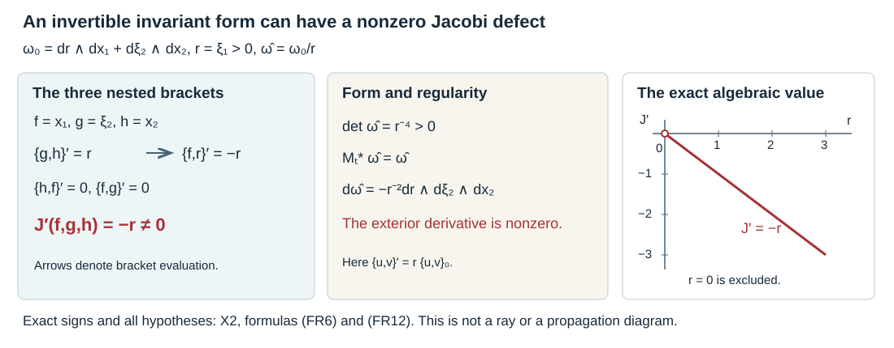

# Finite-regularity forms and conic calculations

Hamiltonian identities can be established before choosing Darboux coordinates. This lets us keep the precise differentiability needed for an exterior derivative, distinguish an invertible alternating form from a closed one, and follow the weights in a conic fold chart.

Mathematical source: Lars Hörmander, *The Analysis of Linear Partial Differential Operators III*, 2007 edition, §21.1, especially Lemma 21.1.5, the homogeneity identities and Example 21.1.11. The exposition and diagram here are independent programme work. The [phase-space lesson](../20261005-restored-phase-space/phase-space-and-generating-families.html), [prescribed coordinates](../20261005-restored-prescribed-coordinates/prescribed-canonical-coordinates-and-isotropic-fibers.html) and [folded forms](../20261005-restored-folded-forms/folded-forms-and-symplectic-targets.html) give the complete smooth coordinate theorems.

## 1. Keep the differentiability in the definition

**D0. Invert a continuously differentiable alternating form.** Let \(M\) be a \(C^2\) manifold and \(\omega\) a nondegenerate \(C^1\) two-form. In a coordinate chart write \(w_{ab}=\omega(\partial_a,\partial_b)\), so \(w_{ab}=-w_{ba}\). For \(f\in C^1\), define \(H_f\) by
\[
 \omega(H_f,V)=-df(V),\qquad \{f,g\}=H_fg.
 \tag{FR1}
\]
The matrix \(w\) is invertible at each point. Its inverse is \(C^1\), by the cofactor formula and the nonzero determinant. Consequently \(H_f\) is continuous for \(f\in C^1\), and is \(C^1\) for \(f\in C^2\). When \(f,g\in C^2\), their bracket is \(C^1\). On a smooth manifold with smooth \(\omega\), the same coefficient formula gives \(H_f\in C^{k-1}\) and \(\{f,g\}\in C^{k-1}\) for \(f,g\in C^k\), \(k\ge1\).

Antisymmetry of \(\omega\) gives \(\{f,g\}=-\{g,f\}\). Linearity and the ordinary first-derivative product rule give bilinearity and
\[
 \{f,gh\}=g\{f,h\}+h\{f,g\}.
 \tag{FR2}
\]
Closedness has not been used in these assertions. In the convention
\[
 \omega_0=\sum_j d\xi_j\wedge dx_j,
 \qquad H_f=\sum_j(f_{\xi_j}\partial_{x_j}-f_{x_j}\partial_{\xi_j}),
 \tag{FR3}
\]
we have \(\{\xi_j,x_k\}=\delta_{jk}\). This follows by substituting the displayed field into (FR1), so it fixes the sign throughout.

**G0. The full conormal bundle is Lagrangian.** Let \(Y\) be a smooth embedded submanifold of a smooth \(n\)-manifold \(X\). Define
\[
 N^*Y=\{(y,\eta)\in T^*X:y\in Y,\ \eta|_{T_yY}=0\},
\]
including the zero covectors. In adapted coordinates \(x=(x_I,x_J)\) with \(Y=\{x_J=0\}\), this set is
\[
 x_J=0,\qquad \xi_I=0,
\]
and \((x_I,\xi_J)\) are its free coordinates. They give a smooth embedded submanifold of dimension \(n\), including at \(\xi_J=0\). Cotangent coordinate changes preserve the annihilator condition, so the local descriptions agree. If \(i:N^*Y\to T^*X\) is inclusion and \(\pi:T^*X\to X\) is projection, then
\[
 (i^*\alpha)_{(y,\eta)}(v)=\eta(d\pi(v))=0,
\]
because \(d\pi(v)\in T_yY\). Thus \(i^*d\alpha=d(i^*\alpha)=0\). Half the ambient dimension together with this vanishing says exactly that \(N^*Y\) is Lagrangian. This proof also covers codimension zero and the zero section; removing zero covectors is a separate convention for homogeneous phases. \(\square\)

## 2. Evaluate the exterior derivative on variable fields

**D1. The \(C^1\) two-form identity.** If \(X,Y,Z\) are \(C^1\) vector fields and \(\omega\) is a \(C^1\) two-form on a \(C^2\) manifold, then
\[
 \begin{split}
 d\omega(X,Y,Z)
 &=X\bigl(\omega(Y,Z)\bigr)+Y\bigl(\omega(Z,X)\bigr)
                         +Z\bigl(\omega(X,Y)\bigr)\\
 &\quad-\omega([X,Y],Z)-\omega([Y,Z],X)-\omega([Z,X],Y).
 \end{split}
 \tag{FR4}
\]
Every term is continuous and uses only the differentiability just specified.

**Proof.** Write \(X=X^a\partial_a\), and likewise for \(Y,Z\); repeated coordinate indices are summed. The coordinate definition of the exterior derivative is
\[
 d\omega(X,Y,Z)=X^aY^bZ^c
       (\partial_a w_{bc}+\partial_b w_{ca}+\partial_c w_{ab}).
 \tag{FR5}
\]
Expand the right side of (FR4) using the first-derivative product rule. The terms differentiating \(w\) give exactly (FR5). For example, the term
\[
 X^a(\partial_aY^b)Z^c w_{bc}
\]
from \(X(\omega(Y,Z))\) cancels the corresponding term from \(-\omega([X,Y],Z)\). The term differentiating \(Z\) in the same expression cancels the \(-X(Z)\) part of \(-\omega([Z,X],Y)\), after using \(w_{bc}=-w_{cb}\). Cyclically permuting \(X,Y,Z\) accounts for the other four field-derivative terms. There are no remaining terms, proving (FR4). Coordinate changes of class \(C^2\) preserve the calculation by the first-derivative chain rule and equality of mixed second coordinate derivatives. Thus the chart calculation defines the asserted identity on \(M\). \(\square\)

## 3. Closedness is exactly the Jacobi condition

**H0. The Jacobi defect with its sign.** For a nondegenerate \(C^1\) form and \(f,g,h\in C^2\), put
\[
 J(f,g,h)=\{f,\{g,h\}\}+\{g,\{h,f\}\}+\{h,\{f,g\}\}.
\]
Then
\[
 J(f,g,h)=-d\omega(H_f,H_g,H_h).
 \tag{FR6}
\]
In particular the bracket satisfies Jacobi for all local \(C^2\) triples if and only if \(d\omega=0\).

**Proof.** In (FR4), set \(X=H_f,Y=H_g,Z=H_h\). From (FR1) and antisymmetry,
\[
 \omega(H_g,H_h)=H_gh=\{g,h\},\qquad
 \omega([H_f,H_g],H_h)=[H_f,H_g]h.
\]
The three differentiations of the first expression sum to \(J\). The cyclic sum of the second expression is
\[
 \sum_{\rm cyc}\bigl(\{f,\{g,h\}\}-\{g,\{f,h\}\}\bigr)=2J,
\]
because antisymmetry changes each negative term into the corresponding cyclic term. Formula (FR4) therefore gives \(d\omega(H_f,H_g,H_h)=J-2J=-J\).

If \(d\omega=0\), this proves Jacobi. Conversely, at any point the differentials of coordinate functions span the cotangent space. Their Hamilton vectors span the tangent space by invertibility of \(w\). Applying (FR6) to coordinate functions shows that every component of \(d\omega\) is zero if Jacobi holds for all \(C^2\) triples. This proves the converse without requiring a Darboux chart. \(\square\)

**H1. The Hamilton commutator at the same regularity.** For \(f,g\in C^2\), the identity before imposing closedness is
\[
 \iota_{[H_f,H_g]}\omega
 =-d\{f,g\}-\iota_{H_g}\iota_{H_f}d\omega.
 \tag{FR7}
\]
Thus a closed form gives \([H_f,H_g]=H_{\{f,g\}}\), as an equality of continuous vector fields.

**Proof.** The identities used here have coordinate proofs involving only first derivatives. For an arbitrary \(C^1\) field \(X\),
\[
 (\mathcal L_X\omega)_{ab}
 =X^c\partial_cw_{ab}+(\partial_aX^c)w_{cb}
                              +(\partial_bX^c)w_{ac}.
\]
The coefficient of \(d\iota_X\omega\) is

\(\partial_a(X^cw_{cb})-\partial_b(X^cw_{ca})\).
Adding the coefficient \(X^c(\partial_cw_{ab}-\partial_aw_{cb}+\partial_bw_{ca})\) of \(\iota_Xd\omega\) cancels the two unwanted derivatives of \(w\), giving the displayed Lie derivative. Hence Cartan's formula holds at this regularity.

For a \(C^1\) one-form \(\beta\), \((\mathcal L_X\beta)_b=X^a\partial_a\beta_b+\beta_a\partial_bX^a\). Expanding this for \(\beta=\iota_Y\omega\) and subtracting \(\iota_Y\mathcal L_X\omega\) leaves
\[
 (X^c\partial_cY^a-Y^c\partial_cX^a)w_{ab},
\]
the coefficient of \(\iota_{[X,Y]}\omega\). For \(g\in C^2\), the same one-form formula gives \(\mathcal L_Xdg=d(Xg)\), using equality of the mixed second derivatives of \(g\).

Apply these formulas with \(X=H_f,Y=H_g\). Since \(\iota_{H_f}\omega=-df\), Cartan gives \(\mathcal L_{H_f}\omega=\iota_{H_f}d\omega\). Also \(\mathcal L_{H_f}\iota_{H_g}\omega=-d(H_fg)\). Substitution proves (FR7). Nondegeneracy gives the stated closed-form conclusion. \(\square\)

## 4. Naturality uses the form, before it uses closedness

**N0. Brackets determine a nondegenerate form.** Let \(F:M_1\to M_2\) be a \(C^2\) diffeomorphism, and let \(\omega_i\) be nondegenerate \(C^1\) alternating forms. Then
\[
 F^*\omega_2=\omega_1
 \quad\Longleftrightarrow\quad
 \{F^*f,F^*g\}_1=F^*\{f,g\}_2
 \tag{FR8}
\]
for all \(C^1\) functions. For the converse it suffices to test the target coordinate functions in every chart.

**Proof.** If the forms agree under pullback, put \(U=(dF)^{-1}(H_f^2\circ F)\). For any \(V\),
\[
 \omega_1(U,V)=\omega_2(H_f^2,dF V)
            =-d(F^*f)(V).
\]
Uniqueness in (FR1) identifies \(U=H_{F^*f}^1\). Acting on \(F^*g\) proves (FR8). Conversely the bracket values on coordinate functions give the bilinear pairing of all coordinate covectors under the inverse alternating matrix. They determine that inverse matrix entry by entry. Equal inverse matrices have equal inverses, so the pulled-back form is \(\omega_1\). Closedness is not needed for either implication. \(\square\)

## 5. Dilation and a nonclosed rescaling

Here a conic manifold has a smooth positive-dilation action and, around every point, a saturated neighborhood equivariantly diffeomorphic to an open cone in \(\mathbb R^N\setminus0\). These are the cone charts used for homogeneous coordinate extensions. In such a chart each positive ray meets the unit sphere once, giving its transverse-slice product. On a cotangent bundle the equivalent dilation acts in the covectors while leaving the base fixed.

**C0. The exact homogeneity law.** On a smooth conic symplectic manifold let \(M_t^*\omega=t\omega\), \(t>0\), and let \(R\) be the generator with logarithmic parameter. For \(C^1\) functions,
\[
 \{M_t^*f,M_t^*g\}=tM_t^*\{f,g\}.
 \tag{FR9}
\]
For \(C^2\) functions, differentiating gives
\[
 \{Rf,g\}+\{f,Rg\}=\{f,g\}+R\{f,g\},\qquad
 [R,H_f]=H_{Rf-f}.
 \tag{FR10}
\]
Consequently a bracket of degrees \(\mu,\nu\) has degree \(\mu+\nu-1\); if \(Rf=\mu f\), then \([H_f,R]=(1-\mu)H_f\).

**Proof.** The same contraction calculation as in N0, with \(F^*\omega=t\omega\), gives
\[
 H_{F^*f}=t(dF)^{-1}(H_f\circ F).
\]
Acting on \(F^*g\) proves (FR9). The first identity in (FR10) follows by differentiating at \(t=1\); the assumed \(C^2\) regularity permits differentiation of the first derivatives defining the bracket. For any \(C^2\) test function \(g\), rearranging this identity gives

\([R,H_f]g=H_{Rf-f}g\).
Coordinate test functions identify the vector fields. The degree assertions follow by substituting \(M_t^*f=t^\mu f\), \(M_t^*g=t^\nu g\) in (FR9), and \(Rf=\mu f\) in (FR10). \(\square\)

If \(T>0\) has degree one, the form \(\widehat\omega=\omega/T\) is nondegenerate and invariant under dilation. Its associated bracket is \(T\{f,g\}\), since its Hamilton field is \(T H_f\). This also proves (FR9) by applying N0 to \(\widehat\omega\). One must keep the distinction in H0: invariance and nondegeneracy do not establish \(d\widehat\omega=0\).

## 6. Three calculations with complete solutions

### Exercise 1. A genuinely \(C^1\) form

**X1. A coordinate change at the stated differentiability.** On \(\mathbb R^2\), take
\[
 a(x)=1+|x|^{3/2},\qquad \omega=a(x)\,d\xi\wedge dx.
\]
Find canonical coordinates of class \(C^2\), and identify the regularity of the form at zero.

**Solution.** The function \(a\) has continuous derivative \(\tfrac32\operatorname{sgn}(x)|x|^{1/2}\), with derivative zero at zero by the difference quotient. Its second derivative on either punctured half-line is \(\tfrac34|x|^{-1/2}\), so \(a\) is not \(C^2\). The form is nondegenerate because \(a\ge1\), and closed because a three-form in two dimensions is zero. Set
\[
 q=x+\tfrac25\operatorname{sgn}(x)|x|^{5/2},\qquad p=\xi.
 \tag{FR11}
\]
Direct differentiation, including the difference quotients at zero, gives \(q'=a>0\), so \(q\) is \(C^2\) and its inverse is locally \(C^2\) by the inverse function theorem and its derivative formula. Then \(dp\wedge dq=\omega\). The displayed \(q\) is not \(C^3\), because \(q'''=\tfrac34|x|^{-1/2}\) away from zero. H0 applies to this \(C^1\) form and \(C^2\) functions without a smoothness assumption on \(a\). \(\square\)

### Exercise 2. An invariant form whose bracket fails Jacobi

**X2. The exact scaled defect.** In \(T^*\mathbb R^2\) on the cone \(r=\xi_1>0\), let
\[
 \omega_0=dr\wedge dx_1+d\xi_2\wedge dx_2,\qquad
 \widehat\omega=\omega_0/r.
\]
Compute the Jacobi expression for \(f=x_1,g=\xi_2,h=x_2\), using the bracket of \(\widehat\omega\).

**Solution.** The bracket is \(\{u,v\}^{\wedge}=r\{u,v\}_0\). Hence
\[
 \{g,h\}^{\wedge}=r,\quad
 \{h,f\}^{\wedge}=\{f,g\}^{\wedge}=0,\quad
 J^{\wedge}(f,g,h)=\{x_1,r\}^{\wedge}=-r\ne0.
 \tag{FR12}
\]
Indeed
\[
 d\widehat\omega=-r^{-2}dr\wedge d\xi_2\wedge dx_2\ne0.
\]
The three Hamilton fields are \(-r\partial_r,r\partial_{x_2},-r\partial_{\xi_2}\). Evaluating the displayed three-form on them gives \(r=-J^{\wedge}\), verifying the sign in (FR6). The form is invariant under positive fiber dilation and remains nondegenerate, since it is a positive multiple of \(\omega_0\). All three facts coexist. \(\square\)

**F0. What the diagram calculates.** The diagram uses the actual cone \(r=\xi_1>0\), the three functions in X2 and the bracket of \(\omega_0/r\). Its arrows are the displayed nested brackets, not Hamilton trajectories. The vertical scale plot is exactly \(J^{\wedge}=-r\); it is an algebraic value at each covector and does not depict propagation. The determinant of the form matrix is \(r^{-4}>0\). The nonzero three-form and X2 prove why this invertible invariant form has a non-Poisson bracket.

### Exercise 3. The half-degree coordinate on a conic fold

**X3. An actual intersection and its inverse chart.** In \(T^*\mathbb R^{n+1}\), \(n\ge2\), restrict to \(\xi_n>0\) and impose
\[
 x_1=0,\qquad
 \xi_1^2=x_1\xi_n^2+\xi_{n+1}\xi_n.
 \tag{FR13}
\]
Find the restricted two-form in folded coordinates and verify its weights and rank hypotheses near \(\xi_1=0\).

**Solution.** The differentials of the two defining functions are independent, since the derivative of the second equation's left-minus-right side in \(\xi_{n+1}\) is \(-\xi_n\ne0\). Thus the intersection is parameterized by \(x_2,\ldots,x_{n+1},\xi_1,\ldots,\xi_n\), with \(\xi_{n+1}=\xi_1^2/\xi_n\). The ambient form restricts to
\[
 \sigma=\sum_{j=2}^n d\xi_j\wedge dx_j
                  +d(\xi_1^2/\xi_n)\wedge dx_{n+1}.
 \tag{FR14}
\]
Define
\[
 q_1=x_{n+1},\quad q_j=x_j\ (2\le j\le n),\quad
 s=\xi_1\sqrt{2/\xi_n},\quad p_j=\xi_j\ (2\le j\le n).
 \tag{FR15}
\]
The inverse has \(\xi_1=s\sqrt{p_n/2}\), \(\xi_{n+1}=s^2/2\), and the unchanged remaining coordinates. It is smooth on \(p_n>0\), and
\[
 \sigma=s\,ds\wedge dq_1+\sum_{j=2}^n dp_j\wedge dq_j,
 \qquad
 \sigma^n=n!s\,ds\wedge dq_1\wedge\bigwedge_{j=2}^n(dp_j\wedge dq_j).
 \tag{FR16}
\]
The top power has a simple zero at \(s=0\). On its tangent hypersurface the \((n-1)\)-st power is the nonzero spectator volume, and the restricted radical is \(\mathbb R\partial_{q_1}\). Under ambient fiber dilation, \(q_j\) have degree zero, \(p_j\) degree one and \(s\) degree \(1/2\). Thus
\[
 R=\tfrac12s\partial_s+\sum_{j=2}^n p_j\partial_{p_j}
\]
is outside that restricted radical, since \(p_n>0\). This verifies all the homogeneous folded-form hypotheses. The requirement \(n\ge2\) makes the distinguished indices \(1,n\) different and supplies a nonzero spectator radial direction. The map \(s\mapsto s^2/2\) is not a coordinate change at zero; (FR15), which retains the sign of \(s\), is the actual chart. \(\square\)

The proof map gives the exact local arguments and earlier programme inputs. Human prerequisites linked by the programme retain their external status and their own terms. Independent programme text and figure: CC0 to the extent rights exist. Exposition, calculations and illustration: GPT-6.1 Sol (OpenAI), Ultra.
