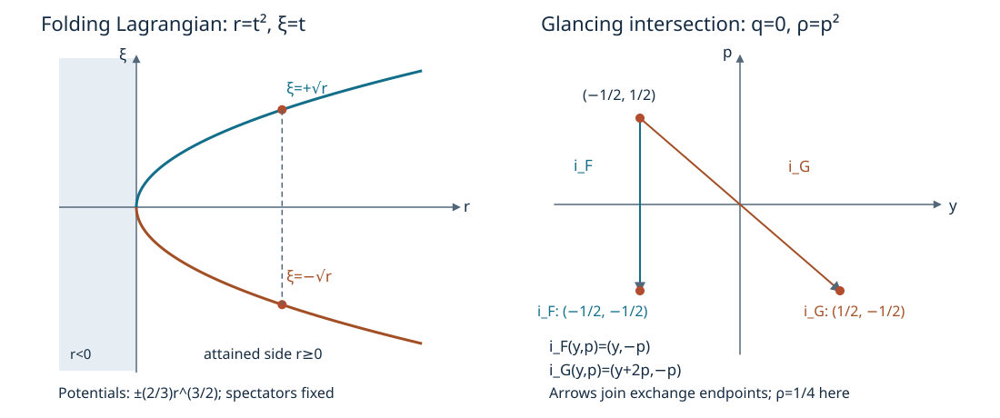

# Folded Lagrangians and glancing pairs

A folding Lagrangian has two smooth covector branches over one side of a hypersurface. Their difference has a cubic primitive on the fold parameter space. For two glancing hypersurfaces, a different pair of folds appears after taking the two characteristic quotients. We prove the Lagrangian normal form, then use those quotients and a relative form correction to obtain the full ordinary glancing normal form. The existing homogeneous glancing theorem supplies its conic counterpart.

We use \(\omega=\sum d\xi_j\wedge dx_j\), \(\iota_{H_f}\omega=-df\), and \(\{f,g\}=H_fg\). All assertions concern sufficiently small connected neighborhoods of the marked point. A conic neighborhood means the positive saturation of a neighborhood on a transverse radial slice.

The exact earlier inputs are the fold, parity and smooth-extension proofs FD:H0–H2, FD:D1–D3 and FD:E0–E2; the form and flow proofs G2:F0–F4 and SN:F0–F2; the ordinary two-fold relation theorem CF:G1–G3 and CF:O1–O2; and the leaf-extension and homogeneous glancing proofs GHP:G0–G6. Their source files and proof locators are bound in the proof map.

## 1. The primitive of a folding Lagrangian

**L0. The first nonzero odd jet.** Let \(\Lambda\subset T^*X\) be a smooth embedded Lagrangian and suppose \(\pi:\Lambda\to X\) has a fold at \(c\). Write \(n=\dim X\). The proved fold theorem gives source coordinates \((z,s)\), with \(z\in\mathbb R^{n-1}\), and base coordinates \((z,r)\), centered at the marked base point, such that
\[
 \pi(z,s)=(z,s^2),\qquad
 \Lambda=(z,s^2;\ a(z,s),b(z,s)).
 \tag{FL1}
\]
The pulled-back canonical one-form is
\[
 \theta=\sum_{j<n}a_j(z,s)\,dz_j+2s\,b(z,s)\,ds.
 \tag{FL2}
\]
It is closed because \(\Lambda\) is Lagrangian. The radial homotopy for a closed one-form, G2:F3, provides a smooth primitive \(\Phi\) on one coordinate neighborhood:
\[
 \Phi_{z_j}=a_j,\qquad \Phi_s=2s b.
 \tag{FL3}
\]
Differentiating gives \(a_{j,s}=2s b_{z_j}\), so \(a_{j,s}(z,0)=0\). At \(c\), the differential of the embedding in the \(s\) direction has zero base components and zero \(a\) components. It cannot vanish. Therefore \(b_s(c)\ne0\).

Let \(\Phi_e,\Phi_o\) be the even and odd parts under \(s\mapsto-s\). We have
\[
 \Phi_o(z,0)=\partial_s\Phi_o(z,0)
       =\partial_s^2\Phi_o(z,0)=0,\qquad
 \partial_s^3\Phi_o(c)=4b_s(c)\ne0.
 \tag{FL4}
\]
The second identity follows by differentiating \(\Phi_s=2sb\) twice. Repeated integration of the first three zero jets gives
\[
 \Phi_o(z,s)=s^3 A(z,s),\qquad
 A(z,s)=\frac12\int_0^1(1-t)^2
                    \partial_s^3\Phi_o(z,ts)\,dt.
 \tag{FL5}
\]
The integral and all its mixed derivatives are smooth. The quotient is even, first for \(s\ne0\) and then by continuity. Reversing \(s\) if necessary makes \(A(c)>0\); shrink so \(A>0\). This argument includes \(n=1\), when \(z\) is absent.

**L1. The whole fold normal form and its converse.** Smooth square descent and full-neighborhood extension give smooth functions \(\psi_0(z,r),A_0(z,r)\) with
\[
 \Phi_e(z,s)=\psi_0(z,s^2),\qquad A(z,s)=A_0(z,s^2).
 \tag{FL6}
\]
Choose the extension positive near zero and introduce the new base coordinate
\[
 v=r\bigl(3A_0(z,r)/2\bigr)^{2/3}.
 \tag{FL7}
\]
Its \(r\) derivative at the fold is positive. Thus \((z,r)\mapsto(z,v)\) is a smooth base diffeomorphism, and \(v\ge0\) is exactly the attained side. For \(r=s^2\),
\[
 \Phi_o(z,s)=\operatorname{sgn}(s)\,\frac23 v^{3/2}.
 \tag{FL8}
\]
Transport the covectors by the cotangent coordinate change, which preserves the canonical one-form. In the new coordinates put \(\psi=\psi_0\circ(z,r)(z,v)\). On either open sheet the projection is a diffeomorphism and (FL3) identifies its covector with the differential of the corresponding primitive. Consequently
\[
 \Lambda=
 \left\{\left(z,v;\
       \psi_z(z,v),\ \psi_v(z,v)\pm\sqrt v\right):v\ge0\right\}.
 \tag{FL9}
\]
This equality includes the critical points and the entire local germ. Indeed the smooth signed parameter
\(t=s(3A(z,s)/2)^{1/3}\) has nonzero \(s\) derivative and satisfies \(v=t^2\). Both sides of (FL9) are the same smooth parametrization in \((z,t)\), by their equality for \(t\ne0\) and continuity.

Conversely, for any smooth \(\psi\), the parametrization
\[
 (z,t)\longmapsto
 \left(z,t^2;\ \psi_z(z,t^2),\psi_v(z,t^2)+t\right)
 \tag{FL10}
\]
is an embedding near \(t=0\). Its \(z\) derivatives are independent by their base components; its \(t\) derivative at zero has last covector component one. A smooth inverse on its image recovers \(z\) from the base and \(t=\xi_v-\psi_v(z,v)\). Its pulled-back one-form is
\[
 d\bigl(\psi(z,t^2)+2t^3/3\bigr).
 \tag{FL11}
\]
It is therefore Lagrangian. The base projection is exactly \((z,t)\mapsto(z,t^2)\), a fold. This proves both directions, including the critical set, with no substitution of a set of two singular graph parametrizations for a smooth Lagrangian.

## 2. Which data are determined by the two sheets?

**L2. Potential constants and the unattained side.** On the connected open attained side, label the two covector one-forms \(\alpha_+,\alpha_-\) so that their primitive difference is positive. From (FL9),
\[
 \frac{\alpha_++\alpha_-}{2}=d\psi,\qquad
 \alpha_+-\alpha_-=d\left(\frac43v^{3/2}\right).
 \tag{FL12}
\]
The first equality determines \(\psi\) up to one additive constant: the difference of two potentials has every first derivative zero, and integration on coordinate segments in a connected neighborhood makes it constant.

Choose the difference \(S\) of the two branch primitives to vanish on the caustic. This normalization is possible because the two covectors coincide there, so the difference of their primitives is constant along that connected hypersurface. It fixes the difference uniquely. Then
\[
 S=\frac43v^{3/2},\qquad v=(3S/4)^{2/3}.
 \tag{FL13}
\]
The construction in Section 1 already proves that this defining function is smooth at the caustic and has nonzero differential. Changing the sheet labeling replaces \(S\) by its negative; its positive choice determines \(v\) on the attained side. The average potential still has its additive constant.

There is no uniqueness of the extensions to \(v<0\). For example, let
\[
 h(v)=\begin{cases}e^{1/v},&v<0,\\0,&v\ge0.\end{cases}
 \tag{FL14}
\]
Each derivative on the negative side is a polynomial in \(1/v\) times \(e^{1/v}\). It tends to zero as \(v\uparrow0\): writing \(u=-1/v\), the inequality \(e^u\ge u^{N+1}/(N+1)!\) proves \(u^Ne^{-u}\to0\). Induction and the fundamental theorem of calculus therefore show that \(h\) is smooth and flat at zero. Adding \(h\) to an extension of \(\psi\) changes none of (FL9). Adding it to \(v\) also leaves the attained-side coordinate unchanged and preserves its nonzero differential near the marked point.

## 3. The reduced relation of an ordinary glancing pair

Let \(M\) be symplectic of dimension \(2n\), and let \(F=\{f=0\}\), \(G=\{g=0\}\) be smooth hypersurfaces through \(c\). Assume
\[
 df(c),dg(c)\text{ independent},\qquad
 \{f,g\}(c)=0,\qquad
 H_f^2g(c)\ne0,\quad H_g^2f(c)\ne0.
 \tag{FL15}
\]
Multiplying either defining function by a smooth nonzero factor preserves these conditions. At their common zero and first-bracket zero, the second brackets acquire only the nonzero factors \(a^2b\) or \(ab^2\), by Leibniz' rule. Thus (FL15) is a condition on the hypersurface pair.

**O0. Quotients, folds and the full reduced relation.** The two independent vectors \(H_f,H_g\) are symplectically orthogonal at \(c\), since their pairing is a signed first bracket. They cannot be independent and orthogonal in a symplectic plane, whose orthogonal of a nonzero line is that line. Hence \(n\ge2\).

The restriction of \(\omega\) to either hypersurface has its Hamilton line as radical. A transverse flow section gives a smooth local quotient \(Y_F\) or \(Y_G\), with a symplectic form whose pullback is the restricted form. This is the flow and quotient construction SN:F0 and SN:C2: contraction with the tangent field is zero, so closedness makes the form invariant along its flow, and its restriction to the transverse section is nondegenerate.

Put \(J=F\cap G\), of dimension \(2n-2\). Both quotient maps restricted to \(J\) are folds. To verify this for \(J\to Y_F\), use coordinates \((t,y)\) on \(F\) following \(H_f\). The equation of \(J\) has nonzero differential, zero \(t\) derivative and nonzero second \(t\) derivative at \(c\), by (FL15). One of its \(y\) derivatives is consequently nonzero. Solve for that \(y\) coordinate. The map to \(y\) then has rank one below full rank, kernel the \(t\) direction, and nonzero kernel-to-cokernel second derivative. FD:H0–H2 prove this intrinsic criterion and its full fold chart. The other map uses \(H_g^2f\).

The product of these quotient maps is an immersion at \(c\), because its kernel is the intersection of the two independent Hamilton lines. An invertible coordinate minor makes its restricted image a local embedded graph, as in CF:N0. The difference of the two quotient forms pulls back to zero on \(J\). Its image has half the dimension of their product, so is a canonical relation with two folding projections. No global quotient or unresolved set-theoretic image is used.

## 4. Extend the comparison from the intersection

**O1. Leafwise extension and an ambient inverse.** Use the explicit ordinary model, with spectators if \(n>2\),
\[
 \omega_0=dp\wedge dq+d\rho\wedge dy+
                \sum_{j=2}^{n-1}d\xi_j\wedge dx_j,\quad
 F_0=\{q=0\},\quad G_0=\{p^2-q-\rho=0\}.
 \tag{FL16}
\]
Both its second brackets are nonzero. Apply O0 and the complete ordinary two-fold theorem CF:O1–O2 separately to this model and the actual pair, keeping the order of the two quotients. The canonical normal forms of their full embedded reduced relations give symplectic quotient maps and a diffeomorphism \(k:J_0\to J\) intertwining both quotient maps. Smooth inverses follow from the embedded relation parametrizations.

The general leaf-extension lemma GHP:G3 applies to ordinary hypersurfaces as well as its homogeneous specialization. Its proof gives full leaf coordinates with the intersection \(u^2=h(y)\); a quotient map \(\chi\) has
\[
 h_1(\chi(y))=b(y)h_0(y),\qquad b>0,\qquad
 E(u,y)=(\epsilon\sqrt{b(y)}u,\chi(y)).
 \tag{FL17}
\]
Here the fixed sign \(\epsilon\) is determined by \(dk\) on the fold kernel. That proof establishes smoothness at the fold, agreement with \(k\) on both sheets and invertibility on a full neighborhood. Since the restricted forms are quotient pullbacks, these extensions give maps \(E_F:F_0\to F\), \(E_G:G_0\to G\), preserving restricted forms and agreeing on \(J_0\).

Choose ordinary adapted coordinates \((a,b,w)\) on the model, with \(F_0=\{a=0\}\), \(G_0=\{b=0\}\), and the analogous target coordinates \((A,B,W)\). They exist by the independent defining differentials. For each target coordinate \(U\), extend its two prescribed values by
\[
 U(a,b,w)=U_F(b,w)+U_G(a,w)-U_J(w).
 \tag{FL18}
\]
The resulting \(E_0\) has the prescribed restrictions. At the marked point its \(A\) row has nonzero \(a\) derivative and its \(B\) row nonzero \(b\) derivative; both rows have zero other derivatives there. The remaining tangential block is \(dk\). These assertions follow because each prescribed hypersurface map is a diffeomorphism and carries its intersection to the other intersection. Thus the full derivative is invertible. The inverse theorem makes \(E_0\) a full local diffeomorphism. Its first two components are nonzero smooth multiples of \(a,b\), so it maps both entire hypersurface germs exactly.

## 5. A relative primitive for two transverse hypersurfaces

**O2. The ordinary form correction.** Put
\[
 \omega_1=E_0^*\omega,\quad \delta=\omega_1-\omega_0,\quad
 \omega_t=\omega_0+t\delta,\quad 0\le t\le1.
 \tag{FL19}
\]
The closed form \(\delta\) restricts to zero on each hypersurface. At each point of \(J_0\) this implies
\(\delta=c\,da\wedge db\): completing \(da,db\) to a basis, vanishing on \(\ker da\) removes every term without \(da\), and vanishing on \(\ker db\) removes every remaining term except that wedge.

At the marked point let \(B(v)=\omega_0(v,\cdot)\), \(D(v)=\delta(v,\cdot)\). The image of \(B^{-1}D\) lies in the span of \(B^{-1}da,B^{-1}db\). Both covectors \(da,db\) kill that span: the self-pairings vanish by skew symmetry, and their cross pairing vanishes by glancing. Therefore
\[
 (B^{-1}D)^2=0,\qquad
 (B+tD)^{-1}=(I-tB^{-1}D)B^{-1}.
 \tag{FL20}
\]
Every \(\omega_t\) is nondegenerate at that point. Compactness of \(0\le t\le1\) and continuity give one smaller neighborhood on which all are nondegenerate.

Take a star-shaped adapted-coordinate box centered at the marked point, and write \(x=(a,b,w)\). The ordinary radial homotopy gives the smooth one-form
\[
 \beta_x(v)=\int_0^1 t\,\delta_{tx}(x,v)\,dt,\qquad d\beta=\delta.
 \tag{FL21}
\]
This is G2:F3 applied in these coordinates; its proof permits all parameter derivatives at \(t=0\). The homotopy preserves both coordinate hypersurfaces. If \(x\) and \(v\) are tangent to either hypersurface, its restricted-form identity makes the integrand zero. Thus \(\beta\) restricts to zero on each hypersurface. More strongly, if \(x\in J_0\), the entire covector \(\beta_x\) is zero: at every \(tx\in J_0\), the form \(\delta\) is a multiple of \(da\wedge db\) and the vector \(x=(0,0,w)\) kills both factors.

Solve the nonsingular linear equation
\[
 \iota_{V_t}\omega_t=-\beta.
 \tag{FL22}
\]
It gives a smooth field, zero on \(J_0\). It is tangent to both hypersurfaces. For instance the \(\omega_t\)-Hamilton field of \(a\) is tangent to \(a=0\); since \(\beta\) kills its tangent vectors, (FL22) gives \(da(V_t)=0\) there. The same argument uses \(b\).

The complete common-time flow result G2:F4 gives \(\Phi_t\) on one initial neighborhood through \(t=1\): the field vanishes at the marked point for every \(t\), and the solution domain contains its constant orbit for the whole compact time interval. Its flow fixes \(J_0\) pointwise and preserves each hypersurface, by uniqueness. The differentiated pullback identity gives
\[
 \frac{d}{dt}\Phi_t^*\omega_t
  =\Phi_t^*(\delta+d\iota_{V_t}\omega_t)=0.
 \tag{FL23}
\]
Hence \(\Phi_1^*\omega_1=\omega_0\). The map \(\kappa=E_0\circ\Phi_1\) is a symplectic diffeomorphism of full neighborhoods, maps \(F_0,G_0\) to \(F,G\), and retains \(k\) on \(J_0\).

## 6. The ordinary pair theorem and its geometric consequences

**O3. Full ordinary glancing normal form.** Every pair satisfying (FL15) has local symplectic coordinates centered at \(c\) with
\[
 F=\{x_1=0\},\qquad G=\{\xi_1^2-x_1-\xi_n=0\}.
 \tag{FL24}
\]
This is exactly \(\kappa^{-1}\) from O2, with \(q=x_1,p=\xi_1,y=x_n,\rho=\xi_n\). All spectators in (FL16) remain. It is an equality of hypersurfaces on a full neighborhood, including their two sides.

In these coordinates
\[
 J=\{q=0,\rho=p^2\},\qquad
 K=\{q=p=\rho=0\},\qquad
 \omega|_J=2p\,dp\wedge dy+
                     \sum_{j=2}^{n-1}d\xi_j\wedge dx_j.
 \tag{FL25}
\]
Thus \(J,K\) have codimensions two and three. The form on \(J\) has a simple folded zero and restricted rank \(2n-4\) on \(K\). Its ambient radical there is spanned by \(\partial_p,\partial_y\), while its radical restricted to \(K\) is \(\mathbb R\partial_y\). These ranks follow by splitting off the spectator symplectic planes.

The Hamilton field of \(q\) is \(-\partial_p\), so its exchange on \(J\) is
\[
 i_F(y,p)=(y,-p).
 \tag{FL26}
\]
The model \(g=p^2-q-\rho\) has \(H_g=2p\partial_q-\partial_y+\partial_p\). Starting at \(q=0,p=s,\rho=s^2\), its integral curve is
\[
 p=s+t,\quad q=2st+t^2,\quad y=y_0-t,\quad\rho=s^2.
 \tag{FL27}
\]
The second intersection with \(q=0\) is at \(t=-2s\). Therefore
\[
 i_G(y,p)=(y+2p,-p).
 \tag{FL28}
\]
Both expressions extend smoothly through the common fixed set. Their reflection lines are distinct, and are the characteristic directions of the corresponding hypersurfaces at \(K\).

Finally, \(H_h\) is tangent to \(J\) at its marked point exactly when \(h_p=h_y=0\), because \(T_cJ=\{dq=d\rho=0\}\). This is equivalently that \(dh\) vanishes on \(H_q=-\partial_p\) and the radical \(\mathbb R\partial_y\) of \(\omega|_K\). This gives the complete tangency test as well as the coordinate description of \(F,J,K\).

## 7. The conic theorem and the retained Hamiltonian extension

**H0. From the full radial hypothesis to the homogeneous pair.** Suppose \(\omega\) has degree one on a conic symplectic \(2n\)-manifold, and \(F,G\) are conic and glancing. Let \(R\) be the radial field and \(\alpha=\iota_R\omega\). Nondegeneracy of the contraction map identifies
\[
 R\notin\operatorname{span}(H_f,H_g)
 \quad\Longleftrightarrow\quad
 \alpha\notin\operatorname{span}(df,dg).
 \tag{FL29}
\]
Choose degree-zero defining functions on a radial slice and extend them along rays. Multiply the defining function of \(G\) by a positive degree-two radius. This supplies the degree-two \(p\), degree-zero \(q\), and independence of \(dp,dq,\alpha\) required in GHP:G0. Their nonzero second brackets follow from (FL15) and the defining-unit rule. The complete proof GHP:G1–G6 then gives its homogeneous canonical pair map on full conic neighborhoods, including the nonzero defining factors.

Permute its tangential canonical pairs so that its positive last frequency is \(\lambda=\xi_{n-1}\) and its other distinguished frequency is \(\rho=\xi_n\). Its normal pair is \(q=x_1,p=\xi_1\). The result is
\[
 F=\{x_1=0\},\qquad
 G=\{\xi_1^2-x_1\lambda^2-\rho\lambda=0\},
 \quad \lambda>0,\quad (x,\xi)(c)=(0,e_{n-1}).
 \tag{FL30}
\]
The reduced relation in GHP:G1 has nonzero pulled-back Euler form. CF:H1 forces its half-dimension \(n-1\) to be at least two, so \(n\ge3\), precisely the required ambient dimension. The pair permutation preserves the full symplectic form and the marked values, also when \(n=3\) and the middle list is empty.

**H1. Exact extensions and every retained flow equation.** For the ordinary model (FL24), the function
\[
 Q=y+p
 \tag{FL31}
\]
has \(H_Q=\partial_q-\partial_\rho\), is transverse to \(F\), and commutes with \(g=p^2-q-\rho\). On \(J\) it is the invariant \(y+p\) of \(i_G\). The flow equations for all spectator positions and momenta are zero, while \(H_Qq=1\), \(H_Q\rho=-1\). Thus the full pair coordinates provide the required extension of that invariant as well as its actual transverse flow.

For (FL30), put \(y=x_n,z=x_{n-1}\). The degree-one function and its full field are
\[
 Q=y\lambda+p,\qquad
 H_Q=\partial_q+y\partial_z-\lambda\partial_\rho.
 \tag{FL32}
\]
It commutes with \(g=p^2-q\lambda^2-\rho\lambda\), as direct differentiation gives \(-\lambda^2+\lambda^2=0\). Its flow fixes \(y,p,\lambda\) and every middle pair, and is
\[
 q(t)=q(0)+t,\quad z(t)=z(0)+t\,y(0),\quad
 \rho(t)=\rho(0)-t\lambda(0).
 \tag{FL33}
\]
It is transverse to \(F\). On \(J\), \(Q=y\lambda+p\), and the remaining normal momentum is recovered exactly by \(p=Q-y\lambda\). These are all the position and momentum extension equations, including the nonconstant last-position term. Pulling \(Q\) back through the symplectic pair map gives the actual smooth extension on the original manifold, with degree one in the conic case.

## 8. Two exact coordinate pictures

**F0. Projection and exchange data.** The first panel depicts the one-dimensional Lagrangian \(r=t^2,\xi=t\), with \(\psi=0\). The two open sheets have potentials \(\pm2r^{3/2}/3\). The second panel uses the \((y,p)\) coordinates of the ordinary intersection \(J\); every plotted point also has \(q=0,\rho=p^2\). At \((y,p)=(-1/2,1/2)\), (FL26) gives \((-1/2,-1/2)\), whereas (FL28) gives \((1/2,-1/2)\).

*The first panel is the entire two-dimensional normal cotangent slice in (FL10), with spectators fixed. Its projection forgets \(\xi\) and has attained side \(r\ge0\). The second is a coordinate view of \(J\) in (FL25), with the suppressed momentum \(\rho=p^2\); the arrows identify the exact exchange endpoints, and are not characteristic trajectories in the ambient space. The full orbit is (FL27). All coefficients, marked values and signs are those in Sections 1 and 6.*

## 9. Three solved exercises

### Exercise 1. A curved fold before the base change

Take one base variable \(r=s^2\) and the embedded curve
\(\xi=s(1+s^2)\). Find its primitive, the normal coordinate \(v\), and the transformed covector.

**X1. Solution.** Pullback of \(\xi\,dr\) is \(2s^2(1+s^2)\,ds\), so a primitive is
\[
 \Phi(s)=\frac23s^3+\frac25s^5,\quad
 A(s)=\frac23+\frac25s^2,\quad
 v=r(1+3r/5)^{2/3}.
 \tag{FL34}
\]
The factor is positive near zero and \(v_r(0)=1\). Its signed fold parameter is \(t=s(1+3s^2/5)^{1/3}\). Since \(\Phi=2t^3/3\), the transformed covector is \(d\Phi/dv=t\) for \(s\ne0\) and, by smoothness, on the full curve. Thus both signed sheets give \(\xi_v=\pm\sqrt v\), with no missing Jacobian in the base-induced cotangent change.

### Exercise 2. The two ordinary characteristic exchanges

At the point \((q,y;p,\rho)=(0,-1/2;1/2,1/4)\), compute both exchanges and the full \(G\)-orbit between its two \(F\)-intersections.

**X2. Solution.** The \(F\)-exchange fixes \(y,\rho,q\) and changes \(p\) to \(-1/2\). The \(G\)-exchange uses \(s=1/2,t=-1\) in (FL27), giving \(y=1/2,p=-1/2,q=0,\rho=1/4\). Throughout \(-1\le t\le0\),
\[
 q=t+t^2,\quad p=1/2+t,\quad y=-1/2-t,\quad\rho=1/4.
 \tag{FL35}
\]
Substitution gives \(p^2-q-\rho=0\). The interior has \(q<0\), though both endpoints lie on \(F\). The exchange is therefore an ambient characteristic construction; a physical choice \(q\ge0\) contains neither interior chord. Pullback of \(2p\,dp\wedge dy\) by either (FL26) or (FL28) leaves it unchanged, since the latter adds \(2\,dp\) to \(dy\) and \(dp\wedge dp=0\).

### Exercise 3. A relative primitive with a nonzero intersection form error

In the four-dimensional model, choose adapted coordinates
\(a=q,b=p^2-q-\rho,w=(y,p)\), and take
\(\delta=c\,da\wedge db\), with constant \(c\). Find its homotopy primitive and check why the linear form homotopy stays nonsingular at the glancing point.

**X3. Solution.** Formula (FL21) gives
\[
 \beta=\frac c2(a\,db-b\,da),\qquad d\beta=c\,da\wedge db.
 \tag{FL36}
\]
Its restriction to \(a=0\) or \(b=0\) is zero, and its full covector vanishes on \(a=b=0\). At the anchor \(a=b=p=0\), \(da=dq\), \(db=-dq-d\rho\), so
\(\delta=-c\,dq\wedge d\rho\). The two \(\omega_0\)-dual conormals lie in \(\operatorname{span}(\partial_p,\partial_y)\), and both conormals kill that span. Hence \(A=B^{-1}D\) has \(A^2=0\), with inverse \(I-tA\) for \(I+tA\). This proves the precise nondegeneracy used in O2. It does not assert it for unrelated symplectic endpoints: the path from \(\omega_0\) to \(-\omega_0\) vanishes at time \(1/2\).

## 10. Sources and credit

Lars Hörmander, *The Analysis of Linear Partial Differential Operators III: Pseudo-Differential Operators*, 2007, §21.4, especially Theorem 21.4.1, Lemma 21.4.7 and Theorems 21.4.8 and 21.4.12, supplies the classification problems and normal forms. The ordinary proof here uses characteristic quotients and a relative homotopy primitive; the earlier homogeneous companion gives its conic route through the same quotients.

The prerequisite proof index gives the earlier results used here. Programme proofs linked outside this export retain their recorded component terms.

Text, solutions and illustration: GPT-6.1 Sol (OpenAI). Independent programme expression is CC0-1.0 to the extent rights exist. Linked components retain their own terms.
