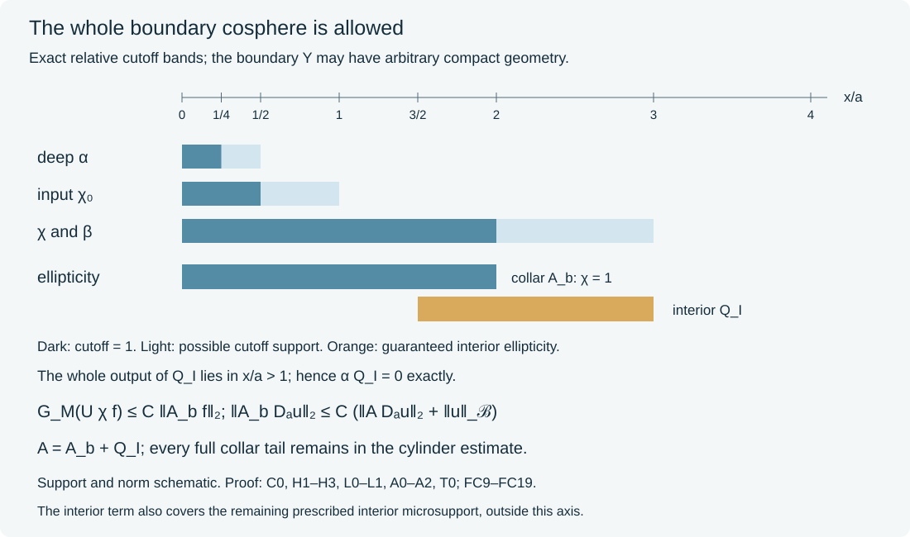

# Scalar tests when the whole boundary cosphere is allowed

On a compact boundary, a prescribed microsupport can cover every boundary base point. An unused boundary output patch then need not exist. If the allowed cone contains the entire boundary cosphere, a coercive differential operator on the logarithmic collar gives another scalar assembly. Its proof controls the whole collar norm, including every full residual kernel, before an interior elliptic comparison recovers that norm from one scalar test.

The [global boundary calculus](../20261005-global-boundary-operators/global-boundary-operator-calculus.html) supplies the full kernels. The [global family reduction](../20261017-global-finite-family-reduction/global-finite-order-families-and-residual-tests.html) supplies the uniform family and conic conventions. The [one-dimensional assembly](../20261017-one-dimensional-scalar-assembly/global-scalar-tests-on-one-dimensional-manifolds.html) supplies the earlier support pattern. We prove the higher-dimensional cylinder estimate here, with all logarithmic tails retained.

## 1. Hypotheses and the scalar conclusion

**H0. A compact boundary with all boundary directions allowed.** Let \(X\) have smooth compact nonempty boundary \(Y\), and fix a smooth positive density. Let \(\Gamma\subset\widetilde T^*X\setminus0\) be open and conic, with
\[
                  \widetilde T^*X|_Y\setminus0\subset\Gamma.
 \tag{FC1}
\]
Let the scalar \(T_{\ell,a}\in\Psi_b^m(X)\), \(1\leq\ell\leq L\), have common compact kernel projections, bounded full order-\(m\) seminorms and uniform rapid tails outside a compactly generated cone \(K\Subset\Gamma\), as in GFR:H0. The boundary base projection of \(K\) may be all of \(Y\).

Let \(D_a\) be a differential family of fixed finite order with the stated uniform smooth coefficient bounds on all relevant compact sets, and let \(\mathcal B\) embed continuously in extendible distributions. For any integer \(r\geq1\) with \(M=2r\geq\max(m,0)\), there is a fixed compact scalar \(A\in\Psi_b^M(X)\), with microsupport compactly inside \(\Gamma\), such that on smooth inputs
\[
 \|T_{\ell,a}D_a u\|_2
       \leq C\bigl(\|AD_a u\|_2+\|u\|_{\mathcal B}\bigr).
 \tag{FC2}
\]
The constant is uniform in \(\ell,a\). For varying inputs \(D_a u\), a supremum uses the corresponding supremum of the entire tested norm. For a common input there is a common scalar test norm. Complete residual kernels remain in the estimate. The Banach norm is the original one.

This theorem has hypothesis (FC1). Compact boundaries with restricted allowed angular directions remain a separate scalar assembly case. The full general observation graph is also a separate argument.

**C0. One collar and fixed support buffers.** The finite defining-function and smooth-flow proof GRF:C0 gives a global collar of the compact \(Y\). Normalize its density by
\[
 d\mu=w(x,y)\,dx\,d\nu(y),\qquad
 (Uf)(v,y)=e^{v/2}w(e^v,y)^{1/2}f(e^v,y),\qquad v=\log x.
 \tag{FC3}
\]
Here \(w>0\) is smooth up to \(x=0\). Compactness of the normalized cosphere over \(Y\), together with (FC1) and openness, gives one \(a>0\) for which the whole cosphere over \(0\leq x\leq4a\) is compactly inside \(\Gamma\). To justify uniformity, take a finite neighborhood cover of that compact cosphere at \(x=0\); a smaller common collar lies in its union for every normalized covector. Rescale the collar if necessary.

Choose nonnegative smooth cutoffs, all at most one:

- \(\chi_0=1\) for \(x\leq a/2\), with support in \(x<a\);
- \(\chi=1\) and \(\beta=1\) for \(x\leq2a\), with supports in \(x<3a\);
- \(\alpha=1\) for \(x\leq a/4\), with support in \(x<a/2\).

They depend only on \(x\) in the collar and extend smoothly by zero where appropriate. In particular \(\chi\chi_0=\chi_0\). A smooth-up-to-boundary \(f\) gives \(U(\chi f)\) Schwartz in \(v\), with smooth coefficients on compact \(Y\), by GRF:C0. The cylinder arguments below are proved on the smooth Schwartz class; \(U(\chi f)\) belongs to that class.

## 2. The coercive differential cylinder operator

**H1. A finite tangential spanning family.** A finite chart cover and compact chart cutoffs \(\rho_i\), not all zero at any point of \(Y\), give global smooth real fields \(V_{ij}=\rho_i\partial_{z_i^j}\), extended by zero outside their charts. They span \(T_yY\) at every \(y\). Hence
\(q_Y(y,\eta)=\sum_{i,j}|\eta(V_{ij})|^2\) is a positive definite smooth quadratic form on the cotangent fibers. Matrix inversion gives its smooth dual metric. In any of the finitely many smaller charts, it is uniformly comparable to the Euclidean squared norm, by compactness. List the fields as \(V_1,\ldots,V_N\); when \(\dim Y=0\) the list is empty and \(Y\) is finite.

On \(\mathbb R_v\times Y\), with density \(dv\,d\nu\), set
\[
                 \mathsf L=1-\partial_v^2+\sum_{j=1}^N V_j^*V_j.
 \tag{FC4}
\]
The adjoints are the actual density adjoints, \(V_j^*=-V_j-\operatorname{div}_\nu V_j\). Its principal symbol is \(\kappa^2+q_Y(y,\eta)\), a positive quadratic form. All coefficients are independent of \(v\).

**H2. Coercivity requires no spectral theorem or inverse.** For a function Schwartz in \(v\) and smooth on \(Y\), integration by parts gives
\[
 (\mathsf Lg,g)=\|g\|_2^2+\|\partial_vg\|_2^2+\sum_j\|V_jg\|_2^2.
 \tag{FC5}
\]
There is no boundary term on the closed manifold \(Y\); a finite chart partition proves the adjoint identity, with transition terms included in the divergence. The normal terms vanish at both infinite ends by Schwartz decay. Cauchy--Schwarz gives \(\|g\|_2\leq\|\mathsf Lg\|_2\). Each differential power preserves the same smooth Schwartz class, so iteration proves
\[
                         \|g\|_2\leq\|\mathsf L^r g\|_2.
 \tag{FC6}
\]
This is a smooth-domain norm inequality. No membership of a true inverse in the boundary operator class is asserted.

**H3. Every required cylinder derivative has a direct estimate.** Choose a finite real squared chart partition \(\sum_i\theta_i^2=1\) on \(Y\), and in chart \(i\) write \(d\nu=b_i(z)\,dz\). For integers \(j\geq0\), define
\[
 G_j(g)^2=\sum_i\|b_i^{1/2}\theta_i g\|_{H^j(\mathbb R_v\times\mathbb R^d_z)}^2.
 \tag{FC7}
\]
All chart components extend by zero in \(z\). In particular \(G_0=\|g\|_2\). Integer Fourier norms are equivalent to the finite sum of all derivative norms through that integer: expand \((1+|\xi|^2)^j\) and use Plancherel. Finite chart transitions and density multipliers preserve these norms by the product and chain rules; larger local cutoffs are bounded by the same finite sum after inserting the squared partition. Their constants do not depend on \(v\). This is the integer version of the proved chart norm comparison KS:S3.

Here is the elliptic estimate, rather than an imported compact-manifold regularity theorem. In a smaller chart, conjugate \(\mathsf L^r\) by \(b_i^{1/2}\), and freeze its leading order-\(M\) coefficients at a fixed point. The resulting constant homogeneous symbol \(p_i(\kappa,\eta)\) is the \(r\)-th power of a positive quadratic form, so
\(\langle\xi\rangle^M\leq C_i(1+|p_i(\xi)|)\).
Fourier Plancherel proves \(\|h\|_{H^M}\leq C_i(\|p_i(D)h\|_2+\|h\|_2)\). Shrink the chart until the suprema of all leading-coefficient differences are small enough to absorb their contribution \(C_i\delta\|h\|_{H^M}\). Every remaining term has at most \(M-1\) derivatives and bounded coefficients. Commuting the fixed cutoff through \(\mathsf L^r\) also has order at most \(M-1\). The finite chart sum therefore gives
\[
 G_M(g)\leq C\bigl(\|\mathsf L^r g\|_2+G_{M-1}(g)\bigr).
 \tag{FC8}
\]
First choose these finitely many small charts; the derivatives of their cutoffs are then fixed finite constants. For any \(\delta>0\), the scalar Fourier weight inequality
\(\langle\xi\rangle^{M-1}\leq\delta\langle\xi\rangle^M+C_\delta\)
gives \(G_{M-1}\leq\delta G_M+C_\delta G_0\). Choose \(\delta\) after the constant in (FC8), absorb, and use (FC6). Thus
\[
                         G_M(g)\leq C_r\|\mathsf L^r g\|_2.
 \tag{FC9}
\]
Only finite Fourier estimates, actual differential coefficients and the proved coercivity were used. If \(Y\) is zero-dimensional these are the finitely many one-dimensional Fourier estimates directly.

## 3. Full boundary kernels on the logarithmic cylinder

**L0. The complete kernel has a uniform ordinary local model.** Consider \(U\beta T_{\ell,a}\chi_0U^{-1}\). In one boundary coordinate chart, write the actual original density relative to \(dx\,dz\) as \(q(x,z)\,dx\,dz\). The full kernel formula GB:K2 has normal argument \(1-x'/x\). Put \(h=v-v'\), and near \(h=0\) define
\[
 c(h)={1-e^{-h}\over h},\qquad c(0)=1.
 \tag{FC10}
\]
This is smooth and positive near zero, by the integral identity \(c(h)=\int_0^1 e^{-th}\,dt\). The positive change of frequency \(\xi_n=\kappa/c(h)\) turns the exact phase into
\((z-z')\cdot\eta+h\kappa\). Apart from the fixed input/output cutoffs, the full amplitude is
\[
 e^{-h/2}c(h)^{-1}
 \left({q(e^v,z)\over q(e^{v-h},z')}\right)^{1/2}
 a_{\ell,a}\bigl(e^v,z,\eta,\kappa/c(h)\bigr).
 \tag{FC11}
\]
The normal density factor and frequency Jacobian are both retained. After a cutoff near the lifted diagonal, this amplitude has uniform order-\(m\) estimates with every derivative in \(v,z,z',h\). A normal difference derivative gives \(\kappa\partial_{\xi_n}a\), preserving the order. Every \(v\)-derivative of a smooth function of \(e^v\) is a finite sum of \(e^{pv}\partial_x^p\) terms; on these compact physical collar supports all are bounded down to \(v=-\infty\). The complete ordinary amplitude reduction P2:OP4 retains every finite symbol remainder with these uniform constants.

For precision about the noncompact \(v\) direction, choose a compact smooth \(\eta\geq0\), positive on \([-1,1]\), and form the smooth positive periodic sum \(s(v)=\sum_{k\in\mathbb Z}\eta(v-k)\). The functions \(\eta(v-k)/s(v)\) sum to one, have common derivative bounds and finite overlap. The near kernel has a fixed bounded difference support \(|v-v'|<h_0\). After this partition of its input, only finitely overlapping translated compact output windows occur. On each window P2:OP4 is the actual compact-amplitude theorem, with constants independent of the translate. Thus no global noncompact-base amplitude theorem is being presumed.

Away from that lifted diagonal the complete kernel is a full residual. Its normalized logarithmic kernel, including rectangular chart pairs, obeys
\[
       |k(v,v';y,y')|\leq C_N e^{-N|v-v'|}
 \tag{FC12}
\]
for any chosen \(N\), with analogous differentiated bounds. This is the full side-flatness calculation GB:K2--K3 and SFT:D2; no original-product smoothness at the corner is assumed. Compact \(Y\) and the two normal Schur integrals make this entire far term uniformly L2 bounded. Cross-chart and cross-component kernels are included.

**L1. The actual full collar estimate.** On a translated near chart, the reduced left symbol \(a_j(v,z,\xi)\) has uniform order \(m\). Exact right Fourier multiplication gives
\(\operatorname{Op}(a_j)=\operatorname{Op}(a_j\langle\xi\rangle^{-M})\langle D\rangle^M\).
The quotient is uniformly order at most zero. The complete packet bound SY:H9, applied with scalar coefficient space, gives its uniform L2 norm. The translated compact input pieces have squared \(H^M\) norms summing to at most a constant times the original norm: Leibniz's rule and the finite overlap prove this for every integer derivative through \(M\). The output pieces also have finite overlap because the difference support is bounded. Summing the chart bounds and then the far Schur term proves
\[
 \|\beta T_{\ell,a}\chi_0 f\|_2
       \leq C G_M(U\chi f)
       \leq C'\|\mathsf L^r U\chi f\|_2.
 \tag{FC13}
\]
The identity \(\chi\chi_0=\chi_0\) justifies this input exactly. Uniformity uses the complete bounded family, not just its principal symbols.

The remaining output \((1-\beta)T_{\ell,a}\chi_0\) has a smooth original-product kernel flat in the input: its input has \(x'<a\), while its output is outside \(x\leq2a\), so it is separated from the diagonal; as input approaches the boundary the corresponding side-face flatness applies. Its projections are compact. The actual flat-input transpose bound OSA:K0 therefore gives
\[
 \|(1-\beta)T_{\ell,a}\chi_0D_a u\|_2\leq C\|u\|_{\mathcal B}.
 \tag{FC14}
\]
This is the only discarded collar-output part, and its full kernel has been checked.

## 4. A physical collar operator and an interior addition

**A0. The collar test is a genuine smooth boundary differential operator.** Define
\[
                      A_b=U^{-1}\mathsf L^r U\chi.
 \tag{FC15}
\]
Although \(U\) contains a half power, its differential conjugations have smooth coefficients:
\[
 U^{-1}\partial_vU=x\partial_x+\tfrac12+\tfrac x2\partial_x\log w,
 \qquad U^{-1}V_jU=V_j+\tfrac12 V_j\log w.
 \tag{FC16}
\]
Conjugate the actual adjoints in (FC4) as well and then compose; all coefficients extend smoothly to \(x=0\). Thus \(A_b\in\Psi_b^M\) is a scalar b-differential operator with compact diagonal kernel, supported over \(x<3a\). Its principal symbol is
\(\chi(x)(\kappa^2+q_Y(y,\eta))^r\), nonnegative and elliptic where \(\chi=1\). Its microsupport lies in \(\Gamma\) by C0. The norm on the right of (FC13) is exactly \(\|A_bf\|_2\), not an additional norm of \(f\).

**A1. A positive interior term has no deep output.** Put \(T^I_{\ell,a}=T_{\ell,a}(1-\chi_0)\). Its input projection is away from the boundary, and its nonresidual microsupport is compactly inside the interior and \(\Gamma\). Let \(L_I\) consist of its common normalized microsupport outside \(x<3a/2\), together with the entire cosphere above \(3a/2\leq x\leq3a\). Points outside the collar in the first set are simply interior points. This is a compact interior set inside \(\Gamma\), a positive distance from \(x\leq a\).

The full positive construction GFR:A0, now using only ordinary interior charts, gives \(Q_I\in\Psi^M\) with nonnegative principal symbol, elliptic near \(L_I\), microsupport compactly inside \(\Gamma\), and both actual kernel projections outside \(x\leq a\). Choose its proper cutoffs there before the products. Hence \(\alpha Q_I=0\) as a complete kernel identity. Set
\[
                             A=A_b+Q_I.
 \tag{FC17}
\]
For \(x<3a/2\), \(\chi=1\), so the collar symbol supplies ellipticity in every direction. At the remaining comparison points the positive interior symbol supplies it. No leading cancellation is possible. Consequently \(A\) is elliptic on the nonresidual microsupports of all \(T^I_{\ell,a}\) and of \((1-\alpha)A_b\). The latter has its whole diagonal kernel in the compact interior annulus \(a/4\leq x\leq3a\). The overlap \(3a/2<2a\) leaves no gap in that ellipticity assertion.

**A2. Every comparison error really has flat input.** Apply the fixed complete ordinary microlocal inverse of \(A\) at those compact interior comparison sets, with all auxiliary kernel projections compactly inside the interior. The ordered calculus gives
\[
 T^I_{\ell,a}=E_{\ell,a}A+F_{\ell,a},\qquad
 (1-\alpha)A_b=E_b A+F_b,
 \tag{FC18}
\]
where the \(E\)'s have order at most zero and are uniformly L2 bounded with compact interior projections. For \(T^I\), first localize its output to an interior neighborhood of its diagonal singularities if necessary; the omitted kernel is smooth with input away from the boundary. This leaves the same error class in (FC18).

Here is the complete input-support check. Both left sides have input away from the boundary. In the products \(EA\), the input of \(E\) accesses \(A\) only at an interior compact set. The differential kernel of \(A_b\) is diagonal, so those terms also have interior input. The complete kernel of \(Q_I\) has interior input by construction. Thus each \(EA\) has input away from the boundary. The full microlocal agreement removes all remaining diagonal singularities. The proper, low-frequency and far-kernel terms are therefore original smooth compact kernels with input away from the boundary. They are flat there to every input order. Uniformity follows from the one fixed inverse and the full original bounded family. OSA:K0 applies to every \(F D_a u\); a full boundary residual is not being substituted for this argument.

## 5. Recover the collar norm and conclude

**T0. One scalar test retains the original Banach remainder.** Since \(\alpha Q_I=0\), \(\alpha A_bf=\alpha Af\). The second identity in (FC18), followed by the actual flat-input bound, gives for \(f=D_a u\)
\[
 \|A_bf\|_2
 \leq\|\alpha Af\|_2+\|(1-\alpha)A_bf\|_2
 \leq C\|Af\|_2+C\|u\|_{\mathcal B}.
 \tag{FC19}
\]
Split the full operator exactly as
\(T=\beta T\chi_0+(1-\beta)T\chi_0+T(1-\chi_0)\).
Use (FC13) and (FC19) on the first term, (FC14) on the second, and the first identity of (FC18) on the third. This proves (FC2), with every full logarithmic tail and every original-product error in its stated class. All fixed cutoffs, the integer \(r\), the tangential fields and the scalar \(A\) precede the coefficient parameter in \(D_a\).

**G0. The exact scope.** This proves scalar assembly on compact boundaries under (FC1), including complete relevant base coverage. The spatial output-reserve theorem uses an unused boundary point instead. Restricted angular cones are treated by [whole-manifold tangential-equator assembly](../20261017-global-tangential-equator-assembly/one-scalar-test-when-all-boundary-tangential-directions-are-allowed.html) and [global scalar assembly and observation](../20261017-angular-output-reserve-assembly/scalar-tests-from-a-missing-tangential-direction.html). As in GFR:G0, this component's estimate extends to its actual smooth graph completion; no larger graph-density assertion is assumed.

## 6. Three solved examples

### Exercise 1. The exact physical operator on a circular collar

**X1.** Let \(Y=\mathbb T\), use density \(dx\,d\theta\), and take \(\mathsf L=1-\partial_v^2-\partial_\theta^2\). Compute its physical conjugate and verify its lower bound despite its physical zeroth coefficient.

**Solution.** Since \(U=x^{1/2}\), the conjugate before the right cutoff is
\[
 U^{-1}\mathsf LU
 =1-(x\partial_x+\tfrac12)^2-\partial_\theta^2
 =\tfrac34-x^2\partial_x^2-2x\partial_x-\partial_\theta^2.
 \tag{FC20}
\]
For smooth compact normal input, integration by parts gives its quadratic form as
\(\tfrac34\|f\|^2+\|x\partial_xf\|^2+\|\partial_\theta f\|^2\).
The identity \(\operatorname{Re}\int x\partial_x f\,\overline f\,dx\,d\theta=-\tfrac12\|f\|^2\) follows from the vanishing upper cutoff and the factor \(x\) at zero. Cauchy--Schwarz gives \(\|x\partial_xf\|\geq\tfrac12\|f\|\). Thus the form is at least \(\|f\|^2\), as in (FC5). For the normalized circle mode \(e_k\) and \(g(v,\theta)=\phi(v)e_k(\theta)\), Fourier Plancherel gives
\(\|\mathsf L^rg\|^2=(2\pi)^{-1}\int(1+\kappa^2+k^2)^{2r}|\widehat\phi(\kappa)|^2d\kappa\).
All half-density shifts and the constant \(3/4\) are essential to these identities.

### Exercise 2. Check the entire transition annulus

**X2.** Set \(a=1\). Why can the interior addition avoid \(x\leq1\) while the comparison \((1-\alpha)A_b\) begins already at \(x=1/4\)?

**Solution.** The collar principal symbol is positive in every direction through \(x\leq2\), because \(\chi=1\) there. The interior addition is elliptic above the closed annulus \([3/2,3]\). These two ellipticity regions overlap on \([3/2,2]\), and together cover \([1/4,3]\), the complete transition support. The deep cutoff has support in \(x<1/2\), while the interior addition's whole output lies in \(x>1\). Hence \(\alpha Q_I=0\) exactly. Derivatives of the outer \(\chi\) do not create a support gap: their entire region lies in the annulus covered by the interior addition.

### Exercise 3. A true cylinder inverse need not be a boundary operator

**X3.** For \(1-\partial_v^2\) on the line, compute the inverse convolution kernel and its normal ratio coefficient. Does its L2 boundedness prove side flatness of every order?

**Solution.** The kernel is \(k(h)=\tfrac12e^{-|h|}\). Away from zero it solves \(k-k''=0\), and the jump of \(k'\) at zero is \(-1\), so \((1-\partial_h^2)k=\delta_0\). Direct integration on the two half-lines gives Fourier multiplier \((1+\kappa^2)^{-1}\). Its normalized physical ratio coefficient is
\[
 t^{-1/2}k(-\log t)=
 \begin{cases}\tfrac12t^{1/2},&0<t<1,\\
 \tfrac12t^{-3/2},&t>1.\end{cases}
 \tag{FC21}
\]
These are fixed powers at the two ratio ends, not flatness of every order. The corresponding resolved density factors cannot turn a fixed power into infinite-order flatness. Thus the true bounded cylinder inverse cannot simply be declared an operator in the required boundary calculus. The proof above uses the direct energy estimate and finite Fourier estimates instead; its actual physical test is the differential operator (FC15).

## 7. The support and norm diagram

**F0. What each part represents.** The cutoff bands have the exact relative endpoints of C0, A1 and Exercise 2. They describe allowed supports and ellipticity, not nonzero values at every displayed point. The cylinder estimate includes all full corner and rectangular residual kernels. Only the original smooth flat-input errors in L1 and A2 use the Banach-only bound. The scalar recovery is the actual identity and estimate (FC19), with \(\alpha Q_I=0\). The diagram is a support and norm schematic, not a sampled operator kernel.

Independent exposition, proofs, solutions and diagram: CC0-1.0. Mathematical context: Lars Hörmander, *The Analysis of Linear Partial Differential Operators III*, Sections 18.3 and 24.7.  Earlier programme proofs and external human foundations retain their recorded terms. This theorem has hypothesis (FC1); internal CC0-export closure and whole-course completion are not claimed.
