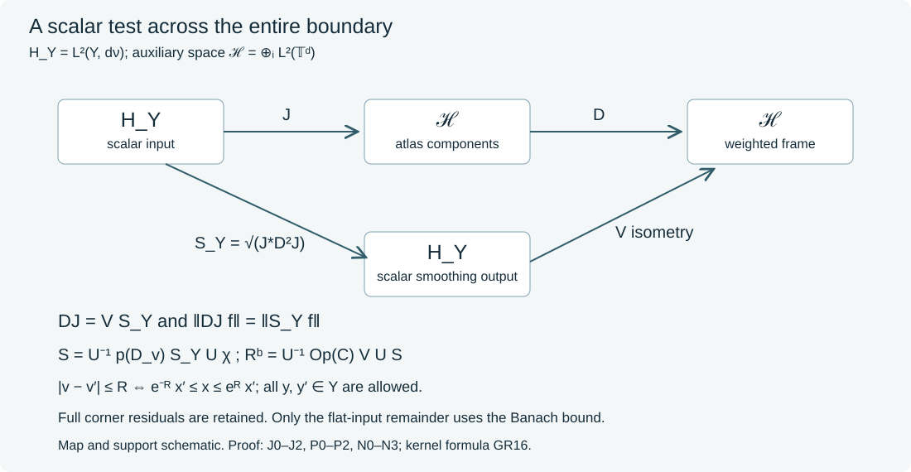

# Global scalar factors for boundary residuals

A smooth coefficient at the resolved boundary corner need not be a smooth kernel on the original product. Such residual terms must remain in the estimate. We construct one scalar boundary residual test that controls any bounded finite list of complete residual families on a compact boundary, including kernels between different charts and different boundary components. The construction uses a global collar, a finite atlas frame and a positive square root on the tangential Hilbert space. The square root and its smoothing property are proved below.

The earlier [logarithmic Fourier construction](../20261009-scalar-fourier-source-tests/scalar-source-tests-from-compact-logarithmic-kernels.html) supplies the positive normal multiplier. The [global boundary calculus](../20261005-global-boundary-operators/global-boundary-operator-calculus.html) specifies the complete kernel class. Ordinary smooth errors flat at the input boundary are controlled by the [original Banach bound](../20261017-one-dimensional-scalar-assembly/global-scalar-tests-on-one-dimensional-manifolds.html#2-which-kernel-errors-have-a-coarse-bound). These are distinct roles.

## 1. The global statement and its quantifiers

**H0. Full residuals and the original remainder.** Let \(X\) be a smooth manifold with compact boundary \(Y\), put \(d=\dim Y\), and fix a smooth positive density. All operators below are scalar. Let \(R_{\ell,a}\in\Psi_b^{-\infty}(X)\), \(1\leq\ell\leq L\), be a bounded family of complete kernels with fixed compact input and output projections. Boundedness includes every smooth resolved-kernel seminorm and flatness of every order at both side faces. Let \(D_a\) be a differential family of a fixed finite order with uniformly bounded smooth coefficients on these compact sets. Suppose \(\mathcal B\) embeds continuously in extendible distributions on \(X\).

There is one compactly supported scalar \(S\in\Psi_b^{-\infty}(X)\), depending on the entire family, such that for smooth inputs
\[
 \|R_{\ell,a}D_a u\|_2
 \leq C\bigl(\|S D_a u\|_2+\|u\|_{\mathcal B}\bigr).
 \tag{GR1}
\]
The constant is uniform in \(\ell,a\). For one common input \(f\), the corner parts actually have bounded right factors \(R^b_{\ell,a}f=B_{\ell,a}Sf\), uniformly in \(\ell,a\). Thus a supremum of their norms is bounded by \(C\|Sf\|_2\). For \(f=D_a u\) varying with \(a\), (GR1) holds for each \(a\); a supremum requires the corresponding supremum of \(\|S D_a u\|_2\). A single value of that norm at one parameter is insufficient.

This theorem controls complete residual families. Combining this scalar residual test with a general finite-order elliptic test into one scalar test on an arbitrary global boundary is a further assertion, not assumed in its proof. All of the present residuals have empty boundary microsupport, so they introduce no conic microsupport restriction.

## 2. A collar and the actual normal density

**C0. One collar for the entire compact boundary.** Finite smooth cutoffs are supplied by U001-A4. In boundary charts let \(x_i\geq0\) be the local normal coordinate. A subordinate partition gives \(x=\sum_i\rho_i x_i\) near \(Y\). At \(Y\), the terms \(x_i d\rho_i\) vanish, and the remaining positive combination of inward conormals is nonzero. Hence \(x\) is a boundary defining function after shrinking the neighborhood. Patch inward coordinate fields to a field \(N_0\) with \(N_0x>0\), and put \(N=N_0/(N_0x)\). The complete local smooth-flow proof NF1--NF7 gives a flow \(F(t,y)\) starting at \(y\in Y\). Compactness supplies one positive time interval for all \(y\). Its defining equation gives \(x(F(t,y))=t\). The differential at \(t=0\) is invertible, since the tangential differential is identity and \(Nx=1\). The inverse theorem and flow uniqueness give a diffeomorphism from \([0,\epsilon)\times Y\) onto a neighborhood of \(Y\): points with equal image have the same \(t=x\), and their backward flow has the same initial point. A finite local inverse cover gives the asserted open image.

Write the density there as \(w(x,y)\,dx\,d\nu(y)\), with \(w>0\) smooth and \(d\nu\) a fixed smooth positive density on \(Y\). On the logarithmic collar put
\[
 v=\log x,\qquad (Uf)(v,y)=e^{v/2}w(e^v,y)^{1/2}f(e^v,y).
 \tag{GR2}
\]
Changing variable \(dx=e^v dv\) proves unitarity. We extend collar inputs by zero beyond a smaller fixed collar when necessary. A cutoff vanishing before its upper edge makes this extension smooth. For a smooth-up-to-boundary input with that cutoff, \(Uf\) is Schwartz in \(v\), with values in smooth functions on \(Y\): at \(-\infty\), every differentiated expression has the factor \(e^{v/2}\) times a bounded smooth function of \(e^v,y\).

**C1. Corner localization and the part with a Banach bound.** Fix \(R>0\) and a nonzero nonnegative smooth normal function \(\phi\) whose support difference lies in \([-R,R]\). Choose cutoffs \(\beta(x),\chi_0(x')\) equal to one near \(Y\), with supports \(x<\epsilon/2\) and \(x'<\epsilon e^{-R}/4\). Fix also \(\chi=1\) on the support of \(\chi_0\), supported in \(x'<\epsilon e^{-R}/2\). These choices precede every family-dependent factor below. Set \(R^b_{\ell,a}=\beta R_{\ell,a}\chi_0\). Every original-product kernel of \(R_{\ell,a}-R^b_{\ell,a}\) is smooth and flat in its input normal variable. Indeed the only possible original-product singularity of a full residual is the double boundary corner, where the multiplier \(1-\beta\chi_0\) is zero. If input approaches the boundary while output stays away, side-face flatness gives smooth flatness at the input to all orders. The remaining compact region is interior. This also holds for rectangular kernels between different charts or components; no diagonal-support assertion is used. The exact flat-test transpose argument OSA:K0, whose proof is independent of dimension, therefore bounds this remainder after \(D_a\) by \(C\|u\|_{\mathcal B}\).

The logarithmic kernel of \(UR^b_{\ell,a}U^{-1}\) is a smooth \(Y\times Y\) kernel \(h_{\ell,a}(v,H;y,y')\), where input is \(v-H\). Its full left Fourier symbol is
\[
 r_{\ell,a}(v,\kappa)=\int e^{-iH\kappa}h_{\ell,a}(v,H)\,dH:
 H_Y\longrightarrow H_Y,\qquad H_Y=L^2(Y,d\nu).
 \tag{GR3}
\]
This identity follows first on smooth compact tests by Fourier inversion and absolute integrability. The normal density in the ratio variable \(t=x'/x=e^{-H}\) is exactly \(t^{1/2}[w(x,y)/w(tx,y')]^{1/2}\kappa_R(x,t;y,y')\,dH\), with the sign from reversing the ratio integral handled by its limits. This is the same half-density factor as SFT:D1--D2. Flatness at both ratio ends makes \(h\), all of its \(H,v,y,y'\) derivatives and every exponential weight in \(H\) uniformly integrable. Integration by parts and differentiation in (GR3) show that its smooth tangential kernel and every such derivative are rapidly decreasing in \(\kappa\), uniformly in \(v,\ell,a\). For positive \(v\) outside the output cutoff the kernel is zero. These assertions concern the full corner kernel, not an ordinary smooth-product replacement for it.

## 3. An atlas isometry and a common slow diagonal

**J0. A frame across overlapping charts.** Choose a finite atlas on \(Y\), with smaller supports inside coordinate boxes in the flat torus \(\mathbb T^d=(\mathbb R/2\pi\mathbb Z)^d\). From a real partition \(\rho_i\) form \(\chi_i=\rho_i/(\sum_j\rho_j^2)^{1/2}\). The denominator is smooth and positive; thus \(\sum_i\chi_i^2=1\). In chart \(i\), write \(d\nu=a_i(z)\,dz\) and define \(J_i f\) by zero extension of \(a_i^{1/2}\chi_i f\) to the torus. The support stays inside its chart. Then
\[
 J:H_Y\longrightarrow\mathcal H=\bigoplus_i L^2(\mathbb T^d),
 \quad Jf=(J_i f)_i,\qquad J^*J=I.
 \tag{GR4}
\]
This isometry follows by integrating \(\sum_i\chi_i^2|f|^2\). Its adjoint is the sum of the inverse chart transfers with the same cutoffs and inverse density factors. It is not an inverse on all of \(\mathcal H\).

The normalized torus modes are \(e_k(z)=(2\pi)^{-d/2}e^{ik\cdot z}\), \(k\in\mathbb Z^d\). Their completeness follows by applying the circle Parseval theorem GE:G1 successively in each coordinate. Fubini gives the squared norms of the successive partial projections; each is a contraction and converges in \(L^2\), so their finite product converges to identity by a telescoping sum. Simple tensor functions are dense by the simple-function approximation in SY:H1. This proves the full product basis and Parseval, rather than importing a compact-manifold spectral theorem. For \(d=0\) there are finitely many point coordinates and one mode per point; the same argument reduces to finite sums.

**J1. The joint tail envelope.** Use the normal function \(\phi\) already fixed in C1. Choose \(\delta>0\) small enough that \(h=|\widehat\phi|^2\geq h_*>0\) on \([-\delta/2,\delta/2]\), as in SFT:D3. In normal frequency use the cubes \(Q_j=\delta j+[-\delta/2,\delta/2]\). For \(k\in\mathbb Z^d\) let \(n(k)=\lfloor|k|\rfloor\), and set
\[
 A_{j,k}=\langle k\rangle^{d+1}
 \max_{\ell,i,\,0\leq b\leq2}\sup_{a,v,\,\kappa\in Q_j}
 \|\partial_\kappa^b r_{\ell,a}(v,\kappa)J_i^*e_k\|_{H_Y}.
 \tag{GR5}
\]
This sequence decreases faster than every polynomial jointly in \(j,k\). To verify the input-frequency assertion, write the smooth kernel in the input chart, including its compact cutoff and density factor. Integration by parts with \((1-\Delta_{z'})^N\) moves every derivative onto that compact smooth kernel and produces \(\langle k\rangle^{-2N}\). Its norm over the compact output \(Y\) is bounded uniformly; (GR3) supplies arbitrary normal-frequency decay simultaneously. Arbitrarily many such integrations prove the assertion.

Define the positive, nonincreasing sequence
\[
 W_n=e^{-\sqrt{1+n^2}}+
 \sup_{\max(|j|,n(k))\geq n} A_{j,k},
 \qquad d_k=W_{n(k)}^{1/2}.
 \tag{GR6}
\]
For an empty tail take its supremum to be zero. The joint rapid bounds imply arbitrary polynomial decay of \(W_n\); taking a square root preserves that property. The sequence \(d_k\) is strictly positive and rapidly decreasing. Since both \(W_{|j|}\) and \(W_{n(k)}\) dominate \(A_{j,k}\),
\[
 A_{j,k}/d_k\leq W_{|j|}^{1/2}.
 \tag{GR7}
\]
Let \(D\) multiply each chart mode by \(d_k\). Parseval makes \(D\) bounded, positive, selfadjoint and injective on \(\mathcal H\). Its Fourier kernel is smooth: after any derivative the series is absolutely uniformly convergent, because polynomially weighted \(d_k\) are summable. This also proves smoothness of
\(T=J^*D^2J\) on \(Y\times Y\).

**J2. Division is a bounded column series.** Initially on finite mode sums define
\(B_{\ell,a}(v,\kappa)=r_{\ell,a}(v,\kappa)J^*D^{-1}\).
By (GR5)--(GR7), each differentiated column, for \(b\leq2\), has norm at most
\(\langle k\rangle^{-d-1}W_{|j|}^{1/2}\) on \(Q_j\). The squares of these weights are summable over \(k\), with only finitely many charts: counting lattice points in shells bounds the sum by a constant times \(\sum_{m\geq1}m^{d-1}m^{-2d-2}\). Cauchy--Schwarz therefore extends the column series to a bounded map \(\mathcal H\to H_Y\); the same square sum bounds its Hilbert--Schmidt norm. Its first two normal-frequency derivatives converge uniformly in this norm, and
\[
 \sup_{v,\,\kappa\in Q_j,\ell,a}
 \|\partial_\kappa^b B_{\ell,a}(v,\kappa)\|
 \leq C W_{|j|}^{1/2}\quad(0\leq b\leq2),
 \qquad B_{\ell,a}DJ=r_{\ell,a}.
 \tag{GR8}
\]
For the identity, first truncate the chart modes of \(Jf\), then use their \(L^2\) convergence, boundedness of \(B,D,r,J^*\) and \(J^*J=I\). There is no assertion that \(D^{-1}\) is bounded on \(\mathcal H\).

## 4. A scalar smoothing square root, with proof

**P0. Positive square root without a spectral theorem.** The bounded operator \(T=J^*D^2J\) is positive and injective, since \((Tf,f)=\|DJf\|^2\). Choose \(c\geq\|D\|^2>0\), and put \(A=I-T/c\). Then \(0\leq A\leq I\) as quadratic forms. A positive quadratic form satisfies \(|(Af,g)|^2\leq(Af,f)(Ag,g)\): expand \((A(f+zg),f+zg)\geq0\) and minimize over the complex scalar \(z\), with a zero diagonal case obtained by taking arbitrarily large \(|z|\). Consequently \(\|A\|\leq1\). Every power \(A^n\) is positive; the even powers have quadratic form \(\|A^{n/2}f\|^2\), and the odd powers use positivity of \(A\) on \(A^{(n-1)/2}f\). Their norms are at most one.

Put \(c_n=4^{-n}\binom{2n}{n}\), \(c_0=1\), and \(b_n=c_{n-1}-c_n\) for \(n\geq1\). The recurrence \(c_n/c_{n-1}=(2n-1)/(2n)\) gives \(b_n>0\). It also gives \(c_n\leq(n+1)^{-1/2}\): the induction step reduces to \((2n+1)^2(n+2)\leq4(n+1)^3\), whose difference is \(3n+2>0\). Hence \(\sum_{n\geq1}b_n=1\). The norm-convergent series
\[
 S_Y=\sqrt c\left(I-\sum_{n\geq1}b_n A^n\right)
 \tag{GR9}
\]
is selfadjoint and positive, since each partial quadratic sum is bounded above by \((\sum b_n)\|f\|^2\). It squares to \(T\). Here is an explicit coefficient justification. The recurrence for the coefficients of \(F(z)=1-\sum b_n z^n\) gives \(2(1-z)F'(z)+F(z)=0\) on \(|z|<1\), by termwise differentiation on smaller intervals. Thus \((F(z)^2/(1-z))'=0\) for real \(|z|<1\), and its value at zero is one. Differentiating the convergent power series at zero identifies every coefficient of \(F^2\) with that of \(1-z\). Its coefficients are absolutely summable, so the operator Cauchy product at the contraction \(A\) is justified in norm and gives \(S_Y^2=c(I-A)=T\). Completeness of bounded-operator spaces is SY:H4; the scalar series and Cauchy product are the earlier absolute-series proofs.

**P1. This square root really has a smooth kernel.** Write \(\psi_{i,k}=J_i^*e_k\). Smoothness of the kernel of \(T\), integration by parts in both chart variables, and compact chart cutoffs show that \((T\psi_{i,k},\psi_{i,k})\) decreases faster than every power of \(|k|\). It is nonnegative and equals \(\|S_Y\psi_{i,k}\|^2\). Thus for every integer \(N\)
\[
 \sum_{i,k}\langle k\rangle^{2N}\|S_Y\psi_{i,k}\|^2<\infty.
 \tag{GR10}
\]
Selfadjointness gives \(|(J_iS_Yf,e_k)|=|(f,S_Y\psi_{i,k})|\leq\|f\|\|S_Y\psi_{i,k}\|\). Equation (GR10) bounds every weighted Fourier norm of \(J_iS_Yf\) by \(C_N\|f\|\). Cauchy--Schwarz then makes each differentiated Fourier series converge absolutely and uniformly, using a stronger weight whose reciprocal square is summable.

To see joint kernel smoothness, let \(s_{i,k;j,l}=(J_iS_YJ_j^*e_l,e_k)\). The output bound just proved gives \(|s_{i,k;j,l}|\leq C_N\langle k\rangle^{-N}\), since \(\|J_j^*e_l\|\leq1\). Selfadjointness gives the same bound with \(l\). Taking \(N=2M\) and the geometric mean proves a bound \(C_M\langle k\rangle^{-M}\langle l\rangle^{-M}\). The double Fourier series and every derivative therefore converge absolutely uniformly to a smooth kernel for \(J_iS_YJ_j^*\). Summing its inverse chart transfers, using \(S_Y=J^*(JS_YJ^*)J\), gives a global scalar smooth kernel \(s_Y(y,y')\). No claim about square roots of general full boundary residual operators is used here: this square root acts only on the compact tangential manifold.

**P2. An auxiliary isometry, not an extra test component.** Injectivity of \(T\) implies injectivity of \(S_Y\). Its range is dense: a vector orthogonal to the range lies in the kernel of its adjoint, which is its own zero kernel. On that range define \(V(S_Yf)=DJf\). Equation \(S_Y^2=T\) gives equality of the squared norms, so this is well defined and isometric. It extends uniquely by density to an isometry \(V:H_Y\to\mathcal H\), with
\[
                         DJ=VS_Y.
 \tag{GR11}
\]
The extension uses only completeness. For clarity, the orthogonal-complement fact follows directly by taking a minimizing sequence for the distance of a vector to a closed subspace. The parallelogram identity makes that sequence Cauchy; its limit realizes the distance. Varying the limit by every real and imaginary scalar multiple of a subspace vector makes the difference orthogonal to the subspace. Thus a proper closed subspace has a nonzero orthogonal complement. Applied to the closure of the range, the zero complement above proves density. Surjectivity onto \(\mathcal H\) is neither required nor asserted. The final test below acts from scalar functions on \(X\) to scalar functions on \(X\).

## 5. The normal floor and an integrable quotient kernel

**N0. A positive multiplier with compact normal kernel.** Set
\(E_j=\max_{b\leq2}\sup_{\ell,a,v,\kappa\in Q_j}\langle\kappa\rangle^2\|\partial_\kappa^b B_{\ell,a}(v,\kappa)\|\).
It is rapidly decreasing by (GR8). Use the function \(\phi\), spacing \(\delta\) and function \(h\) already fixed in J1. Define
\[
 q_j=M^{-1}(E_j+e^{-\sqrt{1+j^2}})^{1/3},\qquad
 p(\kappa)=\sum_j q_j h(\kappa-\delta j),\qquad 0<q_j\leq1.
 \tag{GR12}
\]
A fixed sufficiently large \(M\) gives the stated upper bound. SFT:D3 proves that \(p\) is strictly positive Schwartz, with compact smooth inverse Fourier kernel
\(k_p(H)=c_\phi(H)\sum_jq_j e^{i\delta jH}\), supported in the difference of the supports of \(\phi\). In particular its support can be chosen inside \([-R,R]\) for any prescribed \(R>0\).

Put \(C_{\ell,a}=B_{\ell,a}/p\). On \(Q_j\), \(p\geq h_*q_j\), while \(p',p''\) are globally bounded. The exact formulas \((1/p)'=-p'/p^2\) and \((1/p)''=2(p')^2/p^3-p''/p^2\), followed by Leibniz's rule, give
\[
 \|\partial_\kappa^b C_{\ell,a}(v,\kappa)\|
 \leq C\langle\kappa\rangle^{-2}E_j q_j^{-3}
 \leq C'\langle\kappa\rangle^{-2}\quad(0\leq b\leq2).
 \tag{GR13}
\]
These are operator-norm bounds \(\mathcal H\to H_Y\). Only these finite derivatives are claimed to have this uniform bound.

**N1. The full operator-valued kernel bound.** The absolutely convergent integral
\(K_{\ell,a}(v,H)=(2\pi)^{-1}\int e^{iH\kappa}C_{\ell,a}(v,\kappa)\,d\kappa\)
has norm at most a uniform constant by (GR13). Integrating twice by parts gives \(\|K(v,H)\|\leq C|H|^{-2}\) for \(H\ne0\). Boundary terms vanish because both \(C\) and \(\partial_\kappa C\) tend to zero in norm. Thus
\[
 \|K_{\ell,a}(v,v-v')\|\leq {C\over1+|v-v'|^2}.
 \tag{GR14}
\]
This yields a uniform \(L^2(\mathbb R;\mathcal H)\to L^2(\mathbb R;H_Y)\) bound for \(\operatorname{Op}(C_{\ell,a})\). Explicitly, if \(g(H)=C/(1+H^2)\), Cauchy--Schwarz with weight \(g\) bounds the squared pointwise output by \(\|g\|_1\int g(v-v')\|F(v')\|^2dv'\). Integrating and using nonnegative Fubini gives the bound \(\|g\|_1^2\|F\|_2^2\). Finite-coordinate compact smooth inputs justify the integral initially; SY:H1 density and completeness extend it. This proves the bound for the actual auxiliary Hilbert spaces without a dimension-dependent matrix estimate or a finite-rank approximation of the symbol.

**N2. Exact cancellation and a scalar full boundary kernel.** With the cutoffs and \(R\) already fixed in C1, the input cutoff \(\chi\) is one on the common input projection of all \(R^b_{\ell,a}\). Define
\[
 S=U^{-1}p(D_v)S_YU\chi .
 \tag{GR15}
\]
Its output remains inside the collar, since \(|v-v'|\leq R\). Its complete ratio kernel, relative to \(dt\,d\nu(y')\), is
\[
 \kappa_S(x,t;y,y')=t^{-1/2}
 \left({w(tx,y')\over w(x,y)}\right)^{1/2}
 k_p(-\log t)s_Y(y,y')\chi(tx,y').
 \tag{GR16}
\]
This formula follows directly from (GR2), with \(dx'/x'=dt/t\); all density factors are retained. The ratio is confined to \(e^{-R}\leq t\leq e^R\). The kernel is smooth down to the front face, flat at both side faces, and compact in both original projections, including the corner \(x=x'=0\). The global kernel criterion GB:C1 therefore gives \(S\in\Psi_b^{-\infty}(X)\). It is scalar even though its proof uses \(\mathcal H\).

On the dense smooth collar inputs, left quantization, (GR8), (GR11), and the fact that fixed \(V\) commutes with the scalar normal multiplier give
\[
 UR^b_{\ell,a}f
 =\operatorname{Op}(C_{\ell,a})\,p(D_v)DJU(\chi f)
 =\operatorname{Op}(C_{\ell,a})V\,USf.
 \tag{GR17}
\]
In the first equality, multiplication of the normal Fourier integrand by \(p\) cancels the denominator exactly; there is no symbolic remainder. The Fourier integrals on a smooth collar input are absolutely norm integrable. The commutation with \(V\) follows first on finite tensors and then by boundedness and SY:H1 density. In the right factor, \(USf\) is extended by zero past the collar edge. Restriction of the output to the physical collar and multiplication by \(U^{-1}\) are bounded. Equation (GR14) and isometry of \(V\) prove the claimed uniform bounded right factor for \(R^b\). Adding C1 proves (GR1).

**N3. The graph conclusion and its limit.** If smooth inputs approach an element in an actual graph whose norm controls \(u\) in \(\mathcal B\) and \(S D_a u\) in \(L^2\), (GR1) makes their complete residual outputs Cauchy in \(L^2\). Distributional continuity identifies the limit whenever that graph has its stated distributional realization. This is a statement about that actual smooth graph completion; it does not presume density in a larger intersection of distribution spaces. Separate residual forcing and observation lists can each be included in the finite list above, or factored together when they act on the same input. The separate [global scalar assembly and observation](../20261017-angular-output-reserve-assembly/scalar-tests-from-a-missing-tangential-direction.html) treats finite-order tests and the general observation graph.

## 6. Three solved examples

### Exercise 1. Why chart overlap does not add output components

**X1.** Suppose two chart cutoffs overlap and satisfy \(\chi_1^2+\chi_2^2=1\) on their common region. Explain why \(J_1^*J_1+J_2^*J_2=I\) there, and why replacing \(J^*\) by an inverse on \(\mathcal H\) would be wrong.

**Solution.** Each density factor in \(J_i\) cancels its inverse in \(J_i^*\), leaving multiplication by \(\chi_i^2\). Their sum is identity. On \(\mathcal H\), however, \(JJ^*\) is an orthogonal projection: its square equals itself by \(J^*J=I\), and it is selfadjoint. Where both cutoffs are nonzero, chart functions representing opposite contributions can sum to zero under \(J^*\); for example, transfer \(\chi_2 g\) to the first chart and \(-\chi_1 g\) to the second for a nonzero smooth \(g\) supported in the overlap. Their images under \(J^*\) cancel, including the density transfers. Thus \(J^*\) has a nonzero kernel. The proof uses only its actual left-inverse identity (GR4). The scalar test is \(S_Y\), while \(V\) occurs solely in a bounded right factor.

### Exercise 2. A positive tangential square root on a circle

**X2.** On \(Y=\mathbb T\), take the one-chart algebraic model \(J=I\) and \(d_k=e^{-\sqrt{1+|k|}}\). Compute \(T,S_Y,V\), and determine whether the scalar normal multiplier alone could control every smooth tangential residual.

**Solution.** This is a global Fourier model, rather than a claim that a circle has one coordinate chart. The operators are diagonal: \(Te_k=d_k^2e_k\), \(S_Ye_k=d_ke_k\), and \(Ve_k=e_k\). The series square root in (GR9) has precisely this action, since its scalar square is \(d_k^2\) and it is positive. Their kernels are smooth by absolute summability of every polynomially weighted coefficient. For a bounded family with tangential multipliers \(m_k\), domination requires \(\sup_k|m_k|/d_k<\infty\), which is why the slow weights depend on the given family. A normal multiplier alone is the identity in tangential frequency, so it can control these residuals on an \(L^2\) input; but its tangential identity kernel is a delta distribution and is not a full residual test when \(d>0\). The factor \(S_Y\) supplies the missing tangential smoothing while retaining domination for the given family.

### Exercise 3. The original corner is still present

**X3.** Assume \(k_p(0)s_Y(y_0,y'_0)\ne0\), and \(\chi=1\) near the boundary. Show that (GR16) need not be a smooth kernel on the original product, even though its ratio support is compact. Give its support bounds when \(R=\log2\).

**Solution.** Relative to \(dx'\,d\nu(y')\), the kernel is \(x^{-1}\kappa_S(x,x'/x;y,y')\). On \(x'=x>0\), its coefficient is
\(x^{-1}[w(x,y')/w(x,y)]^{1/2}k_p(0)s_Y(y,y')\).
At \((y_0,y'_0)\) this has a nonzero \(x^{-1}\) leading term as \(x\downarrow0\); it cannot extend smoothly on the original product. It is nevertheless an admissible full residual on the resolved square. For \(R=\log2\), its exact support condition is \(x'/2\leq x\leq2x'\), with \(x'\) in the support of \(\chi\). Neither the corner nor kernels between distinct \(y,y'\) are discarded. This explains why C1 applies its Banach-only estimate to the flat-input remainder, not to \(S\) or arbitrary \(R^b\).

## 7. The factorization diagram

**F0. What the arrows mean.** The upper path is \(H_Y\xrightarrow{J}\mathcal H\xrightarrow{D}\mathcal H\); the lower path is \(H_Y\xrightarrow{S_Y}H_Y\xrightarrow{V}\mathcal H\). They agree by (GR11), and \(\|DJf\|=\|S_Yf\|\). Tensoring with the normal variable and applying \(p(D_v)\) gives (GR15)--(GR17). The right factor \(\operatorname{Op}(C)V\) is bounded by the actual integrable kernel estimate (GR14). The diagram represents maps and the exact ratio support, not a plot of a computed kernel. Every boundary chart and every cross-component residual is included.

The independent exposition, proofs, solutions and diagram are CC0-1.0. Mathematical context: Lars Hörmander, *The Analysis of Linear Partial Differential Operators III*, the global boundary calculus and Section 24.7.  Earlier programme proofs, component credits and external human foundations retain their recorded terms. This supplement proves the residual factorization stated in H0; it makes no whole-course or internal CC0-export closure claim.
