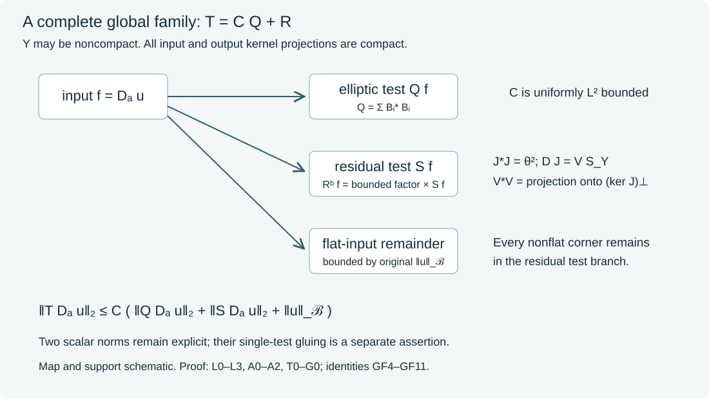

# Global finite-order families and residual tests

Complete boundary residual kernels may connect different coordinate charts and boundary components. Their compact input and output projections do not require the entire boundary to be compact. We extend the [scalar residual factor](../20261017-global-boundary-residual-factors/global-scalar-factors-for-boundary-residuals.html) to this setting and combine it with the [full global parametrix](../20261005-global-boundary-operators/global-boundary-operator-calculus.html). The result is a reduction of an arbitrary bounded finite-order family to two scalar norms, retaining the original Banach remainder.

The first scalar test is positive and elliptic on the prescribed compact conic microsupport. The second is a complete residual test. The statement below keeps those two norms explicit. It supplies the full global family reduction needed before a separate scalar gluing argument; it does not identify a sum of squares with a norm that dominates both factors.

## 1. The complete family and the conic hypotheses

**H0. Uniformity includes the residual tails.** Let \(X\) be a smooth manifold with boundary, equipped with a smooth positive density. Its boundary may be noncompact. Let \(\Gamma\subset\widetilde T^*X\setminus0\) be open and conic. Suppose scalar operators \(T_{\ell,a}\in\Psi_b^m(X)\), \(1\leq\ell\leq L\), have fixed compact input and output projections, and are bounded in the full order-\(m\) topology. Their symbols are uniformly rapidly decreasing outside one compactly generated closed cone \(K\Subset\Gamma\). Here compact containment is in the normalized cosphere bundle, including the base variable. Uniform rapid decrease means every required negative-order symbol estimate holds uniformly on each closed conic set disjoint from \(K\). Merely requiring each member separately to be residual is weaker.

Let \(D_a\) be a differential family of fixed finite order, with uniformly bounded smooth coefficients on the relevant compact sets, and let \(\mathcal B\) embed continuously in extendible distributions. There are compactly supported scalar operators
\[
 Q\in\Psi_b^{2r}(X),\quad S\in\Psi_b^{-\infty}(X),
 \qquad r\in\mathbb N_0,\quad 2r\geq\max(m,0),
 \tag{GF1}
\]
such that \(Q\) is formally selfadjoint, \((Qf,f)\geq0\) for smooth compact inputs, its principal symbol is nonnegative and elliptic on a neighborhood of \(K\), and its microsupport lies in a compactly generated cone inside \(\Gamma\). For all smooth inputs in the indicated graph,
\[
 \|T_{\ell,a}D_a u\|_2
 \leq C\bigl(\|QD_a u\|_2+\|SD_a u\|_2+\|u\|_{\mathcal B}\bigr).
 \tag{GF2}
\]
The constant is uniform in \(\ell,a\). The full residual kernel of \(S\), including its corner coefficient, remains in this norm. No compactness of \(\partial X\), no boundaryless replacement of \(X\), and no new norm on \(u\) is assumed.

For a common input \(f\), every complete finite-order operator has an identity \(T_{\ell,a}=C_{\ell,a}Q+R_{\ell,a}\), with \(C_{\ell,a}\) uniformly bounded on L2. The corner parts of the residuals have uniformly bounded right factors through \(S\). Only their original smooth flat-input remainder is charged to \(\|u\|_{\mathcal B}\) after \(D_a\). The estimate is pointwise in \(a\) when \(D_a u\) varies with \(a\); a supremum on the left uses the corresponding supremum of both test norms on the right.

## 2. Residual factors with compact projections

**L0. A finite collar neighborhood, without compactifying the boundary.** Consider first any bounded complete residual family with compact projections. The intersections of those projections with \(\partial X\) lie in a compact set. Choose finitely many boundary charts covering it and slightly larger relatively compact charts. The finite cutoff and normalized inward-flow construction GRF:C0 works on a neighborhood of this compact set: all normal derivatives are nonzero on a larger closed neighborhood, and the finite flow cover gives one positive time interval there. Thus one obtains a product collar \([0,\epsilon)\times Y_0\) over an open boundary neighborhood \(Y_0\) containing the compact set. The neighborhood \(Y_0\) need not have a smooth boundary, be closed or be compact. Shrinking the covered compact supports inside the larger charts suffices for the flow interval. The inverse and uniqueness arguments are exactly those of GRF:C0; no double of a manifold with corners or regular-value theorem is required.

Use the fixed density normalization GRF:C0 in this collar. Before choosing any spectral weights, fix a compact normal convolution radius, the normal bump and nested input cutoffs as in GRF:C1. Tangential cutoffs equal to one near the two compact boundary projections keep the corner part inside compact subsets of \(Y_0\times Y_0\). Subtracting it leaves an original-product smooth kernel flat in the input, by the complete side-face argument GRF:C1. OSA:K0 bounds that remainder after \(D_a\) by the original Banach norm. Every rectangular corner between different input and output charts is included in the corner part.

**L1. The compact frame is a contraction.** Write \(H=L^2(Y_0,d\nu)\). Choose a smooth compactly supported \(\theta\) equal to one near the common tangential input projection of the corner kernels. A finite chart partition on a neighborhood of \(\operatorname{supp}\theta\), normalized by its sum of squares, gives real compact chart cutoffs \(\chi_i\) with
\[
 \sum_i\chi_i^2=\theta^2,\qquad
 J:H\longrightarrow\mathcal H=\bigoplus_iL^2(\mathbb T^d),
 \qquad J^*J=M_{\theta^2}.
 \tag{GF3}
\]
Here \(0\leq\theta\leq1\), and \(J_i\) is the density-normalized chart transfer from GRF:J0. The adjoint computation is unchanged. In particular \(J\) is a contraction, not necessarily an isometry or injection. Put \(K_0=\bigcup_i\operatorname{supp}\chi_i\), a compact subset of \(Y_0\).

Let \(r_{\ell,a}(v,\kappa)\) be the full normal Fourier symbol of the corner residual, with its smooth compact tangential kernel. The complete estimates in GRF:C1 and the joint input integrations by parts in GRF:J1 apply unchanged: compact tangential projections replace integration over a compact entire boundary. Choose the positive Schwartz diagonal \(D\) and its tail envelope by GRF:J1. The column construction GRF:J2 gives bounded maps \(B_{\ell,a}=r_{\ell,a}J^*D^{-1}\), with both normal-frequency derivatives through order two rapidly decreasing uniformly. Their exact identity is now
\[
 B_{\ell,a}DJ=r_{\ell,a}M_{\theta^2}=r_{\ell,a}.
 \tag{GF4}
\]
The final equality holds on the complete input kernel, since \(\theta=1\) near its common projection. Truncating chart modes and passing by their L2 convergence justifies the equality; no inverse of \(J\) or bounded inverse of \(D\) is used. If the family is zero there is nothing to factor; otherwise the finite covering may be taken nonempty.

**L2. A compactly supported scalar square root.** Set \(T=J^*D^2J\). Its scalar kernel is smooth and supported in \(K_0\times K_0\). Positivity and boundedness follow from \((Tf,f)=\|DJf\|^2\). The full norm-series proof GRF:P0 does not require injectivity: choose \(c\geq\|D\|^2>0\), let \(A=I-T/c\), and use the same absolutely summable binomial coefficients. It gives a positive selfadjoint \(S_Y\) with \(S_Y^2=T\).

This square root has no output outside \(K_0\). If \(f\) is supported in its complement, then \(Tf=0\) and \(\|S_Yf\|^2=(Tf,f)=0\). Selfadjointness also makes every output orthogonal to functions supported in that complement. Thus, as L2 operators,
\[
 S_Y=1_{K_0}S_Y1_{K_0}.
 \tag{GF5}
\]
The measurable projections here express support; no nonsmooth multiplier is used as a boundary pseudodifferential operator.

To prove smoothness, choose a second finite atlas frame \(L\), with \(L^*L=M_\alpha\), where \(\alpha=1\) on a neighborhood of \(K_0\). Its cutoffs have compact support in larger chart neighborhoods. For \(\psi_{i,k}=L_i^*e_k\), integration by parts in the compact smooth kernel of \(T\) makes \((T\psi_{i,k},\psi_{i,k})=\|S_Y\psi_{i,k}\|^2\) rapidly decreasing in \(k\). For every \(N\), the sum of \(\langle k\rangle^{2N}\|S_Y\psi_{i,k}\|^2\) is finite. The Cauchy--Schwarz and double Fourier argument of GRF:P1 therefore proves a smooth joint kernel for every \(L_iS_YL_j^*\). All weighted Fourier series and their derivatives converge absolutely uniformly. Since (GF5) implies
\[
 S_Y=M_\alpha S_Y M_\alpha=L^*(LS_YL^*)L,
 \tag{GF6}
\]
these chart kernels give a global smooth scalar kernel for \(S_Y\), supported in \(K_0\times K_0\). Using the original frame \(J\) in (GF6) would give unwanted factors of \(\theta^2\). The larger frame is what proves smoothing through the transition region of \(\theta\).

**L3. The partial isometry and the full residual estimate.** The squared norm identity gives \(\ker S_Y=\ker J\). Let \(M=(\ker J)^\perp\). Selfadjointness and the closed-subspace projection argument of GRF:P2 show \(\overline{\operatorname{ran}S_Y}=M\). Define \(V(S_Yf)=DJf\) on this range. It is well defined and isometric because both squared norms equal \((Tf,f)\). Extend it by completeness to \(M\), and by zero on \(M^\perp\). Then
\[
 \|V\|\leq1,\qquad V^*V=1_M,\qquad DJ=VS_Y.
 \tag{GF7}
\]
These identities are proved directly by the construction, including the noninjective case. There is no assertion that \(V^*V=I\) on all of \(H\).

The normal construction GRF:N0--N2 now applies verbatim to the column bounds in L1. Its positive multiplier \(p\) has compact smooth normal kernel; \(C_{\ell,a}=B_{\ell,a}/p\) has integrable norm bounds through its second normal-frequency derivative. The twice-integrated normal kernel and its two Schur integrals give a uniformly bounded \(\operatorname{Op}(C_{\ell,a})\). With the fixed normal input cutoff \(\chi\), define
\[
 S=U^{-1}p(D_v)S_YU\chi .
 \tag{GF8}
\]
Its complete density-correct ratio kernel is GRF:GR16, with the present compactly supported smooth \(s_Y(y,y')\). Its compact tangential support, compact normal ratio and fixed normal input support give compact original projections inside this collar. It is smooth at the front face and flat at both side faces, hence a full scalar residual on \(X\) after extension by zero. Exact Fourier cancellation in (GF4), followed by (GF7), gives
\[
 UR^b_{\ell,a}f=\operatorname{Op}(C_{\ell,a})V\,USf.
 \tag{GF9}
\]
The scalar normal multiplier commutes with the fixed bounded \(V\). Smooth collar inputs make every Fourier integral absolutely norm integrable; Hilbert density supplies the bounded extension. Adding the genuine flat-input remainder from L0 proves the global residual estimate GR1 on an arbitrary boundary with compact kernel projections. All constants remain uniform in the full family.

## 3. A positive finite-order test on the prescribed cone

**A0. The scalar positive test is global.** A compact normalized set \(K\) inside \(\Gamma\) has a finite cover by smaller boundary or interior coordinate-cone neighborhoods whose closures stay inside \(\Gamma\). The finite cutoff proof U001-A4 supplies base and angular cutoffs. Choose symbols \(b_i\) of order \(r\), supported in these neighborhoods, with real nonnegative homogeneous leading terms and with at least one leading term positive at each point of \(K\). Their degree-\(r\) radial factors are \(|\zeta|^r\) in their local frames for large frequency. Low frequencies are cut off smoothly. The global lacunary realization GB:C6 and proper cutoff give compactly supported scalar \(B_i\in\Psi_b^r(X)\). Set
\[
                           Q=\sum_iB_i^*B_i.
 \tag{GF10}
\]
The actual adjoints use the fixed density. Thus \(Q\) is formally selfadjoint and \((Qf,f)=\sum_i\|B_if\|_2^2\geq0\) on smooth compact inputs, as an exact full-operator identity. The full product and adjoint calculus GB:C9--C10 gives order \(2r\), compact projections and microsupport in the finite union of the chosen compact conic neighborhoods. Its principal scalar symbol is \(\sum_i|b_i|^2\). It is nonnegative everywhere and elliptic of order \(2r\) near \(K\). Indeed its normalized continuous value has a positive minimum on \(K\), and on a smaller fixed neighborhood by compactness. This is a principal-symbol conclusion together with an exact positivity identity, not an assertion that all lower symbols vanish or are positive.

**A1. The complete global right comparison.** Ellipticity of \(Q\) near \(K\) gives a fixed properly supported \(E\in\Psi_b^{-2r}\), localized inside a slightly larger cone in \(\Gamma\), such that \(EQ-I\) is residual on a neighborhood of \(K\). For clarity, this is the full construction GB:E1--E3: begin with the reciprocal principal symbol times a larger cutoff, cancel the order-minus-one product error by ordered multiplication with that reciprocal, and repeat. A fixed larger cutoff is one near every nonresidual error support, so no division occurs outside the elliptic region. The asymptotic sum GB:C11 retains the low-frequency, proper-cutoff and chart-transition errors as full residuals. A finite cover of \(K\) and its coordinate-invariant full-symbol recursion produce the global localized inverse. No inverse of \(Q\) is asserted outside this cone.

Define
\[
 C_{\ell,a}=T_{\ell,a}E,\qquad
 R_{\ell,a}=T_{\ell,a}-C_{\ell,a}Q.
 \tag{GF11}
\]
These are complete operators with compact projections. The first has order \(m-2r\leq0\), so the exact global order-zero estimate GB:H1 gives a uniform L2 bound. The second is a full residual. Near \(K\), this follows from \(R=T(I-EQ)\) and the complete parametrix identity. Away from \(K\), every finite-order part of \(T\) is rapidly decreasing uniformly, so the full product has the same property. A finite normalized cover of the compact base and all angular directions gives every residual seminorm. The residual ideal GB:C8--C9 retains all separated-chart, proper-cutoff and low-frequency kernels. It does not turn them into ordinary original-product smooth kernels.

**A2. Uniformity and supports of the full remainder.** The operator \(E\) and its asymptotic radii depend only on the fixed \(Q\) and the two nested working cones. Since the \(T_{\ell,a}\) family is bounded in each stated symbol seminorm, each finite product estimate is uniform in \(\ell,a\). For every required negative order, use the corresponding sufficiently long fixed expansion of \(EQ-I\) and the uniform rapid bounds outside \(K\). Its full remainder has that negative order uniformly. This proves boundedness of \(R_{\ell,a}\) in the complete residual topology for all seminorms, rather than inferring a uniform residual family from pointwise residual membership.

Compact output and input cutoffs in \(E\) may be fixed before the products, equal to one near the compact base projection of the smaller elliptic neighborhood. All newly introduced proper-cutoff terms are retained in (GF11). The common compact projections of \(T\), these fixed cutoffs and their finite intermediate product projections give common compact projections for \(C\) and \(R\). Boundary projections may lie in several components of a noncompact boundary; L0--L3 cover their finite compact union.

## 4. The two scalar norms and the actual graph

**T0. The full global family estimate.** Apply L0--L3 to the entire residual family in (GF11), not to isolated diagonal chart kernels. Its one scalar \(S\) controls every corner component, including all cross-chart and cross-component terms. Taking norms in the exact identity \(T=CQ+R\), using the uniform L2 bound for \(C\), and applying its residual estimate to \(D_a u\) proves (GF2). For a common smooth \(f\), this gives the supremum estimate for all corner pieces through \(\|Sf\|_2\), together with \(C\|Qf\|_2\); after \(D_a\), only the flat-input part uses the original \(\mathcal B\) norm. For the forcing and observation inputs of an estimate, apply this construction separately to the family acting on \(P_a u\) and the family acting on \(u\). This gives at most two scalar tests per input, with their respective prescribed cones.

**G0. What is and is not a graph conclusion.** On any actual smooth graph norm controlling \(u\) in \(\mathcal B\) and the two tested quantities in L2, (GF2) makes the \(T_{\ell,a}D_a u\) outputs Cauchy whenever smooth inputs are Cauchy. If the graph has its stated distributional realization, continuity of the full operators identifies the output limit. This proves extension to that completion. It does not prove smooth density in an arbitrary larger distributional intersection, or supply an unproved Fréchet description of that intersection.

The reduction is global and includes the full finite-order families. The still-needed scalar gluing assertion is that one admissible scalar test can dominate the two norms \(\|Qf\|_2\) and \(\|Sf\|_2\), with the original Banach remainder when \(f=D_a u\). The positive identity in (GF10) alone does not prove it. Nor does replacing the tests by \(Q^*Q+S^*S\) and applying Cauchy--Schwarz without control of \(\|f\|_2\). The full general observation proposition retains this obligation and its actual graph argument.

## 5. Three solved examples

### Exercise 1. A cutoff frame on a noncompact boundary

**X1.** Take \(Y_0=\mathbb R\), and let all corner input kernels be supported in \([-1,1]\). Choose \(\theta=1\) near this interval, supported in \((-2,2)\). What happens to an input supported in \((3,4)\), and why is (GF4) still exact?

**Solution.** Every chart component \(J_i f\) is zero, so \(Tf=0\) and \(S_Yf=0\). The partial isometry is zero on this part of \(\ker J\). The corner operator also annihilates such \(f\). For an arbitrary input, multiplication by \(\theta^2\) is exactly identity on its entire corner-kernel input projection; hence \(rM_{\theta^2}=r\), regardless of behavior in the transition region. The second frame in L2 covers the whole compact \(K_0\), including that transition, which is why the smoothing proof does not require division by a cutoff vanishing at its support edge.

### Exercise 2. A sum of squares is not a dominating norm

**X2.** On a cylinder with circle boundary, let \(\psi\) be a real unit L2 function compactly supported in a normal interior interval. Let \(P_\psi\) be its rank-one orthogonal projection. On the circle take \(D e_k=d_k e_k\), where \(d_k=e^{-\sqrt{1+|k|}}\), and put \(S=P_\psi\otimes D\). Can \(\|Sf\|_2\leq C\|S^*Sf\|_2\) hold for all smooth inputs?

**Solution.** This \(S\) is positive, selfadjoint and has a smooth compact original-product kernel, so it is also a full boundary residual. For \(f_k=\psi e_k\), the two norms are exactly \(d_k\) and \(d_k^2\). Their ratio tends to infinity. Thus no such uniform constant exists. The identity \((S^*Sf,f)=\|Sf\|^2\) yields only \(\|Sf\|^2\leq\|S^*Sf\|\,\|f\|\). The missing input norm cannot be discarded. This calculation addresses that exact L2 shortcut; it does not disprove a statement with a separately justified original Banach remainder.

### Exercise 3. Pointwise residual membership is insufficient

**X3.** In an interior coordinate interval, choose a compact smooth frequency function \(b\), equal to one near \(1\) and supported in \((1/2,2)\). Let \(\chi\) be a compact spatial cutoff equal to one near a nonzero compact smooth \(\psi\). Define \(T_N=\chi b(D/N)\chi\). Explain why these are individually residual and uniformly order zero, but cannot be dominated on L2 by one fixed compact residual test.

**Solution.** For fixed \(N\), the frequency support is compact, so the kernel is smooth. Uniform order-zero estimates follow from \(\partial_\xi^j b(\xi/N)=N^{-j}b^{(j)}(\xi/N)\), on \(|\xi|\asymp N\), and the bounded full cutoff-product calculus. For \(f_N=\psi e^{iNx}\), Plancherel gives
\[
 \|b(D/N)f_N-f_N\|_2^2
 =(2\pi)^{-1}\int|b(1+\eta/N)-1|^2|\widehat\psi(\eta)|^2\,d\eta
 \longrightarrow0.
 \tag{GF12}
\]
To justify the limit, split at a fixed large frequency radius. On the ball, \(b(1+\eta/N)\to1\) uniformly by continuity near \(1\). On the complement, the bounded factor is dominated by a fixed constant times the arbitrarily small L2 Fourier tail of \(\psi\). Since \(\chi\psi=\psi\), the cutoff output has the same limit. Thus \(\|T_N f_N\|_2\to\|\psi\|_2>0\). Any fixed compact residual test, applied to these interior-supported inputs, has a smooth compact kernel on the relevant input set. Integration by parts in that input variable gives \(\|Sf_N\|_2=O(N^{-j})\) for every \(j\). Domination is impossible. In particular this family is not uniformly residual: its symbol is of size one near frequency \(N\). H0 requires precisely the additional uniform rapid bounds when a common microsupport is prescribed.

## 6. The global reduction diagram

**V0. Read every branch.** The full identity is (GF11), and the corner factor is (GF9). The residual branch includes every chart pair on the original manifold. Its separate flat-input branch has the actual original Banach bound. The frame satisfies \(J^*J=\theta^2\); only the second larger frame satisfies identity near the square root's compact support. The last display contains two scalar norms, not an asserted single combined tester. This is a map and support schematic, not a plot of a computed kernel.

Independent exposition, proofs, solved examples and diagram: CC0-1.0. Mathematical context: Lars Hörmander, *The Analysis of Linear Partial Differential Operators III*, Sections 18.3 and 24.7.  Earlier programme proofs and external human foundations retain their recorded terms. Internal CC0-export closure and whole-course completion are not claimed.
