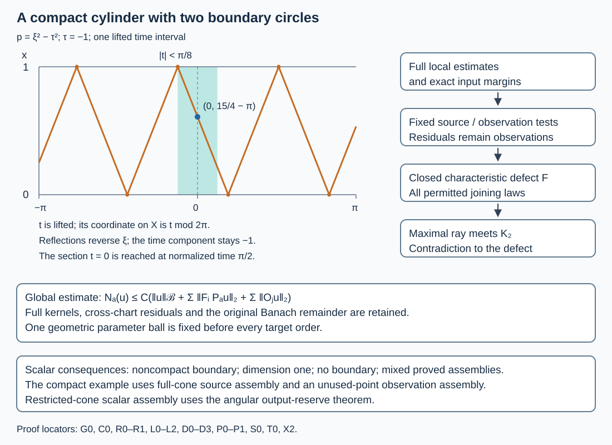

# Global observation with full source and observation tests

The analytic observation argument works on an arbitrary manifold with noncharacteristic boundary, using finitely many fixed full source and observation tests. We prove that statement with one geometric parameter neighborhood before every target order. Existing scalar assembly then gives the single-source, single-observation estimate on noncompact boundaries, on one-dimensional manifolds, and without a boundary. We also record how different proved scalar constructions can supply the two channels on a compact boundary.

The source context is Lars Hörmander, *The Analysis of Linear Partial Differential Operators III*, §§24.5–24.7, especially Propositions24.7.1 and24.7.1-prime.  The proof map gives the actual earlier programme proofs. Original exposition, arguments, solutions and diagram: GPT-6.1 Sol (OpenAI), Ultra; CC0-1.0. Linked human foundations retain their recorded terms. The finite-list conclusion is distinguished from the separate [global scalar assembly and observation](../20261017-angular-output-reserve-assembly/scalar-tests-from-a-missing-tangential-direction.html); their complete-kernel combination gives a single scalar in each channel.

## 1. The global statement

**H0. Manifold, operator, geometry and Banach norm.** Let \(X\) be a second-countable smooth manifold of dimension \(n\geq1\), with boundary allowed, and a fixed smooth positive density. Let \(P_a\) be scalar differential operators of order two, with coefficients smooth jointly in \(X\) and \(a\) near zero in a finite-dimensional real parameter space. Their quadratic principal symbols \(p_a\) are real; lower coefficients may be complex. The boundary is noncharacteristic for \(P_0\). No global time function, compactness of the boundary or unique continuation at infinite contact is assumed.

Let \(\Gamma_1,\Gamma_2\subset\Gamma\) be open cones in the nonzero compressed cotangent space. Every maximally continued compressed generalized characteristic of \(P_0\) in \(\Gamma\) meeting \(\Gamma_1\) is assumed to meet \(\Gamma_2\). This quantifies over every permitted continuation, including stationary normalized rays. Fix a compact normalized target set \(K_1\Subset\Gamma_1\).

Let \(\mathcal B\) be a Banach space containing the smooth compactly supported functions densely, continuously embedded in extendible distributions, with a continuous value trace into distributions on \(\partial X\) agreeing with smooth restriction. We estimate actual smooth compact inputs with zero value trace. The proof of the smooth estimate uses only the embedding; the trace hypothesis also preserves the boundary value on the actual completed graph.

**H1. Finite full tests first.** There is \(\delta>0\), depending on the geometry and coefficient family before any target order, with the following property. Let \(C_{\ell,a,b}\), \(1\leq\ell\leq L\), be finitely many bounded full families of one finite order \(m\), with common compact physical projections and uniform full microsupport in \(K_1\), for \(|a|\leq\delta\). The auxiliary index \(b\) need not vary continuously. There are finitely many fixed compactly supported scalar operators \(F_i,O_j\) of finite orders, independent of \(a,b\), with
\[
 \operatorname{WF}'_b(F_i)\Subset\Gamma,\qquad
 \operatorname{WF}'_b(O_j)\Subset\Gamma_2,
 \tag{GO1}
\]
such that
\[
 N_a(u):=\sum_{\ell=1}^{L}\sup_b\|C_{\ell,a,b}u\|_2
 \leq C\left(\|u\|_{\mathcal B}+
          \sum_i\|F_iP_au\|_2+\sum_j\|O_ju\|_2\right).
 \tag{GO2}
\]
Every full residual part is retained. The number, orders and constants of the tests may depend on the full target families. Later scalar constructions do not change the chosen parameter neighborhood.

## 2. Fix geometry before operator orders

**G0. Localize the coefficient domain without losing the geometric condition.** Choose a compact normalized neighborhood \(K_1^+\Subset\Gamma_1\) of \(K_1\). Apply the fixed-operator case of PRS:S0–S11 to \(P_0\) and \(K_1^+\). It gives compact connecting sets \(K^0\Subset\Gamma\), \(K_2^0\Subset\Gamma_2\), containing the full connecting subarc for every maximal ray from \(K_1^+\). Choose an open set \(\Omega\subset X\), with compact closure in a slightly larger coordinate neighborhood union, containing the base projection of \(K^0\) and a buffer around it. The frontier of \(\Omega\) is excluded; it is not a new physical boundary. Its actual boundary charts are those of \(\partial X\cap\Omega\).

For \(P_0\), every maximal ray in the restricted cone \(\Gamma_\Omega=\Gamma\cap T_b^*\Omega\) meeting a smaller open neighborhood \(\Gamma_1'\) of \(K_1\) inside \(K_1^+\) meets \(\Gamma_2\cap T_b^*\Omega\). To verify this, extend that ray maximally in \(\Gamma\), using the actual continuation theorem. Its connecting subarc lies in \(K^0\), hence in \(\Omega\). A maximal restricted ray cannot end before completing that subarc while remaining in this compact interior region; the local extension and joining laws would extend it. This proves the restricted access hypothesis.

On the compact closure of \(\Omega\), noncharacteristicity persists for a fixed small parameter ball. Apply the full parameter stability theorem PRS to this restricted domain and these cones. Shrinking once to a closed parameter ball \(\mathcal A=\{|a|\leq\delta\}\) inside its validity range gives
\[
 K\Subset\Gamma_\Omega,\quad K_2\Subset\Gamma_2\cap T_b^*\Omega,
 \quad T<\infty,
 \tag{GO3}
\]
such that every maximal restricted \(P_a\) ray from \(K_1\) has a connecting subarc in \(K\) to \(K_2\), with normalized travel time at most \(T\). The same sets and parameter ball work before every target order. In particular no global noncharacteristicity of \(P_a\) outside \(\Omega\) has been added. Remote full residual kernels of later targets will be handled as actual observation tests, not by changing this ball.

**C0. All local estimates return to the original Banach space.** Use a countable atlas on \(\Omega\), with compactly nested boundary or interior coordinate boxes. On each boundary box, PBC:H0–T1 gives the complete smooth parameter normal form, including its fixed normal sign, coefficient division, density unitary and nonvanishing gauge. Near any parameter center in \(\mathcal A\), the same construction applies after translating that center to zero. Its coordinate and conic margins are fixed before operator orders. Boundary values remain zero.

The coarse norm in that chart is supplied by PBC:B0. Its proof transposes the coordinate/gauge map against flat tests, uses NGR:B1–B2 on one fixed compact original input set, and applies the ordinary negative Sobolev bound. Thus
\[
 \|\beta S_a^{-1}U_au\|_{\overline H^{-M}}\leq C\|u\|_{\mathcal B}
 \tag{GO4}
\]
for one integer on that chart and parameter closure. No bounded action of pullback on \(\mathcal B\) is assumed. Require all complete input projections of the local source and observation operators to lie where \(\beta=1\). PBC:T0 then removes the cutoff commutator exactly, including its residual input projections. Its formula T1 returns the actual tested source \(F_a^\natural P_au\), not the source of an altered equation. All transformed kernels remain bounded in the full calculus, with the stated original cones and compact supports.

## 3. Keep the residuals as actual tests

**R0. Global finite elliptic comparison.** A bounded family \(T_{a,b}\) with compact uniform microsupport \(K_T\) can be compared with fixed tests \(E_\nu\) of integer order \(M\geq\max(0,\operatorname{ord}T)\), elliptic on a finite cover of \(K_T\):
\[
 T_{a,b}=\sum_{\nu=1}^q B_{\nu,a,b}E_\nu+R_{a,b},\qquad
 \sup_{\nu,a,b}\|B_{\nu,a,b}\|_{2\to2}<\infty,
 \tag{GO5}
\]
where \(R_{a,b}\) is a bounded full residual family with common compact projections. Choose a finite conic partition supported in the elliptic regions, take the complete localized inverses there and form the exact difference. Every term from proper supports, low frequencies, partitions and chart changes remains in \(R\). GB:E1–E3, C8–C11 and H1 prove all orders and uniform norms in this construction, as in CRO:R0. It is a global construction and does not place the entire base in one chart.

**R1. One fixed residual observation for each required family.** The full global residual factorization GFR:L0–L3 supplies, for each such bounded residual family, one fixed scalar full residual \(S_R\) with compact projections and
\[
 \sup_{a,b}\|R_{a,b}u\|_2
       \leq C_R\bigl(\|S_Ru\|_2+\|u\|_{\mathcal B}\bigr).
 \tag{GO6}
\]
Its finite frames use only a relatively compact boundary region containing the two kernel projections, with a second larger frame to reconstruct the smoothing square root. Thus it applies equally to compact and noncompact boundaries and retains rectangular and cross-component kernels. The true original smooth flat-input error is bounded by OSA:K0 with differential operator the identity. This is precisely the proved full factorization, not a replacement of residuals by principal symbols.

We put this actual \(S_R\) on the observation list. Its full microsupport is empty, so it satisfies (GO1) for any \(\Gamma_2\), even if that cone is empty. It need not have its physical projections over \(\Gamma_2\). These two different support assertions are not conflated. This direct residual observation avoids imposing a noncharacteristic hypothesis on coefficients near remote input projections.

**L0. Global local implications with finitely many fixed tests.** The actual local estimates listed in CRO:T1 cover compressed ellipticity, boundary tangential ellipticity, interior propagation, transverse reflection, strict diffraction, and nondiffractive glancing with its complete incoming window. Apply them through C0. An instance consists of an open parameter neighborhood \(D\), an open output region \(W\Subset\Gamma_\Omega\), and an open observation region \(V\subset\Gamma_\Omega\), possibly empty. Its geometric \(D,W,V\) work before every output order. Parameter closures are compactly inside slightly larger validity regions.

For a global full target microsupported in \(W\), first take an elliptic test in the local output chart and apply (GO5). The difference is a full global residual, whose fixed test from (GO6) is retained separately. For the local part, C0 returns finitely many bounded full source families with microsupport compact in \(\Gamma_\Omega\), and observation families with microsupport compact in \(V\). Apply the full two-test reduction GFR:A0–T0 to each of these families. For a source family use its differential input \(D_a=P_a\); for an observation family use the identity. This gives finitely many fixed operators and an estimate
\[
 \|E u\|_2\leq C_E\left(\|u\|_{\mathcal B}
       +\sum_\mu\|F_{E,\mu}P_au\|_2
       +\sum_\nu\|O_{E,\nu}u\|_2+\|S_Eu\|_2\right),\quad a\in D.
 \tag{GO7}
\]
Here the fixed \(F_{E,\mu}\) have microsupport compact in \(\Gamma_\Omega\); the \(O_{E,\nu}\) have microsupport compact in \(V\); and \(S_E\) is the separately retained global residual test. There may be more than one fixed test in either sum. No scalar assembly is used in obtaining (GO7). GFR needs only the uniform coefficient bounds of \(P_a\) on its finite compact supports to bound its Banach remainder; it requires no action of \(P_a\) on \(\mathcal B\) itself.

All full kernel projections used in the local equation transfer stay inside the margins in C0. If a prescribed global target extends outside that local chart only through residual kernels, (GO5)–(GO6) handle those kernels; they are not cut off without a bound. The opposite propagation orientation follows by conjugating the whole equation and the real quadratic antipodal covector map, as proved in CRO:T1. The glancing observation contains the whole closed incoming window and both lifts, not only its center.

## 4. A countable list retaining every required comparison

**L1. Select open implications, not a dense set of symbols.** On the second-countable normalized phase space \(\Gamma_\Omega\), choose fixed nested basis pairs \(U_i\Subset V_i\), whose smaller interiors form a basis. They can be chosen in coordinate boxes. Fix global full scalar tests \(E_{i,k}\) of each nonnegative integer order \(k\), elliptic on \(\overline U_i\), with microsupport compact in \(V_i\). All low-frequency and proper-support kernels are part of those operators.

For every finite union \(V\) of basis sets, consider the local instances in L0 whose observation region is contained in \(V\). Their open sets \(D\times W\) cover their union in parameter-phase space. Enumerate a basis of that product and, for each basis element contained in a cover member, select one such member. This is a countable subcover: any point lies in a basis element inside some member. Do this for every finite union \(V\), and retain (GO7) for each selected instance, every \(E_{i,k}\) with \(\overline V_i\subset W\), and every \(k\). Compact parameter refinements ensure each selected family has its uniform full bounds.

This preserves every admissible implication from an open regularity region \(G\): cover its required compact cap or window by finitely many basis sets with closure in \(G\); the local estimate allows that larger open observation neighborhood. The selected instances for this finite union cover the same output points and have observations still in \(G\). The output basis index can be fixed before varying \(k\). This is the complete open-cover argument of CRO:T2 on the global atlas. Density of a symbol sequence is not asserted or used.

**L2. Close the list under its actual comparisons.** The source list contains every fixed \(F_{E,\mu}\) in the selected estimates. For each fixed observation operator \(O_{E,\nu}\), retain every (GO5) comparison with a finite tuple of \(E_{i,M}\) covering its microsupport, for every integer \(M\) at least its order and zero. Put the corresponding residual \(S_R\) from (GO6) on a residual observation list. Include every \(S_E\) from (GO7) there too.

Do the same for the given target families, for every finite tuple covering their common compact microsupport and each admissible integer order. Empty tuples are included for empty microsupports. Each choice produces a bounded full residual family, hence one actual fixed residual observation. There are countably many finite tuples, orders and selected instances, so all lists are countable. No comparison of a residual source with another test is needed: these residual observations are measured directly.

The observation list consists of all \(E_{i,k}\) with \(\overline V_i\subset\Gamma_2\), together with these countably many residual observations. Enumerate source and observation lists as \(F_1,F_2,\ldots\) and \(O_1,O_2,\ldots\). Each source has microsupport compact in \(\Gamma\); each observation has microsupport compact in \(\Gamma_2\), including the empty microsupport of every residual. Zero tests can fill finite lists. We have not claimed a countable cofinal sequence of all full symbols or all residual kernels.

## 5. Failure would give a closed characteristic defect

**D0. Normalize failure of the finite-test conclusion.** If any finite initial portions of these lists give (GO2), H1 is proved. Suppose none does. Homogeneity then gives smooth compact zero-Dirichlet inputs and parameters with
\[
 a_j\in\mathcal A,\qquad N_{a_j}(u_j)=1,\qquad
 \|u_j\|_{\mathcal B}+\sum_{i\leq j}\|F_iP_{a_j}u_j\|_2
              +\sum_{i\leq j}\|O_iu_j\|_2\leq2^{-j}.
 \tag{GO8}
\]
Failure supplies a positive target norm, so division by it is legitimate. Compactness gives a subsequence with \(a_j\to a_*\in\mathcal A\). For every fixed listed test, its norm series squared is summable; the tail is bounded by \(\sum_{j\geq i}4^{-j}\), and the finite earlier prefix consists of smooth tested inputs. Subsequences preserve these sums. No uniform bound over list indices is asserted.

**D1. Define the open regularity set.** Put
\[
 G=\bigcup\{U_i:\ \sum_j\|E_{i,k}u_j\|_2^2<\infty
                       \text{ for every integer }k\geq0\},\qquad
 F=\Gamma_\Omega\setminus G.
 \tag{GO9}
\]
The same neighborhood must work for every order. Thus \(G\) is open and \(F\) relatively closed. The observation list gives \(F\cap\Gamma_2=\varnothing\): every point in the restricted observation cone has a basis pair whose \(V_i\) closure lies there, so all its orders are on that list. Residual observations outside its base projection do not alter this argument.

**D2. A target defect exists.** If \(F\cap K_1\) were empty, finitely many regular \(U_i\) would cover \(K_1\). Choose an integer \(M\geq\max(0,m)\). The target comparison already retained in L2 bounds its full family norms by these finitely many \(E_{i,M}\) norms, its listed residual observation and the Banach norm. All their squared series converge. The finite sum inequality \((\sum_{i=1}^q b_i)^2\leq q\sum_i b_i^2\) then gives \(\sum_jN_{a_j}(u_j)^2<\infty\), contradicting its value one at every index. Supremums in the bounded target families are already included in that full uniform comparison. Therefore
\[
                         F\cap K_1\ne\varnothing.
 \tag{GO10}
\]

**D3. Transfer every admissible local implication.** Suppose a selected instance has \(a_*\in D\) and its observation region in \(G\). The compact microsupport of each of its finitely many \(O_{E,\nu}\) is covered by finitely many regular basis sets. Its already recorded comparison gives square summability of \(O_{E,\nu}u_j\), using the regular higher-order tests and the listed residual observation. Apply (GO7) on the tail with \(a_j\in D\). Its source tests, separate residual observation and Banach term all have summable squares by (GO8). Hence every output \(E_{i,k}\) of this instance has a summable series.

Choose one output basis pair about the point with closure in \(W\), then repeat for every \(k\) at that same pair. The point is in \(G\). L1 transfers this conclusion to every admissible local instance with its whole compact cap or window in \(G\). Neither an interchange of all orders nor a uniform numerical constant over the countable collection is required.

## 6. The intrinsic ray contradiction

**P0. Local characteristic and joining laws.** Apply D3 to the data-only elliptic instances. This excludes interior points where \(p_{a_*}\ne0\). At the boundary it excludes compressed normal component \(\kappa\ne0\), since \(x^2P_{a_*}\) is elliptic there; the remaining boundary tangential elliptic region is excluded by the zero-Dirichlet estimate. Thus \(F\) lies in the compressed characteristic set.

For \(n\geq2\), lift it in a boundary normal chart by
\[
 \widetilde F=\operatorname{Char}(p_{a_*})\cap\pi^{-1}(F),\qquad
 p_{a_*}=\xi^2-r_{a_*},\quad \pi(x,z,\xi,\eta)=(x,z,x\xi,\eta).
 \tag{GO11}
\]
Both hyperbolic roots are retained. The bound \(|\xi|^2=r_{a_*}\leq C|\eta|^2\) makes compact normalized lifts compact. The contrapositive of the interior, reflection and strict-diffraction instances gives the complete short ordinary, reflected or tangent germs in \(F\), exactly as CRO:P0–P1. At nondiffractive glancing, if the full larger incoming window missed \(F\), its characteristic lifts and its remaining elliptic compressed points would be in \(G\). Its compact closure would have an observation neighborhood in \(G\), contradicting D3. Each such window therefore has a defect witness.

The uniform window constants of GSP:C9 permit \(\epsilon=L|t|\), with a fixed sufficiently large \(L\). The witnesses then differ from the gliding flow by \(O(t^2)\) in reduced position and tangential covector, have normal position \(O(t^2)\), and normal root \(O(|t|)\). PW:T004–T011 supplies the exact directional witness required by GGL:T040–T045, uniformly on compact glancing sets. The latter proves an actual generalized arc inside the lifted defect, with signed-root recovery through accumulating reflections and the higher-contact bounds needed at joins. This includes infinite contact and stationary projected strict diffraction.

These are intrinsic local statements about the reduced witness, not an assertion of that first-order expansion for the full normal momentum. Write \(w=(x,z,\eta)\) for the reduced variables. The preceding bounds give \(w_t=w+tV_{\rm red}(w)+O(t^2)\) and compressed normal component \(\kappa_t=x_t\xi_t=O(t^3)\). Boundary coordinate changes act smoothly on \((w,\kappa)\); a change of defining function has the form \(\widetilde x=c(x,z)x\), with \(c>0\), and the extra normal-momentum term in the tangential covector is a smooth multiple of \(x\xi\). Taylor's formula therefore gives the transformed reduced witness \(h(w_t,\kappa_t)=h(w,0)+t\,d_wh(w,0)V_{\rm red}(w)+O(t^2)\), uniformly on compact overlaps. Choose one smooth positive homogeneous norm on nonzero compressed covectors, as in PRS. Its normalization is another smooth change of these variables; a positive speed change has new time \(t'=c_1(w)t+O(t^2)\), with \(c_1,c_1^{-1}\) bounded on the compact set. The same reduced witness and joining assertions follow. The normal root is still recovered by the separate signed-root proof. PBC:K0 identifies the characteristic curves, including the fixed sign reversal and positive coefficient division. No single chart for the entire boundary has been assumed.

**P1. Stationary points, dimension one and maximal continuation.** Interior radial Hamilton rays are stationary after positive normalization. Nondiffractive radial gliding rays, including zero fields, have the same constant normalized continuation. These are exactly the exceptional cases of GSP:C10. They count in the geometric access hypothesis; they are not deleted from \(F\).

When \(n=1\), the boundary has no nonzero tangential compressed covectors. Its nonzero compressed covectors are elliptic for \(x^2P\), so no boundary defect remains. Interior characteristic points have symbol \(p=a_2(x)\xi^2\), with \(a_2(x)=0\) and \(\xi\ne0\); the Hamilton field there is \(-a_2'(x)\xi^2\partial_\xi\), hence radial or zero. Every possible remaining defect is therefore a stationary normalized ray. The needed elliptic instances follow directly by the complete parametrix for \(P\) in the interior and \(x^2P\) at the boundary; their full residual errors are the observations of R1. This proves the one-dimensional analytic case without a positive-dimensional glancing chart.

For all dimensions, continue the local arcs in the closed defect maximally in \(\Gamma_\Omega\). The complete continuation argument GSP:C11 and PRS:S7–S10 uses compact velocity bounds and normalized limits at finite endpoints; a finite endpoint in a compact subset has its limit in \(F\) and the local joining law extends it. Exhaustion yields a maximal arc. No bound on reflection count, unique continuation at infinite contact, global clock or continuity of first exit time is used.

Starting from (GO10), this maximal \(P_{a_*}\) arc avoids \(\Gamma_2\), whereas (GO3) forces a subarc to \(K_2\subset\Gamma_2\). This contradiction proves the finite-test estimate (GO2). The one-dimensional stationary case gives the same contradiction immediately.

## 7. Scalar consequences and the actual graph

**S0. When two scalar tests follow.** Apply any proved scalar family assembly separately to the finite source list in (GO2), with differential input \(P_a\), and to its observation list, with identity input. Each retains the original Banach remainder. Rescale the two resulting scalar tests to absorb their finite constants. This gives
\[
 N_a(u)\leq\|A_fP_au\|_2+\|A_ou\|_2+C_B\|u\|_{\mathcal B},\qquad
 \operatorname{WF}'_b(A_f)\Subset\Gamma,\quad
 \operatorname{WF}'_b(A_o)\Subset\Gamma_2.
 \tag{GO12}
\]
In particular:

- If \(n\geq2\) and \(\partial X\) is noncompact, the finite union of boundary base projections of the selected microsupports is compact. GRA supplies an unused boundary point and one scalar full test in each channel. All full residuals, including kernels between components, remain in its estimate.
- If \(n=1\), the global one-dimensional assembly OSA applies for arbitrary boundary and allowed cones. The analytic one-dimensional argument in P1 has already supplied (GO2).
- If the boundary is empty, the positive finite-order construction is elliptic on the finite microsupport union; its full comparison remainders are ordinary smooth compact kernels. OSA:K0, with flatness vacuous, bounds them by \(\|u\|_{\mathcal B}\), also for the source input \(P_au\) by transposing that differential operator. Thus one scalar per channel suffices.
- On a compact positive-dimensional boundary, GRA applies to a channel with an unused boundary base point in its finite microsupport union, and FBC applies to a channel whose allowed cone contains the entire boundary cosphere. The two channels may use different constructions. A list with empty microsupport needs only the full residual factorization R1.

All scalar tests are fixed after the finite lists are obtained, on the already chosen compact parameter ball. No later order-dependent shrink of that ball is introduced. These constructions give the scalar form in the indicated cases. For arbitrary compact restricted cones, see [global scalar assembly and observation](../20261017-angular-output-reserve-assembly/scalar-tests-from-a-missing-tangential-direction.html).

**T0. Completion of the domain actually tested.** For a fixed \(a\), complete the smooth compact zero-Dirichlet inputs in
\[
 \|u\|_{\mathcal B}+\sum_i\|F_iP_au\|_2+\sum_j\|O_ju\|_2.
 \tag{GO13}
\]
If \(u_k\) is Cauchy, let \(u\) be its Banach limit and the tested components have their \(L^2\) limits. For a smooth output test compactly inside \(X^\circ\), the full transpose of each compact boundary operator gives a compact smooth input test flat at the physical boundary. Smoothness uses the full conormal action; flatness uses the input side face with output away from that boundary. The differential transpose \(P_a^t\) preserves this flatness. NGR:B1–B2 therefore identifies every tested limit with its actual distributional action on \(u\), as proved in ABR:R8. If \(u=0\), all those \(L^2\) limits vanish against interior tests, hence vanish. The completion consequently injects into \(\mathcal B\).

The uniform estimate makes each target family Cauchy in the supremum norm over its auxiliary index. That normed space is complete: a Cauchy family has a limit at every index in complete \(L^2\); passing to the limit in the uniform Cauchy bound proves uniform convergence. The same transpose argument identifies each limit. Thus (GO2), and (GO12) when available, extend with their stated constants. The continuous Banach trace remains zero. No density in a larger maximal distributional graph is inferred from density in \(\mathcal B\).

**T1. The finite-test component and scalar interfaces.** This component proves the finite-test analytic estimate and its actual tested graph on arbitrary \(X\), with the scalar consequences in S0. Its parameter neighborhood is fixed geometrically before target orders, and its remainder uses the original Banach norm. For general scalar family estimates, see the separate [whole-manifold tangential-equator assembly](../20261017-global-tangential-equator-assembly/one-scalar-test-when-all-boundary-tangential-directions-are-allowed.html) and [angular output-reserve construction](../20261017-angular-output-reserve-assembly/scalar-tests-from-a-missing-tangential-direction.html). These are further-reading references to separate proof components, not an additional assumption or a density claim about a larger maximal graph. Some prerequisite proofs are external readings identified by the proof index.

## 8. Three solved examples

**X1. A periodic spatial cylinder with noncompact boundary.** On \([0,\infty)_x\times\mathbb R_t\times\mathbb T^d_y\), \(d\geq1\), take \(p=\xi^2+|\eta|^2-\tau^2\). Let the target have \(-1/3\leq t_0\leq1/6\), \(0\leq x_0\leq R\), and all periodic \(y\); let the observation be \(3/4<t<5/4\) and the source region \(|t|<2\). Positive normalization by \(|\tau|\) gives
\[
 \dot t=-2\operatorname{sgn}\tau,\quad
 \dot x=2\xi/|\tau|,\quad\dot y=2\eta/|\tau|,
 \qquad |\xi/\tau|^2+|\eta/\tau|^2=1.
 \tag{GO14}
\]
The signed time to \(t=1\) is \(s_*=-\operatorname{sgn}\tau(1-t_0)/2\), so
\[
             5/12\leq|s_*|\leq2/3.
 \tag{GO15}
\]
Reflections reverse only \(\xi\); tangent boundary rays have the same time equation. Thus every continuation reaches the observation. Along the joining interval \(-1/3\leq t\leq1\) and \(x\leq R+4/3\). Take a compact normalized characteristic set with a small time buffer inside \(|t|<2\), \(0\leq x\leq R+3/2\), and all \(y\), and take its section at \(t=1\) for \(K_2\). Its fibers and periodic base are compact, so these are actual access sets. G0 gives the uniform parameter version for smooth perturbations near zero; S0 gives the scalar estimate on this manifold with several periodic spatial charts. One may take \(\mathcal B=C_0(X)\) with its sup norm: its trace is bounded, and compact cutoffs followed by chart mollification give dense smooth compact functions. The original Banach norm remains that chosen norm.

**X2. Two different scalar constructions on a compact cylinder.** Let \(X=[0,1]_x\times\mathbb T_t\), with \(t\) of period \(2\pi\), density \(dx\,dt\), and \(P=D_x^2-D_t^2\). Let \(\Gamma\) be the entire nonzero compressed cotangent space, and let the observation cone lie over \(|t|_{\mathbb T}<\epsilon\), \(0<\epsilon<\pi/4\), with every covector direction there. Take any compact normalized target. With positive normalization by \(|\tau|\), the characteristic set has \(\tau=\pm1\), \(\xi=\pm1\), and \(\dot t=-2\operatorname{sgn}\tau\). Reflection at either boundary reverses \(\xi\), not \(\tau\). There are no glancing rays. A nearest lift of \(t=0\) has angular distance at most \(\pi\), so every reflected ray meets that compact observation section in signed normalized time at most \(\pi/2\). The entire normalized characteristic set is a compact connecting set.

The finite source list may cover both compact boundary circles, but its allowed cone is full: FBC supplies the scalar source test. The finite observation microsupports lie in the smaller time band and miss the boundary points at \(t=\pi\): GRA supplies the scalar observation test. Residual observations, whose microsupport is empty, are retained by that construction. Thus (GO12) follows on this compact example without claiming arbitrary compact scalar gluing.

For a concrete admissible coarse space, take \(\mathcal B=C(X)\). Uniform limits prove completeness. Restriction to its two boundary circles is bounded, and integration against compact smooth tests gives a continuous injection into distributions. Extend a continuous function evenly across \(x=0,1\) and periodically in \(t\), then convolve locally with a nonnegative normalized smooth bump. Its uniform error is bounded by the modulus of continuity at the bump radius, which tends to zero. Restriction gives dense smooth functions up to the boundary, proving the remaining Banach hypotheses.

**X3. Banach density is not graph density.** As a separate elementary graph example, take \(B=L^2(0,1)\), the dense smooth domain \(D=C_c^\infty(0,1)\), and derivative graph norm \(\|f\|_2+\|f'\|_2\). The constant one has finite maximal derivative graph norm but is not in this domain's graph completion. Indeed the fundamental theorem and Cauchy–Schwarz give
\[
 |f(x)|^2\leq x\|f'\|_2^2,\qquad
                 \|f\|_2^2\leq\tfrac12\|f'\|_2^2\quad(f\in D).
 \tag{GO16}
\]
If \(f_j\to1\) in \(L^2\) and \(f_j'\to0\) in \(L^2\), this inequality would force \(\|f_j\|_2\to0\), contradicting \(\|f_j\|_2\to1\). This example concerns the logical distinction between the two closures; \(L^2\) is not asserted to be an admissible Banach trace space for the boundary theorem. T0 proves exactly the tested completion and does not make that inference.

## 9. The compact example and the proof mechanism

**I0. What the diagram represents.** In the left panel, \(t\) is one lifted interval \([-\pi,\pi]\), and the ray starts at \(x=1/4,t=-\pi\) with \(\tau=-1,\xi=1\). Thus \(dx/dt=1\) initially and reverses at each boundary. The highlighted band is \(|t|<\pi/8\); the section \(t=0\) is reached after normalized time \(\pi/2\), at \(x=15/4-\pi\). The endpoints are not claimed to close the reflected ray after one time-circle period. The right panel shows the actual finite-test argument and its scalar corollaries. Full residuals enter as fixed observation tests with empty microsupport, not as unbounded terms silently omitted from the estimate.
