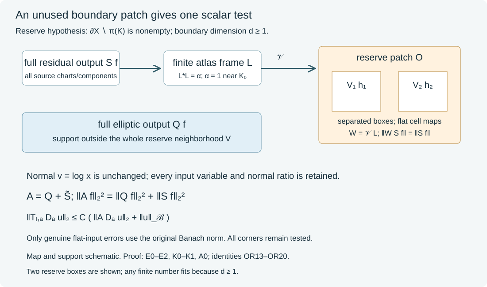

# One scalar test with a global boundary output reserve

The [global family reduction](../20261017-global-finite-family-reduction/global-finite-order-families-and-residual-tests.html) retains an elliptic scalar test and a full residual scalar test. An unused open boundary patch lets us combine them into one scalar operator. We encode all of the residual output in that patch by an exact L2 isometry. The elliptic and encoded residual outputs then have disjoint supports. The source manifold and scalar input and output spaces stay the same.

The encoding uses a finite atlas and smooth flat coordinate maps from torus cells into disjoint boxes. It handles every residual chart pair and boundary component. A single boundary coordinate chart containing all original inputs is unnecessary. The result applies in particular whenever the positive-dimensional boundary is noncompact, since the prescribed microsupport has compact base projection.

## 1. The scalar assembly theorem

**H0. The exact output-reserve hypothesis.** Let \(X\) be a smooth manifold with \(d=\dim\partial X\geq1\), equipped with a smooth positive density. Let \(\Gamma\subset\widetilde T^*X\setminus0\) be open and conic. Suppose \(T_{\ell,a}\), \(1\leq\ell\leq L\), are scalar families bounded in the complete \(\Psi_b^m\) topology, with common compact kernel projections and uniform rapid symbol tails outside a compactly generated closed cone \(K\Subset\Gamma\), in the precise sense of GFR:H0. Assume

\[

               \partial X\setminus\pi(K)\ne\varnothing,

 \tag{OR1}

\]

where \(\pi(K)\) denotes the full compact base projection of its normalized cosphere set, including interior base points. Thus (OR1) gives a boundary point outside that closed compact base projection.

Let \(D_a\) be a differential family of fixed finite order, uniformly bounded in all required smooth coefficient seminorms on the relevant compact sets. Let \(\mathcal B\) embed continuously in extendible distributions. Then there is one fixed compactly supported scalar

\[

 A\in\Psi_b^{2r}(X),\qquad r\in\mathbb N_0,

 \quad 2r\geq\max(m,0),\qquad

 \operatorname{WF}'_b(A)\Subset\Gamma,

 \tag{OR2}

\]

such that on smooth inputs

\[

 \|T_{\ell,a}D_a u\|_2

       \leq C\bigl(\|AD_a u\|_2+\|u\|_{\mathcal B}\bigr).

 \tag{OR3}

\]

The constant is uniform in \(\ell,a\). All complete residual corner kernels remain in this estimate. For parameter-dependent inputs, taking a supremum on the left requires the corresponding supremum of \(\|AD_a u\|_2\) on the right. A common input has a common scalar test norm.

This theorem has the stated output-reserve hypothesis. It does not impose a product-cone condition on all residual input supports. It does not assert the still-needed gluing result when a compact boundary is entirely covered by \(\pi(K)\). The earlier global one-dimensional assembly concerns the separate case of zero-dimensional boundary.

## 2. Choose the elliptic output and the entire residual family

**C0. Make the finite-order output vanish on an actual neighborhood.** Choose \(p\in\partial X\setminus\pi(K)\). Since \(\pi(K)\) is closed, there is a relatively compact boundary neighborhood whose closure in \(X\) is disjoint from it. Choose a smaller open neighborhood \(V\subset X\) of \(p\), still with closure disjoint from \(\pi(K)\). The finite coordinate-cone neighborhoods used in GFR:A0 can all have base closures outside \(\overline V\). Realize their scalar \(B_i\) with both actual kernel projections in those base neighborhoods. This is done by choosing the proper input and output cutoffs there before taking adjoints and products. Consequently

\[

                    Q=\sum_i B_i^*B_i

 \tag{OR4}

\]

is positive, elliptic near \(K\), compactly supported, and has no output in \(V\). Its microsupport remains compactly inside \(\Gamma\). All these are full-kernel support assertions, not just vanishing of a principal symbol on \(V\).

The complete global parametrix GFR:A1--A2 gives

\[

 T_{\ell,a}=C_{\ell,a}Q+R_{\ell,a},\qquad

 \sup_{\ell,a}\|C_{\ell,a}\|_{2\to2}<\infty,

 \tag{OR5}

\]

with \(R_{\ell,a}\) uniformly bounded in the full residual topology and with common compact projections. Its tails are retained even if their input or output projections meet \(V\). The finite-order test is chosen from \(K\), not from the possibly larger projections of those residual tails.

**C1. The compact-projection residual construction has room for the reserve.** Apply GFR:L0--L3 to this entire residual family. In constructing its finite collar, include both its compact boundary projections and the closure of a small boundary patch \(O\) around \(p\). Shrink \(O\) and the common collar interval so that

\([0,\epsilon)\times\overline O\subset V\). The compact inward-flow construction gives this uniform collar after shrinking, since the reserve closure lies inside \(V\).

Fix all normal cutoffs and the compact normal convolution radius before choosing the family-dependent weights. Their bounds in GRF:C1 and GRF:N2 put the scalar residual output strictly inside the collar interval. We obtain

\[

 R_{\ell,a}=R^b_{\ell,a}+F_{\ell,a},\qquad

 R^b_{\ell,a}=B_{\ell,a}S,\qquad

 S=U^{-1}p(D_v)S_YU\chi,

 \tag{OR6}

\]

where \(B_{\ell,a}\) are uniformly L2 bounded, \(F_{\ell,a}\) have original-product smooth kernels flat in the input, and \(\|F_{\ell,a}D_a u\|_2\leq C\|u\|_{\mathcal B}\). The map \(U\) is the exact density-normalizing logarithmic collar unitary. The scalar tangential kernel of \(S_Y\) is smooth and supported in \(K_0\times K_0\) for a compact tangential set \(K_0\). The entire output of \(USf\), for every normal variable, is supported in \(K_0\). It is this full output that we encode.

## 3. Smooth isometric encoding into one open patch

**E0. A flat cell isometry.** On the real line define

\[

 b(t)=\begin{cases}\exp[-1/(t(1-t))],&0<t<1,\\0,&\text{otherwise},\end{cases}

 \quad c=\int_0^1b(t)^2\,dt,

 \quad F(t)={2\pi\over c}\int_0^t b(s)^2\,ds\quad(0\leq t\leq1).

 \tag{OR7}

\]

The flat exponential proof U001:P14.3 gives a smooth flat \(b\) at both endpoints: near either endpoint every derivative is a finite sum of a power of its reciprocal times the decaying exponential, multiplied by a bounded smooth factor from the other endpoint. Hence \(c>0\), \(F(0)=0\), \(F(1)=2\pi\), and \(F'>0\) in the open interval. The fundamental theorem gives

\(F'=(2\pi/c)b^2\), so \(\sqrt{F'}=\sqrt{2\pi/c}\,b\) is smooth and flat. The inverse theorem gives a smooth inverse of \(F\) on the two open intervals.

For a smooth periodic function \(h\) on \(\mathbb T^d\), put, in the unit cube,

\[

 (V_0h)(t)=\prod_{j=1}^d\sqrt{F'(t_j)}\,

          h(F(t_1),\ldots,F(t_d)),

 \tag{OR8}

\]

and extend by zero across its faces. Repeated product and chain rules prove that this extension is smooth and flat on every face, including their intersections. In any differentiated term, the factor for a coordinate at its endpoint contains a derivative of the flat \(b\) or a product containing such a flat factor. Every other factor is bounded. For each \(N\), its derivatives through order \(N\) are bounded by a constant times the derivatives of \(h\) through order \(N\) on the torus. This also proves continuity for all these smooth seminorms.

Successive one-variable substitution with \(u_j=F(t_j)\), followed by the compact product Fubini theorem, gives

\[

                \|V_0h\|_{L^2((0,1)^d)}

                       =\|h\|_{L^2(\mathbb T^d)}.

 \tag{OR9}

\]

One can perform each substitution first on closed interior intervals and pass to the endpoints: the omitted nonnegative integrals decrease to zero, or for a smooth bounded input are bounded by the omitted integrals of \(F'\). The normalized product Fourier basis and its density were proved in GRF:J0. Thus (OR9) extends \(V_0\) uniquely to an L2 isometry. Its adjoint satisfies \(V_0^*V_0=I\). We use its smooth action only on smooth periodic functions; no assertion that arbitrary L2 functions have smooth flat extensions is made.

**E1. Finitely many boxes, with the actual density.** Suppose the larger atlas frame below has \(I\) components. Because \(d\geq1\), the open patch \(O\) contains \(I\) coordinate boxes with pairwise disjoint closures, all compactly contained in that patch. To see this explicitly, take one smaller coordinate cube and divide its first-coordinate interval into \(3I\) equal pieces. Use the middle interval of each consecutive triple, and fixed smaller intervals in the other coordinates. These closed boxes are separated by positive distances.

In a reserve chart write \(d\nu=a(z)\,dz\), with \(a>0\) smooth. If \(z=b_i+M_it\) maps the unit cube affinely to box \(i\), with a positive diagonal matrix \(M_i\), define

\[

 (V_i h)(z)=a(z)^{-1/2}(\det M_i)^{-1/2}

                  (V_0h)(M_i^{-1}(z-b_i)),

 \tag{OR10}

\]

extended by zero. The flatness just proved makes this a smooth scalar function on \(Y_0\) for smooth \(h\). The density and affine Jacobian cancel in its squared integral, so \(V_i\) is isometric. Distinct box outputs are orthogonal. Therefore

\[

 \mathcal V:\bigoplus_{i=1}^I L^2(\mathbb T^d)\longrightarrow L^2(Y_0,d\nu),

 \quad\mathcal V(h_i)=\sum_iV_ih_i,

 \qquad\mathcal V^*\mathcal V=I.

 \tag{OR11}

\]

Its image is supported in the union of these closed boxes inside \(O\). The constants in every smooth seminorm bound are finite because the boxes and density are now fixed. Disjointness is required only for these auxiliary output boxes; the original source charts may overlap arbitrarily.

**E2. The encoding is isometric on the whole residual output.** Choose the larger finite atlas frame from GFR:L2, now denoted \(L\), with

\[

 L^*L=M_\alpha,\qquad 0\leq\alpha\leq1,\qquad

                         \alpha=1\text{ near }K_0.

 \tag{OR12}

\]

The frame uses compact cutoffs and the exact input chart densities, with a further cutoff equal to one near \(K_0\). Its construction gives the stated upper bound by normalizing the sum of squared cutoffs as in GRF:J0. Define \(W=\mathcal V L\). Then

\[

 W^*W=M_\alpha,\quad \|W\|\leq1,\qquad

 W^*WS_Y=S_Y,\qquad \|WS_Yh\|=\|S_Yh\|.

 \tag{OR13}

\]

These identities follow from (OR11)--(OR12) and the compact output support of \(S_Y\); \(W\) need not be isometric on all of \(L^2(Y_0)\). The map \(W\) carries every smooth function on that compact support continuously to a smooth function supported in the reserve boxes. Acting on the output of the smooth kernel of \(S_Y\) therefore gives a jointly smooth kernel \((WS_Y)(y,y')\), supported in \(\overline O\times K_0\). Derivatives in \(y'\) commute with this fixed continuous linear map; the bounds in E0--E1 justify every such differentiated kernel statement.

## 4. The relocated operator is a complete scalar boundary residual

**K0. Keep the full normal kernel and density.** Apply \(W\) in the normalized tangential variable and leave the logarithmic normal variable fixed. Define

\[

 \widetilde S=U^{-1}(I_v\otimes W)US

       =U^{-1}p(D_v)(WS_Y)U\chi.

 \tag{OR14}

\]

All outputs stay in the physical collar, since \(W\) changes no normal variable. If its smooth positive density there is \(w(x,y)\,dx\,d\nu(y)\), its complete ratio kernel, relative to \(dt\,d\nu(y')\), is

\[

 \kappa_{\widetilde S}(x,t;y,y')=

 t^{-1/2}\left({w(tx,y')\over w(x,y)}\right)^{1/2}

 k_p(-\log t)(WS_Y)(y,y')\chi(tx,y').

 \tag{OR15}

\]

This is direct substitution in the exact logarithmic unitary. The inverse normal Fourier kernel \(k_p\) has fixed compact support in its difference variable, so \(t\) lies in a fixed compact subinterval of \((0,\infty)\). The kernel is smooth down to the front face and flat on both side faces. The compact tangential supports and fixed normal input cutoff give compact original projections. Flatness at the reserve box edges permits smooth zero extension there. The global kernel criterion GB:C1 gives a compact scalar \(\widetilde S\in\Psi_b^{-\infty}(X)\). In particular its ordinary product kernel need not be smooth at the double boundary corner, and that corner has not been discarded.

Its output lies in \([0,\epsilon)\times\overline O\subset V\), where the complete output of \(Q\) is zero. The full residual has empty operator microsupport in the boundary symbol calculus, so its placement does not enlarge the prescribed conic microsupport. The auxiliary encoding itself need not belong to that calculus; (OR15) proves membership of the actual scalar operator used in the estimate.

**K1. Exact norm recovery and bounded factors.** In the normalized collar, \(USf(v,\cdot)\) is supported in \(K_0\) for every \(v\). Equation (OR13) and integration in \(v\) give

\[

                  \|\widetilde Sf\|_2=\|Sf\|_2.

 \tag{OR16}

\]

For a precise bounded adjoint, restrict L2 functions on \(X\) to the collar, apply its unitary \(U\), and extend by zero in \(v\) past the upper edge. Denote this contraction by \(J_U\). The physical operator \(\mathcal W=J_U^*(I_v\otimes W)J_U\) is bounded by one. The complete support bounds of \(S\) and \(W\) imply

\(\mathcal WS=\widetilde S\) and \(\mathcal W^*\widetilde S=S\).

There is no lost normal output at the collar edge. Consequently every corner residual in (OR6) also factors exactly as

\[

             R^b_{\ell,a}=B_{\ell,a}\mathcal W^*\widetilde S,

 \tag{OR17}

\]

with uniformly bounded factors. Neither a new vector-valued tester nor an additional boundary component has been introduced.

## 5. Orthogonality closes this scalar assembly

**A0. One scalar norm on the original manifold.** Set

\[

                            A=Q+\widetilde S.

 \tag{OR18}

\]

It has the order and microsupport in (OR2). For every smooth input with the stated compact restrictions, its two outputs are supported in disjoint subsets of \(X\). Hence

\[

 \|Af\|_2^2=\|Qf\|_2^2+\|\widetilde Sf\|_2^2

           =\|Qf\|_2^2+\|Sf\|_2^2.

 \tag{OR19}

\]

This exact identity recovers both scalar norms. Inserting (OR17) into (OR5)--(OR6), then applying Cauchy--Schwarz to these two recovered norms, gives

\[

 \|T_{\ell,a}f\|_2

 \leq C\|Af\|_2+\|F_{\ell,a}f\|_2.

 \tag{OR20}

\]

For \(f=D_a u\), the genuine flat-input bound in C1 proves (OR3). It uses the original \(\mathcal B\) norm, with the actual differential coefficients transposed onto that flat kernel. Every other residual term is in the tested branch (OR17). The scalar \(A\) is fixed for the entire bounded family. It need not be selfadjoint; positivity of the finite-order \(Q\) and exact output orthogonality suffice for its construction.

**G0. Spatial-reserve applications.** If the positive-dimensional boundary is noncompact, its whole set cannot equal the compact set \(\pi(K)\cap\partial X\). Thus (OR1) holds and this scalar assembly applies, even if the original family uses arbitrarily many boundary charts and components. It also applies on a compact boundary whenever a boundary point is outside \(\pi(K)\). The forcing and observation families may use separate reserves and separate fixed scalar testers in their respective prescribed cones.

The estimate extends to the actual smooth graph completion by the Cauchy argument GFR:G0. No smooth-density assertion about a larger distributional intersection is assumed. For full-base compact boundaries and the general observation graph, see [global scalar assembly and observation](../20261017-angular-output-reserve-assembly/scalar-tests-from-a-missing-tangential-direction.html). Higher finite order is permitted for the controlling operator, as in the source statement; the original Banach remainder is retained.

## 6. Three solved examples

### Exercise 1. Several source charts, one spare patch

**X1.** Let \(\partial X=\mathbb R^d\), \(d\geq1\), and suppose \(\pi(K)\cap\partial X\subset[-M,M]^d\). Residual input and output kernels may meet a larger compact set and different source charts. Where can the reserve be chosen, and how do two torus components fit into it?

**Solution.** The boundary point \((M+2,0,\ldots,0)\) is outside \(\pi(K)\). Compactness of the full base projection supplies a small relative neighborhood in \(X\) disjoint from it, even if some interior base points lie above that tangential position. Choose the reserve collar inside that neighborhood. In a smaller coordinate unit cube in its boundary patch, the first-coordinate intervals \([1/6,1/3]\) and \([2/3,5/6]\), with the same fixed smaller intervals in the other coordinates, give two separated closed boxes. Use (OR10) in each. Both complete torus functions are encoded isometrically; source charts and residual projections are unchanged. More frame components use finitely many smaller separated boxes. Residual kernels touching the reserve are still included in (OR6), rather than removed from the family.

### Exercise 2. The encoded constant mode

**X2.** In dimension one, take the normalized torus mode \(e_0=(2\pi)^{-1/2}\). Compute its profile under \(V_0\) and check both its norm and endpoint behavior.

**Solution.** Equations (OR7)--(OR8) give \(V_0e_0=b/\sqrt c\). Its squared integral is \(c^{-1}\int_0^1b^2=1\). Every endpoint derivative vanishes by the explicit flat exponential calculation, so zero extension is smooth. This illustrates why an arbitrary affine identification of the circle cell with an interval would not suffice: a nonzero constant would retain nonzero endpoint values. The flat density factor provides both exact L2 normalization and the smooth extension needed by the full residual kernel.

### Exercise 3. Empty microsupport does not imply orthogonal outputs

**X3.** On \(\mathbb C^2\), let \(Q=\operatorname{diag}(1,0)\), \(S=\operatorname{diag}(0,1)\), and let \(W e_2=-e_1\), \(W e_1=0\). Does isometry on the range of \(S\) alone imply the norm identity (OR19)?

**Solution.** It does not. Although \(\|WSf\|=\|Sf\|\), for \(f=e_1+e_2\) one has \(Qf=e_1\), \(WSf=-e_1\), and \((Q+WS)f=0\). Both recovered norms would be one. Exact disjoint output support in C0 and K0 prevents this cancellation. Declaring the added term residual is not a substitute for that support proof. This finite calculation tests the norm argument; all class and kernel assertions for the actual manifold are established separately in K0.

## 7. The encoding and support diagram

**F0. The exact content of the diagram.** The source charts overlap freely. The frame is identity in squared norm only near the compact residual output support. Its finitely many torus components go to separated reserve boxes by E0--E2. Formula (OR15) leaves every normal ratio and every input variable in place. The output of \(Q\) avoids the whole reserve neighborhood, so (OR19) is an exact orthogonality identity for scalar functions on \(X\). The diagram represents maps and supports, not sampled kernel values.

Independent exposition, proofs, solved examples and diagram: CC0-1.0. Mathematical context: Lars Hörmander, *The Analysis of Linear Partial Differential Operators III*, Sections 18.3 and 24.7.  Earlier programme proofs, component credits and external human foundations retain their recorded terms. This theorem has hypothesis (OR1); internal CC0-export closure and whole-course completion are not claimed.

