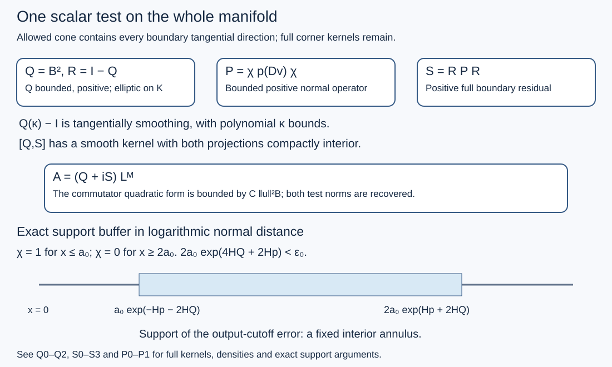

# One scalar test when all boundary tangential directions are allowed

The boundary calculus keeps kernels at the double boundary corner. A smooth kernel there need not have a bound from a distribution norm alone. This proof combines the finite-order and complete residual tests into one scalar operator on the whole manifold, including the interior. The hypothesis is that the allowed cone contains every boundary tangential direction. Normal directions may be excluded.

The notation and full kernel calculus are those of [global boundary operators](../20261005-global-boundary-operators/global-boundary-operator-calculus.html). The [global family reduction](../20261017-global-finite-family-reduction/global-finite-order-families-and-residual-tests.html), [normal residual factor](../20261017-global-boundary-residual-factors/global-scalar-factors-for-boundary-residuals.html) and [collar estimate](../20261017-tangential-elliptic-collar-tests/scalar-collar-tests-with-all-tangential-directions-allowed.html) give the earlier interfaces. Here the decisive additional device is a bounded order-zero test whose difference from identity is tangentially smoothing at each fixed normal frequency. A positive residual regularizer then has an interior smooth commutator with that test.

## 1. Exact statement

**H0. Data and quantifiers.** Let \(X\) be a smooth manifold with compact nonempty boundary \(Y\), where \(\dim Y=d\geq1\). Fix a smooth positive density. Let \(\Gamma\subset\widetilde T^*X\setminus0\) be open and conic and contain
\[
 \mathcal E_Y=\{(0,y;0,\eta):y\in Y,\ \eta\ne0\}.
 \tag{TA1}
\]
Here the compressed normal covariable is \(\kappa\). Let \(K\Subset\Gamma\) mean compact containment after taking unit covectors over compact bases. Let \(T_{j,a}\) be finitely many bounded full \(\Psi_b^m\) families with microsupport in \(K\) and common compact input and output projections. All full residual seminorms are included in boundedness. Let \(D_a\) be a bounded family of ordinary differential operators of fixed finite order, on the compact sets used below. A Banach space \(\mathcal B\) embeds continuously into extendible distributions. We test smooth compactly supported \(u\) belonging to \(\mathcal B\). No invariance of \(\mathcal B\) under coordinate changes is assumed.

**H1. Whole-manifold scalar conclusion.** There exist an integer \(M\geq0\), one fixed scalar \(A\in\Psi_b^{2M}(X)\), compact in both projections with \(\operatorname{WF}'A\subset\Gamma\), and a constant \(C\), such that
\[
 \sup_j\|T_{j,a}D_a u\|_2
 \leq C\bigl(\|A D_a u\|_2+\|u\|_{\mathcal B}\bigr).
 \tag{TA2}
\]
For a varying input, the precise form is \(\|T_{j,a}D_a u_a\|_2\leq C(\|AD_a u_a\|_2+\|u_a\|_{\mathcal B})\), uniformly in \(j,a\). The estimate holds for every parameter, with one constant. Taking a supremum in that parameter on both sides gives the corresponding family estimate. The operator may depend on the complete bounded families and their target order. No exact global factorization without the Banach remainder is asserted.

## 2. A bounded finite-order test with an exact collar model

**Q0. Cones, atlas frame and normal support.** Use the global collar and unitary map of GRF:C0:
\[
 v=\log x,\qquad Uf=e^{v/2}w(e^v,y)^{1/2}f(e^v,y),\qquad H=L^2(Y,d\nu).
 \tag{TA3}
\]
Compactness of \(Y\), of its unit tangential bundle, and of \(K\) gives a product conic neighborhood of \(K\) at the boundary together with \(\mathcal E_Y\), whose closure lies in \(\Gamma\) for \(x\leq\epsilon\). Indeed choose finitely many base-angular neighborhoods at \(x=0\), shrink them, and then use their common positive normal thickness. Any target points with arbitrarily small \(x\) outside their union would have a limiting point of \(K\) on the boundary, a contradiction. Remaining target points lie in a compact interior region.

Use the exact finite atlas frame \(J:H\to\bigoplus_iL^2(\mathbb T^d)\), \(J^*J=I\), from GRF:J0. Choose real joint order-zero symbols \(b_i(y,\kappa,\eta)\), equal to one near the boundary target directions, with nonnegative principal symbols supported in the allowed product cone. They can and do equal one for \(|\eta|\geq C\langle\kappa\rangle\), on each chart used by the frame. Smooth low frequency choices do not affect microsupport. Extend them on the chart torus so that this last identity holds there as well. Conic cutoffs exist by the finite smooth partition proof U001-A4.

Quantize, multiply each complete cylinder kernel by a real even function \(\psi(v-v')\), equal to one near zero and compactly supported, assemble by \(J^*(\cdot)J\), and symmetrize. Denote the result by \(B_0\). It is bounded selfadjoint, translation invariant in \(v\), jointly order zero, and has \(|v-v'|\leq H_B\). Removing a kernel away from the full diagonal changes the local symbol by a joint residual; the actual cut kernel has bounded normal difference and hence the required full side flatness. GB:C1, C8--C10 and H1 justify the full calculus and bound.

**Q1. A fixed-frequency identity and its quantitative meaning.** Write \(B_0(\kappa)\) for the normal Fourier multiplier. Then
\[
 B_0(\kappa)-I\text{ has a smooth kernel on }Y\times Y,
 \quad \|\partial_\kappa^r(B_0(\kappa)-I)\|_{C^s(Y\times Y)}
 \leq C_{r,s}\langle\kappa\rangle^{N_{r,s}}.
 \tag{TA4}
\]
Here smoothness is in the tangential variables; it is not a joint residual assertion. Before the normal cutoff, the symbol of \(b_i-1\) vanishes for \(|\eta|>C\langle\kappa\rangle\). Its tangential kernel derivatives are bounded by summing \(\langle k\rangle^s\) over \(|k|\leq C\langle\kappa\rangle\); this gives a polynomial. Normal cutoff replaces it by convolution in \(\kappa\) with the Schwartz function \(\widehat\psi\). Every polynomial moment of that function is finite. For \(|k|>2C\langle\kappa\rangle\), the original symbol can contribute only from normal frequencies of size at least a fixed multiple of \(|k|\); the convolution tail is then rapidly decreasing in \(k\), with polynomial dependence on \(\kappa\). This proves (TA4), also after any finite number of derivatives. The identity part is unchanged, since \(\psi(0)=1\). The exact frame identity and symmetrization preserve (TA4).

**Q2. The global positive bounded operator.** Multiply the collar model on both sides by the same large normal cutoff. Add a selfadjoint, ordinary interior order-zero test with nonnegative principal symbol, elliptic on the remaining compact target directions. Its two projections are away from the boundary. Let their sum be \(B\), and set
\[
 Q=B^2,\qquad R=I-Q.
 \tag{TA5}
\]
Thus \(Q\) is positive, bounded and selfadjoint, compact in both projections, and elliptic at every point of \(K\); its microsupport is contained in \(\Gamma\). In a sufficiently deep collar its exact model is \(Q_0(\kappa)=B_0(\kappa)^2\). It has bounded normal difference, say \(H_Q\), and \(Q_0(\kappa)-I\) satisfies (TA4). To see the last assertion, write \(B_0=I+E\); the kernel of \(2E+E^2\) is smooth, and its differentiated kernel bounds are polynomial by integration over compact \(Y\).

Deep enough means an identity of complete kernels for all compositions used here, rather than equality of principal symbols. Every collar factor has bounded normal difference. Every added interior factor has both projections bounded away from \(x=0\). Hence a sufficiently small collar input cannot reach an interior factor through any fixed finite number of collar factors. Choose a model depth \(\epsilon_0\) with this property for four \(Q\) factors and two normal factors of support radius \(H_p\), where \(H_p>0\) is fixed now.

## 3. Differential amplification and a local auxiliary inverse

**L0. The differential operator used on the right.** Take finitely many real smooth vector fields \(V_i\) spanning \(TY\), and let \(L_Y=\sum_iV_i^*V_i\) for \(d\nu\). FBC:H1 constructs these fields and proves ellipticity. On the cylinder put
\[
 \Lambda=1-\partial_v^2+L_Y,\qquad \Lambda_\kappa=1+\kappa^2+L_Y.
 \tag{TA6}
\]
Choose a global smooth b-differential operator \(L\) of order two, equal to \(U^{-1}\Lambda U\) on \(x<\epsilon_0\), and elliptic near the remaining target directions. Patch positive principal quadratic forms in the interior. FBC:A0 gives the exact smooth physical coefficients of the collar conjugation; no singular coefficient is introduced. Invertibility of this global \(L\) is not needed. Choose an integer \(M\) with \(2M\geq\max(m,0)\). The full global ordered parametrix of GB:E1--E3 gives
\[
 T_{j,a}=C_{j,a}Q L^M+R_{j,a},\qquad
 \sup_{j,a}\|C_{j,a}\|_{2\to2}<\infty,
 \tag{TA7}
\]
where \(R_{j,a}\) is a bounded complete residual family with compact projections. This is exactly the full comparison, including residual corner kernels, of GFR:A0--A2. For \(f=D_a u\) put \(g=L^M f\).

**L1. The actual inverse on the infinite cylinder.** For real \(\kappa\), \(K_\kappa=\Lambda_\kappa^{-1}\) exists on \(H\), is selfadjoint, and
\[
 \|K_\kappa\|_{H\to H}\leq(1+\kappa^2)^{-1},\qquad
 \partial_\kappa K_\kappa=-2\kappa K_\kappa^2.
 \tag{TA8}
\]
Here is a construction rather than an appeal to an inverse in the boundary calculus. Complete smooth functions in the form norm \(\sum_i\|V_i h\|_2^2+(1+\kappa^2)\|h\|_2^2\). Its equivalence to a finite-chart \(H^1\) norm follows from spanning and KS:S3. The functional \(h\mapsto\langle F,h\rangle\) is bounded. The Hilbert representation assertion follows directly from completeness and the parallelogram identity: on a nonempty affine level of a nonzero bounded functional, a minimizing sequence for the norm is Cauchy; its limit has minimum norm. Variations in every real and imaginary null direction show that this minimizer is orthogonal to the nullspace. Decomposition along it represents the functional. The zero functional is represented by zero. Applying this argument in the form Hilbert space gives a unique weak solution. Testing by that solution gives (TA8)'s norm bound. Interchanging two right sides proves selfadjointness.

The ordinary elliptic parametrix for fixed \(1+L_Y\) implies that the weak solution is \(H^2\) for \(F\in L^2\), and is smooth for smooth \(F\). More explicitly its identity gives, successively,
\[
 \|h\|_{H^{s+2}}\leq C_s\bigl(\|F\|_{H^s}+\langle\kappa\rangle^2\|h\|_{H^s}+\|h\|_2\bigr).
 \tag{TA9}
\]
The identity first upgrades distributions using the smoothing remainder, then iterates from the initial \(H^1\); the fixed parametrix gains two derivatives by its Fourier symbol estimates. Finite-chart Sobolev embedding follows by Fourier inversion and Cauchy--Schwarz with an integrable frequency weight. Thus all smooth seminorm bounds for \(K_\kappa F\) are polynomial in \(\kappa\), controlled by finitely many smooth seminorms of \(F\). The same is true for all \(\kappa\) derivatives: subtract the two weak equations to obtain \(K_\kappa-K_\mu=(\mu^2-\kappa^2)K_\kappa K_\mu\), divide by \(\kappa-\mu\), and iterate the resulting norm derivative identity. Higher powers of \(K_\kappa\) have these bounds too. Fourier transform in \(v\) therefore gives the exact inverse \(K(D_v)^M\) of \(\Lambda^M\) on smooth Schwartz cylinder inputs. This auxiliary inverse is not claimed to belong to \(\Psi_b\).

**L2. Localize before applying that inverse.** Choose \(a_0>0\) so small that
\[
 2a_0\exp(4H_Q+2H_p)<\epsilon_0.
 \tag{TA10}
\]
Let \(\chi_1(x)\) be real, equal to one for \(x\leq a_0\), zero for \(x\geq2a_0\), with \(0\leq\chi_1\leq1\). Localize each \(R_{j,a}\) to a still smaller double corner, using input cutoff \(\chi_0\) supported where \(\chi_1=1\), and a collar output cutoff. The discarded part has an original smooth kernel flat in the input normal variable, hence is bounded on \(D_a u\) by \(C\|u\|_{\mathcal B}\), by GRF:C1 and OSA:K0. Write \(r_{j,a}(v,\kappa)\) for its complete left normal Fourier symbol, as a smooth \(Y\times Y\) kernel. GRF:C1 proves rapid decay in \(\kappa\), with all derivatives, uniformly in \(v,j,a\).

With cylinder extensions understood, \(z=U\chi_1 f\) is Schwartz and
\[
 \Lambda^M z=U\chi_1 g+E_{\chi}Uf,\qquad
 z=K(D_v)^M U\chi_1 g+K(D_v)^M E_{\chi}Uf.
 \tag{TA11}
\]
The finite differential commutator \(E_{\chi}=[\Lambda^M,\chi_1]\) is supported in the fixed interior annulus \(a_0\leq x\leq2a_0\). These identities use the actual differential equality for \(L\), not a symbolic inverse. Since \(\chi_1=1\) on the residual input projection, substituting (TA11) in the complete residual kernel gives a main operator with exact left symbol
\[
 \widetilde r_{j,a}(v,\kappa)=r_{j,a}(v,\kappa)K_\kappa^M
 \tag{TA12}
\]
on \(U\chi_1 g\), and an error \(\operatorname{Op}(\widetilde r_{j,a})E_\chi Uf\). Applying (TA9) to the right kernel variable proves that (TA12) is still a smooth tangential kernel rapidly decreasing in \(\kappa\), after every finite derivative and uniformly in \(v,j,a\).

**L3. The inverse commutator error uses only the original norm.** The inverse normal Fourier kernel of (TA12) and all its normal and tangential derivatives are bounded by \(C_N\langle v-v'\rangle^{-N}\), uniformly in \(v\). The input of \(E_\chi\) lies in a compact interior annulus. Transpose \(E_\chi U D_a\) onto that variable. The finite flat-test estimate NGR:B1--B2 bounds the resulting output at \((v,y)\) by
\[
 C_N\langle v\rangle^{-N}\|u\|_{\mathcal B}
 \quad(v\text{ in the negative half-cylinder}),
 \tag{TA13}
\]
enlarging the constant on a bounded interval. The tangential output manifold is compact. Integration proves an \(L^2\) bound by \(C\|u\|_{\mathcal B}\). This is an input-away kernel estimate with square-integrable output seminorms. It does not assert smoothness at the original output boundary for the auxiliary inverse error. All differentiations and constants use finitely many uniformly bounded coefficients on the fixed annulus.

## 4. The residual operator and its commutator

**S0. A normal floor and one bounded anisotropic operator.** Apply the positive compact-normal-kernel floor GRF:N0--N1 to the finitely many families (TA12). It supplies a real strictly positive Schwartz multiplier \(p(\kappa)\), with smooth inverse Fourier kernel supported in \([-H_p,H_p]\), such that
\[
 \operatorname{Op}(\widetilde r_{j,a})=
 \operatorname{Op}(\widetilde r_{j,a}/p)\,p(D_v),\qquad
 \sup_{j,a}\|\operatorname{Op}(\widetilde r_{j,a}/p)\|_{2\to2}<\infty.
 \tag{TA14}
\]
Only two normal frequency derivatives of the quotient are needed: their operator norms are bounded by \(C\langle\kappa\rangle^{-2}\), and two integrations by parts give a kernel bounded by \(C/(1+|v-v'|^2)\). The two Schur integrals prove the asserted bound. Thus the main residual outputs are bounded by \(C\|p(D_v)U\chi_1g\|_2\). The normal radius was fixed before \(a_0\); the floor construction allows any prescribed positive radius.

Define a bounded positive operator on the physical Hilbert space by
\[
 P=U^{-1}\chi_1 p(D_v)\chi_1 U,
 \qquad S=RPR.
 \tag{TA15}
\]
The middle factor is identity in \(Y\). It is an anisotropic operator; no joint boundary pseudodifferential class is asserted for \(P\) itself. The operator \(S\) is positive selfadjoint and compact in both physical projections.

**S1. Why the sandwiched operator is a full residual.** In the deep exact model the normal Fourier multiplier of \(S\) is
\[
 p(\kappa)(I-Q_0(\kappa))^2.
 \tag{TA16}
\]
Its smooth tangential kernel is rapidly decreasing in \(\kappa\) with every derivative by (TA4). Its normal kernel has bounded difference, since all three constituent kernels do. Hence it is a full joint residual at the front face, smooth there and flat at both side faces after restoring the precise unitary density (TA3).

For completeness the same assertion holds in the cutoff transition. Put \(E(\kappa)=I-Q_0(\kappa)\). It has smooth tangential kernel with polynomial normal-frequency seminorms. Every term of \(E(D_v)\chi_1p(D_v)\chi_1E(D_v)\) in a compact transition interval is smoothing in both normal and tangential variables. One can verify this without a formal product expansion: insert compact normal cutoffs equal to one on all relevant supports. In normal Fourier variables the resulting factors are \(E(\kappa)\), Schwartz convolution kernels from the cutoffs, \(p(\lambda)\), and \(E(\mu)\). For any prescribed number of derivatives, the tangential kernel seminorms cost only fixed powers of \(\kappa,\mu\). The elementary inequality \(\langle\kappa\rangle\leq2\langle\kappa-\lambda\rangle\langle\lambda\rangle\), used twice, bounds these powers by moments of the Schwartz convolution factors and of \(p\). The same argument with extra weights in both external frequencies gives rapid decay there. Integrating the smooth tangential kernels over compact \(Y\) proves every differentiated kernel bound. All normal supports in this transition are interior. Condition (TA10) ensures that no nonmodel interior piece of \(Q\) is reached. Consequently \(S\in\Psi_b^{-\infty}(X)\), including its entire kernel and every cross-chart part.

**S2. The commutator is smooth with both projections interior.** In the model, \(p(D_v)\) commutes exactly with \(Q_0(D_v)\). Therefore
\[
 [P,Q]=\chi_1p(D_v)[\chi_1,Q_0]+[\chi_1,Q_0]p(D_v)\chi_1
 \tag{TA17}
\]
in the unitary coordinates. The identity part of \(Q_0\) commutes with \(\chi_1\); (TA4) and the Fourier argument of S1 show that each product in (TA17) is fully smoothing. The kernel of \([\chi_1,Q_0]\) is the complete model kernel multiplied by \(\chi_1(x)-\chi_1(x')\). Bounded normal difference forces both coordinates away from zero whenever this difference is nonzero. Composing with the compact normal kernel of \(p\) retains this property. Thus (TA17), restored by \(U\), is an original smooth kernel with both projections compactly interior. Equation (TA10) again makes this the exact global commutator, rather than just its leading corner expression. Since \(R\) commutes with \(Q\),
\[
 [Q,S]=R[Q,P]R
 \tag{TA18}
\]
has the same original smooth interior property: composition with the model part of \(Q\) moves normal supports a bounded distance; its other parts already have both projections interior.

**S3. A bilinear bound and the scalar sum.** If \(F\) is an original smooth kernel with both projections compactly interior, and \(E_a\) is any uniformly bounded finite differential family there, then
\[
 |\langle FE_a u,E_a u\rangle|\leq C\|u\|_{\mathcal B}^2,
 \qquad \|FE_a u\|_2\leq C\|u\|_{\mathcal B}.
 \tag{TA19}
\]
For the first assertion transpose \(E_a\) in both kernel variables. Apply the finite test-seminorm estimate NGR:B1--B2 to the first variable and its finitely many derivatives, then apply it to the resulting compact smooth test in the second variable. Each needed seminorm is bounded by a fixed smooth-kernel seminorm times \(\|u\|_{\mathcal B}\). This proves the square bound; the one-sided version and integration over the compact output prove the second assertion. There is no bound of \(\|E_a u\|_2\) by \(\|u\|_{\mathcal B}\).

Apply (TA19) to (TA18) and \(E_a=L^MD_a\). Selfadjointness gives
\[
 \left|\|(Q+iS)g\|_2^2-\|Qg\|_2^2-\|Sg\|_2^2\right|
 \leq C\|u\|_{\mathcal B}^2.
 \tag{TA20}
\]
Indeed the cross term is the quadratic form of \(i(QS-SQ)\) if the inner product is linear in its first argument. Thus
\(\|Qg\|_2+\|Sg\|_2\leq C(\|(Q+iS)g\|_2+\|u\|_{\mathcal B})\).
The commutator estimate, rather than positivity alone, is what permits this scalar sum.

## 5. Recover the complete normal observation

**P0. Recover the cut-off normal regularizer.** The exact bounded-operator identity
\[
 I=Q(2I-Q)+R^2
 \tag{TA21}
\]
implies
\[
 Pg=P(2I-Q)Qg+Sg+[P,R]Rg.
 \tag{TA22}
\]
The commutator term is an original smooth interior operator on \(g\), by S2 and the same bounded support argument after the last \(R\). Its norm is bounded by the Banach remainder through (TA19). All the other fixed factors preceding \(Qg\) are bounded. Hence \(\|Pg\|_2\leq C(\|Qg\|_2+\|Sg\|_2+\|u\|_{\mathcal B})\).

**P1. Recover the output omitted by the cutoff.** Work in the cylinder and put \(F=(1-\chi_1)p(D_v)\chi_1\), extended to the physical space only on this fixed support. Then
\[
 p(D_v)U\chi_1g=UPg+FUg,
 \qquad FU g=FQ_0(2I-Q_0)Ug+FR_0^2Ug.
 \tag{TA23}
\]
For the first term the exact global version is the bounded operator \(F(2I-Q)Qg\), with unitary collar identifications. This identity on its supports follows from (TA10), so no uncontrolled norm outside the collar is used. For the second term the output factor \(1-\chi_1\) forces the normal output to be at least \(a_0\). The bounded differences of \(p\) and of the two \(R_0\) factors force every input to be at least \(a_0 e^{-(H_p+2H_Q)}\); all are bounded above by \(2a_0 e^{H_p+2H_Q}\). Its tangential kernels are smoothing with polynomial frequency bounds, and \(p\) and the cutoff convolutions give full normal smoothing exactly as in S1. Thus \(FR_0^2\) is an original smooth operator with both projections interior. Equation (TA19) bounds its action on \(g\) by \(C\|u\|_{\mathcal B}\). Consequently
\[
 \|p(D_v)U\chi_1g\|_2
 \leq C(\|Qg\|_2+\|Sg\|_2+\|u\|_{\mathcal B}).
 \tag{TA24}
\]

**T0. Assemble the actual full operators.** Combine (TA7), (TA11)--(TA14), (TA20) and (TA24). Every complete target output is bounded by \(\|Qg\|_2\), the complete corner residual main term, and the two proved Banach-only errors. Thus (TA2) holds with the single scalar operator
\[
 A=(Q+iS)L^M\in\Psi_b^{2M}(X),\qquad \operatorname{WF}'A\subset\Gamma.
 \tag{TA25}
\]
Differentiating on the right does not enlarge kernel projections or microsupport. The residual factor has empty microsupport, but its whole boundary-corner kernel remains in the estimate. All choices precede the individual parameter and input, and every estimate used bounded complete families, so the asserted uniform quantifiers follow.

**T1. Observation and graph consequences at this scope.** Apply this theorem separately to the finite source and observation families furnished by GOB:H1 whenever their respective allowed cones contain \(\mathcal E_Y\). It can also be combined with GRA:A0 or FBC:T0 on the other channel when that channel has the corresponding proved hypothesis. This gives one source and one observation with the same previously fixed geometric parameter neighborhood and original Banach remainder. The actual scalar-tested graph completion is justified as in GOB:T0: full transposes identify all distributional limits, and the uniform estimates identify the target outputs. No density in a larger maximal graph is presumed. This proof settles whole-manifold gluing for the full-tangential-equator case. The complementary compact case omitting tangential directions is treated in [global scalar assembly and observation](../20261017-angular-output-reserve-assembly/scalar-tests-from-a-missing-tangential-direction.html).

## 6. Three solved exercises

**X1. A commuting normal-frequency check.** In the exact model suppose a common tangential mode has \(Q_0\) eigenvalue \(q\geq0\), and scale the positive normal floor so that \(0<p\leq1\). The residual sandwich has eigenvalue \(s=p(1-q)^2\). Prove a lower bound for the scalar sum and compare the two regimes.

Solution. If \(q\geq1/2\), then \(|q+is|\geq q\geq1/2\geq p/4\). If \(0\leq q<1/2\), then \(s>p/4\), hence again \(|q+is|\geq p/4\). At \(q=1\), \(s=0\) and the finite-order test supplies the whole norm. At \(q=0\), the residual supplies exactly \(p\). The scalar modulus squared is exactly \(q^2+p^2(1-q)^4\). This mode calculation illustrates the complementary mechanisms; it is not substituted for the global commutator proof when cutoffs destroy commutation.

**X2. Exact support buffers.** Suppose \(H_Q=H_p=1\), the exact model is valid for \(x<1\), and take \(a_0=e^{-8}\). Check the model margin and locate the error in P1.

Solution. The left side of (TA10) is \(2e^{-8}e^6=2e^{-2}<1\), since \(e^2>1+2+2=5\). The error's two projections lie within \([e^{-11},2e^{-5}]\). Indeed the total normal displacement in P1 is at most \(H_p+2H_Q=3\), starting between \(a_0\) and \(2a_0\). This is a compact interior annulus, although it lies close to the boundary. A finite number of additional differential transposes cannot change its support. The original Banach bound therefore applies. Its constant may depend on this fixed annulus; no uniformity as \(a_0\downarrow0\) is claimed.

**X3. Why an auxiliary inverse need not be a full boundary operator.** Let \(Y=\mathbb T\), \(L_Y=-\partial_y^2\). On its Fourier mode \(k\), compute the inverse normal kernel of \(\Lambda\) and explain which estimate in L3 still works.

Solution. Put \(b_k=\sqrt{1+k^2}\). The kernel is \(G_k(h)=e^{-b_k|h|}/(2b_k)\): it solves \((-\partial_h^2+b_k^2)G_k=0\) off zero, its derivative jump is \(-1\), and its integrability fixes the two decaying solutions. Fourier transformation therefore gives \((1+\kappa^2+k^2)^{-1}\). Even for \(k=0\) the physical ratio kernel, including (TA3) for density \(dx\,dy\), is \(t^{1/2}/2\) for \(0<t<1\) and \(t^{-3/2}/2\) for \(t>1\). It is not flat to every order at both ratio ends. Nothing in L1 asserts that it is a full residual. In L3 the already smoothing symbol \(rK^M\) has a Schwartz inverse normal kernel; after restricting the input to a compact annulus its transpose tests have bounds \(C_N\langle v\rangle^{-N}\). Their squared output integral is finite for \(N\geq1\), since \(\int_1^\infty v^{-2N}dv=(2N-1)^{-1}\). This suffices for the Banach-only error even without infinite original-boundary smoothness of the auxiliary inverse output.

## 7. The diagram and source credit

**I0. What the diagram represents.** The diagram records the exact bounded-operator construction, the model cutoff margin (TA10), the interior support interval in P1 and the commutator bound (TA20). It is a map of the proved operators and support estimates, not a numerical approximation to their kernels.



Hörmander, *The Analysis of Linear Partial Differential Operators III*, 2007 edition, Sections18.3 and24.7, supplies the boundary-calculus and observation context. This whole-manifold assembly is independent programme exposition with the exact earlier receiving proofs listed above and in the proof map. Independent programme text and the reproducible diagram are CC0-1.0. External human foundations retain their recorded terms and are not bundled or claimed internally closed in this export.
