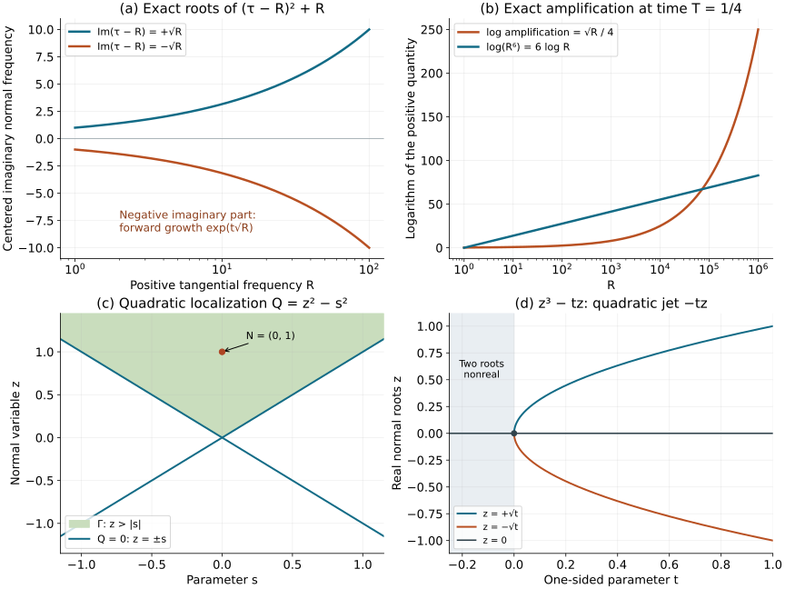

# Hyperbolic roots: stability, instability and quadratic localization

A simple real normal root survives lower-order perturbations in a bounded complex strip. A repeated root can split at a growing fractional power of frequency. We prove both facts, relate the second to the smooth Cauchy problem, and then study the first nonzero Taylor polynomial of a real-rooted family. The quadratic case gives the Lorentz form and its convex hyperbolicity cone. Four exercises include an explicit distributional nonexistence example and a one-sided boundary qualification.

Exposition, proofs, exercises and figure: GPT-6.1 Sol (OpenAI). Independent expression is CC0. Linked programme components retain their own source and rights notices.

The mathematical antecedents are Hörmander II, *The Analysis of Linear Partial Differential Operators II: Differential Operators with Constant Coefficients*, 2005, ISBN 978-3-540-26964-9, Corollary 12.4.10 and Definition 12.4.11; Hörmander III, *Pseudo-Differential Operators*, 2007, ISBN 978-3-540-49938-1, Chapter 23 Summary and closing Notes; and Hörmander I, *Distribution Theory and Fourier Analysis*, 2003, ISBN 978-3-642-61497-2, Lemmas 8.7.2–8.7.3. The polynomial-family argument below proves the localization and the complete quadratic cone assertion needed here. It does not assume a general analytic preparation or general hyperbolicity-cone theorem.

Use \(D=-i\partial\). We use the complete [polynomial circle-count and homotopy proof](../20261005-restored-hyperbolicity-necessity/hyperbolicity-necessity-support-tests-and-double-roots.md), [polynomial factorization and weighted circle moments](../20261005-restored-quadratic-forms/spectral-algebra-and-contour-projections.md), [compact Taylor and integration proofs](../20261004-free-stationary-phase/proof-map.html), and the [higher-order Cauchy energy and existence theorem](../20261005-restored-higher-order-cauchy/higher-order-cauchy-roots-jets-and-propagation.md). Exact locators and versions appear in the proof map.

## 1. What robustness means

Let \(m\ge1\), \(x\in\mathbb R^d\), and let \(p_m(\tau,\xi)\) be a homogeneous polynomial of total degree \(m\), monic in \(\tau\). A nonzero constant pure-normal coefficient can first be divided out. Thus \(t=0\) is noncharacteristic. Lower-order perturbations are arbitrary constant-coefficient polynomials \(q(\tau,\xi)\) of total degree at most \(m-1\). Each perturbation has its own constants and its own local solution neighborhood.

The following three conditions are equivalent:

1. For every real \(\xi\ne0\), the \(m\) zeros of \(p_m(\tau,\xi)\) are real and distinct.
2. For every such \(q\), there is \(C_q<\infty\) such that every zero of \(p_m(\tau,\xi)+q(\tau,\xi)\), with \(\xi\) real, satisfies \(|\operatorname{Im}\tau|\le C_q\).
3. For every such \(q\), the smooth Cauchy problem for \(p_m(D_t,D_x)+q(D_t,D_x)\) is locally well posed: smooth data give unique smooth solutions on a common neighborhood, and the solution depends continuously on the data in their smooth topologies.

The existence part allows a smooth forcing as well as the \(m\) initial jets. The local region is a controlled Cauchy region: arbitrary incoming lateral boundary data are not omitted from a uniqueness assertion. For necessity we use zero forcing and continuity of only one positive-time point evaluation. Thus the obstruction already rules out that weaker continuous solution assignment. It does not assert that every individual datum lacks a distributional solution. Exercise 1 separately gives a particular periodic smooth datum with no distributional solution.

For a fixed operator \(p_m+r\), asking for robustness under all additional lower terms is the same statement: \(r+q\) ranges over every lower-order polynomial. There is no uniform estimate over an unbounded family of perturbations.

## 2. Simple roots give a uniform complex strip

**R1. Compact angular separation.** Suppose condition 1 holds and \(d\ge1\). For \(|\theta|=1\), the monic polynomial \(p_m(\tau,\theta)\) has bounded coefficients. If \(M\) bounds the absolute values of its lower coefficients, then a root has modulus at most \(1+M\): when \(|z|>1+M\),
\[
 \sum_{j=0}^{m-1}|a_j z^j|
 \le M\frac{|z|^m-1}{|z|-1}<|z|^m.
 \tag{RL1}
\]
Choose small disjoint circles around the simple roots at one angle. Coefficient continuity and the circle-count homotopy give one root in each circle at nearby angles. The assumed reality identifies these with their increasing order. The ordered roots \(\lambda_1(\theta)<\cdots<\lambda_m(\theta)\) are therefore continuous. Compactness gives \(L<\infty\) with \(|\lambda_j|\le L\), and, for \(m\ge2\), a single \(\delta>0\) with
\[
 \lambda_{j+1}(\theta)-\lambda_j(\theta)\ge\delta.
 \tag{RL2}
\]
Homogeneity gives the roots \(R\lambda_j(\theta)\) at \(\xi=R\theta\). This argument needs continuity, not smooth individual root branches.

**R2. Fixed-radius circles at large frequency.** Fix \(q\). On \(|z-R\lambda_j(\theta)|=A\), if \(R\delta\ge2A\),
\[
 |p_m(z,R\theta)|
 =\prod_{\nu=1}^m|z-R\lambda_\nu(\theta)|
 \ge A(R\delta/2)^{m-1}.
 \tag{RL3}
\]
For \(R\ge A\), every point of these circles has \(|z|+R\le(L+2)R\), so the finite polynomial \(q\) satisfies \(|q(z,R\theta)|\le B_qR^{m-1}\), uniformly in \(\theta,j\). First choose
\[
 A>B_q(2/\delta)^{m-1},
 \tag{RL4}
\]
and then choose \(R\) larger than the fixed restrictions above. The straight polynomial homotopy from \(p_m\) to \(p_m+q\) is nonzero on every circle. Its zero count there stays one. The disks are disjoint and already account for all \(m\) roots of the monic degree-\(m\) polynomial. Every root is consequently within \(A\) of a real center. If \(m=1\), the product in RL3 has only its first factor, and the same proof uses \(|p_m|=A\), with no separation restriction.

**R3. Bounded frequencies.** On a bounded set of real \(\xi\), every coefficient of \(p_m+q\) is bounded. RL1 gives a common bound on every root. Together with R2 this proves condition 2, including \(\xi=0\). All constants may depend on the fixed \(q\).

## 3. A repeated root has an unstable lower-order perturbation

**R4. Nonreal principal roots.** If \(p_m(\tau_0,\eta)=0\) with \(\eta\) real and \(\operatorname{Im}\tau_0\ne0\), then \(\eta\ne0\), because \(p_m(\tau,0)=\tau^m\). Homogeneity also gives the root \((-\tau_0,-\eta)\). Choose its sign so \(\operatorname{Im}\tau_0<0\). At \(\xi=R\eta\) the exact roots \(R\tau_0\) have negative imaginary parts of size \(R\). Thus condition 2 already fails for \(q=0\).

**R5. Fractional-power splitting of a real multiple root.** Suppose all principal roots are real, but at some \(\eta\ne0\) the root \(\tau_0\) has multiplicity \(k\ge2\). Write the exact finite expansion
\[
 p_m(\tau_0+v,\eta)=a v^k+\sum_{\ell=k+1}^m a_\ell v^\ell,
 \qquad a\ne0.
 \tag{RL5}
\]
Choose a real linear form \(\ell(\xi)\) with \(\ell(\eta)=1\), and put \(q(\tau,\xi)=a\ell(\xi)^{m-1}\). Its order is \(m-1\). At \(\xi=R\eta\), set \(\tau=R\tau_0+R^{1-1/k}w\). Homogeneity gives
\[
 R^{-(m-1)}(p_m+q)(R\tau_0+R^{1-1/k}w,R\eta)
 =a(w^k+1)+\sum_{\ell=k+1}^m a_\ell R^{1-\ell/k}w^\ell.
 \tag{RL6}
\]
The right side converges coefficientwise, hence uniformly on compact complex \(w\)-sets, to \(a(w^k+1)\). This polynomial has a simple root \(w_*\) with negative imaginary part. Choose a small circle about it, disjoint from the real axis and all other limiting roots. The circle-count proof gives a root \(w_R\) inside it for every sufficiently large \(R\). Shrinking the circle initially gives constants \(c,C>0\) with
\[
 \operatorname{Im}\tau_R\le-cR^{1-1/k},
 \qquad |\tau_R|\le CR.
 \tag{RL7}
\]
Only bounded root selection is needed; no differentiable branch in \(R\) is asserted. If \(k=m\), RL6 has no remainder. If \(p_m\) is real, this witness \(q\) is real as a polynomial in the \(D\)-variables. The construction proves that condition 2 implies condition 1.

## 4. Why the root splitting obstructs the smooth Cauchy problem

**R6. Continuity tested by exact solutions.** Fix a positive-time point \((T,x_0)\) in a purported common solution neighborhood. Uniqueness makes the homogeneous solution map linear. Continuity of its point evaluation implies a finite data seminorm estimate
\[
 |u(T,x_0)|
 \le C\sum_{j=0}^{m-1}\max_{|\alpha|\le N}\sup_K
       |\partial_x^\alpha g_j|,
 \qquad D_t^ju|_{t=0}=g_j,
 \tag{RL8}
\]
for some compact data set \(K\), integer \(N\) and constant \(C\). To obtain this directly, a basic neighborhood of zero in the finite product of smooth-function spaces bounds finitely many seminorms. Enlarge their compact sets and derivative orders to \(K,N\). Scaling by a positive scalar gives RL8. If that data seminorm vanishes, scale by arbitrarily large scalars to see that the evaluation vanishes too.

Every root of the full polynomial gives the exact smooth solution
\[
 u_R(t,x)=\exp(iR\eta\cdot x+i\tau_Rt),
 \quad
 g_{R,j}(x)=\tau_R^j\exp(iR\eta\cdot x).
 \tag{RL9}
\]
For the roots in R4 or R5, its data seminorm in RL8 is at most \(C_N(1+R)^{N+m-1}\), whereas
\[
 |u_R(T,x_0)|=\exp(-T\operatorname{Im}\tau_R)
 \ge \exp(cTR^\beta),
 \quad \beta=1\ \hbox{or}\ 1-1/k>0.
 \tag{RL10}
\]
These bounds are incompatible. Indeed the exponential series gives \(\exp(cTR^\beta)\ge(cT)^J R^{\beta J}/J!\); choose an integer \(J\) with \(\beta J>N+m-1\). Thus condition 3 implies condition 1. This is an obstruction to the actual solution map, obtained from exact solutions, not merely to a particular energy proof.

**R7. Sufficiency and the one-dimensional edge case.** Under condition 1, the coefficients of a fixed \(p_m+q\) satisfy the constant-coefficient hypotheses of the complete higher-order Cauchy theorem: the homogeneous principal roots have the compact angular separation of R1, and all lower symbols have their exact prescribed orders. [HC:G4 and HC:E1](../20261005-restored-higher-order-cauchy/higher-order-cauchy-roots-jets-and-propagation.md) give compatible solutions at all Sobolev orders, uniqueness and the Cauchy energy estimate. Applying these estimates at every order and recovering normal derivatives from the monic equation gives smooth solutions and continuous dependence of every smooth seminorm on finitely many forcing/data seminorms. Localization on a fixed controlled cone gives the stated local formulation. Constant coefficients allow the same construction in the opposite time direction.

If \(d=0\), condition 1 has no nonzero tangential covector to test, and condition 2 concerns a single polynomial with finitely many roots. The equation is an ordinary differential equation. Its normalized jet vector solves a finite constant-matrix system; the matrix exponential series converges absolutely on each bounded time interval, can be differentiated termwise, and variation of constants gives the solution for a smooth forcing. The bound by the scalar exponential series gives continuous dependence and uniqueness, the latter also by the elementary integral Gronwall proof. Thus all three conditions hold in this edge case. For \(d\ge1,m=1\), there is no repeated-root case; R2 already treated the empty separation product.

## 5. A collapsing real cluster has a controlled finite jet

Let \(s\) range over a full open neighborhood of \(0\) in \(\mathbb R^a\). Let \(F(s,z)\) be a polynomial of fixed degree in the complex variable \(z\), with smooth real coefficients in \(s\), and nonzero leading coefficient. Suppose all its roots are real for real \(s\) near zero, and \(z=0\) has multiplicity exactly \(k\ge1\) in \(F(0,z)\). Other roots at \(s=0\) may be present.

**H1. One fixed cluster and its moments.** Take a positively oriented circle \(\gamma\) about zero enclosing no other root of \(F(0,\cdot)\). Coefficient continuity keeps the denominator nonzero on \(\gamma\) for all small \(s\); the circle-count proof keeps exactly \(k\) roots inside, with multiplicity. Write their unordered multiset as \(r_1(s),\ldots,r_k(s)\). The complete weighted moment identity gives
\[
 S_j(s)=\frac1{2\pi i}\oint_\gamma
                z^j\frac{\partial_zF(s,z)}{F(s,z)}\,dz
       =\sum_{\nu=1}^k r_\nu(s)^j,\qquad j\ge1.
 \tag{RL11}
\]
Differentiating under the fixed contour proves smoothness of every \(S_j\); its denominator is bounded away from zero on a smaller compact parameter neighborhood. No root labeling is differentiated.

**H2. Smooth cluster factor.** The elementary symmetric functions of these roots are smooth. Here is the finite algebra establishing this claim. Put \(e_0=1\) and recursively define
\[
 j e_j=\sum_{i=1}^j(-1)^{i-1}e_{j-i}S_i,\qquad 1\le j\le k.
 \tag{RL12}
\]
For any fixed multiset of roots, differentiate \(E(t)=\prod_\nu(1+r_\nu t)\). Multiplying its logarithmic-derivative identity by \(E(t)\) and comparing coefficients through degree \(k-1\) gives RL12. The reciprocal factors \(1/(1+r_\nu t)\) can be expanded as finite formal geometric sums modulo \(t^k\), so no convergence is assumed. Induction identifies these \(e_j\) with the elementary symmetric functions. Consequently
\[
 G(s,z)=z^k-e_1(s)z^{k-1}+\cdots+(-1)^k e_k(s)
 \tag{RL13}
\]
has smooth coefficients and exactly the cluster roots. Monic polynomial division gives a smooth quotient \(A(s,z)\) with \(F=AG\); its remainder is zero because, at each fixed parameter, the factorization with all root multiplicities proves divisibility. Moreover \(A(0,0)\ne0\).

**H3. Variance and a Lipschitz bound at the collapsing cluster.** Define
\[
 \mu=S_1/k,\qquad
 V=S_2-S_1^2/k=\sum_{\nu=1}^k(r_\nu-\mu)^2.
 \tag{RL14}
\]
All roots are real, so \(V\ge0\). It is smooth and vanishes at \(s=0\). Since zero is an interior parameter point, every directional first derivative of \(V\) there is zero: a nonzero derivative would give a negative value on one side. Taylor's integral remainder and a bounded Hessian give \(0\le V(s)\le C|s|^2\). Also \(\mu(0)=0\), so \(|\mu(s)|\le C|s|\). Each nonnegative summand in RL14 is at most \(V\), hence
\[
 |r_\nu(s)|\le|\mu(s)|+\sqrt{V(s)}\le C|s|.
 \tag{RL15}
\]
For \(k=1\), \(V=0\) identically and the same conclusion comes from the smooth mean.

**H4. The first nonzero homogeneous Taylor polynomial.** Products of the bounds RL15 give \(e_j(s)=O(|s|^j)\). Thus \(G(s,z)=O((|s|+|z|)^k)\), and the smooth bounded quotient \(A\) gives that same order for \(F\). All Taylor coefficients of total degree below \(k\) vanish. To see this without inferring derivative estimates from a pointwise inequality, take the first nonzero homogeneous term of smaller degree in the finite Taylor formula, evaluate it on a real direction where it is nonzero, and let the real scaling parameter tend to zero; its smaller power contradicts the bound. A nonzero polynomial has a nonzero value on some real direction, by the elementary one-variable induction in each coordinate.

Let \(F_k\) be the total degree-\(k\) Taylor polynomial. Its \(z^k\) coefficient is \(A(0,0)\ne0\), so it is nonzero. Taylor's remainder, remembering that the \(z\)-dependence is polynomial, gives
\[
 \epsilon^{-k}F(\epsilon y,\epsilon w)\longrightarrow F_k(y,w)
 \tag{RL16}
\]
uniformly on compact real \(y\)-sets and compact complex \(w\)-sets. All derivatives in \(s\) are taken in a fixed real neighborhood; no holomorphic extension in \(s\) is needed.

For every real \(y\), the polynomial \(w\mapsto F_k(y,w)\) has only real roots. Otherwise put a small circle around one of its nonreal roots, away from the real axis and all other roots. The leading coefficient of this polynomial is the same nonzero \(A(0,0)\). Uniform convergence and circle-count homotopy give a nonreal zero of \(F(\epsilon y,\epsilon w)\) for small positive \(\epsilon\), contradicting the hypothesis. Moreover \(F_k(0,w)=A(0,0)w^k\). Thus \(F_k\) is hyperbolic in the \(z\)-direction, in the precise homogeneous polynomial sense.

## 6. The Hessian at a genuine multiple characteristic

**H5. Applying the cluster argument to a principal symbol.** Let \(p(x,\xi)\) be real and smooth in \(x\), polynomial and homogeneous in \(\xi\), and noncharacteristic in a fixed normal direction \(N\). Suppose its normal polynomial has only real roots on a full neighborhood of a point \((x_0,\xi_0)\), with \(\xi_0\ne0\). Decompose nearby covectors as \(\xi_0+\eta+zN\), with \(\eta\) in a fixed complement of \(N\), and use \(s=(x-x_0,\eta)\). Divide by the nonvanishing leading normal coefficient. The preceding argument applies to this smooth polynomial family.

If \(p(x_0,\xi_0)=0\) and \(dp(x_0,\xi_0)=0\), its finite normal multiplicity is \(k\ge2\). If \(k=2\), the first nonzero total Taylor term is exactly
\[
 Q(Y)=\tfrac12 d^2p(x_0,\xi_0)[Y,Y],
 \tag{RL17}
\]
and H4 makes it a nonzero hyperbolic quadratic form in the normal-frequency direction. If \(k>2\), all second derivatives vanish and \(Q=0\). This zero case is kept explicit; it is not assigned a noncharacteristic hyperbolicity direction. Multiplying \(p\) by a smooth nonzero real function multiplies its Hessian at this characteristic by that function's value, because the terms involving \(p\) and \(dp\) vanish.

The full-neighborhood premise is material to the order-\(k\) statement. It cannot be replaced in H3 by real roots only for a one-sided base parameter: the nonnegative variance could then have a nonzero inward derivative. Exercise 4 computes a genuine multiple-characteristic example. There is nevertheless a separate quadratic conclusion on a half-neighborhood, which we now prove.

**H5b. A one-sided weakly hyperbolic neighborhood.** Write the parameters as \(s=(t,y)\), and suppose all normal roots are real for \(t\ge0\), with \(y\) in a full neighborhood, near the selected genuine characteristic at \(t=0\). Coefficients extend smoothly across zero. The contour factor and its coefficients in H1–H2 remain smooth across zero: those constructions require only a nonzero denominator on the fixed circle, not reality of roots on the other side.

If \(k=2\), that cluster factor is \(G=z^2-e_1z+e_2\), and \(F=AG\), with \(A(0,0)\ne0\). Since \(dF=0\) and \(G(0,0)=0\), every parameter derivative of \(e_2\) at zero is zero. The variance is \(V=e_1^2/2-2e_2\). Thus \(V(0)=0\) and \(dV(0)=0\), including the inward derivative. A bounded Hessian gives \(V=O(|s|^2)\), and on \(t\ge0\) it is nonnegative. The mean and root bound in H3 therefore hold on that half-neighborhood. The quadratic Taylor polynomial \(Q\) has a nonzero \(z^2\) coefficient. For parameters with nonnegative \(t\)-component, Taylor scaling and circle counts make every \(z\)-root of \(Q\) real. For a parameter with negative \(t\)-component, use \(Q(-s,-z)=Q(s,z)\). This extends the real-root conclusion to every real parameter. Hence \(Q\) is hyperbolic in the original normal-frequency direction.

If \(k\ge3\), restrict first to \(t=0\). The remaining parameters \(y\) form a full neighborhood, so H4 applied to \(F(0,y,z)\) makes every total Taylor term in \((y,z)\) of degree below \(k\) vanish. In particular \(Q|_{t=0}=0\). Every quadratic monomial of \(Q\) therefore contains \(t\), and
\[
 Q(t,y,z)=t\,L(t,y,z)
 \tag{RL18}
\]
for a real linear form \(L\). If this is nonzero, choose \(E\) with \(t_E L(E)\ne0\). Such a vector exists: on \(t_E=1\), either \(L\) is a nonzero constant or it is a nonconstant affine function of the other coordinates. The zeros of \(Q(Y+\lambda E)\) are exactly \(-t_Y/t_E\) and \(-L(Y)/L(E)\), with multiplicity, so they are real. Thus a nonzero \(Q\) is hyperbolic in some direction. Its component containing \(E\) is the intersection of the two open half-spaces fixing the signs of \(t\) and \(L\); it is convex. The original normal-frequency direction can be characteristic, since its \(t\)-component is zero.

These two cases prove that the Hessian at a genuine multiple characteristic in a one-sided weakly hyperbolic neighborhood is either zero or a hyperbolic quadratic form. They retain the distinction between this quadratic assertion and the stronger total order-\(k\) assertion on a full neighborhood. The principal-type boundary theorem, with its separate condition \(dp\ne0\), is not used here.

**H6. Complete quadratic cone geometry.** Let a real quadratic form \(Q(y,z)\) satisfy \(a=Q(0,1)\ne0\) and have only real zeros in \(z\) for every real \(y\). Write
\[
 Q(y,z)=a z^2+2zL(y)+C(y),\qquad
 Q/a=(z+b(y))^2-S(y),
 \tag{RL19}
\]
where \(b=L/a\) is linear and \(S=(L^2-aC)/a^2\) is a nonnegative quadratic form, by the discriminant condition. This is the Lorentz form with possible null directions.

Let \(B_S\) be the symmetric bilinear form obtained by polarizing \(S\). Nonnegativity of \(S(y+tv)\) for all real \(t\) gives
\[
 |B_S(y,v)|^2\le S(y)S(v).
 \tag{RL20}
\]
If \(S(v)=0\), a nonzero linear coefficient would make that polynomial negative for one sign of \(t\), so the same conclusion holds. Expanding \(S(y+v)\) and using RL20 proves the triangle inequality for \(\sqrt S\). Therefore
\[
 \Gamma=\{(y,z):z+b(y)>\sqrt{S(y)}\}
 \tag{RL21}
\]
is an open convex cone. It contains \(N=(0,1)\). The set \(Q/a>0\) consists of \(\Gamma\) and \(-\Gamma\); its two pieces cannot meet without \(z+b=0\), which would give \(Q/a\le0\). Each piece is convex and connected, so \(\Gamma\) is exactly the component containing \(N\).

We verify the change of hyperbolicity direction and the sign of all roots as well. Put \(w=z+b(y)\), let \(E=(v,z_E)\in\Gamma\), and set \(e=z_E+b(v)>\sqrt{S(v)}\). In
\[
 Q(Y+tE)/a=A t^2+2Bt+C_0
 \tag{RL22}
\]
the coefficients are \(A=e^2-S(v)>0\), \(B=we-B_S(y,v)\), \(C_0=w^2-S(y)\). If \(r=\sqrt{S(v)}>0\), put \(c=B_S(y,v)/r\). RL20 gives \(S(y)\ge c^2\), and direct expansion gives
\[
 B^2-AC_0=(rw-ce)^2+(e^2-r^2)(S(y)-c^2)\ge0.
 \tag{RL23}
\]
If \(r=0\), RL20 gives \(B_S(y,v)=0\), and this discriminant is \(e^2S(y)\ge0\). Thus every \(E\in\Gamma\) is a hyperbolicity direction.

Both roots in RL22 are strictly negative if and only if \(C_0>0\) and \(B>0\). If \(Y\in\Gamma\), RL20 gives \(B\ge we-\sqrt{S(y)S(v)}>0\); if \(Y\in-\Gamma\), it gives \(B<0\). Since \(C_0>0\) places \(Y\) in exactly one of those two components, the roots are both negative exactly when \(Y\in\Gamma\). Finally \(Q(Y+iE)/a=C_0-A+2iB\) cannot vanish: \(B=0\) and RL23 force \(C_0\le0\), whereas its real part would require \(C_0=A>0\). This proves the complex zero-free assertion for the entire quadratic cone, including degenerate \(S\).

**H7. The exact input to symplectic quadratic classification.** On the hyperplane \(z+b(y)=0\), the form \(-Q/a\) is \(S(y)\ge0\). A subspace on which \(-Q/a\) is negative definite therefore intersects this hyperplane only at zero. The linear map \(Y\mapsto z+b(y)\) is injective on that subspace, whose dimension is consequently at most one. After this nonzero real normalization, the complete [index-at-most-one symplectic classification QF:R0–QF:R7](../20261005-restored-quadratic-forms/quadratic-hamilton-maps-and-positive-complex-planes.md) applies to the actual phase-space Hessian. A zero Hessian is its zero-form case. The classification does not by itself give the subprincipal necessary interval or Cauchy solvability at a multiple characteristic.

## 7. Exact models in the figure

**V1.** For \(p=(\tau-\xi)^2\) and \(q=\xi\), positive frequency \(\xi=R\) gives the exact roots \(R\pm i\sqrt R\). The growing branch has logarithmic amplification \(T\sqrt R\), and at \(T=1/4\) the figure compares this exact function with \(6\log R\). That fixed comparison illustrates the growth; R6 proves the assertion for every polynomial exponent.

For the collapsing family \(F(s,z)=z^2-s^2\), the mean is zero, the variance is \(2s^2\), and \(Q=F\) has cone \(z>|s|\). For \(G(t,z)=z^3-tz\), all roots are real only on the displayed side \(t\ge0\): they are \(0,\pm\sqrt t\). At \((0,0)\) its normal multiplicity is three but its nonzero quadratic jet is \(-tz\); this is the one-sided qualification in Exercise 4.

All curves and shaded boundaries are the formulas just stated. Frequency and time are real. The root-splitting panel uses centered normal frequency \(\operatorname{Im}(\tau-R)\). The cone panel shows an actual two-variable section, and the final panel shows real roots only on the side where the cubic is real rooted. [Reproducible figure source](figures/draw_hyperbolic_root_localization.py).

## 8. Exercises with complete solutions

**Exercise 1. Exact instability and a smooth datum with no periodic distributional solution.** For
\[
 P=(D_t-D_x)^2+D_x,\qquad x\in\mathbb R/(2\pi\mathbb Z),
 \tag{RL24}
\]
first exhibit smooth data tending to zero in every smooth seminorm whose exact solutions diverge at a fixed positive time. Then construct one smooth pair of Cauchy data for which there is no distribution on any positive time strip solving the equation with those data.

**Solution.** Fix \(T>0\). At frequency \(j^2\), the normal roots are \(j^2\pm ij\). Hence
\[
 u_j(t,x)=e^{-jT/2}e^{ij^2(x+t)}e^{jt}
 \tag{RL25}
\]
solves \(Pu_j=0\). At zero its two \(D_t\)-jets are \(e^{-jT/2}e^{ij^2x}\) and \((j^2-ij)e^{-jT/2}e^{ij^2x}\). Every spatial derivative is bounded by a fixed polynomial in \(j\) times \(e^{-jT/2}\), so both data tend to zero in \(C^\infty\). But \(|u_j(T,x)|=e^{jT/2}\).

For the single datum put \(a_j=e^{-\sqrt j}\), and set
\[
 g_0(x)=\sum_{j\ge1}a_j e^{ij^2x},\qquad
 g_1(x)=\sum_{j\ge1}(j^2-ij)a_j e^{ij^2x}.
 \tag{RL26}
\]
For each derivative order these series converge absolutely and uniformly: a sufficiently high term of the exponential series bounds any chosen polynomial in \(j\) times \(e^{-\sqrt j}\) by \(Cj^{-2}\). The coordinate fundamental theorem of calculus then justifies all termwise derivatives. Thus both data are smooth.

Suppose a distribution \(U\) on \((0,T)\times\mathbb T\) solves \(PU=0\) and has these Cauchy jets, even just in the modewise sense. Testing against each fixed spatial exponential shows that its frequency-\(j^2\) coefficient solves the scalar constant-coefficient second-order equation with roots \(z_\pm=j^2\pm ij\). A distribution solving \((D_t-z)v=0\) is \(ce^{izt}\): conjugation gives a distribution with derivative zero; a compact test of integral zero is the derivative of its compact smooth primitive, so that distribution pairs only with the integral of a test. For distinct \(z_+,z_-\), apply
\[
 v_+=\frac{D_t-z_-}{z_+-z_-}v,\qquad
 v_-=\frac{D_t-z_+}{z_--z_+}v
 \tag{RL27}
\]
to split the second-order solution into these two first-order solutions. The two initial jets determine their constants. Consequently the prescribed data force its frequency-\(j^2\) coefficient to be \(a_j e^{ij^2t}e^{jt}\).

Choose a nonzero nonnegative compact smooth \(\chi\) supported in \(t_1<t<t_2<T\), with \(t_1>0\), and test \(U\) against \(\chi(t)e^{-ij^2(x+t)}\). The pairing is
\[
 2\pi a_j\int\chi(t)e^{jt}\,dt
 \ge 2\pi e^{jt_1-\sqrt j}\int\chi.
 \tag{RL28}
\]
A distribution has finite order on this fixed compact time cylinder. Its test bound is at most \(Cj^{2M}\) for some finite \(M\), because each space or time derivative of the test costs at most a fixed multiple of \(j^2\). RL28 exceeds every such polynomial. This is a contradiction. No positive-time slice of \(U\) was assumed to have a trace in this argument. The nonexistence assertion concerns this periodic example with its specified modewise initial jets.

**Exercise 2. A smooth cluster with multiplicity three.** Let \(F(s,z)=(z-s)(z-2s)(z+3s)(z-5)\). On a small full real neighborhood of \(s=0\), identify the three-root cluster, its mean and variance, its first nonzero Taylor polynomial, and the Hessian of \(F\) at the origin.

**Solution.** The cluster roots are \(s,2s,-3s\); the fourth stays at \(5\). Thus \(\mu=0\) and \(V=14s^2\). The cluster factor is
\[
 G(s,z)=z^3-7s^2z+6s^3.
 \tag{RL29}
\]
Multiplying by \(z-5\) shows that the first total Taylor polynomial is \(-5G\), of degree three. All terms of degree two vanish, so the full Hessian is zero. For every fixed real \(s\), the roots of this cubic in \(z\) are real, and its leading \(z^3\) coefficient is nonzero. A zero Hessian here does not contradict hyperbolicity of the nonzero degree-three localization.

**Exercise 3. A null direction in the quadratic cone.** For \(Q(y_1,y_2,z)=(z+2y_2)^2-y_1^2\), find the component containing \((0,0,1)\), its null directions and the zeros of \(Q(Y+tE)\) for \(E=(0,1,0)\).

**Solution.** Here \(b=2y_2\) and \(S=y_1^2\), so
\[
 \Gamma=\{z+2y_2>|y_1|\}.
 \tag{RL30}
\]
The full bilinear form of \(Q\) has radical \(\{y_1=0,\ z=-2y_2\}\); these are the directions invisible to both squares after the shear. The chosen \(E\) is in \(\Gamma\), since \(z_E+2y_{2,E}=2>0\). Its normal polynomial factors into \(z+2y_2+2t-y_1\) and \(z+2y_2+2t+y_1\), with roots
\[
 t_\pm=\frac{-(z+2y_2)\pm y_1}{2}.
 \tag{RL31}
\]
They are real, and both are negative exactly on RL30. This verifies the cone and root-sign assertion even though the quadratic form has a nontrivial radical.

**Exercise 4. Why a one-sided neighborhood changes the variance argument.** At tangential frequency \(\eta=1\), consider the homogeneous principal symbol \(p(t,\eta,\tau)=\tau^3-t\tau\eta^2\). Compute its real roots on the two sides, its full differential and Hessian at \((t,\eta,\tau)=(0,1,0)\), and the cluster variance.

**Solution.** For \(t\ge0\) the roots are \(0,\pm\sqrt t\,|\eta|\); for \(t<0,\eta\ne0\), two roots are nonreal. The derivatives are \(p_t=-\tau\eta^2\), \(p_\eta=-2t\tau\eta\), and \(p_\tau=3\tau^2-t\eta^2\), all zero at the selected nonzero covector. The quadratic Taylor term is
\[
 Q(\delta t,\delta\eta,\delta\tau)=-\delta t\,\delta\tau.
 \tag{RL32}
\]
At \(\eta=1\) the cluster mean is zero and the variance is \(2t\). This is nonnegative only on the permitted half-neighborhood and has a nonzero inward derivative at zero. The normal root has multiplicity three, yet \(Q\ne0\) and \(Q(0,0,1)=0\). Thus neither the order-\(k\) total-jet conclusion nor hyperbolicity in the original normal direction follows from that one-sided premise. The form \(-\delta t\,\delta\tau\) itself has a Lorentz signature and other hyperbolicity directions; the example does not deny that distinct fact. It also fails the boundary lesson's requirement that every multiple boundary root be double.

## 9. Sources and scope

R1–R7 prove the robust constant-coefficient criterion used in the Chapter 23 Summary. The necessary step uses exact roots and exact smooth solutions. The positive direction uses the complete earlier Cauchy theorem with its energy estimates, regularity recovery and controlled localization. The bounded-strip statement is proved directly for the robust class of all lower-order perturbations; the general characterization of a single hyperbolic polynomial by operator strength is not used.

H1–H6 give the polynomial-family lower-jet statement and its entire quadratic cone consequence. On a full neighborhood they identify the first nonzero homogeneous term. On a one-sided weakly hyperbolic neighborhood, H5b proves separately that the Hessian at a genuine multiple characteristic is zero or hyperbolic; the direction need not be the original normal direction at higher multiplicity. The subprincipal interval and the effectively hyperbolic Cauchy solvability assertions in the closing Notes have their own hypotheses and proofs; they are not consequences of the results proved here.
