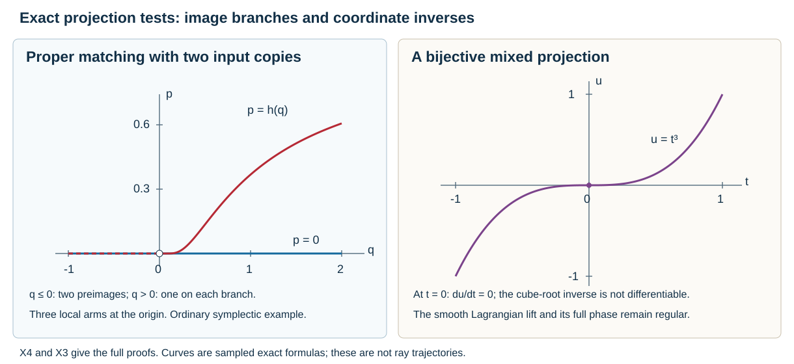

# Local images, compact fibers and phase coordinates

Clean intersection determines tangent spaces and local Lagrangian images. A global image, a bundle over that image and a smooth coordinate projection require their own hypotheses. The examples here keep these questions separate while retaining exact cotangent signs.

Mathematical source: Lars Hörmander, *The Analysis of Linear Partial Differential Operators III*, 2007 edition, §21.2, especially the reduction remark after Proposition21.2.13, Theorem21.2.14 and the generating-function discussion in Theorems21.2.16–21.2.18. The [phase-space lesson](../20261005-restored-phase-space/phase-space-and-generating-families.html), [conormal recognition proof](../20261005-restored-prescribed-coordinates/prescribed-canonical-coordinates-and-isotropic-fibers.html) and proper connected-image argument supply exact earlier results. Exposition, the examples testing global image and coordinate hypotheses, and the diagram are independent programme work.

We use \(\alpha=\sum p_j\,dq_j\), \(\omega=d\alpha=\sum dp_j\wedge dq_j\). A canonical relation from \(S_2\) to \(S_1\) is Lagrangian for \(\omega_1-\omega_2\). An image assertion below concerns the specified image, with its stated topology; multiplicities are retained.

## 1. Clean conormals, critical maps and compact fibers

**C0. Conormals preserve a clean base intersection.** Let \(Y_1,Y_2\subset X\) be embedded submanifolds intersecting cleanly. Their full conormal bundles, including zero covectors, intersect cleanly in \(T^*X\). The same holds after deleting zero, when the intersection is nonempty.

**Proof.** Use the proved simultaneous smooth chart \((u,v,w,z)\) for the base pair:
\(Y_1=\{w=z=0\}\), \(Y_2=\{v=z=0\}\). Write \(k=\dim u\), \(c=\dim z\), and denote the four momentum blocks by \((p_u,p_v,p_w,p_z)\). In the induced full cotangent chart the conormals are exactly
\[
 N^*Y_1=\{w=z=0,\ p_u=p_v=0\},\qquad
 N^*Y_2=\{v=z=0,\ p_u=p_w=0\}.
\]
Their intersection is the coordinate submanifold with only \(u,p_z\) free, of dimension \(k+c\). The intersection of their tangent spaces has exactly the same coordinate equations, at every point. This proves cleanliness, including at zero covectors. The full cotangent lift of a base change is a diffeomorphism preserving the canonical primitive, so the conclusion is intrinsic. Deleting zero is an open restriction; in the intersection it requires \(p_z\ne0\). Thus if \(c=0\), the nonzero intersection is empty, rather than a fictitious common ray. \(\square\)

**G0. General clean generating functions may reach zero covectors.** Let \(\phi\) be a smooth real function on a product of coordinate neighborhoods in \(X\times\Theta\), where \(\dim X=n\), \(\dim\Theta=N\). Suppose \(C=\{\phi_\theta'=0\}\) is a smooth manifold with \(TC=\ker d(\phi_\theta')\) and dimension \(n+e\). No homogeneity or nonvanishing of \(d\phi\) is assumed. Then \(\kappa(x,\theta)=(x,\phi_x')\) on \(C\) has rank \(n\), and each local image is Lagrangian in the full \(T^*X\), possibly meeting its zero section.

**Proof.** Cleanliness makes \(d(\phi_\theta')\) have rank \(N-e\). A kernel vector of \(d\kappa|_{TC}\) is precisely \((0,\eta)\) with \(\phi_{x\theta}''\eta=0\) and \(\phi_{\theta\theta}''\eta=0\). This stacked matrix is the transpose of \(d(\phi_\theta')\), by symmetry of the second derivatives. Its kernel has dimension \(e\), so the critical map has rank \((n+e)-e=n\). The proved constant-rank coordinate construction gives a smooth local image. On \(C\), \(\kappa^*\alpha=d\phi|_C\); taking an exterior derivative proves that its local image is isotropic. Its dimension makes it Lagrangian.

Equivalently the map \((x,\theta)\mapsto(x,\phi_x';\theta,-\phi_\theta')\) is an embedded canonical relation: its base coordinates are \((x,\theta)\), its pulled-back difference primitive is \(d\phi\), and its dimension is half the product dimension. Matching it with the zero section of \(T^*\Theta\) has exactly the displayed clean equations and gives \(\kappa(C)\). This proves the general generating-function construction, including zero covectors. For a homogeneous phase with \(d\phi\ne0\), the earlier phase theorem adds the punctured and conic conclusions. \(\square\)

**P0. Proper submersions are locally trivial.** Let \(f:M\to B\) be a surjective smooth proper submersion between smooth manifolds without boundary. For each \(b_0\in B\), a neighborhood \(U\) admits a diffeomorphism
\[
 T:U\times f^{-1}(b_0)\longrightarrow f^{-1}(U),
 \qquad f(T(u,z))=u.
 \tag{LI1}
\]
In particular each fiber is compact. For a clean canonical composition one can apply this after its image is known to be embedded and the projection is proper. The earlier proper connected-image theorem is one sufficient criterion for that embeddedness.

**Proof.** Properness makes \(F=f^{-1}(b_0)\) compact. Take coordinates centered at \(b_0=0\) and a closed coordinate ball \(\overline{B_R}\) compactly contained in the coordinate domain. Then \(K=f^{-1}(\overline{B_R})\) is compact.

At every point of \(K\), submersion coordinates give smooth fields \(H_1^a,\ldots,H_r^a\) lifting the coordinate fields of \(B\). Such coordinates follow from the inverse-function construction for a constant-rank map proved in the conormal lesson: select an invertible minor and retain the unused domain coordinates. Choose finitely many of these neighborhoods covering \(K\). The proved finite smooth-cutoff construction supplies functions \(\chi_a\), supported in the assigned neighborhoods, whose sum is one on an open neighborhood \(W\) of \(K\). Extend each \(\chi_a H_j^a\) by zero and set
\[
 H_j=\sum_a\chi_a H_j^a,\qquad df(H_j)=\partial_{u_j}\quad\hbox{on }W.
 \tag{LI2}
\]
These fields are smooth; no choice of a global metric or horizontal bundle is needed.

For \(u\in B_{R/2}\), let \(H(u)=\sum_j u_jH_j\). Starting at \(z\in F\), its flow has base coordinate \(tu\) as long as it lies in \(W\), since differentiating \(f\) along it gives the constant vector \(u\). Thus it remains in \(K\) throughout its possible time interval \(0\leq t\leq1\). It cannot leave \(W\), which contains all of \(K\).

The flow exists through time one. Indeed the compact set \(K\), and the compact parameter set \(\overline{B_{R/2}}\), are covered by finitely many local ODE construction rectangles. Shrinking the associated data neighborhoods gives a positive lower bound for their local existence times. If a maximal endpoint occurred at \(t_*\leq1\), start in one of these rectangles at a time less than \(t_*\) by less than this bound. Its local solution extends past \(t_*\), and uniqueness identifies the extension with the original solution, a contradiction. This uses the proved finite-coordinate flow theorem with its actual parameter domains.

Write \(\Phi_u^t\) for this flow and put \(T(u,z)=\Phi_u^1(z)\). It is smooth jointly in \(u,z\). For \(m\in f^{-1}(u)\), the flow of \(-H(u)\) has base \((1-t)u\). The same compactness proof gives it through time one. Flow uniqueness and the inverse law therefore give the smooth inverse
\[
 m\longmapsto\bigl(f(m),\Phi_{f(m)}^{-1}(m)\bigr).
 \tag{LI3}
\]
Both compositions are the identity, proving (LI1). In base dimension zero, choose the open singleton \(U=\{b_0\}\); the asserted product and inverse are immediate. \(\square\)

This result does not assign a smooth structure to a set of several unresolved image branches. A proper constant-rank map has compact fibers and closed image: if image points converge, choose their preimages over the compact set consisting of that sequence and its limit. Properness gives a convergent subsequence and a preimage of the limit. Local constant-rank charts give smooth image branches. To apply P0 to the image as one base, its embeddedness must also be established.

## 2. Exercise: reduction can jump while the original planes vary smoothly

**X1. A discontinuous family of reduced lines.** In \(T^*\mathbb R^2\), let
\[
 A=\{(0,s;0,0):s\in\mathbb R\},\qquad
 L_a=\{(as,s;t,-at):s,t\in\mathbb R\}.
 \tag{LI4}
\]
Compute the reduction of \(L_a\) in \(A^\omega/A\), and determine its dependence on \(a\).

**Solution.** Pairing with \(\partial_{q_2}\) gives \(A^\omega=\{p_2=0\}\). The quotient has coordinates \((q_1,p_1)\) and form \(dp_1\wedge dq_1\). The two columns
\[
 (a,1,0,0)^T,\qquad(0,0,1,-a)^T
\]
are independent for every \(a\). Pulling \(\alpha\) back to the \((s,t)\)-plane gives \(t\,a\,ds-at\,ds=0\). Thus \(L_a\) is a smoothly varying Lagrangian plane.

If \(a\ne0\), the condition \(p_2=-at=0\) forces \(t=0\). Its quotient image is the whole \(q_1\)-axis. If \(a=0\), every \(s,t\) is allowed, \(q_1=0\), and the quotient image is the whole \(p_1\)-axis. In both cases it is a Lagrangian line, in agreement with the linear reduction theorem. The original intersections have dimensions
\[
 \dim(L_a\cap A^\omega)=
 \begin{cases}1&a\ne0,\\2&a=0,\end{cases}
 \qquad
 \dim(L_a\cap A)=
 \begin{cases}0&a\ne0,\\1&a=0.\end{cases}
 \tag{LI5}
\]
The reduced line has dimension one throughout but is discontinuous at zero: its Euclidean orthogonal projection is \(\operatorname{diag}(1,0)\) for \(a\ne0\) and \(\operatorname{diag}(0,1)\) at zero. The operator norm of their difference is one. Constant reduced dimension alone does not give continuous reduction. \(\square\)

## 3. Exercise: the semicubical cusp has a smooth conic lift

**X2. The exact cusp lift.** Parametrize
\[
 (q_1,q_2,p_1,p_2)=(3s^2,-2s^3,s\rho,\rho),
 \qquad s\in\mathbb R,\quad \rho\ne0.
 \tag{LI6}
\]
Prove that its image is a smooth conic Lagrangian. Determine its base projection and its relation to conormal bundles.

**Solution.** The inverse parameters on the image are \(\rho=p_2\) and \(s=p_1/p_2\). The differential is injective even at \(s=0\): the \(p_2\) component first detects the \(\rho\) variation, and the remaining \(p_1\) component detects \(\rho\,ds\). The parametrization is therefore an embedding, with two components according to the sign of \(\rho\).

The primitive cancels exactly:
\[
 \alpha=s\rho(6s\,ds)+\rho(-6s^2\,ds)=0.
 \tag{LI7}
\]
The two-dimensional image is isotropic in a four-dimensional symplectic manifold, hence Lagrangian. Positive fiber dilation replaces \(\rho\) by \(c\rho\) and leaves \(s\) unchanged.

The base curve satisfies
\[
 (q_1/3)^3-(q_2/2)^2=0.
 \tag{LI8}
\]
Its derivative is \(6s(1,-s)\), so the base projection has rank one for \(s\ne0\) and zero at \(s=0\). On the regular part its full nonzero conormal consists exactly of the multiples \(\rho(s,1)\), \(\rho\ne0\); these give (LI6). Every point of (LI6) with \(s=0\) is a limit from regular values with the same \(\rho\). Conversely a finite nonzero cotangent limit over the cusp has \(p_1=s p_2\to0\), so \(p_2\ne0\), and belongs to (LI6). Thus the lift is the closure of that nonzero conormal inside the punctured cotangent bundle.

There is no conormal germ at the cusp of an embedded smooth base manifold. Such a conormal projection has constant rank equal to the dimension of its base; the ranks just computed vary in every neighborhood of \(s=0\). The smooth lifted manifold and the singular projected curve are different objects. \(\square\)

## 4. Exercise: a smooth bijection is not a smooth coordinate chart

**X3. A mixed projection with a singular inverse.** On the cone \(\rho>0\), consider
\[
 (q_1,q_2,p_1,p_2)
   =(-\tfrac34t^4,t^3,\rho,t\rho).
 \tag{LI9}
\]
Test the mixed projection \((q_2,p_1)\), and construct an actual smooth nondegenerate phase.

**Solution.** The inverse lift parameters are \(\rho=p_1>0\) and \(t=p_2/p_1\), and their differential again proves embedding. The primitive is
\[
 \alpha=\rho(-3t^3\,dt)+t\rho(3t^2\,dt)=0.
 \tag{LI10}
\]
This is a smooth conic Lagrangian. Its mixed projection is \((t,\rho)\mapsto(t^3,\rho)\), a smooth bijection onto \(\mathbb R\times(0,\infty)\). Its inverse contains a cube root and is not differentiable at \(t=0\). The differential of this projection has rank one there and rank two away from zero.

If a smooth mixed generating function \(S(u,\theta)\), \(u=q_2,\theta=p_1\), gave \(q_1=S_\theta\), \(p_2=-S_u\), it would satisfy
\[
 S_u(u,\theta)=-\theta\,\sqrt[3]{u}.
 \tag{LI11}
\]
This right side is not differentiable in \(u\) at zero. Thus no smooth \(S\) can give the proposed mixed chart near that point. The degree-one candidate fixed by the primitive is \(S=-\tfrac34\theta|u|^{4/3}\), which is \(C^1\) but not \(C^2\). The generating-function theorem uses a local diffeomorphism of the mixed variables; a set-theoretic bijection alone is insufficient.

There is nevertheless a full smooth frequency chart. On \(\theta_1>0\), put
\[
 H(\theta)=\frac{\theta_2^4}{4\theta_1^3},
 \qquad
 \phi(q,\theta)=q_1\theta_1+q_2\theta_2-H(\theta).
 \tag{LI12}
\]
Then \(H_{\theta_1}=-3\theta_2^4/(4\theta_1^4)\) and \(H_{\theta_2}=\theta_2^3/\theta_1^3\). Its critical equations are exactly (LI9), with \(\rho=\theta_1\), \(t=\theta_2/\theta_1\). Their differentials are independent because their derivatives in \(q\) form the identity matrix. Also \(d\phi\ne0\), since its \(q_1\) derivative is \(\theta_1>0\). Homogeneity has degree one.

At \(t=0\), the full vertical tangent has dimension two, as both parameter variations have zero base differential and independent fiber differentials. The proved minimum-variable theorem therefore requires at least two phase variables there. The phase (LI12) attains this bound. \(\square\)

## 5. Exercise: proper clean matching can retain distinct image branches

**X4. Two ordinary canonical branches.** Let
\[
 h(q)=
 \begin{cases}e^{-1/q}&q>0,\\0&q\leq0.\end{cases}
 \tag{LI13}
\]
Use \(S_1=T^*\mathbb R\), let \(S_2\) be the disjoint union of two copies of \(T^*\mathbb R\), and let \(S_3\) be a point. On copy \(i=0,1\), take the symplectomorphism
\[
 F_i(q,p)=(q,p+i h(q)).
 \tag{LI14}
\]
Let \(C_{12}\) be their graphs and \(C_{23}\) the union of the two zero sections, as a relation from the point. Determine their clean composition, its properness and its fibers.

**Solution.** The flat-function proof gives \(h\in C^\infty\), including every derivative at zero. The inverse of \(F_i\) subtracts \(i h(q)\), and
\[
 F_i^*(dp\wedge dq)=(dp+i h'(q)dq)\wedge dq=dp\wedge dq.
 \tag{LI15}
\]
Thus each graph is Lagrangian for the difference form. Their union is an embedded canonical relation because the input copies are disjoint. Each zero section is Lagrangian, so \(C_{23}\) is an embedded canonical relation too.

Matching is transverse to the middle diagonal: the second projection of either graph is a diffeomorphism, and varying it while holding the zero-section point fixed spans every middle mismatch. The clean matching manifold is consequently
\[
 \mathcal F=\mathbb R\sqcup\mathbb R,\qquad
 \pi(q,i)=(q,i h(q)).
 \tag{LI16}
\]
The rank is one everywhere and the excess is zero. Projection is proper. For a compact target set \(K\), its preimage in each copy is closed by continuity and has bounded \(q\), because the first output coordinate is \(q\); it is therefore compact. The finite union is compact.

Its image is the closed union of the curves \(p=0\) and \(p=h(q)\). On \(q<0\) these coincide; for \(q>0\) they are distinct, since \(h(q)>0\). The fiber cardinality is two at every image point with \(q\leq0\), and one at every image point with \(q>0\). Thus it cannot be a locally trivial bundle over the set-theoretic image near the origin: a bundle's fibers over one trivializing neighborhood are diffeomorphic, whereas these zero-dimensional fibers have different cardinalities.

Nor is that image an embedded one-dimensional manifold at the origin. In a sufficiently small neighborhood, deleting the origin leaves three local arms: the shared negative arm and two distinct positive arms. A coordinate interval with its center removed has two. Each individual branch remains a smooth Lagrangian. The parametrizing disjoint union is an immersed branch description with multiplicity, and is not identified with a single embedded image.

This is an ordinary symplectic example; it asserts no homogeneous zero-section model in a punctured cotangent bundle. It shows why properness and local clean rank do not by themselves supply the embedded base needed in P0. Connected fibers, as in the earlier proper connected-image argument, or an explicit embedded-image hypothesis settle that separate issue. \(\square\)

## 6. Read the two projection tests

**F0. Objects and scales in the diagram.** The left panel plots the exact image branches \((q,0)\) and \((q,h(q))\) from X4 for \(-1\leq q\leq2\), with \(p\) as the vertical coordinate. Only these finite plotting intervals are shown; properness concerns the full map on both copies of \(\mathbb R\). The shared negative branch has two preimages, and each positive branch has one. The right panel plots \(u=t^3\) from X3 for \(-1\leq t\leq1\). This map is bijective and has derivative zero at the origin; its cube-root inverse is not differentiable there. These are sampled graphs of exact formulas, not ray trajectories or replacement proofs.

The proof map identifies the complete local arguments and their exact earlier programme inputs. Human foundations retain their external status and terms. Independent programme text and original illustration: CC0 to the extent rights exist. Exposition, calculations and illustration: GPT-6.1 Sol (OpenAI), Ultra.
