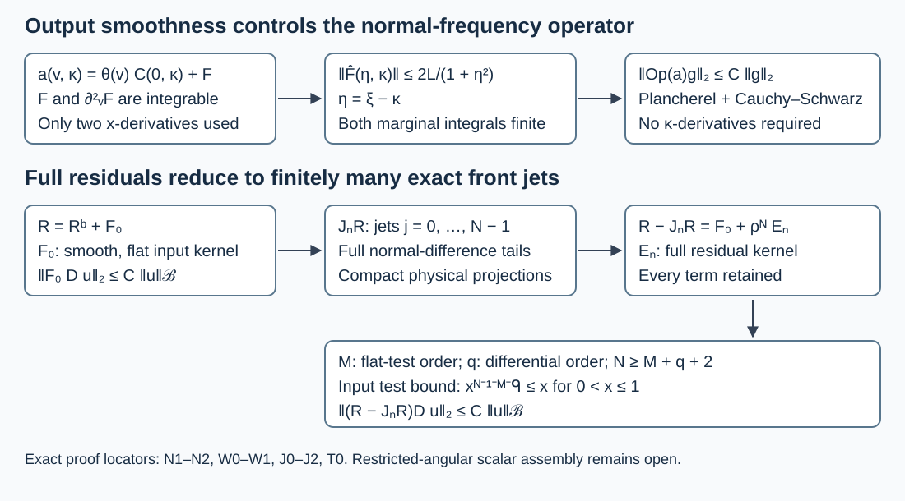

# Normal-fiber bounds and finite front jets

An estimate in the normal variable can remain uniform even when frequency derivatives of an auxiliary inverse have no useful bounds. A separate fact reduces a complete boundary residual to finitely many exact normal jets, with its error controlled by the original Banach norm. We prove both statements, including the density factors and the full side tails. They are tools for scalar observation estimates, not a proof of the remaining angular assembly.

The mathematical setting is Hörmander's full boundary calculus in *The Analysis of Linear Partial Differential Operators III*, §18.3, and the observation estimates in §24.7. This independent exposition uses the edition and the exact programme proofs in the proof map. A citation never substitutes for the arguments below. Original expression, examples and diagram: GPT-6.1 Sol (OpenAI), Ultra; CC0-1.0. Linked human foundations retain their recorded terms.

## 1. The setting and what is retained

**H0. Complete kernels and the original Banach space.** Let the boundary \(Y\) be a compact smooth manifold, possibly disconnected, with a fixed positive smooth density \(d\nu\). Work in a fixed collar \([0,b)\times Y\) of a smooth manifold \(X\). Its density is \(w(x,y)\,dx\,d\nu(y)\), with \(w>0\) smooth. All families below have common compact physical input and output projections; their full residual seminorms are uniformly bounded. Thus off-diagonal kernels, kernels between components, and both resolved side tails are included. No assertion is made only modulo residuals.

Let \(\mathcal B\) be a Banach space continuously embedded in extendible distributions on \(X\). Let \(D_a\) be a bounded family of smooth differential operators of order at most a fixed nonnegative integer \(q\), on the relevant compact input set. Smooth inputs belong to \(\mathcal B\) whenever its norm is used. All estimates are uniform in the family parameters. The proofs first concern these actual smooth inputs; they assert no unproved graph-density statement.

**C0. Coordinates, densities and a fixed distribution order.** The complete collar and flow proof GRF:C0 supplies the chosen coordinates. Set
\[
 v=\log x,\qquad (U f)(v,y)=e^{v/2}w(e^v,y)^{1/2}f(e^v,y).
 \tag{NF1}
\]
The substitution \(dx=e^v\,dv\) gives exact unitarity. Use fixed smooth normal cutoffs supported before the collar's upper edge, so that zero extension in \(v\) is smooth. For each compact input chart, NGR:B1–B2 proves that there are an integer \(M\) and a constant \(C\) with
\[
 |u(\phi)|\leq C\|u\|_{\mathcal B}\,p_M(\phi),\qquad
 p_M(\phi)=\max_{|\alpha|\leq M}\sup|\partial^\alpha\phi|,
 \tag{NF2}
\]
for every fixed-support smooth test flat at the input boundary. Here pairing uses the chosen input density; converting to coordinate Lebesgue density multiplies tests by a fixed smooth positive factor. A finite input partition permits the same \(M\) for all charts and components. This order comes from the entire Banach ball, not from an individual input. We use (NF2) directly; no chosen ambient extension of \(u\) is required.

## 2. A normal-frequency estimate with no frequency derivatives

**N0. The operator-valued hypotheses.** Let \(H_0,H_1\) be separable Hilbert spaces. Suppose \(C(x,\kappa):H_0\to H_1\), for \(0\leq x\leq b_0<b\) and \(\kappa\in\mathbb R\), is twice continuously differentiable in \(x\) in operator norm and
\[
 K_j=\sup_{x,\kappa}\|\partial_x^j C(x,\kappa)\|<\infty,
 \qquad j=0,1,2.
 \tag{NF3}
\]
Assume joint strong measurability in the operator-norm Banach space, including these derivatives. This is a norm-measurability hypothesis, stronger than merely testing measurability on each vector; norm-continuous frequency families satisfy it. No derivative in \(\kappa\) is assumed. Fix a smooth scalar \(\beta\), equal to one near zero and supported strictly below \(b_0\), and extend \(a(v,\kappa)=\beta(e^v)C(e^v,\kappa)\) by zero at its upper end. Initially define the left-quantized operator by
\[
 (Tg)(v)=(2\pi)^{-1}\int e^{iv\kappa}a(v,\kappa)\widehat g(\kappa)\,d\kappa.
 \tag{NF4}
\]
It is enough initially to take finite-coordinate inputs whose Fourier transforms have bounded support and are square integrable. They are integrable by Cauchy–Schwarz; (NF4) is a Bochner integral. The Hilbert-valued Fourier theorem SY:H1 gives this dense test class and fixes the inverse factor \((2\pi)^{-1}\).

**N1. Remove the constant front value in the output variable.** Choose a smooth step \(\theta(v)\) equal to one for \(v\leq V_0\), zero for \(v\geq V_1\), with \(\beta(e^v)=1\) below \(V_0\). Write
\[
 a(v,\kappa)=\theta(v)C(0,\kappa)+F(v,\kappa).
 \tag{NF5}
\]
At the negative end the fundamental theorem of calculus gives \(\|F\|\leq K_1e^v\). There \(F_v=e^vC_x\) and \(F_{vv}=e^vC_x+e^{2v}C_{xx}\). On the fixed transition interval all three quantities have bounds from (NF3) and the fixed cutoffs; above it they vanish. Consequently, uniformly in \(\kappa\),
\[
 \int_{\mathbb R}(\|F(v,\kappa)\|+\|F_{vv}(v,\kappa)\|)\,dv\leq L,
 \qquad \|\widehat F(\eta,\kappa)\|\leq \frac{2L}{1+\eta^2}.
 \tag{NF6}
\]
For the second assertion the Fourier integral is in \(v\), not in \(\kappa\). Its norm is at most \(L\); for \(|\eta|\geq1\), two integrations by parts give \(L|\eta|^{-2}\). The boundary terms vanish because \(F,F_v=O(e^v)\) at the negative end and are zero at the positive end. Operator-norm completeness SY:H4 and the integrable bounds justify the Banach-valued integrals and these integrations by parts, by taking finite intervals and their norm limits. Taking \(2L\) yields (NF6) on both ranges.

**N2. The actual two-sided integral bound.** For the preceding test inputs, Fourier inversion and Fubini give
\[
 \widehat{\operatorname{Op}(F)g}(\xi)
 =(2\pi)^{-1}\int\widehat F(\xi-\kappa,\kappa)\widehat g(\kappa)\,d\kappa.
 \tag{NF7}
\]
One may first pair against a compact-frequency finite-coordinate output test: (NF6) then gives absolute integrability, and the identity follows by scalar Fourier inversion component by component. Put \(m(\eta)=2L/(2\pi(1+\eta^2))\) and \(A=\int m<\infty\). The norm of the right side of (NF7) is at most \(\int m(\xi-\kappa)\|\widehat g(\kappa)\|\,d\kappa\). Weighted Cauchy–Schwarz and nonnegative Fubini give
\[
 \int\!\left(\int m(\xi-\kappa)h(\kappa)\,d\kappa\right)^2d\xi
 \leq A\iint m(\xi-\kappa)h(\kappa)^2\,d\kappa\,d\xi
 = A^2\|h\|_2^2.
 \tag{NF8}
\]
Both marginal integrals equal \(A\); no unproved pointwise-to-operator inference is used. Hilbert-valued Plancherel now bounds \(\operatorname{Op}(F)\) by \(A\). The other term in (NF5) is exactly multiplication by \(\theta(v)\) after the Fourier multiplier \(C(0,D_v)\), with norm at most \(\|\theta\|_\infty K_0\). Density therefore gives a unique bounded extension and
\[
 \|Tg\|_2\leq (A+\|\theta\|_\infty K_0)\|g\|_2.
 \tag{NF9}
\]
In particular, if a full left symbol factors exactly as \(r(x,\kappa)=C(x,\kappa)s(\kappa)\), this bounds its left quotient using (NF3), without frequency-derivative bounds for that quotient. On any domain where the multiplier \(s(D_v)g\) and the exact factorization are defined, \(\operatorname{Op}(\beta r)g=T(s(D_v)g)\). Existence of a full boundary test with symbol \(s\), its physical support and its side-face properties remain separate obligations. Boundedness of an auxiliary inverse never proves its membership in the boundary calculus.

## 3. A weighted full residual has the original Banach bound

**W0. The pointwise flat-test estimate.** Let \(R_a\) be any full residual family from H0. Fix an integer
\[
 N\geq M+q+2.
 \tag{NF10}
\]
Near an output boundary point, in function-kernel convention, write
\[
 R_af(x,y)=\int\kappa_a(x,t;y,y')f(xt,y')\,dt\,d\nu(y'),\qquad t=x'/x.
 \tag{NF11}
\]
Finite tangential charts and partitions are understood; they do not omit cross-chart or cross-component kernels. The full resolved-kernel criterion GB:C1 and SFT:D2 say that every ratio derivative needed here is bounded uniformly, with arbitrary decay at both ratio ends. Relative to ordinary input coordinates the kernel is \(x^{-1}\kappa_a(x,x'/x;y,y')\). Relative to the chosen input density it additionally has the smooth positive factor \(w(x',y')^{-1}\). Extend this factor smoothly over the fixed compact input region.

For fixed \(x>0,y\), transpose \(D_a\) onto this input kernel, multiply by \(x^N\), and take any input derivative of order at most \(M\). A normal derivative on the ratio costs \(x^{-1}\); every other derivative falls on a uniformly bounded smooth coefficient or cutoff, or on a tangential kernel derivative. The transpose uses at most \(q\) derivatives, including coefficient derivatives. For \(0<x\leq\epsilon\leq1\), therefore,
\[
 p_M\!\left(D_a^t\{x^{N-1}w(x',y')^{-1}
              \kappa_a(x,x'/x;y,y')\}\right)
 \leq C_N x^{N-1-M-q}.
 \tag{NF12}
\]
For fixed positive \(x\), this is a smooth test flat at \(x'=0\): arbitrary ratio-end decay survives all of the finitely many derivatives and the zero extension. Its support is in the fixed input compact set. Formula (NF2) applies to this exact test, giving
\[
 |x^NR_aD_au(x,y)|\leq C_Nx^{N-1-M-q}\|u\|_{\mathcal B}.
 \tag{NF13}
\]
There are only finitely many input and output patches. The estimate does not assert that this weighted kernel is smooth on the original double corner; that stronger assertion is unnecessary and generally unavailable.

**W1. Integrate without changing the Banach norm.** Fix a global smooth positive extension \(\rho\) of the collar defining function \(x\), positive in the interior. Since the exponent in (NF13) is at least one, its square is integrable against the bounded smooth output density on the compact collar. Away from the output boundary the full residual kernel is an original smooth kernel flat at the input boundary. Its finite input derivatives are bounded; the same flat-test estimate, or the complete OSA:K0 proof, gives the required compact-output bound there. Thus
\[
 \|\rho^N R_aD_au\|_{L^2(X)}\leq C_N\|u\|_{\mathcal B}.
 \tag{NF14}
\]
All constants are uniform for the prescribed bounded families. The exponent is a sufficient integer choice, not a sharp threshold. In particular (NF14) does not assign the unweighted residual to a Banach-only remainder.

## 4. The finite front-jet operator

**J0. Normal jets retain every side tail.** First localize \(R_a\) to the double boundary corner: \(R_a^b=\beta_0R_a\chi_0\), where both normal cutoffs equal one near zero and are compact in the collar. GRF:C1 proves that \(F_a=R_a-R_a^b\) has an original smooth kernel flat at the input boundary, so \(\|F_aD_au\|_2\leq C\|u\|_{\mathcal B}\).

The full normalized kernel of \(UR_a^bU^{-1}\), acting from \(v-h\) to \(v\), is
\[
 k_a(x,h;y,y')=t^{1/2}
       \sqrt{\frac{w(x,y)}{w(tx,y')}}\,\kappa_a^b(x,t;y,y'),
 \qquad x=e^v,\quad t=e^{-h}.
 \tag{NF15}
\]
This follows by substituting \(|dt|=t\,dh\) in (NF11), including the two half-density factors from (NF1). It is smooth in \(x\) down to zero for fixed finite \(h\). For every nonnegative integer \(j\), every tangential and \(h\) derivative and every \(L>0\), it satisfies a uniform bound after multiplication by \(e^{L|h|}\). To check the stronger \(x\)-derivatives explicitly, use resolved coordinates \(s=x+x'=x(1+e^{-h})\) and \(r=x/s=(1+e^{-h})^{-1}\). Each \(x\) derivative introduces only finitely many factors \((1+e^{-h})\); differentiating the input cutoff or density introduces additional finite powers of \(e^{-h}\). Arbitrary side flatness absorbs all these powers, the factor \(t^{1/2}\), and every prescribed exponential weight. This proves the asserted bounds, rather than assuming that \(v\)-derivative bounds imply them.

Consequently the exact coefficients
\[
 k_{j,a}(h;y,y')=\frac{1}{j!}\partial_x^jk_a(0,h;y,y'),\qquad
 r_{j,a}(\kappa)=\int e^{-ih\kappa}k_{j,a}(h)\,dh
 \tag{NF16}
\]
are smooth tangential kernels; their \(h\) tails have every exponential weight. Integration by parts shows rapid frequency decay after every frequency and tangential derivative. They are full normal model operators, not just principal symbols.

**J1. An actual compact physical operator.** Choose fixed smooth \(\beta,\chi\) equal to one near zero, both compact within the collar. Define
\[
 \mathcal J_N R_a
 =U^{-1}\beta(x)\sum_{j=0}^{N-1}x^jr_{j,a}(D_v)\,U\chi(x).
 \tag{NF17}
\]
The notation means the Fourier multiplier for the full tangential kernel \(r_{j,a}\). Its normalized log kernel is precisely
\(\beta(x)\sum_{j<N}x^jk_{j,a}(h;y,y')\chi(xe^{-h})\).
In ratio convention its function kernel is
\[
 t^{-1/2}\sqrt{\frac{w(tx,y')}{w(x,y)}}\,
 \beta(x)\sum_{j<N}x^jk_{j,a}(-\log t;y,y')\chi(tx).
 \tag{NF18}
\]
These formulae fix the sign, power, order of the cutoffs and both density variables. All the tails from J0 survive. In resolved variables this is smooth, flat at both side faces, and compact in both physical projections. Indeed finite powers from changing variables or differentiating the density and cutoffs are absorbed by the arbitrary exponential decay. GB:C1 thus proves that (NF17) is a genuine full residual operator. Its normal-difference support need not be compact.

For each fixed finite \(h\), both cutoffs in (NF17) are constant one for sufficiently small \(x\); hence the first \(N\) derivatives in \(x\) of its log kernel agree with those of \(k_a\) at zero. Dependence of that neighborhood on \(h\) causes no loss: the uniform weighted derivative bounds just proved hold for all \(h\).

**J2. Divide the difference in the full calculus.** Put \(\Delta_a=R_a^b-\mathcal J_NR_a\). This is a bounded full residual family. Its normalized log kernel has zero \(x\)-jets of orders less than \(N\). Taylor's integral formula gives
\[
 k_{\Delta_a}(x,h)=x^N e_{N,a}(x,h),\qquad
 e_{N,a}(x,h)=\frac{1}{(N-1)!}\int_0^1(1-t)^{N-1}
          \partial_x^Nk_{\Delta_a}(tx,h)\,dt.
 \tag{NF19}
\]
J0's weighted derivative bounds also apply to the cutoff model in J1, so (NF19) bounds every derivative of \(e_{N,a}\) with every exponential \(h\) weight. Here division is legitimate in the full resolved class, as can also be seen without relying on a one-sided log characterization. In the compactified coordinates \(s=x+x'\), \(r=x/s\), for \(0<r<1\) the zero \(x\)-jets imply zero \(s\)-jets of orders below \(N\). Smoothness extends this identity to the side endpoints. Taylor division by \(s^N\) is smooth and preserves arbitrary flatness at \(r=0,1\), because its integral differentiates only \(s\). Dividing further by \(r^N\) preserves side flatness, by the same Taylor estimate at \(r=0\). Thus division by \(x^N=s^Nr^N\) gives a smooth side-flat kernel, including the density factors. Off the front face, the only possible zero of \(x\) is a side face, where the same flatness allows division. Compact physical projections are retained: at every \(x>0\) the quotient equals the difference divided by \(x^N\), and its extension introduces no new support.

It follows that there is a uniformly bounded full residual family \(E_{N,a}\) on \(X\) with
\[
 R_a-\mathcal J_N R_a=F_a+\rho^NE_{N,a}.
 \tag{NF20}
\]
Away from the chosen collar, \(\rho>0\), so this division extends smoothly; the original smooth flat-input part may equivalently remain in \(F_a\). No term in (NF20) has been discarded or replaced by a principal-symbol equality.

## 5. What the reduction proves

**T0. Exact finite-jet control modulo the original remainder.** Combine (NF14), (NF20) and the flat-input estimate for \(F_a\). For \(N\geq M+q+2\),
\[
 \|(R_a-\mathcal J_N R_a)D_au\|_2\leq C_N\|u\|_{\mathcal B}.
 \tag{NF21}
\]
The triangle inequality in both directions therefore makes the seminorm families \(\|R_aD_au\|_2\) and \(\|\mathcal J_NR_aD_au\|_2\) equivalent after adjoining this same Banach norm. Supremums over the bounded family obey the same two inequalities. Applying this to the exact full remainder in GFR:A1 reduces the residual contribution in that finite-order family reduction to finitely many normal jets, with the original Banach remainder.

**G0. The exact operator and finite-jet scope.** N2 is an operator bound under explicitly stated coordinate-smoothness hypotheses; it does not manufacture those hypotheses for an arbitrary inverse. T0 is a finite-jet reduction for full residuals; it neither removes the finite-order part nor by itself constructs a scalar test in an arbitrary allowed angular cone. The separate [whole-manifold tangential-equator assembly](../20261017-global-tangential-equator-assembly/one-scalar-test-when-all-boundary-tangential-directions-are-allowed.html) and [global scalar assembly and observation](../20261017-angular-output-reserve-assembly/scalar-tests-from-a-missing-tangential-direction.html) give the corresponding scalar tests and observation theorem. Some prerequisite proofs are external readings; their authorship and licence notices remain applicable.

## 6. Three solved examples

**X1. A bounded normal factor with a discontinuous frequency dependence.** Take \(H_0=H_1=\mathbb C\), \(m(\kappa)=\mathbf1_{[0,\infty)}(\kappa)\) and any bounded measurable \(n(\kappa)\). On a bounded \(x\)-interval let \(C(x,\kappa)=m(\kappa)+xn(\kappa)\). It is norm measurable, \(C_x=n\), \(C_{xx}=0\), and it meets N0. Directly from (NF4),
\[
 Tg=\beta(e^v)m(D_v)g+\beta(e^v)e^vn(D_v)g,
 \quad \|T\|\leq\|\beta\|_\infty+
           \sup_v|\beta(e^v)e^v|\,\|n\|_\infty.
 \tag{NF22}
\]
Plancherel proves this bound even though the derivative of \(m\) is not a bounded function. This is an auxiliary Hilbert-space factor example; the discontinuous multiplier is not asserted to be an admissible full boundary test.

**X2. Why the weight is substantive.** On a half-line with density \(dx\), choose a nonnegative smooth nonzero \(\kappa(t)\) supported in \((3/4,5/4)\), and fixed input/output cutoffs equal to one near zero. Its ratio kernel, with these cutoffs, is a full residual: it is smooth and identically zero near both side faces. Choose a smooth \(\psi\) supported in \((1/4,4)\) and equal to \(z\) on \([1/2,2]\). Such a function is \(z\) times a cutoff supplied by U001-A4. Put \(u_\epsilon(x)=\psi(x/\epsilon)\) and \(D=\partial_x\). For sufficiently small \(\epsilon\), at \(x=\epsilon X\) all cutoffs are one on the supports, and
\[
 RDu_\epsilon(\epsilon X)=\epsilon^{-1}F(X),\qquad
 F(X)=\int\kappa(t)\psi'(tX)\,dt.
 \tag{NF23}
\]
The function \(F\) has fixed compact support in the positive \(X\)-axis and is nonzero: for \(X\) sufficiently close to one, \(tX\in[1/2,2]\) on the support of \(\kappa\), so \(F(X)=\int\kappa>0\). Consequently
\[
 \frac{\|RDu_\epsilon\|_2}{\|u_\epsilon\|_2}
 =\epsilon^{-1}\frac{\|F\|_2}{\|\psi\|_2},\qquad
 \frac{\|x^NRDu_\epsilon\|_2}{\|u_\epsilon\|_2}
 =\epsilon^{N-1}\frac{\|X^NF\|_2}{\|\psi\|_2}.
 \tag{NF24}
\]
Here \(\mathcal B=L^2\) satisfies (NF2) with \(M=0\) on fixed compact tests by Cauchy–Schwarz and their finite volume. The unweighted Banach-only claim fails, whereas the sufficient choice \(N\geq3\) from (NF10) is consistent with the exact scaling. The example asserts no sharpness of that sufficient choice.

**X3. Two retained front jets.** Let \(Y\) be the circle of length \(2\pi\), with \(e_0=(2\pi)^{-1/2}\). Let \(h_0,h_1,h_2\) be smooth compactly supported functions of the normal difference, and set the full normalized kernel to
\[
 k(x,h;y,y')=\beta(x)\chi(xe^{-h})
       [h_0(h)+xh_1(h)+x^2h_2(h)]e_0(y)\overline{e_0(y')}.
 \tag{NF25}
\]
It is a full residual by (NF18), with constant physical density. Both cutoffs equal one near zero. Its first two coefficients from (NF16) are exactly \(h_0e_0\overline{e_0}\) and \(h_1e_0\overline{e_0}\); the factor \(1/j!\) recovers \(h_2\), rather than \(2h_2\), at order two. Using the same cutoffs in (NF17) gives the exact difference
\[
 k-k_{\mathcal J_2R}=x^2\beta(x)\chi(xe^{-h})
                       h_2(h)e_0(y)\overline{e_0(y')}.
 \tag{NF26}
\]
For \(D=1\), \(\mathcal B=L^2\) and \(M=0\), the sufficient exponent is precisely \(N=2\). This is also directly bounded: the rank-one tangential projection has norm one, and the scalar convolution norm is at most \(\|h_2\|_1\), by the two-marginal argument (NF8). Multiplication by the bounded cutoff and \(x^2\) factors gives a finite operator norm. Both retained jets and the complete weighted error are visible in the equality; no corner term is hidden.

## 7. Two estimates and their roles



**F0. What the arrows assert.** The upper route splits the full left symbol into its constant front value and an output-integrable part. Two output derivatives yield the integrable frequency-difference majorant \(2L/(1+\eta^2)\); they do not represent frequency derivatives of the symbol. The lower route retains the first \(N\) exact normal jets and uses \(N\geq M+q+2\) only for the proved remainder bound. The diagram shows implications and exact equalities, not a purported completed scalar angular assembly.
