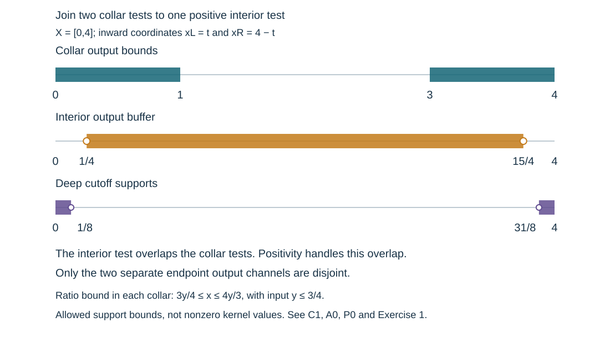

# Global scalar tests on one-dimensional manifolds

Boundary collars have no tangential coordinate in dimension one. Their full residual kernels nevertheless need not be ordinary smoothing kernels. We combine the existing scalar Fourier tests in the collars with one positive interior test, retaining every residual term. The resulting norm inequality has the coarse Banach term required for forcing and observation tests in a propagation estimate.

Independent exposition, proofs, examples and illustration: CC0-1.0. The approved antecedent is Lars Hörmander, *The Analysis of Linear Partial Differential Operators III*, Springer 2007 eBook, ISBN 978-3-540-49938-1, §§18.3 and24.7. The scalar Fourier construction supplies the complete half-line factors in every dimension. The [global kernel calculus](../20261005-global-boundary-operators/global-boundary-operator-calculus.md) supplies their coordinate and support conventions. External human foundation proofs remain explicit in the proof map; internal closure of a CC0-only export is not claimed.

## 1. The inequality and its precise scope

**H0. Full families on a one-dimensional manifold.** Let \(X\) be a smooth one-dimensional manifold with boundary, with a fixed positive smooth density. Let \(\mathcal B\) be a Banach space continuously embedded in extendible distributions on \(X\). We estimate smooth compact inputs \(u\in\mathcal B\). Let \(D_a\) be a family of differential operators of fixed finite order, with coefficients bounded with every derivative on the relevant compact sets. Identity operators are allowed. No boundary condition or continuous trace map is needed for this assembly lemma.

Let \(T_{\ell,a}\), \(1\leq\ell\leq L\), be a finite list of bounded full scalar families in \(\Psi_b^m(X)\), with common compact input and output projections. Their uniform compressed microsupport lies in a compact cosphere set \(K\Subset\Gamma\), where \(\Gamma\) is an open conic set. All residual and off-cone seminorms are included in boundedness. The parameter index need not be differentiable. Then, for a nonnegative integer \(M\geq m\), there is one compact scalar \(A\in\Psi_b^M(X)\), independent of \(a\), such that
\[
 \operatorname{WF}'_b(A)\Subset\Gamma,\qquad
 \sum_{\ell=1}^L\|T_{\ell,a}D_au\|_2
 \leq C\|AD_au\|_2+C\|u\|_{\mathcal B}
                  \quad\hbox{for every }a.
 \tag{OS1}
\]
For a fixed differential operator \(D\) and common input \(f=D u\), the
same test also gives
\[
 \sum_{\ell=1}^L\sup_a\|T_{\ell,a}D u\|_2
       \leq C\|AD u\|_2+C\|u\|_{\mathcal B}.
 \tag{OS2}
\]
For a varying input \(f_a=D_a u\), take a supremum of the whole right side as well. We prove these exact quantifiers below. The specializations \(D_a=P_a\) and \(D_a=I\) assemble forcing and observation lists separately. Their two open cones may differ.

This is an estimate modulo the displayed original Banach norm. It is not an assertion of exact bounded right factorization for an arbitrary global \(L^2\) input. It does not establish the observation theorem in dimensions with positive-dimensional boundary.

## 2. Which kernel errors have a coarse bound?

**K0. Smooth kernels flat in the input.** Suppose a family \(R_a\) has compact projections and smooth kernels on the original product \(X\times X\), flat to every order at the input boundary, with all these seminorms uniformly bounded. Then
\[
                     \|R_aD_au\|_2\leq C\|u\|_{\mathcal B}.
 \tag{OS3}
\]
Here is the actual dual argument. On the compact input set, continuous embedding in extendible distributions gives a finite flat-test seminorm and a constant bounding the pairing with each \(u\) in the unit ball of \(\mathcal B\); this is the proved flat-test bound NGR:B1–B2. For a fixed output point, transpose \(D_a\) onto the input kernel, retaining its complete formal adjoint and the density. Differential operators preserve flatness. Its finite test seminorm is uniformly bounded over the compact output set and parameter family. The pairing is therefore bounded pointwise by \(C\|u\|_{\mathcal B}\). Integrating its square over that finite-density output compact proves (OS3). Kernels supported away from the input boundary are included.

Flatness is essential here. A full residual boundary kernel can have a nonzero smooth coefficient at the new front face and is not silently put into this class.

## 3. All boundary ends, including cross-end residuals

**C0. Finite collars and the remainder on the original product.** Only finitely many boundary points meet the common compact projections. Indeed the boundary is a closed discrete submanifold; its intersection with a compact set is compact and discrete and therefore finite. Choose disjoint collar coordinates \(x_j\geq0\) at those points. In each collar use the unitary density conversion to \(L^2(dx_j)\). Smooth positive density factors preserve the complete boundary class and its principal scalar symbol.

At the \(j\)-th endpoint, the normalized compressed cotangent sphere consists of the two signs of \(\kappa_j=x_j\xi_j\). Let \(F_j\) be the signs belonging to \(K\) there. If a sign is absent, compactness of \(K\) gives a collar on which it remains absent from the uniform microsupport. Openness of \(\Gamma\) gives a collar times all the signs in \(F_j\) compactly inside \(\Gamma\). Shrink the finitely many collars to satisfy both conditions. An empty \(F_j\) is permitted.

Choose nonnegative output cutoffs \(\beta_i\), equal to one near their endpoints, and nonnegative input cutoffs \(\chi_j\), also equal to one near theirs, supported strictly inside those collars. Decompose the full kernel into
\[
 T_{\ell,a}^{\rm b}=\sum_{i,j}\beta_iT_{\ell,a}\chi_j,
 \qquad T_{\ell,a}^{\rm r}=T_{\ell,a}-T_{\ell,a}^{\rm b}.
 \tag{OS4}
\]
All ordered pairs of endpoints occur. Off-diagonal blocks \(i\ne j\) have smooth full resolved kernels and are residual in the logarithmic variables; their front-face coefficients need not vanish. The global rectangular-kernel calculation GB:C3 gives exactly this conclusion.

The remainder in (OS4) vanishes when both variables are sufficiently close to any pair of boundary endpoints. Its diagonal singularity is consequently confined to a compact subset of the interior. Choose two interior cutoffs equal to one around that compact diagonal support and split off its ordinary pseudodifferential kernel. Every remaining kernel is smooth on the original product and flat in the input: if an input approaches its boundary while the output stays away, resolved side flatness gives every required normal power; if both approach endpoints, the kernel is zero. Derivatives and parameter bounds preserve these statements. Thus
\[
        T_{\ell,a}^{\rm r}=S_{\ell,a}+R_{\ell,a},
 \tag{OS5}
\]
where \(S_{\ell,a}\) is a bounded ordinary family with input and output compactly inside \(X^\circ\), microsupport in \(K\), and \(R_{\ell,a}\) satisfies K0. The decomposition is an actual full-kernel identity.

**C1. One Fourier multiplier for each input end.** Fix an input end \(j\), and view all blocks \(\beta_iT_{\ell,a}\chi_j\) as a finite family of operators from that half-line to the output half-lines. Use their exact unitary logarithmic coordinates from SFT:D1. Diagonal blocks have order \(m\) and full symbol rapidly decreasing outside \(F_j\). Off-diagonal blocks are full residuals. Consequently SFT:D3–D8 applies to this whole column, with a scalar multiplier on the input. Choose a nonnegative cutoff \(\mu_j\), equal to one on \(\operatorname{supp}\chi_j\), supported in the larger collar, with \(\operatorname{supp}\mu_j\times F_j\Subset\Gamma\) when \(F_j\ne\varnothing\). If \(F_j\) is empty, use the residual theorem SFT:D5, which needs no cone condition. It gives
\[
 A_{{\rm b},j}=\mathcal U_j^{-1}q_j(D_v)\mathcal U_j\mu_j,
 \qquad q_j=q_{{\rm e},j}+r_j>0,
 \tag{OS6}
\]
and bounded full column factors, uniform in \(\ell,a\). Here \(r_j\) is a positive Schwartz floor and \(q_{{\rm e},j}\) has a nonnegative principal symbol, elliptic on \(F_j\). For empty \(F_j\), take \(q_{{\rm e},j}=0\). The multiplier kernels have compact logarithmic difference support, as small as needed. Thus every \(A_{{\rm b},j}\) has its entire output inside its chosen collar. Their output collars are disjoint.

Extending these scalar collar kernels by zero gives a single scalar global operator
\[
 A_{\rm b}=\sum_j A_{{\rm b},j}\in\Psi_b^M(X),
 \qquad \operatorname{WF}'_b(A_{\rm b})\Subset\Gamma.
 \tag{OS7}
\]
This sum acts on the original scalar function, not on an enlarged vector bundle. The column factorization and disjoint output norms give
\[
 \sum_\ell\sup_a\|T_{\ell,a}^{\rm b}f\|_2
                    \leq C\|A_{\rm b}f\|_2
 \tag{OS8}
\]
for a common smooth input \(f\). Finite sums and Cauchy–Schwarz supply the harmless factor from the number of ends. The full factorization also gives the pointwise uniform version for \(f=f_a\).

In the interior of its collars the principal symbol of \(A_{\rm b}\) is nonnegative. It is elliptic on all signs in \(F_j\) wherever \(\mu_j=1\). This uses the exact nonnegative elliptic multiplier of SFT:D6, with its complete residual floor, not an arbitrary complex microlocal inverse.

## 4. Join the collar test to the interior test

**A0. A positive interior addition.** Choose nonnegative cutoffs \(\alpha_j\), equal to one near their endpoints, whose supports are strictly inside the sets where \(\mu_j=1\). Write \(\alpha=\sum_j\alpha_j\). The operator
\[
                         (1-\alpha)A_{\rm b}
 \tag{OS9}
\]
has input and output projections compactly inside the interior. For the input assertion, its output is a positive distance from every endpoint, and compact logarithmic difference support bounds the normal input below by a fixed positive multiple of the output. This is an assertion about the whole kernel.

Let \(U_{\rm b}\) be a conic open ellipticity neighborhood of the collar signs with \(\mu_j=1\), chosen to contain the microsupport of the families \(S_{\ell,a}\) above \(\operatorname{supp}\alpha\). This last choice is possible: the collar was chosen so that every relevant sign there belongs to \(F_j\). Choose \(\alpha_j\) with closure strictly inside this neighborhood in those signs.

The microsupports of \(S_{\ell,a}\) and (OS9) form a compact interior cosphere set \(L\Subset\Gamma\). The part not already controlled by an inner ellipticity neighborhood of \(A_{\rm b}\) is compact and lies away from \(\operatorname{supp}\alpha\). Construct a fixed ordinary \(Q\in\Psi^M\), with compact input and output projections disjoint from \(\operatorname{supp}\alpha\), nonnegative principal symbol, microsupport compactly inside \(\Gamma\), and positive elliptic principal symbol on that remaining compact set. Finite smooth phase cutoffs and the ordinary symbol realization give it. Proper cutoffs are chosen inside the same interior buffer, so
\[
             \alpha Q=0\quad\hbox{as a full kernel identity}.
 \tag{OS10}
\]
Set
\[
                             A=A_{\rm b}+Q.
 \tag{OS11}
\]
Both principal symbols are nonnegative. On the inner collar ellipticity set their sum remains elliptic; on the remaining set the positive principal symbol of \(Q\) supplies ellipticity. Hence \(A\) is elliptic on a neighborhood of all of \(L\). No cancellation of leading terms is possible. Its compact full kernels and microsupport have the required global properties.

**A1. The complete ordinary comparisons have flat input errors.** Apply the ordinary ordered microlocal inverse of this fixed \(A\) near \(L\), with all auxiliary cutoffs compactly inside the interior. The complete calculus, including its proper and low-frequency errors, gives
\[
 \begin{aligned}
 S_{\ell,a}&=E_{\ell,a}A+R'_{\ell,a},\\
 (1-\alpha)A_{\rm b}&=E_0 A+R'_0,
 \end{aligned}
 \tag{OS12}
\]
where the \(E\)'s are uniformly \(L^2\)-bounded ordinary operators of order at most zero. They have compact interior input and output projections. The actual errors \(R'\) are ordinary smooth kernels with flat input.

To check the last assertion rather than discard a residual: all operators being compared on the left have complete kernels supported away from the input boundary. The inverse accesses \(A\) only at output points in a compact interior set. There the kernel of \(Q\) has interior input support, and that of \(A_{\rm b}\) has interior input support by its fixed ratio bound. Thus the full \(E A\) kernels also have interior input support. Microlocal agreement removes every diagonal singularity; the remaining proper and low-frequency terms are ordinary smooth compact kernels. Every input normal derivative consequently vanishes at the boundary. Uniformity follows from the bounded original families and the one fixed inverse. Equation (OS3) applies to all these errors after \(D_a\).

**P0. Recover the whole boundary norm and conclude.** By (OS10), \(\alpha A_{\rm b}f=\alpha Af\). Equations (OS9) and (OS12) therefore give, for \(f=D_au\),
\[
 \begin{aligned}
 \|A_{\rm b}f\|_2
 &\leq\|\alpha Af\|_2+\|(1-\alpha)A_{\rm b}f\|_2\\
 &\leq C\|Af\|_2+C\|u\|_{\mathcal B}.
 \end{aligned}
 \tag{OS13}
\]
Use (OS8) for the boundary blocks, (OS12) for the ordinary interior families, and (OS3) for all errors in (OS5) and (OS12). Their finite sum proves (OS1). For a common input \(f=D u\), the same operators and constants control the supremum of the bounded families, proving (OS2) with its common-input convention. For varying \(f_a\), take the supremum of (OS1), including its whole right side. This proves the announced quantifiers.

The construction used only the fixed compact supports, bounded full operator family and open cone. In particular its support choices precede any coefficient parameter in \(D_a\), and it adds no condition on derivatives normal to the boundary. With \(D_a=P_a\), it applies to every smooth zero-Dirichlet input in the propagation argument; with \(D_a=I\), it assembles its observation list. A continuous Banach trace remains a separate hypothesis when completing the propagation graph. For arbitrary-dimensional scalar tests and the observation estimate, see [global scalar assembly and observation](../20261017-angular-output-reserve-assembly/scalar-tests-from-a-missing-tangential-direction.html).

## 5. Three examples with complete solutions

### Exercise 1. Two collars on an interval

Take \(X=[0,4]\), inward coordinates \(x_L=t\), \(x_R=4-t\), input supports \(x_j\leq3/4\), and logarithmic difference bound \(R=\log(4/3)\). Let \(\mu_j=1\) for \(x_j\leq1/2\), let \(\alpha_j=1\) for \(x_j\leq1/16\) with support in \(x_j<1/8\), and put the complete interior output of \(Q\) in \((1/4,15/4)\). Find the collar output bounds and verify (OS10). Interpret the covector signs.

**Solution.** The ratio bound is \(3y/4\leq x\leq4y/3\). Thus \(x_j\leq1\) on each collar output. The two global output sets lie in \([0,1]\) and \([3,4]\), which are disjoint. The complete \(Q\) output stays outside both \(\alpha\) supports, so \(\alpha Q=0\). Between the \(\alpha\) support and \(x_j=1/2\), \(A_{\rm b}\) is elliptic on its permitted signs. The interior addition can cover the subsequent cutoff transition. These are allowed support bounds, not assertions that every point has nonzero kernel. At the right end \(\xi_R=-\xi_t\), so \(\kappa_R=-(4-t)\xi_t\). A sign stated in the inward frame must not silently be identified with the same sign of \(\xi_t\).

### Exercise 2. Interior support does not make an error harmless

Let \(\zeta\ne0\) be a smooth function compactly supported in \((3/2,5/2)\), and let \(\theta=1\) on its support. Put \(u_N=\zeta e^{iNt}\), \(T=\theta D_t^2\theta\), \(D=I\), and \(\mathcal B=L^2\). Explain why \(T\) cannot be bounded by the coarse norm alone.

**Solution.** The exact expression is
\[
 Tu_N=e^{iNt}(N^2\zeta-2iN\zeta'-\zeta''),\qquad
 \|Tu_N\|_2\geq N^2\|\zeta\|_2-2N\|\zeta'\|_2-\|\zeta''\|_2.
 \tag{OS14}
\]
The input norm is the fixed positive number \(\|\zeta\|_2\). The displayed quadratic lower bound diverges, so no uniform coarse-only estimate holds. The nonresidual interior part requires the elliptic comparison (OS12). In contrast, the complete smooth errors there have fixed test-kernel seminorms and obey K0. This example uses the assembly lemma, which requires no Banach trace; it is not an invocation of the propagation theorem with \(L^2\) trace.

### Exercise 3. Compactness detects a missing sign

Near the left end of \([0,4]\), take the normalized points \((t,\kappa_L)=(1/n,-1)\), \(n\geq2\). Can their union be a compact target set inside a cone which contains only the positive sign at \(t=0\)?

**Solution.** In the compressed coordinates these points converge to \((0,-1)\). The union without its limit is not closed and hence not compact. Its compact closure contains the negative boundary sign and cannot be contained in the stated cone. Thus the compact-target and open-cone hypotheses force every accumulating boundary sign to be admitted. This is exactly the finite-collar choice in C0; pointwise tests at positive distance from the face would miss it.

## 6. Read the support diagram



**F0. The diagram's exact meaning.** The intervals are the support bounds in Exercise1. The collar outputs \([0,1]\) and \([3,4]\) are disjoint. The interior output is contained in \((1/4,15/4)\), and the deep cutoffs are supported in \([0,1/8)\) and \((31/8,4]\). The interior test overlaps the collar tests; positivity and the ordinary inverse handle that overlap, not an orthogonality assertion about \(A_{\rm b}\) and \(Q\). Only the separate endpoint channels use disjoint-output norms. The marked inward coordinates are \(x_L=t\) and \(x_R=4-t\). The figure is an allowed support diagram, not a computed wave or a claim about nonzero kernel values.
