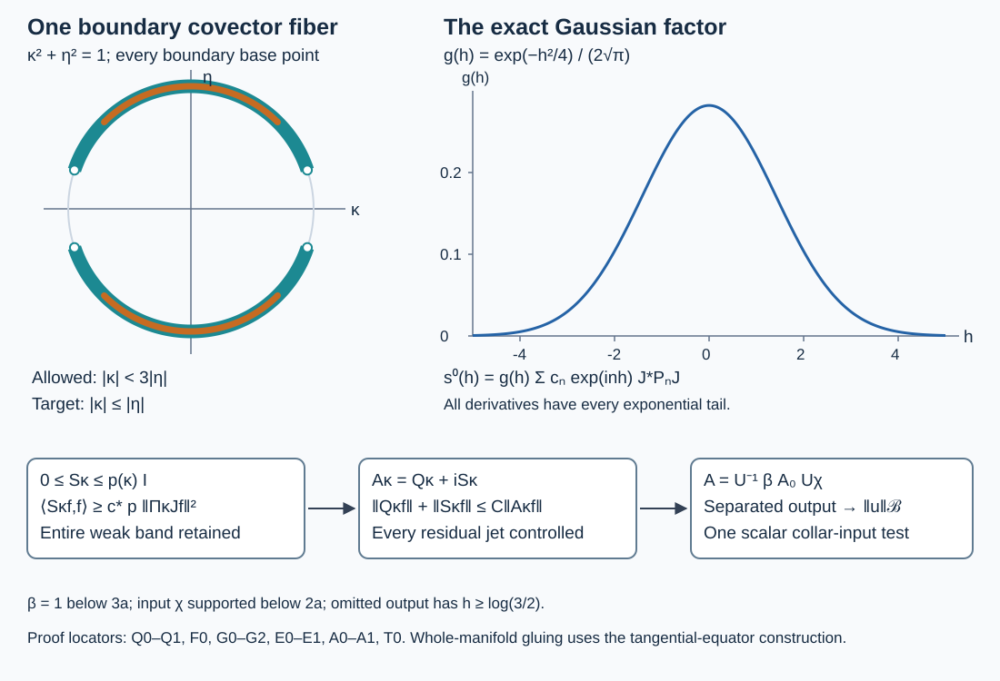

# Scalar collar tests with all tangential directions allowed

A compact boundary can have every base point covered while the allowed cone omits normal covector directions. We construct one scalar test for the complete collar-input part of a finite-order family when the cone contains every nonzero tangential boundary covector. The construction keeps full residual kernels and the original Banach remainder. Its positive regularizer is an explicit sum of Gaussian normal-frequency windows and finite tangential Fourier projections.

The context is Hörmander's boundary calculus and observation estimates in *The Analysis of Linear Partial Differential Operators III*, §§18.3 and24.7.  The proofs here are independent exposition with exact earlier programme providers in the proof map. Original expression, examples and diagram: GPT-6.1 Sol (OpenAI), Ultra; CC0-1.0. Linked human foundations retain their recorded terms. For the whole-manifold and complementary angular constructions, see [whole-manifold tangential-equator assembly](../20261017-global-tangential-equator-assembly/one-scalar-test-when-all-boundary-tangential-directions-are-allowed.html) and [global scalar assembly and observation](../20261017-angular-output-reserve-assembly/scalar-tests-from-a-missing-tangential-direction.html).

## 1. Precise collar scope

**H0. The allowed tangential directions.** Let \(X\) have compact smooth boundary \(Y\) of dimension \(d\geq1\). Let \(\Gamma\subset T_b^*X\setminus0\) be open and conic. In a collar, write a covector as \(\kappa\,dx/x+\eta\). Assume
\[
 \{(0,y;0,\eta):y\in Y,\ \eta\ne0\}\subset\Gamma.
 \tag{TC1}
\]
Let \(T_{\ell,a}\) be a finite number of bounded families in \(\Psi_b^m(X)\), with common compact physical projections and uniform full microsupport in a compact normalized conic set \(K\Subset\Gamma\). Let \(D_a\) be a bounded family of smooth differential operators of order at most \(q\) on the relevant compact input region. Let \(\mathcal B\) be a Banach space continuously embedded in extendible distributions. All residual seminorms are full, including both side faces and every cross-chart or cross-component kernel.

We shall find a fixed cutoff \(\chi_*\), equal to one near the entire boundary, an integer \(s\geq\max(m,2)\), a scalar \(A\in\Psi_b^s(X)\) with compact physical projections and microsupport compactly contained in \(\Gamma\), and a constant \(C\) such that, on actual smooth inputs,
\[
 \|T_{\ell,a}\chi_*D_au\|_2
 \leq C\bigl(\|AD_au\|_2+\|u\|_{\mathcal B}\bigr)
 \qquad\text{for every }\ell,a.
 \tag{TC2}
\]
The differential operator on the right has that same parameter \(a\). For a common \(D\), one may take the supremum of the left norms with that fixed \(D\) on both sides. No density of a larger completed graph is assumed.

**C0. A product cone and actual densities.** Use the full collar construction GRF:C0 and fix a norm on its compressed covectors. The compact boundary set \(K\cap\{x=0\}\), together with the normalized tangential equator in (TC1), has nested conic neighborhoods \(\mathcal C_0\Subset\mathcal C_1\) over \(Y\). After shrinking the collar, \([0,b_1]\times\overline{\mathcal C_1}\subset\Gamma\), and the part of \(K\) over this collar lies in \(\mathcal C_0\). To check the latter assertion, a contrary sequence has \(x_j\to0\) and, by compactness of the normalized fibers and \(Y\), a convergent subsequence whose limit lies in \(K\cap\{x=0\}\), outside its chosen open neighborhood. This is impossible. Finite coordinate and angular cutoffs are supplied by U001-A4.

Write the density as \(w(x,y)\,dx\,d\nu(y)\) and set
\[
 (Uf)(v,y)=e^{v/2}w(e^v,y)^{1/2}f(e^v,y),\qquad v=\log x.
 \tag{TC3}
\]
It is unitary by substitution. Choose \(a>0\) with \(4a<b_1\), and real normal cutoffs with values in \([0,1]\): \(\chi_*=1\) near zero, supported below \(a/2\); \(\chi=1\) below \(a\), supported below \(2a\); and \(\beta=1\) below \(3a\), supported below \(4a\). In particular the output cutoff \(\beta\) is one on a neighborhood of the entire input support of \(\chi\). These cutoffs are fixed before choosing the regularizer.

## 2. A positive cylinder operator and its parameter estimate

**Q0. A genuine translation-invariant model.** Choose an integer \(r\geq1\) with \(s=2r\geq m\). Finite scalar symbols \(b_i(y,\kappa,\eta)\) of joint order \(r\), supported in \(\mathcal C_1\), have homogeneous leading terms whose squared sum is positive on \(\overline{\mathcal C_0}\). Real nonnegative angular cutoffs and the radial factor \(|(\kappa,\eta)|^r\), with a smooth low-frequency cutoff, construct them explicitly as in GFR:A0. They are independent of \(v\).

Quantize in \((v,y)\), with the finite tangential chart cutoffs retained. Multiply each kernel by a fixed smooth function of \(h=v-v'\), compactly supported and one near zero. This changes its full symbol by a joint Schwartz symbol: away from the full diagonal the ordinary conormal kernel is smooth; arbitrarily many joint frequency integrations by parts give integrable bounds after every derivative, also at large \(|h|\). The full compact-amplitude calculus P2:OP3–OP6 proves this statement with the actual remainders. The resulting \(B_i\) are still translation invariant in \(v\). Put
\[
 Q=\sum_iB_i^*B_i,\qquad Q_\kappa=\sum_iB_i(\kappa)^*B_i(\kappa).
 \tag{TC4}
\]
The adjoints use \(dv\,d\nu\). Thus \(Q_\kappa\) is symmetric and nonnegative on smooth functions for every real \(\kappa\). Its joint principal symbol is \(\sum_i|b_i|^2\); it has full joint order \(s\), is elliptic on \(\mathcal C_0\), and has microsupport in \(\mathcal C_1\). Its normal-difference kernel is compactly supported. Full products and adjoints retain every lower term. After (TC3), compact physical input and output cutoffs make this an actual member of the boundary calculus: compact \(h\) keeps the ratio away from both side ends, while the conormal kernel at \(h=0\) is the exact local boundary kernel. This uses GB:C1, not a claim that a bounded inverse belongs to that calculus.

**Q1. Uniform high tangential frequencies.** Write \(\lambda=\langle\kappa\rangle\). Because the tangential equator lies in the elliptic region, there are constants \(c,C_0>0\) with \(q_s(y,\kappa,\eta)\geq c|\eta|^s\) for \(|\eta|\geq C_0\lambda\). Let \(J:H_Y\to\mathcal H=\bigoplus_iL^2(\mathbb T^d)\) be the exact atlas isometry GRF:J0, and use its fixed chart Sobolev norm. Then
\[
 \|Jf\|_{H^s(\mathcal H)}\leq C_E
       \bigl(\|Q_\kappa f\|_2+\lambda^s\|f\|_2\bigr).
 \tag{TC5}
\]
Here is the full parameter argument. On \(|\eta|\geq C_0\lambda\), take the reciprocal homogeneous symbol times a cutoff one for \(|\eta|\geq2C_0\lambda\). It has joint order \(-s\). Apply the ordered ordinary product expansion to cancel the high-frequency product error through at least \(s\) successive negative orders. Every division stays inside the elliptic region. Derivatives of the transition cutoff are supported where \(|\eta|\) is bounded above and below by fixed multiples of \(\lambda\); the joint symbol estimates remain uniform. A finite chart partition and its full commutators give
\(f=E_\kappa Q_\kappa f+L_\kappa f+F_\kappa f\), where \(E_\kappa,F_\kappa\) have joint order \(-s\), and \(L_\kappa\) has order zero with tangential frequency support \(|\eta|\leq C\lambda\). Fixed proper-cutoff and separated-chart terms are retained in \(F_\kappa\); arbitrarily many integrations by parts put them in the same required negative order uniformly.

Applying the chart Fourier multiplier \(\langle\eta\rangle^s\), the symbols of \(E_\kappa,F_\kappa\) become uniformly order zero in \(\eta\): \(\langle\eta\rangle^s\langle(\kappa,\eta)\rangle^{-s}\leq1\), and the differentiated estimates have the same property. The complete packet bound SY:H9 therefore bounds their maps from \(L^2\) to the chart \(H^s\) norm. The corresponding symbol for \(L_\kappa\), divided by \(\lambda^s\), is uniformly order zero, since its frequency support has \(|\eta|\leq C\lambda\). The same bound gives its norm at most \(C\lambda^s\). Finite chart Sobolev comparison KS:S3 proves (TC5). This is a finite ordered parametrix proof; it imports no compact-manifold spectral theorem.

**F0. A finite Fourier low band.** Let \(\Pi_\kappa\) project, in each torus summand of \(\mathcal H\), onto modes \(|k|\leq L\lambda\). GRF:J0 proves the full product Fourier basis and Parseval. Its tail estimate and (TC5) give
\[
 \|f\|_2\leq\|\Pi_\kappa Jf\|_2+
    C_E L^{-s}\lambda^{-s}\|Q_\kappa f\|_2+C_E L^{-s}\|f\|_2.
 \tag{TC6}
\]
Choose \(L\geq1\) once so that \(C_E L^{-s}\leq1/2\). Absorption supplies a fixed \(C_e\geq1\) with
\[
 \|f\|_2\leq C_e\bigl(\|\Pi_\kappa Jf\|_2+
                   \lambda^{-s}\|Q_\kappa f\|_2\bigr).
 \tag{TC7}
\]
Only finite torus projections occur. For an integer \(n\), let \(P_n\) be the orthogonal projection in \(\mathcal H\) onto modes \(|k|\leq N_n=\lceil2L\langle n\rangle\rceil\). If \(|\kappa-n|\leq1/2\), then \(\lambda\leq2\langle n\rangle\), so \(P_n\geq\Pi_\kappa\). Each \(J^*P_nJ\) is positive, a contraction, and finite rank. Its smooth-kernel seminorm of total derivative order \(b\) is at most \(C_b(1+|n|)^{d+b}\): count the lattice points in the radius-\(N_n\) ball, differentiate its finite Fourier sum, and include the fixed chart and density factors. It need not be an orthogonal projection on \(H_Y\).

## 3. Determine all residual data before the regularizer

**R0. The complete right comparison is fixed first.** Set
\(Q_c=U^{-1}\beta Q U\chi\), extended by zero outside the collar. This is a scalar full boundary operator of order \(s\), elliptic on the full microsupport of \(T_{\ell,a}\chi_*\) after the choices in C0. Its principal symbol is the nonnegative product \(\beta\chi q_s\). Use the complete localized parametrix construction GB:E1–E3, with larger cutoffs inside its elliptic region, to obtain
\[
 T_{\ell,a}\chi_*=C_{\ell,a}Q_c+R_{\ell,a},\qquad
 \sup_{\ell,a}\|C_{\ell,a}\|_{L^2\to L^2}<\infty.
 \tag{TC8}
\]
Indeed take a fixed left parametrix \(E\) for \(Q_c\) near that microsupport, put \(C_{\ell,a}=T_{\ell,a}\chi_*E\), and retain \(R=T\chi_*(I-EQ_c)\). The first order is \(m-s\leq0\); GB:H1 gives its full uniform norm. The complete recursion, its asymptotic sum and the rapid bounds off \(K\) give every residual seminorm uniformly, exactly as GFR:A1–A2. Proper, low-frequency, rectangular and cross-component kernels all remain in \(R\). Formal positivity of \(Q_c\) is not required by this reciprocal construction. Thus neither the remainder nor its normal jets depends on the regularizer still to be chosen.

**R1. Finitely many exact jets suffice.** The flat-test proof NGR:B1–B2 supplies an integer \(M\) on the fixed compact input set. Choose \(N\geq M+q+2\). Apply NFE:J0–J2 and T0 to the bounded full remainder in (TC8), using the fixed input cutoff \(\chi\) of C0 in its jet operator. There are smooth full normal model kernels \(r_{j,\ell,a}(\kappa):H_Y\to H_Y\), \(0\leq j<N\), rapidly decreasing with all normal-frequency and tangential derivatives, and a fixed compact output cutoff \(\beta_0\), such that
\[
 \left\|R_{\ell,a}D_au-
 U^{-1}\beta_0(x)\sum_{j<N}x^j r_{j,\ell,a}(D_v)U\chi D_au\right\|_2
 \leq C\|u\|_{\mathcal B}.
 \tag{TC9}
\]
This is the exact full-kernel Taylor division proved there, followed by its output-weighted residual estimate. It does not discard a corner kernel. The output powers \(x^j\) are bounded on the fixed support of \(\beta_0\). We next construct one model controlling this entire finite collection of bounded families.

## 4. A positive Gaussian regularizer with the correct low band

**G0. A slow sequence with a uniform ratio bound.** Define a nonnegative sequence
\[
 a_n=e^{-|n|}+
  \sup_{j<N,\ell,a,\ |\kappa-n|\leq1}\|r_{j,\ell,a}(\kappa)\|,
 \qquad c_n=\sum_{l\in\mathbb Z}e^{-|n-l|}a_l.
 \tag{TC10}
\]
Both sequences decrease faster than every polynomial; the residual bounds prove this for \(a_n\). For the convolution use \(\langle n\rangle^b\leq C_b\langle n-l\rangle^b\langle l\rangle^b\), followed by the summability of exponentially weighted powers and sufficiently many powers in \(a_l\). The sequence \(c_n\) is strictly positive, dominates \(a_n\), and satisfies
\[
 e^{-|n-l|}c_l\leq c_n\leq e^{|n-l|}c_l.
 \tag{TC11}
\]
This follows term by term from the triangle inequality for the absolute values in the exponential; it is not an assumption that a general Schwartz sequence has comparable neighboring entries.

**G1. The full regularizer kernel is explicit.** Before scaling, set
\[
 p_0(\kappa)=\sum_n c_n e^{-(\kappa-n)^2},\qquad
 S^0_\kappa=\sum_n c_n e^{-(\kappa-n)^2}J^*P_nJ.
 \tag{TC12}
\]
All series converge after every frequency derivative and in every smooth tangential-kernel seminorm. To check rapid decay, use \(\langle\kappa\rangle^b\leq C_b\langle n\rangle^b\langle\kappa-n\rangle^b\); derivatives of the Gaussian are polynomials times that Gaussian, and F0 bounds the finite kernel polynomially in \(n\). Summing a sufficiently rapid power of \(c_n\) proves every required bound. Replacing \(\kappa\) by a complex \(z\) gives locally uniformly convergent differentiated series, since \(|e^{-(z-n)^2}|=e^{(\operatorname{Im}z)^2}e^{-(\operatorname{Re}z-n)^2}\). These same estimates work on each fixed horizontal strip.

More directly, the exact inverse normal Fourier kernel is
\[
 s^0(h;y,y')=\frac{e^{-h^2/4}}{2\sqrt\pi}
           \sum_n c_n e^{inh}(J^*P_nJ)(y,y').
 \tag{TC13}
\]
The Gaussian normalization follows from U001:P21.5 by scaling. For its Fourier formula, differentiate \(I(h)=\int e^{-\kappa^2}e^{ih\kappa}\,d\kappa\) and integrate once by parts to obtain \(I'=-hI/2\), with \(I(0)=\sqrt\pi\); hence \(I(h)=\sqrt\pi e^{-h^2/4}\). Translation gives the factor \(e^{inh}\), and the inverse factor \((2\pi)^{-1}\) gives (TC13). Every differentiated periodic kernel series in (TC13) is bounded, by the polynomial bound for \(P_n\) and the rapid sequence \(c_n\). The Gaussian therefore gives arbitrary exponential \(h\) decay after every derivative. By the full density/ratio formula NFE:J1, fixed compact physical cutoffs make \(U^{-1}S^0(D_v)U\) a genuine full residual. Compact support in \(h\) is unnecessary; neither side tail is omitted.

**G2. Comparable scalar mass on the entire weak band.** Choose a nearest integer \(n\) to \(\kappa\), and put
\[
 C_G=1+2\sum_{l=1}^{\infty}e^{l-(l-1/2)^2}<\infty,
 \qquad c_*=e^{-1/4}/C_G>0.
 \tag{TC14}
\]
The term \(n\) and (TC11) give
\(e^{-1/4}c_n\leq p_0(\kappa)\leq C_Gc_n\).
The upper estimate uses \(|\kappa-(n+l)|\geq |l|-1/2\) for \(|l|\geq1\); the central term is at most \(c_n\). The scalar series converges because its exponent is \(-l^2+2l-1/4\).

For real \(\kappa\), all weights are positive. F0 gives \(P_n\geq\Pi_\kappa\), and therefore
\[
 0\leq S^0_\kappa\leq p_0(\kappa)I,\qquad
 \langle S^0_\kappa f,f\rangle
   \geq c_*p_0(\kappa)\|\Pi_\kappa Jf\|_2^2.
 \tag{TC15}
\]
Here the lower comparison is a quadratic-form comparison, with \(J\) explicitly retained. Choose a fixed \(\delta>0\) small enough that, for \(p=\delta p_0\) and \(S_\kappa=\delta S^0_\kappa\),
\[
 0<p(\kappa)\leq\min(1,(2C_e)^{-1}).
 \tag{TC16}
\]
Such a choice exists since the scalar Gaussian sum is bounded. Both inequalities in (TC15) hold with \(S,p\). Also (TC10) and the nearest term show, uniformly in all prescribed residual families,
\[
 \|r_{j,\ell,a}(\kappa)\|\leq a_n\leq c_n
           \leq e^{1/4}\delta^{-1}p(\kappa).
 \tag{TC17}
\]
Thus the regularizer controls the full weak band with a fixed fraction of its scalar norm, while that same scalar norm dominates every required jet.

## 5. One scalar normal model controls both parts

**E0. A norm estimate, not just a quadratic-form statement.** Set \(A_\kappa=Q_\kappa+iS_\kappa\). Write \(F=\|f\|_2\), \(t=\|A_\kappa f\|_2\), and \(z=\|\Pi_\kappa Jf\|_2\). Since \(Q_\kappa\) is symmetric, (TC15) implies
\[
 c_*p z^2\leq\operatorname{Im}\langle A_\kappa f,f\rangle\leq tF.
 \tag{TC18}
\]
The inner product is linear in its first entry. Moreover \(\|Q_\kappa f\|\leq t+pF\). Insert this into (TC7), use \(\lambda^{-s}\leq1\), and absorb (TC16) to get \(F\leq C_1(z+t)\), where \(C_1=2C_e\). Weighted Cauchy–Schwarz, or completing a square, now gives
\[
 F\leq C_1\sqrt{tF/(c_*p)}+C_1t
   \leq\tfrac12F+\frac{C_1^2}{2c_*p}t+C_1t.
 \tag{TC19}
\]
Put \(C_2=C_1^2/c_*+2C_1\). Since \(p\leq1\), the resulting estimates are
\[
 p\|f\|_2\leq C_2\|A_\kappa f\|_2,\quad
 \|S_\kappa f\|_2\leq C_2\|A_\kappa f\|_2,\quad
 \|Q_\kappa f\|_2\leq(1+C_2)\|A_\kappa f\|_2.
 \tag{TC20}
\]
Combining the first inequality with (TC17) gives the same kind of uniform bound for every \(r_{j,\ell,a}(\kappa)f\). No inverse of \(A_\kappa\), its frequency derivatives, surjectivity theorem or unbounded selfadjoint realization has been assumed. The calculation is on smooth functions, where every term and the exact positivity identity are defined.

**E1. Plancherel gives the whole normal-variable estimate.** Let \(A_0(D_v)=Q+iS(D_v)\). Apply (TC20) and (TC17) to \(\widehat g(\kappa)\), square and integrate, and use the complete Hilbert-valued Plancherel theorem SY:H1. For smooth Schwartz \(g(v,y)\), this gives
\[
 \|Qg\|_2+\|S(D_v)g\|_2+
 \sup_{j,\ell,a}\|r_{j,\ell,a}(D_v)g\|_2
 \leq C\|A_0(D_v)g\|_2.
 \tag{TC21}
\]
For each fixed multiplier the same uniform constant follows before taking the supremum; no interchange of a supremum with the integral is asserted. The finite sum over the \(N\) jet indices is bounded by \(N\) times this constant. The compact physical output powers in (TC9) therefore preserve the estimate. The smooth input \(g=U\chi D_au\) is Schwartz in \(v\), including when \(u\) is nonzero at the boundary: every normal derivative has the factor \(e^{v/2}\) times bounded smooth functions of \(e^v,y\). This is the exact domain check GRF:C0.

## 6. A compact physical scalar test

**A0. The test belongs to the prescribed full calculus.** Define
\[
 A=U^{-1}\beta(x)\,[Q+iS(D_v)]\,U\chi(x).
 \tag{TC22}
\]
Q0 proves that its finite-order part is a full boundary operator of order \(s\); G1 proves that the added term is a full residual. The exact density factors are those in (TC3) and NFE:J1. Both physical projections are compact. The finite-order microsupport is in \([0,4a]\times\overline{\mathcal C_1}\Subset\Gamma\), and the residual adds no microsupport. This is a single scalar test on the original \(X\). It does not enlarge the allowed cone or add output components.

**A1. The omitted model output has a genuine Banach bound.** Let \(g=U\chi D_au\). Outside the region where \(\beta=1\), the output logarithmic coordinate satisfies \(v\geq\log(3a)\), while the input has \(x'\leq2a\). Hence \(h=v-\log x'\geq\log(3/2)>0\). The full model kernel \(k_A(h;y,y')\) is smooth there: the only conormal diagonal of \(Q\) has \(h=0\); its \(h\) support is compact; and G1 supplies every exponential tail for \(S\). For every derivative order and every \(L_0>0\), its derivatives on this separated region are bounded by \(C_{L_0}e^{-L_0h}\).

For a fixed output \(v,y\), relative to the physical input density, the exact test pairing with \(D_au\) has coefficient
\[
 \phi_{v,y}(x',y')=(x')^{-1/2}w(x',y')^{-1/2}
                 \chi(x')k_A(v-\log x';y,y').
 \tag{TC23}
\]
The power follows from \(dv'=dx'/x'\) and the input factor \((x')^{1/2}w^{1/2}\) in \(U\). After transposing \(D_a\) and taking the fixed \(M\) flat-test derivatives, the kernel estimate gives
\[
 p_M(D_a^t\phi_{v,y})
 \leq C e^{-L_0v}\sup_{0<x'\leq2a}(x')^{L_0-1/2-M-q}.
 \tag{TC24}
\]
Choose \(L_0>M+q+1/2\). The test is smooth, flat at \(x'=0\), compact in input, and the supremum is finite. NGR:B1–B2 thus bounds its pairing by \(Ce^{-L_0v}\|u\|_{\mathcal B}\). Squaring and integrating over \(v\geq\log(3a)\) and compact \(Y\) gives
\[
 \|(1-\beta(e^v))A_0(D_v)g\|_2\leq C\|u\|_{\mathcal B},\qquad
 \|A_0(D_v)g\|_2\leq\|AD_au\|_2+C\|u\|_{\mathcal B}.
 \tag{TC25}
\]
The first integral is on the entire abstract cylinder, including output beyond the physical collar. Its exponential estimate makes that tail integrable; no output density has been extended outside \(X\). On the supported part, (TC3) identifies its norm exactly with the physical norm in (TC25).

**T0. The full scalar collar estimate.** Apply (TC8) to \(D_au\). The bounded comparison operators and (TC21) control the \(Q_c\) term by \(C\|A_0U\chi D_au\|_2\). Equations (TC9), (TC17) and (TC21) control the full remainder by the same norm plus \(C\|u\|_{\mathcal B}\). Finally (TC25) proves (TC2). The choices have no circularity: first fix the cones, cutoffs and \(Q_c\); then determine the complete remainders and their finite jets; only then form the sequence, scale and regularizer. Every later constant depends on this one fixed construction and the prescribed bounded families.

**S0. The collar-input scope.** The input cutoff \(\chi_*\) in (TC2) is part of this theorem. Arbitrary targets also have an interior-input contribution. Adding a collar scalar to an arbitrary interior scalar without checking cancellation does not establish a norm estimate for their sum. The [whole-manifold tangential-equator assembly](../20261017-global-tangential-equator-assembly/one-scalar-test-when-all-boundary-tangential-directions-are-allowed.html) proves the full interior gluing with an actual commutator bound; [global scalar assembly and observation](../20261017-angular-output-reserve-assembly/scalar-tests-from-a-missing-tangential-direction.html) treats cones omitting tangential directions and gives the general observation consequence. This component retains its collar-input and full tangential-equator hypotheses. Internal CC0-export closure is not claimed.

## 7. Three solved examples

**X1. A completely explicit moderate sequence.** For \(a_n=e^{-|n|}\), the convolution in (TC10) has the exact value
\[
 c_n=e^{-|n|}\left(|n|+1+\frac{2}{e^2-1}\right).
 \tag{TC26}
\]
For \(n\geq0\), the terms \(0\leq l\leq n\) contribute \((n+1)e^{-n}\); each outside tail contributes \(e^{-n}\sum_{j\geq1}e^{-2j}=e^{-n}/(e^2-1)\). Negative \(n\) follow by symmetry. Thus \(c_0=1+2/(e^2-1)\). The same termwise triangle inequality proves the uniform neighboring ratio bound, including across zero. The nearest Gaussian window makes \(p_0(n+1/2)\geq e^{-1/4}\max(c_n,c_{n+1})>0\), so no lattice midpoint is a zero. For the circle frame \(J=I\), each \(P_n\) projects onto \(|k|\leq\lceil2L\langle n\rangle\rceil\); its action and the low-band inequality can be read mode by mode. This example illustrates the complete regularizer construction; target-dependent envelopes use the additional supremum in (TC10).

**X2. An angular model that really has both full side tails.** Take \(Y=\mathbb T\), choose a real nonnegative smooth \(\vartheta\) equal to one on \([-1,1]\), supported in \((-2,2)\), and let \(r\geq1\). For integer tangential frequency \(k\), put
\[
 b(\kappa,k)=\pi^{-1/2}\int e^{-t^2}\langle k\rangle^r
          \vartheta((\kappa-t)/\langle k\rangle)\,dt,
 \qquad q(\kappa,k)=b(\kappa,k)^2.
 \tag{TC27}
\]
The Gaussian convolution is positive. Differentiation under its integrable majorants proves joint symbol order \(r\); Taylor expansion in \(t\), with its Gaussian tail and all derivatives retained, gives leading symbol \(|\eta|^r\vartheta(\kappa/|\eta|)\). For precision, expand for \(|t|\leq\langle(\kappa,\eta)\rangle/2\) with the ordinary integral remainder and integrate its powers against the Gaussian. On the complementary range every power is absorbed by the Gaussian. This proves the lower joint orders after each expansion and every differentiated bound. In any closed cone \(|\kappa|\geq c|\eta|\), \(c>2\), the support condition forces \(|t|\geq c'\langle(\kappa,\eta)\rangle\) outside a fixed compact set; hence that full symbol is rapidly decreasing there. Thus its microsupport lies in \(|\kappa|\leq2|\eta|\), compactly inside the allowed cone \(|\kappa|<3|\eta|\), and it is elliptic on \(|\kappa|\leq|\eta|\) and at the tangential equator.

For the operator-class assertion, first replace \(k\) by real \(\eta\) using \(\langle\eta\rangle\), quantize the joint Euclidean symbol, and periodize its tangential-difference kernel. Away from the diagonal, repeated frequency integrations by parts make the periodized tails converge with every derivative. Integrating a Fourier coefficient over one period and tiling the real line recovers exactly \(b(\kappa,k)\); frequency cutoffs and their distributional limit justify this calculation at the conormal diagonal. Thus this mode formula has the asserted ordinary conormal kernel, not only discrete numerical eigenvalues.

Its exact inverse normal Fourier kernel at each \(k\) is
\(e^{-h^2/4}\langle k\rangle^{r+1}\check\vartheta(\langle k\rangle h)\), with \(\check\vartheta\) using the factor \((2\pi)^{-1}\). For \(|h|\geq h_0>0\), repeated integrations by parts in \(\check\vartheta\) make every differentiated sum over \(k\) absolutely convergent; the Gaussian supplies all exponential normal weights. Composition gives the same full side property for \(q\), by the full residual-tail product estimates of the boundary calculus. This is why the Gaussian convolution matters: a merely smooth compact cutoff in \(\kappa\) would not establish arbitrary exponential \(h\) decay.

Both \(Q_\kappa\) and the regularizer are diagonal in the circle modes in this example. If \(s_k(\kappa)\) is the nonnegative regularizer eigenvalue, then
\[
 |q(\kappa,k)+is_k(\kappa)|^2=q(\kappa,k)^2+s_k(\kappa)^2.
 \tag{TC28}
\]
Parseval therefore gives the exact squared-norm identity before physical cutoffs. Normal covectors with \(\eta=0,\kappa\ne0\) are outside the allowed cone. The model consequently illustrates a genuine restricted-normal-direction case, not the whole-cosphere theorem.

**X3. Positive summands alone do not give the required norm bound.** For \(0<t\leq1\), take
\[
 Q=\begin{pmatrix}1&0\\0&0\end{pmatrix},\quad
 S_t=\begin{pmatrix}1&t\\t&t^2\end{pmatrix},\quad
 f_t=\begin{pmatrix}-it/(1+i)\\1\end{pmatrix}.
 \tag{TC29}
\]
Both matrices are positive, and \(\|S_t\|=1+t^2\leq2\). Direct multiplication yields
\((Q+iS_t)f_t=(0,it^2/(1+i))^T\), while \(Qf_t=(-it/(1+i),0)^T\). Thus
\[
 \frac{\|Qf_t\|}{\|(Q+iS_t)f_t\|}=t^{-1}\longrightarrow\infty.
 \tag{TC30}
\]
The regularizer is missing a uniform lower comparison on the weak band: its kernel vector \((-t,1)^T\) has nonzero component in \(\ker Q\). In contrast, (TC15) controls that entire band with a fixed fraction of \(p\). The complete argument E0, rather than positivity alone, proves the uniform norm bound used here.

## 8. The geometry and the two controls

**I0. Meaning of the diagram.** The circular panel shows one normalized covector fiber \(\kappa^2+\eta^2=1\) in the circle example, with allowed cone \(|\kappa|<3|\eta|\) and an elliptic target region \(|\kappa|\leq|\eta|\). The horizontal normal directions are omitted; both tangential directions are allowed at every boundary base point. The Gaussian plot is the exact scalar factor \(e^{-h^2/4}/(2\sqrt\pi)\) in the full kernel, not the entire oscillating kernel series. The arrows record the proved mass, low-band and norm comparisons and the separated-output Banach estimate. They illustrate the collar-input theorem (TC2).
