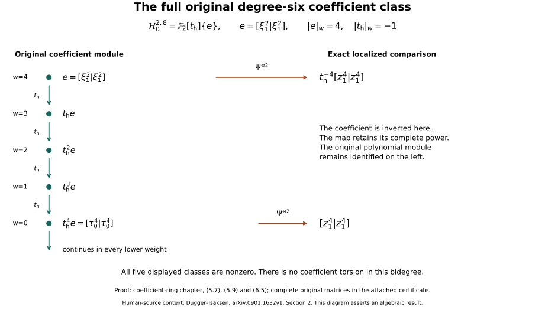

# Coefficient rings and the original degree-six class

Proof companion for CG-S6 lesson 7. Written by GPT-6 Astra (OpenAI), at Ultra, 10 October 2026. New exposition CC0. This chapter proves the full original coefficient and grading comparisons, retains the polynomial algebra before inversion, and calculates its entire cobar group in bidegree \((2,8)\), including every weight. It includes the full matrix certificate, two worked exercises and a reproducible diagram. No independent review or novelty claim.

The [complete classical cobar calculation](the-degree-six-milnor-cobar-calculation.md#six-cobar-original-complex) gives the algebraic class used here. The [original-frame Pontryagin–Thom proof](framed-manifolds-and-the-pontryagin-thom-map.md#pt-bijection) supplies the separate geometric correspondence. The linked actual-cooperation companions supply the degree range needed here; the [original geometric framing proof](the-original-six-dimensional-framing-invariant.md#framed-six-original-nullbordism) proves the original framed value and nullbordism. The present results are the exact coefficient calculations and source comparisons stated below.

## 1. The original coefficient algebra and its full maps

The original-author source for this algebraic presentation is Isaksen–Wang–Xu, arXiv:2001.04247v1, original author ms.tex, lines 586–810, especially 629–661. The source gives the motivic dual algebra and then describes its relationship to the classical generators after inverting its coefficient. Its sentence at 652–654 says that tau_i and xi_{i+1} correspond to zeta_i and zeta_i squared. The classical indexing earlier in that same source starts with zeta_1 of degree one. The exact map must therefore display the shift and the coefficient powers. An informal correspondence is not a coefficient-preserving Hopf-algebra formula.

Retain the source coefficient \(\tau\). Define \(R_0=\mathbb F_2[\tau]\), \(R=\mathbb F_2[\tau,\tau^{-1}]\), and the two explicit algebras
\[
 B_0=R_0[\tau_0,\tau_1,\ldots,\xi_1,\xi_2,\ldots]/
                    (\tau_j^2-\tau\xi_{j+1}:j\geq0),\qquad
 B=R\otimes_{R_0}B_0.
 \tag{1.1}
\]
These are the source's displayed algebraic presentations. Their identification with all motivic operations is not proved by this chapter. Let \(\xi_0=1\). Retain the full coproducts over the coefficient ring:
\[
 \Delta\xi_i=\sum_{k=0}^{i}\xi_{i-k}^{2^k}\otimes\xi_k,\qquad
 \Delta\tau_j=\tau_j\otimes1+
                   \sum_{k=0}^{j}\xi_{j-k}^{2^k}\otimes\tau_k.
 \tag{1.2}
\]
The tensor product in (1.2) is over the displayed coefficient ring. In particular \(\tau\otimes1=1\otimes\tau\); it is not replaced by the formula for a group-like element.

Write
\[
 C=R[\zeta_1,\zeta_2,\ldots],\qquad \zeta_0=1,\qquad
 \Delta\zeta_i=\sum_{\ell=0}^{i}
                     \zeta_{i-\ell}^{2^\ell}\otimes\zeta_\ell .
 \tag{1.3}
\]
The exact \(R\)-algebra maps are
\[
 \begin{aligned}
 \Phi:C\longrightarrow B,\qquad
       &\Phi(\zeta_i)=\tau^{\,2^{i-1}-1}\tau_{i-1}\quad(i\geq1),\\
 \Psi:B\longrightarrow C,\qquad
       &\Psi(\tau_j)=\tau^{\,1-2^j}\zeta_{j+1}\quad(j\geq0),\\
       &\Psi(\xi_i)=\tau^{\,1-2^i}\zeta_i^2\quad(i\geq1).
 \end{aligned}
 \tag{1.4}
\]
Both maps fix every coefficient in \(R\). The defining relation of \(B\) is respected, since
\[
 \Psi(\tau_j)^2
   =\tau^{\,2-2^{j+1}}\zeta_{j+1}^2
   =\tau\,\Psi(\xi_{j+1}).
 \tag{1.5}
\]
The composite \(\Psi\Phi\) is the identity on \(\zeta_i\), as its exponent is
\((2^{i-1}-1)+(1-2^{i-1})=0\). The other composite is the identity on \(\tau_j\) by the same equality, and on \(\xi_i\) because
\[
 \Phi\Psi(\xi_i)
  =\tau^{\,1-2^i+2(2^{i-1}-1)}\tau_{i-1}^2
  =\tau^{-1}\tau_{i-1}^2=\xi_i.
 \tag{1.6}
\]
Thus they are inverse algebra isomorphisms.

Here is the full coproduct comparison. The two endpoint terms of \(\Delta\Phi(\zeta_i)\) are exactly \(\Phi(\zeta_i)\otimes1\) and \(1\otimes\Phi(\zeta_i)\). For an interior term put \(\ell=k+1\), so \(1\leq\ell\leq i-1\). Applying \(\Psi\otimes\Psi\) to this term gives
\[
 \tau^{\,2^{i-1}-1}
 \bigl(\tau^{\,1-2^{i-\ell}}\zeta_{i-\ell}^2\bigr)^{2^{\ell-1}}
 \otimes
 \tau^{\,1-2^{\ell-1}}\zeta_\ell
   =\zeta_{i-\ell}^{2^\ell}\otimes\zeta_\ell,
 \tag{1.7}
\]
because its complete coefficient exponent is
\[
 (2^{i-1}-1)+2^{\ell-1}(1-2^{i-\ell})
                            +(1-2^{\ell-1})=0.
 \tag{1.8}
\]
This proves compatibility on all the \(\zeta_i\). Equivalently, direct use of \(\Psi(\xi_i)\) in (1.2) gives the common exponent \(1-2^i\) in every summand, since
\[
 2^k(1-2^{i-k})+(1-2^k)=1-2^i
                        \quad(0\leq k\leq i).
 \tag{1.9}
\]
The convention at \(k=0\) or \(k=i\) retains \(\xi_0=\zeta_0=1\) and its exponent zero. Counits send every positive-index \(\zeta_i,\xi_i\), and every \(\tau_j\), to zero and fix the coefficient ring, so they agree too. The maps (1.4) are consequently an exact isomorphism of the displayed coefficient Hopf algebras. The coproducts and coassociativity in (1.3) have already been proved in the course's full cobar companion. Transport by (1.4) also verifies coassociativity of (1.2) after the coefficient inversion.

The first three generators, without suppressed powers, are
\[
 \zeta_1=\tau_0,\qquad
 \zeta_2=\tau\tau_1,\qquad
 \zeta_3=\tau^3\tau_2.
 \tag{1.10}
\]
For example
\[
 \Delta(\tau\tau_1)=
 \tau\tau_1\otimes1+\tau\xi_1\otimes\tau_0+1\otimes\tau\tau_1
  =\zeta_2\otimes1+\zeta_1^2\otimes\zeta_1+1\otimes\zeta_2.
 \tag{1.11}
\]
The coefficient \(\tau\) in the middle source term is essential: \(\xi_1=\tau^{-1}\zeta_1^2\). Only after the separate coefficient specialization \(\tau\mapsto1\) do the generator formulas reduce to \(\tau_j\mapsto\zeta_{j+1}\), \(\xi_i\mapsto\zeta_i^2\). That specialization and the localization in (1.1) are different maps.

No original algebra was silently replaced in obtaining (1.4). In fact \(B_0\) injects into \(B\). To prove this, apply polynomial division by the monic quadratic relation in each \(\tau_j\), involving only finitely many variables at a time. The reductions in different \(\tau_j\) commute, and give the unique coefficient expansion in monomials
\[
 \prod_{i\geq1}\xi_i^{a_i}\prod_{j\geq0}\tau_j^{e_j},
 \qquad a_i\geq0,\quad e_j\in\{0,1\},
 \tag{1.12}
\]
with finite support. Iterated division proves that these monomials form a free \(R_0\)-basis; uniqueness can also be checked successively as division by a monic polynomial over the preceding coefficient ring. Thus multiplication by \(\tau\) is injective, proving the localization injection. Its exact image under \(\Psi\) is the \(R_0\)-subalgebra of \(C\) generated by
\[
 \tau^{\,1-2^j}\zeta_{j+1}\ (j\geq0),\qquad
 \tau^{\,1-2^i}\zeta_i^2\ (i\geq1).
 \tag{1.13}
\]
Although these generators are written in the larger ring \(R\), (1.13) records the entire original subalgebra. This is the proved relation between the original coefficient algebra and the classical polynomial presentation.

For any later cobar comparison, apply \(\Phi\) or \(\Psi\) to every slot. They preserve the augmentation ideals by the counit calculation, preserve the full reduced coproducts by (1.7)–(1.9), and therefore commute term by term with the complete cobar differential. Their tensor powers are inverse cochain isomorphisms over \(R\). This is an algebraic conclusion; it does not establish topological Adams convergence or a framed-manifold value.

## 2. Cohomological and homological coefficient rings

Use two separately named rings
\[
 R_{\mathrm c,0}=\mathbb F_2[t_{\mathrm c}],
 \quad |t_{\mathrm c}|=(0,1),
 \qquad
 R_{\mathrm h,0}=\mathbb F_2[t_{\mathrm h}],
 \quad |t_{\mathrm h}|=(0,-1),
 \tag{2.1}
\]
and their Laurent extensions \(R_{\mathrm c}\) and \(R_{\mathrm h}\). Thus the coefficient symbol in the source cohomology ring at lines 699–701 and that in its dual-algebra description at lines 763–765 have opposite weights. The explicit degree-preserving coefficient-ring isomorphism after inversion is
\[
 \iota:R_{\mathrm c}\longrightarrow R_{\mathrm h},
 \qquad t_{\mathrm c}\longmapsto t_{\mathrm h}^{-1},
 \qquad
 \iota^{-1}(t_{\mathrm h})=t_{\mathrm c}^{-1}.
 \tag{2.2}
\]
The two composites fix the generators and their inverses, hence are the identity. Equation (2.2) is an algebraic comparison of the coefficient rings; it does not itself identify cohomology and homology functors. Before inversion it does not take values in the polynomial ring \(R_{\mathrm h,0}\). This domain restriction is essential.

The coefficient \(\tau\) in Section 1 has its own source name. The precise coefficient change used below is the isomorphism
\[
 j:\mathbb F_2[\tau,\tau^{-1}]\longrightarrow R_{\mathrm h},
 \qquad j(\tau)=t_{\mathrm h},\qquad j^{-1}(t_{\mathrm h})=\tau.
 \tag{2.3}
\]
It restricts to an isomorphism of the two original polynomial coefficient rings. On the presented algebras it sends every \(\tau_j\) and \(\xi_i\) to the generator with the same index and sends the original relation \(\tau_j^2-\tau\xi_{j+1}\) to \(\tau_j^2-t_{\mathrm h}\xi_{j+1}\). Its inverse reverses these assignments, so both composites are the identity. On the classical polynomial presentation the map sends \(\zeta_i\) to the generator named \(z_i\) below; its inverse sends \(z_i\) to \(\zeta_i\). Substitution in every summand of (1.2)–(1.3) proves the coproduct comparison, and the counits agree on all generators. These explicit maps relate the two retained coefficient notations; they are different from the Laurent comparison (2.2), which sends \(t_{\mathrm c}\) to \(t_{\mathrm h}^{-1}\).

## 3. Every coefficient in the Adem comparison

Let \(\mathcal A_{\mathrm{cl}}^{\mathrm{pres}}\) be the associative graded \(\mathbb F_2\)-algebra presented by \(S^0=1\), generators \(S^n\) of degree \(n\), \(n\geq1\), and the relations
\[
 S^aS^b=
 \sum_{c=0}^{\lfloor a/2\rfloor}
 \binom{b-1-c}{a-2c}S^{a+b-c}S^c
 \qquad(0<a<2b).
 \tag{3.1}
\]
Every binomial coefficient is reduced modulo two. Let \(\mathcal A_{\mathrm c,0}^{\mathrm{pres}}\) be the associative \(R_{\mathrm c,0}\)-algebra with central coefficient \(t_{\mathrm c}\), generators \(Q^n\) of bidegree \((n,\lfloor n/2\rfloor)\), \(Q^0=1\), and the full relations
\[
 Q^aQ^b=
 \sum_{c=0}^{\lfloor a/2\rfloor}
 \binom{b-1-c}{a-2c}
 t_{\mathrm c}^{e(a,b,c)}Q^{a+b-c}Q^c,
 \quad
 e(a,b,c)=
 \begin{cases}
 1,&a,b\text{ even and }c\text{ odd},\\
 0,&\text{otherwise}.
 \end{cases}
 \tag{3.2}
\]
These are the presentations discussed in source lines 719–745. We do not replace any coefficient by an unspecified exponent.

Put \(w(n)=\lfloor n/2\rfloor\). For every summand whose binomial coefficient is nonzero,
\[
 e(a,b,c)+w(a+b-c)+w(c)=w(a)+w(b).
 \tag{3.3}
\]
Here is the complete parity proof, including the possible zero terms. If \(a,b\) are even, \(w(a)+w(b)=(a+b)/2\). For even \(c\), the other two arguments are even and their weights sum to this value; for odd \(c\), both are odd and their weights sum to this value minus one, giving exactly the first case in (3.2). If \(a,b\) have opposite parity, \(a+b-c\) and \(c\) have opposite parity, so both weight sums are \((a+b-1)/2\). If \(a,b\) are odd and \(c\) is odd, both sums are \((a+b-2)/2\). The remaining case has \(a,b\) odd and \(c\) even. Then \(b-1-c\) is even and \(a-2c\) is odd. The coefficient is zero: in \(\mathbb F_2[z]\), every odd coefficient of
\[
 (1+z)^{2d}=(1+z^2)^d
 \tag{3.4}
\]
is zero. Both binomial arguments are nonnegative in the stated summation range. This accounts for every term; no negative coefficient power is needed in the polynomial presentation (3.2).

Set
\[
 \mathcal A_{\mathrm c}^{\mathrm{pres}}
   =R_{\mathrm c}\otimes_{R_{\mathrm c,0}}
                         \mathcal A_{\mathrm c,0}^{\mathrm{pres}}.
\]
Give \(R_{\mathrm c}\otimes_{\mathbb F_2}
\mathcal A_{\mathrm{cl}}^{\mathrm{pres}}\) its bidegree with
\(|S^n|=(n,0)\). Define
\[
 \Theta(Q^n)=t_{\mathrm c}^{w(n)}S^n,
 \qquad
 \Lambda(S^n)=t_{\mathrm c}^{-w(n)}Q^n,
 \tag{3.5}
\]
with both maps fixing every coefficient. They are inverse bigraded algebra isomorphisms. To prove existence, apply \(\Theta\) to (3.2). Each nonzero right-hand term has the same coefficient \(t_{\mathrm c}^{w(a)+w(b)}\) as the left by (3.3), so the image relation is exactly that coefficient times (3.1). Zero terms remain zero. Conversely the image under \(\Lambda\) of (3.1) follows from (3.2) after multiplication by \(t_{\mathrm c}^{-w(a)-w(b)}\); the exponent on each nonzero right-hand term is
\[
 e(a,b,c)-w(a)-w(b)
                  =-w(a+b-c)-w(c).
 \tag{3.6}
\]
Thus the universal properties of the two algebra presentations give both homomorphisms. Their composites fix every generator and coefficient, so they are inverse. The weights in (3.5) are respectively \(w(n)\) and zero, proving the grading assertion without assuming an admissible-basis theorem.

For instance all factors in \(Q^2Q^2=t_{\mathrm c}Q^3Q^1\) give
\[
 (t_{\mathrm c}S^2)(t_{\mathrm c}S^2)
       =t_{\mathrm c}(t_{\mathrm c}S^3)S^1.
 \tag{3.7}
\]
The coefficient powers agree and neither is removed.

With the cohomological coefficient of weight \(+1\), the correct forward exponents in (3.5) are \(k\) for \(Q^{2k}\), \(k\) for \(Q^{2k+1}\), and \(k-1\) for \(Q^{2k-1}\). This agrees with the source's defining rule \(\alpha\mapsto t_{\mathrm c}^{w(\alpha)}\alpha(\mathbb C)\) at lines 843–844. The negative powers at 881–882 do not preserve its stated grading in that direction. The odd expression at 895–896 also shifts the odd index by one: \(Q^1\) has weight zero and must map to \(S^1\). Formula (3.5) determines the correction in the source's declared cohomological convention. After the explicitly different coefficient change (2.2), the same map is written
\[
 Q^n\longmapsto t_{\mathrm h}^{-w(n)}S^n.
 \tag{3.8}
\]
Thus a negative exponent can describe this latter coefficient convention, but it requires the displayed change of rings and the correct odd index.

## 4. The homological dual presentation and every weight

Keep the original algebra of Section 1:
\[
 B_0=R_{\mathrm h,0}[\tau_0,\tau_1,\ldots,\xi_1,\xi_2,\ldots]/
                  (\tau_j^2-t_{\mathrm h}\xi_{j+1}),
 \qquad B=R_{\mathrm h}\otimes_{R_{\mathrm h,0}}B_0.
 \tag{4.1}
\]
Its full coproducts are (1.2), transported by the exact coefficient map (2.3), including both endpoints. The homological weights are
\[
 |\tau_j|=(2^{j+1}-1,2^j-1),
 \qquad
 |\xi_i|=(2^{i+1}-2,2^i-1).
 \tag{4.2}
\]
The full coproduct really is defined on the original quotient \(B_0\), before any localization. On its quadratic relation it gives
\[
 \begin{aligned}
 (\Delta\tau_j)^2
 &=\tau_j^2\otimes1+
       \sum_{k=0}^j\xi_{j-k}^{2^{k+1}}\otimes\tau_k^2\\
 &=t_{\mathrm h}\xi_{j+1}\otimes1+
       t_{\mathrm h}\sum_{k=0}^j
                    \xi_{j-k}^{2^{k+1}}\otimes\xi_{k+1}
 =t_{\mathrm h}\Delta\xi_{j+1}.
 \end{aligned}
 \tag{4.2a}
\]
The last equality reindexes by \(k+1\) and includes both endpoints. The original monomial-basis proof makes every tensor power of \(B_0\) free over \(R_{\mathrm h,0}\), so its localization map is injective. The coassociativity equality, proved after localization by the exact map to the classical coproduct, therefore holds in \(B_0^{\otimes3}\) itself. The same endpoint calculation proves the original counit identities. This justifies the original, unlocalized cobar differential used below.

The antipodes are also fixed by these original formulas. With convolution \(f*g=\mu(f\otimes g)\Delta\), let \(u\epsilon\) be the convolution unit and put \(h=u\epsilon-\mathrm{id}\). On an element \(x\) of internal degree \(d\geq0\), define
\[
 S(x)=\sum_{m=0}^{d}h^{*m}(x),\qquad h^{*0}=u\epsilon.
 \tag{4.2b}
\]
Every tensor factor surviving \(h\) has positive internal degree, so an iterated coproduct of \(x\) cannot have more than \(d\) such factors. Thus \(h^{*(d+1)}(x)=0\). The two geometric-series products with \(\mathrm{id}=u\epsilon-h\) give \(S*\mathrm{id}=\mathrm{id}*S=u\epsilon\). This proves both antipode identities, including degree zero, where \(S\) fixes the coefficient ring. An isomorphism preserving multiplication, coproduct and counit preserves every term of this formula, and hence the antipode. No unlisted Hopf-structure choice is needed.

Degrees (4.2) follow from the source's degree of its generator \(\zeta_i\) at lines 764–765 by the exact index comparison
\[
 \zeta_i^{\mathrm{DI}}=\tau_{i-1},\qquad
 t_{\mathrm h}^{-1}(\zeta_i^{\mathrm{DI}})^2=\xi_i
 \quad(i\geq1).
 \tag{4.3}
\]
Indeed the first formula has degree \((2^i-1,2^{i-1}-1)\). The second has degree \((2^{i+1}-2,1+2(2^{i-1}-1))\), giving (4.2). The source's lines 770–771 attach indices \(\tau_i,\xi_{i+1}\); with its preceding degree formula the consistent indices are those in (4.3). The later source arXiv:2001.04247v1, lines 633–645, uses the presentation (4.1) and its full coproducts. The map (4.3) gives the actual relation between the presentations.

Let \(C=R_{\mathrm h}[z_1,z_2,\ldots]\), \(|z_i|=(2^i-1,0)\), and \(z_0=1\). The already proved inverse Hopf-algebra maps are
\[
 \Phi(z_i)=t_{\mathrm h}^{\,2^{i-1}-1}\tau_{i-1},
 \quad
 \Psi(\tau_j)=t_{\mathrm h}^{\,1-2^j}z_{j+1},
 \quad
 \Psi(\xi_i)=t_{\mathrm h}^{\,1-2^i}z_i^2.
 \tag{4.4}
\]
They are now verified to preserve both degrees. The weight of \(\Phi(z_i)\) is
\(-(2^{i-1}-1)+(2^{i-1}-1)=0\). The weights of the last two expressions are \(2^j-1\) and \(2^i-1\); their internal degrees are \(2^{j+1}-1\) and \(2(2^i-1)\). The relation in (4.1) has bidegree \((2^{j+2}-2,2^{j+1}-2)\) on both sides, since its right weight is \(-1+(2^{j+1}-1)\). This retains the coefficient contribution.

More generally the image under \(\Psi\) of any original monomial is
\[
 t_{\mathrm h}^{\ell}\prod_{i\geq1}\xi_i^{a_i}
                      \prod_{j\geq0}\tau_j^{e_j}
 \longmapsto
 t_{\mathrm h}^{L}\prod_{i\geq1}z_i^{\,2a_i+e_{i-1}},
 \quad
 L=\ell+\sum_{i\geq1}a_i(1-2^i)
              +\sum_{j\geq0}e_j(1-2^j),
 \tag{4.5}
\]
where the sums have finite support. Its original weight is exactly \(-L\), and its original internal degree is exactly
\(\sum_i(2a_i+e_{i-1})(2^i-1)\). Hence (4.5) proves the grading comparison for every original coefficient and monomial, including the polynomial subalgebra \(B_0\) whose exact image was proved in Section 1. It does not replace \(B_0\) by its localization.

For completeness the full coproduct in the source's \(\zeta^{\mathrm{DI}}\) coordinates is
\[
 \begin{aligned}
 \Delta\zeta_k^{\mathrm{DI}}
  ={}&\zeta_k^{\mathrm{DI}}\otimes1+
                      1\otimes\zeta_k^{\mathrm{DI}}\\
   &+\sum_{i=1}^{k-1}
     t_{\mathrm h}^{-2^{i-1}}
       (\zeta_{k-i}^{\mathrm{DI}})^{2^i}
                         \otimes\zeta_i^{\mathrm{DI}} .
 \end{aligned}
 \tag{4.6}
\]
Although displayed in Laurent coordinates, every interior left factor is the original polynomial-algebra element
\[
 t_{\mathrm h}^{-2^{i-1}}
       (\zeta_{k-i}^{\mathrm{DI}})^{2^i}
 =\bigl(t_{\mathrm h}^{-1}
            (\zeta_{k-i}^{\mathrm{DI}})^2\bigr)^{2^{i-1}}
 =\xi_{k-i}^{2^{i-1}}\in B_0.
 \tag{4.7}
\]
Substitution of (4.3) in (4.6), with \(j=k-1\) and the summation index \(i-1\), gives the full original \(\Delta\tau_j\) term for term. Its weight balance also follows from
\[
 2^i(2^{k-i-1}-1)+(2^{i-1}-1)
             -(2^{k-1}-1)=-2^{i-1}.
 \tag{4.8}
\]
The coefficient of weight \(+2^{i-1}\) in (4.6) compensates exactly this difference. The endpoint coefficients are one and are kept separate because \(\zeta_0=1\) has degree zero.

The source's integral monomial basis is retained as well:
\[
 b_R=t_{\mathrm h}^{-\sum_i\lfloor r_i/2\rfloor}
                    \prod_i(\zeta_i^{\mathrm{DI}})^{r_i}.
 \tag{4.9}
\]
Writing \(r_i=2a_i+e_{i-1}\), \(e_{i-1}\in\{0,1\}\), turns (4.9) into precisely
\(\prod_i\xi_i^{a_i}\prod_j\tau_j^{e_j}\). The free \(R_{\mathrm h,0}\)-basis proof in Section 1 therefore applies to every such monomial. Its weight is
\[
 \sum_i\left(r_i(2^{i-1}-1)+\left\lfloor\frac{r_i}{2}\right\rfloor\right)
 =\sum_i\left\lfloor\frac{r_i(2^i-1)}2\right\rfloor .
 \tag{4.10}
\]
This proves the exact source basis-degree formula at lines 794–798 by evaluating all coefficient powers, rather than suppressing them.

The tensor powers of (4.4) preserve length, internal degree and total weight in the augmentation-ideal cobar complexes, since the coproduct and counit comparisons were proved in Section 1 and the tensor products are over the stated coefficient ring. Thus the corresponding cochain isomorphism preserves \((s,f,w)=(t-f,f,w)\), with \(f\) the number of slots. The coefficient class \(t_{\mathrm h}\) has \((s,f,w)=(0,0,-1)\), exactly the convention explicitly stated in Isaksen, arXiv:1407.8418v2, May chapter lines 361–364.

These are complete algebraic comparisons, including the original polynomial subalgebra, both localizations, all weights, every coefficient and the source index corrections. They do not supply the still-required proof that the chosen topological operation object realizes the presented algebra, nor the convergence and geometric detection needed for the original six-manifold.

## 5. The exact degree-six receiving calculation over the original coefficient ring

The preceding comparison has a concrete consequence over the original coefficient ring. Write
\[
 C_0^{f,t}=(\overline B_0^{\otimes_{R_{\mathrm h,0}}f})^t,
 \qquad
 \overline B_0=\ker(\epsilon:B_0\longrightarrow R_{\mathrm h,0}),
 \tag{5.1}
\]
with \(C_0^{0,0}=R_{\mathrm h,0}\) and \(C_0^{0,t}=0\) for \(t\ne0\). The differential inserts each full reduced coproduct in turn; since the characteristic is two, every alternating sign is \(+1\). Coassociativity makes its square zero: insertions into two different slots occur twice, and the two insertions into the same original slot agree by coassociativity. Denote its cohomology by \(\mathcal H_0^{f,t}\). No topological interpretation is included in this definition.

Localization gives an isomorphism of complete cochain complexes
\[
 R_{\mathrm h}\otimes_{R_{\mathrm h,0}} C_0^{\bullet,*}
  \xrightarrow{\ \Psi^{\otimes\bullet}\ }
 R_{\mathrm h}\otimes_{\mathbb F_2}
                      C^{\bullet,*}(H_{\mathrm{cl}}),
 \quad
 H_{\mathrm{cl}}=\mathbb F_2[z_1,z_2,\ldots],
 \tag{5.2}
\]
where \(H_{\mathrm{cl}}\) has its full classical coproduct
\(\Delta z_i=\sum_{k=0}^i z_{i-k}^{2^k}\otimes z_k\).
The coefficient tensor in each degree on the left identifies with
\(\overline B^{\otimes f}\): the split counit decomposition
\(B_0=R_{\mathrm h,0}\oplus\overline B_0\) is retained by localization, and the tensor-product universal property gives the identification on every slot. Formula (4.4) then proves (5.2) term for term.

Here is the full comparison with cohomology, including its exact kernel. For any \(R_{\mathrm h,0}\)-cochain complex \(D\), the natural map
\[
 R_{\mathrm h}\otimes_{R_{\mathrm h,0}}H^f(D)
       \longrightarrow H^f(R_{\mathrm h}\otimes_{R_{\mathrm h,0}}D),
 \qquad [a]/t_{\mathrm h}^k\longmapsto[a/t_{\mathrm h}^k],
 \tag{5.3}
\]
is an isomorphism. A localized cycle \(a/t_{\mathrm h}^k\) satisfies
\(t_{\mathrm h}^m da=0\) for some \(m\geq0\), so it is the image of the genuine cycle \(t_{\mathrm h}^m a\), divided by \(t_{\mathrm h}^{k+m}\). This proves surjectivity. If a localized genuine cycle \(a/t_{\mathrm h}^k\) equals \(db/t_{\mathrm h}^{\ell}\), then for some \(m\geq0\),
\[
 t_{\mathrm h}^{m+\ell}a=t_{\mathrm h}^{m+k}db.
 \tag{5.4}
\]
Thus its cohomology class becomes zero in the localization of \(H^f(D)\), proving injectivity. In particular, the kernel of the original map \(H^f(D)\to H^f(D[t_{\mathrm h}^{-1}])\) is exactly the set of classes killed by some power of \(t_{\mathrm h}\); no other class is lost. Tensoring the classical complex over \(\mathbb F_2\) with \(R_{\mathrm h}\) likewise commutes with cohomology: a vector-space decomposition into boundaries, chosen cohomology representatives and a complement on which the differential is an isomorphism gives the same direct decomposition after tensoring. This proves the comparison without an unverified interchange of a Hom functor and localization.

Apply the complete all-length classical cobar calculation, equation (1.8) and Sections 2–5. Its degree-six result gives
\[
 \mathcal H_0^{f,f+6}[t_{\mathrm h}^{-1}]
   \cong
 \begin{cases}
 R_{\mathrm h}\{[z_1^4|z_1^4]\},&f=2,\\
 0,&f\ne2.
 \end{cases}
 \tag{5.5}
\]
The cited proof is available in the private repository and is part of the course's full included source. It covers every length \(f\), not a finite truncation.

All coefficient factors in the surviving original cycle are explicit. Since \(\xi_1\) is primitive, \(\xi_1^2\) is primitive over \(\mathbb F_2\), so
\[
 e=[\xi_1^2|\xi_1^2]\in C_0^{2,8}
 \quad\text{is a cycle of weight }4.
 \tag{5.6}
\]
The original relation \(\tau_0^2=t_{\mathrm h}\xi_1\) and the balanced tensor product give
\[
 [\tau_0^4|\tau_0^4]
   =[t_{\mathrm h}^2\xi_1^2|t_{\mathrm h}^2\xi_1^2]
   =t_{\mathrm h}^4 e,
 \qquad
 \Psi^{\otimes2}(e)
          =t_{\mathrm h}^{-4}[z_1^4|z_1^4].
 \tag{5.7}
\]
Thus \(e\) is not a boundary and no nonzero polynomial in \(t_{\mathrm h}\) annihilates its class. Indeed either assertion would contradict the free rank-one Laurent module in (5.5), since a nonzero polynomial remains nonzero in \(R_{\mathrm h}\).

We can recover the entire free summand in the original polynomial coefficient ring and give a uniform bound on all remaining coefficient torsion. A monomial of the original \(R_{\mathrm h,0}\)-basis (1.12) has internal degree \(d\) and weight \(v\) satisfying
\[
 0\leq v\leq\left\lfloor\frac d2\right\rfloor .
 \tag{5.8}
\]
For \(\xi_i\), twice its weight equals its internal degree; for \(\tau_j\), twice its weight is its internal degree minus one. Add these exact identities with the monomial multiplicities to prove (5.8). Consequently every tensor-basis vector of \(C_0^{f,t}\) has weight between zero and \(\lfloor t/2\rfloor\). Multiplication by \(t_{\mathrm h}\) lowers weight by one, so \(C_0^{f,t,w}=0\) when \(w>\lfloor t/2\rfloor\).

Moreover, for every integer \(w\leq0\), multiplication is a cochain isomorphism
\[
 t_{\mathrm h}:C_0^{\bullet,t,w}
                  \xrightarrow{\ \cong\ }C_0^{\bullet,t,w-1}.
 \tag{5.9}
\]
A tensor-basis vector of original weight \(v\geq0\) occurs in the first vector space with coefficient exactly \(t_{\mathrm h}^{v-w}\), and in the second with coefficient \(t_{\mathrm h}^{v-w+1}\). This gives a bijection on the full bases. The inverse removes one factor only in this stated range, where its exponent is positive; it is not a division map on the entire original complex. Coefficient linearity of the differential proves that (5.9) and its inverse are cochain maps. Therefore (5.9) also induces an isomorphism on cohomology.

Let \(T^{f,t}\) be the kernel of localization on \(\mathcal H_0^{f,t}\). By (5.3) it is precisely the \(t_{\mathrm h}\)-power torsion. It satisfies the explicit bound
\[
 t_{\mathrm h}^{\lfloor t/2\rfloor}T^{f,t}=0.
 \tag{5.10}
\]
To prove this, decompose a class into its finitely many homogeneous weight components. Every component has weight \(w\leq\lfloor t/2\rfloor\). After the displayed power its weight is at most zero. If the original class is coefficient torsion, so is this image. But (5.9) is injective in every subsequent weight at most zero, so the image must already be zero. This proves (5.10) for each component and hence for the class.

For \(f=2,t=8\), (5.5) and the grading determine a canonical coefficient-module retraction onto the full original free class. Every homogeneous \(h\in\mathcal H_0^{2,8,w}\) maps after localization either to zero or to
\[
 t_{\mathrm h}^{4-w}e.
 \tag{5.11}
\]
The exponent is nonnegative because \(w\leq4\); thus every localization image already belongs to the polynomial submodule \(R_{\mathrm h,0}e\). The unique coefficient in this submodule defines an \(R_{\mathrm h,0}\)-linear map
\(\rho:\mathcal H_0^{2,8}\to R_{\mathrm h,0}\) with \(\rho(e)=1\).
It is well-defined on sums by the uniqueness of Laurent coefficients, and its kernel is exactly \(T^{2,8}\). The map
\[
 R_{\mathrm h,0}\{e\}\oplus T^{2,8}
       \longrightarrow\mathcal H_0^{2,8},
 \quad (ae,h)\longmapsto ae+h
 \tag{5.12}
\]
has inverse \(x\mapsto(\rho(x)e,x-\rho(x)e)\). This proves both composites and the exact direct-sum decomposition. In characteristic two the subtraction equals addition, but the displayed map specifies its role.

Combining (5.5), (5.10) and (5.12), the original coefficient calculation is
\[
 \begin{gathered}
 \mathcal H_0^{2,8}
      =R_{\mathrm h,0}\{[\xi_1^2|\xi_1^2]\}\oplus T^{2,8},
 \qquad t_{\mathrm h}^{4}T^{2,8}=0,\\
 t_{\mathrm h}^{\lfloor(f+6)/2\rfloor}
             \mathcal H_0^{f,f+6}=0\qquad(f\ne2).
 \end{gathered}
 \tag{5.13}
\]
Here \(T^{2,8}\) is the exactly defined kernel of the displayed localization map; its internal presentation is not being asserted to be zero. Equation (5.13) proves the entire free summand, the exact original cycle receiving the classical class, and a specified annihilating power for every other class at every length. No coefficient-torsion contribution has been removed from the original object.

## 6. The remaining torsion in bidegree \((2,8)\) is zero

We now compute the kernel left in (5.13), over the original polynomial coefficient ring. The complete finite calculation is retained in [calculate_original_coefficient_h28.py](../checks/calculate_original_coefficient_h28.py) and its [full matrix certificate](../checks/ORIGINAL_COEFFICIENT_H28_CERTIFICATE.json). Both files are included with this proof. The certificate includes every original basis word, every coefficient power in both differentials, all matrix columns, and explicit nonzero minors. No row or column of the original complexes is omitted from the retained data.

Here is the construction and the proof of why this finite calculation covers the entire original bidegree. In internal degrees at most eight the only generators that can occur are, in this fixed order,
\[
 (\tau_0,\tau_1,\tau_2,\xi_1,\xi_2),
 \quad
 (d_0,d_1,d_2,d_3,d_4)=(1,3,7,2,6),
 \quad
 (v_0,v_1,v_2,v_3,v_4)=(0,1,3,1,3).
 \tag{6.1}
\]
Their original monomial basis is indexed by
\[
 m=(e_0,e_1,e_2,a_1,a_2),\quad
 e_i\in\{0,1\},\quad a_1,a_2\geq0,\quad
 \sum_i d_i m_i\leq8.
 \tag{6.2}
\]
Multiplication of two basis vectors first adds their exponents, then uses the exact original relations \(\tau_0^2=t_{\mathrm h}\xi_1\) and \(\tau_1^2=t_{\mathrm h}\xi_2\), retaining each resulting coefficient power. A square of \(\tau_2\) has internal degree fourteen and hence cannot occur in this degree-eight calculation. The full generator coproducts, before removing the two unit endpoints to form the differential, are
\[
 \begin{aligned}
 \Delta\tau_0&=\tau_0\otimes1+1\otimes\tau_0,\\
 \Delta\tau_1&=\tau_1\otimes1+\xi_1\otimes\tau_0+1\otimes\tau_1,\\
 \Delta\tau_2&=\tau_2\otimes1+\xi_2\otimes\tau_0+
                             \xi_1^2\otimes\tau_1+1\otimes\tau_2,\\
 \Delta\xi_1&=\xi_1\otimes1+1\otimes\xi_1,\\
 \Delta\xi_2&=\xi_2\otimes1+\xi_1^2\otimes\xi_1+1\otimes\xi_2.
 \end{aligned}
 \tag{6.3}
\]
Multiplying (6.3) with the exact multiplication rule proves every coproduct column in the certificate.

For length \(f=1,2,3\), enumerate all ordered lists of nonunit monomials (6.2) whose internal degrees sum to eight. Sort individual monomials lexicographically by (6.2); enumerate words recursively by the first internal degree \(1,\ldots,8\) in ascending order, then that monomial order, then the same order on the remaining word. This specifies every basis index used in the certificate without an arbitrary basis change.

In weight \(w\), a word of original weight \(v\) appears exactly as
\(t_{\mathrm h}^{v-w}\) times that word, and appears if and only if \(v\geq w\).
If its differential contains \(t_{\mathrm h}^k\) times a target word of weight \(v'\), homogeneity gives \(v'=v+k\). Therefore the entry in the weight-\(w\) matrix is exactly the coefficient of that target word, because
\[
 t_{\mathrm h}^{v-w}t_{\mathrm h}^k
                    =t_{\mathrm h}^{v'-w}.
 \tag{6.4}
\]
This is a proved conversion from the original polynomial differential to a particular homogeneous \(\mathbb F_2\)-matrix. The certificate also retains \(k\) itself; (6.4) does not discard that coefficient in the original complex.

The resulting exact matrix dimensions and ranks are:

::: {.coefficient-rank-table style="overflow-x:auto"}

| Weight \(w\) | \(\dim C_0^{1,8,w}\) | \(\dim C_0^{2,8,w}\) | \(\dim C_0^{3,8,w}\) | \(\operatorname{rank}d_1\) | \(\operatorname{rank}d_2\) |
|---|---:|---:|---:|---:|---:|
| 0 | 4 | 26 | 63 | 3 | 22 |
| 1 | 4 | 26 | 63 | 3 | 22 |
| 2 | 4 | 26 | 63 | 3 | 22 |
| 3 | 4 | 25 | 48 | 3 | 21 |
| 4 | 2 | 5 | 3 | 1 | 3 |

:::

For an exact verification of each rank lower bound, the certificate names row and column indices of a square submatrix with determinant one in \(\mathbb F_2\). Its rows are also included explicitly as binary integers: bit \(j\) is column \(j\). The algorithm for this determinant proceeds from column zero upward, exchanges the first row with a one in that column into the pivot position, then adds it to every later row with a one in that column. If no such row exists, the determinant is zero. Each exchange and row addition preserves the determinant in characteristic two. A successful step leaves a one at that diagonal position and zeros below it; induction gives an upper triangular matrix with every diagonal entry one. This proves that a successful certificate has determinant one and hence supplies the stated rank lower bound. The executable calculation checks every named minor by precisely this algorithm.

The ranks are then forced to be exact without an assumed upper-bound computation. The full matrix composition \(d_2d_1=0\) is checked on every column and also follows from the proved coassociativity. In every table row the two lower bounds sum to \(\dim C_0^{2,8,w}-1\). The cycle \(t_{\mathrm h}^{4-w}e\) is nonzero in cohomology by (5.7). Independently, the certificate gives a row functional on \(C_0^{2,8,w}\) that annihilates every \(d_1\)-column and takes value one on this cycle's column; its pairings are explicitly checked. Thus cohomology has dimension at least one, while the two rank lower bounds make it at most one. Both ranks and the single stated cohomology generator follow.

For \(w>4\), all degree-eight cochains are zero by (5.8). For every \(w\leq0\), (5.9) transports the weight-zero result by the original coefficient multiplication. Consequently every integer weight is covered, and multiplication by \(t_{\mathrm h}\) carries the displayed nonzero generator at each weight \(w\leq4\) to the displayed generator at weight \(w-1\). There is no coefficient-torsion class. We obtain the complete result
\[
 \boxed{\displaystyle
 \mathcal H_0^{2,8}
       =\mathbb F_2[t_{\mathrm h}]
                      \{[\xi_1^2|\xi_1^2]\},
 \qquad |[\xi_1^2|\xi_1^2]|=(f,t,w)=(2,8,4).}
 \tag{6.5}
\]
Its precise receiving map is still (5.7): the weight-zero original class
\([\tau_0^4|\tau_0^4]\) is \(t_{\mathrm h}^4\) times this generator, and after localization it maps to the original classical class \([z_1^4|z_1^4]\). Equations (5.10) and (5.13) continue to retain every other length's coefficient torsion; (6.5) makes no unsupported assertion that those other groups vanish.

The vertical arrows are multiplication by the original coefficient of weight minus one, not a change of the underlying object. Both horizontal arrows use the same tensor-square map (4.4) and retain the powers in (5.7). The five displayed weights, together with the cochain isomorphism (5.9) in every lower weight, account for the entire module (6.5). The reproducible source is [draw_original_coefficient_class.py](../checks/draw_original_coefficient_class.py); its rendered output was inspected.

## 7. Two complete worked exercises

### Exercise 7.1. Every coefficient in two Adem relations

Compute the original relations for \(Q^4Q^4\) and \(Q^3Q^2\) in the cohomological coefficient presentation. Retain even the zero binomial terms. Apply both maps (3.5), keeping every power of \(t_{\mathrm c}\). Finally determine the image of the generator \(Q^1\) and its coefficient.

**Solution.** For \(a=b=4\), the original sum has \(c=0,1,2\). It is
\[
 Q^4Q^4
  =\binom34 Q^8Q^0
    +\binom22 t_{\mathrm c}Q^7Q^1
    +\binom10 Q^6Q^2
  =0\cdot Q^8Q^0+t_{\mathrm c}Q^7Q^1+Q^6Q^2.
 \tag{7.1}
\]
The only coefficient power one occurs for the odd \(c=1\). Under \(\Theta\), the left side becomes
\(t_{\mathrm c}^2S^4\,t_{\mathrm c}^2S^4=t_{\mathrm c}^4S^4S^4\). The two nonzero terms on the right become
\[
 t_{\mathrm c}(t_{\mathrm c}^3S^7)S^1
          +(t_{\mathrm c}^3S^6)(t_{\mathrm c}S^2)
     =t_{\mathrm c}^4(S^7S^1+S^6S^2).
 \tag{7.2}
\]
Their full coefficient powers agree. Applying \(\Lambda\) to the classical relation gives
\[
 (t_{\mathrm c}^{-2}Q^4)(t_{\mathrm c}^{-2}Q^4)
   =(t_{\mathrm c}^{-3}Q^7)Q^1
           +(t_{\mathrm c}^{-3}Q^6)(t_{\mathrm c}^{-1}Q^2).
 \tag{7.3}
\]
Multiplication by \(t_{\mathrm c}^4\) recovers exactly (7.1), including its one coefficient factor.

For \(a=3,b=2\), the only terms are
\[
 Q^3Q^2=\binom13 Q^5Q^0+\binom01 Q^4Q^1
                    =0\cdot Q^5Q^0+0\cdot Q^4Q^1=0.
 \tag{7.4}
\]
Its image under \(\Theta\) is \(t_{\mathrm c}^2S^3S^2=0\); applying \(\Lambda\) to \(S^3S^2=0\) gives \(t_{\mathrm c}^{-2}Q^3Q^2=0\). Finally \(w(1)=0\), so \(\Theta(Q^1)=S^1\). A coefficient \(t_{\mathrm c}^{-1}\) in this last formula would change weight zero to weight minus one and would not be the degree-preserving map in the stated convention.

### Exercise 7.2. The surviving original class in a complete small matrix

Work in internal degree eight and weight four in the original coefficient cobar complex. For this exercise use the original elements \(x=\xi_1\) and \(y=\xi_2\), with internal degrees \(2,6\) and weights \(1,3\). Specify the complete bases in lengths one, two and three, calculate both differential matrices, and prove that the cohomology is generated by \([x^2|x^2]\). Relate the result back to \([\tau_0^4|\tau_0^4]\).

**Solution.** Every word in this weight must have twice its weight equal to its internal degree. The exact degree formula in (5.8) therefore excludes every \(\tau_j\) factor: each would lower twice the weight by one. It also excludes positive powers of \(t_{\mathrm h}\), which lower the weight. Only the stated \(\xi\) generators can occur in internal degree at most eight. The complete ordered bases are
\[
 \begin{aligned}
 C_0^{1,8,4}:&\quad [xy],\ [x^4],\\
 C_0^{2,8,4}:&\quad
 [x|y],\ [x|x^3],\ [x^2|x^2],\ [y|x],\ [x^3|x],\\
 C_0^{3,8,4}:&\quad
 [x|x|x^2],\ [x|x^2|x],\ [x^2|x|x].
 \end{aligned}
 \tag{7.5}
\]
These are the same original monomial and word orders as in Section 6. The full coproducts are
\(\Delta x=x\otimes1+1\otimes x\) and
\(\Delta y=y\otimes1+x^2\otimes x+1\otimes y\). Multiplying them gives
\[
 \Delta(xy)
 =xy\otimes1+x^3\otimes x+x\otimes y
           +y\otimes x+x^2\otimes x^2+1\otimes xy.
 \tag{7.6}
\]
Thus \(d[xy]=[x^3|x]+[x|y]+[y|x]+[x^2|x^2]\). The element \(x^4\) is primitive in characteristic two, so \(d[x^4]=0\). The first matrix, with every zero entry retained, is
\[
 D_1=
 \begin{pmatrix}
 1&0\\0&0\\1&0\\1&0\\1&0
 \end{pmatrix}.
 \tag{7.7}
\]
The reduced coproduct of \(x^3\) is \(x\otimes x^2+x^2\otimes x\), and that of \(x^2\) is zero. Inserting these and the reduced coproduct of \(y\) into each of the five words gives
\[
 \begin{aligned}
 d[x|y]&=[x|x^2|x],\\
 d[x|x^3]&=[x|x|x^2]+[x|x^2|x],\\
 d[x^2|x^2]&=0,\\
 d[y|x]&=[x^2|x|x],\\
 d[x^3|x]&=[x|x^2|x]+[x^2|x|x].
 \end{aligned}
 \tag{7.8}
\]
Hence the second matrix is exactly
\[
 D_2=
 \begin{pmatrix}
 0&1&0&0&0\\
 1&1&0&0&1\\
 0&0&0&1&1
 \end{pmatrix},
 \qquad D_2D_1=0.
 \tag{7.9}
\]
The first matrix has rank one. Columns one, two and four of the second matrix are linearly independent: the first coordinate forces the coefficient of column two to vanish; the second then forces the coefficient of column one to vanish, and the third forces the coefficient of column four to vanish. Thus the second matrix has rank three and its kernel has dimension two. The vectors
\[
 (1,0,1,1,1)^{\mathsf T},
 \qquad
 (0,0,1,0,0)^{\mathsf T}
 \tag{7.10}
\]
belong to that kernel and are independent. The first spans the image of \(D_1\); the second is the cycle \(e=[x^2|x^2]\). This proves the one-dimensional cohomology and its precise generator. Equivalently, the functional with coefficients \((1,0,1,0,0)\) annihilates both \(D_1\)-columns and evaluates to one on \(e\), giving an explicit nonboundary witness.

Finally the original quadratic relation gives
\[
 [\tau_0^4|\tau_0^4]
       =[t_{\mathrm h}^2x^2|t_{\mathrm h}^2x^2]
       =t_{\mathrm h}^4[x^2|x^2].
 \tag{7.11}
\]
This is the weight-zero class, whereas \(e\) has weight four. The exact tensor-square comparison sends \(e\) to \(t_{\mathrm h}^{-4}[z_1^4|z_1^4]\), so it sends (7.11) to the full original classical class. Section 6 supplies all other weights and proves that the resulting original module is the entire polynomial module, without coefficient torsion.

## 8. Sources, proof scope and verification

Daniel C. Isaksen, Guozhen Wang and Zhouli Xu, [*Stable homotopy groups of spheres*, arXiv:2001.04247v1](https://arxiv.org/abs/2001.04247v1), original-author ms.tex, lines 629–661, supplies the original dual coefficient algebra and its complete coproducts. The informal generator correspondence at lines 652–654 receives the exact maps (1.4), their two inverse calculations and the full coefficient factors in (1.7)–(1.13). Actual recorded reading covers ms.tex 1–810 and the included Hatcher table source 1–95; no broader reading is claimed.

Daniel Dugger and Daniel C. Isaksen, [*The motivic Adams spectral sequence*, arXiv:0901.1632v1](https://arxiv.org/abs/0901.1632v1), original author-main.tex, lines 699–798 and 836–900, supplies the separate cohomological and homological grading conventions and the comparison under discussion. Sections 2–4 above explicitly reconstruct the maps and correct the sign and odd-index discrepancies in that stated version; the source statements remain identified. Lines 1085–1144 give the source Ext comparison, whereas Section 5 above proves the cohomology-localization map directly on fractions. Actual original-TeX reading is 1–220, 681–1148 and 2038–2217. The latter interval was read for the homological pairing and Künneth input; its cited geometric prerequisites are not silently imported into this chapter.

Daniel C. Isaksen, [*Stable stems*, arXiv:1407.8418v2](https://arxiv.org/abs/1407.8418v2), original stable-stems-May.tex, lines 361–364, explicitly states the dual coefficient degree \((0,0,-1)\) used in (4.4)–(4.10) and the cobar comparison. Actual reading of that included file is 280–460 and 904–1000; the main file 1–100, introduction 1–143 and tables 50–118 have also been read. The intact original TeX archives, exact source versions and hashes, actual reading intervals and receiving calculations are recorded in the private source-use ledger. No PDFs were used.

The included [classical all-length proof](the-degree-six-milnor-cobar-calculation.md), Theorem 1.1 and Sections 2–5, supplies the full degree-six input in (5.5). The original coefficient theorem (6.5) is proved here by the complete source-coordinate matrices and their rank witnesses, with every remaining weight covered by the proved coefficient isomorphism. The [coefficient checker](../checks/verify_coefficient_rings.py) checks the stated finite integer, binomial, coproduct and grading identities; the [matrix construction](../checks/calculate_original_coefficient_h28.py) and [complete certificate](../checks/ORIGINAL_COEFFICIENT_H28_CERTIFICATE.json) retain the finite proof calculation. These computations supplement the exact all-index arguments and full comparisons in the text.

The results concern the displayed algebraic objects. They neither assert that every topological operation has already been classified nor infer Adams convergence, a value for the original manifold's framed class, or its smooth-sphere recognition. Those subsequent arguments are included in the receiving companions; the [sphere-twist and smooth-recognition proof](sphere-twists-and-the-original-smooth-six-sphere-comparison.md#twist-original-smooth-map) completes their application in lesson 7.

The [actual Adams-tower companion](the-adams-tower-and-exact-inverse-limits.md#adams-actual-convergence) now supplies the original coefficient-spectrum construction, all-stage finiteness and convergence to the specified homotopy limit. The [arithmetic companion](the-original-adams-tower-and-arithmetic-completion.md#arithmetic-adams-equivalence) proves the exact unit-preserving equivalence with the original Moore-tower completion and retains every derived contribution to its homotopy groups. The [actual degree-eight companion](the-actual-mod-two-cooperation-comparison-through-degree-eight.md#actual-eight-bijectivity) supplies the required mod-two comparison; the [actual odd-prime companion](the-original-odd-prime-cooperations-and-degree-six-adams-calculation.md#odd-actual-adams) proves the odd-prime completed degree-six groups vanish. The [original integral comparison](the-original-integral-stable-group-and-its-completion-maps.md#integral-degree-six-answer) now proves finite generation of the original sphere groups, the exact suspension range and the full unit comparison with all prime completions. It proves \(\pi_6(\mathbb S)=\mathbb Z/2\mathbb Z\) and that the original 2-completion unit is an isomorphism in degree six. The [original geometric framing proof](the-original-six-dimensional-framing-invariant.md#framed-six-original-nullbordism) constructs the full quadratic invariant, proves framed bordism invariance and gives value zero for the original framed homotopy six-sphere, with an actual framed nullbordism. The [sphere-twist and smooth-recognition proof](sphere-twists-and-the-original-smooth-six-sphere-comparison.md#twist-original-smooth-map) now constructs the new interior gluing with its full frame defect, cancels every actual handle and gives the orientation-preserving diffeomorphism to the original six-sphere, homotopic to its original degree-one map.

The [actual mod-two cooperation companion](the-actual-mod-two-adams-resolution-and-cooperation-maps.md#cooperation-chain-comparison) now constructs both cross-product coordinate maps, the actual cofree Adams resolution and both chain maps and inverse homotopies comparing it with the actual cooperation cobar complex. Its [original diagonal and degree-range proof](the-actual-mod-two-adams-resolution-and-cooperation-maps.md#cooperation-original-diagonal) identifies the generator tied to the original integer two, proves every degree-two reduced coproduct zero, and shows that the degree-six calculation at every word length uses cooperation degrees through eight. The [actual degree-eight companion](the-actual-mod-two-cooperation-comparison-through-degree-eight.md#actual-eight-bijectivity) supplies the required polynomial comparison through degree eight; the [original geometric framing proof](the-original-six-dimensional-framing-invariant.md#framed-six-original-nullbordism) now supplies that value and its actual framed nullbordism.

The [full characteristic-two coordinate proof](the-exact-characteristic-two-coordinate-calculation.md#formal-two-linearization) now supplies the all-ring formal-series calculation and both inverses. The [actual projective-coordinate proof](the-original-projective-coordinate-and-actual-cooperations.md#projective-actual-coproduct) constructs the polynomial-to-cooperation morphism, proves its full coproduct and antipode comparison, and identifies its [first generator with the original integer two](the-original-projective-coordinate-and-actual-cooperations.md#projective-original-two). The [actual degree-eight companion](the-actual-mod-two-cooperation-comparison-through-degree-eight.md#actual-eight-bijectivity) now proves bijectivity of this original morphism in every cooperation degree from zero through eight. Its [bar and original-suspension proof](the-actual-mod-two-cooperation-comparison-through-degree-eight.md#actual-eight-original-suspension) determines the full graded dimensions, and its [cup-square calculation](the-actual-mod-two-cooperation-comparison-through-degree-eight.md#actual-eight-nonzero-powers) proves every power of the actual first generator nonzero. The [receiving cobar and convergence argument](the-actual-mod-two-cooperation-comparison-through-degree-eight.md#actual-eight-receiving-cobar) identifies the entire degree-six line and proves \(\pi_6(\mathbb S^{\wedge}_2)=\mathbb F_2\), with the original permanent-cycle representative. The [actual odd-prime companion](the-original-odd-prime-cooperations-and-degree-six-adams-calculation.md#odd-actual-adams) now proves the full signed bar and original suspension calculation, the actual cooperation degrees needed by stem six, and the signed comparison with the original Adams tower. It proves \(\pi_6(\mathbb S^{\wedge}_p)=0\) for every odd prime. The [original integral comparison](the-original-integral-stable-group-and-its-completion-maps.md#integral-degree-six-answer) now proves finite generation of the original sphere groups, the exact suspension range and the full unit comparison with all prime completions. It proves \(\pi_6(\mathbb S)=\mathbb Z/2\mathbb Z\) and that the original 2-completion unit is an isomorphism in degree six. The [original geometric framing proof](the-original-six-dimensional-framing-invariant.md#framed-six-original-nullbordism) constructs the full quadratic invariant, proves framed bordism invariance and gives value zero for the original framed homotopy six-sphere, with an actual framed nullbordism. The [sphere-twist and smooth-recognition proof](sphere-twists-and-the-original-smooth-six-sphere-comparison.md#twist-original-smooth-map) now constructs the new interior gluing with its full frame defect, cancels every actual handle and gives the orientation-preserving diffeomorphism to the original six-sphere, homotopic to its original degree-one map.
