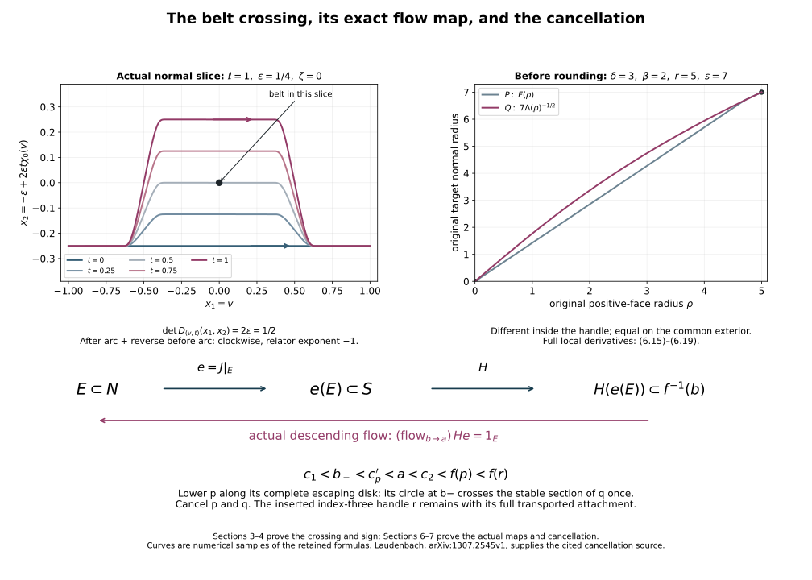

# Framed handle slides and removal of index one {#original-framed-slides}

Proof companion for CG-S6 lesson 7. GPT-6 Astra (OpenAI), Ultra, 10 October 2026. New teaching exposition CC0. The full framed slide, loop isotopy, original-flow comparison, index-one cancellation and reversed removal are proved below, with a proved strengthening of the fundamental-group hypothesis and two complete calculations. Author self-checks and 52 finite exact checks supplement the complete written arguments. No independent review or novelty claim. The [sphere-twist and smooth-recognition proof](sphere-twists-and-the-original-smooth-six-sphere-comparison.md#twist-original-smooth-map) now constructs the new interior gluing with its full frame defect, cancels every actual handle and gives the orientation-preserving diffeomorphism to the original six-sphere, homotopic to its original degree-one map.

## 1. The original handle presentation gives the exact based group {#slide-original-group}

Let \((C;M_-,M_+)\) be the original connected smooth cobordism, of dimension \(n\geq6\), with nonempty connected boundary manifolds \(M_-,M_+\), simply connected incoming boundary \(M_-\), and simply connected \(C\). Use the included zero/top removal and index arrangement, retaining every original parameter radius, coefficient, gluing map and boundary comparison. Let \(W_1\) be the original stage consisting of the incoming collar and the \(r\) remaining index-one handles, and \(N_1\) its outgoing boundary. Write the retained one-handle coordinates as
\[
 [-r_i,r_i]\times D^{n-1}_{s_i},\qquad r_i,s_i>0.
 \tag{1.1}
\]
Their two attaching maps are the restrictions of the actual framed map to \(\{-r_i,r_i\}\times D^{n-1}_{s_i}\). Keep their labels and signs.

Choose a point \(b\) in the common exterior of all attaching disks, and paths \(a_i^\pm\) from \(b\) to the centres of the two feet. The path
\[
 h_i(t)=(r_i t,0),\quad -1\leq t\leq1,\qquad
 x_i=[a_i^-h_i(a_i^+)^{-1}]
 \tag{1.2}
\]
is a specified loop in the original one-handle body. Its image in the original cobordism is given by the retained complete handle-presentation map. No unlabelled generator or omitted connecting path is used.

We first prove
\[
 \pi_1(W_1,b)=F(x_1,\ldots,x_r),\qquad
 \pi_1(N_1,b)\xrightarrow{\;\cong\;}\pi_1(W_1,b).
 \tag{1.3}
\]
The basepoint in the outgoing boundary is carried along its fixed collar to the displayed one; we retain that connecting path when writing the inclusion homomorphism.

Here is the needed two-component intersection calculation. Suppose a path-connected space \(U\) is joined to a simply connected open set \(V\), and \(U\cap V\) has exactly two path-connected simply connected components. Fix one path in \(V\) between them and connecting paths in \(U\) to its endpoints. The fundamental group of \(U\cup V\) is the free product of \(\pi_1(U)\) with the infinite cyclic group generated by that joined loop. To prove surjectivity, subdivide a loop into finitely many pieces lying in \(U\) or \(V\), using a Lebesgue number for its open cover. A \(V\)-piece with endpoints in the same overlap component can be replaced, up to homotopy fixing endpoints, by a path in that component, since \(V\) is simply connected. A \(V\)-piece between different components is the chosen connecting path, with the appropriate sign, preceded and followed by paths in the overlap components. This writes the loop as a word in the stated factors.

For injectivity, retain one point \(z_-\) in one overlap component and one point \(z_+\) in the other. Work first with paths whose endpoints belong to \(\{z_-,z_+\}\), retaining the endpoints as part of every path class. Their composition is defined only when the intermediate endpoints agree. The path classes in \(U\) are generated by its based loops and one chosen path \(u:z_-\to z_+\); the path classes in \(V\) consist of the identity at each point and a single path class \(v:z_-\to z_+\) and its inverse. There is exactly one such class because \(V\) is simply connected. The overlap contributes only the two identities, since each of its two components is simply connected and it has no path between them.

Here is the gluing assertion for those path classes. Subdivide any path into pieces in \(U\) and \(V\), inserting at each change of open set a path in its overlap component to the corresponding \(z_\pm\) and its inverse. Two subdivisions give the same product after refinement and cancellation of these inserted inverse paths. For a homotopy, triangulate its square finely enough that the closed star of each small triangle lies in one open set. Insert the same overlap paths on each edge shared by different sets. The boundary of each triangle gives an actual relation in that set's path classes. A shared edge appears twice with inverse orientations, so multiplication of the triangle relations cancels all the internal edge words, with their order retained. Changing an inserted overlap path gives only a relation in its overlap component. These operations prove that the path classes of \(U\cup V\) have exactly the presentation obtained by joining the two path-class presentations and identifying their overlap identities. They prove both directions, because every relation used is itself a path homotopy in the union.

At the object \(z_-\), eliminate the chosen arrow \(u\) by using it to identify the two reference objects. The remaining new loop is \(vu^{-1}\), with no relation involving it: the \(V\)-relations merely identify \(v^{-1}\) as its inverse arrow, and the overlap has contributed no loop relation. The resulting based group is \(\pi_1(U,z_-)*\langle vu^{-1}\rangle\). Transporting the basepoint along the retained path in \(U\) gives the stated free product. This ordered-path argument is needed; counting crossing exponents alone would not prove injectivity.

Apply this argument to open collar neighbourhoods of the incoming body and each one-handle. The two overlap components retract onto its two original attaching disks, and the handle neighbourhood is contractible. The retained collars make these actual open sets after the prescribed corner rounding. Starting with \(\pi_1(M_-)=1\) and iterating proves the first identity in (1.3), with the precise generators (1.2).

For the outgoing boundary, first remove the interiors of the \(2r\) original attaching disks from \(M_-\), using their retained slightly extended charts to define disjoint collars. The remaining manifold \(U_0\) is connected and simply connected. We justify both assertions. Any path can be moved off the finite disk centres; any null-homotopy of a loop can be moved off those centres as well, because its domain has dimension two and \(\dim M_-=n-1>2\). This relative avoidance is obtained by the finite chart-bump parameter argument in the included belt-complement chapter: keep the map fixed near its boundary, add full coordinate parameters in finitely many interior charts, and apply Sard to the point-preimage projection. Its bad-parameter set has smaller dimension. In each punctured original disk chart the map
\[
 x\longmapsto \frac{\max(\|x\|,s_i)}{\|x\|}\,x
 \tag{1.4}
\]
pushes its inner punctured disk to the retained radius \(s_i\), equals the identity outside that radius, and has the radial homotopy obtained by replacing the maximum radius by its convex interpolation with \(\|x\|\). At the centre it is not defined, which is precisely why the preceding relative avoidance was required. Apply these maps in the disjoint disks. They give the desired paths and null-homotopies in \(U_0\). Smoothness is unnecessary for this fundamental-group homotopy; the continuous radial map keeps the original radius and is the identity on the already retained exterior.

The outgoing one-handle tube is
\[
 [-r_i,r_i]\times S^{n-2}_{s_i}.
 \tag{1.5}
\]
It is simply connected, and its two intersections with \(U_0\), after taking the actual collar neighbourhoods, retract onto the two spheres \(S^{n-2}_{s_i}\), which are simply connected as \(n-2\geq2\). The two-component calculation therefore gives a free generator for each tube. Choose a fixed \(v_i\in S^{n-2}_{s_i}\) and the path \((r_it,v_i)\) along the tube. In the full one-handle body it is homotopic to \(h_i\) through
\[
 (t,\sigma)\longmapsto(r_it,(1-\sigma)v_i),
 \qquad 0\leq\sigma\leq1.
 \tag{1.6}
\]
The endpoint tracks lie in the actual attaching disks and are appended to the chosen paths \(a_i^\pm\). Thus the inclusion sends this precise free generator to the corresponding \(x_i\), with the same sign. It is an isomorphism on the displayed free presentations. The explicit corner-comparison diffeomorphism in the handle-arrangement companion carries (1.5) and the exterior to the actual rounded boundary, so the calculation applies to the retained original \(N_1\), not just to an unrounded model.

Now write every index-two attaching core, with its actual orientation and radius, as
\[
 \alpha_j:S^1_{r_j}\times\{0\}\longrightarrow N_1,
 \qquad j=1,\ldots,m.
 \tag{1.7}
\]
After the established ordering and common-exterior comparisons, choose its connecting path \(\omega_j\) from \(b\) to \(\alpha_j(r_j,0)\). Let
\[
 R_j=\left[\omega_j\,
      \bigl(t\mapsto\alpha_j(r_j\cos(2\pi t),r_j\sin(2\pi t),0)\bigr)
      \,\omega_j^{-1}\right]\in F(x_1,\ldots,x_r).
 \tag{1.8}
\]
Here the final zero denotes all original normal parameters; the two displayed circular coordinates belong to the original radius-\(r_j\) core disk.

Attaching that handle gives exactly the quotient by the normal closure of \(R_j\). Indeed take open collar neighbourhoods of the old body and the attached handle; their connected intersection retracts onto the entire original \(S^1_{r_j}\times D^{n-2}_{s_j}\), while the handle is contractible. The connected-intersection van Kampen lemma, proved in lesson 6, Section 3, gives this quotient by the full image of its fundamental group. Radial contraction in the second factor is a based homotopy within that intersection, so its entire image is generated by (1.8). All normal parameters and the connecting path have thus been accounted for.

For an index-\(k\) handle with \(k\geq3\), the same intersection retracts onto \(S^{k-1}_{r_j}\times D^{n-k}_{s_j}\), which is connected and simply connected. Its attachment induces an isomorphism on \(\pi_1\). The final regular bands are actual products. Therefore the exact homomorphism from the original one-handle level into the whole cobordism is
\[
 F(x_1,\ldots,x_r)\longrightarrow
 \pi_1(C,b)\cong
 F(x_1,\ldots,x_r)/\langle\!\langle R_1,\ldots,R_m\rangle\!\rangle.
 \tag{1.9}
\]
It sends each \(x_i\) to its actual based handle loop. Since \(C\) is simply connected, every one of these generators belongs to the displayed normal closure.

## 2. The finite words that must be realized geometrically {#slide-normal-closure}

For any group \(G\) and labelled elements \(R_1,\ldots,R_m\), the normal closure of those elements is exactly the set of finite products
\[
 \prod_{\nu=1}^{N}g_\nu R_{j_\nu}^{\epsilon_\nu}g_\nu^{-1},
 \quad
 N\geq0,\quad g_\nu\in G,\quad
 \epsilon_\nu\in\{-1,1\}.
 \tag{2.1}
\]
Proof: the set of such products contains the identity and all the \(R_j\), is closed under multiplication by concatenating the lists, and is closed under inverse by reversing the list and replacing each sign by its negative. Conjugation by \(a\in G\) replaces every \(g_\nu\) by \(ag_\nu\). It is therefore a normal subgroup containing the given elements. Conversely every normal subgroup containing them contains each factor and every finite product. These two inclusions prove (2.1).

Apply this to the exact group in (1.9). For every original one-handle label \(i\), there is a finite identity in the original free group
\[
 x_i=\prod_{\nu=1}^{N_i}
        g_{i,\nu}R_{j_{i,\nu}}^{\epsilon_{i,\nu}}g_{i,\nu}^{-1}.
 \tag{2.2}
\]
There is no assumption that the existing relators themselves can be converted to a free basis. Equation (2.2) is an actual consequence of the proved quotient, and uses no assertion about the Andrews–Curtis problem.

The included [pair-creation chapter](creating-an-original-cancelling-handle-pair.md), Sections 5–6, inserts an index-two/three pair in an original regular band. Use the band immediately above all the old two-handles, and a small coordinate disk in their common exterior, as constructed in Section 6 below. Its lower attaching circle bounds the exact framed disk given there, entirely in that exterior. Pulling this disk back to \(N_1\) gives the based element \(R_0=1\) in (1.3). The inserted three-handle has no effect on (1.9), by the index-\(k\geq3\) calculation. It is carried through every subsequent full cobordism comparison.

At the level of based loops, multiplying \(R_0\) by the factors in (2.2), in the order specified in Section 4, ends with \(x_i\), including every conjugating path and sign. Sections 3–4 construct the required framed slides and prove their multiplication convention.

For a concrete sign check, in the free group on \(x,y\), let \(R_1=xy\) and \(R_2=y\). Then
\[
 x=R_1R_2^{-1},\qquad y=R_2.
 \tag{2.3}
\]
The inverse is essential: using two positive copies would give \(xy^2\), not \(x\). With a connecting path represented by a further word \(g\), the corresponding identity is
\[
 gxg^{-1}=(gR_1g^{-1})(gR_2^{-1}g^{-1}).
 \tag{2.4}
\]
The middle \(g^{-1}g\) cancels as based path concatenation, so both copies use the same actual connecting-path class. The later geometric slide must preserve that distinction when choosing its band.

## 3. A supported belt crossing gives the actual two-handle slide {#slide-belt-crossing}

We now construct the geometric operation directly in the original target-handle coordinates. Keep a target index-two handle \(j\), attached first to the original boundary \(N=N_1\). Write its radii as \(a_j,b_j>0\), its full framed attaching map as
\[
 \varphi_j:S^1_{a_j}\times D^{n-2}_{b_j}\longrightarrow N,
 \qquad L_j=\varphi_j(S^1_{a_j}\times\{0\}).
 \tag{3.1}
\]
Keep every other attaching map, with a moving label \(i\ne j\). Initially its whole image is disjoint from the target tube. It therefore lies in the common exterior before and after attaching \(j\).

Let \(S_j\) be the actual rounded outgoing boundary after this handle, and \(B_j\) its belt sphere. The already proved rounding and complement maps give the exact diffeomorphism
\[
 P_j:S_j\setminus B_j\longrightarrow N\setminus L_j.
 \tag{3.2}
\]
In the unrounded positive-face coordinates \((x,y)\in D^2_{a_j}\times S^{n-3}_{b_j}\), its formula is
\[
 (x,y)\longmapsto
 \varphi_j\left(\frac{a_j}{\|x\|}x,\frac{F_j(\|x\|)}{b_j}y\right),
 \qquad x\ne0.
 \tag{3.3}
\]
Here \(F_j\) is precisely the strictly increasing radial function from equations (1.8)–(1.13) of the belt-complement companion, retaining both original radii, its full cutoff integral, and its linear seam germ. Compose with the inverse of the actual rounding map as in the handle-arrangement companion, Section 1. Near the belt the face is away from its seam, so these are the actual retained handle coordinates. The complete derivative of (3.3) is equation (1.13a) of the complement companion, followed by \(D\varphi_j\); the rounding derivative is included in (3.2).

Choose \(y_*\in S^{n-3}_{b_j}\), and a small coordinate chart \(\zeta\mapsto y(\zeta)\) on that sphere with \(y(0)=y_*\). At a chosen small disk in the positive face the belt equation is \(x_1=x_2=0\). Choose positive \(\ell,\varepsilon\) and a box
\[
 |x_1|<2\ell,\qquad |x_2|<3\varepsilon,\qquad
 \|\zeta\|<d_0
 \tag{3.4}
\]
whose closure lies inside that original positive face.

First put a short oriented arc of the moving attaching circle into the position
\[
 v\longmapsto(v,-\varepsilon,0),\qquad |v|\leq\ell.
 \tag{3.5}
\]
This can be done by an ambient isotopy avoiding the belt and all the other attaching circles. Here are the complete local and global reasons. The complement (3.2) is connected: deleting the one-dimensional target core from the connected \(N\) does not disconnect it, by the relative path-avoidance argument, since \(1+1<n-1\). Within this complement a path from a small moving-circle patch to the chosen endpoint can be selected with interior disjoint from the entire moving circle and every other attaching circle. Relative smoothing followed by the same finite-parameter avoidance makes the path embedded with these exclusions. Its endpoints and their short coordinate germs are retained.

An actual chart transports the patch along that path. Extend the path slightly at both ends, choose a smooth frame transverse to its tangent, and take a normal exponential neighbourhood in an auxiliary connection. Choose that connection flat in the prescribed start and end charts; a partition of unity on connection coefficients retains these whole end germs. Choose the path straight and the transverse frame constant in those end charts. The resulting map
\[
 J(s,w)=\exp_{c(s)}\left(\sum_\nu w_\nu E_\nu(s)\right)
 \tag{3.6}
\]
is an embedding for a sufficiently small fixed transverse radius: its differential is invertible along the zero section, and compactness and injectivity of the embedded path exclude distinct nearby points with the same image. It agrees exactly with the chosen product end charts. The initial short circle arc is a coordinate line in the first end chart, by its original embedded-circle coordinates; choose the corresponding end frame so that this line becomes (3.5).

In the chart (3.6), a cutoff vector field equal to \(\partial_s\) on the full compact corridor traced by that sufficiently small patch, and zero outside a larger corridor, transports the patch by the exact map \((s,w)\mapsto(s+t,w)\) while it is in the inner corridor. The cutoff gives a compactly supported global field. Its support misses the belt and the other circles by the preceding compact separation. Its full derivative is the derivative of \(J\), the flow, and \(J^{-1}\), in that order. If a smaller original patch image is needed, use the already proved ambient radial compression; the original parameter interval and the complete thick attaching domain are transported, not discarded. Flow uniqueness gives a diffeomorphism throughout. At the final point, shrink the crossing box so that the rest of the moved circle misses it. The embeddedness of the moved circle and compactness of the complement of a slightly larger patch give that final separation. This proves (3.5) by an actual supported ambient isotopy.

Choose a smooth function \(0\leq\chi_0(v)\leq1\), equal to one for \(|v|\leq\ell/3\) and zero for \(|v|\geq2\ell/3\). Choose a smooth cutoff \(\eta_0(x_2,\zeta)\), equal to one on a neighbourhood of \([-\varepsilon,\varepsilon]\times\{0\}\) and compactly supported inside the last two factors of (3.4). In the original face chart take the exact vector field
\[
 Y=2\varepsilon\,\chi_0(x_1)\eta_0(x_2,\zeta)\,\partial_{x_2},
 \tag{3.7}
\]
and zero outside. Its global flow \(I_t\) exists for all finite times because the field has compact support. On (3.5) it is exactly
\[
 I_t(v,-\varepsilon,0)
   =(v,-\varepsilon+2\varepsilon t\chi_0(v),0),
 \qquad 0\leq t\leq1.
 \tag{3.8}
\]
The displayed track remains where \(\eta_0=1\), which verifies the equation rather than merely guessing its solution. It fixes the arc near its endpoints. The entire moving circle remains embedded because \(I_t\) is a diffeomorphism.

The trace meets the belt exactly once, at \(v=0,t=1/2\). At this point its derivative in the ordered parameters \((v,t)\), projected to the ordered normal belt coordinates \((x_1,x_2)\), is
\[
 \begin{pmatrix}1&0\\0&2\varepsilon\end{pmatrix}.
 \tag{3.9}
\]
Its determinant is positive. Starting instead with \(x_2=+\varepsilon\) and using the negative of (3.7) gives one crossing with determinant \(-2\varepsilon\). Thus either sign \(\sigma=\pm1\) is available.

On a whole neighbourhood of the arc track where \(\eta_0=1\), the derivative is
\[
 D I_t=
 \begin{pmatrix}
 1&0&0\\
 2\varepsilon t\chi_0'(v)&1&0\\
 0&0&I_{n-3}
 \end{pmatrix}.
 \tag{3.10}
\]
Outside that inner neighbourhood the entire derivative, with both cutoff contributions retained, is the solution of
\[
 \frac{d}{dt}D I_t|_x
   =D Y|_{I_t(x)}D I_t|_x,\qquad
 D I_0|_x=I,
 \tag{3.11}
\]
where
\[
 D Y=2\varepsilon\,\partial_{x_2}
       \otimes\left(\eta_0\chi_0'\,dx_1+\chi_0\,d\eta_0\right).
 \tag{3.12}
\]
Therefore the entire original attaching tube and its frame are transported by the actual ambient flow, not reconstructed from a core homotopy.

At both ends of the crossing the core misses the belt. At the final end, compress its full original thick tube around the core by the proved radial ambient compression, until its complete image misses the belt as well. This is possible because the core is compact and disjoint from the closed belt. Choose the compression inside a neighbourhood disjoint from every other attaching tube; those tubes and the moving one are disjoint compact images after the ambient diffeomorphism. Their original parameter radii remain as domain labels under this compression. Pull the resulting complete tube through (3.2).

Its image may enter the original target normal tube, but misses its core. The original normal-radius minimum on this compact image is a positive number. Apply the outward radial flow from the handle-arrangement companion, Section 3, to move the whole tube into the common exterior. Choose its final radius slightly larger than \(b_j\), and its outer support still within the extended target chart and short of the compact other attaching tubes. This is possible because those other tubes were originally disjoint from the closed target tube. That flow is the identity near the target core and on every other attaching tube. Conjugating it through \(P_j\) extends to an ambient isotopy of all of \(S_j\), equal to the identity near the belt. Its complete derivative is the proved derivative of the radial flow between \(DP_j\) and \(DP_j^{-1}\).

We have now obtained a full ambient isotopy \(A_t\) of the actual outgoing boundary \(S_j\), starting with the original moving tube in the common exterior and ending with a new full tube in that same exterior, while retaining the other attaching tubes. Its stages are the path transport, (3.7), the final compression and the conjugated outward flow; reparametrize their time variables by smooth cutoffs constant near their endpoints and concatenate. Every stage has its exact derivative as above or in the cited included construction.

Extend this isotopy into the cobordism already containing target handle \(j\). In its actual inward boundary collar \(c:S_j\times[0,d)\to C_j\), choose \(\gamma=1\) near zero and zero near \(d\), and set
\[
 \widehat A_t(c(x,r))=c(A_{t\gamma(r)}(x),r),
 \qquad \widehat A_t=1\ \text{outside that collar}.
 \tag{3.13}
\]
The inverse replaces \(A_{t\gamma(r)}\) by its inverse at that same radius. In collar coordinates its full derivative is
\[
 (\xi,\rho)\longmapsto
 \left(D A_{t\gamma(r)}\xi
    +t\gamma'(r)\,\partial_sA_s|_{s=t\gamma(r)}\,\rho,\ \rho\right),
 \tag{3.14}
\]
followed by the retained collar derivatives. It is a diffeomorphism, fixes the incoming boundary, and transports the full gluing collar of handle \(i\).

Attach handle \(i\) by its transported thick map and collar. The map \(\widehat A_1\) on \(C_j\), together with the identity on the entire original parameter domain of handle \(i\), agrees on the full attaching collar and gives an exact diffeomorphism of the two attached cobordisms. Transport all later attaching maps through this diffeomorphism, including any added index-three handle. The derivative on each piece and its matching collar has just been specified. This proves the full framed two-handle slide, with the outgoing identification retained. To keep the support disjoint from every other whole attaching tube during the initial path transport, first choose the path avoiding their cores, then compress those tubes sufficiently close to their compact cores by the proved ambient radial flow. The complete original parameter domains and their derivatives are carried by that preliminary isotopy and its collar extension. Thereafter the supports above miss these compressed whole tubes. This is a transported presentation of the same original cobordism; it is not a claim that those original tube embeddings were pointwise fixed by the preliminary compression.

## 4. The exact based word and its crossing sign {#slide-based-sign}

Keep the source orientation of the moving circle and the ordered coordinates \((x_1,x_2)\) of the target core. For the positive crossing (3.9), the before arc goes from negative to positive \(x_1\) below the origin, and the after arc goes in that same direction above it. The after arc followed by the inverse before arc winds clockwise around the origin. Its winding is therefore \(-1\), not \(+1\).

Here is a proof which retains the whole complement map. Remove a small open disk around \((v,t)=(0,1/2)\) from the parameter strip of (3.8). On the remaining strip, \(P_j\) composed with the trace is defined. On a small positively oriented circle about the removed point, (3.9) gives degree \(+1\) for \(x/\|x\|\). Its image under (3.3) is
\[
 \varphi_j\left(a_j\frac{x}{\|x\|},
                   \frac{F_j(\|x\|)}{b_j}y_*\right).
 \tag{4.1}
\]
Within the actual original tube this loop is homotopic to the positively oriented attaching core by multiplying its second coordinate by \(1-s\), with \(0\leq s\leq1\). Its first coordinate retains degree \(+1\); the strict monotone radial function and every original radius remain in (4.1). The parameter strip boundary has the before arc forward and the after arc backward for orientation \(dv\wedge dt\). Its inner boundary has the negative orientation. Reading these three boundary pieces proves that the after arc followed by the inverse before arc contributes the negative target-core class. Reversing the crossing reverses this sign. This verifies the clockwise computation without a picture convention.

Let \(R_i^{\mathrm{old}}\) and \(R_i^{\mathrm{new}}\) be the exact based words, with the basepoint fixed away from all supports. Let \(h\) be the actual path from that basepoint to the target core basepoint, obtained by following the prefix of the moving circle to the crossing band and then its retained band and angular paths. Retain the target connecting path \(\omega_j\) from (1.8), and set \(g=[h\omega_j^{-1}]\). Thus \(g\) is a based group element; the raw path to the target is not multiplied as though it were a based loop. Cutting the based loop at the changed arc and reading the punctured strip gives
\[
 R_i^{\mathrm{new}}
     =g R_j^{-\sigma}g^{-1}R_i^{\mathrm{old}}.
 \tag{4.2}
\]
For instance, write the old loop as \(a\,c_-\,b\) and the new one as \(a\,c_+\,b\). Their quotient in that order is
\[
 (a c_+ b)(a c_- b)^{-1}
       =a(c_+c_-^{-1})a^{-1},
 \tag{4.3}
\]
and the inner loop is precisely the signed loop proved above, with its path to the target retained. This proves (4.2), including its left multiplication convention. The path-transport, compression and outward-flow stages are ambient isotopies in the appropriate core complements, fixed at the basepoint; consequently they do not change this based identity.

Every desired based conjugating class \(g\) can be used in the construction: choose the path \(h\) in the class represented by \(g\omega_j\). In the original \(N\), the inclusion of the complement of the finitely many one-dimensional attaching cores induces an isomorphism on \(\pi_1\): surjectivity moves loops off those cores, and injectivity moves homotopies of dimension two off them, since \(2+1<n-1\). These are the relative avoidance constructions already proved in the belt-complement chapter. The exact map \(P_j^{-1}\) transports the resulting path to the belt complement. Choose an embedded representative in its prescribed relative path class, avoiding the other cores by the same dimension inequalities. This is precisely the path used in (3.6). Thus specifying the band does not leave the conjugating word uncontrolled.

For equation (2.2), start with the new pair's \(R_0=1\). Perform the factors in reverse order \(N_i,N_i-1,\ldots,1\), and at step \(\nu\) choose crossing sign
\[
 \sigma_\nu=-\epsilon_{i,\nu}.
 \tag{4.4}
\]
Equation (4.2) then left-multiplies the current word by \(g_{i,\nu}R_{j_{i,\nu}}^{\epsilon_{i,\nu}}g_{i,\nu}^{-1}\). After the finite list the new lower attaching circle represents exactly \(x_i\). Every target old two-handle is retained, all original normal framings have been carried by the full ambient derivative, and the new index-three handle has been transported through the exact cobordism maps. This completes the geometric realization of the finite word calculation. The next step is the actual loop isotopy to the once-over-one-handle representative and the resulting one/two cancellation.

## 5. From the exact loop class to a full ambient isotopy {#slide-loop-isotopy}

Put \(d=n-1\geq5\). We need the following relative statement on the actual \(d\)-dimensional level manifold \(N\). Let \(K\) be a finite disjoint union of embedded circles. Let
\[
 \lambda_0,\lambda_1:S^1_{a_0}\longrightarrow N\setminus K
 \tag{5.1}
\]
be smooth parametrized embeddings which are freely homotopic in \(N\setminus K\). The original radius \(a_0>0\) is retained. There is a smooth isotopy \(\lambda_t\) through parametrized embeddings in this complement, constant on time intervals near \(0\) and \(1\), with these exact endpoints. If a given homotopy is fixed on an open parameter arc containing a specified closed arc, the construction can also fix a smaller open neighbourhood of that closed arc. In the application we do not need a fixed arc: the retained based words and connecting paths give the required free homotopy.

We prove the assertion, including the two different dimension estimates it requires. First make the given continuous homotopy smooth relative its time-end collars and any prescribed parameter-arc collar. Use the finite coordinate embedding, retraction and partition-of-unity smoothing constructed in [the belt-complement chapter](belt-sphere-complements-and-the-whitney-disk.md), Sections 2–3. For completeness, on the compact image choose finitely many coordinate charts and chart cutoffs; the map formed from the cutoff-weighted coordinate functions and the cutoff functions embeds a neighbourhood of that compact image into a finite-dimensional Euclidean space. Its normal exponential map supplies a retraction from a neighbourhood. Approximate the Euclidean-valued homotopy by local convolution and a partition of unity, with a cutoff vanishing on the prescribed collars, then apply that retraction. A sufficiently close approximation remains in \(N\setminus K\). Convex interpolation before retraction proves that it is the same relative homotopy. Use the angular coordinate \(\theta\) only as a parameter on the original circle; its point is always \((a_0\cos\theta,a_0\sin\theta)\).

Here is the finite-parameter argument that removes vanishing tangents. Around a point of the parameter cylinder at which \(\partial_\theta h\) could vanish, choose a local source coordinate and a target chart. Perturb in that chart by
\[
 h_{u,v}(\theta,t)
   =h(\theta,t)
      +\rho(\theta,t)\bigl(u+(\theta-\theta_*)v\bigr),
 \qquad u,v\in\mathbb R^d,
 \tag{5.2}
\]
where \(\rho=1\) on a smaller source neighbourhood and is supported away from the fixed collars. The addition is in the named target coordinates; compose with the inverse chart. At \((\theta_*,t)\), the \(u\)-parameters change the value arbitrarily and the \(v\)-parameters change the \(\theta\)-derivative arbitrarily. Consequently the full parameter family is transverse to the zero section of the vertical tangent bundle over that source neighbourhood. A finite collection of these perturbations suffices on the compact part where a zero tangent could occur. Compose the finite perturbations in a fixed recorded order and restrict all parameters to a small ball. Surjectivity persists there by continuity. On the fixed collars the endpoint maps are already embeddings, and on slightly larger collars their tangent lengths have a positive lower bound, so no perturbation is needed there.

If the total parameter dimension is \(P\), the zero-tangent locus of this universal family is a smooth manifold of dimension \(P+2-d\). Its projection to the \(P\)-dimensional parameter ball has image of measure zero because \(2-d<0\): in countably many coordinate charts its differential has rank less than \(P\), so Sard's theorem applies. Choose a parameter outside that image. The resulting homotopy is an immersion on each circle slice.

For this particular immersion family there is a number \(\delta>0\) such that points on the same circle with angular distance less than \(\delta\) have different images, unless they are the same point. To see this uniformly, at each \((\theta,t)\) select a target-coordinate linear functional positive on \(\partial_\theta h\). In a sufficiently small parameter rectangle its derivative remains positive, and this functional is strictly increasing on each angular interval in that rectangle. Finitely many such rectangles cover the compact cylinder. A Lebesgue number gives the asserted \(\delta\). The strict derivative bounds also hold on a sufficiently small \(C^1\) neighbourhood of this immersion family.

It remains to exclude pairs farther apart. On the compact parameter space
\[
 \mathcal D_\delta
  =\{(\theta,\theta',t):
             \operatorname{dist}_{S^1}(\theta,\theta')\geq\delta\}
 \tag{5.3}
\]
consider the evaluation pair \((h(\theta,t),h(\theta',t))\) in \(N\times N\). At a possible coincidence, choose a bump supported near one source point and disjoint from the other source point. Its \(d\) value parameters change one evaluation arbitrarily while leaving the other fixed, and hence span the normal space to the diagonal. If one source point is on a fixed collar, perturb the other. If both are fixed, their images cannot coincide, because the prescribed fixed arc and the prescribed endpoint embeddings are injective there. Compactness of the possible-coincidence set gives a finite collection of bumps. As in (5.2), a sufficiently small full parameter family is transverse to the diagonal. Its coincidence locus has dimension
\[
 P+3-d<P.
 \tag{5.4}
\]
Sard applied to its parameter projection gives a parameter with no coincidences. For the boundaries and corners of (5.3), apply this same argument on each stratum; there are finitely many strata, and the source dimensions there are at most three. Choose the perturbation small in \(C^1\), so the already proved near-diagonal injectivity and nonzero tangent bounds remain. Its compact image remains disjoint from \(K\). Every slice is now a one-to-one immersion of a compact circle, and is therefore an embedding: it is a homeomorphism onto its image, and the immersion charts give the smooth inverse. This proves the claimed loop isotopy.

Every dimension estimate in this loop-isotopy proof also holds when \(d=4\): the two source dimensions are two and three, both strictly smaller than the relevant target codimensions. Thus the loop statement itself is proved for every \(d\geq4\), including the relative version. The receiving cobordism in this chapter still has its original dimension \(n\geq6\).

The based identity in Section 4 supplies a homotopy in the required complement. Indeed the inclusion
\[
 N\setminus K\longrightarrow N
 \tag{5.5}
\]
induces an isomorphism on fundamental groups. A loop can be moved off \(K\) because its dimension plus \(\dim K\) is \(2<d\); a homotopy or null-homotopy can be moved off it because \(2+1<d\). For the latter assertion, the universal chart-value perturbation of a disk is transverse to every component of \(K\). The preimage has dimension \(2+1-d<0\) for a regular parameter and is empty. Keep its boundary collar fixed, where the image already misses \(K\). The same finite-chart and Sard proof supplies both moves. Retaining the whiskers of the two based circles in (5.5), a based equality therefore gives a based homotopy in the complement; forgetting only the whisker gives the free homotopy used in (5.1). No assertion about embedded disks is needed for this step.

### 5.1. Extending the isotopy while retaining the original frame

We now construct its ambient extension. Give a neighbourhood of the compact trace an auxiliary metric, and put
\[
 T(\theta,t)
   =\frac{\partial_\theta\lambda_t}
          {|\partial_\theta\lambda_t|}.
 \tag{5.6}
\]
This unit vector is used only for the auxiliary tubular construction. The original circle radius, original metric and original attaching frame are retained below. The initial thick attaching map supplies a basis of the normal quotient bundle. Project its normal-coordinate derivatives orthogonally to \(T^\perp\), obtaining independent normal vectors \(E_\nu(\theta,0)\). Record their original Gram matrix; it need not be the identity. Extend them along \(t\) by the linear equation
\[
 \nabla_t E_\nu
   =-\langle E_\nu,\nabla_tT\rangle T .
 \tag{5.7}
\]
Differentiating shows
\[
 \partial_t\langle E_\nu,T\rangle=0,\qquad
 \partial_t\langle E_\nu,E_\mu\rangle=0.
 \tag{5.8}
\]
Thus they remain a basis of \(T^\perp\). The coefficients and initial data are smooth and periodic in \(\theta\); uniqueness of the linear equation gives the same properties to the solution.

For a sufficiently small uniform \(\rho>0\), the maps
\[
 J_t(\theta,z)=
  \exp_{\lambda_t(\theta)}
       \left(\sum_{\nu=1}^{d-1}z_\nu E_\nu(\theta,t)\right),
 \qquad \|z\|<\rho,
 \tag{5.9}
\]
are embeddings, smoothly depending on \(t\). Their differentials are invertible on the zero sections. Compactness gives uniform local inverse neighbourhoods; failure of global injectivity for every smaller radius would give two sequences converging to points of a single embedded circle with equal image, contradicting either its injectivity or a local inverse. Decrease \(\rho\) so that all their images miss \(K\), and so that any prescribed fixed arc has a fixed neighbourhood on which the construction below vanishes.

Let \(\Pi_{t,\theta,z}\) be parallel transport along the radial exponential segment in (5.9). Choose \(\chi(\|z\|^2)=1\) near zero, supported strictly inside this tube. Define
\[
 V_t(J_t(\theta,z))
   =\chi(\|z\|^2)\,
      \Pi_{t,\theta,z}\,\partial_t\lambda_t(\theta),
 \qquad V_t=0\ \text{outside}.
 \tag{5.10}
\]
Where a fixed arc is retained, \(\partial_t\lambda_t=0\), so the field vanishes on its tubular neighbourhood; enlarge the fixed parameter collar before choosing the required smaller neighbourhood. The field is smooth, including at its zero extension, and has compact support in \(N\setminus K\). Its flow \(\mathcal J_t\) exists for \(0\leq t\leq1\). Since (5.10) equals \(\partial_t\lambda_t\) on the core, uniqueness of the time-dependent differential equation gives
\[
 \mathcal J_t\lambda_0=\lambda_t.
 \tag{5.11}
\]
The flow is a diffeomorphism; its inverse is obtained by solving the same equation backwards in time.

Here is the full derivative convention, which also describes the transported framing. Write
\(W_t(\theta,z)=\Pi_{t,\theta,z}\partial_t\lambda_t(\theta)\).
In the tubular charts the derivative of (5.10) is
\[
 D V_t
  =\left(\chi\,D W_t+
       W_t\otimes 2\chi'(\|z\|^2)
                       \sum_\nu z_\nu\,dz_\nu\right)
       D J_t^{-1}.
 \tag{5.12}
\]
Target coordinate changes are applied on both sides as usual; \(DW_t\) includes the derivatives of parallel transport and of \(\partial_t\lambda_t\). The full ambient derivative is determined by
\[
 \frac{d}{dt}D\mathcal J_t|_x
   =D V_t|_{\mathcal J_t(x)}D\mathcal J_t|_x,
 \qquad D\mathcal J_0=I.
 \tag{5.13}
\]
For the original complete attaching embedding
\(\alpha_0:S^1_{a_0}\times D^{n-2}_{b_0}\to N\), retain
\[
 \alpha_t=\mathcal J_t\alpha_0,\qquad
 D\alpha_t=D\mathcal J_t|_{\alpha_0}\,D\alpha_0 .
 \tag{5.14}
\]
This keeps the original entire domain and the actual frame, including any tangential parts projected out for the auxiliary construction in (5.7). It imposes no vanishing condition on a framing twist.

If other complete attaching tubes are to be fixed, first compress them around their cores until their entire images miss the compact support of (5.10), by the proved ambient radial compression. Their original parameter domains and comparison maps are retained. After this preliminary transport (5.10) fixes them. At the endpoint compress the moving full tube around \(\lambda_1\) if necessary. If \(\lambda_1\) lies in an open common exterior, compact separation then puts that full tube in the same exterior.

Finally, an isotopy with compact support in \(N\setminus\bigcup_jL_j\) lifts by the simultaneous complement map to an isotopy of the whole outgoing surgery boundary:
\[
 \mathcal J_t^{\,S}
    =P^{-1}\mathcal J_tP
      \quad\text{off }\bigcup_jB_j,\qquad
 \mathcal J_t^{\,S}=1
      \quad\text{near }\bigcup_jB_j .
 \tag{5.15}
\]
These formulas agree on an open neighbourhood: the compact support in the core complement stays a positive normal distance from every core, and the explicit radial formula for \(P\) sends sufficiently small belt neighbourhoods into the region where \(\mathcal J_t=1\). Its derivative is the full product \(DP^{-1}D\mathcal J_tDP\). Equations (3.13)–(3.14) extend it across the original cobordism collar and transport every later handle. This completes the geometric use of the loop homotopy.

## 6. The old two-handles and their exact descending comparison {#slide-original-flow}

The following preparation makes the use of the complement map precise. Start with the actual ordered Morse function and field supplied by [the trajectory companion](morse-trajectories-and-critical-value-lowering.md#trajectory-ordered-morse), after zero/top removal. If there is no one-handle, no index-one cancellation is needed. Otherwise select the currently highest index-one critical point \(q\). Write its value as \(c_1\). Keep the full local coordinates and Hessian coefficients of this point.

### 6.1. Putting the old two-handles at one critical value

There must be at least one old two-handle: if there were none, (1.9) would identify the nontrivial free group of the remaining one-handles with the trivial group of \(C\). Let \(c_2\) initially be the lowest old index-two critical value. We change the higher index-two critical values to this same \(c_2\), without changing any critical point, its index or its local Hessian.

Here is a finite induction which realizes the change. Suppose the first \(j\) old index-two points already have value \(c_2\), and take the next old index-two point \(p_j\), at value \(c_j>c_2\). Choose a regular level \(a\) with
\[
 c_1<a<c_2.
 \tag{6.1}
\]
The simultaneous outgoing boundary for the first \(j\) points has \(j\) disjoint belt spheres of codimension two. Its construction is given explicitly in the next paragraph; for \(j=1\) it is the included original Morse construction. At a regular level above \(c_2\) and below \(c_j\), their images under the actual outer flow are exactly the stable sections of these \(j\) points, by the proof of equation (1.12) in the trajectory companion, applied separately in their disjoint critical charts. Move the one-dimensional attaching circle of \(p_j\) off their union by the proved relative avoidance, since \(1<2\), and realize that whole isotopy as descending holonomy in a regular band above them. The compact-limit and hitting-time proof in that companion, Section 2, now applies with this finite collection as the only possible critical limits. All have been excluded. It gives the complete embedded unstable disk of \(p_j\) down to \(a\). Apply the supported lowering formula in its Section 4 with new value \(c_2\); its strict inequality is
\(c_j-c_2<c_j-a\). Choose its neighbourhood disjoint from the other critical points and keep the original field on a collar of \(f=a\), where the function modification vanishes. This leaves the first \(j\) critical points unchanged and adds \(p_j\) at their value. Points of the same value cannot have a descending connecting trajectory, because the function strictly decreases on every nonconstant trajectory. This completes the induction after finitely many old two-handles.

We spell out the simultaneous boundary used in this induction. Finitely many critical points of one value have disjoint original Morse coordinate neighbourhoods. Choose positive \(\delta,\beta\) so small that every closed original set
\[
 H_j=\{B_j(y)\leq\beta,\quad
             A_j(x)\leq\delta+B_j(y)\},
 \qquad
 A_j=\sum_{\nu=1}^{2}a_{j,\nu}x_\nu^2,\quad
 B_j=\sum_{\mu=1}^{n-2}b_{j,\mu}y_\mu^2
 \tag{6.2}
\]
lies in its own such neighbourhood. Every coefficient \(a_{j,\nu},b_{j,\mu}\) is the retained positive coefficient for that actual critical point. Put \(a'=c_2-\delta\), \(b=c_2+2\beta\), and choose \(a<a'\) in (6.1). The union of \(C_{a'}\) with these disjoint handles has exactly the rounding of the relative Morse companion, Section 4.2, on each of its disjoint corners. Each rounded face is outward transverse to the increasing field. Its complement up to \(f=b\) is compact and has no critical point, so the proof of the outer variable-length product in Section 4.3 of that companion applies verbatim to their union: every trajectory has one first crossing of the rounded boundary, and its time to \(b\) is \(b-f(z)\). No distinctness of these \(j\) critical values was used in this union argument. All subsequent comparison maps are the maps of that actual union.

Write \(N=f^{-1}(a)\). The regular band from \(a\) to \(a'\) has its retained increasing product map
\[
 J:N\longrightarrow f^{-1}(a').
 \tag{6.3}
\]
Pull every complete attaching map of (6.2) back by \(J^{-1}\). This is a simultaneous presentation of all the old two-handles on \(N\); retain its original radii \(r_j,s_j\), its full maps \(\varphi_j\), and all derivatives \(DJ^{-1}D\varphi_j^{\,\mathrm{local}}\). This \(N\) is an actual level of the one-handle body. Its exact regular product to the earlier \(N_1\) carries all words and connecting paths of Sections 1–2. We write the transported based group as \(G\); no new free generators have silently replaced the old ones.

### 6.2. The loop that actually crosses the selected one-handle once

Construct a specified embedded loop \(\kappa\) in \(N\) as follows. On the actual outgoing boundary of the highest one-handle \(q\), take its original longitudinal arc
\[
 u\longmapsto (u,v_*),\qquad
       -r_q\leq u\leq r_q,\quad v_*\in S^{n-2}_{s_q}.
 \tag{6.4}
\]
Join its two ends by an embedded exterior arc, with the needed endpoint germs. That exterior is connected: it is the preceding connected boundary with two disk interiors removed, and paths can be moved off the disk centres and then pushed radially out as in (1.4). Relative smoothing and the chart-parameter argument give an embedded connecting arc, disjoint from the longitudinal arc except at its designated ends. Round those ends in the retained attaching collars. The core of (6.4) crosses the original belt \(\{0\}\times S^{n-2}_{s_q}\) exactly once, with derivative \(\partial_u\) transverse to it. The rest of the loop misses that belt. Apply the actual rounding map, the outer flow map of the \(q\)-handle and the regular product to \(N\). Their invertible full derivatives preserve precisely that one transverse intersection. Denote the resulting stable section by
\[
 \Sigma_q=W^s(q)\cap N.
 \tag{6.5}
\]
There is no critical value between \(c_1\) and \(a\), so the equality follows from the stable-section proof in the trajectory companion and the actual regular product.

Parametrize this loop on the moving handle's original circle \(S^1_{a_0}\), with the orientation from negative to positive \(u\) in (6.4). Retain a path \(\omega_\kappa\) from the fixed basepoint to its marked point. Its based class is
\(u_q=[\omega_\kappa\kappa\omega_\kappa^{-1}]\in G\).
If the exterior paths just chosen are \(c^\pm\), and the earlier paths in (1.2) are \(a_q^\pm\), the exact comparison in the one-handle body is
\[
 u_q=v^-x_q(v^+)^{-1},\qquad
 v^\pm=[c^\pm(a_q^\pm)^{-1}].
 \tag{6.6}
\]
All loops in this equation are transported by the actual boundary-to-body isomorphism of (1.3). Thus it also holds in \(G\). It is unnecessary to assume that the newly chosen exterior paths equal the old ones. Since \(G\to\pi_1(C)\) is trivial, (2.1) gives a finite normal-closure identity for this exact \(u_q\), just as (2.2) did for \(x_q\).

Arrange that \(\kappa\) misses every old attaching core \(L_j\). First choose the single crossing point on \(\Sigma_q\) outside the finite union of these one-dimensional cores; a submanifold of dimension \(d-1\geq4\) cannot be covered by that finite union, as follows also from the same coordinate Sard estimate. Retain a small transverse crossing arc there. Move the rest of \(\kappa\) off the cores by a small relative perturbation. Its dimension plus theirs is two, less than \(d\); make the perturbation small in \(C^1\), so it remains embedded and retains its single transverse crossing of \(\Sigma_q\). This preserves its based class and the retained path comparison.

Compress each old full attaching tube into a sufficiently small neighbourhood of its core to miss the entire compact \(\kappa\), and to leave a small exterior coordinate disk for the pair insertion. Realize this ambient compression of \(N\) as holonomy in a regular band strictly between \(a\) and \(a'\), using the trajectory companion's exact formula. It fixes every core and the basepoint, carries the complete tube domains and their frames, and leaves the field on and below \(N\) unchanged. If its terminal diffeomorphism is \(T\), the new product in (6.3) is exactly \(JT^{-1}\); hence the new pulled-back attaching maps are \(T\varphi_j\). Use these as the current full maps. This proves the asserted compression on the original Morse data, rather than treating it as a change of labels alone. The loop \(\kappa\) and \(\Sigma_q\) on \(N\) are unchanged.

### 6.3. The complement map and the flow map are compared on their exact domains

Let \(S\) be the simultaneous actual rounded outgoing boundary just constructed. Let \(B_j\subset S\) be its original belt spheres. The included rounding and simultaneous belt-complement maps give
\[
 P:S\setminus\bigcup_jB_j
        \longrightarrow N\setminus\bigcup_jL_j.
 \tag{6.7}
\]
The map includes the current \(J^{-1}\). Away from the finitely many extended attaching and rounding collars, the common exterior \(E\subset N\) has its specific inclusion
\[
 e:E\longrightarrow S,\qquad e=J|_E,
 \qquad Pe=1_E .
 \tag{6.8}
\]
Here and below \(J\) means the current map after the compression in Section 6.2. Choose the exterior collars small enough, after that compression, to keep \(\kappa\) and the insertion disk in \(E\).

The outer flow is
\[
 H:S\longrightarrow f^{-1}(b),\qquad
 H(z)=\operatorname{Fl}^{Y}_{b-f(z)}(z),
 \qquad Y=-Z/(-df(Z)).
 \tag{6.9}
\]
For every \(j\),
\[
 H(B_j)=W^s(p_j)\cap f^{-1}(b).
 \tag{6.10}
\]
The original local equation \(\dot x=x,\dot y=-y\) proves both inclusions as in the trajectory companion, Section 1.1. The charts are disjoint and these old critical values agree, so no trajectory from one of these belts can run to a different point of the same value.

There is also an actual descending map on the belt complement,
\[
 Q:S\setminus\bigcup_jB_j\longrightarrow N.
 \tag{6.11}
\]
Follow the old descending field to the regular level \(a\). A point not on a belt cannot tend to one of the old points: if it did, its local equation would force \(x=0\), and following it backwards would put the starting point on that very belt. There is no other critical value in this band. The compact-limit argument therefore proves that the crossing of \(a\) occurs in finite time. Strict decrease makes it unique and the implicit function theorem makes its time smooth. Reversing a trajectory from \(N\setminus\bigcup_jL_j\) proves the corresponding inverse statement; the excluded \(L_j\) are exactly the lower unstable sections. Thus \(Q\) is a diffeomorphism onto that core complement.

In general \(Q\) is different from \(P\). Its full local formula on the unrounded positive face demonstrates exactly what is being retained. Use original handle parameters \((u,v)\), \(\|u\|=\rho>0\), \(\|v\|=s_j\), and set
\[
 A_0=\frac{\delta+\beta}{r_j^2}\rho^2,\qquad
 \Lambda(\rho)
 =\frac{\delta+\sqrt{\delta^2+4\beta A_0}}{2A_0}.
 \tag{6.12}
\]
The original descending equations give \(x(t)=e^t x\), \(y(t)=e^{-t}y\). The level \(a'=c_2-\delta\) is reached at
\[
 t=\tfrac12\log\Lambda,\qquad
 A_0\Lambda-\frac{\beta}{\Lambda}=\delta.
 \tag{6.13}
\]
Substituting into the original full attaching formula (4.3) of the relative Morse companion, with every coefficient \(a_{j,\nu},b_{j,\mu}\), yields
\[
 Q(u,v)=
 \varphi_j\left(\frac{r_j}{\rho}u,\,
                    \Lambda(\rho)^{-1/2}v\right).
 \tag{6.14}
\]
The current \(J^{-1}\) is part of \(\varphi_j\). Formula (6.14) follows because the normal coordinate is multiplied by \(e^{-t}\), while the original level equation gives exactly the required factors
\(\sqrt{(\delta+\beta/\Lambda)/a_{j,\nu}}\) in the negative coordinates. None of those Hessian coefficients is being set equal to one.

For the derivative write \(L=\Lambda(\rho)\), \(A_0'=2(\delta+\beta)\rho/r_j^2\). Implicit differentiation of (6.13) gives
\[
 L'=-\frac{A_0'L}{A_0+\beta/L^2},\qquad
 (\Lambda^{-1/2})'=-\tfrac12L^{-3/2}L',
 \tag{6.15}
\]
and
\[
 \begin{aligned}
 DQ[\dot u,\dot v]
 =D\varphi_j\Bigg[
 &\frac{r_j}{\rho}
      \left(\dot u-\frac{u\langle u,\dot u\rangle}{\rho^2}\right),\\
 &L^{-1/2}\dot v
     -\tfrac12L^{-3/2}L'
           \frac{\langle u,\dot u\rangle}{\rho}\,v
 \Bigg].
 \end{aligned}
 \tag{6.16}
\]
The normal radius tends to zero linearly with \(\rho\), with its exact leading coefficient
\[
 s_j\Lambda(\rho)^{-1/2}
   =\frac{s_j}{r_j}
       \sqrt{\frac{\delta+\beta}{\delta}}\,
          \rho+O(\rho^3).
 \tag{6.17}
\]
At \(\rho=r_j\), \(\Lambda=1\). The belt point \(\rho=0\) is excluded from (6.12)–(6.16); it is precisely the trajectory that does not reach the lower level.

On the rounding collar use its retained actual coordinates and the implicit crossing time, rather than extending (6.14) across an unspecified seam. If \(T(z)\) is the time to \(a\), then
\[
 \begin{aligned}
 dT|_z
   &=-\frac{df|_{Q(z)}\,D\operatorname{Fl}^Z_{T(z)}|_z}
                 {df(Z)|_{Q(z)}},\\
 DQ|_z
   &=D\operatorname{Fl}^Z_{T(z)}|_z
            +Z|_{Q(z)}\otimes dT|_z .
 \end{aligned}
 \tag{6.18}
\]
The derivatives of the rounding and of \(J\) are composed with this formula. Likewise
\[
 DH|_z=
 D\operatorname{Fl}^Y_{b-f(z)}|_z
           -Y|_{H(z)}\otimes d(f|_S)|_z .
 \tag{6.19}
\]
These are the actual variable-time derivatives, including their tangential time terms.

On the whole open exterior \(E\), however, the exact comparison is particularly direct:
\[
 Qe=Pe=1_E,\qquad
 \bigl(\text{descending flow from }b\text{ to }a\bigr)\,He=1_E .
 \tag{6.20}
\]
Indeed \(e(z)=J(z)\) is on the original lower face outside every attaching and rounding collar. Reversing the regular product takes it to \(z\). Reversing (6.9) first takes \(H(e(z))\) to \(e(z)\) along the same trajectory. Uniqueness of that trajectory proves (6.20). The equalities hold on an open set, so their derivatives are the identity as well. This is the exact comparison used for cancellation; it does not assert equality of \(P\) and \(Q\) on their entire domains.

## 7. Removing the selected index-one handle {#slide-index-one-cancellation}

We now apply all these constructions on the original cobordism. Keep the simultaneous old two-handle stage of Section 6. In a regular band above \(b\) and below the first old higher-index critical value, or below the outgoing collar if there is no such point, insert the supported two/three pair. Use a small coordinate disk in \(H(e(E))\) for its projection to the old level. The full compact support and the entire lower attaching disk of the pair fit in that coordinate product by the explicit positive scales of [the pair-creation proof](creating-an-original-cancelling-handle-pair.md), Section 5. Its Section 6 computes the disk and its full extended frame. Denote the new index-two point by \(p\) and its paired index-three point by \(r\). Their values satisfy
\[
 c_2<b<f(p)<f(r).
 \tag{7.1}
\]
Use a slightly smaller regular band below \(p\) to record the complete attaching tube pulled down to \(f=b\), and then through \(H^{-1}\). Call it
\[
 \alpha_0:S^1_{a_0}\times D^{n-2}_{b_0}\longrightarrow S.
 \tag{7.2}
\]
The choice of insertion disk puts its whole image in \(e(E)\), and its core bounds the specified disk there. Its word pulled to \(N\) is therefore the exact identity \(R_0=1\).

Choose a finite normal-closure expression for the retained class \(u_q\) of (6.6):
\[
 u_q=\prod_{\nu=1}^{N_q}
           g_\nu R_{j_\nu}^{\epsilon_\nu}g_\nu^{-1}.
 \tag{7.3}
\]
Existence follows from the exact quotient (1.9), since \(C\) is simply connected. Its factors, order, whiskers and signs are all retained. Equation (7.3) does not require replacing \(u_q\) by a preferred free generator.

Perform the slides of Sections 3–4 on the simultaneous boundary \(S\), using the factors in reverse order and the signs \(\sigma_\nu=-\epsilon_\nu\). Here is why the simultaneous use changes no part of those proofs. The positive face of target \(j\), including its crossing box, is the same original face in the disjoint union of handles. Use the simultaneous \(P\) for the path transport. Its complement is connected and induces the same based paths in \(N\). All paths can avoid the other whole attaching collars: in each punctured normal tube the radial homotopy
\[
 (\theta,z)\longmapsto
 \left(\theta,
     \frac{(1-t)\|z\|+t\max(\|z\|,R_j)}{\|z\|}z\right),
 \qquad z\ne0,
 \tag{7.4}
\]
pushes them outside a retained slightly extended radius \(R_j>s_j\), and is the identity outside that radius. The disjoint extended tubes make these homotopies compatible. The original radius, the new chosen \(R_j\), and the entire homotopy appear in (7.4). Smooth the path relative its endpoint germs afterwards. The added collars still miss the chosen basepoint. A generic small relative path perturbation avoids the moving circle and all remaining cores. Consequently the supported transport and crossing in target \(j\) miss every other handle face and belt. After each crossing, compress the complete moving tube off the belts and use the disjoint outward radial flows to put it back in \(e(E)\). These flows fix all original cores and preserve the based word just computed. Their exact derivatives and collar extensions are those of Section 3.

Thus the finite composite is an actual ambient isotopy of \(S\), and the final core pulled through \(P\) has based class \(u_q\). The fixed old target cores still have their original classes \(R_j\). By (5.5), that core and \(\kappa\) are freely homotopic in the complement of all \(L_j\). Apply Section 5, lift by (5.15), and concatenate with the slides. Compress the final full moving tube around \(\kappa\), within its exterior neighbourhood. With smooth time cutoffs at all joins this gives one ambient isotopy \(\mathcal A_t\) of \(S\) with
\[
 \mathcal A_0=1,\qquad
 \mathcal A_1\alpha_0=e\widetilde\alpha,\qquad
 \widetilde\alpha(\theta,0)=\kappa(\theta),\qquad
 \widetilde\alpha
   (S^1_{a_0}\times D^{n-2}_{b_0})\subset E.
 \tag{7.5}
\]
The final frame is the actual transported frame in (5.14). No extension of an arbitrary sphere diffeomorphism, and no assumed cancellation of a frame twist, was used.

### 7.1. Realizing that exact tube as the unstable attachment

Keep the function fixed for this stage. Transport the whole isotopy to the actual level \(f=b\):
\[
 \mathcal B_t=H\mathcal A_tH^{-1},\qquad
 D\mathcal B_t=DH\,D\mathcal A_t\,DH^{-1}.
 \tag{7.6}
\]
Use a regular band \([b,b_1]\) below \(p\), with its actual old increasing product \(\Gamma\), and a smooth \(\eta\) equal to one near \(b\) and zero near \(b_1\). In those product coordinates the new descending field is the pushforward of \(-\partial_t\) by
\[
 F(z,t)=(\mathcal B_{\eta(t)}z,t),\qquad
 DF=
 \begin{pmatrix}
 D\mathcal B_{\eta(t)}&
       \eta'(t)\partial_s\mathcal B_s|_{s=\eta(t)}\\
 0&1
 \end{pmatrix}.
 \tag{7.7}
\]
This is the exact holonomy construction already proved in the trajectory companion, including the retained positive speed change and the extension to the old field on both endpoint collars. Its upper-to-lower holonomy is \(\mathcal B_1\). It leaves the function and all critical charts unchanged, and leaves the field on and below \(f=b\) unchanged. In particular the stable sections of the old two-handles in (6.10) are still the original ones.

The entire new attaching tube on \(f=b\) is now
\(H\mathcal A_1\alpha_0=He\widetilde\alpha\).
Its core misses every old stable section. By the exact equation (6.20), following its trajectories down through that old stage gives the full tube \(\widetilde\alpha\) on \(N\), with its full derivative. In particular the upper unstable circle reaches \(N\) as precisely \(\kappa\), not as the image of \(\kappa\) under an unspecified self-map of \(N\).

Choose a regular value \(b_-\) with
\[
 c_1<b_-<a<c_2.
 \tag{7.8}
\]
There is no critical point between \(b_-\) and \(a\). Let
\[
 D_{a,b_-}:N\longrightarrow f^{-1}(b_-)
 \tag{7.9}
\]
be the actual descending regular product, with its variable-time derivative given by the same formula (6.18). The upper unstable circle on this lower level is
\(\kappa_-=D_{a,b_-}\kappa\). The stable section of \(q\) on this level is \(D_{a,b_-}\Sigma_q\). Their intersection is therefore exactly one transverse point, with the full original parameter orientation carried by (7.9).

Every nonconstant trajectory of \(W^u(p)\) reaches \(b_-\). Indeed it first reaches the compact attaching circle above the old two-handle stage, follows the prescribed holonomy, and then crosses \(a\) by (6.20). It crosses \(b_-\) through the regular product. The smooth hitting times on the original small unstable ellipsoid about \(p\) are uniformly bounded by compactness. The proof in the trajectory companion, Sections 2–3, therefore constructs its complete embedded unstable disk down to \(b_-\), with every original quadratic coefficient and all transverse coordinates. There is no critical point on that disk except \(p\).

Use the supported critical-value lowering of that companion, Section 4, on this disk. Choose
\[
 b_-<c_p'<a
 \tag{7.10}
\]
as the new value of \(p\). The exact strict inequality required there is
\(f(p)-c_p'<f(p)-b_-\).
Take the support neighbourhood disjoint from every other critical point; its existence follows from compactness of the disk and its avoidance of those finitely many points. Keep a neighbourhood of \(f=b_-\) fixed, since the cutoff modification vanishes there. The new descending field is the old one on the whole unstable disk and on and below this lower regular level. The local Hessian at \(p\) and its unstable local field are unchanged; only its constant critical value changes there. Consequently its unstable circle at \(b_-\) is still exactly \(\kappa_-\).

All old two-handle critical values are still \(c_2>c_p'\). All remaining one-handles other than \(q\) are below \(c_1\). Hence \(p,q\) are now the two successive critical points in this part of the actual function.

### 7.2. Checking every cancellation hypothesis

A trajectory from \(p\) to \(q\) crosses \(f=b_-\) at a point of
\[
 \kappa_-\cap\bigl(W^s(q)\cap f^{-1}(b_-)\bigr).
 \tag{7.11}
\]
Conversely a point in this intersection lies on precisely one such trajectory, by uniqueness of the flow and the definitions of stable and unstable manifolds. Section 7.1 proves that (7.11) is one point. The tangent spaces of its two level sections have dimensions \(1\) and \(n-2\) and span the \((n-1)\)-dimensional regular level. Adding the nonzero flow direction shows
\[
 T W^u(p)+T W^s(q)=TC
 \tag{7.12}
\]
along that trajectory. Thus the full stable and unstable manifolds meet transversely in exactly one trajectory.

Choose a regular value \(a_-\) below \(c_1\) and above every other remaining index-one critical value; if there are no such points, choose it above the incoming collar and below \(c_1\). Choose also a regular upper value between \(c_p'\) and \(a\). The compact band between these two regular values contains exactly \(q,p\). Every other nonconstant descending trajectory in \(W^u(p)\) reaches \(a_-\). To prove this, suppose one did not. Its positive-time limit set inside the compact band is nonempty, compact and connected; it is the intersection of the nested compact connected closures of its tails. Strict decrease of \(f\) makes \(f\) constant on that limit set. Flow invariance excludes every regular point, and connectedness then makes it a single critical point. It cannot be \(p\), whose value the trajectory has already left below. If it were \(q\), it would be the unique trajectory already counted in (7.11). No other critical point is in the band. Therefore it must cross the lower regular boundary; the regular collar makes the crossing finite in time.

The closure of the upper unstable portion above \(a_-\) is contained in that compact band. Its only broken limit at an interior critical point is at \(q\); the two outgoing branches from \(q\) continue to \(a_-\), since there is no further critical point before that level. Equivalently, the local linear coordinates at \(q\) and the compact hitting-time argument away from its small meridian give exactly the closure described in Section 3 of [the supported cancellation proof](morse-cancellation-with-controlled-support.md#morse-cancellation-fibres). Choose an open neighbourhood \(U\) of this closure in a slightly larger regular band. It misses every other critical point and both original boundary collars.

We have now verified all the data of [the cancellation theorem](morse-cancellation-with-controlled-support.md#morse-cancellation-data), with \(k=1\): the actual function, actual descending field, exact unique transverse trajectory, the retained lower regular level, the crossing of that level by every other nonconstant upper trajectory, and the support neighbourhood. Apply its complete cutoff construction inside \(U\). It removes \(p,q\), creates no critical point and fixes the original boundary collars. The original one-handle \(q\) is removed. The inserted three-handle \(r\) remains.

### 7.3. Every later handle and the finite termination

At each stage reconstruct the original-coordinate handle presentation from the current Morse data, using the already proved local embeddings, full attaching maps, regular products and corner comparisons. If
\[
 G_{\rm old}:P_{\rm old}\longrightarrow C,\qquad
 G_{\rm new}:P_{\rm new}\longrightarrow C
 \tag{7.13}
\]
are consecutive complete presentation maps, their retained exact comparison is
\[
 \Psi=G_{\rm new}^{-1}G_{\rm old},\qquad
 D\Psi|_z
  =D G_{\rm new}^{-1}|_{G_{\rm old}(z)}\,DG_{\rm old}|_z .
 \tag{7.14}
\]
The explicit slide collar maps (3.13)–(3.14) provide the same comparison for the intermediate attached presentations. Every later attaching map \(\beta\) becomes \(\Psi\beta\), with full derivative \(D\Psi D\beta\); the final outgoing identification is composed with that same map. In particular the added three-handle is carried through the slides, the change of holonomy, the critical-value lowering and the supported cancellation. It has not been discarded because its original partner was used elsewhere. Metrics are pulled back by the complete derivative:
\((D\Psi)^{\mathsf t}g_{\rm new}D\Psi\).

This operation inserts one index-two and one index-three point and then cancels the new index-two point with one old index-one point. Its exact effect on the numbers \(m_k\) of critical points is
\[
 m_1\longmapsto m_1-1,\qquad
 m_2\longmapsto m_2,\qquad
 m_3\longmapsto m_3+1,
 \tag{7.15}
\]
with all other \(m_k\) unchanged. Reconstruct the current group and the current exterior loop before the next operation. The underlying \(C\) and its incoming boundary remain the original ones, so the quotient argument still gives the finite normal-closure expression required for the next highest one-handle. No step introduces an index-one point. After exactly the original \(m_1\) repetitions there is no index-one point. This proves index-one removal, with the complete original cobordism and boundary comparisons retained.

## 8. Reversal and the precise fundamental-group hypothesis {#slide-reversal}

For the reverse direction assume also that \(M_+\) is connected and simply connected. On the same original cobordism use
\[
 f^{\rm rev}=-f,\qquad Z^{\rm rev}=-Z.
 \tag{8.1}
\]
At an original index-\(k\) point, with the original function
\[
 f=c-\sum_{\nu=1}^{k}a_\nu x_\nu^2
       +\sum_{\mu=1}^{n-k}b_\mu y_\mu^2,
 \tag{8.2}
\]
put \(u=y,v=x\), retaining all coordinates and coefficients. Then
\[
 f^{\rm rev}
   =-c-\sum_{\mu=1}^{n-k}b_\mu u_\mu^2
             +\sum_{\nu=1}^{k}a_\nu v_\nu^2,\qquad
 Z^{\rm rev}=(u,-v).
 \tag{8.3}
\]
The permutation matrix \(P_k:(x,y)\mapsto(y,x)\) has determinant
\((-1)^{k(n-k)}\). The metric in these coordinates is
\(P_k^{-\mathsf t}G_{\rm original}P_k^{-1}\), and all boundary collar signs are the ones computed in [the zero/top reversal proof](removing-the-original-zero-and-top-handles.md). Thus the reversed index is exactly \(n-k\); no Hessian coefficient or orientation sign has been omitted.

Apply Section 7 to the reversed index-one points. This removes every original index-\((n-1)\) point, with effect per operation
\[
 m_{n-1}\longmapsto m_{n-1}-1,\qquad
 m_{n-2}\longmapsto m_{n-2},\qquad
 m_{n-3}\longmapsto m_{n-3}+1.
 \tag{8.4}
\]
For \(n\geq6\), the only newly retained index is \(n-3\geq3\), so this does not recreate an index-one point. Both reversals preserve their designated incoming boundary maps through the full comparisons (7.14); after returning to \(f\), this means the original boundary identifications are still recorded. Together with zero/top removal, the remaining handles have exactly the allowed index range
\[
 2\leq k\leq n-2.
 \tag{8.5}
\]
This is the reduction now proved. The [integral handle-chain companion](integral-handle-chains-and-signed-incidences.md#handle-six-seven) now proves the original filtration-to-homology map, every incidence sign, the full integer basis comparisons and the exact contractions in dimensions six and seven. The [higher-index framed-slide companion](higher-index-framed-slides-and-chain-maps.md#higher-slide-matrices) now realizes every elementary integral change with its full framed cobordism map and proves both neighbouring differentials using the singular-prism correction. The [receiving-dimension Whitney companion](whitney-moves-in-the-receiving-dimensions.md#receiving-whitney-flow) proves the full disk, adapted frame and supported move for the three required sheet-dimension pairs, with all original metric, orientation and framing maps retained. The [actual Morse realization and middle-cancellation companion](realizing-framed-handles-and-middle-cancellation.md#middle-six-seven-reduction) constructs the compatible function, proves the exact intersection-to-trajectory comparison and every escape and support hypothesis, and completes the simply connected smooth cobordism reductions in dimensions six and seven.

### 8.1. A proved strengthening of the incoming hypothesis

The forward removal actually uses a weaker hypothesis than simple connectivity. Here is the exact statement and its proof. Let \(M_-\) be connected and suppose that its actual inclusion induces a surjection
\[
 \iota_*:\pi_1(M_-,b)\longrightarrow\pi_1(C,b).
 \tag{8.6}
\]
After zero/top removal, all index-one handles can still be removed by the construction above.

Put \(\Gamma=\pi_1(M_-,b)\), keeping its full multiplication and all its relations. Removing the finitely many attaching disks induces an isomorphism on this group: surjectivity moves loops off their centres and radially out; injectivity does the same to null-homotopies relative their boundary, exactly as in (1.4). The two-component path-class argument in Section 1 therefore gives
\[
 \pi_1(W_1,b)=\Gamma*F(x_1,\ldots,x_r),\qquad
 \pi_1(N_1,b)\xrightarrow{\cong}\pi_1(W_1,b).
 \tag{8.7}
\]
For the second identity, at each boundary one-handle tube the overlap spheres and the tube itself are simply connected, and the same path-class argument adds precisely the same free generator. The inclusion carries the complete \(\Gamma\)-factor by its actual incoming map and each new generator by its retained axis and feet paths. Attaching the two-handles and then higher handles gives
\[
 \pi_1(C,b)=
 \bigl(\Gamma*F(x_1,\ldots,x_r)\bigr)/
           \langle\!\langle R_1,\ldots,R_m\rangle\!\rangle,
 \tag{8.8}
\]
by the same connected-intersection proof. No freeness of \(\Gamma\) is asserted or required.

Let \(u_q\) be the once-over-\(q\) class from (6.6). Surjectivity in (8.6) gives an actual \(\gamma_q\in\Gamma\) with
\(\iota_*(\gamma_q)=\iota_*(u_q)\).
The based element
\[
 w_q=u_q\gamma_q^{-1}
 \tag{8.9}
\]
then belongs to the kernel of (8.8), hence is a finite product of the original conjugate relators by (2.1).

It has an embedded representative which still crosses \(\Sigma_q\) exactly once. To construct it, retain the transverse arc (6.4). In the exterior join its ends along the previous joining arc with the additional based loop \(\gamma_q^{-1}\) inserted using the retained whisker to the incoming boundary. The incoming representative and its whisker lie in the preceding one-handle body and can be represented on its outgoing boundary by (8.7), without using the selected \(q\)-handle. Remove the two foot centres and push radially out, so this full concatenated exterior path stays outside the selected handle and its belt. Smooth it relative the transverse arc. Its possible self-coincidences have pair-parameter dimension two, less than \(d\); the same independent-value chart perturbations as in Section 5 give an embedded representative in that relative path homotopy class. They can also avoid every old two-handle core, and be small enough to preserve the single transverse belt crossing. Call that representative \(\kappa^{\,w}\). This construction proves both its exact class (8.9) and its geometric intersection count.

Use the finite conjugate-relator expression for \(w_q\), and replace \(\kappa\) by \(\kappa^{\,w}\) in Sections 6.2–7. All the subsequent dimension estimates, maps, derivative formulas and cancellation hypotheses are unchanged. They remove \(q\). The original inclusion (8.6) is an invariant of the same \(C,M_-\), so it remains surjective after each operation and the finite induction terminates as before. This proves the strengthening, including its required replacement loop, rather than dropping simple connectivity without providing the replacement argument.

If both boundary inclusions induce surjections on \(\pi_1(C)\), this same proof applies in both directions and gives (8.5). In the simply connected cobordisms used in lesson 7, (8.6) follows immediately because its target group is trivial. No broader classification theorem follows from this reduction alone.

## 9. Two complete calculations {#slide-exercises}

### 9.1. The order and sign of the two crossings

Start with the new pair's null word and the retained old words
\(R_1=xy\), \(R_2=y\). Produce the target word \(x\) using (4.2), and then calculate the result if the order is reversed while the same crossing signs are retained.

The exact identity is \(x=R_1R_2^{-1}\). Because (4.2) is left multiplication, first slide over \(R_2\) with \(\sigma=+1\). The positive determinant in (3.9) contributes the negative relator, so the new word is \(y^{-1}\). Next slide over \(R_1\) with \(\sigma=-1\); it contributes \(R_1\) and gives
\[
 1\ \longmapsto\ y^{-1}\
       \longmapsto\ (xy)y^{-1}=x.
 \tag{9.1}
\]
Both conjugators here are the retained identity loop. If the chronological order is reversed, the result is
\[
 1\ \longmapsto\ xy\
       \longmapsto\ y^{-1}xy .
 \tag{9.2}
\]
This is conjugate to \(x\), but it is not the same based free-group element: its reduced word has three letters and no adjacent inverse pair. The distinction matters for the specified based path. Section 5 may use free homotopy when constructing a core isotopy, but it does not change the based identity calculated by the slides. For nontrivial prescribed conjugators \(g_\nu\), the exact finite product remains (7.3) with those paths retained; reversing its factors is not a permitted algebraic shortcut.

The local crossing itself has full derivative (3.10), determinant one, and its trace-to-normal derivative has determinant \(2\varepsilon\). These are different determinants on different domains. The former concerns the ambient diffeomorphism at a fixed time; the latter concerns the ordered two-parameter trace crossing the codimension-two belt. It is the latter, together with the strip boundary orientation, that determines the negative relator in (9.1).

### 9.2. The full six-dimensional descending map

Take \(n=6\), an original index-two point with
\[
 \begin{aligned}
 f&=c-A+B,\qquad
 A=2x_1^2+7x_2^2,\\
 B&=3y_1^2+5y_2^2+11y_3^2+13y_4^2,\\
 \delta&=3,\qquad\beta=2,\qquad r=5,\qquad s=7.
 \end{aligned}
 \tag{9.3}
\]
All these are the original parameters for this example. On its positive face, with \(\|u\|=\rho>0\) and \(\|v\|=7\), the full handle map is
\[
 \begin{aligned}
 x_1&=\frac{u_1}{5}\sqrt{\frac{5}{2}},
 &x_2&=\frac{u_2}{5}\sqrt{\frac{5}{7}},\\
 y_1&=\frac{v_1}{7}\sqrt{\frac{2}{3}},
 &y_2&=\frac{v_2}{7}\sqrt{\frac{2}{5}},\\
 y_3&=\frac{v_3}{7}\sqrt{\frac{2}{11}},
 &y_4&=\frac{v_4}{7}\sqrt{\frac{2}{13}}.
 \end{aligned}
 \tag{9.4}
\]
Thus \(A_0=\rho^2/5\), \(B=2\), and the exact factor in (6.12) is
\[
 \Lambda(\rho)
  =\frac{5\bigl(3+\sqrt{9+8\rho^2/5}\bigr)}{2\rho^2}.
 \tag{9.5}
\]
The actual trajectory reaches \(c-3\) at time
\(\frac12\log\Lambda(\rho)\). At \(\rho=5/2\), this is
\[
 A_0=\frac54,\qquad
 \Lambda=\frac25(3+\sqrt{19}),\qquad
 \frac54\Lambda-\frac2\Lambda=3 .
 \tag{9.6}
\]
For every positive \(\rho\) in the face domain, its endpoint is
\[
 \left(
   \sqrt{\Lambda}\,x_1,\sqrt{\Lambda}\,x_2,\,
   \frac{y_1}{\sqrt{\Lambda}},
   \frac{y_2}{\sqrt{\Lambda}},
   \frac{y_3}{\sqrt{\Lambda}},
   \frac{y_4}{\sqrt{\Lambda}}
 \right).
 \tag{9.7}
\]
Substituting every term of (9.3) gives
\(f=c-A_0\Lambda+2/\Lambda=c-3\).
The original attaching parameters at that endpoint are exactly
\[
 \theta=\frac5\rho u,\qquad z=\frac{v}{\sqrt{\Lambda}},
 \tag{9.8}
\]
and the full original attaching map gives
\[
 \begin{aligned}
 x_\nu^{\rm end}
  &=\frac{\theta_\nu}{5}
       \sqrt{\frac{3+2\|z\|^2/49}{a_\nu}},
 & y_\mu^{\rm end}
  &=\frac{z_\mu}{7}\sqrt{\frac2{b_\mu}},\\
 (a_1,a_2)&=(2,7),
 & (b_1,b_2,b_3,b_4)&=(3,5,11,13).
 \end{aligned}
 \tag{9.9}
\]
Equations (9.6) and \(\|v\|=7\) verify equality of (9.7) and (9.9) coordinate by coordinate. This recovers every coefficient and both parameter radii; it does not replace the handle by a unit-radius quadratic form.

The derivative is (6.16), here with
\[
 A_0'=\frac{2\rho}{5},\qquad
 \Lambda'=-\frac{(2\rho/5)\Lambda}{\rho^2/5+2/\Lambda^2}.
 \tag{9.10}
\]
It includes the term proportional to
\(\langle u,\dot u\rangle v\). Dropping that term would omit the change in travel time and would not differentiate (9.8). At the excluded belt \(\rho=0\) the trajectory is stable and never reaches \(c-3\); the lower normal radius tends to zero with exact coefficient
\[
 \frac75\sqrt{\frac53}.
 \tag{9.11}
\]
These formulas supply a complete check of the original-domain flow comparison used in (6.20). They are not a substitute for the global loop, support and cancellation proofs.

<figure>

<figcaption>The left panel samples (3.8) at \(\ell=1,\varepsilon=1/4,\zeta=0\), with \(\chi_0(v)=1-\chi(3|v|-1)\) for the retained symmetric smooth step. The belt is a point in this two-dimensional normal slice. The right panel uses every parameter of (9.3); \(Q\) has radius (9.5), while \(P\) uses the belt-complement chapter's actual radial function \(F\), with cutoff width \(1/5\), integral \(3/10\) and retained slope \(67/47\) near zero. These are numerical samples before corner rounding; (6.18) supplies the actual rounded derivative. The lower diagram is restricted to \(E\), \(e(E)\) and \(H(e(E))\), on which the return map is exactly the identity by (6.20). The displayed critical-value ordering is the order used in (7.8)–(7.10). The inserted three-handle remains, as proved in (7.14)–(7.15).</figcaption>
</figure>

## 10. Sources, scope and the next receiving proof {#slide-sources}

The human cancellation reference remains François Laudenbach, [*A proof of Morse's theorem about the cancellation of critical points*, arXiv:1307.2545v1](https://arxiv.org/abs/1307.2545v1). The retained [original-author TeX source](https://arxiv.org/src/1307.2545v1) contains the two previously read files **cancel_hal.tex** and **english3.2.tex**. For critical-value lowering the precise earlier reading is **english3.2.tex**, Lemma 2 and its proof, lines 262–285. That source states a version retaining its given pseudo-gradient everywhere. Our actual receiving construction is the fully proved supported formula in the included trajectory chapter, Section 4; it retains the old field on the complete unstable disk and the stated prescribed regions, and gives the full new field elsewhere. Only that proved version is used in (7.10).

The exact prerequisite proofs used here are included in this same course archive:

- [Original Morse function, handles and corner maps](relative-morse-functions-and-original-handles.md#relative-morse-attachment), Sections 2–4, retaining the full Hessian, embeddings and outer products.
- [Belt complements and relative avoidance](belt-sphere-complements-and-the-whitney-disk.md#belt-complement-map), equations (1.8)–(1.14) and Sections 2–3, including the simultaneous complement map.
- [Original handle rearrangement](rearranging-the-original-framed-handles.md#arrangement-boundary-comparison), Sections 1–4, for the actual rounding comparison, radial flows and complete collar derivatives.
- [Descending holonomy and supported lowering](morse-trajectories-and-critical-value-lowering.md#trajectory-holonomy), Sections 1–4, including the actual stable section and full escaping disk.
- [Supported cancelling-pair creation](creating-an-original-cancelling-handle-pair.md), Sections 5–6, for the original-band insertion and the disk with its retained frame.
- [Supported geometric cancellation](morse-cancellation-with-controlled-support.md#morse-cancellation-data), Sections 2–6, applied only after every trajectory hypothesis has been proved in Section 7.2.
- [Original zero/top removal](removing-the-original-zero-and-top-handles.md), for the starting extreme-index reduction and the full reversed-coordinate signs.

The prerequisite chapters listed above are included in the course download.

Sections 3–7 give the chapter's own complete receiving derivation: supported belt crossing and its negative relator sign; the loop homotopy and actual ambient extension; the distinction and exact comparison between the complement and descending maps; and the verified cancellation data on the original cobordism. Section 8.1 proves the stronger surjectivity hypothesis rather than assuming the original simple connectivity in its conclusion. These are teaching proofs and recorded strengthenings of this course's statements; no novelty or independent review is claimed. Finite exact algebra checks can check the stated formulas and signs, but do not certify the global geometric arguments.

The next calculation starts with the original handles of indices \(2,\ldots,n-2\) left in (8.5). The [integral handle-chain companion](integral-handle-chains-and-signed-incidences.md#handle-six-seven) now proves the original filtration-to-homology map, every incidence sign, the full integer basis comparisons and the exact contractions in dimensions six and seven. The [higher-index framed-slide companion](higher-index-framed-slides-and-chain-maps.md#higher-slide-matrices) now realizes every elementary integral change with its full framed cobordism map and proves both neighbouring differentials using the singular-prism correction. The [receiving-dimension Whitney companion](whitney-moves-in-the-receiving-dimensions.md#receiving-whitney-flow) proves the full disk, adapted frame and supported move for the three required sheet-dimension pairs, with all original metric, orientation and framing maps retained. The [actual Morse realization and middle-cancellation companion](realizing-framed-handles-and-middle-cancellation.md#middle-six-seven-reduction) constructs the compatible function, proves the exact intersection-to-trajectory comparison and every escape and support hypothesis, and completes the simply connected smooth cobordism reductions in dimensions six and seven. That receiving proof applies the supported Whitney move and geometric cancellation to these actual original handles. The computation of \(\Theta_6\) is supplied by the [sphere-twist and smooth-recognition proof](sphere-twists-and-the-original-smooth-six-sphere-comparison.md#twist-original-smooth-map). This chapter supplies the low-index reduction; it does not complete lesson 7 or the whole series.

