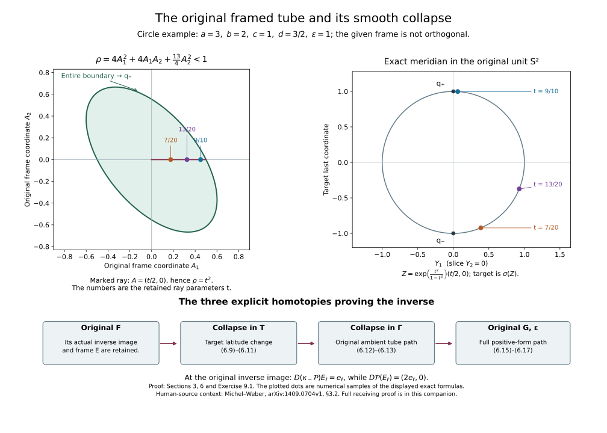

# From the original stable framing to the collapse map

Proof companion for CG-S6 lesson 7. Written by GPT-6 Astra (OpenAI), at Ultra, 10 October 2026. New exposition CC0. Ten sections prove the full original framing and collapse construction, both bordism/homotopy directions and their inverse comparisons, suspension and stable bounding, the exact original complex tangent-framing homotopy, and two complete worked exercises. The stable degree-six class and the subsequent surgery calculation are proved in the included receiving companions, culminating in the [sphere-twist and smooth-recognition proof](sphere-twists-and-the-original-smooth-six-sphere-comparison.md#twist-original-smooth-map). No independent review or novelty claim.

The receiving manifold is the original compact smooth six-manifold \(X\) of lesson 7. The included stable-framing proof supplies a specified isomorphism
\[
 \tau:TX\oplus\mathbf1_{\mathbb R}\longrightarrow
                  X\times\mathbb R^7.
 \tag{1.1}
\]
Keep this map and its inverse, rather than replacing them by a frame chosen without reference to the construction. The following formulas also cover a compact smooth \(n\)-manifold \(M\) without boundary, with a specified isomorphism
\[
 \tau:TM\oplus\mathbf1_{\mathbb R}^{\,k}
            \longrightarrow M\times\mathbb R^{n+k}.
 \tag{1.2}
\]
They will be applied with \(M=X,n=6,k=1\).

## 1. An embedding retaining the original charts

Choose finitely many original coordinate charts \((U_i,\psi_i)\), compact subsets \(K_i\subset U_i\) whose interiors cover \(M\), and smooth functions \(\chi_i\) supported in \(U_i\) and equal to one on a neighborhood of \(K_i\). Such functions are obtained from the positive smooth cutoff on two nested coordinate balls and a finite refinement of the compact cover. Extend both \(\chi_i\) and \(\chi_i\psi_i\) by zero outside \(U_i\); their supports lie in compact subsets of \(U_i\), so these extensions are smooth. Let the number of charts be \(L\) and put \(N=(n+1)L\). Define the actual map
\[
 j:M\longrightarrow\mathbb R^N,\qquad
 j(m)=\bigl(\chi_i(m),\,\chi_i(m)\psi_i(m)\bigr)_{i=1}^{L}.
 \tag{1.3}
\]
Its full derivative is
\[
 Dj_m(v)=
 \bigl(d\chi_i(v),\,
       d\chi_i(v)\psi_i(m)+\chi_i(m)D\psi_i(v)\bigr)_{i=1}^{L}.
 \tag{1.4}
\]
For each \(m\), some \(\chi_i\) is identically one near \(m\). The corresponding coordinate block of (1.4) is \(D\psi_i\), which is injective. Thus \(j\) is an immersion. If \(j(m)=j(m')\), choose such an \(i\). Equality of the first component gives \(\chi_i(m')=1\), so both points are in \(U_i\). Equality of the remaining block gives \(\psi_i(m)=\psi_i(m')\), hence \(m=m'\). The continuous injection \(j\) from compact \(M\) to the Hausdorff space \(\mathbb R^N\) is a homeomorphism onto its image. Together with the immersion property this proves that (1.3) is a smooth embedding.

Use the standard ambient Euclidean inner product solely to define the normal subbundle
\[
 \nu_m=\{y\in\mathbb R^N:\langle y,Dj_m(v)\rangle=0
                                  \text{ for every }v\in T_mM\}.
 \tag{1.5}
\]
In any one of the original coordinates write \(J\) for the \(N\)-by-\(n\) matrix of (1.4), and put
\[
 H=J^{\mathsf T}J,\qquad
 P_\nu=I_N-JH^{-1}J^{\mathsf T}.
 \tag{1.6}
\]
The matrix \(H\) is positive definite because \(J\) has full column rank. Direct multiplication shows
\[
 P_\nu^{\,2}=P_\nu,\qquad
 P_\nu J=0,\qquad
 P_\nu^{\mathsf T}=P_\nu.
 \tag{1.7}
\]
Thus (1.6) is the actual orthogonal projection onto (1.5).

The projection is independent of the chosen coordinate representation. Under the change \(J\mapsto JA\) with \(A\) invertible, its entire product becomes
\[
 JA\bigl(A^{\mathsf T}HA\bigr)^{-1}A^{\mathsf T}J^{\mathsf T}
       =JH^{-1}J^{\mathsf T}.
 \tag{1.8}
\]
Every coordinate matrix \(A\) has been retained in this comparison. Any other original metric on \(M\) continues to exist as its original matrix; (1.6) defines the particular ambient projection used in the construction and makes no identification of that metric with \(H\).

## 2. The exact map from the tangent framing to a normal framing

Stabilize the embedding by the specified zero inclusion
\[
 j':M\longrightarrow\mathbb R^{N+n+k},\qquad j'(m)=(j(m),0).
 \tag{2.1}
\]
Its actual normal bundle is \(\nu\oplus\mathbf1_{\mathbb R}^{\,n+k}\). Its rank is
\[
 r=(N-n)+(n+k)=N+k.
 \tag{2.2}
\]
For \(y\in\nu_m\) and \(u\in\mathbb R^{n+k}\), write
\[
 (v,b)=\tau_m^{-1}(u)\in T_mM\oplus\mathbb R^k.
 \tag{2.3}
\]
Define
\[
 \begin{aligned}
 \alpha_m:\nu_m\oplus\mathbb R^{n+k}&\longrightarrow
                                 \mathbb R^N\oplus\mathbb R^k,\\
 \alpha_m(y,u)&=(y+Jv,b).
 \end{aligned}
 \tag{2.4}
\]
This is a bundle isomorphism. Its full inverse, with domain
\((a,b)\in\mathbb R^N\oplus\mathbb R^k\), is
\[
 \alpha_m^{-1}(a,b)
    =\left(P_\nu a,\,
       \tau_m\bigl(H^{-1}J^{\mathsf T}a,b\bigr)\right).
 \tag{2.5}
\]
Indeed \(P_\nu a+JH^{-1}J^{\mathsf T}a=a\), so (2.4) after (2.5) is the identity. Conversely \(J^{\mathsf T}y=0\) for \(y\in\nu_m\), whence applying (2.5) to (2.4) gives
\[
 P_\nu(y+Jv)=y,\qquad
 H^{-1}J^{\mathsf T}(y+Jv)=v,\qquad
 \tau_m(v,b)=u.
 \tag{2.6}
\]
This proves the other composite exactly. Equations (1.8) and the coordinate transformation rule for \(\tau_m\) prove that (2.4)–(2.5) agree on overlapping original charts.

For each standard coordinate vector \(e_\ell\) of
\(\mathbb R^r=\mathbb R^N\oplus\mathbb R^k\), let
\[
 E_\ell(m)=\alpha_m^{-1}(e_\ell)
       \in\nu_m\oplus\mathbb R^{n+k}
       \subset\mathbb R^{N+n+k},\qquad 1\leq\ell\leq r.
 \tag{2.7}
\]
These are the ordered original normal-frame vectors produced by the tangent framing. Write \(E\) for their ambient matrix and retain its entire Gram matrix
\[
 G(m)=E(m)^{\mathsf T}E(m).
 \tag{2.8}
\]
It is positive definite. There is no orthonormal-frame substitution in (2.7).

The orientation sign can also be read without dropping the permutation. Give \(\nu\) the orientation for which \(TM\) followed by \(\nu\) has the ambient orientation. If \(\tau\) preserves the specified orientation of \(TM\oplus\mathbb R^k\), then the determinant sign of (2.4), from the ordered domain \(\nu,\,\mathbb R^{n+k}\) to the ordered target \(\mathbb R^N,\,\mathbb R^k\), is
\[
 (-1)^{n(N-n)}.
 \tag{2.9}
\]
To verify this, use (2.3) to write the domain order as \(\nu,TM,\mathbb R^k\). The target order is \(TM,\nu,\mathbb R^k\). Moving the \(n\) tangent vectors past the \(N-n\) normal vectors gives exactly (2.9); the other two maps preserve the stated orientations. If the determinant sign of \(\tau\) is negative, multiply (2.9) by that sign. For \(n=6\), the permutation factor is \(+1\) for every original \(N\). For lesson 7, (2.1) has ambient dimension \(N+7\) and the ordered normal frame has rank \(r=N+1\).

## 3. The original-radius tube and its smooth collapse

For a positive number \(\epsilon\), retain the actual ellipsoidal fiber condition
\[
 \mathcal U_\epsilon=
 \{(m,A)\in M\times\mathbb R^r:
                 \rho(m,A)=A^{\mathsf T}G(m)A<\epsilon^2\}.
 \tag{3.1}
\]
Define
\[
 \Gamma(m,A)=j'(m)+E(m)A.
 \tag{3.2}
\]
Its full derivative is
\[
 D\Gamma_{(m,A)}(v,B)
   =Dj'_m(v)+(DE_m[v])A+E(m)B.
 \tag{3.3}
\]
At \(A=0\), the first and last blocks are complementary tangent and normal subspaces. In original tangent coordinates the full inverse at the zero section is
\[
 V\longmapsto
 \left(H^{-1}(J')^{\mathsf T}V,\,
              G^{-1}E^{\mathsf T}V\right),
 \qquad J'=\begin{pmatrix}J\\0\end{pmatrix}.
 \tag{3.4}
\]
The cross-products \((J')^{\mathsf T}E\) are zero and the two diagonal Gram matrices are \(H\) and \(G\), proving (3.4). Away from the zero section the full matrix is
\[
 \bigl[J'_1+(DE[\partial_1])A,\ldots,
           J'_n+(DE[\partial_n])A,\ E\bigr],
 \tag{3.5}
\]
where the first block means the \(n\) columns specified separately in (3.3). Its inverse is the inverse of this entire matrix, including all \(DE\) terms.

There is a single positive tube bound for which \(\Gamma\) is a diffeomorphism onto its open image. First, compactness and the invertible zero-section derivative give a neighborhood of the entire zero section on which the derivative is invertible. The least eigenvalue of \(G\) has a positive lower bound, so a sufficiently small normal-radius bound places the whole tube in that neighborhood. If global injectivity failed for every such bound, choose distinct pairs \((m_j,A_j),(m'_j,A'_j)\) with equal images and both original normal lengths tending to zero. Compactness gives a subsequence with limits \(m,m'\). Equality of images then implies \(j'(m)=j'(m')\), hence \(m=m'\). Both pairs converge to \((m,0)\), contradicting the local inverse-function theorem there. Thus a sufficiently small single bound gives injectivity. A bijective local diffeomorphism onto its image has the smooth local inverses as its global inverse. Choose the retained \(\epsilon\) so that \(2\epsilon\) is less than this proved bound. Then \(\Gamma\) is a diffeomorphism on the larger tube \(\mathcal U_{2\epsilon}\) as well as on (3.1). These larger-tube coordinates remain valid across the actual collapse boundary \(\rho=\epsilon^2\).

Regard \(S^{N+n+k}\) as the one-point compactification of the actual ambient coordinate space in (2.1). Write \(\infty\) for the added basepoint. In the target unit sphere \(S^r\subset\mathbb R^{r+1}\), retain the two specified points
\[
 q_-=(0,-1),\qquad q_+=(0,1)
 \tag{3.6}
\]
and the exact inverse stereographic coordinate map
\[
 \sigma(Z)=
 \left(\frac{2Z}{1+Z^{\mathsf T}Z},
       \frac{Z^{\mathsf T}Z-1}{1+Z^{\mathsf T}Z}\right).
 \tag{3.7}
\]
For \(\rho<\epsilon^2\), put
\[
 \lambda(\rho)=\exp\!\left(\frac{\rho}{\epsilon^2-\rho}\right),
 \qquad Z(m,A)=\lambda(\rho(m,A))A.
 \tag{3.8}
\]
The collapse map with all its original fiber data is
\[
 \mathcal P:S^{N+n+k}\longrightarrow S^r,\qquad
 \mathcal P(\Gamma(m,A))=\sigma(Z(m,A)),\qquad
 \mathcal P=q_+\ \hbox{outside }\Gamma(\mathcal U_\epsilon).
 \tag{3.9}
\]
In particular \(\mathcal P(\infty)=q_+\). This is a smooth based map.

Here are the boundary and regular-value verifications. In the target chart centered at \(q_+\), (3.7) has coordinate
\[
 \frac{Z}{Z^{\mathsf T}Z}
  =\exp\!\left(-\frac{\rho}{\epsilon^2-\rho}\right)
                   \frac{A}{A^{\mathsf T}A}.
 \tag{3.10}
\]
Near the tube boundary \(\rho=\epsilon^2\), the vector \(A\) is bounded away from zero, since the largest eigenvalue of \(G\) is uniformly bounded above. The exponential in (3.10) is
\[
 \exp(1)\exp\!\left(-\frac{\epsilon^2}{\epsilon^2-\rho}\right).
 \tag{3.11}
\]
Every derivative of (3.11) is a finite sum of a polynomial in
\((\epsilon^2-\rho)^{-1}\), derivatives of \(\rho\), and the same exponentially decaying factor. It tends to zero faster than every power of \(\epsilon^2-\rho\). Multiplication by the smooth bounded local derivatives of \(A/(A^{\mathsf T}A)\) therefore gives a smooth zero extension of (3.10) across the boundary. The map is constant on a neighborhood of the ambient basepoint because the closed tube is contained in a bounded set. These facts prove smoothness of (3.9) everywhere.

The full differential inside the tube is retained as follows:
\[
\begin{aligned}
 d\rho&=2A^{\mathsf T}G\,dA+A^{\mathsf T}(dG)A,\\
 dZ&=\lambda(\rho)\left(dA+
               \frac{\epsilon^2}{(\epsilon^2-\rho)^2}A\,d\rho\right),\\
 D\sigma_Z(B)&=
 \left(\frac{2B}{1+Z^{\mathsf T}Z}
      -\frac{4Z(Z^{\mathsf T}B)}{(1+Z^{\mathsf T}Z)^2},
       \frac{4Z^{\mathsf T}B}{(1+Z^{\mathsf T}Z)^2}\right),\\
 D\mathcal P&=D\sigma_Z\circ DZ\circ(D\Gamma)^{-1}.
\end{aligned}
\tag{3.12}
\]
Thus the original Gram matrix, its derivatives, the original tube radius and every off-zero derivative of \(E\) remain present.

The inverse image of \(q_-\) is exactly \(j'(M)\): inside the tube, (3.7) equals \(q_-\) exactly when \(Z=0\), equivalently \(A=0\); outside the tube its value is the different point \(q_+\). At the zero section, \(\lambda(0)=1\) and \(dZ=dA\). In the target chart
\[
 \kappa_-(Y,t)=\frac{Y}{1-t},
 \tag{3.13}
\]
we have \(\kappa_-\sigma(Z)=Z\). Therefore
\[
 D(\kappa_-\mathcal P)_{j'(m)}E_\ell(m)=e_\ell,\qquad
 \ker D(\kappa_-\mathcal P)_{j'(m)}=Dj'_m(T_mM).
 \tag{3.14}
\]
This proves that \(q_-\) is a regular value and that its ordered inverse-image normal framing is exactly (2.7). In the ambient target tangent coordinates the derivative is \(2e_\ell\), since \(D\sigma_0(B)=(2B,0)\); the target frame used by (3.13) is correspondingly \((2e_\ell,0)\). The factor two has not been removed.

For an explicit comparison with the usual boundary orientation on the target unit sphere, put its outward normal first. At the south pole the determinant of that ordered ambient frame is
\[
 \det\bigl[q_-,(2e_1,0),\ldots,(2e_r,0)\bigr]
                       =(-1)^{r+1}2^r.
 \tag{3.15}
\]
The last-coordinate vector moves past all \(r\) tangent vectors and has its own negative sign, which proves the formula. Thus the target coordinate frame used throughout has sign \((-1)^{r+1}\) relative to that boundary orientation. All inverse-image frames here use the specified \(\kappa_-\) coordinate frame; (3.15) is the exact orientation conversion whenever the outward-normal-first sphere convention is invoked.

These constructions give the required exact map from the original stable tangent framing to a smooth sphere map with its prescribed regular framed inverse image.

## 4. An actual framed bordism gives an actual based homotopy

Fix \(D=n+r\). An embedded framed bordism for the present construction consists of a compact smooth \((n+1)\)-manifold
\[
 W\subset\mathbb R^D\times[0,1]
 \tag{4.1}
\]
with a specified ordered normal frame \(E_W\) of rank \(r\), and specified product collars at both ends. In those collars its embedding and frame are exactly
\[
 (m,t)\longmapsto(j_i(m),t),\qquad
 E_W(m,t)=\begin{pmatrix}E_i(m)\\0\end{pmatrix},
 \quad i=0,1.
 \tag{4.2}
\]
There are no other intersections with the boundary of the cylinder. Each \(j_i\) is an embedding of the corresponding compact \(n\)-manifold, and \(E_i\) is its original ordered normal frame.

The smooth tube proof of Section 3 applies to \(W\), with the boundary handled by the exact product coordinates (4.2). In particular, there is an actual tube
\[
 \Gamma_W(w,A)=w+E_W(w)A,\qquad
 \rho_W(w,A)=A^{\mathsf T}G_W(w)A,\qquad
 G_W=E_W^{\mathsf T}E_W,
 \tag{4.3}
\]
that is injective with invertible derivative on a fixed larger-radius neighborhood. It can be chosen inside \(\mathbb R^D\times[0,1]\). To check the latter point, choose smaller product collars first. In these collars the last component of \(E_W\) is zero, so the normal displacement leaves \(t\) unchanged. The rest of \(W\) is compact and has positive distance from both boundary hyperplanes. Choose the normal-radius bound smaller than that distance. The displacement has Euclidean length \(\sqrt{\rho_W}\), so it cannot cross either boundary there.

Choose one positive \(\epsilon\) strictly inside that tube bound, retaining a larger valid tube of radius \(2\epsilon\). Replace \((\Gamma,\rho)\) by \((\Gamma_W,\rho_W)\) in (3.8)–(3.10), and set the map equal to \(q_+\) outside the smaller tube. This gives a smooth map on the original cylinder
\[
 \mathcal P_W:\mathbb R^D\times[0,1]\longrightarrow S^r.
 \tag{4.4}
\]
The flatness calculation (3.10)–(3.11) proves its smoothness across the tube boundary; the larger tube gives the actual boundary coordinates required by that calculation.

Since \(W\) is compact, the projection of the closed tube to \(\mathbb R^D\) is bounded. Consequently (4.4) is equal to \(q_+\) outside a single compact set in the spatial variables, uniformly for all \(t\). It therefore extends to a based homotopy
\[
 \mathcal H:S^D\times[0,1]\longrightarrow S^r,\qquad
 \mathcal H(\infty,t)=q_+.
 \tag{4.5}
\]
The endpoint restrictions are exactly the collapse maps for \((j_0,E_0)\) and \((j_1,E_1)\) with the same displayed radius \(\epsilon\), because (4.2) identifies all their tube coordinates and Gram matrices.

If the originally specified endpoint maps have radii \(\epsilon_0,\epsilon_1\), first choose the common \(\epsilon\) with
\[
 0<\epsilon\leq\min(\epsilon_0,\epsilon_1).
 \tag{4.6}
\]
For each endpoint, interpolate from \(\epsilon_i\) to \(\epsilon\) inside the interval between those two actual positive values, using a smooth parameter function constant near its endpoints. Every tube used is contained in the original valid endpoint tube, since its radius is at most \(\epsilon_i\). Formula (3.9) with this varying radius is jointly smooth by the same flatness argument and gives a based homotopy of endpoint collapse maps. Its full interior derivative includes the extra radius term:
\[
 dZ=\lambda(\rho)\left[
 dA+
 A\left(
 \frac{\epsilon^2}{(\epsilon^2-\rho)^2}\,d\rho
 -\frac{2\epsilon\rho}{(\epsilon^2-\rho)^2}\,d\epsilon
 \right)\right].
 \tag{4.7}
\]
Here \(\epsilon\) denotes the actual varying radius at that parameter value, and \(d\rho\) is the entire expression in (3.12). Thus neither original endpoint radius has been replaced without its explicit comparison. Concatenate these two endpoint-radius homotopies with (4.5), using parameter functions constant near the concatenation points. This gives a smooth based homotopy between the originally specified endpoint maps.

For orientation, orient the ambient cylinder by
\[
 dt\wedge dx_1\wedge\cdots\wedge dx_D
   =(-1)^D\,dx_1\wedge\cdots\wedge dx_D\wedge dt.
 \tag{4.8}
\]
The sign in this comparison retains the displayed spatial-then-time coordinates of (4.1). Orient a regular inverse image by placing its tangent vectors before the specified target normal-frame vectors. Near an end, the order \((\partial_t,TM_i,E_i)\) agrees with (4.8) when \((TM_i,E_i)\) has the original spatial orientation. Thus \(W\) has orientation \(dt\) followed by the original orientation of \(M_i\) on each collar. The outward-normal-first boundary convention consequently gives
\[
 \partial W=(-M_0)\ \sqcup\ M_1.
 \tag{4.9}
\]
At \(t=0\), the outward normal is \(-\partial_t\), giving the first sign; at \(t=1\), it is \(+\partial_t\), giving the second. The regular-value calculation (3.14) on the whole tube also shows that the inverse-image normal frame of (4.4) is exactly \(E_W\), including the target tangent factor two. This completes the direction from the given embedded framed bordism to the given based sphere homotopy.

The reverse construction follows. The endpoint germs in (4.2), including their full normal frames, will be retained.

## 5. The relative regular-value construction and its exact frame

Let \(D=n+r\), with \(r\geq1\). A based map here sends the specified \(\infty\in S^D=(\mathbb R^D)^+\) to the specified \(q_+\in S^r\). We first justify passage between continuous homotopies and smooth maps that are constant near the basepoint.

For a continuous based homotopy \(F:S^D\times[0,1]\to S^r\), compactness of its basepoint line gives one neighborhood \(U\) of \(\infty\) whose entire image is in the target chart
\[
 \kappa_+(Y,t)=\frac{Y}{1+t}.
 \tag{5.1}
\]
Choose a smooth spatial cutoff \(\chi\) equal to zero on a smaller neighborhood of \(\infty\) and equal to one outside \(U\). Within \(U\), replace the original coordinate \(w=\kappa_+F\) by
\[
 w_s=\bigl(1-s+s\chi\bigr)w,\qquad 0\leq s\leq1.
 \tag{5.2}
\]
Outside \(U\) retain \(F\). These maps agree wherever \(\chi=1\), give a continuous based homotopy, and at \(s=1\) are constant on a whole spatial neighborhood of the basepoint. The target chart is all of \(\mathbb R^r\), so no coordinate-domain condition is lost by this multiplication. If the original endpoint maps are already constant on basepoint neighborhoods, choose \(U\) inside both of those neighborhoods. Then (5.2) leaves both endpoint maps fixed. For smooth input the full coordinate derivative is
\[
 dw_s=(1-s+s\chi)\,dw+
            w\bigl(s\,d\chi+(\chi-1)\,ds\bigr).
 \tag{5.3}
\]

Reparametrize the original homotopy parameter by a smooth function that is zero near zero and one near one. The endpoint maps then occupy exact product collars. Smooth approximation relative these collars and the constant basepoint neighborhood has the following direct construction. Regard the target sphere as its original unit sphere in \(\mathbb R^{r+1}\). On the compact source choose a finite cover on which the oscillation of \(F\) is less than \(\eta\), a subordinate smooth partition \(\psi_i\), and points \(p_i\) in those sets. The Euclidean-valued map \(F_0=\sum_i\psi_i F(p_i)\) is smooth and satisfies \(\|F_0-F\|<\eta\). A cutoff \(\zeta\), equal to one on the prescribed smaller collars and supported where \(F\) is already smooth, gives
\[
 \widetilde F=\zeta F+(1-\zeta)F_0,\qquad
 F^{\mathrm{sm}}=\frac{\widetilde F}
                       {\sqrt{\widetilde F^{\mathsf T}\widetilde F}}.
 \tag{5.4}
\]
Take \(\eta<1/2\). Every vector on the straight segment from \(F\) to \(\widetilde F\) then has length at least \(1-\eta>0\). Applying the displayed radial retraction to that whole segment gives the required relative homotopy. Its derivative at a nonzero vector \(v\), applied to \(b\), is
\[
 D\mathfrak r_v(b)=\frac{b}{\sqrt{v^{\mathsf T}v}}
       -\frac{v(v^{\mathsf T}b)}{(v^{\mathsf T}v)^{3/2}}.
 \tag{5.5}
\]
The construction works on boundary charts as well, since smooth partitions on a manifold with boundary can be obtained by restricting partitions on its doubled collar charts. Thus smooth based representatives constant near \(\infty\), and smooth based homotopies constant on endpoint collars, calculate the original continuous based homotopy classes. The norm factors in (5.4)–(5.5) belong to the explicit retraction; no original sphere radius or input map is silently replaced.

We now arrange regularity at the *specified* point \(q_-\). This keeps the target point and its frame, rather than substituting a nearby regular value. The following argument applies either to a single smooth map on \(S^D\) or to a smooth homotopy on \(S^D\times[0,1]\). In the latter case suppose that \(q_-\) is already regular for the two endpoint maps, which are constant in their time collars.

On the open set where \(F\ne q_+\), put \(Q=\kappa_-F\). Choose a smooth target cutoff \(\psi(Q)\) with compact support, equal to one near \(Q=0\). Choose a smooth source cutoff \(\beta\), zero on the prescribed endpoint and basepoint neighborhoods and positive at every other possible nonregular inverse image of \(q_-\). It may be chosen zero only in slightly smaller fixed collars and the basepoint neighborhood; on their transition regions the original endpoint regularity or the absence of \(q_-\) already holds. For \(a\) in a sufficiently small open ball in \(\mathbb R^r\), set
\[
 Q_a(p)=Q(p)+\beta(p)\psi(Q(p))a,\qquad
 F_a(p)=\sigma(Q_a(p)).
 \tag{5.6}
\]
Outside the support of the target cutoff use \(F_a=F\). Compact support in the target coordinate chart proves smooth pasting across its excluded point \(q_+\). The same formula with \(sa\) gives a homotopy fixed on all the prescribed neighborhoods. The full derivative is
\[
 dQ_a=
 \bigl[I_r+\beta\,a\otimes D\psi_Q\bigr]\,dQ
       +\psi(Q)\,a\,d\beta+\beta\psi(Q)\,da.
 \tag{5.7}
\]

At a zero of \(Q_a\), either \(\beta\psi(Q)\ne0\), in which case the parameter derivative in (5.7) is onto, or \(\beta\psi(Q)=0\). In the second case \(Q_a=Q=0\), hence \(\psi(Q)=1\), and \(\beta=0\). Here the original map is regular and \(d\beta=0\), since the nonnegative smooth \(\beta\) is zero there. Thus the source derivative is onto. The universal zero set of (5.6) is consequently a smooth manifold. Apply Sard's theorem to its projection to the parameter ball. A parameter outside the critical values gives a regular inverse image for \(F_a\). To see the exact linear implication, its tangent space is
\[
 \{(v,b):D_pQ_a(v)+\beta\psi(Q)b=0\}.
 \tag{5.8}
\]
If the parameter projection from (5.8) is onto, subtracting a tangent lift of each parameter vector from an arbitrary universal lift proves that \(D_pQ_a\) is onto. Conversely, if \(D_pQ_a\) is onto, it solves (5.8) for every \(b\), proving that projection is onto. The already fixed boundary collars require no perturbation. A countable interior chart cover suffices for Sard; there are only the two boundary strata, on which regularity was retained. This proves the asserted relative regularity. The use of Sard is the same foundational smooth-analysis input as in the included relative Morse proof, Section 1; the parameter and endpoint comparisons here are proved explicitly.

Let first \(F:S^D\to S^r\) be one such transverse map. Its inverse image
\[
 M_F=F^{-1}(q_-)\subset\mathbb R^D
 \tag{5.9}
\]
is a compact smooth \(n\)-manifold. Compactness follows in \(S^D\), and the inverse image is disjoint from a whole basepoint neighborhood. At \(x\in M_F\), retain the actual \(r\)-by-\(D\) matrix
\[
 L_x=D(\kappa_-F)_x.
 \tag{5.10}
\]
It has full row rank. The ordered inverse-image normal frame is the matrix
\[
 E_F=L^{\mathsf T}(LL^{\mathsf T})^{-1}.
 \tag{5.11}
\]
Indeed \(LE_F=I_r\), every column lies in \((\ker L)^\perp\), and that orthogonal complement has dimension \(r\). Hence (5.11) is exactly the inverse of \(L\) on the Euclidean normal bundle. Its full Gram matrix and the normal projection are
\[
 G_F=E_F^{\mathsf T}E_F=(LL^{\mathsf T})^{-1},
 \qquad
 P_F=E_FL=L^{\mathsf T}(LL^{\mathsf T})^{-1}L.
 \tag{5.12}
\]
Matrix multiplication gives \(P_F^2=P_F=P_F^{\mathsf T}\). Smoothness follows from the everywhere invertible \(LL^{\mathsf T}\). In the target's ambient tangent coordinates the original frame is \((2e_\ell,0)\), so \(DF(E_{F,\ell})=(2e_\ell,0)\), retaining the factor in Section 3.

For a transverse homotopy \(\mathcal H\), the same construction gives
\[
 W=\mathcal H^{-1}(q_-)\subset\mathbb R^D\times[0,1],
 \qquad
 L_W=\bigl[D_x(\kappa_-\mathcal H)\ \ 
                    \partial_t(\kappa_-\mathcal H)\bigr],
 \qquad
 E_W=L_W^{\mathsf T}(L_WL_W^{\mathsf T})^{-1}.
 \tag{5.13}
\]
The compactness argument is uniform along the entire basepoint line. On each endpoint collar the last column of \(L_W\) is zero, so (5.13) is exactly \((E_{F_i},0)^{\mathsf T}\). Its inverse image is exactly \(M_{F_i}\times[0,\delta_i)\), or the corresponding upper collar. Thus \(W\) has precisely the product collars (4.2), and the orientation computation (4.8)–(4.9) applies without any new sign choice.

In particular, if the endpoints are the original collapse maps of Section 3, their recovered endpoint frames are the original \(E_i\): both (5.11) and \(E_i\) lie in the normal bundle and are right inverses to the same \(L_i\), whose restriction to that bundle is an isomorphism. This proves equality of the matrices, not only equality up to a change of frame. A based homotopy between the original collapse maps therefore gives an actual embedded framed bordism with exactly those endpoint frames.

## 6. A transverse map is homotopic to the collapse of its own inverse image

Keep the actual \(F,M_F,E_F,G_F\) of Section 5; write them \(F,M,E,G\) within this section. Choose an original valid linear tube
\[
 \Gamma(m,A)=j(m)+E(m)A
 \tag{6.1}
\]
as in Section 3, where now \(j\) is the actual inclusion of \(M=F^{-1}(q_-)\) in \(\mathbb R^D\). Retain any specified collapse radius \(\epsilon\) with a larger valid tube. We construct a homotopy to that particular collapse.

Near the zero section define the full coordinate function
\[
 \Phi(m,A)=\kappa_-F(\Gamma(m,A)).
 \tag{6.2}
\]
It satisfies \(\Phi(m,0)=0\), \(D_A\Phi(m,0)=I_r\), and \(D_m\Phi(m,0)=0\). Compactness permits a single \(b>0\) such that (6.2) is defined for \(\|A\|<2b\) and
\[
 \|D_A\Phi(m,A)-I_r\|<\tfrac12
       \quad\hbox{for every }m,\ \|A\|\leq b.
 \tag{6.3}
\]
In particular \(\|\Phi(m,A)-A\|\leq\|A\|/2\). For each \(\|z\|<b/2\), the iteration of
\[
 A\longmapsto z-\bigl(\Phi(m,A)-A\bigr)
 \tag{6.4}
\]
maps the closed ball \(\|A\|\leq b\) to itself and is a contraction with ratio less than \(1/2\). Its geometric difference estimate proves existence and uniqueness of a fixed point \(a(m,z)\), with \(\|a(m,z)\|\leq2\|z\|<b\). The inverse function theorem then proves smooth dependence on \(m,z\). On overlapping original charts these solutions agree by uniqueness. Their exact derivatives are
\[
 D_za=(D_A\Phi)^{-1},\qquad
 D_ma=-(D_A\Phi)^{-1}D_m\Phi,
 \tag{6.5}
\]
evaluated at \((m,a(m,z))\). Define
\[
 T(m,z)=\Gamma(m,a(m,z)).
 \tag{6.6}
\]
This is an actual tube with \(F(T(m,z))=\sigma(z)\), \(T(m,0)=j(m)\), \(D_zT(m,0)=E(m)\). Its full derivative, before restricting to the zero section, is
\[
 DT(v,B)=Jv+(DE[v])a+
             E(D_A\Phi)^{-1}\bigl(B-D_m\Phi(v)\bigr).
 \tag{6.7}
\]
No derivative of the original frame or of \(F\) is discarded.

For a sufficiently small \(\delta>0\), the *entire* inverse image of the target ball \(\sigma(B_\delta^r)\) is \(T(M\times B_\delta^r)\). To prove the assertion globally, take the complement in the compact sphere \(S^D\) of \(\Gamma(M\times B_{b/2}^r)\). It is compact and contains no inverse image of \(q_-\). Its image under \(F\) therefore has a positive distance from \(q_-\). Choose \(\delta<b/4\) so that the closure of \(\sigma(B_\delta^r)\) misses that image. Every inverse image then has \(\|A\|<b/2\), and the uniqueness in (6.4) identifies it with (6.6). Conversely every point of (6.6) has the required image by its defining equation. This proves both inclusions, including exclusion of extra components.

Here is an explicit target homotopy that discards only values outside that ball and retains the derivative at \(q_-\). Parameterize the original unit target sphere by
\[
 (Y,t)=(\sin\theta\,u,-\cos\theta),\quad
       0\leq\theta\leq\pi,\quad u\in S^{r-1},\qquad
 z=\tan(\theta/2)u.
 \tag{6.8}
\]
At the two poles the value is independent of \(u\). Set \(\theta_\delta=2\arctan\delta\), and define
\[
 B_\delta(\theta)=
 \begin{cases}
 2\arctan\!\left[
 \tan(\theta/2)
 \exp\!\left(\dfrac{\tan^2(\theta/2)}
                   {\delta^2-\tan^2(\theta/2)}\right)\right],
                                  &0\leq\theta<\theta_\delta,\\
 \pi,                            &\theta_\delta\leq\theta\leq\pi.
 \end{cases}
 \tag{6.9}
\]
The difference \(\pi-B_\delta\) is smooth and flat at \(\theta_\delta\): use
\( \pi-2\arctan v=2\arctan(v^{-1})\) for \(v>0\) and the exponential estimate (3.11). Near zero \(B_\delta\) is a smooth odd function of \(\theta\), with derivative one; near \(\pi\) it is constant. Thus
\[
 \theta_s=(1-s)\theta+sB_\delta(\theta),\qquad
 c_s(\sin\theta\,u,-\cos\theta)
                =(\sin\theta_s\,u,-\cos\theta_s)
 \tag{6.10}
\]
defines a jointly smooth based homotopy, including both poles. More explicitly near zero, \(\sin\theta_s/\sin\theta\) is a smooth function of \(\theta^2\), and \(\cos\theta_s\) is smooth in \(\theta^2\); near the other pole use \(v=\pi-\theta\) and
\(\pi-\theta_s=(1-s)v\). These expressions prove smoothness in the original Cartesian sphere charts, also for \(r=1\).

We have \(c_0=1\), and in the chart (3.13),
\[
 c_1(\sigma(z))=
 \begin{cases}
 \sigma\!\left(\exp\!\left(\dfrac{z^{\mathsf T}z}
                                  {\delta^2-z^{\mathsf T}z}\right)z\right),
                                           &\|z\|<\delta,\\
 q_+,                                      &\|z\|\geq\delta.
 \end{cases}
 \tag{6.11}
\]
At every time, the only inverse image of \(q_-\) under \(c_s\) is \(q_-\), and its derivative in the original \(z\)-coordinates is \(I_r\). Consequently \(c_sF\) keeps the exact inverse-image frame \(E\). At \(s=1\), (6.11) and the proved global inverse-image equality show that \(c_1F\) is precisely the collapse constructed in the curved tube \(T\) with the displayed coordinate radius \(\delta\).

Next compare that tube to the original linear tube, retaining the frame throughout. In the actual ambient coordinate space define
\[
 T_s(m,z)=(1-s)T(m,z)+s\Gamma(m,z),\quad 0\leq s\leq1.
 \tag{6.12}
\]
At \(z=0\) its value is \(j(m)\) and its derivative is \([J,E]\), independently of \(s\). These matrices are invertible. Compactness of \(M\times[0,1]\), the local inverse function theorem with parameter, and the collision-sequence argument of Section 3 give one radius on which *every* \(T_s\) is a tube. In that last argument a putative sequence of collisions also has a convergent parameter subsequence \(s_\nu\to s_*\); the parameter-dependent local inverse at \((m,0,s_*)\) contradicts the collisions. Reduce \(\delta\), if needed, so that all \(T_s\) are valid on \(M\times B_{2\delta}^r\). This reduction is made before (6.9) is used. Formula (6.11) in the coordinates \(T_s\), extended by \(q_+\), is now a smooth based homotopy of collapse maps. Smoothness with parameter at its boundary follows from the larger tubes and the same flat exponential. Its full tube differential is
\[
 dT_s=(1-s)\,DT+s\,D\Gamma+(\Gamma-T)\,ds.
 \tag{6.13}
\]
Every endpoint and every frame derivative in (6.7), (6.13) remains part of this comparison.

Finally compare the coordinate ball to the original ellipsoid. Make the preceding \(\delta\) still smaller so that
\[
 \delta^2\max_{m\in M}\lambda_{\max}(G(m))\leq\epsilon^2.
 \tag{6.14}
\]
In the fixed original tube (6.1), put
\[
 B_s(m)=(1-s)\frac{I_r}{\delta^2}
                         +s\frac{G(m)}{\epsilon^2},
 \qquad q_s(m,A)=A^{\mathsf T}B_s(m)A.
 \tag{6.15}
\]
Every \(B_s\) is positive definite. Condition (6.14) implies
\(B_s\geq G/\epsilon^2\), so \(q_s<1\) stays inside the original valid \(\epsilon\)-tube. Use
\[
 Z_s=\exp\!\left(\frac{q_s}{1-q_s}\right)A
       \quad(q_s<1),\qquad \mathcal P_s=q_+\quad(q_s\geq1),
 \tag{6.16}
\]
with \(\mathcal P_s(\Gamma(m,A))=\sigma(Z_s)\) on the first region. This is jointly smooth by flatness, with uniform positive eigenvalue bounds for \(B_s\). It begins at the linear coordinate-ball collapse and ends at exactly (3.8)–(3.9) with the original \(G,\epsilon\). The complete differentials are
\[
 \begin{aligned}
 dq_s&=2A^{\mathsf T}B_s\,dA+A^{\mathsf T}(dB_s)A,\\
 dB_s&=\frac{s}{\epsilon^2}\,dG+
             \left(\frac{G}{\epsilon^2}
                         -\frac{I_r}{\delta^2}\right)ds,\\
 dZ_s&=\exp\!\left(\frac{q_s}{1-q_s}\right)
               \left(dA+\frac{A\,dq_s}{(1-q_s)^2}\right).
 \end{aligned}
 \tag{6.17}
\]
The original \(\epsilon,\delta\) are fixed in this interpolation; their separate radius variation, when required, is exactly (4.7). Equations (6.15)–(6.17) are the proved comparison between the two fiber domains and their full formulas.

Concatenate (6.10), (6.12) and (6.16), using smooth parameter functions constant near the joins. This proves that the original transverse map \(F\) is based homotopic to the collapse of its own actual framed inverse image, with its originally specified linear tube and radius.

If \(M\) is empty, compactness gives a target ball about \(q_-\) missed by all of \(F\). Then (6.10) makes \(F\) constant at \(q_+\), and the collapse of the empty manifold is that same constant map. This includes the empty case of the inverse assertion.

## 7. The two constructions are inverse in each stated ambient dimension

Let \(\mathcal B_{n,r}\) denote the set of compact smooth \(n\)-submanifolds without boundary in \(\mathbb R^{n+r}\), each with an ordered Euclidean normal frame of rank \(r\), modulo the embedded framed bordisms of (4.1)–(4.2). Reparametrizing product collars allows smooth concatenation of two bordisms; the constant cylinder supplies reflexivity. Reversing the height parameter and transporting its full normal vectors by \((x,t)\mapsto(x,1-t)\) supplies symmetry. Thus this is an equivalence relation. The induced boundary orientation is always the one calculated in (4.8)–(4.9).

The collapse construction and the regular-inverse-image construction give mutually inverse maps
\[
 \mathcal B_{n,r}\ \underset{\mathcal R}{\overset{\mathcal P}{\rightleftarrows}}\
                  [S^{n+r},S^r]_* ,\qquad r\geq1.
 \tag{7.1}
\]
Here the bracket denotes continuous based homotopy classes with the specified basepoints, and the normal frame in \(\mathcal R\) is exactly (5.11). We verify every choice and composite.

For \(\mathcal P\), two valid collapse radii give homotopic maps by (4.7). A framed bordism gives a based homotopy by Section 4. The linear tube is determined by the given embedding and full normal frame; the construction makes no additional choice of orthonormal frame. Hence \(\mathcal P\) is well-defined.

For \(\mathcal R\), equations (5.1)–(5.8) give a smooth transverse representative of any based class. Two such representatives of one class have a continuous based homotopy. Apply (5.2)–(5.5) relative its smooth endpoint collars, and then (5.6)–(5.8) relative those collars. The inverse image (5.13) is an embedded framed bordism with precisely their frames (5.11). Thus both approximation and transverse-parameter choices give the same element of \(\mathcal B_{n,r}\), and \(\mathcal R\) is well-defined.

The composite \(\mathcal R\mathcal P\) recovers the original submanifold as a set and as an embedded smooth manifold, and recovers every original frame vector by (3.14) and the uniqueness after (5.13). Therefore this composite is the identity. The other composite is the identity by the three explicit homotopies of Section 6. This proves (7.1).

The based null-homotopy case will be used directly later. If the collapse of a particular original \((M,E)\) is null-homotopic, Section 5 applied to a homotopy to the constant \(q_+\) map gives a compact embedded \((n+1)\)-manifold with one boundary component, whose normal frame extends exactly \(E\). Conversely such a framed bounding manifold gives a null-homotopy by Section 4 with an empty upper endpoint. This statement retains the original boundary embedding, collar and frame; it does not infer a bounding manifold merely from stable parallelizability.

## 8. Suspension, stable bounding and the original complex tangent framing

We specify the suspension coordinates before identifying its inverse image. The one-point compactification of a product has the exact based homeomorphism
\[
 (\mathbb R^D\times\mathbb R)^+
       \longrightarrow(\mathbb R^D)^+\wedge\mathbb R^+.
 \tag{8.1}
\]
It takes each finite \((x,u)\) to its two classes and takes the added point to the collapsed wedge. The quotient of the compact product on the right by its closed wedge is compact Hausdorff; its complement is exactly \(\mathbb R^D\times\mathbb R\). The displayed bijection is continuous, including the added point because complements of neighborhoods there are compact subsets of that complement. This proves (8.1) as a homeomorphism. The order of the new coordinate is spatial \(x\), then \(u\).

Identify the target \((\mathbb R^r)^+\) with the original unit \(S^r\) by \(\sigma\). For a based map \(F\), its reduced suspension, in (8.1), is represented by
\[
 \widehat{\Sigma F}(x,u)=
 \begin{cases}
 \sigma_{r+1}\bigl(Q(x),u\bigr),&
          F(x)\ne q_+,\quad Q=\kappa_-F,\\
 q_+,&F(x)=q_+,
 \end{cases}
 \qquad
 \widehat{\Sigma F}(\infty)=q_+.
 \tag{8.2}
\]
Here \(\sigma_{r+1}\) is the full formula (3.7) in \(r+1\) coordinates; in particular its denominator is
\(1+Q^{\mathsf T}Q+u^2\). Formula (8.2) is the smash of the given \(F\) and the identity of \(\mathbb R^+\), so it represents the original suspension homomorphism, with no coordinate permutation.

It is also useful to check continuity and finite-coordinate smoothness directly. As \(F(x)\to q_+\) through the other chart, \(\|Q\|\to\infty\). As \(|u|\to\infty\), the last coordinate already forces \(\|(Q,u)\|\to\infty\). For any fixed bound on \(\|Q\|\), its possible source points form a compact set away from the based point, since \(F(\infty)=q_+\). These observations prove continuity at the collapsed points and at infinity. Near a finite point with \(F(x)=q_+\), use the actual \(w=\kappa_+F(x)\). The target north-chart coordinate of (8.2) is exactly
\[
 \left(\frac{w}{1+u^2w^{\mathsf T}w},
       \frac{u\,w^{\mathsf T}w}{1+u^2w^{\mathsf T}w}\right).
 \tag{8.3}
\]
The denominator is at least one. This proves smoothness across \(w=0\). For example with \(v=w^{\mathsf T}w\), \(a=1+u^2v\), the full differential is
\[
 dv=2w^{\mathsf T}dw,\quad da=2uv\,du+u^2\,dv,\quad
 d(8.3)=
 \left(\frac{dw}{a}-\frac{w\,da}{a^2},
       \frac{v\,du+u\,dv}{a}-\frac{uv\,da}{a^2}\right).
 \tag{8.4}
\]
At the source point at infinity only continuity is required for the suspension class. The relative procedure (5.2)–(5.5) makes a smooth representative constant near that point while leaving the whole regular-inverse-image neighborhood unchanged.

For transverse \(F\), the inverse image of the target's specified south pole under (8.2) is exactly \(M_F\times\{0\}\). In its target south coordinates the derivative is
\[
 \begin{pmatrix}L&0\\0&1\end{pmatrix}.
 \tag{8.5}
\]
Consequently the recovered original normal frame, Gram matrix and linear-tube squared length are
\[
 E^+=
 \begin{pmatrix}E&0\\0&1\end{pmatrix},\qquad
 G^+=\begin{pmatrix}G&0\\0&1\end{pmatrix},\qquad
 \rho^+(m,A,u)=A^{\mathsf T}G(m)A+u^2.
 \tag{8.6}
\]
This keeps the old \(G\) and appends the specified unit coordinate. The ambient tangent target factor is again two for every coordinate. The frame order is \(E_1,\ldots,E_r,e_u\); the source orientation order is the old spatial orientation followed by \(u\), so no permutation sign occurs here. Applying Section 6 to the smoothed (8.2) proves that it is homotopic to the collapse with this exact frame and any specified valid radius. In particular (7.1) commutes with suspension and the geometric operation (8.6).

Define the stable group in degree \(n\geq0\) by the directed limit
\[
 \pi_n^{\,S}=\underset{r\longrightarrow\infty}{\operatorname{colim}}\,
                   \pi_{n+r}(S^r),
 \tag{8.7}
\]
where the transition maps are precisely (8.2). One may begin with \(r\geq2\), where the homotopy groups in this limit are abelian; dropping finitely many initial terms changes no directed limit. We use no stable-range theorem to replace this limit by a particular finite term. A class represented at rank \(r\) equals zero in (8.7) exactly when its image after some finite number \(s\geq0\) of these transitions is zero. This follows from the definition of the directed-limit equivalence: representatives \(a_r,b_t\) are equivalent precisely when their images agree at some common finite stage. The usual group law is compatible with these transitions because the two hemispheres defining addition suspend to the corresponding two pieces of the suspended source; the common boundary still maps to the basepoint.

Combining that definition with (7.1), (8.5) and (8.6) proves the exact geometric assertion needed here:
\[
 \begin{gathered}
 \bigl[\mathcal P(M,E)\bigr]=0\text{ in }\pi_n^{\,S}
 \\
 \Longleftrightarrow
 \\
 (M\times\{0\},E\oplus I_s)
 \text{ bounds an embedded framed manifold}
 \\
 \text{for some finite }s.
 \end{gathered}
 \tag{8.8}
\]
The ambient boundary space on the right is \(\mathbb R^{n+r+s}\), and the bounding manifold lies in its product with \([0,1]\), with the original \(M\) at height zero and an empty upper boundary. Thus the notation \(M\times\{0\}\) in (8.8) uses exactly \(s\) appended zero coordinates. Both directions are actual constructions: suspend, use Section 5 on a null-homotopy, or collapse the bounding manifold and use Section 4. No existence of a stable null-homotopy is asserted by (8.8) without its calculation.

We finally prove the comparison back to the original tangent framing for the particular complex manifold in lesson 7. First record this comparison for arbitrary data (1.2). The normal frame \(E\) of (2.7) gives a stable tangent framing
\[
 \begin{aligned}
 \tau_E:T_mM\oplus\mathbb R^N\oplus\mathbb R^k
       &\longrightarrow \mathbb R^N\oplus\mathbb R^{n+k},\\
 \tau_E(v,a,b)&=
 \left(Jv+P_\nu a,\
             \tau\bigl(H^{-1}J^{\mathsf T}a,b\bigr)\right).
 \end{aligned}
 \tag{8.9}
\]
This is the full tangent-plus-normal map \(Dj'(v)+E(a,b)\), using (2.5). Define also the specified stabilization of the original framing
\[
 \tau_{\mathrm{st}}(v,a,b)=(a,\tau(v,b)).
 \tag{8.10}
\]
The coordinate orders in these two formulas agree. Put \(Q=H^{-1}J^{\mathsf T}\), so \(QJ=I\), \(QP_\nu=0\), and \(P_\nu+JQ=I_N\). The exact comparison is
\[
 S_m(v,a,b)=(Qa,\ P_\nu a+Jv,\ b),\qquad
 S_m^2=I,\qquad
 \tau_E=\tau_{\mathrm{st}}S_m.
 \tag{8.11}
\]
Each equality follows by substituting these three matrix identities. Relative to the decomposition \(a=P_\nu a+JQa\), the map \(S_m\) exchanges the two \(n\)-dimensional tangent summands and fixes every other summand. Its determinant sign is therefore \((-1)^n\). In general an orientation calculation alone would not make this bundle automorphism homotopic to the identity.

For the original \(M=X\), retain its original almost-complex tangent operator \(\mathcal J\), with \(\mathcal J^2=-I\). It is provided by the original complex charts, independently of the later smooth-sphere recognition. This gives the following explicit homotopy, which proves the additional comparison we actually need. For \(0\leq t\leq1\), put \(\theta=\pi t/2\), \(\varphi=\pi t\), \(u=Qa\), \(y=P_\nu a\), and set
\[
 \begin{aligned}
 C_\varphi&=\cos\varphi\,I+\sin\varphi\,\mathcal J,\qquad
       C_\varphi^{-1}=\cos\varphi\,I-\sin\varphi\,\mathcal J,\\
 v_t&=\cos\theta\,v+\sin\theta\,u,\\
 a_t&=y+J C_\varphi(-\sin\theta\,v+\cos\theta\,u),\\
 S_{m,t}(v,a,b)&=(v_t,a_t,b).
 \end{aligned}
 \tag{8.12}
\]
Multiplication gives the displayed inverse of \(C_\varphi\), since \(\mathcal J^2=-I\). The rotation on the ordered pair \((v,u)\), then \(C_\varphi\) on its second component, then the original splitting \(a=y+Ju\), are all isomorphisms. Thus every \(S_{m,t}\) is invertible. At \(t=0\) it is the identity; at \(t=1\), \(v_t=u\) and \(C_\pi(-v)=v\), so it is exactly (8.11). All coefficients are smooth in \(m,t\), and the original \(J,H,\mathcal J\) make the formula agree in overlapping original charts. We have proved the actual framing homotopy
\[
 \tau_{\mathrm{st}}S_{m,t}:\quad
                  \tau_{\mathrm{st}}\simeq\tau_E.
 \tag{8.13}
\]
This comparison uses the original almost-complex structure at an explicit point in the proof. The [general stable tangent-frame comparison](sphere-twists-and-the-original-smooth-six-sphere-comparison.md#twist-general-stable-framing) now proves the same endpoint homotopy for every stably framed six-manifold, after at most one further specified identity coordinate. It uses the original stable frame on the even-rank bundle, constructs its full rotation and cancels the auxiliary minus signs with a second explicit rotation. Its equations (7.9)–(7.19) retain this chapter's original J, H, Q, normal projection and both framing maps. That independent bundle calculation supplies the full tangent-framed bordism use of the normal-framed bijection; the original complex-specific homotopy (8.12) remains unchanged. For example the full variation of its extra factor is
\[
 dC_\varphi=
 (-\sin\varphi\,I+\cos\varphi\,\mathcal J)\,d\varphi
                                      +\sin\varphi\,d\mathcal J,
 \tag{8.14}
\]
and the derivative of \(a_t=y+JC_\varphi(-\sin\theta v+\cos\theta u)\) includes \(dy\), \(dJ\), (8.14), and the full derivative of the last parenthesis. Thus the varying original complex operator is retained, not treated as a constant matrix.

For completeness, a normal-framed bounding manifold obtained in (8.8) has an actual stable tangent framing. If \(K\) is a matrix of its tangent inclusion in the ambient \(\mathbb R^{n+r+s}\times\mathbb R\), and \(E_W\) its normal frame, the isomorphism and its inverse are
\[
 (v,A)\longmapsto Kv+E_WA,\qquad
 z\longmapsto
 \left((K^{\mathsf T}K)^{-1}K^{\mathsf T}z,\
       (E_W^{\mathsf T}E_W)^{-1}E_W^{\mathsf T}z\right).
 \tag{8.15}
\]
Here \(K^{\mathsf T}E_W=0\), so direct multiplication proves both composites. The formulas are independent of tangent chart choices by the same calculation as (1.8).

On its product boundary collar, write a tangent vector as \(v+a\,\partial_t\). Formula (8.15) becomes
\[
 (v+a\,\partial_t,A)\longmapsto
                         \bigl(Dj(v)+(E\oplus I_s)A,\ a\bigr).
 \tag{8.16}
\]
The spatial-then-time order is shown explicitly. Reordering it to time-first multiplies the orientation by \((-1)^{n+r+s}\), exactly as in (4.8). The lower boundary orientation is \(-M\) as a cobordism from \(M\) to the empty manifold; forgetting that incoming-versus-outgoing convention leaves the specified underlying framed boundary identification unchanged. Equation (8.16) restricts to \(\tau_E\) with the \(s\) added factors and the displayed collar line. Reverse the parameter in (8.13), make it constant near both ends, and use it on a smaller collar. This changes the boundary framing to the specified stabilization (8.10) of the original \(\tau\), while retaining the framing on the rest of the bounding manifold. At the outer seam it equals the old frame on a whole neighborhood, so it pastes smoothly. The same argument applies after every appended identity factor.

Consequently the framed bounding construction, when the stable class of the actual collapse has been proved zero, receives the original complex six-manifold and its original stable tangent framing. Its input is not merely an abstract manifold with an unspecified stable trivialization.

## 9. Two complete worked exercises

### Exercise 9.1. A sheared original frame on a circle

Fix \(a,b,d>0\) and \(c\in\mathbb R\). Embed the original circle by \(j(\theta)=(a\cos\theta,a\sin\theta,0)\), and prescribe the ordered normal frame
\[
 E_1=(b\cos\theta,b\sin\theta,0),\qquad
 E_2=(c\cos\theta,c\sin\theta,d).
 \tag{9.1}
\]
Compute the complete tube, its inverse, the inverse-image framing matrix, the Gram condition and the orientation. Determine the collapse derivative and a valid original radius.

**Solution.** Write \(R=a+bA_1+cA_2\). The actual tube is
\[
 \Gamma(\theta,A_1,A_2)
       =(R\cos\theta,R\sin\theta,dA_2),\qquad
 G=\begin{pmatrix}b^2&bc\\bc&c^2+d^2\end{pmatrix}.
 \tag{9.2}
\]
Its original squared normal length is
\[
 \rho=b^2A_1^2+2bcA_1A_2+(c^2+d^2)A_2^2
                   =(bA_1+cA_2)^2+d^2A_2^2.
 \tag{9.3}
\]
In particular \(G\) is positive definite: its first principal minor is \(b^2>0\), and its determinant is \(b^2d^2>0\). The mixed term is present whenever \(c\ne0\).

Choose \(0<\epsilon<a/2\). On \(\rho<(2\epsilon)^2\), we have \(|bA_1+cA_2|<2\epsilon<a\), so \(R>0\). For an image point \((x,y,z)\), the inverse coordinates are
\[
 \begin{aligned}
 R&=\sqrt{x^2+y^2},\qquad
 (\cos\theta,\sin\theta)=(x/R,y/R),\\
 A_2&=z/d,\qquad
 A_1=\frac{R-a-cz/d}{b}.
 \end{aligned}
 \tag{9.4}
\]
The angular statement is a smooth circle-valued inverse, with the usual local angular charts where a single real angle is needed. Substitution of (9.4) into (9.2) and the reverse substitution both give the identity. Thus this is an actual tube on the larger radius required in Section 3. The original \(\rho\) becomes \((R-a)^2+z^2\) *under the displayed map*; (9.3) remains its complete expression in the given frame coordinates.

Differentiate (9.4) on the zero section. The two rows of the inverse-image matrix are
\[
 L=
 \begin{pmatrix}
  \cos\theta/b&\sin\theta/b&-c/(bd)\\
  0&0&1/d
 \end{pmatrix},
 \qquad
 LL^{\mathsf T}=
 \begin{pmatrix}
 (c^2+d^2)/(b^2d^2)&-c/(bd^2)\\
 -c/(bd^2)&1/d^2
 \end{pmatrix}=G^{-1}.
 \tag{9.5}
\]
Matrix multiplication gives \(LE=I_2\) and
\(L(-a\sin\theta,a\cos\theta,0)^{\mathsf T}=0\). The columns of \(E\) are perpendicular to that tangent. Therefore \(L^{\mathsf T}(LL^{\mathsf T})^{-1}=E\), recovering exactly the two vectors in (9.1), including \(b,c,d\).

The full tube derivative has columns
\[
 \left[
 \begin{pmatrix}-R\sin\theta\\R\cos\theta\\0\end{pmatrix},
 \begin{pmatrix}b\cos\theta\\b\sin\theta\\0\end{pmatrix},
 \begin{pmatrix}c\cos\theta\\c\sin\theta\\d\end{pmatrix}
 \right],
 \qquad \det D\Gamma=-Rbd.
 \tag{9.6}
\]
It is invertible on the whole stated tube. At the zero section the determinant is \(-abd<0\). Consequently the inverse-image orientation defined by tangent-then-\((E_1,E_2)\) is the *negative* of increasing \(\theta\). This sign is part of the framed example.

On \(\rho<\epsilon^2\), put
\(\lambda=\exp(\rho/(\epsilon^2-\rho))\). The actual target map is
\[
 \mathcal P(\Gamma)=
 \left(
 \frac{2\lambda A_1}{1+\lambda^2(A_1^2+A_2^2)},
 \frac{2\lambda A_2}{1+\lambda^2(A_1^2+A_2^2)},
 \frac{\lambda^2(A_1^2+A_2^2)-1}
      {1+\lambda^2(A_1^2+A_2^2)}
 \right).
 \tag{9.7}
\]
Outside that tube it is \(q_+\). At \(A=0\), its derivative on an ambient source vector \(v\) is
\[
 D\mathcal P(v)=\bigl(2(Lv)_1,2(Lv)_2,0\bigr).
 \tag{9.8}
\]
Equations (9.5), (9.8) give \(D\mathcal P(E_1)=(2,0,0)\) and \(D\mathcal P(E_2)=(0,2,0)\). Along the entire boundary \(\rho=\epsilon^2\), formula (3.10) proves the smooth extension to \(q_+\). No factor of the sheared frame, its mixed Gram term, or the target tangent factor two is lost.

### Exercise 9.2. The tangent-framing comparison with nonorthogonal matrices

At one tangent fiber retain the coordinate matrices
\[
 J=\begin{pmatrix}2&0\\0&3\\1&1\end{pmatrix},\qquad
 \tau=\begin{pmatrix}2&1&0\\0&3&1\\1&0&2\end{pmatrix},
 \qquad
 \mathcal J=\begin{pmatrix}0&-1\\1&0\end{pmatrix}.
 \tag{9.9}
\]
Here \(n=2,N=3,k=1\); the last input of \(\tau\) is the original stable line. Calculate the complete \(E,G\), prove (8.11), and give the derivative of the homotopy (8.12) in its parameter with the fiber held fixed.

**Solution.** Direct products give
\[
 \begin{gathered}
 H=\begin{pmatrix}5&1\\1&10\end{pmatrix},\quad
 H^{-1}=\frac1{49}\begin{pmatrix}10&-1\\-1&5\end{pmatrix},\\
 Q=\frac1{49}\begin{pmatrix}20&-3&9\\-2&15&4\end{pmatrix},\qquad
 P_\nu=\frac1{49}\begin{pmatrix}9&6&-18\\6&4&-12\\-18&-12&36\end{pmatrix}.
 \end{gathered}
 \tag{9.10}
\]
For instance \(P_\nu=vv^{\mathsf T}/49\) with \(v=(-3,-2,6)^{\mathsf T}\), where \(v^{\mathsf T}v=49\) and \(J^{\mathsf T}v=0\). Hence \(P_\nu^2=P_\nu\), \(P_\nu J=0\), and the displayed \(Q\) has \(QJ=I_2\), \(QP_\nu=0\), \(JQ+P_\nu=I_3\).

Equation (2.5), retaining \(\tau\) and its stable column, gives
\[
 E=\frac1{49}
 \begin{pmatrix}
 9&6&-18&0\\
 6&4&-12&0\\
 -18&-12&36&0\\
 38&9&22&0\\
 -6&45&12&49\\
 20&-3&9&98
 \end{pmatrix},\qquad
 G=\frac1{2401}
 \begin{pmatrix}
 2321&306&62&1666\\
 306&2311&123&1911\\
 62&123&2473&1470\\
 1666&1911&1470&12005
 \end{pmatrix}.
 \tag{9.11}
\]
The second matrix is the product \(E^{\mathsf T}E\), with every off-diagonal entry retained. Its determinant is \(169/49>0\). More directly, \(\det\tau=13\ne0\), and the exact inverse in (2.4) shows that \(E\) has full column rank; hence \(A^{\mathsf T}GA=\|EA\|^2>0\) for \(A\ne0\). This proves positive definiteness without mistaking a positive determinant alone for that property.

The matrix of \(S\), in the original order \(v\in\mathbb R^2,a\in\mathbb R^3,b\in\mathbb R\), is
\[
 S=\begin{pmatrix}
 0_{2\times2}&Q&0\\
 J&P_\nu&0\\
 0&0&1
 \end{pmatrix}.
 \tag{9.12}
\]
Squaring gives diagonal blocks \(QJ=I_2\), \(JQ+P_\nu^2=I_3\), \(1\), and off-diagonal blocks \(QP_\nu=0,P_\nu J=0\). Thus \(S^2=I_6\). Applying \(\tau_{\mathrm{st}}\) gives
\[
 \tau_{\mathrm{st}}S(v,a,b)
       =(P_\nu a+Jv,\tau(Qa,b))=\tau_E(v,a,b).
 \tag{9.13}
\]
The exchange of two two-dimensional summands has sign \((-1)^2=+1\); the formula (8.12), using the actual \(\mathcal J\) in (9.9), proves the stronger assertion that \(S\) is connected to the identity through the displayed invertible matrices.

For its derivative write
\[
 U=\cos\theta\,v+\sin\theta\,u,\qquad
 V=-\sin\theta\,v+\cos\theta\,u,\qquad u=Qa.
 \tag{9.14}
\]
Since \(\theta'=\pi/2\), \(\varphi'=\pi\), we have
\[
 U'=\tfrac\pi2 V,\qquad V'=-\tfrac\pi2 U,\qquad
 C_\varphi'=\pi\mathcal J C_\varphi.
 \tag{9.15}
\]
The last equality follows by multiplying \(\mathcal J(\cos\varphi I+\sin\varphi\mathcal J)\) and using \(\mathcal J^2=-I\). The full parameter derivative at this fixed fiber is therefore
\[
 \frac{d}{dt}S_{m,t}(v,a,b)=
 \left(\tfrac\pi2 V,\
   J\left[\pi\mathcal J C_\varphi V
                      -\tfrac\pi2 C_\varphi U\right],\
   0\right).
 \tag{9.16}
\]
If the basepoint \(m\) varies too, the additional \(dJ,dQ,dP_\nu,d\mathcal J\) terms are exactly those of (8.12), (8.14); (9.16) asserts only the specified parameter derivative. The original coordinate matrices in (9.9) need not be orthogonal for any of these identities.

<figure>

</figure>

The figure uses the original frame of Exercise 9.1 with the displayed constants. The left panel shows its actual Gram ellipsoid; the right is the target slice with second coordinate zero. The three marked ray parameters give numerical samples of the exact formula (9.7). The lower row records the proved maps (6.9)–(6.17), including the original Gram matrix and final radius. The target tangent factor two remains visible. These samples illustrate the exact proof and do not replace it.

## 10. Sources, proof scope and the receiving lesson

The original manifold and its complex tangent operator are those of [the construction in lesson 5](cusp-and-compact-threefold.md). The actual stable tangent isomorphism is supplied by [the SpinSix and framing companion](spin-six-and-the-framing-comparison.md). Sections 1–8 above prove its full receiving normal-frame and Pontryagin–Thom comparison. The relative finite-parameter argument uses the same foundational Sard theorem as [the relative Morse companion, Section 1](relative-morse-functions-and-original-handles.md#relative-morse-existence); the smoothing, tube, normal inverse and target homotopies required here have been written out. Inverse-function, partition-of-unity and finite-dimensional smooth-analysis results have their usual hypotheses verified where they are used.

The relevant human-source context was read in the original-author TeX of Françoise Michel and Claude Weber, [*Michel Kervaire work on knots in higher dimensions*, arXiv:1409.0704v1](https://arxiv.org/abs/1409.0704v1), Section 3.2, especially author-source lines 535–539. That passage describes the Pontryagin construction from a chosen normal trivialization and the subsequent surgery question; it does not provide the full proof of the correspondence used here. The retained original archive and exact reading coverage are in the private source-use ledger. The proof above is an independently written teaching derivation, not a transcription of a proof absent from that passage. No additional human work is claimed to have been read, and no PDF was used.

In particular, (8.11) records the entire tangent-framing comparison automorphism. Its determinant sign alone would not settle its homotopy class. The explicit use of the original complex operator in (8.12) proves the needed homotopy for the receiving manifold, with no claim that this argument applies to every stably framed manifold lacking such an operator. The finite-codimension correspondence (7.1) and suspension comparison do apply to the general normal-framed objects stated there.

The separate [degree-six cobar calculation](the-degree-six-milnor-cobar-calculation.md) is an algebraic proof with its own exact hypotheses. The actual cooperation comparisons and complete separated convergence are proved in their included companions. The [original integral comparison](the-original-integral-stable-group-and-its-completion-maps.md#integral-degree-six-answer) proves the full integral sixth stable sphere group and its original unit map. The [original geometric framing proof](the-original-six-dimensional-framing-invariant.md#framed-six-original-nullbordism) constructs the full quadratic invariant, proves framed bordism invariance and gives value zero for the original framed homotopy six-sphere, with an actual framed nullbordism. The [sphere-twist and smooth-recognition proof](sphere-twists-and-the-original-smooth-six-sphere-comparison.md#twist-original-smooth-map) now constructs the new interior gluing with its full frame defect, cancels every actual handle and gives the orientation-preserving diffeomorphism to the original six-sphere, homotopic to its original degree-one map. The present chapter supplies the full geometric correspondence used by that receiving invariant; the latter has its own complete argument. It makes no novelty, independent-review or exhaustive-literature claim.
