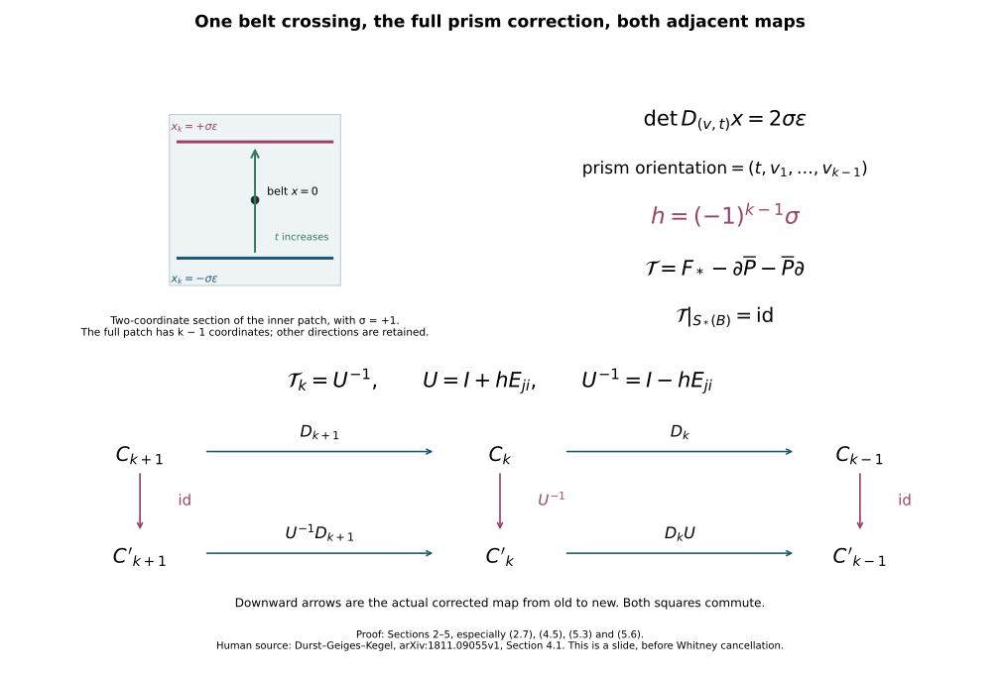

# Higher-index framed slides and their exact chain maps {#higher-framed-slides}

Proof companion for CG-S6 lesson 7. GPT-6 Astra (OpenAI), Ultra, 10 October 2026. New teaching exposition CC0. This chapter constructs the geometric elementary changes of an original handle presentation and proves their actual maps on the integral handle complex. The full framed attachments, both neighbouring differentials, and the outgoing boundary identification are retained.

## 1. The original stages and the moving handle {#higher-slide-stages}

Use the ordered presentation and notation of [the integral handle-chain chapter](integral-handle-chains-and-signed-incidences.md#handle-filtration). Let \(2\leq k\leq n-2\). Assume the boundary \(N=\partial_+A_{k-1}\) is connected. The application has \(n=6\) or \(7\). Choose different index-\(k\) labels \(i,j\); \(i\) is moving and \(j\) is the target. Their original domains remain
\[
 H_\nu=D^k_{r_\nu}\times D^{n-k}_{s_\nu},
 \qquad
 \varphi_\nu:S^{k-1}_{r_\nu}\times D^{n-k}_{s_\nu}\longrightarrow N,
 \qquad r_\nu,s_\nu>0.
 \tag{1.1}
\]
Every displayed core orientation is its ordered original \(u\)-orientation. The sphere orientation is its outward boundary orientation. No radius or framing is replaced.

Attach all the index-\(k\) handles other than \(i\) first, and write
\[
 A=A_{k-1},\qquad
 B=A\cup\bigcup_{\nu\ne i}H_\nu,\qquad
 S=\partial_+B,\qquad
 \mathcal B_\nu=\{0\}\times S^{n-k-1}_{s_\nu}\subset S .
 \tag{1.2}
\]
These attachments have disjoint original thick images. Their interchange therefore uses exactly the disjoint-attachment comparison already constructed in the [arrangement chapter](rearranging-the-original-framed-handles.md). In particular \(A_k=B\cup H_i\) is the original \(k\)-stage with its original maps.

The complement diffeomorphism, applied on the disjoint handle regions, is
\[
 P:S\setminus\bigcup_{\nu\ne i}\mathcal B_\nu
   \longrightarrow
 N\setminus\bigcup_{\nu\ne i}L_\nu,\qquad
 L_\nu=\varphi_\nu(S^{k-1}_{r_\nu}\times\{0\}).
 \tag{1.3}
\]
On the \(\nu\)-th original positive face it is
\[
 P(u,v)=
 \varphi_\nu\left(\frac{r_\nu}{\|u\|}u,
                  \frac{F_\nu(\|u\|)}{s_\nu}v\right),
 \qquad u\ne0,\quad \|v\|=s_\nu .
 \tag{1.4}
\]
Here \(F_\nu\), all its cutoff and seam terms, and the full rounding comparisons are those of [the belt-complement proof](belt-sphere-complements-and-the-whitney-disk.md), Section 1, and the arrangement chapter, Section 1. It is the identity on the common exterior. Its derivative includes the derivative of both radial factors, \(D\varphi_\nu\), and both rounding derivatives, exactly as in that proof; these factors will be composed, not absorbed into a new framing.

The right side of (1.3) is connected. Indeed, a path in connected \(N\) can be perturbed relative its endpoint collars off the finite \((k-1)\)-dimensional cores: the possible intersection dimension is
\[
 1+(k-1)-(n-1)=k-n+1<0.
 \tag{1.5}
\]
The finite chart-value perturbation and Sard argument in the belt-complement proof give this relative perturbation. Consequently the left side of (1.3) is connected too. The moving full tube starts in the common exterior, since its original thick attaching image is disjoint from every other thick image.

## 2. The one-crossing ambient isotopy {#higher-slide-crossing}

In the target's positive face choose original coordinates
\[
 (x,\zeta)\in\mathbb R^k\times\mathbb R^{n-k-1},
 \qquad
 (x,\zeta)\longmapsto (x,y(\zeta)),
 \quad y(0)=y_*\in S^{n-k-1}_{s_j}.
 \tag{2.1}
\]
The belt equation is \(x=0\). Choose \(\ell,\varepsilon,d_0>0\) so that the closure of the box
\[
 \|x'\|<2\ell,\qquad |x_k|<3\varepsilon,\qquad
 \|\zeta\|<d_0,\qquad x'=(x_1,\ldots,x_{k-1}),
 \tag{2.2}
\]
lies in this face and misses every other belt. Arrange a small positively oriented patch of the moving attaching sphere as
\[
 v\longmapsto(v,-\sigma\varepsilon,0),
 \qquad \|v\|\leq\ell,\qquad \sigma\in\{1,-1\}.
 \tag{2.3}
\]
Here positive refers to the original boundary orientation of \(S^{k-1}_{r_i}\).

We give the actual ambient construction of this arrangement. In the connected complement in (1.3), choose a path from the selected moving patch to the proposed endpoint, with its interior disjoint from the moving sphere. The relative avoidance dimension for this extra exclusion is again (1.5). The path can be made embedded: the dimension of two path parameters is two, strictly less than \(n-1\geq3\); perturb the values independently near two separated source points, and use compact local injectivity near the diagonal. Keep short endpoint germs fixed.

Prescribe a product chart around the initial embedded patch and the exact product chart (2.3) at the final patch. Choose the path transverse to the patch in these end charts and straight on its end germs. Extend a transverse frame along the interval. Its \((k-1)\) designated vectors carry the positively oriented patch coordinates. There is at least one other transverse direction, since \(n-k-1\geq1\); choosing its endpoint sign if necessary makes the two full transverse frames belong to the same component of the invertible-frame space. A smooth frame along the interval with the specified endpoints then exists. One direct construction is to retain each Gram matrix, deform its positive square root along the convex cone of positive matrices, and join the resulting orthogonal frames by successive rotations in coordinate two-planes. The determinant signs agree by the chosen remaining vector. Restoring the retained square roots gives the required frames with their exact endpoint values.

Choose an auxiliary connection flat in the two prescribed end charts, by a partition of unity on its coefficients. The normal exponential map along the path gives
\[
 J(s,w)=\exp_{c(s)}\left(\sum_{\mu=1}^{n-2}w_\mu E_\mu(s)\right).
 \tag{2.4}
\]
For a sufficiently small fixed transverse radius this is an embedding. The derivative is invertible on its zero section. Failure of injectivity for every smaller radius would give two limiting points of the embedded path with equal image; if their parameters differ this contradicts its injectivity, and if they agree it contradicts a local inverse chart. This proves the assertion, including a uniform radius by compactness. The flat end connections and constant end frames give exactly the prescribed product germs.

A vector field in this chart equal to \(\partial_s\) on the full track of a smaller patch, with a smooth cutoff supported in a larger compact corridor, transports the patch by \((s,w)\mapsto(s+t,w)\) on that track. The corridor misses all the belts. The field extends by zero and its flow is a diffeomorphism. It carries the entire original attaching tube by its full derivative. At the endpoint the rest of the moved sphere misses a sufficiently small crossing box: the endpoint sphere is embedded, and the complement of a slightly larger parameter patch is compact and disjoint from the selected point. Take the box inside this separation neighbourhood. If necessary first shrink the selected image patch by an ambient coordinate dilation with cutoff; its original parameter map is carried by that dilation and is never deleted. Thus the whole operation arranges (2.3) and has no belt crossing.

Choose \(\chi:\mathbb R^{k-1}\to[0,1]\), equal to one on \(\|v\|\leq\ell/3\) and zero on \(\|v\|\geq2\ell/3\). Choose \(\eta(x_k,\zeta)\), equal to one on a neighbourhood of \([-\varepsilon,\varepsilon]\times\{0\}\) and supported strictly inside the last two factors of (2.2). The exact crossing field is
\[
 Y_\sigma
   =2\sigma\varepsilon\,\chi(x')\eta(x_k,\zeta)\,\partial_{x_k}.
 \tag{2.5}
\]
Its flow \(I_t\), extended by the identity outside the box, satisfies
\[
 I_t(v,-\sigma\varepsilon,0)
  =(v,-\sigma\varepsilon+2\sigma\varepsilon t\chi(v),0),
 \quad 0\leq t\leq1.
 \tag{2.6}
\]
The displayed track remains where \(\eta=1\), so substitution into the differential equation proves this formula. Only the point \((v,t)=(0,\tfrac12)\) meets the target belt. No other part of the sphere meets any belt, by the preceding separation and the support. The normal derivative with the ordered trace parameters \((v_1,\ldots,v_{k-1},t)\) is
\[
 D x=
 \begin{pmatrix}I_{k-1}&0\\0&2\sigma\varepsilon\end{pmatrix}
 \quad\text{at that crossing}.
 \tag{2.7}
\]
Its determinant sign is exactly \(\sigma\).

On the inner track neighbourhood, where \(\eta\) is identically one, the complete derivative is
\[
 D I_t=
 \begin{pmatrix}
 I_{k-1}&0&0\\
 2\sigma\varepsilon t\,D\chi&I_1&0\\
 0&0&I_{n-k-1}
 \end{pmatrix}.
 \tag{2.8}
\]
On the rest of the whole tube the derivative is the unique solution of
\[
 \frac{d}{dt}D I_t=(D Y_\sigma)_{I_t}D I_t,\qquad D I_0=I,
 \quad
 D Y_\sigma=2\sigma\varepsilon\,\partial_{x_k}
       \otimes(\eta\,d\chi+\chi\,d\eta).
 \tag{2.9}
\]
Both cutoff contributions remain. These equations transport every original normal vector, including any component tangent to the core.

At the endpoint the moving core is disjoint from every belt. The ambient tube compression proved in the arrangement chapter, Section 2, therefore makes its entire original thick attaching image disjoint from them: choose a neighbourhood of the compact core missing the closed belts and compress the image into it. That compression fixes the core and retains its whole original parameter domain. Pull the whole compressed tube through \(P\). It is a compact subset of \(N\setminus\bigcup L_\nu\). In each original target tube its normal distance from \(L_\nu\) has a positive lower bound on the part needing motion. Apply the exact outward radial flow of the arrangement chapter, Section 3, with support in a small extension of that tube and with endpoint radius greater than \(s_\nu\). The original tubes and their small extensions can be chosen disjoint. Thus these finitely many flows move the whole moving image into the common exterior.

These return flows fix a neighbourhood of each \(L_\nu\). Their conjugates by (1.3) extend by the identity across the belts and have no belt crossing. Their derivatives are exactly
\[
 D(P^{-1})_{\mathcal R(P(z))}
       \,D\mathcal R_{P(z)}\,DP_z,
 \tag{2.10}
\]
where \(\mathcal R\) is the actual product of the disjoint radial flows, with each original radius and cutoff retained in its construction. Time-reparametrize the patch transport, crossing, compression and return flows to be constant near their endpoints and concatenate them. This gives an ambient isotopy \(T_t:S\to S\), from the identity, whose final whole moving tube is again in the common exterior. Its core trace has precisely the one transverse crossing (2.7).

## 3. The full cobordism comparison {#higher-slide-cobordism}

Take the actual inward collar \(c:S\times[0,d)\to B\) and a smooth \(\gamma\) equal to one near zero and zero near \(d\). Define
\[
 F_t(c(z,\rho))=c(T_{t\gamma(\rho)}(z),\rho),
 \qquad F_t=1\text{ outside the collar}.
 \tag{3.1}
\]
Its inverse at radius \(\rho\) uses \(T_{t\gamma(\rho)}^{-1}\). Its full collar-coordinate derivative is
\[
 (\xi,a)\longmapsto
 \left(DT_{t\gamma(\rho)}\xi
       +t\gamma'(\rho)
           \left.\partial_sT_s\right|_{s=t\gamma(\rho)}a,\ a\right),
 \tag{3.2}
\]
followed by the original \(Dc\) and \(Dc^{-1}\). In particular this is a smooth diffeomorphism of \(B\), fixes a neighbourhood of the incoming boundary \(M_-\), and agrees with \(T_t\) on the entire outgoing collar germ.

Attach \(H_i\) by \(T_1\varphi_i\) and the transported full gluing collar. This endpoint is a map into the original common exterior of \(N\), so it gives a new disjoint index-\(k\) presentation with every other \(\varphi_\nu\) retained. Define
\[
 F:A_k^{\rm old}\longrightarrow A_k^{\rm new},
 \qquad F|_B=F_1,\qquad F|_{H_i}=\operatorname{id}_{H_i}.
 \tag{3.3}
\]
The two definitions agree on the entire attaching collar because its new map is the transported old map. The original rounded-corner charts then give the smooth map and inverse across that collar. This proves an actual diffeomorphism, not only a comparison of cores.

Every later handle is attached by composing its full original attaching and collar maps with the already constructed boundary diffeomorphism. Extend \(F\) by the identity on that handle's original parameter domain. The same collar argument gives a diffeomorphism at every later stage and finally
\[
 F:C^{\rm old}\xrightarrow{\ \cong\ }C^{\rm new}.
 \tag{3.4}
\]
If \(G_{\rm old}:C^{\rm old}\to C\) is the original presentation of the specified cobordism, use
\[
 G_{\rm new}=G_{\rm old}F^{-1}.
 \tag{3.5}
\]
Thus \(G_{\rm new}F=G_{\rm old}\) on every point, including both boundaries. This is the retained outgoing identification.

For any original coordinate metric matrix \(g_{\rm old}(z)\), its transported matrix is exactly
\[
 g_{\rm new}(F(z))
   =D F_z^{-{\mathsf T}}\,g_{\rm old}(z)\,D F_z^{-1}.
 \tag{3.6}
\]
The derivatives in (2.8)-(2.10) and (3.2), together with those of the retained charts, specify every factor of \(DF\). No orthonormal replacement of the original frame or metric is made.

There is a subtlety needed for the next calculation. The collar isotopy \(F_t\) of \(B\) need not preserve the old lower body \(A\). Therefore (3.3) alone is not a map of the pair \((A_k,A)\). We now construct the exact chain comparison that fixes this issue.

## 4. The singular prism correction {#higher-slide-prism}

Let \(S_*(X)\) be the free abelian singular chain complex, with its usual alternating boundary \(\partial\). On \(S_*(B)\), the homotopy \(F_t\) has its integral prism operator
\[
 P_m:S_m(B)\longrightarrow S_{m+1}(B),
 \qquad \partial P_m+P_{m-1}\partial=(F_1)_*-\operatorname{id}.
 \tag{4.1}
\]
Here is its sign convention explicitly. For a singular \(m\)-simplex \(s\) with ordered vertices \(v_0,\ldots,v_m\), let \(v_a^0=(v_a,0)\), \(v_a^1=(v_a,1)\). Triangulate its prism by the ordered simplices
\[
 [v_0^0,\ldots,v_a^0,v_a^1,\ldots,v_m^1],
 \qquad 0\leq a\leq m.
 \tag{4.2}
\]
Compose each affine simplex with \((x,t)\mapsto F_t(s(x))\) and multiply it by \((-1)^a\). Their sum is \(P_m(s)\). In their boundaries the internal faces cancel in pairs with opposite signs. The top faces give \((F_1)_*s\), the bottom faces give \(-s\), and the remaining side faces give \(-P_{m-1}\partial s\): deleting vertex \(v_b\) before the change from superscript zero to one shifts \(a\) by one, and deleting it after that change does not, giving exactly the alternating face sign in both cases. This proves (4.1).

The orientation of this prism sum is
\[
 dt\wedge\operatorname{or}(s),
 \tag{4.3}
\]
because for \(m=0\) its edge points from time zero to time one, and its product boundary is the top minus the bottom minus the prism of the source boundary. Equivalently, the determinant of (4.2) in the coordinates \((t,v_1-v_0,\ldots,v_m-v_0)\) is \((-1)^a\). Thus (4.2) with its coefficient has positive orientation (4.3).

Identify the copies of \(B\) in the old and new cobordisms by their unchanged handle presentation. Extend \(P\) to a degree-one homomorphism
\[
 \overline P:S_*(C^{\rm old})\longrightarrow S_{*+1}(C^{\rm new})
 \tag{4.4}
\]
by using the preceding prism on each basis simplex whose entire image lies in \(B\), and assigning zero to every other basis simplex. The freeness of singular chains makes this a well-defined homomorphism. It is not asserted to be a chain map. Its image always lies in \(S_*(B)\).

Define
\[
 \mathcal T=F_*-\partial\overline P-\overline P\partial .
 \tag{4.5}
\]
Since \(F_*\partial=\partial F_*\) and \(\partial^2=0\),
\[
 \partial\mathcal T
 =F_*\partial-\partial\overline P\partial
 =\mathcal T\partial.
 \tag{4.6}
\]
On \(S_*(B)\), all faces are still in \(B\), so (4.1) gives the stronger exact equality
\[
 \mathcal T|_{S_*(B)}=\operatorname{id}.
 \tag{4.7}
\]
This is why the lower-body difficulty after (3.6) is resolved.

The corrected map preserves the full index filtration. For \(p<k\), \(A_p\subset B\) and it is the identity there. For \(p\geq k\), \(F\) carries the old \(p\)-stage to the new \(p\)-stage, while every correction term lies in \(B\subset A_k\subset A_p\). It also fixes the chains on \(M_-\), by (4.7). Thus it induces maps on all the original relative handle groups and their connecting sequences.

Moreover \(\overline P\) carries chains in \(M_-\) into \(M_-\): \(F_t\) fixes that boundary, so every simplex in its prism has image there, even though a constant-homotopy prism need not be literally the zero chain. Consequently (4.5) is a chain homotopy between \(\mathcal T\) and \(F_*\) also on the relative complex \(S_*(C,M_-)\). Under the exact singular-homology comparison of the handle-chain chapter, its resulting homology map is the actual \(F_*\). After (3.5), it is the identity on the specified original cobordism's relative homology.

## 5. The crossing class and both neighbouring matrices {#higher-slide-matrices}

Choose a finite oriented triangulation of the original moving disk \(D^k_{r_i}\), and let \(z_i\) be the resulting singular core chain. Each top simplex contains interior points of the moving handle, so none of these basis simplices has its entire image in \(B\). Its boundary is the actual oriented attaching-core chain \(a_i\) in \(A\). Thus
\[
 \overline P z_i=0,\qquad
 \partial z_i=a_i,\qquad
 \mathcal T z_i=z_i'-P a_i.
 \tag{5.1}
\]
Here \(z_i'\) is the same original parameter chain in the new moving handle. The trace chain is a relative cycle in \((B,A)\), because
\[
 \partial P a_i=(F_1)_*a_i-a_i,\qquad
 \partial a_i=0,
 \tag{5.2}
\]
and both endpoint attaching cores lie in \(A\).

For each \(\nu\ne i\), take the exact quotient \(q_\nu:B\to D^k_{r_\nu}/S^{k-1}_{r_\nu}\) of the handle-chain chapter, equation (3.5): it collapses \(A\) and all other handles, and sends \((u,v)\) to \([u]\) on \(H_\nu\). The trace meets \(q_\nu^{-1}([0])\) exactly where its boundary trace meets \(\mathcal B_\nu\). Our construction has no such point except the unique target crossing. Excision of a small neighbourhood of that crossing computes its relative degree by its local normal determinant, just as in the signed-incidence proof.

The determinant in (2.7) used \((v_1,\ldots,v_{k-1},t)\), whereas the prism orientation (4.3) is \((t,v_1,\ldots,v_{k-1})\). Moving \(t\) past the \(k-1\) source vectors gives the retained sign
\[
 h=(-1)^{k-1}\sigma,\qquad
 [P a_i]=h\,e_{k,j}\ \text{in }H_k(B,A;\mathbb Z).
 \tag{5.3}
\]
There is no ambient-orientation factor here: both the quotient generator and the normal determinant use the same original \(u\)-orientation. If intersection signs using an ambient boundary orientation are desired, the additional original chart factor is exactly the one already proved in the handle-chain chapter, equation (3.9).

Use column coordinates, and let \(E_{ji}\) have its single nonzero entry \(1\) in row \(j\), column \(i\). The corrected relative map is
\[
 \begin{aligned}
 \mathcal T_k(e_{k,i}^{\rm old})
    &=e_{k,i}^{\rm new}-h e_{k,j}^{\rm new},\\
 \mathcal T_k(e_{k,\nu}^{\rm old})
    &=e_{k,\nu}^{\rm new}\quad(\nu\ne i),\\
 U&=I+hE_{ji},\qquad
 U^{-1}=I-hE_{ji},\qquad [\mathcal T_k]=U^{-1}.
 \end{aligned}
 \tag{5.4}
\]
The second line follows from (4.7), since all those cores lie in \(B\). The inverse is exact because \(i\ne j\) implies \(E_{ji}^2=0\).

For \(p<k\), \(\mathcal T_p=I\) by (4.7). For \(p>k\), every correction term in (4.5) lies in \(B\subset A_{p-1}\), so vanishes in the relative handle group; \(F\) is the identity on each later original parameter domain. Thus
\[
 [\mathcal T_p]=I\quad(p\ne k).
 \tag{5.5}
\]
Naturality of the connecting boundary applies to the filtered chain map (4.5): applying it to a relative representative commutes with taking its singular boundary and then the preceding relative quotient. Consequently, for the original and new incidence matrices,
\[
 D'_k U^{-1}=D_k,\qquad
 D'_{k+1}=U^{-1}D_{k+1},
 \quad\text{or equivalently}\quad
 D'_k=D_kU,\qquad D'_{k+1}=U^{-1}D_{k+1}.
 \tag{5.6}
\]
This proves both changes from the actual geometric construction. In the old group's coordinates the new moving generator is therefore
\[
 e_{k,i}^{\rm new}=e_{k,i}^{\rm old}+h e_{k,j}^{\rm old}.
 \tag{5.7}
\]
The equality means transport by the inverse of the proved relative isomorphism (5.4). It does not identify the two embedded cores pointwise. Its exact comparison map is (4.5).

For \(k=2\), (5.3) reads \(h=-\sigma\). This recovers the negative target contribution of the based relator formula in [the index-one removal chapter](framed-handle-slides-and-index-one-removal.md#slide-based-sign), including its crossing convention. At \(k=3\) it is \(h=\sigma\), and at \(k=4\) it is \(h=-\sigma\).

The upper-left drawing is a two-coordinate section of the inner patch for positive trace sign. The full trace and every frame derivative are (2.6)-(2.9). The downward maps in the lower panel are the actual old-to-new comparison (4.5); both squares commute by (5.6). The prism orientation supplies the factor in (5.3).

## 6. Finite integral changes and their geometric scope {#higher-slide-integer-changes}

Either sign \(h\) is available by choosing \(\sigma=(-1)^{k-1}h\). Repeating the same ordered moving/target operation \(|a|\) times realizes
\[
 U=I+aE_{ji}\qquad(a\in\mathbb Z),
 \tag{6.1}
\]
because \((I+hE_{ji})(I+bE_{ji})=I+(h+b)E_{ji}\). At each step the newly proved full maps and framings are the input to the next step. Each endpoint is again a disjoint presentation on the original lower boundary. All later handles are transported after every step.

A permutation of handle labels and a sign change of a core basis are also permitted, with their exact maps recorded. A permutation reorders the direct summands while retaining every labelled handle map. A sign change assigns \(-e_{k,i}\) as the comparison basis vector; the original oriented geometric generator remains \(e_{k,i}\) and the signed diagonal comparison matrix is retained. It is an algebraic change of coordinate on the same handle group and does not assert an orientation-reversing ambient isotopy. The incidence matrices change by the same explicitly recorded basis rule. Thus no original core orientation is silently altered.

Every integer unimodular matrix is a finite product of these operations. To prove this, apply the finite Euclidean row-and-column procedure of the handle-chain chapter, Section 4, to a square matrix \(V\) with determinant \(\pm1\). It gives diagonal entries with successive divisibility and product of absolute values \(1\); hence each diagonal entry has absolute value \(1\). The retained operations are row and column additions by integer multiples, permutations and sign changes. Reverse their finite list. Multiplication on either side by an elementary matrix is itself a matrix product, so reversing the list expresses \(V\) as a product of the indicated generators. This argument records each multiplier and never replaces the original \(V\).

For an entire complex the result is therefore
\[
 D'_p=U_{p-1}^{-1}D_pU_p.
 \tag{6.2}
\]
To realize it, perform the finite handle slides for one index at a time, carrying the actual presentation onward. The chain maps (5.4)-(5.5) compose. Adjacent operations multiply the relevant matrices in that same recorded order; associativity gives (6.2) with every intermediate multiplier retained. The full total diffeomorphism is the composition of the corresponding maps (3.4), and (3.5)-(3.6) retain its original boundary and metric comparisons.

The geometric step is available whenever the relevant lower boundary is connected and \(2\leq p\leq n-2\). These hypotheses hold for the middle stages used after the proved extreme-index and index-one removals: the original incoming boundary is connected, and surgery on a connected level along an attaching core of codimension at least two leaves a connected exterior; its positive handle piece meets that exterior along its nonempty seam. This proves connectedness after each index \(2,\ldots,n-2\) attachment. Reversal uses the corresponding connected outgoing boundary.

In particular the explicit six- and seven-dimensional acyclic complexes of the handle-chain chapter, Section 6, can be put in exactly the displayed block incidence form by these full framed maps and recorded coordinate comparisons. This establishes their geometric incidence reduction. A coefficient \(1\) or \(-1\) is the algebraic sum of transverse intersections and may still arise from several points. Removing opposite-sign pairs by actual framed Whitney moves, then checking the unique Morse trajectory for cancellation, is the subsequent geometric calculation. Equation (6.2) by itself does not make that additional assertion.

## 7. Sources and proof boundaries {#higher-slide-sources}

The human handle-slide treatment used here is Sebastian Durst, Hansjörg Geiges and Marc Kegel, [Handle homology of manifolds, arXiv:1811.09055v1](https://arxiv.org/abs/1811.09055v1), original-author TeX lines 611-750. The preceding integral chapter records the intact archive and source hashes and the full 987-line reading coverage. Their treatment describes the moving generator and the adjacent differentials. Sections 2-5 here give the full supported ambient construction, original collar maps and the explicit filtered singular-chain correction needed when the boundary isotopy moves the lower body.

The included complement, arrangement and integral-chain chapters supply the exact original coordinate comparisons, cutoff flows and singular-homology maps cited above. All are part of this course's source and offline archive. The [receiving-dimension Whitney companion](whitney-moves-in-the-receiving-dimensions.md#receiving-whitney-flow) proves the full disk, adapted frame and supported move for the three required sheet-dimension pairs, with all original metric, orientation and framing maps retained. The [actual Morse realization and middle-cancellation companion](realizing-framed-handles-and-middle-cancellation.md#middle-six-seven-reduction) constructs the compatible function, proves the exact intersection-to-trajectory comparison and every escape and support hypothesis, and completes the simply connected smooth cobordism reductions in dimensions six and seven. This chapter makes no novelty claim, no claim that a finite matrix check verifies a smooth construction, and no claim that the \(\Theta_6\) calculation has been completed.

## 8. Two complete calculations {#higher-slide-exercises}

### Exercise 1. A three-handle slide changes both adjacent matrices

Take the original incidence matrices
\[
 A=\begin{pmatrix}2&3&5\end{pmatrix},\qquad
 B=\begin{pmatrix}-3&-4\\2&1\\0&1\end{pmatrix},
 \qquad AB=0.
 \tag{8.1}
\]
Slide the index-three generator \(e_1\) over \(e_2\) with positive trace sign \(\sigma=1\). Compute the exact chain comparison, both new matrices and the transported section of \(A\).

Since \(k=3\), equation (5.3) gives \(h=1\). Thus
\[
 U=\begin{pmatrix}1&0&0\\1&1&0\\0&0&1\end{pmatrix},
 \qquad
 U^{-1}=\begin{pmatrix}1&0&0\\-1&1&0\\0&0&1\end{pmatrix}.
 \tag{8.2}
\]
The actual filtered map has degree-three matrix \(U^{-1}\) and identity matrices in the other degrees. Both new differentials are
\[
 A'=AU=\begin{pmatrix}5&3&5\end{pmatrix},
 \qquad
 B'=U^{-1}B=
 \begin{pmatrix}-3&-4\\5&5\\0&1\end{pmatrix}.
 \tag{8.3}
\]
Their product is the row
\[
 A'B'=\begin{pmatrix}-15+15+0&-20+15+5\end{pmatrix}
      =\begin{pmatrix}0&0\end{pmatrix}.
 \tag{8.4}
\]
The original section \(S=(-1,1,0)^{\mathsf T}\) satisfies \(AS=1\). Its actual transported coordinates are
\[
 S'=U^{-1}S=(-1,2,0)^{\mathsf T},\qquad
 A'S'=-5+6+0=1.
 \tag{8.5}
\]
The old core \(e_1\) maps to \(e'_1-e'_2\), whereas the new moving core pulled back to the old relative group is \(e_1+e_2\). These are the two directions of the same proved map, and (8.2) records which one each calculation uses.

### Exercise 2. The prism sign and the order of two slides

At index four, slide \(e_1\) over \(e_2\) with \(\sigma=1\), then slide the resulting \(e_2\) over \(e_3\) with \(\sigma=-1\). Compute the resulting new basis in the original one and the corrected map from old to new.

The first coefficient is \((-1)^3(1)=-1\); the second is \((-1)^3(-1)=1\). Hence
\[
 U_1=I-E_{21},\qquad U_2=I+E_{32}.
 \tag{8.6}
\]
Columns of the final basis in the original one are the columns of
\[
 U_1U_2=
 \begin{pmatrix}1&0&0\\-1&1&0\\0&1&1\end{pmatrix}.
 \tag{8.7}
\]
Thus \(e_1''=e_1-e_2\), \(e_2''=e_2+e_3\), \(e_3''=e_3\). In the second expression \(e_2\) is the original vector; the first slide changed the first generator only. The corrected old-to-new map is the reverse-ordered inverse
\[
 (U_1U_2)^{-1}=U_2^{-1}U_1^{-1}
 =(I-E_{32})(I+E_{21})
 =I+E_{21}-E_{32}-E_{31}
 =\begin{pmatrix}1&0&0\\1&1&0\\-1&-1&1\end{pmatrix}.
 \tag{8.8}
\]
The last term is necessary because \(E_{32}E_{21}=E_{31}\). Direct multiplication of (8.7) and (8.8) gives the identity in both orders. For arbitrary original adjacent matrices \(D_4,D_5\), the final ones are exactly
\[
 D_4''=D_4U_1U_2,\qquad
 D_5''=(I+E_{21}-E_{32}-E_{31})D_5.
 \tag{8.9}
\]
Their product is \(D_4D_5\), which is zero for an original chain complex. Changing the order of the two geometric moves gives a different product; neither the crossing sign nor the order can be omitted.
