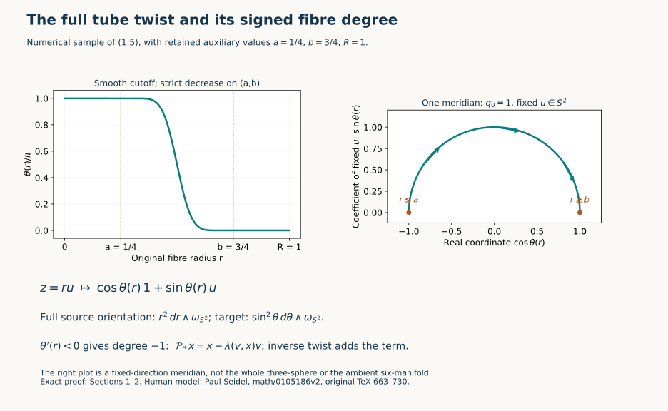
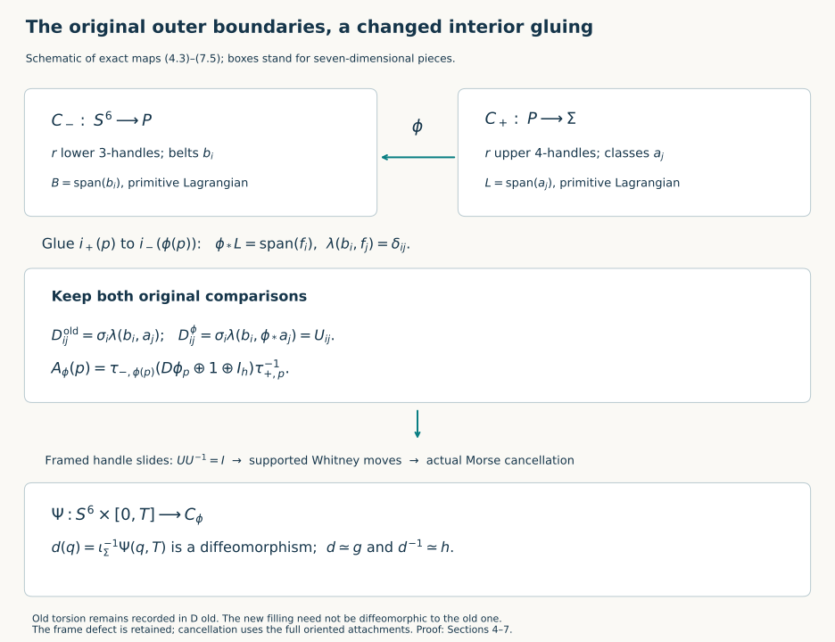

# Sphere twists and the original smooth six-sphere comparison

Receiving proof for CG-S6 lesson 7. GPT-6 Astra (OpenAI), Ultra, 11 October 2026. New exposition CC0-1.0.

The preceding geometric framing chapter constructs a framed seven-manifold with the original homotopy six-sphere as its specified boundary. The argument here works with an actual middle level of that manifold. It constructs smooth twists with their full signed integral homology action, realizes the required integral change by a finite composition of those maps, and changes the interior gluing while keeping both outer boundaries. The resulting handles cancel. Every original gluing, frame-comparison map and incidence matrix is retained in the comparison.

## 1. A smooth twist in the actual three-sphere tube {#twist-actual-tube}

Let \(P\) be a closed oriented smooth six-manifold, and let
\[
 f:S^3\longrightarrow P
 \tag{1.1}
\]
be an oriented parametrized embedding. The sphere is the unit sphere in the original ordered quaternion space \(\mathbb H=(1,i,j,k)\), with its boundary orientation. Its oriented rank-three normal bundle is trivial: its hemisphere transition has class in \(\pi_2SO(3)=0\), as proved in the geometric framing chapter, Sections 1–2. Retain a chosen normal frame \(\psi_q:\operatorname{Im}\mathbb H\to\nu_{f,q}\), an actual tubular map and a positive coordinate radius \(R\) on which that map is injective.

The left quaternion frame gives the exact bundle isomorphisms
\[
 TS^3\longleftrightarrow S^3\times\operatorname{Im}\mathbb H,
 \qquad(q,z)\longmapsto(q,\bar qz),\qquad
 (q,h)\longmapsto(q,qh).
 \tag{1.2}
\]
Here \(\langle q,z\rangle=\operatorname{Re}(\bar qz)=0\). Thus the actual tube can be written as
\[
 \begin{split}
 N_R&=\{(q,z)\in\mathbb H\oplus\mathbb H:
                   |q|=1,\ \langle q,z\rangle=0,\ |z|\le R\},\\
 \Gamma(q,z)&=\operatorname{tube}\bigl(f(q),\psi_q(\bar qz)\bigr).
 \end{split}
 \tag{1.3}
\]
The norm on \(z\) is a coordinate norm specifying this auxiliary disc bundle. It does not replace an original ambient metric. If that metric gives the Gram matrix \(G_\psi(q)\) to \(\psi_q\), the actual normal squared length is
\[
       (\bar qz)^T G_\psi(q)(\bar qz).
 \tag{1.4}
\]
Both (1.3) and (1.4) are retained; no metric-isometry assertion about \(\Gamma\) is needed.

Choose actual numbers \(0<a<b<R\). Set
\[
 \eta(t)=
 \begin{cases}e^{-1/t},&t>0,\\0,&t\le0,\end{cases}
 \qquad
 \beta(r)=\frac{\eta(b-r)}{\eta(b-r)+\eta(r-a)},\qquad
                       \theta(r)=\pi\beta(r).
 \tag{1.5}
\]
The denominator is positive for every real \(r\), since \(a<b\). The function is smooth, equals one for \(r\le a\), and equals zero for \(r\ge b\). For \(a<r<b\) its derivative is
\[
 \beta'(r)=
 \frac{-\eta'(b-r)\eta(r-a)-\eta(b-r)\eta'(r-a)}
      {(\eta(b-r)+\eta(r-a))^2}<0 .
 \tag{1.6}
\]
Every derivative of \(\eta\) at zero vanishes: on the positive side it is a finite polynomial in \(1/t\) times \(e^{-1/t}\), whose limit is zero. This proves the asserted smoothness at both transition points.

For \(r=|z|>0\), define
\[
 \begin{split}
 F_\theta(q,z)&=(q',z'),\\
 q'&=\cos\theta(r)\,q+\frac{\sin\theta(r)}r\,z,\\
 z'&=-r\sin\theta(r)\,q+\cos\theta(r)\,z.
 \end{split}
 \tag{1.7}
\]
At \(z=0\), define \(F_\theta(q,0)=(-q,0)\). For \(r<a\), (1.7) is exactly \((q,z)\mapsto(-q,-z)\), so this definition is smooth at the entire zero section. For \(r>b\) it is the identity.

The original constraints and radius are preserved. Writing \(c=\cos\theta(r)\), \(s=\sin\theta(r)\), direct expansion gives
\[
 \begin{split}
 |q'|^2&=c^2|q|^2+2cs\langle q,z\rangle/r+s^2|z|^2/r^2=1,\\
 \langle q',z'\rangle
      &=-rcs|q|^2+(c^2-s^2)\langle q,z\rangle
                                      +cs|z|^2/r=0,\\
 |z'|^2&=r^2s^2|q|^2-2rcs\langle q,z\rangle+c^2|z|^2=r^2 .
 \end{split}
 \tag{1.8}
\]
Since \(r\) is unchanged, replacing \(\theta\) by \(-\theta\) in (1.7) gives the two-sided inverse, by multiplication of the displayed two-by-two rotation matrices. It is smooth at zero for the same reason. Hence \(F_\theta\) is a diffeomorphism of the original \(N_R\).

For clarity, its differential away from zero retains all radial derivatives. With \(\dot r=\langle z,\dot z\rangle/r\), it is
\[
 \begin{split}
 \dot q'={}&c\dot q+\frac{s}{r}\dot z
       -s\theta'(r)\dot r\,q
       +\left(\frac{c\theta'(r)}r-\frac{s}{r^2}\right)\dot r\,z,\\
 \dot z'={}&-rs\dot q+c\dot z
       -\bigl(s+rc\theta'(r)\bigr)\dot r\,q
       -s\theta'(r)\dot r\,z .
 \end{split}
 \tag{1.9}
\]
At zero the differential is \((\dot q,\dot z)\mapsto(-\dot q,-\dot z)\) in the surrounding bundle coordinates. The inverse in (1.8) proves that this differential is invertible on each tangent space, including at the transition radii. The map preserves orientation: it is the identity on a nonempty outer collar, and its determinant sign is constant on the connected \(N_R\).

Extend the following map by the identity outside the actual tube:
\[
 \mathcal F_f=
 \begin{cases}
  \Gamma F_\theta\Gamma^{-1},&\text{on }\Gamma(N_R),\\
  1,&\text{on }P\setminus\Gamma(N_R).
 \end{cases}
 \tag{1.10}
\]
The definitions agree on an open collar because \(b<R\). They give a smooth orientation-preserving diffeomorphism of \(P\), with inverse obtained from \(F_{-\theta}\). On the tube its exact derivative is
\[
 D\mathcal F_f
       =D\Gamma_{F_\theta(q,z)}\,
             DF_{\theta,(q,z)}\,D\Gamma_{(q,z)}^{-1}.
 \tag{1.11}
\]
Thus every chosen tube coordinate, normal frame and original metric comparison remains present.

This model has a precise source comparison. Paul Seidel's original-author TeX, [*A long exact sequence for symplectic Floer cohomology*, math/0105186v2](https://arxiv.org/abs/math/0105186v2), lines 663–730, uses ordered variables \((u,v)\) with \(|v|=1\), \(\langle u,v\rangle=0\), and the flow
\[
 \sigma_t(u,v)=
  \left(\cos t\,u-\sin t\,|u|v,\
          \cos t\,v+\frac{\sin t}{|u|}u\right).
 \tag{1.12}
\]
The exact interchange is \((u,v)=(z,q)\). If his function is chosen on \(r\ge0\) as
\[
 R_{\rm S}(r)=-\frac1{2\pi}\int_r^R\theta(s)\,ds ,
 \qquad 2\pi R_{\rm S}'(r)=\theta(r),
 \tag{1.13}
\]
then his formula is exactly (1.7) under that interchange. Near zero \(R_{\rm S}(r)=R_{\rm S}(0)+r/2\); extend it across zero by \(R_{\rm S}(-r)=R_{\rm S}(r)-r\). It is smooth there and vanishes for \(r\ge b\). His retained primitive correction is
\[
 2\pi\bigl(R_{\rm S}'(r)r-R_{\rm S}(r)\bigr)
              =r\theta(r)+\int_r^R\theta(s)\,ds .
 \tag{1.14}
\]
We use the smooth map, with its inverse proved above. No ambient symplectic form or symplectic tubular embedding of \(f\) is assumed. The source's ambient extension in lines 979–1002 has an additional Lagrangian hypothesis for its symplectic assertion; (1.10) is a smooth tubular construction under the explicitly proved bundle comparison (1.2)–(1.3).

## 2. The full signed integral action {#twist-signed-action}

Write \(v=f_*[S^3]\in H_3(P;\mathbb Z)\), and write \(\lambda(x,y)=x\cdot y\) for the ordered intersection number using the original orientation. The normal orientation in (1.3) is the one for which an oriented tangent frame of \(f(S^3)\), followed by its normal frame, is positive in \(P\).

We prove
\[
       (\mathcal F_f)_*(x)=x-\lambda(v,x)v,
       \qquad
       (\mathcal T_f)_*(x)=x+\lambda(v,x)v,
       \qquad \mathcal T_f=\mathcal F_f^{-1}.
 \tag{2.1}
\]
This includes the integer sign, rather than only its residue modulo two.

First define the variation map on the original tube:
\[
 \begin{split}
 \operatorname{Var}_{F_\theta}:H_3(N_R,\partial N_R;\mathbb Z)
       &\longrightarrow H_3(N_R;\mathbb Z),\\
                         [c]&\longmapsto[F_\theta c-c].
 \end{split}
 \tag{2.2}
\]
A relative cycle has boundary in \(\partial N_R\), on which \(F_\theta\) is the identity, so the displayed difference is a cycle. Replacing \(c\) by \(c+\partial d+e\), where \(e\) is a chain in the boundary, changes that difference by \(\partial(F_\theta d-d)\). This proves that (2.2) is well-defined with the displayed sign.

The oriented Thom comparison from the included duality chapter identifies \(H_3(N_R,\partial N_R;\mathbb Z)\) with \(H_0(S^3;\mathbb Z)=\mathbb Z\). Its positive generator is the original oriented fibre disc \(D_{q_0}\). Retraction to the zero section identifies \(H_3(N_R;\mathbb Z)\) with \(\mathbb Z[S^3]\). We now calculate (2.2) on \(D_{q_0}\).

Take \(q_0=1\) first, with the ordered fibre coordinates \((i,j,k)\). Projection of its image under (1.7) is
\[
        z=ru\longmapsto
              \cos\theta(r)\,1+\sin\theta(r)\,u,
       \qquad u\in S^2\subset\operatorname{Im}\mathbb H.
 \tag{2.3}
\]
It equals \(1\) near the boundary and equals \(-1\) near the centre. It therefore descends to a map \(D^3/\partial D^3\to S^3\). Every target with polar angle \(\vartheta\in(0,\pi)\) has exactly one inverse image: (1.6) gives exactly one \(r\in(a,b)\) with \(\theta(r)=\vartheta\), and the target's unit imaginary direction gives \(u\).

The source orientation is \(dr\wedge\omega_{S^2}\), with its positive radial factor \(r^2\). In the target coordinates \((\vartheta,u)\), the original boundary orientation is \(\sin^2\vartheta\,d\vartheta\wedge\omega_{S^2}\). Indeed the ordered first two columns \((q,\partial_\vartheta q)\) have determinant one in the plane spanned by \(1,u\), and each angular column contributes the positive factor \(\sin\vartheta\). Thus at that unique inverse point the signed Jacobian has the sign of \(\theta'(r)\), namely minus one. Both radial factors are positive. The degree of (2.3) is exactly \(-1\).

For arbitrary \(q_0\), left multiplication by \(q_0\) takes this entire calculation to the corresponding fibre. It has determinant \(+1\) in \(\mathbb H\) and takes \((i,j,k)\) to the positive tangent frame \((q_0i,q_0j,q_0k)\). The sign is therefore unchanged. Projection of the original, unmoved fibre is constant, of degree zero. Consequently
\[
                   \operatorname{Var}_{F_\theta}[D_{q_0}]
                                      =-[S^3].
 \tag{2.4}
\]

The passage from (2.4) to the ambient action has an exact chain description. Subdivide an ambient cycle and cut it across an inner boundary collar of the tube; the resulting inside chain is a relative cycle and the outside chain is fixed by (1.10). Its variation is precisely (2.2), included into \(P\). The collar prism produced by the subdivision has the same boundary on both sides and contributes a boundary to the difference. This proves the factorization
\[
 \begin{split}
 H_3(P)&\longrightarrow H_3(P,P\setminus\operatorname{int}\Gamma(N_R))
        \xrightarrow[\rm excision]{\ \cong\ }H_3(N_R,\partial N_R)\\
 &\xrightarrow{\operatorname{Var}_{F_\theta}}H_3(N_R)
        \xrightarrow{\Gamma_*}H_3(P)
        \ =\ (\mathcal F_f)_*-1 .
 \end{split}
 \tag{2.5}
\]
Equivalently one may use singular relative chains throughout; excision follows from barycentric subdivision, and (2.2) proves independence of every collar-chain choice.

The coefficient of the relative fibre generator in (2.5) is \(\lambda(v,x)\). At each transverse intersection, an ordered tangent basis of the zero section followed by an oriented fibre basis is the ambient orientation by our convention. This is exactly the order defining \(\lambda(v,x)\). Summing these local coefficients gives the Thom coefficient, by the included intersection/duality comparison. Equations (2.4)–(2.5) prove the first formula in (2.1). Since \(\lambda(v,v)=0\) in this skew integral pairing, its inverse is the second formula there. In particular
\[
 T_v^m(x)=x+m\lambda(v,x)v,\qquad
           m\in\mathbb Z,\qquad T_v=(\mathcal T_f)_* .
 \tag{2.6}
\]
Expansion verifies
\[
 \lambda(T_vx,T_vy)
  =\lambda(x,y)+\lambda(v,y)\lambda(x,v)
                     +\lambda(v,x)\lambda(v,y)=\lambda(x,y);
 \tag{2.7}
\]
the last possible term is \(\lambda(v,x)\lambda(v,y)\lambda(v,v)=0\). No integral intersection sign has been absorbed into the symbol \(T_v\).

When \(P\) is two-connected and stably framed, every class \(v\in H_3(P;\mathbb Z)\) has an embedded representative by the geometric framing chapter, Section 7. Its normal bundle has the actual trivialization used in (1.3). Thus every transvection (2.6) needed below is realized by an actual orientation-preserving diffeomorphism of the original \(P\). The normal frame used to define a twist is not required to extend a framed surgery handle: that extension condition belongs to a different operation. We keep the derivative frame comparison of each twist explicitly in Section 5.

<figure>

<figcaption>Numerical sample of the exact cutoff (1.5) at the stated auxiliary radii, and one fixed-direction meridian of (2.3). The complete three-dimensional degree is proved using both volume factors in Section 2; the curve alone is a meridian. Seidel's original source and all comparison factors are identified in (1.12)–(1.14). Reproducible source: <a href="../checks/draw_sphere_twists.py">draw_sphere_twists.py</a>.</figcaption>
</figure>

## 3. Integral Lagrangians and a finite sequence of the actual twists {#twist-integral-lagrangians}

Let \(H\) be a free integral group of rank \(2r\), with a unimodular alternating pairing \(\lambda\). A primitive subgroup \(L\) means that \(H/L\) is torsion-free. An integral Lagrangian is a primitive rank-\(r\) subgroup on which \(\lambda\) vanishes. We prove that a finite product of the transvections (2.6) carries any such \(L\) to any specified integral Lagrangian. All changes below are actual automorphisms of \(H\); the original group and pairing remain fixed.

First construct a symplectic basis adapted to an original Lagrangian \(B\). Choose its basis \(e_1,\ldots,e_r\). Primitivity and the subgroup theorem over \(\mathbb Z\) split \(H=B\oplus B'\). Hence every functional on \(B\) extends to \(H\). Unimodularity then supplies \(y_j\in H\) with
\[
                         \lambda(e_i,y_j)=\delta_{ij}.
 \tag{3.1}
\]
Write \(C_{jk}=\lambda(y_j,y_k)\), retaining the full skew integer matrix. Define coefficients \(a_{jk}=C_{jk}\) for \(j<k\), and \(a_{jk}=0\) for \(j\ge k\), and put
\[
                       f_j=y_j+\sum_i a_{ij}e_i .
 \tag{3.2}
\]
Every pair then satisfies
\[
 \lambda(f_j,f_k)=C_{jk}+a_{kj}-a_{jk}=0,\quad
 \lambda(e_i,f_j)=\delta_{ij},\quad
 \lambda(e_i,e_j)=0 .
 \tag{3.3}
\]
These classes are an integral basis, not merely a rational basis. To check this, for \(z\in H\) subtract
\[
              \sum_i\lambda(z,f_i)e_i
                       -\sum_i\lambda(z,e_i)f_i .
 \tag{3.4}
\]
The remainder pairs to zero with every \(e_i,f_i\). The displayed pairing matrix is invertible over \(\mathbb Q\), so these \(2r\) classes span \(H\otimes\mathbb Q\); the remainder pairs to zero with every element of \(H\). Unimodularity makes it zero. Formula (3.4) is the integral inverse-coordinate map.

In the original coordinates \(z=\sum_i(a_ie_i+b_if_i)\), the twists on one pair act by
\[
 \begin{array}{rcl}
 T_{e_i}^{m}:(a_i,b_i)&\longmapsto&(a_i+mb_i,b_i),\\
 T_{f_i}^{m}:(a_i,b_i)&\longmapsto&(a_i,b_i-ma_i).
 \end{array}
 \tag{3.5}
\]
They fix all other coordinates. Their explicit product is
\[
 J_i=T_{e_i}T_{f_i}T_{e_i}:
           (a_i,b_i)\longmapsto(b_i,-a_i),\qquad J_i^2=-I_2.
 \tag{3.6}
\]
Products act from right to left throughout.

If \(\lambda(u,w)=0\), direct use of (2.6) gives
\[
 E_{u,w}=T_{u+w}T_u^{-1}T_w^{-1},
 \qquad
 E_{u,w}(z)=z+\lambda(u,z)w+\lambda(w,z)u.
 \tag{3.7}
\]
The added operator has square zero, so its \(m\)-th power adds \(m\) times the same two terms for every integer \(m\). For \(i\ne j\), the original vectors \(u=e_i,w=f_j,u+w=e_i+f_j\) are primitive and perpendicular, and
\[
 E_{e_i,f_j}^{m}:
      a_i\longmapsto a_i-ma_j,\qquad
      b_j\longmapsto b_j+mb_i ,
 \tag{3.8}
\]
with every other coordinate fixed. Formula (3.8) retains the companion change of \(b_j\); it is an automorphism of the entire original symplectic lattice.

Here is a terminating algorithm carrying any primitive \(z\in H\) to \(e_1\).

For each \(i\), integer division in (3.5), followed when needed by (3.6), performs the Euclidean algorithm on \((a_i,b_i)\). If \(b_i\ne0\), choose the quotient \(q\) with \(a_i=qb_i+s\), \(0\le s<|b_i|\), using a signed divisor if necessary. Apply \(T_{e_i}^{-q}\) to obtain \((s,b_i)\), then \(J_i\) to obtain \((b_i,-s)\). The absolute value of the second nonzero entry strictly decreases. Iteration ends at \((g_i,0)\), where \(g_i\) is a signed greatest common divisor of the two original entries. Use \(J_i^2\) when necessary to make \(g_i\ge0\). This also covers one zero entry, while \((0,0)\) stays zero.

Now every \(b_i\) is zero. Operations (3.8) perform integer row additions on the original \(a\)-coordinates, and keep every \(b_i=0\). Two nonzero \(a\)-entries are reduced by the same division procedure, using row additions and the two-coordinate signed interchange
\[
 (A,B)\longmapsto(A-B,B)
       \longmapsto(A-B,A)
       \longmapsto(-B,A).
 \tag{3.9}
\]
Each arrow is a row addition of the form (3.8), with its full companion \(b\)-action. Their product moves the two coordinates with the displayed signs. A coordinate sign can also be corrected by (3.6). Thus a finite sequence puts the greatest common divisor of all original \(a_i,b_i\) in the first \(a\)-entry and zero in the others. Primitivity of \(z\) makes that greatest common divisor one: otherwise \(z\) is divisible in \(H\), and conversely a common divisor is exactly that divisibility in an integral basis. The final image is \(e_1\).

We now act on \(L\). Choose a basis element \(x\) of \(L\). It is primitive in \(H\): if \(x=ny\), primitivity of \(L\) first puts \(y\) in \(L\), and primitivity of its basis element forces \(n=\pm1\). The preceding algorithm sends \(x\) to \(e_1\). Call the image Lagrangian \(L_1\). Isotropy gives \(L_1\subset e_1^\perp\), and \(e_1\in L_1\). The actual quotient map and its section are
\[
 \begin{split}
 e_1^\perp&=\mathbb Ze_1\oplus H',\qquad
                H'=\bigoplus_{i=2}^r(\mathbb Ze_i\oplus\mathbb Zf_i),\\
 e_1^\perp/\mathbb Ze_1&\longleftrightarrow H',\\
 [ce_1+z']&\longmapsto z',\qquad
 z'\longmapsto[z'] .
 \end{split}
 \tag{3.10}
\]
Under these maps \(L_1/\mathbb Ze_1\) is a primitive rank-\((r-1)\) isotropic subgroup of \(H'\). Its primitivity follows because \(e_1^\perp/L_1\) is a subgroup of the torsion-free \(H/L_1\). Its rank and isotropy follow from the displayed direct decomposition and original pairing.

Induct on \(r\). Use only the twists in \(H'\); each fixes both \(e_1\) and \(f_1\) in the full \(H\). They carry that quotient subgroup to \(\operatorname{span}(e_2,\ldots,e_r)\). At this point every lifted generator differs from its \(e_i\) by an integer multiple of \(e_1\), already in \(L_1\); subtracting that multiple proves that the full image is precisely \(B=\operatorname{span}(e_1,\ldots,e_r)\). The induction starts at \(r=0\), with the identity. Every step is a finite product of the displayed twists, so the induction supplies an actual finite product.

In particular a further product of \(J_i^{-1}\), for all \(i\), sends that \(B\) to
\[
                         B^\vee=\operatorname{span}(f_1,\ldots,f_r),
             \qquad J_i^{-1}e_i=f_i.
 \tag{3.11}
\]
This proves the transitivity needed below, with an algorithm recording every integer quotient, sign and ordered transvection factor. It also proves transitivity on primitive vectors. When \(H=H_3(P;\mathbb Z)\) for the two-connected stably framed \(P\) of Section 2, replace each factor \(T_v^{m}\) by the exact diffeomorphism \(\mathcal T_f^{m}\) from (1.10) for an embedded representative of that original class \(v\). The ordered composition is a diffeomorphism of the original \(P\) inducing the calculated lattice automorphism. The supporting tubes may intersect; finite composition of the actual maps requires no disjointness among those tubes.

## 4. The two integral Lagrangians in the original middle level {#twist-original-middle-level}

Let \(\Sigma\) be the original oriented smooth homotopy six-sphere. Retain its specified stable tangent framing. Section 9 of the [geometric framing chapter](the-original-six-dimensional-framing-invariant.md#framed-six-original-nullbordism) constructs a compact framed seven-manifold \(W\), together with the actual boundary identification
\[
                  \iota_\Sigma:\Sigma\xrightarrow{\cong}\partial W .
 \tag{4.1}
\]
This is the framed nullbordism supplied by the proved geometric invariant and original integral stable-group calculation. It does not presuppose a smooth identification of \(\Sigma\) with a standard sphere.

Choose an oriented coordinate embedding \(\chi:D^7_\rho\to\operatorname{int}W\), with its actual radius \(\rho>0\), and remove the open coordinate ball. The incoming parametrization is
\[
 j:S^6\longrightarrow\partial\chi(D^7_\rho),\qquad
                 j(q)=\chi(\rho q),\qquad Dj_q(v)=D\chi_{\rho q}(\rho v).
 \tag{4.2}
\]
The positive orientation on its domain is the boundary orientation of the coordinate ball. Thus the oriented boundary of the resulting cobordism \(C\) is \(-j(S^6)\sqcup\iota_\Sigma(\Sigma)\). The factor \(\rho\) in (4.2) remains part of the map and its differential.

Apply the interior surgeries proved in Section 8.2 of the geometric framing chapter to \(C\), keeping both boundary collars and their maps fixed. They produce a two-connected framed cobordism \(C'\) with precisely these boundaries. The full surgery traces, normal-frame changes and appended stable coordinates are retained by that construction. Section 8.3 then gives a handle presentation of this same \(C'\) with only indices three and four. Its proof uses \(H_2(C',S^6)=H_2(C',\Sigma)=0\); it makes no assumption that \(H_3(C')\) is zero or free. The original handle-arrangement proof orders the stages. Write them as
\[
 C'=C_-\cup_P C_+,\qquad
 C_-:S^6\longrightarrow P,\qquad C_+:P\longrightarrow\Sigma,
 \tag{4.3}
\]
with \(r\) index-three handles in \(C_-\) and \(s\) index-four handles in \(C_+\). The common oriented regular level \(P\), its two inclusions, every parameter radius and every full framed attachment are fixed in (4.3). In particular \(P\) is not replaced by a connected-sum model.

The first stage and its reverse have the original relative core models
\[
 H_k(C_-,S^6;\mathbb Z)=
 \begin{cases}\mathbb Z^r,&k=3,\\0,&k\ne3,\end{cases}
 \qquad
 H_k(C_-,P;\mathbb Z)=
 \begin{cases}\mathbb Z^r,&k=4,\\0,&k\ne4.\end{cases}
 \tag{4.4}
\]
Consequently the exact sequences, with all endpoint terms specified, give
\[
 H_4(C_-)=0,\qquad H_3(C_-)\cong\mathbb Z^r,\qquad
 0\longrightarrow\mathbb Z^r
   \xrightarrow{\delta_-}H_3(P;\mathbb Z)
   \xrightarrow{p_-}\mathbb Z^r\longrightarrow0 .
 \tag{4.5}
\]
For example \(H_4(S^6)=H_3(S^6)=H_2(S^6)=0\), and the adjacent relative groups in (4.4) are zero; these are exactly the zero terms giving (4.5). The classes \(\delta_-(e_i)\) are the original belt spheres
\[
 B_i=\{0\}\times S^3_{\beta_i}
 \quad\hbox{of }D^3_{\alpha_i}\times D^4_{\beta_i},
 \qquad b_i=[B_i].
 \tag{4.6}
\]
Give each belt the boundary orientation of its original four-disc. The image \(B=\sum_i\mathbb Zb_i\) is primitive because the quotient in (4.5) is free. It is isotropic: different belts are disjoint, and a small push in an original \(D^3_{\alpha_i}\)-direction gives a disjoint self-push-off. Equation (4.5) gives \(\operatorname{rank}H_3(P)=2r\).

The original core-cell comparisons also show that \(P\) is two-connected. Attaching only three-cells to \(S^6\) gives \(\pi_1C_-=\pi_2C_-=0\), while \((C_-,P)\) has only four-cells and therefore zero relative homotopy groups through degree three. Its exact sequence identifies \(\pi_1P,\pi_2P\) with those of \(C_-\). The stable frame on \(C'\) supplies one on \(P\). The integral intersection pairing
\[
       \lambda:H_3(P;\mathbb Z)\times H_3(P;\mathbb Z)\longrightarrow\mathbb Z
 \tag{4.7}
\]
is alternating and unimodular by the full integral duality comparison in the geometric framing chapter, Section 6.3. In particular (4.6) spans an integral Lagrangian.

Read the second stage in reverse. It consists of \(s\) index-three handles from the original \(\Sigma\) to the same underlying \(P\). Since \(\Sigma\) has the integral homology and low homotopy groups of \(S^6\), the same relative argument gives
\[
 0\longrightarrow\mathbb Z^s
      \xrightarrow{\delta_+}H_3(P;\mathbb Z)
      \xrightarrow{p_+}\mathbb Z^s\longrightarrow0 .
 \tag{4.8}
\]
The orientation on the reversed middle boundary is the opposite one if the reversed cobordism is given the opposite orientation; its intersection pairing is then \(-\lambda\). Both primitivity and isotropy are unchanged by this specified sign. In coordinates an original upper handle \(D^4_{\gamma_j}\times D^3_{\delta_j}\), with coordinates \((x,y)\), reverses to the handle with ordered coordinates \((y,x)\). The block permutation has sign \((-1)^{4\cdot3}=+1\); a constant reflection used for the chosen reversed orientation is recorded separately. The reversed belt \(\{0\}_y\times S^3_{\gamma_j,x}\) is exactly the original upper attaching sphere. Its orientation differs, if at all, by that recorded constant sign.

Let \(a_j\) be the class of the original upper attaching sphere with the boundary orientation of its original \(x\)-core. Thus \(\delta_+(e_j)=\varepsilon_j a_j\), with the explicit reversal sign \(\varepsilon_j\in\{1,-1\}\). Equation (4.8) proves that
\[
 L=\sum_{j=1}^s\mathbb Za_j\quad\hbox{is primitive and isotropic},
 \qquad 2s=\operatorname{rank}H_3(P)=2r.
 \tag{4.9}
\]
It follows that \(s=r\) and \(L\) is an integral Lagrangian. This conclusion does not assert that \(B\) and \(L\) were complementary in the original filling.

Retain the original signed matrix as well. Let \(\sigma_i\) be the orientation sign of the ordered lower handle coordinates \((u_1,u_2,u_3,v_1,v_2,v_3,v_4)\) relative to \(C'\). Equation (8.4) of the geometric framing chapter, with its ordered tangent calculation, gives the original handle boundary matrix
\[
 D^{\rm old}_{ij}=\sigma_i\lambda(b_i,a_j),\qquad
 H_4(C',S^6)=\ker D^{\rm old},\quad
 H_3(C',S^6)=\operatorname{coker}D^{\rm old}.
 \tag{4.10}
\]
Indeed the relative boundary of the \(j\)-th original four-core is its oriented attaching sphere. The projection \(r_3p_-\) in that equation gives its coordinates in the original lower core basis, and multiplication by \(\sigma_i\) is its own inverse. There are no other relative handle groups. Thus every free or torsion contribution of the old matrix remains visible in (4.10).

Apply Section 3 to \(H=H_3(P;\mathbb Z)\) with \(e_i=b_i\). Construct the actual dual basis \(f_i\), including its full skew correction (3.2), and use the finite twist algorithm to obtain an orientation-preserving diffeomorphism
\[
 \phi:P\longrightarrow P,\qquad
             \phi_*L=\operatorname{span}_{\mathbb Z}(f_1,\ldots,f_r).
 \tag{4.11}
\]
Every class used in this algorithm is represented by an embedded three-sphere by Section 7 of the geometric framing chapter; its rank-three normal bundle is trivial. Sections 1–2 supply each actual tube diffeomorphism. This verifies the geometric realization of every algebraic factor. If \(r=0\), take \(\phi=1_P\); there are already no handles.

## 5. Regluing the original pieces and retaining the frame defect {#twist-original-gluing}

Write \(i_-:P\to\partial_+C_-\) and \(i_+:P\to\partial_-C_+\) for the inclusions in (4.3). Their original gluing identifies \(i_+(p)\) with \(i_-(p)\). Define a new cobordism by the actual equivalence relation
\[
 C_\phi=(C_-\sqcup C_+)/\bigl(i_+(p)\sim i_-(\phi(p))\bigr).
 \tag{5.1}
\]
The two outer boundary maps \(j\) and \(\iota_\Sigma\) are retained literally. The natural maps of each piece into \(C'\) and \(C_\phi\) identify the interiors and their outer collars. They do not claim an identification of the two entire fillings; their old and new middle homology may differ.

Here is the smooth seam. Retain original collar parameters
\[
 c_-:P\times(-d_-,0]\to C_-,\qquad
 c_+:P\times[0,d_+)\to C_+,
 \qquad d_-,d_+>0,
 \tag{5.2}
\]
directed from the lower to the upper piece. Restrict to \(d=\min(d_-,d_+)\), without changing either parameter scale. A chart neighbourhood of the seam is parametrized by
\[
 \Xi_\phi(q,t)=
 \begin{cases}
    c_-(q,t),&-d<t\le0,\\
    c_+(\phi^{-1}(q),t),&0\le t<d .
 \end{cases}
 \tag{5.3}
\]
At \(t=0\) these are the same quotient point by (5.1). Together with the original interior charts, (5.3) defines a smooth atlas: on either open half its transition maps are the original collar maps composed with the smooth diffeomorphism \(\phi^{-1}\). The inverse coordinate is \((q,t)\) on the lower half and \((\phi(p),t)\) on the upper half. The two pieces are compact and are glued along a closed boundary by a homeomorphism; the quotient is Hausdorff (disjoint compact equivalence classes have disjoint saturated collar neighbourhoods) and compact. This establishes the underlying manifold structure, not merely a formal gluing notation.

In upper coordinates \((p,t)\) the tangent identification at the seam, written in the ordered summands \(TP\oplus\mathbb R_t\), is
\[
                         (v,a)\longmapsto(D\phi_pv,a).
 \tag{5.4}
\]
The orientation of \(\phi\) is positive, and \(t\) keeps its direction. Hence the given orientations on the two original pieces extend to the stated oriented cobordism from \(S^6\) to \(\Sigma\).

To retain the full stable-frame comparison, append identity coordinates until the two original piece frames have a common rank \(7+h\). Express them through (5.2) as isomorphisms
\[
 \tau_{\pm,p}:T_pP\oplus\mathbb R_t\oplus\mathbb R^h
                                    \longrightarrow\mathbb R^{7+h}.
 \tag{5.5}
\]
If an original boundary frame was given using an outward rather than a directed collar vector, the corresponding sign is included in \(\tau_{\pm,p}\). The old and new comparisons are exactly
\[
 A_{\rm old}(p)=\tau_{-,p}\tau_{+,p}^{-1},\qquad
 A_\phi(p)=\tau_{-,\phi(p)}
              (D\phi_p\oplus1\oplus I_h)\tau_{+,p}^{-1}.
 \tag{5.6}
\]
The original global frame supplies the old seam compatibility or its specified collar homotopy. The new map \(A_\phi\) is retained as an actual matrix-valued map. Its derivative factor is the ordered product of (1.11) for the chosen twist factors, evaluated at their successive image points. No null-homotopy of \(A_\phi\), and no preservation of the original frame by \(\phi\), is being asserted. Equation (5.6) is the exact comparison between the two framed pieces in the new oriented smooth filling.

Likewise the full upper attaching tube, originally
\[
 \alpha_j:S^3_{\gamma_j}\times D^3_{\delta_j}\longrightarrow P,
 \tag{5.7}
\]
becomes \(\phi\circ\alpha_j\) in the lower seam coordinates. Its differential is \(D\phi_{\alpha_j(q,z)}D\alpha_{j,(q,z)}\), including every tangent and normal column. A normal bundle here is first the quotient by the attaching tangent bundle; this derivative induces the exact quotient isomorphism and carries its frame. If one uses metric-orthogonal normal vectors, apply the original metric projection to these columns and retain that projection map. Invertibility on the quotient guarantees that they still form a frame. Neither \(\gamma_j\), \(\delta_j\), nor any derivative factor has been removed.

There is no requirement for a global stable framing on \(C_\phi\) in the subsequent smooth cancellation theorem. Its data are oriented full handle attachments, which (5.7) has supplied. The original stable frame was used to construct \(W,C'\), to prove the properties of \(P\), and to supply the embedded representatives. Those uses are complete before the regluing. The original frame and its precise defect (5.6) remain part of the comparison.

## 6. The new signed matrix and cancellation of every actual handle {#twist-actual-cancellation}

Define \(F_i=\sigma_i f_i\). The classes \(F_i\) are still a basis of the complementary Lagrangian. Since \(\phi_*\) maps the basis \(a_j\) of \(L\) onto another basis of this same subgroup, there is a unique unimodular integer matrix \(U\) with
\[
        \phi_*a_j=\sum_iF_iU_{ij},\qquad
        U_{ij}=\sigma_i\lambda(b_i,\phi_*a_j).
 \tag{6.1}
\]
The equality on the right follows from \(\lambda(b_i,f_k)=\delta_{ik}\) and \(\sigma_i^2=1\). Its determinant is \(1\) or \(-1\) because both displayed collections are bases of the same free group.

The full relative handle chain complex of (5.1), in its original lower and transported upper core bases, is
\[
       0\longrightarrow\mathbb Z^r
                \xrightarrow{\,D^\phi=U\,}\mathbb Z^r
                       \longrightarrow0 .
 \tag{6.2}
\]
This is the same signed core-to-belt calculation that gave (4.10), now applied to the actual tubes (5.7). Both matrices \(D^{\rm old}\) and \(D^\phi\) are retained; (6.2) does not erase the kernel or torsion cokernel of (4.10). It proves that the new relative groups vanish because \(U\) is an integer isomorphism.

For actual cancellation, factor \(U^{-1}\) into the finite integer additions, label permutations and signed basis comparisons proved in Section 6 of the [higher-index slide chapter](higher-index-framed-slides-and-chain-maps.md#higher-slide-integer-changes). Perform each addition by its full index-four framed slide in the seven-dimensional cobordism. The hypotheses there are satisfied: the lower boundary \(P\) is connected, and \(2\le4\le7-2\). Carry the full tubes and outgoing boundary map through its specified cobordism diffeomorphism after every operation. Its signed chain-prism proof gives the exact comparison
\[
                 D_{\rm comparison}^{\rm new}=U\,U^{-1}=I_r .
 \tag{6.3}
\]
There is no index-five boundary to omit; its adjacent source group is zero. The lower index-three basis is kept fixed.

It is essential to retain what a signed basis change means geometrically. The slide proof leaves every original oriented core identifiable. After all the actual slides and permutations, let \(c_j^{\rm geom}\) be the resulting upper geometric core generator. The final comparison basis is \(\widehat c_j=\epsilon_j c_j^{\rm geom}\), with each recorded \(\epsilon_j\in\{1,-1\}\); assigning this sign does not assert an orientation-reversing ambient isotopy. The lower geometric core bases were fixed. Therefore (6.3) is equivalent to the full geometric identities
\[
 D^{\rm geom}_{ij}=\epsilon_j\delta_{ij},\qquad
 [A_j^{\rm geom}]=\epsilon_jF_j,\qquad
       \lambda(b_i,[A_j^{\rm geom}])
                             =\epsilon_j\sigma_i\delta_{ij}.
 \tag{6.4}
\]
To verify the second identity, the upper comparison generator is the recorded linear combination \(U^{-1}\) of the transported original generators; its attaching homology class is \(\sum_k\phi_*a_k(U^{-1})_{kj}=F_j\). Multiply by \(\epsilon_j\) to recover its original geometric orientation. This proves every sign in (6.4).

Perturb the disjoint upper attaching spheres and their full tubes slightly to be transverse to the lower belts, retaining their parameter domains and frames by the derivative of the perturbing ambient isotopy. The finite-chart transverse perturbation in the receiving Whitney chapter supplies such an isotopy. All intersections are then finite. For each pair \(A_j^{\rm geom},B_i\), (6.4) gives algebraic count zero off the diagonal and absolute count one on the diagonal. Pair all opposite-sign points. After each removal, retain the single point of sign \(\epsilon_j\sigma_j\) on the diagonal.

Every such removal has the precise hypotheses of the [receiving Whitney construction](whitney-moves-in-the-receiving-dimensions.md#receiving-whitney-levels). The level before the original index-three stage is \(S^6\) with its retained product collar, so it is simply connected. The sheet dimensions are exactly \((d,p,q)=(6,3,3)\). The original belt complement is diffeomorphic to that \(S^6\) minus its disjoint attaching two-sphere cores; a loop and a null-homotopy can avoid them because \(1+2<6\) and \(2+2<6\). The exact complement diffeomorphism and all its radial coefficients are those of that included construction.

The two arcs joining a chosen opposite-sign pair give its Whitney circle. The disk filling, with its complete collar fixed, can avoid every other three-dimensional sheet because \(2+3<6\), and can be embedded because \(2+2<6\). The rank-four adapted normal-frame calculation of Sections 2–3 of that chapter removes its actual rotation obstruction. Its Section 4 then supplies the supported ambient flow, the derivative transport of every upper normal column, and the full diffeomorphism of attached cobordisms. Its support misses all other sheets except the two prescribed patches. Thus it removes exactly the chosen two points and creates none.

There are finitely many points and each operation decreases their number by two. Finite iteration gives
\[
                  \#(A_j^{\rm geom}\cap B_i)=\delta_{ij}.
 \tag{6.5}
\]
The remaining diagonal signs are still those in (6.4). This geometric assertion follows after the supported moves; it is stronger than the algebraic equation (6.3).

Apply Sections 2–5 of the [actual Morse realization chapter](realizing-framed-handles-and-middle-cancellation.md#middle-actual-incidence) to this complete modified presentation. Here three is the lowest remaining index, the level below it is the incoming product, the \(r\) lower points have one common value, and the \(r\) upper points have another strictly larger value. That proof builds the actual function and descending field from all the retained handle maps and parameter radii. Its intersection-to-trajectory bijection turns (6.5) into exactly one transverse descending trajectory from the \(j\)-th upper point to the \(j\)-th lower point, and no such trajectory to any other lower point.

For completeness, its escape and support hypotheses can be checked directly in this presentation. Fix a regular value \(a_0\) in the incoming product below all lower points. A descending trajectory which does not reach \(a_0\) stays in a compact band and must limit to a critical point: at a noncritical limit point the strictly negative derivative would give a uniform positive drop on infinitely many disjoint time intervals, contradicting the lower bound on the function. The connected limit set is contained in the finite critical set, hence is one point. The common upper value excludes every other upper point, and the trajectory bijection excludes every lower point except the one on the specified trajectory. Thus all other trajectories escape to \(a_0\).

Near that lower point the actual quadratic coordinates retain
\[
 f=c-\sum_{\nu=1}^3 a_\nu x_\nu^2+
                     \sum_{\mu=1}^4 b_\mu y_\mu^2,\qquad
 x(t)=e^t x(0),\quad y(t)=e^{-t}y(0),\qquad a_\nu,b_\mu>0 .
 \tag{6.6}
\]
These formulas show that the only additional limits of the upper unstable sheet are in the chosen lower unstable disc. The compact lower exit sphere reaches \(a_0\) in uniformly bounded time, by a finite cover of its transverse hitting neighbourhoods. The same holds for the compact remainder of the upper attaching sphere away from the chosen intersection. The resulting truncated unstable closure is therefore compact, contains only this pair of critical points, and stays away from both boundary collars. Distinct pairs have disjoint such compact sets by uniqueness of trajectories and (6.5). Choose disjoint neighbourhoods with compact closure around them. These are exactly the supported cancellation hypotheses proved in that chapter.

Its cancellation formula now removes every index-three/four pair, with the retained signs permitted by its theorem. All comparison diffeomorphisms and boundary maps are carried through the finite sequence. No critical point remains. The resulting function \(f_{\rm end}\) on the actual \(C_\phi\), viewed through those comparisons, has original constant boundary values \(\ell_-<\ell_+\) and no critical point.

Choose a smooth positive transverse field \(V\) matching its prescribed boundary collars, and retain the full multiplier in
\[
 Y=\frac{V}{df_{\rm end}(V)},\qquad df_{\rm end}(Y)=1,\qquad
                        T=\ell_+-\ell_->0 .
 \tag{6.7}
\]
The actual product map and its inverse are
\[
 \begin{split}
 \Psi:S^6\times[0,T]&\longrightarrow C_\phi,
                  &\Psi(q,t)&=\operatorname{Fl}^{Y}_t(j(q)),\\
 \Psi^{-1}(w)&=
 \left(j^{-1}\operatorname{Fl}^{Y}_{-(f_{\rm end}(w)-\ell_-)}(w),
                          f_{\rm end}(w)-\ell_-\right).
 \end{split}
 \tag{6.8}
\]
On each trajectory the function increases by exactly its time, so compactness gives existence up to both specified endpoints and each intermediate level is crossed once. This proves both inverse identities. The derivative in a tangent direction is \(D\operatorname{Fl}^Y_t\,Dj\), and the time column is \(Y\), transverse to the level. Thus both maps are smooth with invertible differentials, including in their boundary collars. All earlier presentation comparisons are part of \(j\) and \(\iota_\Sigma\) in this formula. If one compares with the interval \([0,1]\), the map is \((q,s)\mapsto\Psi(q,Ts)\), whose second derivative column is \(T Y\); the original positive length \(T\) is retained.

## 7. The smooth map to the original sphere and its original homotopy class {#twist-original-smooth-map}

Restrict the product map to its outgoing boundary and use the original boundary identification:
\[
       d:S^6\longrightarrow\Sigma,\qquad
              d(q)=\iota_\Sigma^{-1}\bigl(\Psi(q,T)\bigr).
 \tag{7.1}
\]
Every factor in (7.1) is a specified smooth map and (6.8) gives its smooth inverse:
\[
 d^{-1}(x)=j^{-1}\operatorname{Fl}^{Y}_{-T}(\iota_\Sigma(x)).
 \tag{7.2}
\]
It is orientation-preserving. The positive orientation on the incoming level was specified by the disc in (4.2). The directed product orientation has boundary \(-S^6\) at \(0\) and \(+\Sigma\) at \(T\). The flow preserves the level orientation since its transverse time column stays positive. All intervening comparisons are orientation-preserving. Hence \(d_*[S^6]=[\Sigma]\), with the original orientations, without an unrecorded reflection.

Take now \(\Sigma=X\), the actual compact smooth manifold of lesson 7. Its original degree-one map \(g:S^6\to X\) was constructed in Section 9 of that lesson. The included first Hurewicz theorem gives an isomorphism
\[
        h_6:\pi_6(X,x_*)\xrightarrow{\cong}H_6(X;\mathbb Z),
                         [u]\longmapsto u_*[S^6].
 \tag{7.3}
\]
The hypothesis is verified there: \(X\) is five-connected by its integral homology calculation and successive first Hurewicz applications. If the basepoint of \(d\) differs from that of \(g\), choose a path between their images and use the homotopy-extension property of \(\{q_*\}\subset S^6\) to move the basepoint along that path. The induced based class is independent of the path, since \(\pi_1X=0\). Both (7.1) and \(g\) map under (7.3) to the same generator \([X]\). Injectivity supplies a based homotopy after that basepoint change, and adjoining the basepoint-change homotopy gives the actual free homotopy
\[
                              d\simeq g .
 \tag{7.4}
\]
This uses equality of the original oriented degree classes, not a new choice of the original map.

The homotopy inverse retained in lesson 7 is \(h_X:X\to S^6\). In this companion write \(h=h_X\), with no change to that original map. Compose (7.4) with \(h\) to get \(hd\simeq hg\simeq1_{S^6}\); precompose this homotopy with \(d^{-1}\). It gives
\[
                              h\simeq d^{-1}.
 \tag{7.5}
\]
Thus both original homotopy-equivalence maps receive a proved comparison to inverse smooth diffeomorphisms.

The previous tangent comparison is retained as well. Let \(B:g^*TX\to TS^6\) be the rank-six bundle isomorphism of the spin-six chapter, (6.3), and let \(H(q,s)\) be the homotopy from \(g\) to \(d\) just obtained. The finite projection transport proved in lesson 11 constructs an actual oriented isomorphism \(P_H:g^*TX\to d^*TX\): embed the bundle over the compact homotopy cylinder in a trivial bundle, partition its parameter interval finely enough that adjacent projection operators differ in norm by less than one, and compose their restricted projection isomorphisms. Their inverse operators, in reverse order, give its inverse. Compactness makes one finite partition work for every \(q\). This uses the original continuous homotopy and needs no smoothness assumption on \(g\). The exact automorphism comparing the old bundle identification with the differential of the new map is
\[
              E_q=B_q(P_H)_q^{-1}Dd_q:T_qS^6\longrightarrow T_qS^6 .
 \tag{7.6}
\]
It is invertible and orientation-preserving, and the exact relation is
\[
                     Dd_q=(P_H)_qB_q^{-1}E_q .
 \tag{7.7}
\]
No claim that \(E\) is the identity or nullhomotopic is needed or made. Stabilizing retains the original radial coordinate: the differential-induced frame of \(d^*TX\oplus\mathbb R\) sends \((v,a)\) to \((Dd_q)^{-1}v+a q\), with inverse \(w\mapsto(Dd_q(w-\langle w,q\rangle q),\langle w,q\rangle)\). The earlier \(B\)-frame, transported through \(P_H\), differs on the tangent summand by exactly \(E_q\) and on the radial line by the identity. This records the full rank-six and rank-seven comparisons.

The same proof applies to every oriented smooth homotopy six-sphere. Its actual bundle \(T\Sigma\oplus\mathbb R\) is trivial by \(\pi_5SO(7)=0\) and the pullback/descent construction proved in Sections 5–6 of the spin-six chapter. The stable tangent-to-normal framing comparison needed for the whole framed bordism group is proved in Section 7.1 below, extending the original complex-case comparison without changing its endpoints. The geometric framing proof therefore gives a nullbordism for this actual stable tangent frame because its middle homology is zero, so its proved quadratic invariant has value zero. Sections 4–6 above then apply without a complex structure. Consequently every such sphere admits the orientation-preserving diffeomorphism (7.1). In particular the group of oriented smooth homotopy six-spheres is
\[
                                  \Theta_6=0 .
 \tag{7.8}
\]
This is the classical smooth recognition result, proved here with its receiving maps; no novelty is asserted.

One can also retain a smooth filling. Cap the incoming boundary of \(C_\phi\) by the original coordinate seven-disc using \(j\). Equation (6.8) identifies the attached collar with its actual product; extending a disc by a finite collar is diffeomorphic to a disc by a smooth increasing radial coordinate whose derivative stays positive, equal to the original coordinate near the centre. Such a function is obtained by integrating a positive smooth function with the prescribed constant endpoint germs and the required total radial length. The full radial derivative and the original factor \(\rho\) specify that comparison. This gives a smooth disc filling of the underlying original \(\Sigma\). It does not claim that the new filling's framing agrees with the two old piece frames; their exact difference is (5.6). The original framed nullbordism remains retained separately.

### 7.1. The full tangent-to-normal comparison for every stable six-dimensional frame {#twist-general-stable-framing}

This argument supplies an additional receiving prerequisite used by the general framed-bordism calculation. It is a direct bundle calculation from the original Pontryagin–Thom matrices, independent of the gluing and smooth-recognition conclusions above, so it may be used before Section 4. Section 8 of the Pontryagin–Thom companion proved a homotopy for the original complex tangent bundle. Its equation (8.11) also calculated the exact comparison for an arbitrary stable tangent frame. We now prove that this latter comparison is stably homotopic to the identity in dimension six, retaining every original map and using no complex structure on the original tangent bundle.

Use that chapter's notation: \(J:T_mM\to\mathbb R^N\) is the derivative of the actual embedding, \(H=J^TJ\) is its Gram matrix, \(Q=H^{-1}J^T\), and \(P_\nu=I-JQ\). The actual stable tangent frame is
\[
 \tau:T M\oplus\mathbb R^k\xrightarrow{\cong}\mathbb R^{6+k},
 \qquad QJ=I,\quad QP_\nu=0,\quad P_\nu+JQ=I_N .
 \tag{7.9}
\]
The notation \(H\) in (7.9) is this original Gram matrix, distinct from the earlier map homotopy \(H(q,s)\). If the original \(k\) is odd, append one identity coordinate to \(\tau\), in the original last-coordinate convention. Denote the resulting even number again by \(k\), recording this one stabilization explicitly. If it is already even, append none. In particular the original rank-seven frame of a homotopy six-sphere uses exactly one further coordinate here.

Give the ordered trivial spaces \(\mathbb R^{6+k}\) and \(\mathbb R^k\) their constant operators \(J_{6+k}\) and \(J_k\), acting on each successive coordinate pair by \((x,y)\mapsto(-y,x)\). For \(k=0\) the second operator and its formulas act on the zero space. The original \(\tau\) determines the operator
\[
 \mathcal I=\tau^{-1}J_{6+k}\tau
        \quad\hbox{on }E=TM\oplus\mathbb R^k,\qquad
 \mathcal I^2=-I_E .
 \tag{7.10}
\]
This is an operator on the specified stabilized bundle; it makes no claim that \(TM\) alone has such an operator.

For \(0\le t\le1\), put \(\alpha=\pi t\), \(\theta=\pi t/2\), and define
\[
 \begin{split}
 C_t&=\cos\alpha\,I_E+\sin\alpha\,\mathcal I,\\
 R_t&=I_{TM}\oplus(\cos\alpha\,I_k+\sin\alpha\,J_k),\\
 D_t&=R_tC_t .
 \end{split}
 \tag{7.11}
\]
Their exact inverses replace each sine by its negative and reverse the product:
\[
 C_t^{-1}=\cos\alpha\,I_E-\sin\alpha\,\mathcal I,\qquad
 R_t^{-1}=I_{TM}\oplus(\cos\alpha\,I_k-\sin\alpha\,J_k),\qquad
 D_t^{-1}=C_t^{-1}R_t^{-1}.
 \tag{7.12}
\]
Multiplication, using the two squared-operator identities, proves both inverse identities in every fibre. The endpoints are
\[
               D_0=I_E,\qquad D_1=(-I_{TM})\oplus I_k .
 \tag{7.13}
\]
Indeed \(C_1=-I_E\) and \(R_1=I_{TM}\oplus(-I_k)\), so the auxiliary minus signs cancel exactly.

For the original variables \((v,a,b)\in TM\oplus\mathbb R^N\oplus\mathbb R^k\), put \(u=Qa\) and \(y=P_\nu a\). Define the full homotopy by
\[
 \begin{split}
 v_t&=\cos\theta\,v+\sin\theta\,u,\\
 (w_t,b_t)&=D_t(-\sin\theta\,v+\cos\theta\,u,\ b),\\
 a_t&=y+Jw_t,\qquad
 \mathcal S_t(v,a,b)=(v_t,a_t,b_t).
 \end{split}
 \tag{7.14}
\]
Here every occurrence of \(\tau,J,H,Q,P_\nu\) is the original point-dependent map from (7.9); none has been replaced by an orthonormal constant matrix.

The inverse is explicit. Given \((v_t,a_t,b_t)\), recover \(y=P_\nu a_t\), \(w_t=Qa_t\), then put \((w,b)=D_t^{-1}(w_t,b_t)\). Finally set
\[
 v=\cos\theta\,v_t-\sin\theta\,w,\qquad
 u=\sin\theta\,v_t+\cos\theta\,w,\qquad a=y+Ju .
 \tag{7.15}
\]
Equations (7.9) and (7.12) prove both composites are the identity. Thus (7.14) is a homotopy through bundle isomorphisms. Its endpoints are
\[
 \mathcal S_0=I,\qquad
 \mathcal S_1(v,a,b)=(Qa,\ P_\nu a+Jv,\ b).
 \tag{7.16}
\]
The second is precisely the original involution \(S_m\) in equation (8.11) of the Pontryagin–Thom chapter, with the stated appended coordinate if needed.

All derivative terms are retained as well. In any original bundle chart,
\[
 \begin{split}
 d\mathcal I
   &=-\tau^{-1}(d\tau)\tau^{-1}J_{6+k}\tau
                           +\tau^{-1}J_{6+k}\,d\tau,\\
 dC_t
   &=(-\sin\alpha\,I_E+\cos\alpha\,\mathcal I)\,d\alpha
                                      +\sin\alpha\,d\mathcal I,\\
 dR_t
   &=0_{TM}\oplus(-\sin\alpha\,I_k+\cos\alpha\,J_k)\,d\alpha,\\
 dD_t&=(dR_t)C_t+R_t\,dC_t .
 \end{split}
 \tag{7.17}
\]
In (7.14), \(du=(dQ)a+Q\,da\) and \(dy=(dP_\nu)a+P_\nu\,da\). Writing \(z=-\sin\theta\,v+\cos\theta\,u\), its full remaining derivatives are
\[
 \begin{split}
 dv_t={}&\cos\theta\,dv+\sin\theta\,du
                  +(-\sin\theta\,v+\cos\theta\,u)d\theta,\\
 dz={}&-\sin\theta\,dv+\cos\theta\,du
                  +(-\cos\theta\,v-\sin\theta\,u)d\theta,\\
 d(w_t,b_t)={}&(dD_t)(z,b)+D_t(dz,db),\\
 da_t={}&dy+(dJ)w_t+J\,dw_t .
 \end{split}
 \tag{7.18}
\]
Here \(dQ=-H^{-1}(dH)H^{-1}J^T+H^{-1}dJ^T\), \(dH=(dJ)^TJ+J^TdJ\), and \(dP_\nu=-(dJ)Q-J\,dQ\), by differentiating (7.9). These formulas verify smooth dependence while preserving the entire metric comparison.

The earlier exact equality is \(\tau_E=\tau_{\rm st}S_m\). Equations (7.14)–(7.16) therefore give the required general homotopy
\[
             \tau_{\rm st}\mathcal S_t:
                         \tau_{\rm st}\simeq\tau_E .
 \tag{7.19}
\]
It applies to every stably framed six-manifold and to a smooth family of its frames. Making its parameter constant near the endpoints lets it be installed in a boundary collar exactly as in (8.15)–(8.16) of the Pontryagin–Thom chapter. The original boundary map and specified stable frame are then recovered.

This completes the tangent-framed use of the normal-framed Pontryagin–Thom bijection for the entire six-dimensional bordism group used in the geometric framing chapter, (9.1). One direction first forms the original normal frame by that chapter's explicit embedding and normal-bundle map; the inverse first takes a regular inverse image and its tangent-plus-normal frame. Their composite comparison is precisely (7.19). For a bordism, extend the prescribed boundary embedding over a collar and use the relative embedding and frame constructions from the same chapter; (7.19) corrects its boundary frame while fixing the rest of the collar. Conversely a normal-framed bordism has the tangent frame (8.15), and (7.19) recovers its prescribed endpoint frames. Thus the same explicit comparisons give injectivity, surjectivity and compatibility with bordism, without an unproved complex-structure hypothesis on an arbitrary representative.

<figure>

<figcaption>Schematic of the exact maps (4.3)–(7.5), with the original outer boundary parametrizations fixed. The boxes represent the two original pieces; they do not assert a geometric embedding of a seven-manifold in the page. Both the torsion-bearing old matrix and the new frame defect are retained. The full smooth argument is in Sections 4–7. Reproducible source: <a href="../checks/draw_sphere_twists.py">draw_sphere_twists.py</a>.</figcaption>
</figure>

## 8. Two complete worked calculations {#twist-worked-exercises}

### Exercise 8.1. Keep the old torsion and all the new orientation signs

In the original rank-two lattice with \(\lambda(e,f)=1\), let the lower belt be \(e\), the upper attaching class be \(a=2e+3f\), and the lower chart sign be \(\sigma=-1\). Compute both original relative homology groups, give an explicit twist word taking the upper Lagrangian to the complementary one, and retain the signed basis comparison for cancellation.

**Solution.** The vector \((2,3)\) is primitive: the identity \(2(-1)+3(1)=1\) extends it to an integral basis. Its span is isotropic because the pairing is alternating. Formula (4.10) gives \(D^{\rm old}=(-3)\), so
\[
       \ker D^{\rm old}=0,\qquad
       \operatorname{coker}D^{\rm old}=\mathbb Z/3\mathbb Z .
 \tag{8.1}
\]
The exact maps in (3.5), in the original ordered coordinates \((e,f)\), give
\[
 T_f=\begin{pmatrix}1&0\\-1&1\end{pmatrix},\qquad
 T_e^{-2}=\begin{pmatrix}1&-2\\0&1\end{pmatrix},\qquad
 S=T_e^{-2}T_f=\begin{pmatrix}3&-2\\-1&1\end{pmatrix}.
 \tag{8.2}
\]
Their determinants are one. The intermediate vectors are
\[
                    (2,3)^T\longmapsto(2,1)^T
                                      \longmapsto(0,1)^T .
 \tag{8.3}
\]
The actual diffeomorphism is the ordered composition \(\mathcal T_e^{-2}\mathcal T_f\), using the embedded representatives and full tubes of Sections 1–2. It sends \(a\) to \(f\).

Here \(F=\sigma f=-f\), so the new coefficient matrix in (6.1) is \(U=(-1)\). The actual new geometric boundary coefficient is \(-1\), while its signed comparison basis is \(\widehat c=-c^{\rm geom}\); thus \(\epsilon=-1\) and \(D_{\rm comparison}=1\). The remaining ordered intersection of belt and upper attaching sphere has sign \(\epsilon\sigma=+1\). Its single Morse trajectory cancels the pair. Both new relative groups are zero, by the isomorphism \((-1):\mathbb Z\to\mathbb Z\).

The original \(\mathbb Z/3\mathbb Z\) in (8.1) has not been identified with zero by a supposed diffeomorphism. The two original pieces have been reglued by \(S\); (5.1) specifies a different interior filling with the same outer boundary. On frames the exact new comparison is \(\tau_{-,\phi(p)}(D\phi_p\oplus1\oplus I_h)\tau_{+,p}^{-1}\). Its factors are retained regardless of the homology calculation. This example verifies both the utility and the precise scope of that operation.

### Exercise 8.2. Two interacting pairs with every companion coordinate retained

Use the ordered coordinates \((e_1,e_2,f_1,f_2)\), with matrix
\[
 \Lambda=\begin{pmatrix}0&0&1&0\\0&0&0&1\\-1&0&0&0\\0&-1&0&0\end{pmatrix}.
 \tag{8.4}
\]
Set
\[
 S=T_{e_1+f_2}^{\,2}T_{f_1}^{-1}T_{e_2}^{\,3},\qquad
 L=S\operatorname{span}(e_1,e_2),\qquad
                  (\sigma_1,\sigma_2)=(-1,+1).
 \tag{8.5}
\]
Compute the original incidence, an exact complementary gluing, and the resulting signed matrices. Explain why the full vector \(e_1+f_2\) cannot be replaced by only its first component.

**Solution.** For a column \(v\), formula (2.6) gives the entire matrix \(T_v^m=I_4+mv(v^T\Lambda)\). Multiplication in the written order gives
\[
 S=\begin{pmatrix}
 3&-2&2&-6\\
 0&1&0&3\\
 1&0&1&0\\
 2&-2&2&-5
 \end{pmatrix},\qquad
 [a_1\ a_2]=
 \begin{pmatrix}3&-2\\0&1\\1&0\\2&-2\end{pmatrix}.
 \tag{8.6}
\]
Each factor preserves \(\Lambda\) by (2.7) and has inverse obtained by negating its exponent. Hence \(S\) is an integral symplectic isomorphism; its first two columns span a primitive Lagrangian. Directly \(a_1^T\Lambda a_2=3\cdot0+0\cdot(-2)-1\cdot(-2)-2\cdot1=0\), retaining all four contributions.

The ordered belt-to-attaching matrix is
\[
 [\,\lambda(e_i,a_j)\,]=
        \begin{pmatrix}1&0\\2&-2\end{pmatrix},
 \qquad
 D^{\rm old}=
        \begin{pmatrix}-1&0\\2&-2\end{pmatrix}.
 \tag{8.7}
\]
Its kernel is zero. Its image is generated by \((-1,2)^T,(0,-2)^T\); the first generator eliminates the first coordinate, and the second leaves exactly the parity of the second coordinate. Thus its cokernel is \(\mathbb Z/2\mathbb Z\), by the actual quotient map \((x,y)\mapsto y\bmod2\).

Put \(K=J_1^{-1}J_2^{-1}\); it sends each \(e_i\) to \(f_i\) and each \(f_i\) to \(-e_i\). The exact gluing action is
\[
 P_*=KS^{-1}=
 \begin{pmatrix}
 1&2&-3&0\\
 0&-2&2&-1\\
 1&2&-2&0\\
 0&-5&6&-3
 \end{pmatrix},\qquad
 P_*[a_1\ a_2]=
 \begin{pmatrix}0&0\\0&0\\1&0\\0&1\end{pmatrix}.
 \tag{8.8}
\]
Its finite twist word is \(J_1^{-1}J_2^{-1}T_{e_2}^{-3}T_{f_1}T_{e_1+f_2}^{-2}\), in that order of composition. Sections 1–2 realize every factor on the original level, so \(P_*\) is not merely a desired abstract matrix.

The target basis in (6.1) is \(F_1=-f_1,F_2=f_2\). Consequently
\[
 U=D^\phi=\begin{pmatrix}-1&0\\0&1\end{pmatrix},
 \quad U^{-1}=U,\quad D_{\rm comparison}^{\rm new}=I_2,
 \quad(\epsilon_1,\epsilon_2)=(-1,+1).
 \tag{8.9}
\]
The geometric diagonal coefficients remain \((-1,+1)\). The belt-to-attaching signs are \((\epsilon_1\sigma_1,\epsilon_2\sigma_2)=(+1,+1)\). The supported Whitney moves leave exactly the two specified points, and the two supported Morse cancellations remove both pairs.

Finally \(v=e_1+f_2\) has \(v^T\Lambda=(0,-1,1,0)\). Its contribution to a vector \((a_1,a_2,b_1,b_2)^T\) is
\[
 T_v^m(a_1,a_2,b_1,b_2)^T
 =\bigl(a_1+m(b_1-a_2),\ a_2,\ b_1,\
                         b_2+m(b_1-a_2)\bigr)^T .
 \tag{8.10}
\]
Both displayed changes are required. Omitting the \(f_2\) coordinate changes the map and destroys (8.6)–(8.8). Equations (8.4)–(8.10) retain the original ordered lattice throughout.

## 9. Sources, proof locations and scope of the checks {#twist-sources}

The human source used for the tube model is Paul Seidel, [*A long exact sequence for symplectic Floer cohomology*, arXiv:math/0105186v2](https://arxiv.org/abs/math/0105186v2). The retained original-author file is all.tex; lines 645–731 and 979–1002 were read. Its exact flow is at lines 663–730. Equations (1.12)–(1.14) prove the full comparison, including the interchanged coordinates, the \(2\pi\) multiplier, the function at negative radii and its primitive correction. The present argument uses the underlying smooth map; it does not import a symplectic assertion without the source's Lagrangian hypothesis. The archive remains intact in the private source ledger. No reading of the remainder of the Floer argument is claimed.

The complete receiving prerequisites are included in this course. The following immutable links identify the checked earlier edition:

- Original geometric framing invariant, Sections 7–9: embedded representatives, full index-three comparison (8.1)–(8.6), two-connected preparation, the exact index reduction, and the original framed nullbordism.
- Original integral stable comparison, Sections 5–7: the exact suspension range, all completion terms and the original sixth stable sphere group.
- Higher-index framed slides, Sections 3–6: full cobordism map, signed chain prism, both neighbouring matrices and finite integral changes.
- Receiving Whitney moves, Sections 1–4: the exact complement, complete two-corner disc, rank-four framing and supported flow for \((6,3,3)\).
- Actual Morse realization, Sections 4–6: intersections as actual trajectories, escape and support, finite cancellation and the exact product map (6.8).
- Original six-dimensional bundle comparison, Sections 5–6: \(\pi_5SO(7)=0\), the original stable frame and rank-six comparison.
- The receiving lesson, Section 9: the original degree-one map, its two inverse homotopies and the exact homology calculation. The earlier edition still labels smooth recognition unfinished; Sections 4–7 above supply that receiving proof.

The construction proves the classical \(\Theta_6=0\) statement and its application to the original \(X\). The new filling is (5.1); the old filling, old torsion matrix and stable-frame defect are (4.10) and (5.6). The argument does not assert that a twist preserves the old framing or that the two entire fillings are diffeomorphic. Formula (7.6) retains the exact comparison with the earlier tangent-bundle map.

The accompanying checker verifies finite algebra and the displayed examples against this source. It cannot certify the embedded-disk, differential-topological, source-reading or global proof claims by a finite computation. Those are supplied by the written arguments and included prerequisites and have received author self-checking. No independent review, exhaustive literature audit or new mathematical discovery is claimed.

