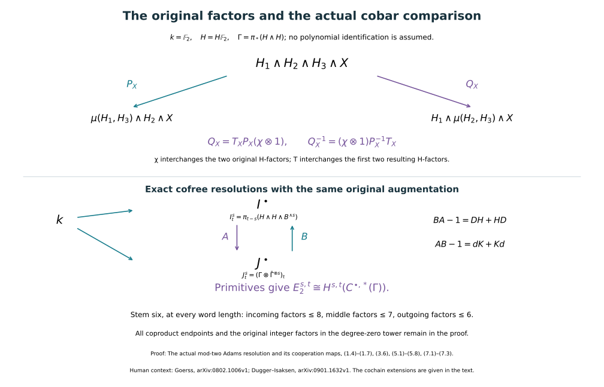

# The actual mod-two Adams resolution and its cooperation maps

Proof companion for CG-S6 lesson 7. GPT-6 Astra (OpenAI), Ultra, 11 October 2026. New exposition CC0. This chapter constructs the actual mod-two cooperation coalgebra and the comparison between the original Adams resolution and its cobar complex. It gives both chain maps and both homotopies, the complete original diagonal line and the exact degree range for the receiving degree-six calculation. The [actual degree-eight companion](the-actual-mod-two-cooperation-comparison-through-degree-eight.md#actual-eight-bijectivity) now proves the required polynomial classification through degree eight. The [original geometric framing proof](the-original-six-dimensional-framing-invariant.md#framed-six-original-nullbordism) constructs the full quadratic invariant, proves framed bordism invariance and gives value zero for the original framed homotopy six-sphere, with an actual framed nullbordism. The [sphere-twist and smooth-recognition proof](sphere-twists-and-the-original-smooth-six-sphere-comparison.md#twist-original-smooth-map) now constructs the new interior gluing with its full frame defect, cancels every actual handle and gives the orientation-preserving diffeomorphism to the original six-sphere, homotopic to its original degree-one map.

## 1. The original spectrum and two different cross products {#cooperation-original-factors}

Put \(k=\mathbb F_2\), \(H=H\mathbb F_2\), and retain the original unit \(\eta:\mathbb S\to H\), fibre \(\alpha:B\to\mathbb S\), ordered factors \(F_s=B^{\wedge s}\), and layers \(W_s=H\wedge F_s\). All these are the actual objects constructed in the Adams chapter, Sections 1 and 8–11. Set
\[
 M(X)_n=\pi_n(H\wedge X),\qquad \Gamma=M(H)=\pi_*(H\wedge H).
 \tag{1.1}
\]
The grading in (1.1) is homotopy degree. Products and tensor products below retain this grading, and their degree \(n\) component is the direct sum over all pairs of degrees whose sum is \(n\).

We first construct the multiplication needed for the maps. The arithmetic chapter, (3.2)–(3.3), proves that maps from a connective spectrum \(Z\) to \(H\) are classified by homomorphisms \(\pi_0Z\to k\). The ordered degree-zero cross product gives \(\pi_0(H\wedge H)=k\otimes_{\mathbb Z}k\). Define
\[
 \mu:H\wedge H\longrightarrow H
 \tag{1.2}
\]
to be the map corresponding to the original coefficient multiplication \(a\otimes b\mapsto ab\). It is unital, associative and commutative in the stable homotopy category. Indeed each of the two maps in each identity has connective source and target \(H\), and the induced maps on \(\pi_0\) are the same coefficient maps. The classification proves the equality of the stable maps. This argument also compares (1.2) with the product induced by the complete shuffle-chain cross product: its degree-zero map is the same multiplication, so it is exactly the same stable map. No higher coherence assertion is needed for the homotopy-group diagrams used here.

For any spectrum \(X\), the full field cross product proved in the Adams chapter, (11.2)–(11.2a), supplies an isomorphism
\[
 P_X:\Gamma\otimes_k M(X)\longrightarrow M(H\wedge X).
 \tag{1.3}
\]
If \(g:S^a\to H_1\wedge H_2\) and \(m:S^b\to H_3\wedge X\) represent homogeneous elements, its representing map keeps the ordered sphere factors \(S^a\wedge S^b\) and is
\[
 H_1\wedge H_2\wedge H_3\wedge X
 \xrightarrow{1\wedge\tau_{H,H}\wedge1}
 H_1\wedge H_3\wedge H_2\wedge X
 \xrightarrow{\mu\wedge1\wedge1}
 H\wedge H_2\wedge X.
 \tag{1.4}
\]
Here and below \(\tau\) is the actual symmetry of the indicated smash factors.

The cooperation comparison needs a different isomorphism, with the middle pair multiplied. Define
\[
 Q_X(g\otimes m)
 =\bigl(1_H\wedge\mu\wedge1_X\bigr)(g\wedge m)
 \in\pi_{a+b}(H\wedge H\wedge X).
 \tag{1.5}
\]
Thus the original product in (1.5) multiplies \(H_2\) and \(H_3\), rather than the pair in (1.4). Let
\[
 \chi=\pi_*(\tau_{H,H}):\Gamma\to\Gamma,
 \qquad T_X=\pi_*(\tau_{H,H}\wedge1_X):M(H\wedge X)\to M(H\wedge X).
 \tag{1.6}
\]
Following the four labelled factors in (1.4) proves the exact formula
\[
 Q_X=T_XP_X(\chi\otimes1),\qquad
 Q_X^{-1}=(\chi\otimes1)P_X^{-1}T_X.
 \tag{1.7}
\]
For example the first expression sends the original four factors to
\(H_2,H_1,H_3,X\), then to \(\mu(H_2,H_3),H_1,X\), and finally to \(H_1,\mu(H_2,H_3),X\). This is (1.5), including the order of its sphere coordinates. Both symmetries in (1.6) square to the identity. Consequently \(Q_X\) is an isomorphism, without assuming a cooperation presentation or an antipode formula.

The coefficient field is exactly \(\mathbb F_2\). An exchange of homogeneous chain factors still has its original integer Koszul sign \((-1)^{ab}\); after the map \(\mathbb Z\to\mathbb F_2\), that coefficient equals \(1\). All the actual symmetries in (1.4)–(1.7) remain in the maps. This observation concerns their induced graded groups, and does not declare the symmetry of two spectrum factors to be an identity.

## 2. The actual coalgebra and its cofree comodules {#cooperation-actual-coalgebra}

Let \(u:k\to\Gamma\) be induced by \(1_H\wedge\eta\), and let \(\epsilon:\Gamma\to k\) be induced by \(\mu\). The original degree-zero calculation gives
\[
 \Gamma_n=0\quad(n<0),\qquad \Gamma_0=k\,1,
 \qquad\epsilon u=1_k.
 \tag{2.1}
\]
Every \(\Gamma_n\) is finite-dimensional, by Sections 10–11 of the Adams chapter. Define the cooperation and the coaction by the actual maps
\[
 \begin{aligned}
 \Delta&=Q_H^{-1}\,\pi_*(1_H\wedge\eta\wedge1_H):
       \Gamma\longrightarrow\Gamma\otimes\Gamma,\\
 \rho_X&=Q_X^{-1}\,M(\eta\wedge1_X):
       M(X)\longrightarrow\Gamma\otimes M(X).
 \end{aligned}
 \tag{2.2}
\]
The unit in both lines is inserted between the original coefficient factor and the remaining original spectrum. Using the other cross product \(P_X\) in (2.2) would give a different coordinate formula. Equation (1.7) is the explicit comparison that prevents that mistake.

We verify every coalgebra and comodule identity. The iterated version of \(Q_X\) on
\(\Gamma\otimes\Gamma\otimes M(X)\) starts with
\[
 (H_1\wedge H_2)\wedge(H_3\wedge H_4)\wedge(H_5\wedge X)
 \longrightarrow H_1\wedge\mu(H_2,H_3)\wedge\mu(H_4,H_5)\wedge X.
 \tag{2.3}
\]
The parentheses in its two successive constructions give the same stable map by the associativity of \(\mu\). Under this isomorphism both
\((\Delta\otimes1)\rho_X\) and \((1\otimes\rho_X)\rho_X\) are the map on homotopy groups which inserts two consecutive original units into \(H\wedge X\). This proves coassociativity. Taking \(X=H\) proves coassociativity of \(\Delta\). Applying \(\epsilon\) in the first tensor factor of (1.5) composes with multiplication of the first two resulting \(H\)-factors. Applied to (2.2), this multiplies an original factor by the inserted unit and gives its identity. Thus
\[
 (\epsilon\otimes1)\rho_X=1_{M(X)},\qquad
 (\epsilon\otimes1)\Delta=(1\otimes\epsilon)\Delta=1_\Gamma.
 \tag{2.4}
\]
For the second coalgebra identity in (2.4), multiply the last two \(H\)-factors of \(H\wedge H\wedge H\); the same unit identity applies. Inserting a unit into \(u(1)\) and using (1.5) also gives \(\Delta u(1)=u(1)\otimes u(1)\). These are all the coalgebra axioms with the indicated coaugmentation and counit.

For a map of spectra \(f:X\to Y\), naturality of (1.5) and of the inserted unit proves
\[
 \rho_YM(f)=(1\otimes M(f))\rho_X.
 \tag{2.5}
\]
Consequently each \(M(f)\) is a map of the actual left \(\Gamma\)-comodules just constructed.

The isomorphism \(Q_X\) identifies the coaction on \(M(H\wedge X)\) with the cofree one:
\[
 \rho_{H\wedge X}Q_X
   =(1\otimes Q_X)(\Delta\otimes1).
 \tag{2.6}
\]
To check (2.6), start with the four labelled factors of (1.5). On its left side the inserted unit sits after \(H_1\), before \(\mu(H_2,H_3)\). On its right side, (2.2) inserts that unit between the first pair, and (2.3) subsequently multiplies \(H_2\) and \(H_3\). These are the same map, with the same factor order. Thus (2.6) does not require a splitting theorem for arbitrary \(H\)-modules.

Here is the extension property of a cofree comodule, with both maps. For a graded comodule \((N,\rho_N)\) and a graded vector space \(V\), the mutually inverse assignments are
\[
 \begin{aligned}
 \operatorname{Hom}_{\Gamma}(N,\Gamma\otimes V)
   &\longrightarrow\operatorname{Hom}_k(N,V),
       &f&\longmapsto(\epsilon\otimes1)f,\\
 \operatorname{Hom}_k(N,V)
   &\longrightarrow\operatorname{Hom}_{\Gamma}(N,\Gamma\otimes V),
       &g&\longmapsto(1\otimes g)\rho_N.
 \end{aligned}
 \tag{2.7}
\]
The second map is a comodule map by coassociativity. Their two compositions are identities by the counit axiom and the defining equation for a comodule map. If \(N'\subset N\) is a graded subcomodule and a comodule map \(f':N'\to\Gamma\otimes V\) is given, first extend the linear map \((\epsilon\otimes1)f'\) to \(N\): choose a basis in each degree of \(N'\), extend it to one of \(N\), and assign zero to the added basis vectors. The second assignment in (2.7) then gives an actual comodule extension. This is the injectivity property used below, together with an explicit construction of the extension.

## 3. An exact resolution made from the original tower {#cooperation-original-resolution}

The full original fibre sequence, smashed on the right with \(F_s\), is
\[
 F_{s+1}\xrightarrow{\alpha\wedge1}F_s
 \xrightarrow{\eta\wedge1}W_s
 \xrightarrow{\partial\wedge1}\Sigma F_{s+1}.
 \tag{3.1}
\]
Its homology map from \(M(F_s)\) to \(M(W_s)\), expressed using \(Q_{F_s}\), is exactly \(\rho_{F_s}\). Equation (2.4) proves that it is injective. The same assertion in the next degree makes the preceding map in its long exact sequence zero. Therefore that original long exact sequence gives, in every degree, the short exact sequence
\[
 0\longrightarrow M(F_s)
 \xrightarrow{\rho_{F_s}}\Gamma\otimes M(F_s)
 \xrightarrow{b_s}\Sigma M(F_{s+1})\longrightarrow0.
 \tag{3.2}
\]
Here \(b_s\) is the original connecting map in (3.1), with the suspension comparison of the homology groups included. The suspension comparison moves the original suspension coordinate past the coefficient factor. Its graded signs are \((-1)^j\) on a coefficient of degree \(j\), hence are \(1\) in this exact coefficient field. Thus (3.2) is a sequence of graded comodules with the grading shift shown. No splitting as comodules has been asserted; (2.4) supplies a splitting only after forgetting the coaction.

For explicit indices, define
\[
 V^s_t=M(F_s)_{t-s},\qquad
 I^s_t=M(W_s)_{t-s},\qquad
 I^s\cong\Gamma\otimes V^s.
 \tag{3.3}
\]
The cofree identification in (3.3) is \(Q_{F_s}\), including the original suspension maps. Write \(v_s:V^s\to I^s\) and \(b_s:I^s\to V^{s+1}\) for (3.2) after this shift. Then
\[
 D^s=v_{s+1}b_s:I^s\longrightarrow I^{s+1},
 \qquad D^{s+1}D^s=0.
 \tag{3.4}
\]
The last identity follows from \(b_{s+1}v_{s+1}=0\). Moreover \(b_s\) is surjective and \(v_{s+1}\) is injective, so
\[
 \ker D^s=\operatorname{im}v_s
           =\operatorname{im}D^{s-1}\quad(s\geq1).
 \tag{3.5}
\]
At \(s=0\), the kernel is \(v_0(V^0)=u(k)\). We have proved the exact augmented resolution
\[
 0\longrightarrow k\xrightarrow{u}I^0
 \xrightarrow{D^0}I^1\xrightarrow{D^1}I^2\longrightarrow\cdots,
 \tag{3.6}
\]
and every term is cofree by (2.6). This is a construction for the actual original tower.

To recover its first spectral-sequence differential, let
\[
 \delta_s:W_s\xrightarrow{\partial\wedge1}\Sigma F_{s+1}
                 \xrightarrow{\Sigma(\eta\wedge1)}\Sigma W_{s+1}.
 \tag{3.7}
\]
The fibre/cofibre square for \(F_{s+1}\to F_s\to\mathbb S\) identifies (3.7) with the connecting composite between the consecutive layers of the tower \(C_s\). In the mapping-cylinder proof of (1.5) in the Adams chapter, the first map collapses the middle cylinder onto its suspended first fibre, and the second is its quotient to the next layer. These are precisely the two maps of (3.7). A reversal of a connecting-map orientation multiplies the resulting group map by \(-1\); its image in \(k\) is again \(1\). Thus the original \(d_1\) on \(E_1^{s,t}=\pi_{t-s}W_s\) is the map induced by (3.7), with no convention-dependent coefficient remaining in \(\mathbb F_2\).

For a graded comodule \(N\), write
\[
 \operatorname{Prim}(N)_t
 =\{z\in N_t:\rho_N(z)=1\otimes z\}.
 \tag{3.8}
\]
This is the space of degree-\(t\) comodule maps from \(k\) with trivial coaction to \(N\). Equation (2.7) gives
\[
 \operatorname{Prim}(\Gamma\otimes V)_t=1\otimes V_t.
 \tag{3.9}
\]
In (3.3), the corresponding actual inclusion and evaluation maps are
\[
 \begin{aligned}
 \lambda_s:\pi_{t-s}(H\wedge F_s)&\longrightarrow I^s_t,
       &z&\longmapsto\pi_*(\eta\wedge1_{H\wedge F_s})(z),\\
 \operatorname{ev}_s:I^s_t&\longrightarrow\pi_{t-s}(H\wedge F_s),
       &y&\longmapsto\pi_*(\mu\wedge1_{F_s})(y).
 \end{aligned}
 \tag{3.10}
\]
Indeed (1.5) sends \(1\otimes z\) to the first map in (3.10); applying \(\epsilon\) to its first tensor factor is the second map. The unit identity gives \(\operatorname{ev}_s\lambda_s=1\). Its restriction to primitives is the inverse of \(\lambda_s\), by (3.9). Naturality of the unit with respect to (3.7), including its suspension comparison, gives
\[
 D^s\lambda_s=\lambda_{s+1}d_1.
 \tag{3.11}
\]
Equations (3.10)–(3.11) identify the actual first-page complex, with its specified maps, as
\[
 (E_1^{*,t},d_1)\cong\operatorname{Prim}(I^\bullet)_t.
 \tag{3.12}
\]

## 4. A second exact resolution, with every endpoint retained {#cooperation-full-contraction}

Retain the full coalgebra \(\Gamma\), its coaugmentation and its counit. Define the two actual linear projections
\[
 \bar\Gamma=\ker\epsilon,\qquad q=1_\Gamma-u\epsilon,
 \qquad a=u\epsilon(a)+q(a).
 \tag{4.1}
\]
Thus \(\Gamma=k1\oplus\bar\Gamma\), and the quotient by \(k1\) maps isomorphically to \(\bar\Gamma\) by \([a]\mapsto q(a)\), with inverse the quotient map. For \(a\in\bar\Gamma\), write its entire coproduct as
\[
 \Delta a=1\otimes a+a\otimes1+\bar\Delta a,
 \qquad \bar\Delta=(q\otimes q)\Delta|_{\bar\Gamma}.
 \tag{4.2}
\]
Equation (4.2) follows by applying both counits and (4.1), and retains both unit terms. Applying \(q\) in all three factors of the coassociativity identity for \(\Delta\) proves the coassociativity identity for \(\bar\Delta\).

Put
\[
 J^s=\Gamma\otimes\bar\Gamma^{\otimes s}\quad(s\geq0),
 \tag{4.3}
\]
with coaction \(\Delta\) on the first factor. Use bars to display the ordered last factors. With every sum interpreted linearly, define
\[
 \begin{aligned}
 d_J\bigl(g\otimes[a_1|\cdots|a_s]\bigr)
 &=\sum g_{(1)}\otimes[q(g_{(2)})|a_1|\cdots|a_s]\\
 &\quad+\sum_{i=1}^{s}\sum
 g\otimes[a_1|\cdots|a_i'|a_i''|\cdots|a_s],
 \qquad\bar\Delta a_i=\sum a_i'\otimes a_i''.
 \end{aligned}
 \tag{4.4}
\]
The general alternating coefficient of the second sum at position \(i\) is \((-1)^i\); its value here is \(1\). The first sum in (4.4) uses the full \(\Delta g\). In particular it includes its contribution with first factor \(1\). The term with second factor \(1\) maps to zero by \(q(1)=0\), a fact specified by (4.1), rather than an omitted contribution.

The differential is a comodule map: coassociativity checks the first sum in (4.4), and the other sums leave its cofree first factor in place. Its square is zero. More explicitly, terms which split two different bar positions occur twice, in the two possible orders. The two terms which split one position twice coincide by coassociativity of \(\bar\Delta\). The terms involving the leading first sum twice agree with the terms which apply that first sum and then split its new bar factor, by coassociativity of \(\Delta\) with the projection \(q\) on its last factors. Their coefficient is \(1+1=0\) in the original field. This exhausts every term in the square. Also \(d_Ju=0\).

Here is a complete contraction of the augmented underlying vector-space complex. Define
\[
 h_0(g)=\epsilon(g),\qquad
 h_s\bigl(g\otimes[a_1|\cdots|a_s]\bigr)
   =\epsilon(g)a_1\otimes[a_2|\cdots|a_s]\quad(s\geq1).
 \tag{4.5}
\]
For \(s=0\), \(h_1d_J(g)=q(g)\), since \(\sum\epsilon(g_{(1)})q(g_{(2)})=q(g)\). Hence \(u h_0+h_1d_J=1\) by (4.1). For \(s\geq1\), the contribution of the leading term of \(h_{s+1}d_J\) is \(q(g)\otimes[a_1|\cdots|a_s]\). Its term splitting \(a_1\) is
\(\epsilon(g)\sum a_1'\otimes[a_1''|a_2|\cdots|a_s]\).
The leading term of \(d_Jh_s\), using the whole of (4.2), is
\[
 \epsilon(g)\,1\otimes[a_1|\cdots|a_s]
 +\epsilon(g)\sum a_1'\otimes[a_1''|a_2|\cdots|a_s].
 \tag{4.6}
\]
The second term in (4.6) cancels the displayed splitting term. Every splitting of a later \(a_i\) also occurs once in each composite and cancels. The two terms left are \(q(g)\otimes[a_1|\cdots|a_s]\) and \(u\epsilon(g)\otimes[a_1|\cdots|a_s]\), whose sum is the original element by (4.1). Therefore
\[
 d_Jh_s+h_{s+1}d_J=1_{J^s},
 \tag{4.7}
\]
with the just-specified augmented interpretation in degree zero. This proves the exactness of
\[
 0\longrightarrow k\xrightarrow{u}J^0\xrightarrow{d_J}J^1
       \xrightarrow{d_J}J^2\longrightarrow\cdots.
 \tag{4.8}
\]
Every term is cofree. The contraction is a vector-space contraction; it is not asserted to preserve the coaction.

Using (3.9), primitives of (4.3) have the form \(1\otimes[a_1|\cdots|a_s]\). The first sum of (4.4) is then zero, because the full coproduct is \(1\otimes1\) and \(q(1)=0\). Consequently their complex is exactly
\[
 \begin{aligned}
 C^{s,t}(\Gamma)&=(\bar\Gamma^{\otimes s})_t,
        &C^{0,t}(\Gamma)&=\begin{cases}k&t=0,\\0&t\ne0,\end{cases}\\
 d_C[a_1|\cdots|a_s]
   &=\sum_{i=1}^s\sum[a_1|\cdots|a_i'|a_i''|\cdots|a_s].
 \end{aligned}
 \tag{4.9}
\]
The earlier explicit maps and contraction prove why this bar complex may be used. It has not been substituted for the original tower by a change of notation.

## 5. Actual comparison maps and both homotopies {#cooperation-chain-comparison}

We construct chain maps
\[
 A:I^\bullet\longrightarrow J^\bullet,
 \qquad B:J^\bullet\longrightarrow I^\bullet
 \tag{5.1}
\]
which are identities on the augmented \(k\). Start with \(A^0=B^0=1_\Gamma\), using \(F_0=\mathbb S\). Suppose \(A^j\) is defined through degree \(n\) and respects the differentials through degree \(n-1\). On the graded subcomodule \(\operatorname{im}D^n\subset I^{n+1}\), define
\[
 \psi(D^n x)=d_JA^n x.
 \tag{5.2}
\]
If \(D^nx=0\), exactness of (3.6) gives \(x=D^{n-1}y\), with the augmented case for \(n=0\). The right side of (5.2) is then \(d_J^2A^{n-1}y=0\). Thus \(\psi\) is well-defined and is a comodule map. Since \(J^{n+1}=\Gamma\otimes\bar\Gamma^{\otimes(n+1)}\), use the explicit extension in (2.7): extend \((\epsilon\otimes1)\psi\) degree by degree to a linear map \(\widetilde\psi:I^{n+1}\to\bar\Gamma^{\otimes(n+1)}\), assigning zero on a chosen complementary basis, and put
\[
 A^{n+1}=(1\otimes\widetilde\psi)\rho_{I^{n+1}}.
 \tag{5.3}
\]
Its restriction is \(\psi\), so it satisfies the next chain identity. This defines every map \(A^n\). Interchanging the two exact resolutions and using the cofree expression \(I^{n+1}\cong\Gamma\otimes V^{n+1}\) defines every \(B^n\) by the identical extension rule. These constructions are degree preserving and apply to the actual comodules, not to a presumed polynomial coalgebra. Their finite-dimensional graded pieces admit the indicated basis extensions by ordinary row reduction.

For completeness, we construct the homotopies, including their extension maps. Put \(E=BA-1_I\); it is a cochain map which is zero on the augmentation. Set \(H^0=0\). Suppose \(H^j:I^j\to I^{j-1}\) has been chosen through \(j=n\) and
\(E^{n-1}=D^{n-2}H^{n-1}+H^nD^{n-1}\).
The map
\[
 R^n=E^n-D^{n-1}H^n
 \tag{5.4}
\]
vanishes on \(\ker D^n\). For a vector \(D^{n-1}y\) in that kernel, the chain-map identity for \(E\) and the preceding homotopy identity give
\[
 R^nD^{n-1}
  =D^{n-1}E^{n-1}-D^{n-1}H^nD^{n-1}=0.
 \tag{5.5}
\]
The augmented case follows from \(E^0u=0\). Define the comodule map \(\theta:\operatorname{im}D^n\to I^n\) by \(\theta(D^nx)=R^nx\). Equation (5.5) proves it is well-defined. Its target is cofree, so extend it to \(H^{n+1}:I^{n+1}\to I^n\) by (2.7), just as in (5.3). It satisfies \(H^{n+1}D^n=R^n\). Induction proves
\[
 BA-1_I=DH+HD.
 \tag{5.6}
\]
Repeating this construction for \(AB-1_J\) gives a homotopy \(K\) with
\[
 AB-1_J=d_JK+Kd_J.
 \tag{5.7}
\]
All the maps used in (5.6)–(5.7) preserve coactions. Applying primitives therefore gives both actual chain homotopies. Equations (3.10) and (4.9) turn (5.1) into mutually inverse chain-homotopy equivalences between the original first-page complex and the displayed cobar complex. In particular,
\[
 E_2^{s,t}\cong H^{s,t}\bigl(C^{\bullet,*}(\Gamma),d_C\bigr)
 \tag{5.8}
\]
for the actual original mod-two tower and the actual cooperation coalgebra (2.2).

The maps at the cochain level depend on the stated complementary bases. This does not conceal an ambiguity in (5.8). The difference of any two comparison maps which agree on the augmentation is a chain map zero there. The very construction (5.4)–(5.7), with the two different maps in place of the composite and the identity, constructs a homotopy between them. Thus the induced map on cohomology is independent of those choices. For maps between two such constructions, the two naturality composites agree on the augmentation; applying the same argument proves their equality on cohomology. This proves the claimed comparison and its naturality, rather than merely matching vector-space dimensions.

The upper arrows retain all four labelled input factors. The lower comparison is the pair of chain maps and both homotopies proved in Section 5; the degree limits are proved in Section 7. The reproducible source is `draw_actual_cooperation.py`.

## 6. The original degree-zero classes and a constraint in degree two {#cooperation-original-diagonal}

The arithmetic chapter, (7.10)–(7.13), already proves, for the original ordered factors at \(p=2\),
\[
 \begin{aligned}
 \pi_0F_s&=(2\mathbb Z)^{\otimes s},
 &e_s&=2\otimes\cdots\otimes2,
 &(q_s)_*e_s&=2^s,\\
 \pi_0C_s&=\mathbb Z/2^{s+1},
 &E_\infty^{s,s}&=2^s\mathbb Z_2/2^{s+1}\mathbb Z_2.
 \end{aligned}
 \tag{6.1}
\]
The empty tensor is the original \(1\in\mathbb Z\). We keep every factor \(2\) and the original transition maps; the last group is one-dimensional over \(k\).

The degree-zero Hurewicz comparison in the Adams chapter gives
\[
 E_1^{s,s}=M(F_s)_0
      =k\otimes_{\mathbb Z}(2\mathbb Z)^{\otimes s}
      =k\{\bar1\otimes e_s\}.
 \tag{6.2}
\]
Every later page is a subquotient of this one-dimensional space. Its limiting subquotient in (6.1) is nonzero. A zero intermediate page would force every subsequent page and the limiting subquotient to be zero. Hence
\[
 E_r^{s,s}=k\quad\text{for every }s\geq0\text{ and }r\geq1,
 \tag{6.3}
\]
and no differential entering or leaving any of these one-dimensional groups is nonzero. This conclusion uses the proved tower convergence and actual stage extensions; it assumes no classification of operations.

For \(s=0\), the degree-one part of (3.2), together with (2.1), identifies the original connecting map as an isomorphism
\[
 b_0:\Gamma_1\xrightarrow{\ \cong\ }M(B)_0
    =k\otimes_{\mathbb Z}2\mathbb Z.
 \tag{6.4}
\]
Let \(x\in\Gamma_1\) be its unique element mapping to \(\bar1\otimes2\). Thus \(\Gamma_1=kx\), with its generator tied to the original integer \(2\). Grading and (2.4) force its whole coproduct to be
\[
 \Delta x=1\otimes x+x\otimes1.
 \tag{6.5}
\]
For \(y\in\Gamma_2\), (2.1) and (4.2) allow only
\[
 \Delta y=1\otimes y+y\otimes1+c(y)x\otimes x,
 \qquad c(y)\in k.
 \tag{6.6}
\]
In the actual cobar complex, \(C^{2,2}=k[x|x]\) and \(C^{3,2}=0\). Its incoming differential from \(C^{1,2}=\Gamma_2\) sends \([y]\) to \(c(y)[x|x]\). If any \(c(y)\) were nonzero, then \(H^{2,2}(C)=0\). Equations (5.8) and (6.3) prove this is impossible. Therefore
\[
 c(y)=0\text{ for every }y\in\Gamma_2,
 \qquad \Delta y=1\otimes y+y\otimes1.
 \tag{6.7}
\]
This is a proved statement about the entire degree-two subspace, without an unproved assertion about its dimension. For every \(s\), the only words of total degree \(s\) and length \(s\) are multiples of \([x|\cdots|x]\). Their differentials are zero by (6.5). A word of length \(s-1\) and total degree \(s\) contains exactly one factor of degree two and every other factor of degree one; its differential is zero by (6.5) and (6.7). Thus
\[
 H^{s,s}(C)=k\{[x|\cdots|x]\},
 \tag{6.8}
\]
including the empty word for \(s=0\). This gives the explicit cobar representatives of the actual nonzero line. Since both sides of (5.8) on that line have exactly one nonzero element, its original generator \(\bar1\otimes e_s\) maps to the class shown in (6.8).

## 7. The exact degree range for the receiving degree-six calculation {#cooperation-degree-range}

We continue to use the full \(\Gamma\) and every term of its coproduct. Because \(\bar\Gamma_n=0\) for \(n\leq0\), a homogeneous word of length \(s\geq1\) and total degree \(s+n\) satisfies
\[
 \sum_{i=1}^s(|a_i|-1)=n,
 \qquad 1\leq |a_i|\leq n+1.
 \tag{7.1}
\]
For stem six, the cohomology at position \((s,s+6)\) is calculated from exactly three groups and two of the original differentials:
\[
 C^{s-1,s+6}(\Gamma)\xrightarrow{d_C}
 C^{s,s+6}(\Gamma)\xrightarrow{d_C}
 C^{s+1,s+6}(\Gamma).
 \tag{7.2}
\]
For the incoming group of positive length, (7.1) has excess \(7\), so every factor has degree at most \(8\). For the middle group it has excess \(6\), giving degree at most \(7\). For the outgoing group it has excess \(5\), giving degree at most \(6\). The zero-length groups are exactly those in (4.9); negative lengths are zero. Hence every group and every matrix entry in (7.2), at every length \(s\), is determined by
\[
 \Gamma_1,\Gamma_2,\ldots,\Gamma_8,
 \quad\text{and the full maps}\quad
 \Delta:\Gamma_d\longrightarrow
       \bigoplus_{i+j=d}\Gamma_i\otimes\Gamma_j
       \quad(0\leq d\leq8).
 \tag{7.3}
\]
No positive-degree term outside this range can enter (7.2): its factor would already contribute excess at least \(8\), exceeding all three displayed excesses. The unit terms in each map of (7.3) remain the two terms of (4.2), with their exact projection to (4.9). This is a support theorem for the full original calculation, and does not discard a factor or assert that a finite quotient is the original cooperation algebra.

The same argument for stem five gives factor bounds \(7,6,5\) in its incoming, middle and outgoing groups respectively. Thus the degree-six result and the degree-five differential targets both use the same actual range (7.3). The word length is still unbounded; this proof does not replace an all-length calculation by finitely many tested lengths.

There is also an exact map for a possible coproduct convention change. Let \(\Gamma^{\mathrm{cop}}\) have the original vector space, coaugmentation and counit and coproduct \(\tau\Delta\). At the actual prime two, define
\[
 R_s:C^{s,t}(\Gamma)\longrightarrow C^{s,t}(\Gamma^{\mathrm{cop}}),
 \qquad [a_1|\cdots|a_s]\longmapsto[a_s|\cdots|a_1].
 \tag{7.4}
\]
Reversing a term which splits \(a_i\) reverses both the position of that factor and the order of its two coproduct factors. Those are exactly the terms obtained by splitting the corresponding position using \(\tau\bar\Delta\). Their coefficients are the same in \(k\). Thus \(R_{s+1}d_C=d_CR_s\), and \(R_s^2=1\). Equation (7.4) proves a chain isomorphism, preserves both gradings, and fixes the representatives (6.8). It supplies a verified comparison if a source uses the opposite coproduct; it does not by itself identify either coalgebra with a source presentation.

## 8. Two fully worked exercises {#cooperation-worked-exercises}

### Exercise 8.1 The exact effect of choosing the other cross product

For the actual spectrum \(X\), compute \(P_X^{-1}M(\eta\wedge1_X)\). Compare its value on the nonzero original \(x\in\Gamma_1\), with \(X=H\), to the actual coproduct. Supply the invertible map between the two coordinate presentations.

**Solution.** Naturality of the full field cross product gives
\[
 P_X^{-1}M(\eta\wedge1_X)(m)=1\otimes m.
 \tag{8.1}
\]
Indeed write \(X=\mathbb S\wedge X\) and apply the cross product to the maps \(\eta:\mathbb S\to H\) and \(1_X\). The unit \(1\in M(\mathbb S)_0=k\) maps to \(1\in\Gamma_0\), and the other factor is the original \(m\). For \(X=H\) and \(m=x\), (8.1) is \(1\otimes x\). The actual \(Q_H\) presentation instead gives \(1\otimes x+x\otimes1\), by (6.5). Their difference is the nonzero tensor \(x\otimes1\). In particular the first expression cannot be the claimed coalgebra coproduct with both counits: applying \(1\otimes\epsilon\) to it gives zero, whereas that counit axiom would give \(x\).

The full connecting isomorphism, from the \(P\) coordinates to the \(Q\) coordinates, is
\[
 U_X=Q_X^{-1}P_X
     =(\chi\otimes1)P_X^{-1}T_XP_X,
 \qquad
 U_X^{-1}=P_X^{-1}T_XP_X(\chi\otimes1).
 \tag{8.2}
\]
The inverse identity follows from \(T_X^2=1\), \(\chi^2=1\), and the adjacent cancellations of \(P_X\) with \(P_X^{-1}\). This map retains the two original symmetries. Equations (2.2) and (8.1) prove
\[
 U_X(1\otimes m)=\rho_X(m),\qquad
 U_H(1\otimes x)=1\otimes x+x\otimes1.
 \tag{8.3}
\]
Thus the two presentations have an explicit invertible comparison, and the extra endpoint in the actual cooperation is accounted for.

### Exercise 8.2 A noncocommutative example with the full contraction

Consider the algebraic example \(G=k[x,y]\), with \(|x|=1\), \(|y|=3\), counit zero on both generators, and full coproducts
\[
 \Delta x=1\otimes x+x\otimes1,\qquad
 \Delta y=1\otimes y+x^2\otimes x+y\otimes1.
 \tag{8.4}
\]
Extend \(\Delta\) as an algebra map. Prove coassociativity, evaluate both sides of the contraction identity on \(v=1\otimes[y]\in J^1(G)\), and compute the effect of the reversal (7.4). This is an explicit algebraic example; an identification of \(G\) with the actual spectrum's cooperation algebra is not assumed.

**Solution.** Expanding the square of the first formula in (8.4) keeps the two mixed terms, whose coefficient is \(2=0\) in \(k\), and gives
\[
 \Delta(x^2)=1\otimes x^2+x^2\otimes1.
 \tag{8.5}
\]
Coassociativity on \(x\) follows by inserting the two units. On \(y\), both iterated coproducts give all six terms
\[
 \begin{aligned}
 1\otimes1\otimes y
 +1\otimes x^2\otimes x
 +x^2\otimes1\otimes x
 +1\otimes y\otimes1
 +x^2\otimes x\otimes1
 +y\otimes1\otimes1.
 \end{aligned}
 \tag{8.6}
\]
Since both iterated coproducts are algebra maps, agreement on the two generators proves agreement on every polynomial. Both counit identities follow on the generators and then on all products. The term \(x^2\otimes x\) in (8.4) is not unchanged by interchange of factors, so the coproduct is not cocommutative.

Equations (4.4)–(4.5), with all endpoint terms of (8.4) included, give
\[
 \begin{aligned}
 d_Jv&=1\otimes[x^2|x],
 &h_2d_Jv&=x^2\otimes[x],\\
 h_1v&=y,
 &d_Jh_1v&=1\otimes[y]+x^2\otimes[x].
 \end{aligned}
 \tag{8.7}
\]
The two identical terms \(x^2\otimes[x]\) have coefficient \(2=0\); their sum leaves exactly \(v\), proving \((d_Jh_1+h_2d_J)v=v\). In the primitive cobar complex, the calculation is \(d_C[y]=[x^2|x]\). The opposite coproduct gives \(d_C^{\mathrm{cop}}[y]=[x|x^2]\). Reversal sends the first displayed boundary to the second, as required by (7.4), while leaving the original one-letter word \([y]\) fixed.

## 9. What this source proves and what comes next {#cooperation-scope}

Equations (1.7), (2.2), (3.10)–(3.12) and (5.1)–(5.8) construct the actual cooperation coalgebra, the actual cofree resolution and the cobar comparison of the original mod-two Adams tower. Equations (6.4)–(6.8) determine its original degree-one generator, all degree-two reduced coproducts, and all diagonal cohomology representatives. Equation (7.3) proves the exact support range for the degree-six calculation at every length.

The [actual degree-eight companion](the-actual-mod-two-cooperation-comparison-through-degree-eight.md#actual-eight-bijectivity) now proves bijectivity of this original morphism in every cooperation degree from zero through eight. Its [bar and original-suspension proof](the-actual-mod-two-cooperation-comparison-through-degree-eight.md#actual-eight-original-suspension) determines the full graded dimensions, and its [cup-square calculation](the-actual-mod-two-cooperation-comparison-through-degree-eight.md#actual-eight-nonzero-powers) proves every power of the actual first generator nonzero. The [receiving cobar and convergence argument](the-actual-mod-two-cooperation-comparison-through-degree-eight.md#actual-eight-receiving-cobar) identifies the entire degree-six line and proves \(\pi_6(\mathbb S^{\wedge}_2)=\mathbb F_2\), with the original permanent-cycle representative. The [actual odd-prime companion](the-original-odd-prime-cooperations-and-degree-six-adams-calculation.md#odd-actual-adams) now proves the full signed bar and original suspension calculation, the actual cooperation degrees needed by stem six, and the signed comparison with the original Adams tower. It proves \(\pi_6(\mathbb S^{\wedge}_p)=0\) for every odd prime. The [original integral comparison](the-original-integral-stable-group-and-its-completion-maps.md#integral-degree-six-answer) now proves finite generation of the original sphere groups, the exact suspension range and the full unit comparison with all prime completions. It proves \(\pi_6(\mathbb S)=\mathbb Z/2\mathbb Z\) and that the original 2-completion unit is an isomorphism in degree six. The [original geometric framing proof](the-original-six-dimensional-framing-invariant.md#framed-six-original-nullbordism) constructs the full quadratic invariant, proves framed bordism invariance and gives value zero for the original framed homotopy six-sphere, with an actual framed nullbordism. The [sphere-twist and smooth-recognition proof](sphere-twists-and-the-original-smooth-six-sphere-comparison.md#twist-original-smooth-map) now constructs the new interior gluing with its full frame defect, cancels every actual handle and gives the orientation-preserving diffeomorphism to the original six-sphere, homotopic to its original degree-one map.

Human source context is Paul Goerss, [The Adams–Novikov Spectral Sequence and the Homotopy Groups of Spheres, arXiv:0802.1006v1](https://arxiv.org/abs/0802.1006v1), original `stras1.tex` 86–295 and 374–490; and Daniel Dugger and Daniel Isaksen, [The motivic Adams spectral sequence, arXiv:0901.1632v1](https://arxiv.org/abs/0901.1632v1), original author TeX 2038–2504. The actual read intervals and original source hashes are in the private reading ledger. The present argument supplies its own original-factor cross-product comparison, cofree extension maps, both resolution homotopies and receiving support proof. It does not import the geometric operation classification invoked by those sources.

Kiran Luecke's [A short geometric derivation of the dual Steenrod algebra, arXiv:2109.00048v2](https://arxiv.org/abs/2109.00048v2), was also read in full from its original author TeX, lines 1–214. Its real-oriented bordism route requires further orientation and cooperation calculations; these are not silently treated as proved here. Its odd-prime extension is expressly deferred in the source. No PDF was read, no independent review has occurred, and no novelty claim is made for this reconstruction.

The included [exact cooperation checker](../checks/verify_actual_cooperation.py) passes 350 supplementary checks of the full cofree differential, both counits, contraction, opposite-coproduct reversal, worked example and original support bounds. The all-degree maps and both homotopies are proved in the text. These finite checks do not classify the actual cooperation algebra.

The [full characteristic-two coordinate proof](the-exact-characteristic-two-coordinate-calculation.md#formal-two-linearization) now supplies the all-ring formal-series calculation and both inverses. The [actual projective-coordinate proof](the-original-projective-coordinate-and-actual-cooperations.md#projective-actual-coproduct) constructs the polynomial-to-cooperation morphism, proves its full coproduct and antipode comparison, and identifies its [first generator with the original integer two](the-original-projective-coordinate-and-actual-cooperations.md#projective-original-two). The [actual degree-eight companion](the-actual-mod-two-cooperation-comparison-through-degree-eight.md#actual-eight-bijectivity) now proves bijectivity of this original morphism in every cooperation degree from zero through eight. Its [bar and original-suspension proof](the-actual-mod-two-cooperation-comparison-through-degree-eight.md#actual-eight-original-suspension) determines the full graded dimensions, and its [cup-square calculation](the-actual-mod-two-cooperation-comparison-through-degree-eight.md#actual-eight-nonzero-powers) proves every power of the actual first generator nonzero. The [receiving cobar and convergence argument](the-actual-mod-two-cooperation-comparison-through-degree-eight.md#actual-eight-receiving-cobar) identifies the entire degree-six line and proves \(\pi_6(\mathbb S^{\wedge}_2)=\mathbb F_2\), with the original permanent-cycle representative. The [actual odd-prime companion](the-original-odd-prime-cooperations-and-degree-six-adams-calculation.md#odd-actual-adams) now proves the full signed bar and original suspension calculation, the actual cooperation degrees needed by stem six, and the signed comparison with the original Adams tower. It proves \(\pi_6(\mathbb S^{\wedge}_p)=0\) for every odd prime. The [original integral comparison](the-original-integral-stable-group-and-its-completion-maps.md#integral-degree-six-answer) now proves finite generation of the original sphere groups, the exact suspension range and the full unit comparison with all prime completions. It proves \(\pi_6(\mathbb S)=\mathbb Z/2\mathbb Z\) and that the original 2-completion unit is an isomorphism in degree six. The [original geometric framing proof](the-original-six-dimensional-framing-invariant.md#framed-six-original-nullbordism) constructs the full quadratic invariant, proves framed bordism invariance and gives value zero for the original framed homotopy six-sphere, with an actual framed nullbordism. The [sphere-twist and smooth-recognition proof](sphere-twists-and-the-original-smooth-six-sphere-comparison.md#twist-original-smooth-map) now constructs the new interior gluing with its full frame defect, cancels every actual handle and gives the orientation-preserving diffeomorphism to the original six-sphere, homotopic to its original degree-one map.
