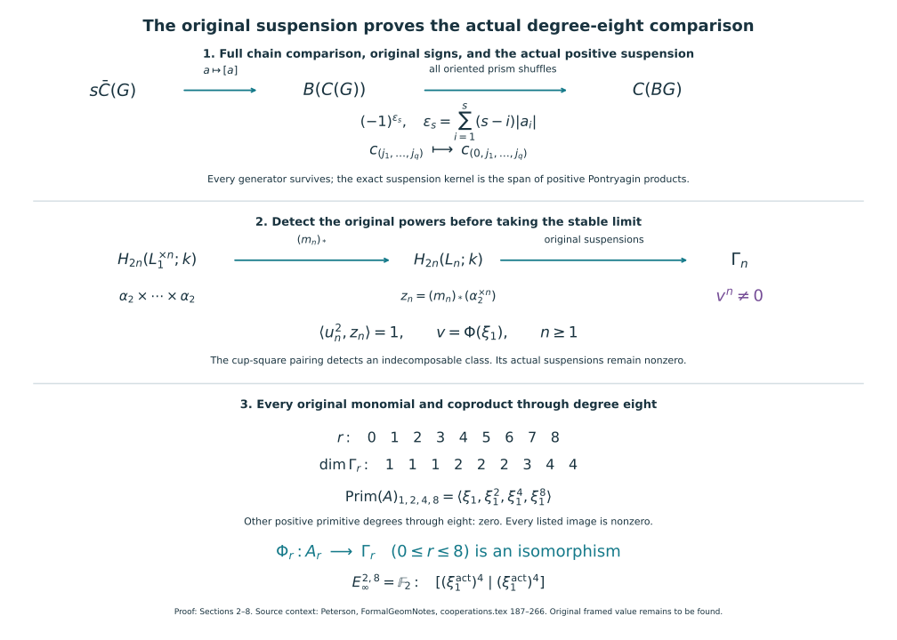

# The actual mod-two cooperation comparison through degree eight

Proof companion for CG-S6 lesson 7. GPT-6 Astra (OpenAI), Ultra, 11 October 2026. New exposition CC0-1.0. The objects are the original coefficient spectrum \(H=H\mathbb F_2\), its actual unit and multiplication, and \(\Gamma=\pi_*(H\wedge H)\). The projective-coordinate companion has already constructed the actual graded Hopf-algebra morphism
\[
\Phi:A=\mathbb F_2[\xi_1,\xi_2,\ldots]\longrightarrow\Gamma,
\qquad |\xi_i|=2^i-1,
\qquad \Delta\xi_n=\sum_{i=0}^n\xi_{n-i}^{2^i}\otimes\xi_i,
\quad \xi_0=1.
\tag{0.1}
\]
This chapter calculates the spaces needed to prove that this exact map is bijective through degree eight. It also proves that every power of its original first generator is nonzero. The [actual odd-prime companion](the-original-odd-prime-cooperations-and-degree-six-adams-calculation.md#odd-actual-adams) now proves the full signed bar and original suspension calculation, the actual cooperation degrees needed by stem six, and the signed comparison with the original Adams tower. It proves \(\pi_6(\mathbb S^{\wedge}_p)=0\) for every odd prime. The [original integral comparison](the-original-integral-stable-group-and-its-completion-maps.md#integral-degree-six-answer) now proves finite generation of the original sphere groups, the exact suspension range and the full unit comparison with all prime completions. It proves \(\pi_6(\mathbb S)=\mathbb Z/2\mathbb Z\) and that the original 2-completion unit is an isomorphism in degree six. The [original geometric framing proof](the-original-six-dimensional-framing-invariant.md#framed-six-original-nullbordism) constructs the full quadratic invariant, proves framed bordism invariance and gives value zero for the original framed homotopy six-sphere, with an actual framed nullbordism. The [sphere-twist and smooth-recognition proof](sphere-twists-and-the-original-smooth-six-sphere-comparison.md#twist-original-smooth-map) now constructs the new interior gluing with its full frame defect, cancels every actual handle and gives the orientation-preserving diffeomorphism to the original six-sphere, homotopic to its original degree-one map.

The included prerequisites are pinned to the verified course edition: full shuffle and front/back comparison, Section 4; original coefficient spaces and positive suspension, Section 9; original stable cross product and convergence, Section 11; actual resolution and cobar chain comparison, Section 5; original projective Hopf morphism, Sections 4–5; unit-preserving arithmetic comparison, Section 5. The full proofs remain in the course sources and offline readers.

## 1. The original chain models, with their degenerate contributions accounted for {#actual-eight-chain-models}

Put \(k=\mathbb F_2\). For a simplicial set \(V\), first form the free chain complex on all its simplices, with the full integer face differential \(\sum_{i=0}^n(-1)^i d_i\), followed by the indicated coefficient map to \(k\). Let \(D\) be the subcomplex spanned by degenerate simplices. We use the quotient \(C(V)\) by \(D\), and record why this comparison retains the homology of the original complex.

Filter \(D_n\) by the subspaces spanned by \(s_i y\) for \(i\leq p\). The simplicial identities give
\[
\partial s_p y
 =\sum_{j<p}(-1)^j s_{p-1}d_jy
   +\sum_{j>p+1}(-1)^j s_p d_{j-1}y.
\tag{1.1}
\]
The two missing face contributions are exactly the opposite-signed copies of \(y\); they cancel before changing coefficients. Thus this is a filtration by subcomplexes. On its \(p\)-th quotient, the map \((-1)^p s_p\) contracts it. To check the identity on \(z=s_p y\), the term numbered \(p+2\) in \(\partial s_pz\) is \((-1)^p z\), since \(d_{p+1}s_p=1\). All its later terms cancel with those of \(s_p\partial z\), with opposite signs. The earlier terms lie in the preceding filtration space. Also \(s_p s_i=s_i s_{p-1}\) for \(i<p\), so the contraction is well defined on the quotient. A cycle in \(D_n\) lies in a finite filtration stage. Subtract the boundary supplied by this contraction and decrease that stage; repeating ends at zero. Therefore \(D\) is acyclic and the quotient map induces an isomorphism on homology. Its quotient basis consists of the original nondegenerate simplices.

The CW realization argument in the Adams-tower companion, Section 9, identifies these nondegenerate simplices with the oriented cells of \(|V|\). Their cellular boundary is the same signed face formula, since degenerate faces have lower-dimensional image. The cellular/singular chain comparison already proved in the course consequently identifies
\[
H_*(C(V))=H_*(|V|;k).
\tag{1.2}
\]
Every construction is natural in maps of simplicial sets. This is an explicit comparison of chain models, not a replacement of a coefficient, grading or original group.

For a simplicial abelian group \(G\), give \(C(G)\) the shuffle cross product followed by its actual group addition. The unit is its zero vertex and the augmentation sends each vertex to one. In a product of simplices, the shuffle paths and their original permutation signs are exactly those in the Thom/Euler companion, Section 4. The construction descends to the quotient just used: a repeated input vertex makes the corresponding step of each product path degenerate. Interchanging two inputs of degrees \(a,b\) gives the original sign \((-1)^{ab}\); associativity follows because both orders enumerate the same paths with three sorts of steps. Thus \(C(G)\) is an augmented commutative differential graded algebra over \(k\). Here “commutative” includes the original graded signs before their value in \(k\) is taken.

Every positive-degree chain \(c\) has square zero in this algebra. For the square of a simplex of degree \(a>0\), pair a shuffle with the shuffle obtained by exchanging its two sorts of steps. There is no fixed shuffle: its first step already changes sort. The two resulting simplices have the same image under the commutative group addition. Their signs have the same value in \(k\), so each pair contributes zero. For a sum of simplices, the cross terms likewise pair in the two orders. This proves the chain identity
\[
c\ast c=0\qquad(|c|>0).
\tag{1.3}
\]
The symbol \(\ast\) always means the product from group addition. It will not be confused with the spectrum multiplication used in Section 6.

## 2. The actual bar comparison and its original signs {#actual-eight-bar-comparison}

Let \(G\) be a simplicial abelian group and put \(C=C(G)\), with augmentation ideal \(\bar C\). Its reduced algebraic bar has the full underlying space
\[
B(C)=\bigoplus_{s\geq0}(s\bar C)^{\otimes s},
\qquad |[a_1|\cdots|a_s]|=s+\sum_i|a_i|,
\tag{2.1}
\]
where each letter is suspended once and the empty word is the unit. Write \(n_i=|a_i|\). Its original differential is
\[
\begin{aligned}
d_{\rm int}[a_1|\cdots|a_s]
 &=\sum_{j=1}^s(-1)^{1+\sum_{i<j}(n_i+1)}
 [a_1|\cdots|da_j|\cdots|a_s],\\
d_{\rm mult}[a_1|\cdots|a_s]
 &=\sum_{j=1}^{s-1}(-1)^{\sum_{i\leq j}(n_i+1)}
 [a_1|\cdots|a_ja_{j+1}|\cdots|a_s].
\end{aligned}
\tag{2.2}
\]
The two outside faces are the actual augmentation faces; they are zero on \(\bar C\). The internal squares cancel by \(d_C^2=0\), the adjacent multiplication terms cancel by associativity, and the mixed terms cancel by the graded Leibniz identity. Thus (2.2) squares to zero. The shuffle product of the suspended letters, with their full Koszul signs, makes (2.1) a commutative differential graded algebra. The same pairing of shuffles proves that every nonempty homogeneous bar chain has square zero over \(k\).

Define the bisimplicial classifying object by
\[
\mathcal B_{s,t}G=G_t^s.
\tag{2.3}
\]
Its horizontal faces drop the first or last entry and add adjacent entries at each interior face; its horizontal degeneracies insert the group identity. Its vertical maps apply the simplicial maps of \(G\) to every entry. They commute with the horizontal maps. Its diagonal is a simplicial abelian group, denoted \(BG\). This keeps the original group addition at every stage.

Here is the chain comparison to its realization. For simplex representatives \(a_i\), take all oriented lattice-path simplices in the prism
\[
\Delta^s\times\Delta^{n_1}\times\cdots\times\Delta^{n_s}
 \longrightarrow |BG|,
\quad (t,u_1,\ldots,u_s)\longmapsto
[t;a_1(u_1),\ldots,a_s(u_s)],
\tag{2.4}
\]
and multiply this chain by
\[
(-1)^{\epsilon_s},\qquad
\epsilon_s=\sum_{i=1}^s(s-i)n_i.
\tag{2.5}
\]
Multilinearity defines the map on chains. The target in (2.4) is first the iterated realization of (2.3). Its comparison with the diagonal realization uses the same shuffle subdivision of the two simplex-coordinate sets. To justify this comparison directly, for a bisimplicial representable \(\Delta[p]\boxtimes\Delta[q]\), both realizations are \(\Delta^p\times\Delta^q\). The product-realization inverse is the common subdivision of cumulative barycentric sums proved in the Adams-tower companion. These identifications agree with every face and degeneracy. Every bisimplicial set is the quotient of the disjoint union of its representables by these maps, so they induce inverse continuous maps on their realizations. This proves the required realization comparison.

We verify (2.4) as a chain map with all signs. In its product prism, a boundary in the \(j\)-th input has exponent \(s+\sum_{i<j}n_i\), in addition to \(\epsilon_s\). The corresponding exponent from (2.2), after lowering \(n_j\) by one in (2.5), is
\[
\epsilon_s-(s-j)+1+\sum_{i<j}(n_i+1)
 =\epsilon_s-s+2j+\sum_{i<j}n_i.
\tag{2.6}
\]
Their difference is the even integer \(2j-2s\). At the interior horizontal face \(j\), combining the two neighboring degrees gives
\[
\epsilon_s-\epsilon'_{s-1}=\sum_{i\leq j}n_i,
\qquad
\epsilon'_{s-1}+\sum_{i\leq j}(n_i+1)=\epsilon_s+j.
\tag{2.7}
\]
This is exactly the original simplex-face sign in (2.4). Its chain is the original shuffle product followed by the specified adjacent group addition. Interior subdivision faces cancel in opposite-oriented pairs. The first and last horizontal faces project away an input: a positive-dimensional input then produces a degenerate simplex, while a degree-zero input in \(\bar C\) has total coefficient zero. These are precisely the two augmentation vanishings, including the degree-zero case. Hence all terms of the original differential agree.

The map is multiplicative. This can be checked on two prism generators before extending linearly. Subdivide their product by the ordered union of the two lists of cumulative horizontal barycentric sums. Each region is a shuffle of the two horizontal words; an entry belonging to one word has the identity in the other word's corresponding position. Addition in \(G\) therefore gives exactly the interleaved word. Subdivide all their vertical simplex factors at the same time. In either order of construction the terms are indexed by the same paths, preserving the order within each of the original horizontal words and vertical simplices. The product orientation and (2.5) give the sign for interchanging letters of suspended degrees \(n_i+1\), which is the bar shuffle sign. Associativity of lattice-path subdivision accounts for every term once. This proves equality of the two products after applying the comparison.

It remains to prove that the map induces a homology isomorphism. Use the chain model obtained by taking the free chains of (2.3), quotienting by the degenerate subcomplex in each direction, and taking the total complex with differential \(\partial_h+(-1)^s\partial_v\) in horizontal degree \(s\). On the full free chains, the shuffle and front/back maps in the two simplex directions compare this total complex with the chains of the diagonal. The universal convex-product contraction of the Thom/Euler companion, applied to \(\Delta^p\times\Delta^q\), gives both inverse homotopies before the degenerate quotients. The shuffle and front/back chain maps preserve the degenerate subcomplexes: a repeated step leaves a repeated vertex in the shuffle image, and in each front/back cut it remains a repetition in at least one retained factor. Each of those subcomplexes is acyclic by (1.1), applied in the relevant direction; the nonnegative double grading makes the passage to its total complex degreewise finite. Their quotient maps therefore induce homology isomorphisms, so the descended shuffle map also induces a homology isomorphism. This proves the desired comparison with the realization without requiring the chosen homotopies themselves to preserve a particular representative of a degenerate simplex. The horizontal filtration is the number of retained bar entries.

On the quotient of filtration \(s\) by filtration \(s-1\), our comparison is the \(s\)-fold reduced shuffle map
\[
\bar C^{\otimes s}\longrightarrow
 C(G^s)\Big/\sum_{i=1}^s C(G^{i-1}\times\{0\}\times G^{s-i}),
\tag{2.8}
\]
suspended by the original \(s\) simplex coordinates, with the sign (2.5). The front/back inverse and its homotopies preserve each indicated product subspace, as in the included product proof. The chain complexes split over the field, so tensoring the quotient maps is exact. Thus (2.8) induces an isomorphism on homology. This argument also works when \(G\) is disconnected.

For clarity, the passage from these quotient comparisons to the whole map involves no infinite convergence assumption. In a total degree \(N\), the horizontal length satisfies \(0\leq s\leq N\), since all vertical degrees are nonnegative. In the mapping cone of the comparison, take a cycle and its greatest nonzero horizontal filtration. Acyclicity of the corresponding quotient supplies a chain whose boundary cancels that part. Subtract it and repeat at the smaller filtration. At most finitely many repetitions are required. The same argument for the augmented degree zero proves that the entire cone is acyclic. We have proved the actual multiplicative comparison
\[
H_*(B(C(G)))\xrightarrow{\cong}H_*(|BG|;k).
\tag{2.9}
\]

The length-one part identifies its suspension map. For a cycle \(a\), it is the chain \([a]\), whose prism is the original positively directed interval times \(a\). Both interval endpoints are the basepoint. Its adjoint loop lifts in the homogeneous universal bundle from the zero vertex to the original group element. Its connecting map is therefore the identity with sign plus. This fixes the exact suspension orientation used below.

## 3. The complete exterior-algebra bar calculation {#actual-eight-exterior-bar}

Let \(E=k[e]/(e^2)\) have the retained internal degree \(d\geq0\). Its augmentation ideal has basis \(e\). In \(B(E)\), every nonempty word consists of copies of \(e\), and every multiplication face is zero because \(e^2=0\). Therefore the whole differential is zero. There is exactly one basis word of length \(s\), internal degree \(sd\), total degree \(s(d+1)\). The complete shuffle count gives
\[
[e|\cdots|e]_s\,[e|\cdots|e]_t
 =\left(\binom{s+t}{s}\bmod2\right)[e|\cdots|e]_{s+t}.
\tag{3.1}
\]
The full coproduct is the sum over all cuts, including both endpoints. Thus this is the divided-power algebra on the suspended original generator.

For several exterior generators, the tensor product of these answers maps into the bar of their tensor product by the full shuffle. We prove that it is a homology isomorphism, including the specified representatives. For one generator take the free augmented resolution with basis \(v_s\) in resolution degree \(s\), internal degree \(sd\), differential \(v_s\mapsto ev_{s-1}\), and augmentation \(Ev_0\to k\). Its kernel and image in every positive step are both \(ke\), so it is exact. Map it into the free augmented bar resolution by
\[
v_s\longmapsto 1\otimes[e|\cdots|e]_s.
\tag{3.2}
\]
The first bar face gives \(e\otimes[e|\cdots|e]_{s-1}\); all other multiplication faces are zero. Hence (3.2) is a chain map lifting the identity of \(k\).

For a finite set of generators tensor these resolutions over \(k\). Their tensor complex remains an exact free resolution of \(k\) over the full exterior algebra. Indeed every augmented exact complex of vector spaces splits into contractible two-term pieces; the actual inverse boundary maps contract them. Tensoring those homotopies, with the original tensor differential signs, contracts every tensor piece with an acyclic factor. The shuffle of (3.2) is a map from this tensor resolution to the full free bar resolution. The latter is exact because inserting the augmentation-ideal part of its first coefficient as a new first bar entry contracts its augmented complex; expansion of its first two faces gives the identity and all later faces cancel in pairs. Both resolutions are free.

For completeness, maps of these resolutions lifting the identity are inverse up to chain homotopy. Construct a reverse map one free basis vector at a time in increasing resolution degree. Its boundary has already been specified and is a cycle, so exactness of the other resolution supplies a preimage. The same induction applied to the difference of a composite and the identity constructs a homotopy: subtract the homotopy already defined on the boundary, obtaining a cycle, and lift it through the next boundary. These constructions preserve the internal grading because the differentials do. Tensoring the resulting maps and homotopies with \(k\) proves the claimed bar-homology isomorphism. It is specifically the shuffle map with representatives (3.2), so the product coefficients are those in (3.1), not unspecified structure constants.

Consequently, for the original exterior algebra on generators \(e_\lambda\) of degrees \(d_\lambda\),
\[
H_*(B(E))=
 \bigotimes_\lambda\Gamma_k(\sigma e_\lambda),
\qquad |\sigma e_\lambda|=d_\lambda+1.
\tag{3.3}
\]
An infinite family is the union over its finite subsets: every chain, cycle and bounding chain uses finitely many generators. Thus the same maps prove (3.3) for the whole family.

Every factor of (3.3) is itself an exterior algebra on the divided powers with indices \(2^j\). To prove this with the full coefficients, express an integer in binary. Multiplying the divided powers at its distinct nonzero binary positions has coefficient one in \(k\), because each corresponding binomial coefficient is odd: the coefficient follows directly from
\((1+T)^n=\prod_{j:n_j=1}(1+T^{2^j})\) in \(k[T]\). Squaring a factor at position \(j\) has coefficient \(\binom{2^{j+1}}{2^j}\), which is even by the same identity. Uniqueness of the binary expansion proves that these exterior monomials are exactly the original divided-power basis.

Suppose now that the actual homology algebra of \(C(G)\) is exterior on positive-degree classes. Choose cycles representing those original classes. Identity (1.3) and commutativity make the map from their zero-differential exterior algebra to \(C(G)\) a well-defined algebra map. On homology it is the isomorphism given by the chosen basis and its products. Applying the bar functor preserves this homology isomorphism: on each bar-length quotient it is a tensor product of augmentation-ideal homology isomorphisms over the field, and the same finite mapping-cone argument used for (2.9) applies. This proves the required replacement by its maps; it does not omit the original acyclic chain contributions.

The suspension has a particularly precise effect. In (3.3), the original generator \(e_\lambda\) goes to the nonzero generator \(\sigma e_\lambda\), represented by the one-letter word. Every product of at least two positive generators goes to zero, since
\[
d[a|b]=[ab]
\tag{3.4}
\]
for cycles \(a,b\) in this characteristic-two, zero-differential exterior algebra. Every decomposable is a sum of such products. Since the one-letter classes for different original generators are independent in (3.3), the suspension kernel is exactly the space of decomposables, and its image consists of independent indecomposable classes. The maps above transfer this assertion to the original \(G\) and its actual classifying-space suspension.

## 4. Application to the original coefficient spaces and every suspension {#actual-eight-original-suspension}

Let \(L_q=|K^q|\) be the original simplicial-cocycle spaces of the Adams-tower companion. Their actual abelian group operations, full cochain bundles and positive suspension maps were proved there. In particular \(L_0=k\), and \(L_q\) has its only nonzero homotopy group \(k\) in degree \(q\).

We first compare the classifying group of \(K^q\) with the original \(K^{q+1}\). The homogeneous bisimplicial object has entries \((K^q_t)^{s+1}\), horizontal faces deleting an entry, and quotient by the diagonal group action (2.3). On diagonals it gives a degreewise exact sequence of simplicial abelian groups
\[
0\longrightarrow K^q\longrightarrow E K^q\longrightarrow B K^q\longrightarrow0.
\tag{4.1}
\]
The middle realization is contractible. In the horizontal direction, inserting the zero vertex contracts the homogeneous bar construction. This insertion commutes with every vertical map, so gives a contraction of the iterated realization. The diagonal-realization comparison proved in Section 2 carries it to a contraction of \(|EK^q|\). The actual quotient-bundle argument in the Adams-tower companion, Section 9, applies to the exact sequence (4.1), including its local sections and relative disk lifting. Its homotopy exact sequence proves that \(|BK^q|\) has its sole nonzero homotopy group \(k\) in degree \(q+1\).

The cohomology-representing construction already proved for the original \(L_{q+1}\) now gives a map
\[
j_q:|BK^q|\longrightarrow L_{q+1}
\tag{4.2}
\]
which sends the generator specified by the connecting map of (4.1) to the original generator. To construct it, choose a cellular degree-\(q+1\) cocycle representing the homomorphism on the first homology group. Make the \(q\)-skeleton constant and assign that cocycle value to each oriented \((q+1)\)-cell. On each \((q+2)\)-cell, the attaching obstruction is the signed sum of those values on its boundary, which is zero by the cocycle equation. Thus the map extends across that dimension. All subsequent attaching obstructions lie in the higher, zero homotopy groups of \(L_{q+1}\), so the map extends across every remaining cell. This is the original cellular cohomology-representation construction with its first obstruction retained. The cellular Hurewicz comparison gives the required generator in degree \(q+1\); for \(q=0\), degree-one cohomology is directly the homomorphism on \(\pi_1\). The map is an isomorphism on every homotopy group and hence a homotopy equivalence by the course's CW argument.

It also preserves group addition up to homotopy. The two maps from \(|BK^q|\times|BK^q|\) to \(L_{q+1}\) in that assertion are classified by degree-\(q+1\) cohomology. There are no mixed terms in that degree: each factor is \(q\)-connected, and the field cross product makes the first possible mixed positive degree \(2q+2\). Their restrictions to either factor coincide with (4.2), so their cohomology classes, and therefore their homotopy classes, coincide. This proves that (4.2) preserves the actual Pontryagin homology algebra.

Finally, (4.2) carries the classifying-space suspension to the original positive suspension \(\sigma_q:\Sigma L_q\to L_{q+1}\). Their adjoint loops have the same connecting value by the endpoint calculation after (2.9) and the original endpoint calculation (9.6) of the Adams-tower chapter. Maps from \(\Sigma L_q\) to \(L_{q+1}\) are classified by \(\widetilde H^{q+1}(\Sigma L_q;k)=\widetilde H^q(L_q;k)=k\), including \(q=0\). Their common positive generator thus proves the full homotopy of these maps, not merely agreement on one homotopy group. This gives the receiving algebra and suspension comparison for the original coefficient spectrum.

At \(q=1\), the projective chapter's original bar cell \(\alpha_n=[g|\cdots|g]\) has boundary zero in \(k\). The Pontryagin shuffle gives the entire product
\[
\alpha_a\ast\alpha_b=\left(\binom{a+b}{a}\bmod2\right)\alpha_{a+b}.
\tag{4.3}
\]
Each shuffle has the same image word: at each coordinate exactly one input contributes \(g\), while the other contributes the identity. This identifies the algebra as divided powers on \(\alpha_1\), or as the exterior algebra on \(\alpha_{2^j}\), with their original degrees \(2^j\).

Inductively, the full homology algebra of \(L_q\), for \(q\geq1\), is exterior on generators indexed by
\[
J=(j_1,\ldots,j_q),\qquad
0\leq j_1\leq\cdots\leq j_q,
\qquad |c_J|=\sum_{i=1}^q2^{j_i}.
\tag{4.4}
\]
The base is (4.3). Given the assertion for \(q\), the actual algebra map of Section 3, followed by (2.9) and (4.2), proves the assertion for \(q+1\). More explicitly, the divided-power generator of index \(2^j\) on \(\sigma c_J\) has degree
\[
2^j\left(1+\sum_{i=1}^q2^{j_i}\right)
 =2^j+\sum_{i=1}^q2^{j+j_i}.
\tag{4.5}
\]
Its new ordered index is \((j,j+j_1,\ldots,j+j_q)\). This correspondence is bijective: recover \(j\) as the first entry and subtract it from every subsequent entry to recover \(J\). Thus no generator is lost or counted twice. The original suspension satisfies
\[
\sigma_*c_J=c_{(0,J)},
\qquad
\ker\sigma_*=(H_{>0}(L_q;k))^{\ast2},
\tag{4.6}
\]
where the right side means the span of products of two positive classes, not only literal squares. The image in (4.6) is an independent family of indecomposables. This is the actual suspension map, by the comparison already proved, and holds at every stage.

## 5. The complete graded dimensions of the actual cooperation space {#actual-eight-graded-dimensions}

The existing stable homology comparison identifies the original cooperation space as
\[
\Gamma_r=H_r(H;k)=\operatorname*{colim}_{q}\widetilde H_{q+r}(L_q;k)
\tag{5.1}
\]
along the positive original suspension maps. In (4.4), the smallest generator degree is \(q\), occurring only for the all-zero index. Its square is zero, and the next generator degree is \(q+1\). Therefore a product of two distinct positive generators has degree at least \(2q+1\). For \(q\geq\max(1,r)\), every positive class of degree \(q+r\) is consequently a linear combination of the individual generators (4.4). Their indexing equation is exactly
\[
\sum_{i=1}^q(2^{j_i}-1)=r.
\tag{5.2}
\]
Each positive entry contributes at least one, so there are at most \(r\) positive entries. For the stated \(q\), all multisets of positive entries satisfying (5.2) fit, and zeros supply the remaining entries. Suspension inserts precisely one initial zero and is a bijection on these bases. Thus the stable dimension is the number of original monomials of weighted degree \(r\) in (0.1). In particular the full dimensions for \(0\leq r\leq8\) are
\[
(\dim\Gamma_0,\ldots,\dim\Gamma_8)
 =(1,1,1,2,2,2,3,4,4).
\tag{5.3}
\]
This proves an actual vector-space calculation. The identification of its products with those of (0.1) will use the already constructed map, not this count alone.

## 6. Every power of the original first coefficient is nonzero {#actual-eight-nonzero-powers}

Put \(v=\Phi(\xi_1)\). The projective chapter proved
\(\langle\beta,v\rangle=1\) and that \(\Gamma_1\) is one-dimensional, where \(\beta\) is the connecting operation for the original sequence \(0\to k\xrightarrow{1\mapsto2}\mathbb Z/4\to k\to0\). Its original projective formula is \(\beta(x)=x^2\).

The stabilization of \(\alpha_2\in H_2(L_1;k)\), dual to \(x^2\), is exactly \(v\). Indeed pairing its stable image with \(\beta\) evaluates the representing operation on the original universal class \(x\); the result is \(\langle x^2,\alpha_2\rangle=1\). This pairing is the actual multiplication map used in projective equation (5.3), since composing its right unit with the operation is that operation. Both nonzero classes lie in the one-dimensional original \(\Gamma_1\), so they coincide.

For \(n\geq1\), let \(u_n\in H^n(L_n;k)\) be the original universal class, and let
\[
m_n:L_1^{\times n}\longrightarrow L_n
\tag{6.1}
\]
represent the cup product of the \(n\) original degree-one classes. It is the level-space map of the original spectrum multiplication: that multiplication was compared with the original cup product by its unit and degree-zero coefficient map in the cooperation chapter. Define the actual class
\[
z_n=(m_n)_*(\alpha_2\times\cdots\times\alpha_2)
 \in H_{2n}(L_n;k).
\tag{6.2}
\]
The full pullback is \(m_n^*u_n=x_1\cdots x_n\). Retaining the integer interchange sign before reducing coefficients gives
\[
m_n^*(u_n^2)=(-1)^{n(n-1)/2}x_1^2\cdots x_n^2,
\qquad \langle u_n^2,z_n\rangle=1\in k.
\tag{6.3}
\]
The evaluation of the exterior product is one on the original product of the \(\alpha_2\); its coefficient sign has image one in \(k\). In particular \(z_n\neq0\).

This detected class is indecomposable for the Pontryagin product. One can see this from (4.4): its degree is \(2n\), while every product of two distinct positive generators has degree at least \(2n+1\), and the repeated bottom generator has square zero. There is also a direct comparison with the detecting functional. The original universal class is primitive under group addition, since that addition represents addition of cohomology classes. Therefore \(u_n^2\) is primitive as well, by the full characteristic-two square expansion. Such a class evaluates to zero on a product of two positive homology classes: both terms of its coproduct have a degree-zero factor. Thus (6.3) independently excludes decomposability of \(z_n\).

Equation (4.6) now proves that \(z_n\) and each of its subsequent suspensions are nonzero indecomposable classes. Its image in (5.1) is therefore nonzero. That image is exactly \(v^n\), by (6.1)–(6.2) and the original stable cross-product comparison. In particular its iterated desuspension sign from equation (11.2a) of the Adams-tower chapter is
\[
(-1)^{\sum_{j=1}^n2(j-1)}=(-1)^{n(n-1)}=1;
\tag{6.4}
\]
all original input degrees are two and every desuspension has degree one. We have proved the all-exponent statement
\[
v^n\neq0\quad\hbox{in }\Gamma_n\qquad(n\geq1).
\tag{6.5}
\]
This is a calculation of the product from the original spectrum multiplication. It is distinct from the Pontryagin product \(\ast\), whose role was to determine the exact suspension kernel; the maps (6.1)–(6.4) prove their required relation.

## 7. The finite primitive calculation and bijectivity of the actual map {#actual-eight-bijectivity}

The complete reduced-coproduct table below is calculated in the original algebra (0.1). Write \(x=\xi_1,y=\xi_2,z=\xi_3\) only to shorten the table's labels. Their original degrees remain one, three and seven. No generator of higher index occurs through degree eight. Every full coproduct is the displayed reduced coproduct plus its two original endpoints.

Degree 1:

\[
\begin{aligned}
\bar\Delta(x)&=0,\\
\end{aligned}
\]

Degree 2:

\[
\begin{aligned}
\bar\Delta(x^{2})&=0,\\
\end{aligned}
\]

Degree 3:

\[
\begin{aligned}
\bar\Delta(y)&=x^{2}\otimes x,\\
\bar\Delta(x^{3})&=x\otimes x^{2}+x^{2}\otimes x,\\
\end{aligned}
\]

Degree 4:

\[
\begin{aligned}
\bar\Delta(xy)&=y\otimes x+x\otimes y+x^{2}\otimes x^{2}\\
&\quad+x^{3}\otimes x,\\
\bar\Delta(x^{4})&=0,\\
\end{aligned}
\]

Degree 5:

\[
\begin{aligned}
\bar\Delta(x^{2}y)&=y\otimes x^{2}+x^{2}\otimes y+x^{2}\otimes x^{3}\\
&\quad+x^{4}\otimes x,\\
\bar\Delta(x^{5})&=x\otimes x^{4}+x^{4}\otimes x,\\
\end{aligned}
\]

Degree 6:

\[
\begin{aligned}
\bar\Delta(y^{2})&=x^{4}\otimes x^{2},\\
\bar\Delta(x^{3}y)&=y\otimes x^{3}+x\otimes x^{2}y+xy\otimes x^{2}\\
&\quad+x^{2}\otimes xy+x^{2}\otimes x^{4}+x^{2}y\otimes x\\
&\quad+x^{3}\otimes y+x^{3}\otimes x^{3}+x^{4}\otimes x^{2}\\
&\quad+x^{5}\otimes x,\\
\bar\Delta(x^{6})&=x^{2}\otimes x^{4}+x^{4}\otimes x^{2},\\
\end{aligned}
\]

Degree 7:

\[
\begin{aligned}
\bar\Delta(z)&=y^{2}\otimes x+x^{4}\otimes y,\\
\bar\Delta(xy^{2})&=y^{2}\otimes x+x\otimes y^{2}+x^{4}\otimes x^{3}\\
&\quad+x^{5}\otimes x^{2},\\
\bar\Delta(x^{4}y)&=y\otimes x^{4}+x^{2}\otimes x^{5}+x^{4}\otimes y\\
&\quad+x^{6}\otimes x,\\
\bar\Delta(x^{7})&=x\otimes x^{6}+x^{2}\otimes x^{5}+x^{3}\otimes x^{4}\\
&\quad+x^{4}\otimes x^{3}+x^{5}\otimes x^{2}+x^{6}\otimes x,\\
\end{aligned}
\]

Degree 8:

\[
\begin{aligned}
\bar\Delta(xz)&=z\otimes x+y^{2}\otimes x^{2}+x\otimes z\\
&\quad+xy^{2}\otimes x+x^{4}\otimes xy+x^{5}\otimes y,\\
\bar\Delta(x^{2}y^{2})&=y^{2}\otimes x^{2}+x^{2}\otimes y^{2}+x^{4}\otimes x^{4}\\
&\quad+x^{6}\otimes x^{2},\\
\bar\Delta(x^{5}y)&=y\otimes x^{5}+x\otimes x^{4}y+xy\otimes x^{4}\\
&\quad+x^{2}\otimes x^{6}+x^{3}\otimes x^{5}+x^{4}\otimes xy\\
&\quad+x^{4}y\otimes x+x^{5}\otimes y+x^{6}\otimes x^{2}\\
&\quad+x^{7}\otimes x,\\
\bar\Delta(x^{8})&=0,\\
\end{aligned}
\]

To verify the primitive-space conclusion, take a linear combination of each degree's displayed monomials. The ordered coefficient witnesses below successively force the indicated coefficients to vanish. At each step all earlier forced coefficients are already zero, and the indicated tensor row has exactly the one remaining coefficient. The four zero columns are \(x,x^2,x^4,x^8\). Their vanishing reduced coproduct also follows directly from the full binomial expansion in characteristic two. Thus
\[
\operatorname{Prim}(A)_r=
\begin{cases}k\xi_1^r,&r\in\{1,2,4,8\},\\
0,&r\in\{3,5,6,7\}.
\end{cases}
\tag{7.1}
\]

- Degree 3: \(x\otimes x^{2}\) forces the coefficient of \(x^{3}\); then \(x^{2}\otimes x\) forces the coefficient of \(y\) to zero.
- Degree 4: \(y\otimes x\) forces the coefficient of \(xy\) to zero.
- Degree 5: \(y\otimes x^{2}\) forces the coefficient of \(x^{2}y\); then \(x\otimes x^{4}\) forces the coefficient of \(x^{5}\) to zero.
- Degree 6: \(y\otimes x^{3}\) forces the coefficient of \(x^{3}y\); then \(x^{2}\otimes x^{4}\) forces the coefficient of \(x^{6}\); then \(x^{4}\otimes x^{2}\) forces the coefficient of \(y^{2}\) to zero.
- Degree 7: \(y\otimes x^{4}\) forces the coefficient of \(x^{4}y\); then \(x\otimes y^{2}\) forces the coefficient of \(xy^{2}\); then \(y^{2}\otimes x\) forces the coefficient of \(z\); then \(x\otimes x^{6}\) forces the coefficient of \(x^{7}\) to zero.
- Degree 8: \(z\otimes x\) forces the coefficient of \(xz\); then \(y\otimes x^{5}\) forces the coefficient of \(x^{5}y\); then \(y^{2}\otimes x^{2}\) forces the coefficient of \(x^{2}y^{2}\) to zero.

We can now prove injectivity of the actual map (0.1) in every degree at most eight. Its degree-zero map is the original unit isomorphism. Suppose a least positive degree \(r\leq8\) has a nonzero kernel element \(a\). Every factor of \(\bar\Delta a\) has positive degree less than \(r\). The maps in those degrees are injective, so their tensor product over the field is injective. The coproduct identity already proved for \(\Phi\) gives
\[
(\Phi\otimes\Phi)(\bar\Delta a)
 =\bar\Delta(\Phi(a))=0,
\tag{7.2}
\]
and hence \(\bar\Delta a=0\). By (7.1), the degree is one of \(1,2,4,8\) and its only possible nonzero element is \(\xi_1^r\). But its image is \(v^r\neq0\) by (6.5), a contradiction. This proves injectivity. The actual dimension calculation (5.3) equals the dimensions of the displayed original monomial bases. An injective linear map between these equal finite dimensions is surjective as well: its independent basis images already have the full number of target basis elements. Thus the exact map constructed from the two projective coordinates satisfies
\[
\Phi_r:A_r\xrightarrow{\cong}\Gamma_r
\qquad(0\leq r\leq8).
\tag{7.3}
\]
Its already proved coproduct, unit, counit, multiplication and antipode identities remain those of the actual ordered factors. Equation (7.3) is an identification of these original morphisms, not an assignment based only on matching dimensions.

The first row uses the suspension of the augmentation ideal, so its chain map has degree zero. The middle row is the actual homology map induced by \(m_n\), followed by the stable suspension system. Sections 2–7 prove all displayed maps; Section 8 proves the receiving permanent-cycle statement.

## 8. The receiving degree-six cobar comparison {#actual-eight-receiving-cobar}

At fixed cobar length \(s\), the full degree-six cohomology calculation has the three adjacent terms of total degree \(s+6\), at lengths \(s-1,s,s+1\). Their largest possible single-letter degrees are respectively eight, seven and six, because every other letter has positive degree. These are the original all-length bounds already proved in the actual-cooperation companion. Equation (7.3) therefore identifies every factor in all three terms. Applying \(\Phi\) to each letter is the actual cobar chain map already constructed in the projective companion; its full differential agrees term by term because the full coproduct and both coaugmentation endpoints agree. We obtain the actual isomorphism
\[
H^{s,s+6}(C^*(A))\xrightarrow{\cong}
H^{s,s+6}(C^*(\Gamma))
\quad\hbox{for every }s\geq0.
\tag{8.1}
\]
For lengths zero or one, empty or negative adjacent terms have their original meanings: the empty word has degree zero and a negative length contributes zero. The same reasoning, with bounds seven, six and five, gives the entire degree-five comparison. No bounded-length truncation has been used.

The [complete algebraic calculation](the-degree-six-milnor-cobar-calculation.md#six-cobar-all-lengths) has one degree-six class, at bidegree \((2,8)\), represented by \([\xi_1^4|\xi_1^4]\), and has zero degree-five cohomology at every length. The actual Adams-resolution comparison hence gives these statements for the original mod-two Adams \(E_2\)-page. Its sole degree-six class is represented by
\[
[(\xi_1^{\rm act})^4|(\xi_1^{\rm act})^4].
\tag{8.2}
\]
It is a permanent cycle. Every outgoing differential lands in the degree-five line, which is zero from the second page onward. An incoming \(d_r\), with \(r\geq2\), would start at \((2-r,9-r)\). At \(r=2\), this is \((0,7)\), whose group is zero because length zero contains only the degree-zero empty word; for \(r>2\) the filtration is negative. Thus no incoming differential exists.

The complete original convergence and arithmetic comparison already proved in the course now identify
\[
\pi_6(\mathbb S^{\wedge}_2)\cong k,
\tag{8.3}
\]
with its sole nonzero associated graded piece at filtration two, and with the representative (8.2). To check the extension assertion, let \(F^s\) be that complete separated Adams filtration. Every successive quotient is zero except \(F^2/F^3=k\). Thus \(F^0=F^1=F^2\), and \(F^3=F^4=\cdots\). Separatedness makes their intersection, and hence \(F^3\), zero. This leaves exactly the single quotient \(k\), with no additive extension. The equality with the original arithmetic completion uses the previously proved unit-preserving map; no unproved equality of integral and completed homotopy groups is inferred here.

The [actual odd-prime companion](the-original-odd-prime-cooperations-and-degree-six-adams-calculation.md#odd-actual-adams) now proves the full signed bar and original suspension calculation, the actual cooperation degrees needed by stem six, and the signed comparison with the original Adams tower. It proves \(\pi_6(\mathbb S^{\wedge}_p)=0\) for every odd prime. The [original integral comparison](the-original-integral-stable-group-and-its-completion-maps.md#integral-degree-six-answer) now proves finite generation of the original sphere groups, the exact suspension range and the full unit comparison with all prime completions. It proves \(\pi_6(\mathbb S)=\mathbb Z/2\mathbb Z\) and that the original 2-completion unit is an isomorphism in degree six. The [original geometric framing proof](the-original-six-dimensional-framing-invariant.md#framed-six-original-nullbordism) constructs the full quadratic invariant, proves framed bordism invariance and gives value zero for the original framed homotopy six-sphere, with an actual framed nullbordism. The [sphere-twist and smooth-recognition proof](sphere-twists-and-the-original-smooth-six-sphere-comparison.md#twist-original-smooth-map) now constructs the new interior gluing with its full frame defect, cancels every actual handle and gives the orientation-preserving diffeomorphism to the original six-sphere, homotopic to its original degree-one map. In particular this chapter does not yet identify the original manifold's image in the two-element group (8.3). It supplies its exact actual target and permanent-cycle representative.

## 9. Two worked calculations with the actual receiving maps {#actual-eight-exercises}

### Exercise 9.1. A nonzero class killed by suspension

Find the complete homology basis of \(L_2\) in degrees two through six, and calculate the suspension on every class in those bases. Exhibit a nonzero class whose suspension is zero.

**Solution.** The tuples in (4.4) give the generators
\[
\begin{aligned}
a&=c_{(0,0)},\quad b=c_{(0,1)},\quad c=c_{(1,1)},\\
d&=c_{(0,2)},\quad e=c_{(1,2)},\\
|a|&=2,\quad |b|=3,\quad |c|=4,\quad |d|=5,\quad |e|=6.
\end{aligned}
\tag{9.1}
\]
There are no other generators in these degrees: the only powers of two at most six are one, two and four, and the displayed pairs are exactly those whose sums are at most six. The algebra is exterior, so every distinct-generator product occurs once and every repeated-generator product is zero. Its full bases are
\[
\begin{array}{c|ccccc}
r&2&3&4&5&6\\\hline
H_r(L_2;k)&k\{a\}&k\{b\}&k\{c\}&k\{d,a\ast b\}&k\{e,a\ast c\}.
\end{array}
\tag{9.2}
\]
Equation (4.6), with the original positive suspension, sends the five listed generators respectively to
\[
c_{(0,0,0)},\quad c_{(0,0,1)},\quad c_{(0,1,1)},\quad
c_{(0,0,2)},\quad c_{(0,1,2)}.
\tag{9.3}
\]
Each target is a nonzero indecomposable. Both products in (9.2) have zero suspension. Explicitly, in the bar of the chosen exterior chain model,
\[
d[a|b]=(-1)^{2+1}[a\ast b]=[a\ast b],\qquad
d[a|c]=(-1)^{2+1}[a\ast c]=[a\ast c]
\quad\hbox{over }k.
\tag{9.4}
\]
The internal terms vanish because these inputs are cycles; both augmentation endpoints vanish because the inputs are positive. The actual bar comparison takes these equations to bounding chains for the suspended original products. Thus \(a\ast b\neq0\) is the requested nonzero class with zero suspension. The calculation also shows why the proof uses the indecomposable quotient before passing to the stable system.

### Exercise 9.2. Why the degree-eight cooperation cannot be omitted

Use the original coproduct (0.1) to compute the full actual cobar boundary of \([\xi_1^{\rm act}\xi_3^{\rm act}]\). Identify every tensor term and its degree, and relate the calculation to the incoming boundary at bidegree \((2,8)\).

**Solution.** Put \(x=\xi_1^{\rm act}\), \(y=\xi_2^{\rm act}\), \(z=\xi_3^{\rm act}\), with the original degrees one, three and seven. The actual comparison gives
\[
\Delta x=x\otimes1+1\otimes x,
\qquad
\Delta z=z\otimes1+y^2\otimes x+x^4\otimes y+1\otimes z.
\tag{9.5}
\]
Multiply these two entire expressions in the graded tensor algebra. The integer Koszul signs for crossing the middle factors all have their specified value one in \(k\). The full result is
\[
\begin{aligned}
\Delta(xz)&=xz\otimes1+xy^2\otimes x+x^5\otimes y+x\otimes z\\
 &\quad+z\otimes x+y^2\otimes x^2+x^4\otimes xy+1\otimes xz.
\end{aligned}
\tag{9.6}
\]
The two outside terms are precisely the original coaugmentation endpoints. Removing them, and only them, gives
\[
\begin{aligned}
d[xz]&=[xy^2|x]+[x^5|y]+[x|z]\\
 &\quad+[z|x]+[y^2|x^2]+[x^4|xy].
\end{aligned}
\tag{9.7}
\]
The six ordered degree pairs are \((7,1),(5,3),(1,7),(7,1),(6,2),(4,4)\); the repeated pair \((7,1)\) belongs to two different original tensor monomials and is not combined or discarded. Each total degree is eight. The input has length one and the output length two. Although every output letter has degree at most seven, its bounding cochain contains the actual degree-eight cooperation \(xz\). This proves concretely why knowing the comparison only through degree seven would not determine the incoming image in bidegree \((2,8)\). Equation (7.3) includes the required degree-eight map, so the boundary is identified in the actual cobar complex.

Human source context is Eric Peterson, *Formal Geometry and Bordism Operations*, [original author TeX, pinned revision](https://github.com/ecpeterson/FormalGeomNotes/blob/2f1cd08cb4f7b7b643eec441eae78637bbb71973/cooperations.tex#L187), lines 187–266, within the actually read interval 59–276. That source discusses iterated bar calculations and the unstable homology algebra. This chapter gives the receiving chain comparison, original suspension, nonvanishing argument and finite primitive test explicitly, with the original coefficient-spectrum maps from the included course. Original author sources are retained unchanged. No independent review, exhaustive literature reading or novelty is claimed.

The [supplementary exact checker](../checks/verify_actual_degree_eight.py) passes 316 finite checks of the original signs, complete small bar complexes, tuple dimensions, coproduct matrices and both exercises. The actual geometric maps and the all-exponent arguments are proved in the text; finite checks do not certify those proofs.
