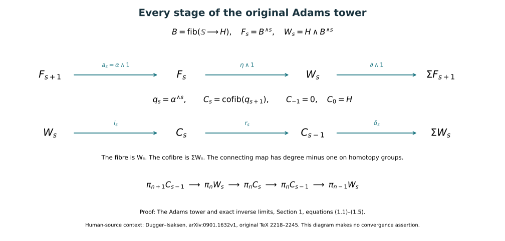
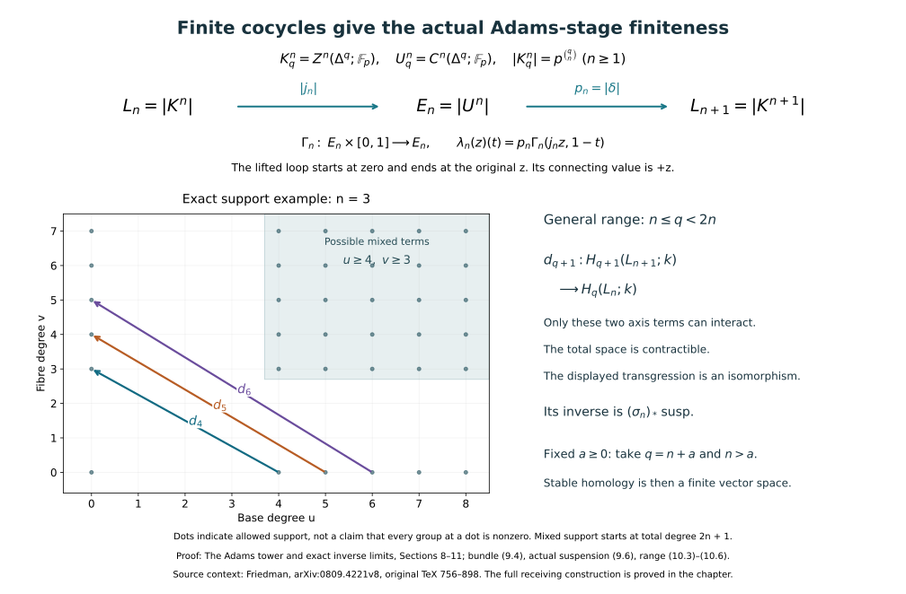

# The Adams tower and exact inverse limits

Proof companion for CG-S6 lesson 7. GPT-6 Astra (OpenAI), Ultra, 10 October 2026. New exposition CC0. This source proves the complete finite-tower convergence argument and the all-length degree-five cobar vanishing used by the receiving calculation. The required mod-two cooperation comparison is proved in the [degree-eight companion](the-actual-mod-two-cooperation-comparison-through-degree-eight.md#actual-eight-bijectivity), and the [actual odd-prime companion](the-original-odd-prime-cooperations-and-degree-six-adams-calculation.md#odd-actual-adams) proves the odd-prime completed degree-six groups vanish. The arithmetic comparison is proved in its linked companion below. No value of the original framed manifold is asserted here.

Sections 8–11, added 11 October 2026, construct the ordinary-cohomology spectrum and prove that the actual sphere tower satisfies the finiteness used in Section 4. They retain the original cochains, all face maps and the actual suspension maps. The resulting convergence is to the displayed homotopy limit; its arithmetic comparison is not implicit in that result.

## 1. Every map in the original tower {#adams-original-tower}

Fix a prime \(p\). Write \(H=H\mathbb F_p\) for the spectrum representing ordinary mod-\(p\) cohomology, \(\mathbb S\) for the sphere spectrum, and \(\eta:\mathbb S\to H\) for its unit. In this section, fibres and cofibres mean homotopy fibres and homotopy cofibres. Fix the fibre sequence
\[
 B\xrightarrow{\alpha}\mathbb S\xrightarrow{\eta}H
     \xrightarrow{\partial}\Sigma B.
 \tag{1.1}
\]
Define \(F_0=\mathbb S\) and \(F_s=B^{\wedge s}\) for \(s\geq1\), with the factors in this order. The transition \(a_s:F_{s+1}\to F_s\) applies \(\alpha\) to the first factor and the identity to the remaining \(s\) factors. Put
\[
 q_s=\alpha^{\wedge s}:F_s\longrightarrow\mathbb S,
 \qquad q_0=1_{\mathbb S},\qquad q_{s+1}=q_s a_s,
 \qquad W_s=H\wedge F_s.
 \tag{1.2}
\]
Smashing (1.1) on the right by \(F_s\) gives the exact fibre/cofibre sequence
\[
 F_{s+1}\xrightarrow{a_s}F_s
 \xrightarrow{\eta\wedge1}W_s
 \xrightarrow{\partial\wedge1}\Sigma F_{s+1}.
 \tag{1.3}
\]
All maps retain the chosen factor order. No unmentioned exchange of suspension factors is used.

Set
\[
 C_s=\operatorname{cofib}(q_{s+1}:F_{s+1}\to\mathbb S)
       \quad(s\geq0),\qquad C_{-1}=0.
 \tag{1.4}
\]
The commuting square with vertical maps \(a_s\) and \(1_{\mathbb S}\) induces \(r_s:C_s\to C_{s-1}\). Thus \(C_0=H\), with its unit map from the original sphere. The resulting exact sequence is
\[
 W_s\xrightarrow{i_s}C_s\xrightarrow{r_s}C_{s-1}
             \xrightarrow{\delta_s}\Sigma W_s.
 \tag{1.5}
\]
Here is the cofibre calculation fixing the index and suspension. Apply the cofibre construction to the composable maps
\(F_{s+1}\xrightarrow{a_s}F_s\xrightarrow{q_s}\mathbb S\).
The three cofibres are respectively \(W_s,C_s,C_{s-1}\). The cofibre sequence of these three maps is (1.5). Concretely, replace both maps by mapping-cylinder inclusions. The quotient of the cylinder of the composite first by the cylinder of the first map and then by the cylinder of the second gives the same quotient as taking their union first. This identifies the last cofibre with \(\Sigma W_s\), including the original connecting map. In a stable category this cofibre sequence is also a fibre sequence. In particular the fibre of \(C_s\to C_{s-1}\) is \(W_s\); its cofibre is \(\Sigma W_s\).

Define \(\widehat{\mathbb S}_H=\operatorname{holim}_{s\geq0}C_s\), with the map from \(\mathbb S\) induced by its compatible maps to every \(C_s\). This is a definition of this particular completion. Identifying it with an arithmetic completion of the original stable homotopy groups requires its own comparison; the notation does not assert that comparison.

The upper sequence smashes the original unit fibre sequence by the retained ordered factors. The lower sequence is (1.5), with the displayed connecting degree. The reproducible source is `draw_adams_tower.py`; the rendered labels and arrows have been inspected.

## 2. The inverse limit of finite groups and the full difference map

Let \(A_0\xleftarrow{q_0}A_1\xleftarrow{q_1}\cdots\) be a sequence of finite abelian groups. Retain every transition, including transitions that are not surjective. Define
\[
 D:\prod_{s\geq0}A_s\longrightarrow\prod_{s\geq0}A_s,
 \qquad D((a_s)_{s\geq0})=(a_s-q_s(a_{s+1}))_{s\geq0}.
 \tag{2.1}
\]
Its kernel is exactly the group of compatible sequences \(\lim_s A_s\). Its cokernel is zero, as follows by an explicit construction.

Fix \(b=(b_s)\) in the target. For every \(N\geq0\), let \(T_N\) be the finite set of tuples \((a_0,\ldots,a_N)\) satisfying
\(a_s-q_s(a_{s+1})=b_s\) for \(0\leq s<N\).
It is nonempty: choose \(a_N=0\) and, moving backward, set \(a_s=b_s+q_s(a_{s+1})\). Truncation makes these finite sets a rooted tree of partial solutions. Each vertex has finitely many immediate extensions. A vertex is called indefinitely extendible when it has extensions at arbitrarily large levels. The root has this property because every level is nonempty. An indefinitely extendible vertex has an indefinitely extendible immediate child: otherwise finitely many upper bounds on the lengths of its children's extensions would give an upper bound for the parent. Choose such a child successively. The resulting infinite branch gives a sequence solving every equation (2.1). Thus
\[
 0\longrightarrow\lim_s A_s\longrightarrow\prod_s A_s
   \xrightarrow{D}\prod_s A_s\longrightarrow0
 \tag{2.2}
\]
is exact. In particular the derived-limit group, defined for this countable tower by \(\lim^1 A_s=\operatorname{coker}D\), vanishes. No surjectivity of the individual \(q_s\) was assumed.

There is a second exact description needed below. Put
\[
 I_s=\bigcap_{k\geq s}\operatorname{im}(A_k\longrightarrow A_s).
 \tag{2.3}
\]
Then the image of \(\lim_kA_k\to A_s\) is exactly \(I_s\). One inclusion follows from compatibility. For the other, fix \(a\in I_s\). For every \(N\geq s\), choose an element of \(A_N\) mapping to \(a\), and use its images to obtain a compatible finite tuple down to level zero. The finite tree of all such tuples is nonempty at every level. The same indefinitely-extendible-vertex argument supplies a compatible infinite tuple whose \(s\)-th component is the original \(a\). This proves the other inclusion, without choosing incompatible lifts independently.

## 3. Every page of the tower spectral sequence

We first work with an arbitrary tower \(C_s\), indexed as in (1.5), with \(C_j=0\) for \(j<0\) and specified fibre sequences
\(W_s\xrightarrow{i_s}C_s\xrightarrow{r_s}C_{s-1}\to\Sigma W_s\).
Let \(p_{v,u}:C_v\to C_u\) denote the full composite of the original transition maps for \(v\geq u\). All groups in this section are stable homotopy groups, hence abelian, and no finiteness assertion is needed for the page formulas.

For \(s\geq0\), \(n\in\mathbb Z\), and \(r\geq1\), define actual subgroups of \(\pi_nW_s\) by
\[
 \begin{aligned}
 Z_r^{s,n}
 &=\{x\in\pi_nW_s:(i_s)_*x\in
       \operatorname{im}((p_{s+r-1,s})_*:\pi_nC_{s+r-1}\to\pi_nC_s)\},\\
 B_r^{s,n}
 &=(\partial_s)_*\ker\bigl((p_{s-1,s-r})_*:
             \pi_{n+1}C_{s-1}\to\pi_{n+1}C_{s-r}\bigr),
 \end{aligned}
 \tag{3.1}
\]
where \((\partial_s)_*:\pi_{n+1}C_{s-1}\to\pi_nW_s\) is the connecting homomorphism of the specified sequence. For a negative target index the target group is zero. Exactness gives \(i_s\partial_s=0\), so \(B_r^{s,n}\subset Z_r^{s,n}\). Also \(Z_1^{s,n}=\pi_nW_s\) and \(B_1^{s,n}=0\).

The page is
\[
 E_r^{s,t}=Z_r^{s,t-s}/B_r^{s,t-s}.
 \tag{3.2}
\]
For a representative \(x\in Z_r^{s,n}\), choose an actual lift
\(a\in\pi_n C_{s+r-1}\) of \((i_s)_*x\), and set
\[
 d_r[x]=[(\partial_{s+r})_*a]
      \in E_r^{s+r,t+r-1},\qquad t=n+s.
 \tag{3.3}
\]
The target has homotopy degree \(n-1\), exactly as its two indices require. Its representative belongs to every \(Z_k\), because its image under \(i_{s+r}\) is zero and can therefore be lifted by zero to every later stage.

We prove well-definedness and the page transition, retaining the choices. Two lifts differ by an element of the kernel of
\(\pi_nC_{s+r-1}\to\pi_nC_s\).
Its boundary is exactly in \(B_r^{s+r,n-1}\) by (3.1). Adding a representative from \(B_r^{s,n}\) to \(x\) leaves \((i_s)_*x\) unchanged, so the same lift may be used. This proves that (3.3) is well-defined. Since the target representative has image zero, zero is a lift for computing its next differential; hence \(d_r^2=0\).

Suppose \(d_r[x]=0\). Then there is
\(b\in\ker(\pi_nC_{s+r-1}\to\pi_nC_s)\)
with \(\partial_{s+r}a=\partial_{s+r}b\). Exactness in (1.5) lifts \(a-b\) to \(\pi_nC_{s+r}\); it still maps to \((i_s)_*x\). Thus \(x\in Z_{r+1}^{s,n}\). Conversely any such lift makes (3.3) zero. This proves
\[
 \ker d_r=Z_{r+1}^{s,n}/B_r^{s,n}.
 \tag{3.4}
\]

The incoming image is exactly \(B_{r+1}^{s,n}/B_r^{s,n}\). To check the nontrivial inclusion, take
\(b\in\pi_{n+1}C_{s-1}\) mapping to zero in \(\pi_{n+1}C_{s-r-1}\).
When \(s-r\geq0\), its image in \(\pi_{n+1}C_{s-r}\) lifts, by exactness, to some
\(y\in\pi_{n+1}W_{s-r}\). The original \(b\) proves \(y\in Z_r^{s-r,n+1}\), and (3.3) sends its class to \(\partial_s b\). Conversely every incoming representative obtained from (3.3) has precisely this property. If \(s-r<0\), both \(B_r\) and \(B_{r+1}\) are already the full image of \(\partial_s\), so their quotient is zero and there is no incoming source. This proves the image assertion in all indices. Combining it with (3.4) gives
\[
 H(E_r,d_r)^{s,t}=Z_{r+1}^{s,t-s}/B_{r+1}^{s,t-s}=E_{r+1}^{s,t}.
 \tag{3.5}
\]
This constructs the spectral sequence and proves its exact differential bidegree without appealing to an unspecified exact-couple convention.

## 4. Convergence for finite homotopy groups at every stage {#adams-finite-convergence}

We now prove the complete convergence statement for towers in which every \(\pi_nC_s\) is finite. The homotopy groups of \(W_s\) are then finite as well: their exact sequence gives
\[
 0\longrightarrow\operatorname{coker}(\pi_{n+1}C_s\to\pi_{n+1}C_{s-1})
 \longrightarrow\pi_nW_s
 \longrightarrow\ker(\pi_nC_s\to\pi_nC_{s-1})\longrightarrow0.
 \tag{4.0}
\]
Both outside groups are finite, and therefore so is the middle group.

First identify the homotopy limit. Let \(P=\prod_{s\geq0}C_s\), and let \(T:P\to P\) have \(s\)-th component \(r_{s+1}\) applied to the \((s+1)\)-st projection. The homotopy limit is the fibre of \(1-T\). Indeed its mapping-space description consists of a map into each \(C_s\) and a specified homotopy between its \(s\)-th component and the image of its next component; composing these adjacent homotopies provides the data for all composites in the indexing sequence. This is precisely the homotopy equalizer of the identity and \(T\), and in spectra it is the fibre of their difference. On homotopy groups, the difference retains the sign in (2.1).

The fibre long exact sequence, together with \(\pi_nP=\prod_s\pi_nC_s\), yields
\[
 0\longrightarrow\operatorname{coker}D_{n+1}
 \longrightarrow\pi_n\operatorname{holim}_s C_s
 \xrightarrow{\rho}\ker D_n\longrightarrow0,
 \tag{4.1}
\]
where \(D_n\) is (2.1) for the actual groups \(\pi_nC_s\) and their transition homomorphisms. Equation (2.2) makes the left group zero. Therefore the original projection maps give an isomorphism
\[
 \rho:\pi_n\operatorname{holim}_s C_s
             \xrightarrow{\cong}\lim_s\pi_nC_s.
 \tag{4.2}
\]
This is the exact map, including the derived-limit term before its vanishing.

Let \(A=\lim_s\pi_nC_s\), and give it the decreasing filtration
\[
 F^sA=\ker(A\longrightarrow\pi_nC_{s-1}),\qquad F^0A=A.
 \tag{4.3}
\]
The intersection of all \(F^sA\) is zero, because a compatible tuple with every coordinate zero is zero. This filtration is complete. An element of
\(\lim_s A/F^sA\) determines compatible coordinates in the respective images of \(A\to\pi_nC_{s-1}\), hence a unique compatible tuple in \(A\); the converse sends a tuple to all its cosets. These are inverse maps.

For fixed \(s,n\), \(Z_r^{s,n}\) is a decreasing sequence of subgroups of the finite group \(\pi_nW_s\), so it eventually stabilizes. The groups \(B_r^{s,n}\) stabilize by \(r=s+1\), when their target in (3.1) is zero. Thus every page position stabilizes after finitely many steps. Write the stable groups as \(Z_\infty\) and \(B_\infty\). Exactness gives
\[
 B_\infty^{s,n}=\operatorname{im}\partial_s=\ker(i_s)_*,
 \qquad
 (i_s)_*Z_\infty^{s,n}
    =I_s\cap\ker((r_s)_*:\pi_nC_s\to\pi_nC_{s-1}),
 \tag{4.4}
\]
where \(I_s\) is the intersection (2.3) for these homotopy groups. The second equality follows in both directions from (3.1): \(Z_\infty\) consists exactly of fibre classes whose images lift to every later stage, while every element of the displayed kernel has a fibre preimage by exactness.

By the second conclusion of Section 2, \(I_s\) is the image of the actual inverse limit. Its intersection with the displayed kernel is consequently the image of \(F^sA\to\pi_nC_s\). The kernel of this last projection is \(F^{s+1}A\). Taking the quotient in (4.4) proves the exact receiving map
\[
 E_\infty^{s,n+s}
 \xrightarrow{\cong}F^sA/F^{s+1}A,
 \qquad [x]\longmapsto [a],
 \tag{4.5}
\]
where \(a\) is a compatible tuple whose \(s\)-th coordinate is \((i_s)_*x\). Such a tuple exists by Section 2. Two choices differ by \(F^{s+1}A\); changing \(x\) by \(B_\infty\) changes no coordinate at level \(s\). This verifies well-definedness as well as both inverse constructions. Equations (4.2), (4.3), and (4.5) prove convergence with a complete separated filtration. Finiteness was used exactly in constructing compatible lifts and in stabilizing the actual groups; no omitted inverse-limit interchange is needed.

## 5. The complete degree-five cobar calculation {#adams-degree-five-cobar}

Use the original Hopf algebra, full coproduct and word differential of the included degree-six cobar proof. Its Sections 2–5 prove the finite filtration in each internal degree and the full calculation over \(R=\mathbb F_2[x]\). We retain its dictionary
\[
 (x,y,a,z,b,c,w)=(h_{10},h_{11},h_{20},h_{12},h_{21},h_{30},h_{13}),
 \qquad B=a^2,
 \tag{5.1}
\]
with all original \((s,t,W)\) degrees as in its (3.1). In this section \(d_r^{\mathrm M}\) denotes the differential of that weight filtration. This superscript keeps it distinct from the tower differential (3.3).

The existing proof gives
\[
 (E_2^{\mathrm M})_{t-s=5}=(R/(x))\{y^5,yB\},
 \qquad (E_2^{\mathrm M})_{t-s=6}
       =(R/(x))\{y^6,y^2B\}\oplus R\{z^2\}.
 \tag{5.2}
\]
We supply the adjacent calculation needed to determine the outgoing differential of \(yB\). The complete \(R\)-basis at difference four is
\(y^4,y^2a,a^2,yz\).
This follows by solving the same nonnegative exponent equation used in the cited proof: \(e_y+2e_a+3e_z=4\), with every higher generator too large and every power of \(x\) retained in \(R\). Its only nonzero differential is
\(d_1^{\mathrm M}(y^2a)=xy^3\).
The complete difference-five basis in the cited (3.4) has images generating
\(R\{xy^4,yz\}\).
Comparison of coefficients in the polynomial ring therefore gives
\[
 \ker(d_1^{\mathrm M}|_4)=R\{y^4,B,yz\},\qquad
 \operatorname{im}(d_1^{\mathrm M}|_5)=R\{xy^4,yz\},\qquad
 (E_2^{\mathrm M})_{t-s=4}=(R/(x))\{y^4\}\oplus R\{B\}.
 \tag{5.3}
\]
In particular \(y^4\) is nonzero. There is no \(d_2^{\mathrm M}\) by the proved parity relation \(W\equiv s\pmod2\).

The complete seven-term original cochain \(\mathcal B\) of the cited (4.3) has the full differential
\[
 d\mathcal B=[\zeta_1^2|\zeta_1^2|\zeta_1^2]
                   +[\zeta_1|\zeta_1|\zeta_1^4],
 \qquad d_3^{\mathrm M}B=y^3+x^2z.
 \tag{5.4}
\]
Both terms, including the second contribution, are retained. Since \(y,z\) are represented by actual primitive cocycles and \(yz=0\) on \(E_2^{\mathrm M}\), the Leibniz rule gives
\[
 d_3^{\mathrm M}(yB)=y^4+x^2yz=y^4\ne0,
 \qquad d_3^{\mathrm M}(y^2B)=y^5+x^2y^2z=y^5.
 \tag{5.5}
\]
The first differential removes \(yB\); the second makes \(y^5\) a boundary. These are every generator in (5.2), and each is already killed by \(x\). Thus the entire difference-five part of \(E_4^{\mathrm M}\) is zero. Later pages are subquotients in each position, so they remain zero. The complete finite-filtration argument of the cited Section 2 now proves
\[
 H^{s,s+5}(C^\bullet(H_{\mathrm{cl}}))=0
                 \quad\text{for every }s\geq0.
 \tag{5.6}
\]
This is an all-length theorem over the original algebra, not a finite sampling of the cobar complex.

The use of (5.6) in the topological calculation is exact. The degree-six class has \((s,t)=(2,8)\). A tower differential leaving it has target
\((s,t)=(2+r,7+r)\), whose difference is five. A differential entering it has source \((2-r,9-r)\); for \(r>2\) the filtration is negative, and for \(r=2\) it is \((0,7)\), where the length-zero cobar group is zero. These index calculations identify every possible differential. Applying them to the actual tower awaits its proved cobar identification; no algebra-to-topology substitution is implicit in (5.6).

## 6. Exact source corrections used in the receiving proof {#adams-source-corrections}

The original TeX of Dugger–Isaksen, [arXiv:0901.1632v1](https://arxiv.org/abs/0901.1632v1), lines 2218–2452, constructs the smash-fibre tower and compares its resolutions. Its general-\(X\) lemma at lines 2362–2374 writes an Ext target with \(\mathbb M_2\) twice, while the displayed resolution begins with \(H_{**}(X)\). Applying the stated comodule Hom functor to that resolution gives \(\operatorname{Ext}_{H_{**}H}(\mathbb M_2,H_{**}(X))\). This retains the actual resolved comodule. For the sphere the latter is \(\mathbb M_2\), so that specialization is unchanged.

The original TeX of Goerss, [arXiv:0802.1006v1](https://arxiv.org/abs/0802.1006v1), Section 1, gives the cohomological tower. Its initial map at lines 98–102 has the correct variance. The display at lines 133–139 reverses the two cohomology modules. For a map \(f:X\to Y\), the actual map is
\[
 f^*:H^*(Y;\mathbb F_2)\longrightarrow H^*(X;\mathbb F_2),
 \qquad [u:Y\to\Sigma^qH]\longmapsto[u\circ f].
 \tag{6.1}
\]
For a stable operation represented by \(\theta:H\to\Sigma^aH\), its value on \([u]\) is \([(\Sigma^q\theta)\circ u]\). Associativity of composition proves
\(f^*\theta[u]=\theta f^*[u]\), including the displayed suspension. Therefore (6.1) is the required module homomorphism; its direction cannot be reversed by renaming its source and target.

The vanishing-line display in that same source, lines 469–490, also cannot be imported as written. It asserts vanishing when \(0<t-s<2s+\epsilon\), with \(\epsilon=1\) for \(s=1\). At \((s,t)=(1,2)\), it would assert zero. The source's own lines 440–459 instead assert a nonzero group there. In the original cobar algebra this nonzero class has a direct proof: \([\zeta_1^2]\) is a cocycle because \(\zeta_1^2\) is primitive, and no positive-internal-degree length-zero cochain exists to have it as a boundary. Thus the displayed vanishing inequality fails at this precise bidegree. We do not assume a repaired general inequality. Sections 2–4 give the complete finite-tower convergence argument, and Section 5 supplies the specific adjacent vanishing calculation needed for the degree-six class.

The source files and versions are retained in the private reading ledger. Actual reading for Goerss is stras1.tex lines 1–601, macros.tex in full and bibliostras.tex in full. No claim of reading its later sections is made. The source's omitted comparison and finiteness arguments have not been promoted to proved facts about the original sphere.

## 7. Two worked exercises {#adams-worked-exercises}

### Exercise 7.1 A tower with no surjective transition

Take \(A_s=\mathbb Z/4\mathbb Z\) at every level, with every transition multiplication by the original integer two. Find the kernel and inverse of (2.1), keeping all factors.

**Solution.** For \(b=(b_s)\), set
\[
 a_s=b_s+2b_{s+1}\pmod4.
 \tag{7.1}
\]
Then
\[
 a_s-2a_{s+1}
 =b_s+2b_{s+1}-2(b_{s+1}+2b_{s+2})
 =b_s-4b_{s+2}=b_s\pmod4.
 \tag{7.2}
\]
Thus (7.1) is a right inverse. A compatible sequence satisfies
\(a_s=2a_{s+1}=4a_{s+2}=0\) for every \(s\), so the kernel is zero. This also makes (7.1) a left inverse: for any original sequence \(a\), substitution of \(b_s=a_s-2a_{s+1}\) gives
\(b_s+2b_{s+1}=a_s-4a_{s+2}=a_s\).
Every individual transition has image \(\{0,2\}\), but the full difference map is an isomorphism. Both \(\lim A_s\) and \(\lim^1 A_s\) are zero.

### Exercise 7.2 A genuine second differential with its original coefficient

Work over \(\mathbb F_3\). Let the chain complex \(K\) have two original basis vectors, \(e\) in degree \(n\) and \(f\) in degree \(n-1\), with differential
\[
 \partial e=2f,\qquad \partial f=0.
 \tag{7.3}
\]
Give it the decreasing filtration
\[
 F^0K=K,\qquad F^1K=F^2K=\mathbb F_3\{f\},
 \qquad F^3K=0,
 \tag{7.4}
\]
and put \(C_s=K/F^{s+1}K\) for \(s\geq0\). Compute the pages and compare with the inverse limit, using the coefficient two in (7.3) throughout.

**Solution.** Both \(C_0\) and \(C_1\) are the one-term complex \(\mathbb F_3\{e\}\) in degree \(n\), and their transition is the identity. Every \(C_s\) for \(s\geq2\) is the original two-term complex \(K\), with identity transitions for \(s\geq3\). The map \(C_2\to C_1\) sends \(e\) to \(e\) and \(f\) to zero. Its kernel is \(\mathbb F_3\{f\}\), not a renamed generator divided by two. The fibre complexes are
\[
 W_0=\mathbb F_3\{e\},\qquad W_1=0,
 \qquad W_2=\mathbb F_3\{f\},\qquad W_s=0\ (s\geq3).
 \tag{7.5}
\]
The short exact sequences of chain complexes give exactly the long exact sequences used in Section 3. Fix the connecting homomorphism by lifting a quotient cycle, applying its differential and reading the result in the kernel complex. This specifies its sign.

The first page has only \([e]\) at \((s,t)=(0,n)\) and \([f]\) at \((2,n+1)\). There is no possible first differential between these positions. The representative \(e\) lifts from \(C_0\) to the same \(e\) in \(C_1\), but its lift in \(C_2\) has the actual differential \(2f\). Hence (3.3) gives
\[
 d_2[e]=2[f],
 \qquad (0,n)\longmapsto(2,n+1).
 \tag{7.6}
\]
The coefficient two is nonzero and invertible in \(\mathbb F_3\), so the third page is zero in both positions.

The subgroup formulas verify the page indices directly. At filtration zero, \(Z_2^{0,n}=\mathbb F_3\{[e]\}\), whereas \(Z_3^{0,n}=0\) because \(H_nC_2=0\). At filtration two, all \(Z_r^{2,n-1}=\mathbb F_3\{[f]\}\), since \([f]\) maps to zero in \(H_{n-1}C_2\). But
\[
 B_2^{2,n-1}=0,\qquad
 B_3^{2,n-1}=\partial_2 H_n(C_1)
            =\mathbb F_3\{2[f]\}=\mathbb F_3\{[f]\}.
 \tag{7.7}
\]
For the first equality the transition \(H_nC_1\to H_nC_0\) is the identity; for the second the target is \(C_{-1}=0\). Finally the tower is constant at the acyclic complex \(K\) from level two onward. Its inverse limit is \(K\), so its homology is zero, exactly as the page calculation proves. This example tests both the delayed differential and the lower endpoint in (3.1).

## 8. The finite cocycles and the full cochain spaces {#adams-original-cocycles}

We construct the coefficient object needed by the original tower. Write \(k=\mathbb F_p\), and let \([q]=\{0,\ldots,q\}\) with its indicated order. Let \(U^n_q\) be the vector space of functions on the strictly increasing \((n+1)\)-tuples of vertices of \([q]\). Its elements are the original simplicial \(n\)-cochains of the ordered simplex. Define their value on a tuple with a repeated vertex to be zero. For every order-preserving map \(\theta:[r]\to[q]\), define the pullback by evaluating on the complete tuple \((\theta(i_0),\ldots,\theta(i_n))\), including this zero rule. Put
\[
 (\delta u)(i_0,\ldots,i_{n+1})
   =\sum_{a=0}^{n+1}(-1)^a
          u(i_0,\ldots,\widehat{i_a},\ldots,i_{n+1}),
 \qquad K^n_q=\ker(\delta:U^n_q\to U^{n+1}_q).
 \tag{8.1}
\]
Both \(U^n\) and \(K^n\) are simplicial abelian groups: their faces omit a vertex and their degeneracies repeat a vertex. Pullbacks compose exactly. The zero rule is compatible with (8.1): if a tuple has exactly one repeated neighbouring pair, the two terms omitting one member of that pair have opposite signs and all other terms have a repetition; if it has more repetitions all remaining contributions vanish in pairs or individually. Thus \(\delta\theta^*=\theta^*\delta\). In \(\delta^2\), each twice-omitted tuple has opposite signs in its two occurrences. This proves every asserted compatibility.

Keep also the full ordered chain differential \(\partial\), with the same alternating signs. On a basis chain define the cone to vertex zero by
\[
 \kappa[i_0,\ldots,i_a]=
 \begin{cases}[0,i_0,\ldots,i_a],&i_0>0,\\0,&i_0=0.
 \end{cases}
 \qquad
 \partial\kappa+\kappa\partial=1-\iota_0\epsilon.
 \tag{8.2}
\]
Here \(\epsilon\) is augmentation in degree zero, zero in other degrees, and \(\iota_0(1)=[0]\). The face omitting the newly inserted zero gives the identity term; every other face cancels its counterpart in \(\kappa\partial\). For a vertex the remaining term is \(-[0]\), which is precisely the displayed augmentation term. This proves (8.2) in every degree.

For \(u\in K^{n+1}_q\), define \(v=u\kappa\in U^n_q\). Equation (8.2), evaluated in positive degree, gives
\[
 (\delta v)(c)=u(\kappa\partial c)
  =u(c)-u(\partial\kappa c)=u(c).
 \tag{8.3}
\]
The last equality uses the actual cocycle equation, rather than dropping the second term without justification. We obtain a degreewise surjective map and an exact sequence of simplicial abelian groups
\[
 0\longrightarrow K^n\xrightarrow{j_n}U^n
      \xrightarrow{\delta}K^{n+1}\longrightarrow0
       \qquad(n\geq0).
 \tag{8.4}
\]
The right inverse (8.3) uses the specified vertex zero and need not commute with all simplicial maps. We do not treat it as a simplicial splitting of (8.4).

For \(n\geq1\), a cocycle is determined by its values on the faces containing vertex zero. Indeed, for \(0<i_0<\cdots<i_n\leq q\), its full equation is
\[
 u(i_0,\ldots,i_n)
   =\sum_{a=0}^{n}(-1)^a
       u(0,i_0,\ldots,\widehat{i_a},\ldots,i_n).
 \tag{8.5}
\]
Conversely choose arbitrary values on those faces, and let \(v\in U^{n-1}_q\) have the selected value on \((i_1,\ldots,i_n)\) when all vertices are positive, and value zero when one is zero. Then \(\delta v\) has exactly the selected values and satisfies (8.5). Thus
\[
 \dim_k U^n_q=\binom{q+1}{n+1},\qquad
 \dim_k K^n_q=\binom qn\ (n\geq1),\qquad
 K^0_q=k
 \tag{8.6}
\]
with every pullback on \(K^0\) the identity. In particular every level is a finite set. The dimension calculation keeps all of (8.1); (8.5) describes its solutions, not a replacement differential.

There is an explicit extra degeneracy of the full cochain space. Define
\[
 (e_q u)(i_0,\ldots,i_n)=
 \begin{cases}
 0,&i_0=0,\\
 u(i_0-1,\ldots,i_n-1),&i_0>0.
 \end{cases}
 \tag{8.7}
\]
It is a map \(U^n_q\to U^n_{q+1}\); it is not asserted to preserve cocycles. Direct evaluation on every tuple gives
\[
 d_0e_q=1,\quad d_i e_q=e_{q-1}d_{i-1}\ (i\geq1),\quad
 s_i e_q=e_{q+1}s_{i-1}\ (i\geq1),\quad
 s_0e_q=e_{q+1}e_q.
 \tag{8.8}
\]
In degree zero the missing map to the augmentation point has value zero. Consequently the realization \(E_n=|U^n|\) has the following actual contraction to its zero point:
\[
 \Gamma_n([u;(t_0,\ldots,t_q)],a)
  =[e_qu;(a,(1-a)t_0,\ldots,(1-a)t_q)],
       \qquad 0\leq a\leq1.
 \tag{8.9}
\]
The identities (8.8) make this formula agree on every face and degeneracy identification. At \(a=0\) it is the original point by \(d_0e=1\); at \(a=1\) it is the zero vertex. The zero point stays fixed throughout. All spaces and all cochains in (8.4) remain part of the construction.

## 9. Realization, the actual fibre bundles and the suspension maps {#adams-original-spectrum}

We provide the topological comparison for (8.4). For a simplicial set \(V\), its realization is the quotient of the disjoint union of \(V_q\times\Delta^q\), by the face and degeneracy identifications. A degeneracy collapses the corresponding adjacent barycentric coordinates by adding them. Repeatedly removing a degeneracy terminates, since the dimension decreases. The resulting nondegenerate simplex is unique: apply face right inverses to two proposed degeneracy expressions and move faces past degeneracies by the simplicial identities. If either expression had a remaining degeneracy, the proposed nondegenerate simplex would be degenerate; otherwise each simplex is a face of the other and they are equal. The same argument with the ordered lists of repeated indices shows that the two collapse maps agree. Hence the interiors of the nondegenerate simplices are disjoint cells, with their indicated characteristic maps. Their boundaries lie in the previous skeleton, and the quotient topology is exactly the weak topology for these characteristic maps. This proves the CW description. For \(L_n=|K^n|\), (8.6) gives finitely many cells in each dimension; when \(n\geq1\) there is one vertex and no nondegenerate cell of dimension between zero and \(n-1\).

Human-source context for this realization is Greg Friedman, [arXiv:0809.4221v8](https://arxiv.org/abs/0809.4221v8), original TeX 756–898. Its later discussion explicitly refers elsewhere for the general comparison between simplicial and topological homotopy. The following proof uses the actual abelian-group quotient bundles in (8.4), and supplies their local sections and lifting maps here. It does not import that general comparison as an unwritten prerequisite.

We use two concrete facts about this realization. First it preserves finite products, with the compactly generated product topology. To construct the inverse to the evident product map, represent two points by their barycentric coordinates, take the union of the two lists of cumulative partial sums in \([0,1]\), and use the lengths of the resulting common subdivision as the new barycentric coordinates. Repeat each simplex vertex across the subintervals into which its old interval was divided. These are exactly degeneracy maps, so the resulting pair is a simplex of the product and maps to the original two points. The construction is independent of a further common subdivision. On each region specifying the order of the partial sums it is affine in the coordinates; the formulas agree on its boundary. Thus it is continuous on each product of characteristic simplices, and therefore in the compactly generated topology. This proves both inverse maps, including points with zero barycentric coordinates. Addition and inverse in a simplicial abelian group consequently realize to continuous group operations.

Second, let
\[
 0\longrightarrow A\longrightarrow V\xrightarrow{q}Q\longrightarrow0
 \tag{9.1}
\]
be degreewise exact simplicial abelian groups. Then \(|q|\) is a principal \(|A|\)-bundle. We prove the local assertion needed here. Its kernel is exactly \(|A|\): if an interior representative \([v;t]\) maps to zero, its image simplex is a degeneracy of the zero vertex, and hence is the zero group element in its degree. Thus \(v\in A\). The inclusion is an embedding because it is the inclusion of a CW subcomplex. Surjectivity follows by lifting a simplex of \(Q\) in its own degree.

Choose, for each nondegenerate simplex \(b\in Q_q\), any lift \(\ell_b\in V_q\). Over its entire characteristic simplex the pullback bundle has inverse trivializations
\[
 (a,t)\longmapsto(a+[\ell_b;t],t),\qquad
 (v,t)\longmapsto(v-[\ell_b;t],t).
 \tag{9.2}
\]
The second difference lies in the actual embedded kernel just identified. On a face the change of trivialization is translation by the difference of the two chosen lifts at the same point. On intersections of faces these differences telescope, so the full cocycle identity holds, including degenerate faces. These trivializations give the topology of \(|V|\). In fact every characteristic simplex of \(|V|\) has image in one characteristic simplex of \(|Q|\), possibly through a degeneracy; subtracting the chosen lift factors that characteristic map continuously through (9.2). The converse maps in (9.2) are already continuous by the group operations. Thus the two descriptions have the same final topology.

For completeness, these cell trivializations give open local trivializations, not merely set-theoretic fibres. Suppose a section is defined on an open part \(O\) of a skeleton. In an attached disk use radial coordinates \((u,r)\) near its boundary, with \(u\) on the boundary and \(r=1\) there. Where the attaching map \(f(u)\) lies in \(O\), extend the section into a collar by
\[
 s'(u,r)=[\ell_b;(u,r)]
          +s(f(u))-[\ell_b;(u,1)].
 \tag{9.3}
\]
The difference of the last two terms is in \(|A|\). At \(r=1\) the formula is the old section. Choose the collar width to be a positive continuous function on the open set \(f^{-1}(O)\), tending to zero at its boundary, and bounded above by \(1/2\). Such a function is, for example, the minimum of \(1/2\) and the distance to the complement, using a metric on the boundary sphere. Its collar union with \(O\) is open in the new skeleton. Extend across all attached cells in this fashion. New sections on cell interiors start from (9.2). Induction over the skeleta produces an open cover of the whole base and continuous sections; continuity follows on each characteristic disk and hence from the weak topology. Translation by a section and subtraction of it now give open bundle charts. This proves the assertion about (9.1).

Such a bundle has the disk homotopy-lifting property used by the included path-fibration proof, Section 1. Here is the needed construction. For a map from a compact disk times an interval, pull back the open bundle charts and choose a finite triangulation of the disk and a subdivision of the interval so small that each closed simplex prism lies in one chart. Within each time slab process the simplices in increasing dimension. The fibre coordinate is already specified on the bottom and on all sides; extend it by composing with a retraction of the prism onto that bottom-and-sides union. This is the disk-cylinder retraction proved in the cited (1.13), with the time coordinate reversed when required. Multiplying back by the chart section gives the lift. The extensions agree on common faces, so they join continuously. Process successive slabs. The same construction fixes prescribed lifts on a boundary subcomplex. This proves the required relative lifting property and hence the exact homotopy sequence by the cited disk proof.

Apply this result to (8.4). We have an actual fibre bundle
\[
 L_n\xrightarrow{|j_n|}E_n\xrightarrow{p_n=|\delta|}L_{n+1},
 \qquad E_n\text{ contractible by }\Gamma_n.
 \tag{9.4}
\]
Since \(L_0=k\) is discrete, its exact homotopy sequence proves inductively
\[
 \pi_j(L_n,0)=
 \begin{cases}k,&j=n,\\0,&j\ne n,
 \end{cases}
 \tag{9.5}
\]
where for \(n=0\) the statement about \(\pi_0\) means its discrete group of components. Each \(L_n\) for \(n\geq1\) is connected: it has just its zero vertex. For \(n=0\), the connecting map sends a lifted based loop to its endpoint in the discrete fibre, and is a group isomorphism \(\pi_1(L_1)\to k\). This includes the bottom endpoint of the induction. All higher steps use the actual group homomorphisms of the same fibre sequence.

The original contraction fixes the suspension maps and their signs. Put
\[
 \lambda_n(z)(t)=p_n\Gamma_n(j_nz,1-t),\qquad
 \sigma_n:S^1\wedge L_n\longrightarrow L_{n+1},
 \quad \sigma_n([t,z])=\lambda_n(z)(t).
 \tag{9.6}
\]
Both endpoints map to zero, and the zero point of \(L_n\) gives the constant loop. The displayed loop lifts to the path \(\Gamma_n(j_nz,1-t)\), which starts at zero and ends at \(j_nz\). Therefore the connecting map sends \((\lambda_n)_*\) to the identity, with sign plus. Equation (9.5) now proves that \(\lambda_n:L_n\to\Omega L_{n+1}\) is a weak equivalence. The spaces \(L_n\) and the actual maps \(\sigma_n\) define the spectrum \(H\). They give
\[
 \pi_a H=\underset{n}{\operatorname{colim}}\,
          \pi_{a+n}L_n
  =\begin{cases}k,&a=0,\\0,&a\ne0.\end{cases}
 \tag{9.7}
\]
Start with the based map \(S^0\to L_0\) taking its nonbase point to \(1\in k\), and successively suspend and apply \(\sigma_n\). This constructs the unit map \(\eta:\mathbb S\to H\) used in (1.1); its degree-zero map is the original quotient \(\mathbb Z\to\mathbb F_p\).

This is the ordinary-cohomology spectrum specified in Section 1. To check the assertion directly, use the CW models and cellular extension procedure proved in the included CW companion. For maps into \(L_n\), first make the \((n-1)\)-skeleton constant, using (9.5). The choices on the oriented \(n\)-cells are their actual elements of \(k\). Extension over an \((n+1)\)-cell is equivalent to the vanishing of the full cellular coboundary: its attaching sphere has the signed incidence degrees on those \(n\)-cells, and composition gives exactly their signed sum in \(\pi_nL_n=k\). All later extension groups vanish by (9.5). Applying the same procedure to the relative cylinder says that two choices are homotopic precisely when their difference is a cellular coboundary in degree \(n\). This also constructs the homotopy, cell by cell; the weak topology makes the construction continuous for infinite CW complexes. Thus the actual assignment is
\[
 [X,L_n]_*\longrightarrow\widetilde H^n(X;k),
 \qquad [f]\longmapsto
 [\text{the signed cell values of }f],
 \tag{9.8}
\]
and the extension construction is its inverse. The argument for \(n=1\) uses the abelian group \(\pi_1L_1=k\), so conjugations in an attaching word have no effect; for \(n=0\) it is the equality between maps to the discrete group and locally constant functions. The sign-plus connecting map in (9.6) gives the usual suspension of these cell values. Hence (9.8) identifies the spectrum with ordinary reduced cohomology, not only with a list of coefficient groups.

## 10. Finiteness of the original stable homology of \(H\) {#adams-stable-homology}

Every \(H_j(L_n;k)\) is finite-dimensional: there are finitely many cells in each dimension by (8.6), and the cellular complex therefore has finite-dimensional terms. We also need that its stable homology is finite-dimensional; a colimit of finite-dimensional spaces alone would not prove that. We prove eventual stabilization of the actual maps (9.6).

For \(n\geq1\), (9.5) and the included first-Hurewicz proof give
\[
 \widetilde H_v(L_n;k)=0\quad(v<n),\qquad
 \widetilde H_u(L_{n+1};k)=0\quad(u<n+1).
 \tag{10.1}
\]
Apply the full fibration filtration of the path-fibre companion, Section 3, to (9.4). The base is simply connected, the fibre is connected, and the total space is contractible. Its terms and differential are
\[
 E^2_{u,v}=H_u(L_{n+1};H_v(L_n;k)),
 \qquad d_r:E^r_{u,v}\to E^r_{u-r,v+r-1}.
 \tag{10.2}
\]
The coefficient system is constant. Since \(k\) is a field, a basis of \(H_v(L_n;k)\) identifies the coefficient complex with a direct sum of copies of the base complex. Thus its homology is the same direct sum. In particular a mixed term with \(u,v>0\) can be nonzero only when \(u\geq n+1\) and \(v\geq n\), so its total degree is at least \(2n+1\).

Fix \(n\leq q<2n\). The only possible differential into \((0,q)\) is from \((q+1,0)\): any mixed source would have total degree \(q+1\geq2n+1\), contrary to the strict bound. The only possible differential from \((q+1,0)\) is to \((0,q)\), since a mixed target would have total degree \(q\geq2n+1\). No differential leaves column zero or enters row zero. The total-space groups in these positive degrees are zero. The complete convergence proof in that companion consequently gives an isomorphism
\[
 d_{q+1}:H_{q+1}(L_{n+1};k)
          \xrightarrow{\cong}H_q(L_n;k),
             \qquad n\leq q<2n.
 \tag{10.3}
\]

We identify its inverse with the actual suspension in (9.6), including its orientation. Let \(z\) be an original reduced singular \(q\)-cycle in \(L_n\). Apply the signed prism from the Thom/Euler companion, Section 1, to the homotopy \(\Gamma_n(j_n(-),1-t)\). Its sum has the terms
\[
 Pz=\sum_{i=0}^{q}(-1)^i
  \Gamma_{n*}\bigl[
    (v_0,0),\ldots,(v_i,0),(v_i,1),\ldots,(v_q,1)
   \bigr](z),
 \qquad
 \partial Pz=j_{n*}z-c_*z-P\partial z.
 \tag{10.4}
\]
In the first formula \(\Gamma_{n*}\) denotes composition with the reversed contraction just specified and the original simplex of \(z\); \(c\) is the constant zero map. All three terms in the boundary formula are retained. Since \(\partial z=0\), the side term is zero; the constant term is zero in the reduced complex. The projected chain \(p_{n*}Pz\) is the suspension cycle from (9.6). The prism order and signs in (10.4) define the orientation on \(S^1\wedge L_n\), with the interval as the first suspension factor.

Here is why the transgression of this cycle is exactly \([z]\). Use the relative filtered complex for \((E_n,L_n)\) over the same one-vertex CW base. It is the filtration of the cited proof with its column-zero fibre divided out. In total degree \(q+1<2n+1\), all mixed terms vanish by (10.1), and its sole possible quotient is the bottom-row group \(H_{q+1}(L_{n+1};k)\). The original projection therefore gives an isomorphism from \(H_{q+1}(E_n,L_n;k)\) to that group. The pair boundary is an isomorphism to \(H_q(L_n;k)\), because \(E_n\) is contractible. Its value on the actual relative class \([Pz]\) is \([z]\) by (10.4). The filtered-chain definition of \(d_{q+1}\) is precisely this projected relative lift followed by its boundary. Hence
\[
 d_{q+1}(\sigma_n)_*(\operatorname{susp}[z])=[z].
 \tag{10.5}
\]
This proves the exact comparison and the sign, rather than assigning an unspecified transgression isomorphism to the structure map.

For a fixed integer \(a\geq0\), take \(n>a\) and set \(q=n+a\). Then \(n\leq q<2n\), so every subsequent structure map is an isomorphism on the groups in
\[
 H_a(H;k)=\underset{n}{\operatorname{colim}}
          \widetilde H_{n+a}(L_n;k).
 \tag{10.6}
\]
This is a colimit of an eventually constant sequence of finite-dimensional vector spaces, hence is finite-dimensional. For \(a<0\), (10.1) makes the colimit zero. In degree zero the cell generator and the sign-plus suspension identify it with \(k\). We have proved all these assertions for the actual spectrum and maps constructed above; no formula for its cooperation algebra has been assumed.

There is a useful extension of the same argument. Replace the coefficient group inside every original simplex cochain by any finite abelian group \(A\), retaining the integer signs in (8.1)–(8.9). The cocycle values on the faces containing zero still give an exact bijection with \(A^{\binom qn}\), and all quotient-bundle and contraction proofs in Section 9 apply. They construct \(HA\) with its original group \(A\) in degree zero. For any finite field \(k\), the fibration argument (10.1)–(10.5) is unchanged, with homology coefficients \(k\), and the same finite cell count proves
\[
 \dim_k H_a(HA;k)<\infty\quad\text{for every integer }a,
       \qquad H_a(HA;k)=0\quad(a<0).
 \tag{10.7}
\]
This extension uses only the finiteness of the original abelian coefficient group. It makes no assumption that \(A\) is a field or that its order is a power of the characteristic of \(k\).

The shaded positions are allowed support, without asserting that every group there is nonzero. The general range and its actual suspension inverse are (10.3)–(10.5). The reproducible source is `draw_finite_cocycle_tower.py`; both the arrows and the original endpoint sign have been inspected after rendering.

## 11. Finiteness and convergence of the actual sphere tower {#adams-actual-convergence}

We make explicit two ordinary-homology comparisons used at this step. For a connective CW spectrum \(X\), the filtration by its cells gives
\[
 \pi_a(H\wedge X)=H_a(X;k).
 \tag{11.1}
\]
Indeed the relative term for an oriented \(j\)-cell is \(\pi_a(\Sigma^j H)\), which by (9.7) is \(k\) when \(a=j\) and zero otherwise. The first differential is the original signed attaching degree reduced modulo \(p\): smash the attaching map with the unit and use its degree-zero quotient \(\mathbb Z\to k\). Thus the sole row is the complete cellular chain complex over \(k\), with its original incidence coefficients. The filtration has just this one row, so the all-page argument of the path-fibre companion, Section 2, identifies its only surviving quotient in degree \(a\) with the group in (11.1). On an infinite complex, each representative sphere and each nullhomotopy has compact image in a finite cell stage; filtered unions therefore commute with these groups. The identification is natural on cellular maps, and cellular approximation extends it to all maps.

The same cellular calculation identifies the right side of (11.1) with the level-space colimit used in (10.6). One can calculate the latter by the shifted reduced singular complexes and their suspension chain maps (10.4). The pair exact sequence, the prism identity and finite support show that this construction preserves cofibre sequences and increasing cell unions. On a sphere cell it gives \(k\) in its cell degree with the same positive generator. Its cell filtration consequently has exactly the same original cellular differential as (11.1), and a single surviving quotient in each total degree. This proves the comparison, including the actual unit and all attaching maps. A connective spectrum can be given a connective CW replacement by adding spheres representing the missing homotopy classes, then cells killing the kernels, successively in each nonnegative degree. The relative disk extension argument is the stable version of the included CW construction; compactness of each representing sphere verifies the increasing-union step. Thus (11.1) applies to all the connective spectra in the tower, independently of the number of cells used in a replacement.

The other comparison is the original field cross product
\[
 \bigoplus_{i+j=a} H_i(X;k)\otimes_k H_j(Y;k)
   \xrightarrow{\cong}H_a(X\wedge Y;k).
 \tag{11.2}
\]
Its chain maps, including all shuffle terms and signs, are the product maps and homotopies proved in the Thom/Euler companion, Section 4, passed to reduced relative complexes and then to the level-space colimits. Those homotopies preserve the basepoint subspaces, so they descend to the smash product. The tensor differential remains
\(\partial(c_i\otimes d_j)=\partial c_i\otimes d_j+(-1)^i c_i\otimes\partial d_j\).
Here is the shift convention in this comparison. On \(\Sigma^{-m}C\) the differential is \((-1)^m\partial_C\). For original chains \(c,d\), the tensor comparison of two shifted complexes is
\[
 (s^{-m}c)\otimes(s^{-n}d)
  \longmapsto(-1)^{n|c|}\,
     s^{-(m+n)}(c\times d).
 \tag{11.2a}
\]
The exponent records moving the second desuspension past the original chain \(c\). On the first boundary term the exponent changes by \(n\) when \(|c|\) decreases by one; on the second term the original tensor sign \((-1)^{|c|}\) combines with the shifts to give \((-1)^{|c|-m}\) in the source. These are exactly the two chain-map identities. Use this rule for each suspension or desuspension in the level-space system, and use the same ordered suspension coordinates on the smash product. The shuffle maps commute with those coordinate maps; moving an interval coordinate through a chain is precisely the sign already displayed in (11.2a). Thus the level comparisons induce the stated stable cross product with their suspension signs retained.
The purely algebraic last step can be proved without discarding an acyclic contribution. In a complex \(C\) over \(k\), choose in each degree a complement \(T_i\) to the boundaries inside the cycles, and a complement \(V_i\) to the cycles inside \(C_i\). Its original differential restricts to an isomorphism \(V_i\to\operatorname{im}\partial_i\). The identity decomposes as the projection onto \(T\) plus the two-term pieces \(V_i\xrightarrow{\partial_i}\operatorname{im}\partial_i\). Retain their actual inverse maps to define a homotopy \(h\); it satisfies
\(\partial h+h\partial=1-\iota\rho\).
Tensor two such identities using
\(h\otimes1+\iota\rho\otimes h'\), with the sign \((-1)^i\) in the second action on a first factor of degree \(i\). The two mixed terms cancel with opposite signs and give
\[
 \partial\bigl(h\otimes1+\iota\rho\otimes h'\bigr)
 +\bigl(h\otimes1+\iota\rho\otimes h'\bigr)\partial
   =1-(\iota\rho)\otimes(\iota'\rho').
 \tag{11.3}
\]
Hence tensor homology is exactly the direct sum on the left of (11.2). Although the complements used to prove invertibility are choices, the map (11.2) itself is the original cross product and is natural. No original differential has been replaced without its maps and homotopy.

Return now to \(B\xrightarrow\alpha\mathbb S\xrightarrow\eta H\) in (1.1). Its homotopy exact sequence and the surjection \(\pi_0\eta:\mathbb Z\to k\) show that \(B\) is connective. Applying the ordinary homology theory, every term in
\[
 H_{a+1}(\mathbb S;k)\xrightarrow{\eta_*}H_{a+1}(H;k)
 \longrightarrow H_a(B;k)
 \xrightarrow{\alpha_*}H_a(\mathbb S;k)
 \xrightarrow{\eta_*}H_a(H;k)
 \tag{11.4}
\]
except possibly the middle term has already been proved finite-dimensional. Exactness places that term in the full short exact sequence
\[
 0\longrightarrow
 \operatorname{coker}\bigl(H_{a+1}(\mathbb S;k)\to H_{a+1}(H;k)\bigr)
 \longrightarrow H_a(B;k)
 \longrightarrow
 \ker\bigl(H_a(\mathbb S;k)\to H_a(H;k)\bigr)
 \longrightarrow0.
 \tag{11.5}
\]
It is therefore finite-dimensional in every degree and zero in negative degrees. This proof retains the endpoint terms, including degree zero; no unstated splitting of (11.4) is used.

Iterating the actual cross product (11.2) in the original factor order of \(F_s=B^{\wedge s}\) gives
\[
 \pi_aW_s=H_a(F_s;k)
   \cong
 \bigoplus_{a_1+\cdots+a_s=a}
       H_{a_1}(B;k)\otimes_k\cdots\otimes_k H_{a_s}(B;k).
 \tag{11.6}
\]
For \(s=0\) the right side means \(k\) at \(a=0\) and zero elsewhere. For \(s\geq1\), only nonnegative \(a_i\) contribute. There are finitely many such ordered tuples for fixed \(s,a\), and every tensor factor is finite-dimensional. Thus every \(\pi_aW_s\) is a finite group. Finally (1.5) gives
\[
 0\longrightarrow
 \operatorname{coker}\bigl(\pi_{a+1}C_{s-1}\to\pi_aW_s\bigr)
 \longrightarrow\pi_aC_s
 \longrightarrow
 \ker\bigl(\pi_aC_{s-1}\to\pi_{a-1}W_s\bigr)
 \longrightarrow0.
 \tag{11.7}
\]
Start with \(C_{-1}=0\). Induction on \(s\) proves that every \(\pi_aC_s\) is finite, for every integer \(a\) and every \(s\geq0\). This is the finiteness assertion for the actual original tower, rather than a new assumption about it.

The same exact sequence proves the sharper bound
\[
 p^{s+1}\pi_aC_s=0.
 \tag{11.7a}
\]
In fact the left group in (11.7) is a quotient of a \(k\)-vector space, so multiplication by \(p\) kills it. By induction multiplication by \(p^s\) kills the right group, which is a subgroup of \(\pi_aC_{s-1}\). Multiplying an original middle-group element first by \(p^s\) places it in the left group, and multiplying once more by \(p\) makes it zero. At \(s=0\) this is (9.7). Thus every stage group is a finite \(p\)-group with the stated exponent bound; no splitting of its extension is asserted.

Section 4 now applies without an unproved vanishing-line input. Its actual conclusions for this tower are
\[
 \pi_a\widehat{\mathbb S}_H
  \xrightarrow{\cong}\lim_s\pi_aC_s,\qquad
 F^s=\ker\bigl(\pi_a\widehat{\mathbb S}_H\to\pi_aC_{s-1}\bigr),
 \qquad
 E_\infty^{s,a+s}\xrightarrow{\cong}F^s/F^{s+1},
 \tag{11.8}
\]
where \(F^0=\pi_a\widehat{\mathbb S}_H\), the intersection is zero and the filtration is complete. The maps are the ones already constructed in (4.2)–(4.5). The actual mod-two differential-complex comparison is now proved in the cooperation companion linked below; the required comparison through degree eight is proved in the [actual degree-eight companion](the-actual-mod-two-cooperation-comparison-through-degree-eight.md#actual-eight-bijectivity). The [arithmetic-completion companion](the-original-adams-tower-and-arithmetic-completion.md#arithmetic-adams-equivalence), (5.7)–(5.8), now constructs the actual unit-preserving equivalence with the original Moore-tower limit. Its (6.8)–(7.9) retain both derived homotopy-group terms and the original unit sign. Its (7.10)–(7.13) strengthen (11.7a) to the exact sharp exponent and full degree-zero extension. Equation (11.8) is transported through that proved map.

The included [tower and cobar checker](../checks/verify_adams_tower.py) and [finite cocycle checker](../checks/verify_finite_cocycle_model.py) supplement the full written proofs. They cover the original signed cochain maps, finite matrix ranks, suspension indices, both exercises and selected cobar groups. The arguments for every degree and every tower stage are in the text. Review is by the author; no independent certification or novelty is claimed.

The [actual mod-two cooperation companion](the-actual-mod-two-adams-resolution-and-cooperation-maps.md#cooperation-chain-comparison) now constructs both cross-product coordinate maps, the actual cofree Adams resolution and both chain maps and inverse homotopies comparing it with the actual cooperation cobar complex. Its [original diagonal and degree-range proof](the-actual-mod-two-adams-resolution-and-cooperation-maps.md#cooperation-original-diagonal) identifies the generator tied to the original integer two, proves every degree-two reduced coproduct zero, and shows that the degree-six calculation at every word length uses cooperation degrees through eight. The [actual mod-two comparison through degree eight](the-actual-mod-two-cooperation-comparison-through-degree-eight.md#actual-eight-receiving-cobar) supplies the required original algebra comparison and completed degree-six group. The [actual odd-prime companion](the-original-odd-prime-cooperations-and-degree-six-adams-calculation.md#odd-actual-adams) now proves the full signed bar and original suspension calculation, the actual cooperation degrees needed by stem six, and the signed comparison with the original Adams tower. It proves \(\pi_6(\mathbb S^{\wedge}_p)=0\) for every odd prime. The [original integral comparison](the-original-integral-stable-group-and-its-completion-maps.md#integral-degree-six-answer) now proves finite generation of the original sphere groups, the exact suspension range and the full unit comparison with all prime completions. It proves \(\pi_6(\mathbb S)=\mathbb Z/2\mathbb Z\) and that the original 2-completion unit is an isomorphism in degree six. The [original geometric framing proof](the-original-six-dimensional-framing-invariant.md#framed-six-original-nullbordism) constructs the full quadratic invariant, proves framed bordism invariance and gives value zero for the original framed homotopy six-sphere, with an actual framed nullbordism. The [sphere-twist and smooth-recognition proof](sphere-twists-and-the-original-smooth-six-sphere-comparison.md#twist-original-smooth-map) now constructs the new interior gluing with its full frame defect, cancels every actual handle and gives the orientation-preserving diffeomorphism to the original six-sphere, homotopic to its original degree-one map.
