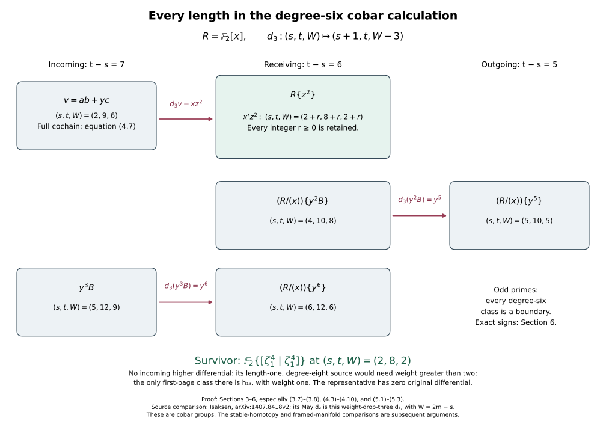

# The degree-six calculation in the full Milnor cobar complex

This chapter calculates the algebra needed for the smooth-sphere argument. It proves the result for every cobar length, rather than checking a finite segment of a table. The original coproduct, every correcting cochain and all signs at odd primes remain explicit.

The conclusion here concerns the specified cobar complexes. The comparison with the stable homotopy of the sphere, its convergence, the framed-manifold invariant and the surgery on a bounding seven-manifold are subsequent mathematical steps. The [Pontryagin–Thom companion](framed-manifolds-and-the-pontryagin-thom-map.md#pt-bijection) now proves the geometric framed-manifold correspondence, its inverse and its exact stabilization; it does not identify this algebraic calculation with that stable class. This chapter does not assume the remaining steps.

## 1. The original Hopf algebra and the entire differential

Work first over \(\mathbb F _2\). Define
\[
 H=\mathbb F _2[\zeta _1,\zeta _2,\ldots],\qquad
 |\zeta _i|=2^i-1,\qquad \zeta _0=1,
 \tag{1.1}
\]
with counit \(\epsilon(\zeta_i)=0\) for \(i>0\), and with the multiplicative coproduct
\[
 \Delta\zeta_i
 =\sum_{k=0}^{i}\zeta_{i-k}^{\,2^k}\otimes\zeta_k
 =\zeta_i\otimes1+1\otimes\zeta_i+
   \sum_{k=1}^{i-1}\zeta_{i-k}^{\,2^k}\otimes\zeta_k .
 \tag{1.2}
\]
Both endpoint terms in the first sum are displayed in the second expression. The counit identities follow from them. Coassociativity follows on each generator because both iterated coproducts are the same full sum
\[
 \sum_{\substack{a,b,c\geq0\\a+b+c=i}}
 \zeta_a^{\,2^{b+c}}\otimes
 \zeta_b^{\,2^c}\otimes\zeta_c .
 \tag{1.3}
\]
Multiplicativity then proves it on every polynomial. No restriction to the first few generators is made in the definition.

Put \(\overline H=\ker\epsilon\). A word of length \(s\) and internal degree \(t\) is denoted by
\[
 [m_1|\cdots|m_s]\in C^{s,t}(H)
   =(\overline H^{\otimes s})_t,\qquad
 \sum_{\nu=1}^{s}|m_\nu|=t .
 \tag{1.4}
\]
Here \(C^{0,0}=\mathbb F _2\), and the other length-zero components are zero. Write
\[
 \overline\Delta m=\Delta m-m\otimes1-1\otimes m.
 \tag{1.5}
\]
The two removed terms in (1.5) are exactly the displayed counit terms of the full coproduct. The differential is
\[
 d[m_1|\cdots|m_s]
 =\sum_{\nu=1}^{s}\ \sum_{\overline\Delta m_\nu
                       =\sum a\otimes b}
 [m_1|\cdots|m_{\nu-1}|a|b|m_{\nu+1}|\cdots|m_s].
 \tag{1.6}
\]
All coefficients are in \(\mathbb F _2\). It has bidegree \((1,0)\); hence it decreases the difference \(t-s\) by one.

The equality \(d^2=0\) follows directly. Splittings at two different positions occur in both possible orders and cancel. The two orders of splitting one position agree by (1.3) and likewise cancel. Concatenation makes this a differential algebra. We will calculate
\[
 \mathcal H^{s,t}(H)
  =\frac{\ker(d:C^{s,t}\longrightarrow C^{s+1,t})}
         {\operatorname{im}(d:C^{s-1,t}\longrightarrow C^{s,t})}.
 \tag{1.7}
\]

**Theorem 1.1.** For the full Hopf algebra (1.1)–(1.2),
\[
 \mathcal H^{s,s+6}(H)=
 \begin{cases}
 \mathbb F _2\{[\zeta_1^4|\zeta_1^4]\},&s=2,\\
 0,&s\ne2.
 \end{cases}
 \tag{1.8}
\]
In particular the assertion includes arbitrarily large \(s\). The proof occupies Sections 2–5. Section 6 proves the corresponding vanishing at every odd prime.

## 2. A bounded filtration on every original internal degree

For a nonnegative integer \(e\), let \(\alpha(e)\) be its number of nonzero binary digits. Define the weight of an original monomial and of an original word by
\[
 W\!\left(\prod_{i\geq1}\zeta_i^{e_i}\right)
    =\sum_{i\geq1}(2i-1)\alpha(e_i),\qquad
 W([m_1|\cdots|m_s])=\sum_{\nu=1}^{s}W(m_\nu).
 \tag{2.1}
\]
Let \(F_wC^{s,t}\) be the span of words of weight at most \(w\). This defines subspaces of the original complex; it does not change its monomials or differential.

Binary carrying can only lower \(\alpha(e)+\alpha(f)\) when passing to \(\alpha(e+f)\). Consequently the weight of a product is no larger than the sum of the weights. In (1.2) applied to \(\zeta_i^{2^j}\), the two endpoint terms have weight \(2i-1\), while each interior term has weight
\[
 (2(i-k)-1)+(2k-1)=2i-2.
 \tag{2.2}
\]
It follows by multiplication that every term of \(\Delta m\) has total tensor weight at most \(W(m)\). Thus \(dF_w\subset F_w\).

For a monomial of degree \(t\), its weight is at most its degree, since
\[
 2i-1\leq2^i-1,\qquad \alpha(e_i)\leq e_i.
 \tag{2.3}
\]
Every nonunit monomial has degree at least one. Therefore, for fixed \(t\),
\[
 C^{s,t}=0\quad(s>t),\qquad
 0=F_{-1}C^{s,t}\subset F_0C^{s,t}\subset\cdots
       \subset F_tC^{s,t}=C^{s,t},
 \tag{2.4}
\]
and every space in (2.4) is finite dimensional. There is no infinite-filtration convergence assumption in the argument below.

Here is the finite filtered-complex construction that we use. First take cohomology of the part of \(d\) preserving weight. A representative of weight \(w\) that survives this operation can be corrected by terms of weight \(w-1\). Its next obstruction is the component of its differential in weight \(w-1\). Iterating, the \(r\)-th obstruction decreases weight by \(r\), increases length by one and retains internal degree. At each step quotient by the obstructions already obtained from length \(s-1\). These are exactly changes of a representative by a boundary, with its highest nonzero weight treated first.

To verify that this procedure computes (1.7), perform ordinary elimination in a basis ordered by weight, pairing each nonzero differential with its highest remaining target weight. Each pair is an acyclic two-dimensional summand and can be removed by the corresponding triangular basis change. The unpaired vectors are cocycles modulo boundaries. At a fixed \(t\), only finitely many pairs and weights occur by (2.4). Thus the procedure terminates and the surviving weight-graded vector space is the associated graded vector space of (1.7). A zero associated graded component is a zero cohomology group. A single one-dimensional component gives a one-dimensional cohomology group, with no additive extension over \(\mathbb F _2\). This also proves the convergence statement used here.

We denote its pages by \(E_1,E_2,\ldots\), with \(E_1\) the cohomology of the weight-preserving differential and \(d_r\) the obstruction decreasing \(W\) by \(r\).

### The first page, with all generators retained

In the associated graded Hopf algebra the elements
\[
 e_{ij}=\operatorname{gr}(\zeta_i^{2^j}),\qquad i>0,\ j\geq0,
 \tag{2.5}
\]
are primitive. They have square zero, since the square in the original algebra has weight \(2i-1\), strictly less than \(2(2i-1)\). Products of distinct binary factors give a basis. The associated graded Hopf algebra is therefore the tensor product of the primitive exterior algebras on all \(e_{ij}\), with
\[
 |e_{ij}|=2^j(2^i-1),\qquad W(e_{ij})=2i-1.
 \tag{2.6}
\]
The word “exterior” here includes its exact characteristic-two relation \(e_{ij}^2=0\).

For completeness, the cobar cohomology of this coalgebra is polynomial. For one primitive exterior generator, the dual algebra is \(\mathbb F _2[u]/(u^2)\). The free resolution having one copy of this algebra in every nonnegative resolution degree, with every positive differential multiplication by \(u\), is exact: the kernel and image of multiplication by \(u\) are both the span of \(u\). Its degree-zero cokernel is \(\mathbb F _2\). Applying \(\operatorname{Hom}(-,\mathbb F _2)\) gives one zero-differential generator in every degree. The shift by one place in the free resolution represents its degree-one extension, and the successive shifts show that every power is nonzero. For finitely many generators, tensor these resolutions over the field. Exactness follows by decomposing each underlying vector-space complex into its degree-zero homology and two-term contractible pairs; tensoring a contractible pair remains contractible. The same degree-shift maps identify the cohomology ring as the polynomial algebra on one class for each generator. For the infinite tensor product, each fixed internal degree uses finitely many generators, so this argument applies degree by degree.

Equivalently these are the cobar classes of the primitive factors: the bar resolution of the finite-degree dual algebra and the cobar complex are dual in each internal degree. The bar resolution is free and exact: its augmented complex contracts by moving the augmentation-ideal part of the leading algebra factor into the first bar slot; the multiplication term restores that part and the remaining terms cancel in pairs. The scalar part is restored by the augmentation term. Thus the resolution calculation computes the same cohomology.

It follows that
\[
 E_1=\mathbb F _2[h_{ij}:i>0,\ j\geq0],\qquad
 (s,t,W)(h_{ij})=(1,2^j(2^i-1),2i-1).
 \tag{2.7}
\]
The weight drop (2.2), without discarding its summands, gives
\[
 d_1h_{ij}=\sum_{k=1}^{i-1}h_{i-k,j+k}h_{k,j}.
 \tag{2.8}
\]
The product order in a tensor representative is the order in (1.2); the product on \(E_1\) is commutative by the resolution computation. The differential on every polynomial follows by the Leibniz rule.

## 3. The first differential at every length

The following letters retain an exact dictionary with the generators of (2.7):
\[
\begin{array}{c|rrrrrrr}
 \text{letter}&x&y&a&z&b&c&w\\ \hline
 \text{generator}&h_{10}&h_{11}&h_{20}&h_{12}&h_{21}&h_{30}&h_{13}\\
 t&1&2&3&4&6&7&8\\
 t-s&0&1&2&3&5&6&7\\
 W&1&1&3&1&3&5&1
\end{array}
\tag{3.1}
\]
They are the only generators with \(t-s\leq7\). Every other generator has \(t-s\geq11\). Since all generator differences are nonnegative, an omitted generator cannot occur in any polynomial with difference at most seven. The unrestricted exponent of \(x\) is retained by working over
\[
 R=\mathbb F _2[x].
 \tag{3.2}
\]
In this region (2.8) reads
\[
 d_1a=xy,\qquad d_1b=yz,\qquad d_1c=xb+az,\qquad
 d_1x=d_1y=d_1z=d_1w=0.
 \tag{3.3}
\]
Put \(B=a^2\) and \(u=xb+az\). Both are \(d_1\)-cycles. To show every kernel and image needed at difference six, here are the complete \(R\)-bases in differences five, six and seven:
\[
\begin{array}{c|l}
5&y^5,\ y^3a,\ ya^2,\ y^2z,\ az,\ b\\
6&y^6,\ y^4a,\ y^2a^2,\ a^3,\ y^3z,\ yaz,\ z^2,\ yb,\ c\\
7&y^7,\ y^5a,\ y^3a^2,\ ya^3,\ y^4z,\ y^2az,\
       a^2z,\ yz^2,\ y^2b,\ ab,\ yc,\ w .
\end{array}
\tag{3.4}
\]
Exhaustiveness follows by solving
\[
 e_y+2e_a+3e_z+5e_b+6e_c+7e_w=k,\qquad e_\bullet\geq0,
 \tag{3.5}
\]
for \(k=5,6,7\); \(x\) has difference zero and is already retained in \(R\).

All nonzero differentials on these bases are
\[
\begin{array}{c|l}
5&
 y^3a\mapsto xy^4,\quad az\mapsto xyz,\quad b\mapsto yz\\
6&
 y^4a\mapsto xy^5,\quad a^3\mapsto xyB,\quad
 yaz\mapsto xy^2z,\quad yb\mapsto y^2z,\quad c\mapsto u\\
7&
 y^5a\mapsto xy^6,\quad ya^3\mapsto xy^2B,\quad
 y^2az\mapsto xy^3z,\quad y^2b\mapsto y^3z,\quad
 ab\mapsto yu,\quad yc\mapsto yu .
\end{array}
\tag{3.6}
\]
Every basis element not listed has zero differential. Comparing coefficients over the integral domain \(R\) now gives
\[
\begin{aligned}
 \ker(d_1|_5)&=R\{y^5,yB,y^2z,u\},\\
 \operatorname{im}(d_1|_6)&=R\{xy^5,xyB,y^2z,u\},\\
 \ker(d_1|_6)&=R\{y^6,y^2B,y^3z,z^2,yu\},\\
 \operatorname{im}(d_1|_7)&=R\{xy^6,xy^2B,y^3z,yu\}.
\end{aligned}
\tag{3.7}
\]
For example, the coefficients of \(yaz\) and \(yb\) in a cycle must be in the ratio \(1:x\), which gives \(yu\). The independent \(b\) and \(az\) terms in the image of \(c\) force its coefficient to vanish in a difference-six cycle. The other displayed equalities follow one coefficient at a time from (3.6). Consequently
\[
\begin{aligned}
 (E_2)_{t-s=5}
   &=(R/(x))\{y^5,yB\},\\
 (E_2)_{t-s=6}
   &=(R/(x))\{y^6,y^2B\}\ \oplus\ R\{z^2\}.
\end{aligned}
\tag{3.8}
\]
These are module identities covering every power of \(x\), not a finite list of lengths.

We also need two difference-seven cycles:
\[
 y^3B,\qquad v=ab+yc.
 \tag{3.9}
\]
The second is a cycle because \(d_1(ab)=yu=d_1(yc)\). Both classes are nonzero on \(E_2\). To verify this without assuming a table, set \(x=z=w=0\) in the polynomial algebra on (3.1). The induced differential on \(\mathbb F _2[y,a,b,c]\) is zero, whereas the images \(y^3a^2\) and \(ab+yc\) are nonzero. This detects that neither is a boundary. Boundaries into difference seven come from difference eight, where the same seven generators still suffice; the next omitted generator has difference eleven. Thus the projection argument covers every possible incoming boundary.

Every monomial on \(E_1\) has \(W\equiv s\pmod2\), because all generator weights are odd. The same is true on \(E_2\). A differential increasing \(s\) by one and dropping weight by two cannot connect two such bidegrees. Therefore \(d_2=0\). The next possible differential is \(d_3\), which we now compute from the entire original cobar differential.

## 4. Two complete correcting cochains

For the formulas in this section only, write
\[
 P=\zeta_1,\qquad Q=\zeta_2,\qquad T=\zeta_3.
 \tag{4.1}
\]
These letters do not change the original variables. The full coproducts are
\[
\begin{aligned}
 \Delta P&=P\otimes1+1\otimes P,\\
 \Delta Q&=Q\otimes1+P^2\otimes P+1\otimes Q,\\
 \Delta T&=T\otimes1+Q^2\otimes P+P^4\otimes Q+1\otimes T.
\end{aligned}
\tag{4.2}
\]
Define the following seven-term cochain of length two and internal degree six:
\[
\begin{aligned}
 \mathcal B={}&[Q|Q]+[Q|P^3]+[P|P^2Q]+[P|P^5]\\
              &+[PQ|P^2]+[P^3|Q]+[P^3|P^3].
\end{aligned}
\tag{4.3}
\]
The only weight-six term is \([Q|Q]\). In the displayed order the seven weights are \(6,5,5,3,5,5,4\). Expanding (1.6) using (4.2) gives
\[
 d\mathcal B=[P^2|P^2|P^2]+[P|P|P^4].
 \tag{4.4}
\]
Here is the complete term-by-term expansion; it also records every cancellation:
\[
\begin{array}{c|l}
[Q|Q]&[Q|P^2|P]+[P^2|P|Q]\\
[Q|P^3]&[Q|P|P^2]+[Q|P^2|P]+[P^2|P|P^3]\\
[P|P^2Q]&[P|Q|P^2]+[P|P^2|Q]+[P|P^2|P^3]+[P|P^4|P]\\
[P|P^5]&[P|P|P^4]+[P|P^4|P]\\
[PQ|P^2]&[Q|P|P^2]+[P|Q|P^2]+[P^2|P^2|P^2]+[P^3|P|P^2]\\
[P^3|Q]&[P|P^2|Q]+[P^2|P|Q]+[P^3|P^2|P]\\
[P^3|P^3]&[P|P^2|P^3]+[P^2|P|P^3]+[P^3|P|P^2]+[P^3|P^2|P].
\end{array}
\tag{4.5}
\]
Each word except the two in (4.4) occurs twice. The weight drops from six to three. The leading class of \(\mathcal B\) is \(B=a^2\), so
\[
 d_3B=y^3+x^2z.
 \tag{4.6}
\]

For the second calculation use the complete eight-term cochain of length two and internal degree nine
\[
\begin{aligned}
 \mathcal V={}&[Q|Q^2]+[Q|P^6]+[P^2|T]+[P^2|PQ^2]\\
              &+[P^2|P^4Q]+[P^2|P^7]
                +[P^2Q|P^4]+[P^5|P^4].
\end{aligned}
\tag{4.7}
\]
Its weights in that order are \(6,5,6,5,5,4,5,3\). Its two highest-weight terms represent \(ab+yc=v\). Direct expansion gives
\[
 d\mathcal V=[P|P^4|P^4].
 \tag{4.8}
\]
Again the entire expansion is included:
\[
\begin{array}{c|l}
[Q|Q^2]&[Q|P^4|P^2]+[P^2|P|Q^2]\\
[Q|P^6]&[Q|P^2|P^4]+[Q|P^4|P^2]+[P^2|P|P^6]\\
[P^2|T]&[P^2|Q^2|P]+[P^2|P^4|Q]\\
[P^2|PQ^2]&[P^2|Q^2|P]+[P^2|P|Q^2]+[P^2|P^4|P^3]+[P^2|P^5|P^2]\\
[P^2|P^4Q]&[P^2|Q|P^4]+[P^2|P^2|P^5]+[P^2|P^4|Q]+[P^2|P^6|P]\\
[P^2|P^7]&[P^2|P|P^6]+[P^2|P^2|P^5]+[P^2|P^3|P^4]
          +[P^2|P^4|P^3]+[P^2|P^5|P^2]+[P^2|P^6|P]\\
[P^2Q|P^4]&[Q|P^2|P^4]+[P^2|Q|P^4]+[P^2|P^3|P^4]+[P^4|P|P^4]\\
[P^5|P^4]&[P|P^4|P^4]+[P^4|P|P^4].
\end{array}
\tag{4.9}
\]
Every word except (4.8) occurs twice. The resulting differential is
\[
 d_3v=xz^2.
 \tag{4.10}
\]
Equations (4.3) and (4.7) give the actual cobar preimages, so the calculation is reproducible without an external differential table.

### Exact comparison with the source's indices

In Isaksen's source, the four indices are May filtration, stem, Adams filtration and motivic weight. Only its classical calculation is used here. If its first index is \(m\) and its Adams filtration is our word length \(s\), then the two retained filtrations satisfy
\[
 W=2m-s,\qquad m=\frac{W+s}{2}
 \tag{4.11}
\]
on the polynomial generators and their products. Thus a differential dropping \(W\) by three and increasing \(s\) by one lowers \(m\) by one. Our \(d_3\) is the differential denoted \(d_2\) in that source. Equations (4.6) and (4.10) recover its classical formulas for \(b_{20}\) and \(h_0(1)\). The original \(W\), the source's \(m\), the length \(s\) and every term of the cochain calculation remain identifiable. No motivic \(\tau\)-factor is silently transferred into the classical complex.

## 5. All other degree-six classes vanish

The primitive words \([P]\), \([P^2]\) and \([P^4]\) are exact cocycles in the original complex. Consequently their page classes \(x,y,z\) have zero differential on every page on which they are present.

Using (3.8), (4.6), the Leibniz rule and the relation \(yz=0\) on \(E_2\), we obtain
\[
\begin{aligned}
 d_3(y^2B)&=y^5+x^2y^2z=y^5\ne0,\\
 d_3(y^3B)&=y^6+x^2y^3z=y^6,\\
 d_3v&=xz^2.
\end{aligned}
\tag{5.1}
\]
The first line removes the entire class \(y^2B\), which is already annihilated by \(x\). The second line makes \(y^6\) a boundary; that class too is annihilated by \(x\). The third line and all its \(x\)-multiples make \(xz^2,x^2z^2,\ldots\) boundaries. Every candidate in (3.8) has therefore been accounted for. After this differential the difference-six part has dimension at most one, represented by \(z^2\) at
\[
 (s,t,W)=(2,8,2).
 \tag{5.2}
\]

It remains to prove that this one class survives. Its representative \([P^4|P^4]\) has differential zero by (4.2), so it has no outgoing obstruction. A possible incoming differential would have source of length one and internal degree eight. On the entire \(E_1\)-page, the equation
\[
 2^j(2^i-1)=8,\qquad i>0,\ j\geq0,
 \tag{5.3}
\]
has the unique solution \(i=1,j=3\). The resulting source is \(w=h_{13}\), of weight one. Any incoming \(d_r\) into weight two would need source weight \(2+r>2\). Such a source is absent already on \(E_1\), and passing to later subquotients cannot create it. The class is also nonzero on \(E_1\), where it is the polynomial square of \(h_{12}\).

Thus it survives. The finite convergence proof in Section 2 yields exactly (1.8). In particular the conclusion covers all lengths because (3.7)–(3.8) were proved over the entire ring \(\mathbb F _2[x]\).

There is a useful stronger piece of information in the explicit calculation:
\[
 [P]\,[P^4|P^4]=d\mathcal V
 \tag{5.4}
\]
is an equality of actual cochains, not merely an equality of associated-graded classes. The product by \([P]\) vanishes with the specific homotopy witness (4.7).

## 6. The odd-prime calculation with its signs

For an odd prime \(p\), define the graded-commutative Hopf algebra
\[
\begin{aligned}
 H_p&=\mathbb F _p[\xi_1,\xi_2,\ldots]
                  \otimes\Lambda(\tau_0,\tau_1,\ldots),\\
 |\xi_i|&=2(p^i-1),\qquad |\tau_i|=2p^i-1,\qquad \xi_0=1,\\
 \Delta\xi_i&=\sum_{k=0}^{i}\xi_{i-k}^{p^k}\otimes\xi_k,\\
 \Delta\tau_i&=\tau_i\otimes1+
                  \sum_{k=0}^{i}\xi_{i-k}^{p^k}\otimes\tau_k .
\end{aligned}
\tag{6.1}
\]
The tensor-product multiplication uses its graded sign. The \(\xi_i\) have even degree and the \(\tau_i\) have odd degree. The counit kills every positive-degree generator. Thus the last sum contains \(1\otimes\tau_i\), and both counit terms are retained. Coassociativity for the \(\xi_i\) follows by the same three-index sum as (1.3), with \(2\) replaced by \(p\). For \(\tau_i\), both iterated coproducts are
\[
 \tau_i\otimes1\otimes1
 +\sum_{k=0}^{i}\xi_{i-k}^{p^k}\otimes\tau_k\otimes1
 +\sum_{a+b+c=i}
       \xi_a^{p^{b+c}}\otimes\xi_b^{p^c}\otimes\tau_c .
 \tag{6.2}
\]
The graded exterior relations are respected because the coproduct is graded-commutative and every odd element has square zero when \(2\) is invertible.

In the cobar complex a slot \([m]\) has total degree \(|m|-1\). With the same counit subtraction (1.5), fix the sign convention
\[
 d[m]=\sum_{\overline\Delta m=\sum a\otimes b}
                  (-1)^{|a|}[a|b],\qquad
 d(UV)=d(U)V+(-1)^{|U|_{\rm tot}}U\,d(V).
 \tag{6.3}
\]
The differential still increases word length and preserves internal degree. For a triple \(a,b,c\) in an iterated coproduct, the two ways of splitting have coefficients \((-1)^{|b|}\) and \(-(-1)^{|b|}\). They cancel. Splittings in different slots cancel by the displayed derivation sign. Hence \(d^2=0\) with precisely this convention.

**Theorem 6.1.** For every odd prime,
\[
 \mathcal H^{s,s+6}(H_p)=0\quad\hbox{for all }s\geq0.
 \tag{6.4}
\]

**Proof for \(p\geq5\).** The only positive-degree monomial of degree at most seven is \(\tau_0\), of degree one. Indeed the smallest other generator is \(\xi_1\), of degree \(2(p-1)\geq8\), and \(\tau_0^2=0\). Every slot contributes \(|m|-1\geq0\) to the difference of its word. A word of difference six could use only monomials of degree at most seven, so every slot would have to be \(\tau_0\); its difference would then be zero. There are no such words. Thus the original cochain group itself is zero in the degree under consideration.

**Proof for \(p=3\).** Write \(T_0=\tau_0\) and \(X=\xi_1\), preserving their degrees \(1\) and \(4\). The complete list of nonunit monomials of degree at most seven is
\[
 T_0,\quad X,\quad T_0X,\quad\tau_1,\quad T_0\tau_1,
 \qquad\hbox{of degrees }1,4,5,5,6.
 \tag{6.5}
\]
The corresponding slot differences are \(0,3,4,4,5\). Hence every original word of difference six consists of exactly two slots \(X\) and any number of slots \(T_0\):
\[
 [T_0]^{a}[X][T_0]^{b}[X][T_0]^{c},
 \qquad a,b,c\geq0.
 \tag{6.6}
\]
The notation \([T_0]^a\) denotes concatenation of \(a\) slots; the exterior-algebra power \(T_0^a\) is zero only when the exponent is at least two. Both \(T_0\) and \(X\) are primitive. Therefore every word (6.6) is a cocycle.

The exact coproducts of the two incoming monomials give, with all signs from (6.3),
\[
\begin{aligned}
 \overline\Delta(T_0X)&=T_0\otimes X+X\otimes T_0,\\
 d[T_0X]&=-[T_0|X]+[X|T_0],\\
 \overline\Delta(X^2)&=2X\otimes X,\\
 d[X^2]&=2[X|X].
\end{aligned}
\tag{6.7}
\]
For any cocycle words \(U,V\), these identities imply
\[
 U[X][T_0]V-U[T_0][X]V
   =(-1)^{|U|_{\rm tot}}d\bigl(U[T_0X]V\bigr).
 \tag{6.8}
\]
Repeatedly apply (6.8) to move every \(T_0\) slot to the left, retaining its signed preimage at each interchange. This is a finite operation: each interchange decreases the number of pairs with an \(X\) to the left of a \(T_0\). Thus (6.6) is homologous to
\[
 [T_0]^{a+b+c}[X|X]
   =d\left(\frac12[T_0]^{a+b+c}[X^2]\right).
 \tag{6.9}
\]
Here \(1/2=2\) in \(\mathbb F _3\), and the prefix has total degree zero, so no additional sign is suppressed. Adding the explicitly signed interchange preimages from (6.8) to the cochain on the right of (6.9) supplies a preimage of the original word. Every cocycle in the component is a linear combination of these words. Therefore every one is a boundary, for every length \(s\), proving (6.4).

## 7. Two complete worked exercises

### Exercise 1. A boundary at arbitrarily high word length

For each integer \(r\geq1\), produce an original cochain whose differential is
\[
 [P]^r[P^4|P^4]\in C^{r+2,r+8}(H).
 \tag{7.1}
\]
List its entire set of terms, rather than referring only to the page relation.

**Solution.** Since \(d[P]=0\), equation (4.8) gives the required preimage
\[
\begin{aligned}
 \mathcal V_r=[P]^{r-1}\bigl(&[Q|Q^2]+[Q|P^6]+[P^2|T]
             +[P^2|PQ^2]\\
             &+[P^2|P^4Q]+[P^2|P^7]
             +[P^2Q|P^4]+[P^5|P^4]\bigr).
\end{aligned}
\tag{7.2}
\]
It has length \(r+1\) and internal degree \((r-1)+9=r+8\). Its highest weight is \((r-1)+6=r+5\). Formula (1.6) and the complete cancellation table (4.9) give
\[
 d\mathcal V_r=[P]^{r-1}[P|P^4|P^4]
              =[P]^r[P^4|P^4].
 \tag{7.3}
\]
This works for every \(r\); no bound on word length is used.

### Exercise 2. An odd-prime preimage with the sign visible

At \(p=3\), find a complete preimage of \([X|T_0|X]\).

**Solution.** In this case (6.3) gives \(|[X]|_{\rm tot}=3\) and \(|[T_0]|_{\rm tot}=0\). A suitable length-two cochain is
\[
 Z=[T_0X|X]+\frac12[T_0|X^2].
 \tag{7.4}
\]
Indeed
\[
\begin{aligned}
 d[T_0X|X]&=-[T_0|X|X]+[X|T_0|X],\\
 d\!\left(\frac12[T_0|X^2]\right)
   &=\frac12\cdot2[T_0|X|X]=[T_0|X|X].
\end{aligned}
\tag{7.5}
\]
Their sum is exactly the required word. The coefficient \(1/2\), the negative term and its cancellation are all essential parts of the original differential.

<figure>

</figure>

The diagram retains every power of the length-one class through the full module R in Section 3. Its arrows are the exact differentials (5.1), with every length, internal degree and weight displayed. The explicit cochains (4.3) and (4.7) prove the arrows. The weight argument (5.3) proves survival; Section 6 proves the odd-prime vanishing with its original signs. The source filtration comparison is (4.11). This depicts the algebraic calculation. The geometric framed-manifold correspondence is proved in its linked companion; the linked actual-cooperation and integral companions now prove its comparison with the stable group, and the [original geometric framing proof](the-original-six-dimensional-framing-invariant.md#framed-six-original-nullbordism) calculates the original manifold’s value.

## 8. Sources, proof scope and verification

The original-author TeX of Daniel C. Isaksen, Guozhen Wang and Zhouli Xu, [Stable homotopy groups of spheres, arXiv:2001.04247v1](https://arxiv.org/abs/2001.04247v1), supplies the classical dual coproduct in its section on the Adams spectral sequence, original `ms.tex` lines 483–583. Its low-dimensional table was read as a routing aid. The proof of (1.8) here is the explicit calculation in Sections 2–5, including the full correcting cochains; it is not inferred from that table.

Daniel C. Isaksen, [Stable stems, arXiv:1407.8418v2](https://arxiv.org/abs/1407.8418v2), supplies the comparison with the May notation. The precise passages read for this comparison are original `stable-stems-May.tex` lines 904–1000 and `stable-stems-tables.tex` lines 50–118, together with the previously recorded introductory coverage. Equations (4.11), (4.6) and (4.10) give the exact classical comparison. The original source archives and per-file hashes are retained in the private reading ledger. No whole-monograph reading or PDF reading is claimed.

The displayed odd-prime Hopf algebra is defined in (6.1); its coassociativity, cobar signs and degree-six vanishing are proved directly in Section 6. The [actual odd-prime companion](the-original-odd-prime-cooperations-and-degree-six-adams-calculation.md#odd-actual-adams) constructs the actual original cooperations in the needed degrees and proves their degree-six cobar vanishing and receiving Adams comparison directly. No classification of all odd-prime operations is needed for that proof or assumed by the algebraic vanishing theorem.

The reproducible calculation script expands the complete coproduct, checks both displayed correcting cochains and their full expansions, and computes selected finite cobar kernels and images. Those finite computations are supplementary checks. The argument over \(\mathbb F _2[x]\) in Section 3 and the signed word reduction in Section 6 are what prove the assertions for every length. Neither a finite rank computation nor this algebraic theorem by itself establishes the stable homotopy or framed-bordism conclusion needed by lesson 7.

The [original coefficient-ring companion](coefficient-rings-and-the-original-degree-six-class.md#coefficient-all-length-receiving) retains the full source polynomial coefficient algebra before inversion, proves both inverse coefficient and grading maps, and applies Theorem 1.1 here to every length. Its complete original matrices then prove that the bidegree \((2,8)\) module has exactly the specified polynomial generator and no coefficient torsion. The coefficient multiple receiving \([\zeta_1^4|\zeta_1^4]\) is displayed with all four original powers. The included topological comparison, geometric framing calculation and [sphere-twist and smooth-recognition proof](sphere-twists-and-the-original-smooth-six-sphere-comparison.md#twist-original-smooth-map) supply the subsequent receiving arguments.

The [Adams-tower companion](the-adams-tower-and-exact-inverse-limits.md#adams-degree-five-cobar), Section 5, extends the complete original module calculation to prove \(H^{s,s+5}(C^\bullet(H_{\mathrm{cl}}))=0\) for every nonnegative length. Its full difference-four kernel and image, followed by both terms of the existing seven-term correcting-cochain differential, prove the result. Sections 8–11 construct the actual coefficient spectrum and establish finite-stage tower convergence. The [arithmetic companion](the-original-adams-tower-and-arithmetic-completion.md#arithmetic-homotopy-groups) now proves the unit-preserving comparison of that limit with the original Moore tower and retains both derived homotopy-group terms. The [actual degree-eight companion](the-actual-mod-two-cooperation-comparison-through-degree-eight.md#actual-eight-bijectivity) identifies the actual mod-two cooperations in the required degrees. The [original geometric framing proof](the-original-six-dimensional-framing-invariant.md#framed-six-original-nullbordism) constructs the full quadratic invariant, proves framed bordism invariance and gives value zero for the original framed homotopy six-sphere, with an actual framed nullbordism. The [sphere-twist and smooth-recognition proof](sphere-twists-and-the-original-smooth-six-sphere-comparison.md#twist-original-smooth-map) now constructs the new interior gluing with its full frame defect, cancels every actual handle and gives the orientation-preserving diffeomorphism to the original six-sphere, homotopic to its original degree-one map.

This is an author-written teaching proof of classical algebra. No novelty or independent-review claim is made.

The [actual mod-two cooperation companion](the-actual-mod-two-adams-resolution-and-cooperation-maps.md#cooperation-chain-comparison) now constructs both cross-product coordinate maps, the actual cofree Adams resolution and both chain maps and inverse homotopies comparing it with the actual cooperation cobar complex. Its [original diagonal and degree-range proof](the-actual-mod-two-adams-resolution-and-cooperation-maps.md#cooperation-original-diagonal) identifies the generator tied to the original integer two, proves every degree-two reduced coproduct zero, and shows that the degree-six calculation at every word length uses cooperation degrees through eight. The [actual degree-eight companion](the-actual-mod-two-cooperation-comparison-through-degree-eight.md#actual-eight-bijectivity) supplies the required polynomial comparison through degree eight; the [original geometric framing proof](the-original-six-dimensional-framing-invariant.md#framed-six-original-nullbordism) now supplies that value and its actual framed nullbordism.

The [full characteristic-two coordinate proof](the-exact-characteristic-two-coordinate-calculation.md#formal-two-linearization) now supplies the all-ring formal-series calculation and both inverses. The [actual projective-coordinate proof](the-original-projective-coordinate-and-actual-cooperations.md#projective-actual-coproduct) constructs the polynomial-to-cooperation morphism, proves its full coproduct and antipode comparison, and identifies its [first generator with the original integer two](the-original-projective-coordinate-and-actual-cooperations.md#projective-original-two). The [actual degree-eight companion](the-actual-mod-two-cooperation-comparison-through-degree-eight.md#actual-eight-bijectivity) now proves bijectivity of this original morphism in every cooperation degree from zero through eight. Its [bar and original-suspension proof](the-actual-mod-two-cooperation-comparison-through-degree-eight.md#actual-eight-original-suspension) determines the full graded dimensions, and its [cup-square calculation](the-actual-mod-two-cooperation-comparison-through-degree-eight.md#actual-eight-nonzero-powers) proves every power of the actual first generator nonzero. The [receiving cobar and convergence argument](the-actual-mod-two-cooperation-comparison-through-degree-eight.md#actual-eight-receiving-cobar) identifies the entire degree-six line and proves \(\pi_6(\mathbb S^{\wedge}_2)=\mathbb F_2\), with the original permanent-cycle representative. The [actual odd-prime companion](the-original-odd-prime-cooperations-and-degree-six-adams-calculation.md#odd-actual-adams) now proves the full signed bar and original suspension calculation, the actual cooperation degrees needed by stem six, and the signed comparison with the original Adams tower. It proves \(\pi_6(\mathbb S^{\wedge}_p)=0\) for every odd prime. The [original integral comparison](the-original-integral-stable-group-and-its-completion-maps.md#integral-degree-six-answer) now proves finite generation of the original sphere groups, the exact suspension range and the full unit comparison with all prime completions. It proves \(\pi_6(\mathbb S)=\mathbb Z/2\mathbb Z\) and that the original 2-completion unit is an isomorphism in degree six. The [original geometric framing proof](the-original-six-dimensional-framing-invariant.md#framed-six-original-nullbordism) constructs the full quadratic invariant, proves framed bordism invariance and gives value zero for the original framed homotopy six-sphere, with an actual framed nullbordism. The [sphere-twist and smooth-recognition proof](sphere-twists-and-the-original-smooth-six-sphere-comparison.md#twist-original-smooth-map) now constructs the new interior gluing with its full frame defect, cancels every actual handle and gives the orientation-preserving diffeomorphism to the original six-sphere, homotopic to its original degree-one map.
