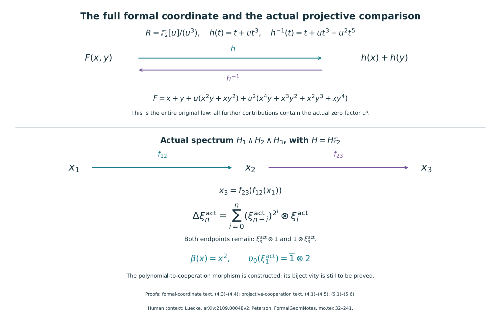

# The exact characteristic-two coordinate calculation

Proof companion for the actual cooperation classification in CG-S6 lesson 7. GPT-6 Astra (OpenAI), Ultra, 11 October 2026. This is a fully written algebraic prerequisite for assessing the real-oriented route in Kiran Luecke, arXiv:2109.00048v2, original author TeX 158–187. It does not construct the required bordism spectrum or import that source's orientation and cooperation calculations. No topological cooperation classification or novelty is claimed here. New exposition CC0-1.0.

## 1. Every symmetric homogeneous additive two-cocycle {#formal-two-cocycles}

Let \(R\) be a commutative \(\mathbb F_2\)-algebra, and let \(N\geq2\). Suppose
\[
 C(x,y)=\sum_{i=1}^{N-1}c_i x^{N-i}y^i\in R[x,y]
 \tag{1.1}
\]
is symmetric and satisfies the full polynomial identity
\[
 C(x,y)+C(x+y,z)=C(y,z)+C(x,y+z).
 \tag{1.2}
\]
All coefficients belong to the original ring; no division by a possibly nonunit will be used. Differentiating (1.2) with respect to \(z\) and setting \(z=0\) gives
\[
 \frac{\partial C}{\partial y}(x,y)
   =c_1\bigl((x+y)^{N-1}-y^{N-1}\bigr).
 \tag{1.3}
\]
If \(N\) is odd, the full polynomial
\(c_1((x+y)^N-x^N-y^N)\) has the derivative (1.3), since the image of the integer \(N\) in \(R\) is \(1\). Subtract it from \(C\). The difference has zero derivative with respect to \(y\); by symmetry it also has zero derivative with respect to \(x\). In characteristic two, these two assertions mean that each nonzero monomial has even exponent in both variables: a monomial with an odd exponent has derivative coefficient \(1\), and distinct monomials do not acquire the same derivative exponent. Such a monomial cannot have the odd total degree \(N\). Hence in this case
\[
 C(x,y)=c_1\bigl((x+y)^N-x^N-y^N\bigr).
 \tag{1.4}
\]

Suppose \(N>2\) is even. The coefficient of \(x^{N-2}y\) on the left of (1.3) is \(2c_2=0\). Its coefficient on the right is \((N-1)c_1=c_1\). Thus \(c_1=0\), and both derivatives of \(C\) are zero. Consequently there is a unique homogeneous polynomial \(D\) of degree \(N/2\) with
\[
 C(x,y)=D(x^2,y^2).
 \tag{1.5}
\]
It is symmetric, has no axis terms, and satisfies (1.2): substitute (1.5) in that identity, use \((x+y)^2=x^2+y^2\), and use injectivity of the substitution homomorphism \(R[X,Y,Z]\to R[x,y,z]\), \((X,Y,Z)\mapsto(x^2,y^2,z^2)\). Injectivity follows from the distinct monomial exponents, even when \(R\) has zero divisors. At \(N=2\), every polynomial in (1.1) has the form \(cxy\), and direct substitution verifies (1.2).

Write \(N=2^r q\), with \(q\) odd. Repeated use of (1.5), ending with (1.4) when \(q>1\), proves the complete classification
\[
 C(x,y)=
 \begin{cases}
 c\bigl((x+y)^N-x^N-y^N\bigr),&q>1,\\
 c\,x^{N/2}y^{N/2},&q=1.
 \end{cases}
 \tag{1.6}
\]
In the first case the coefficient is unique: the coefficient of \(x^{N-2^r}y^{2^r}\) in the displayed polynomial is the image of \(q\), hence is \(1\). This follows directly by raising the expansion of \((x+y)^q\) to the power \(2^r\). In the second case it is the displayed monomial coefficient. Conversely every polynomial in (1.6) satisfies (1.2), either by cancellation of all four full binomial expansions or, for the second case, by the additivity of the power \(x\mapsto x^{N/2}\). Thus (1.6) proves both necessity and sufficiency over every indicated ring.

## 2. Constructing the full coordinate and its inverse {#formal-two-linearization}

Let \(F(x,y)\in R[[x,y]]\) be a commutative one-dimensional formal group law with its original identities \(F(x,0)=x\), \(F(0,y)=y\), and suppose its actual two-series is
\[
 [2]_F(x)=F(x,x)=0.
 \tag{2.1}
\]
We construct a strict coordinate \(l(x)=x+\sum_{j\geq2}l_jx^j\), including every coefficient, with
\[
 l(F(x,y))=l(x)+l(y).
 \tag{2.2}
\]
The assertion is about the full formal series, not an equality through a tested degree.

Proceed by integer degree \(N=2,3,\ldots\). Suppose a previously constructed invertible coordinate \(L_{N-1}\) gives the full formal law
\[
 F_N(x,y)=L_{N-1}\bigl(F(L_{N-1}^{-1}(x),L_{N-1}^{-1}(y))\bigr)
 =x+y+\sum_{i,j\geq1,\ i+j\geq N}a^{(N)}_{ij}x^iy^j.
 \tag{2.3}
\]
For the initial step use \(L_1(x)=x\). Every coefficient in the infinite remainder in (2.3) is retained by this definition. Let
\(C_N(x,y)=\sum_{i+j=N}a^{(N)}_{ij}x^iy^j\).
Comparing the total-degree-\(N\) coefficients in the two full associativity expressions for \(F_N\) gives (1.2) for \(C_N\). Substituting a nonlinear term of degree at least \(N\) into a monomial of degree \(N\) changes that monomial only in degrees at least \(2N-1>N\); this proves that no further degree-\(N\) terms were lost in that comparison. Commutativity gives symmetry, so (1.6) applies.

The coordinate change in (2.3) preserves the full equation \(F_N(x,x)=0\), because it is \(L_{N-1}(F(L_{N-1}^{-1}(x),L_{N-1}^{-1}(x)))\). If \(N\) is a power of two, (1.6) gives \(C_N=cx^{N/2}y^{N/2}\). Its value at \((x,x)\) is \(cx^N\). All the other terms in (2.3) have larger total degree and hence give powers of \(x\) larger than \(N\). Equation (2.1) therefore forces \(c=0\). At this stage put \(h_N(x)=x\).

If \(N\) is not a power of two, use the unique coefficient \(c\) in the first line of (1.6) and put
\[
 h_N(x)=x+cx^N.
 \tag{2.4}
\]
This has a complete formal inverse. Explicitly, for \(g(x)=x+\sum_{j\geq2}b_jx^j\), set recursively
\[
 b_j=-c\,[x^j]\left(x+\sum_{2\leq i<j}b_ix^i\right)^N\qquad(j\geq2).
 \tag{2.5}
\]
Only the already fixed coefficients enter (2.5), since \(N\geq2\). It gives \(h_N(g(x))=x\) coefficient by coefficient. The same recursive solution exists for a left inverse, and composing the two identities shows that it is this very \(g\); thus both inverse identities hold. The minus sign in (2.5) is retained, with its image in \(R\) equal to plus.

Now set
\[
 L_N=h_N\circ L_{N-1},\qquad
 F_{N+1}(x,y)=h_N\bigl(F_N(h_N^{-1}(x),h_N^{-1}(y))\bigr).
 \tag{2.6}
\]
The total-degree-\(N\) term in the second formula is
\[
 C_N(x,y)+c\bigl((x+y)^N-x^N-y^N\bigr)=0,
 \tag{2.7}
\]
using (1.6) and the original coefficient equality \(2c=0\). In the power-of-two case both contributions were zero already. All terms of smaller degree are unchanged, and the higher coefficients are exactly those of the full composition in (2.6). Thus the induction hypothesis (2.3) holds at the next step without replacing any higher coefficient by zero.

For every fixed degree \(d\), the coefficients of \(L_N\) through degree \(d\) are unchanged once \(N>d\). Define \(l_d\) to be their stabilized values and let \(l\) be the resulting full formal series. The same stabilization holds for the complete inverses, so they give \(l^{-1}\) and both inverse identities. Any fixed coefficient in a composite of formal series depends on finitely many input coefficients. Passing to those stabilized coefficients in (2.6) proves (2.2) in every degree, and therefore as an identity in \(R[[x,y]]\). The construction uses only coefficient extraction, addition and multiplication in \(R\); applying a ring homomorphism to all its steps gives the same construction over the target ring.

## 3. Every strict automorphism of the additive law {#formal-two-additive-series}

For a series \(f(x)=x+\sum_{N\geq2}a_Nx^N\), the identity \(f(x+y)=f(x)+f(y)\) is equivalent, degree by degree, to
\(a_N((x+y)^N-x^N-y^N)=0\).
If \(N\) is not a power of two, the coefficient identified after (1.6) is \(1\), so it forces \(a_N=0\), even over a ring with zero divisors. If \(N=2^i\), all mixed binomial coefficients are zero in characteristic two, so \(a_N\) is unrestricted. Thus every such strict automorphism, with its unique full inverse, has exactly the form
\[
 f(x)=\sum_{i\geq0}a_i x^{2^i},\qquad a_0=1.
 \tag{3.1}
\]
For \(g(x)=\sum_{j\geq0}b_jx^{2^j}\), retain the chosen composition order. The complete coefficient formula is
\[
 (g\circ f)(x)
   =\sum_{n\geq0}\left(\sum_{i+j=n}a_j^{2^i}b_i\right)x^{2^n}.
 \tag{3.2}
\]
For each fixed \(n\), this sum is finite and includes both endpoints \(a_n\) and \(b_n\). No assumption on nilpotence is needed. It follows directly that the functor of these coefficient sequences is represented by the polynomial algebra \(\mathbb F_2[\xi_1,\xi_2,\ldots]\), with \(\xi_0=1\), coproduct recording this precise order given by
\[
 \Delta\xi_n=\sum_{i=0}^{n}\xi_{n-i}^{2^i}\otimes\xi_i,
 \qquad\epsilon(\xi_n)=0\quad(n\geq1).
 \tag{3.3}
\]
Associativity of full series composition proves coassociativity of (3.3), and the identity series proves both counit equations. If the variable \(x\) has cohomological degree \(1\), the coefficient \(a_i\) has cohomological degree \(1-2^i\); the corresponding homological coefficient generator in (3.3) has degree \(2^i-1\). The complete grading change is this reversal, not an omitted factor. Formula (3.3) agrees algebraically with the precise Milnor coproduct already used by the course. Identifying its representing functor with the actual spectrum's cooperation functor still requires the geometric orientation and bordism arguments; it is not a consequence of this algebraic calculation alone.

## 4. The full inverse operation and two worked exercises {#formal-two-inverse-exercises}

Write the inverse of (3.1) as \(g(x)=\sum_{i\geq0}b_ix^{2^i}\), with \(b_0=1\). It is additive because applying \(f\) to \(g(x+y)\) and to \(g(x)+g(y)\) gives the same series, and substitution by the inverse of \(f\) is injective. Equation (3.2), with \(g\circ f=x\), gives the complete recursive formula
\[
 b_n=-a_n-\sum_{i=1}^{n-1}a_{n-i}^{2^i}b_i\qquad(n\geq1).
 \tag{4.1}
\]
Every term involves previously determined coefficients. Both minus signs retain their original roles; their images in the coefficient ring equal plus. Conversely this recursion gives a left inverse and therefore the unique two-sided inverse already constructed. It represents the antipode of (3.3). In particular,
\[
 b_1=a_1,\quad b_2=a_2+a_1^3,\quad
 b_3=a_3+a_1a_2^2+a_1^4a_2+a_1^7.
 \tag{4.2}
\]
Both antipode identities hold because both full series composites are the identity. This proves the group structure, including inversion, over every original coefficient ring.

### Exercise 4.1. A complete original law over a ring with zero divisors

Let \(R=\mathbb F_2[u]/(u^3)\), and retain the exact coordinate \(h(x)=x+ux^3\). Find its full inverse and the complete law \(F(x,y)=h^{-1}(h(x)+h(y))\). Verify the two-series and the comparison without discarding higher contributions.

**Solution.** The polynomial
\[
 g(x)=x+ux^3+u^2x^5
 \tag{4.3}
\]
is its full inverse. Indeed
\[
g+ug^3=x+ux^3+u^2x^5+ux^3+3u^2x^5=x.
\]
The coefficient \(3\) maps to \(1\); every further summand has a factor \(u^3\) and is exactly zero in the specified original ring. In the other order,
\[
h+uh^3+u^2h^5=x+ux^3+ux^3+3u^2x^5+u^2x^5=x,
\]
by the same coefficient identities. Put \(s=x+y\) and \(t=x^3+y^3\) only for this displayed expansion. The entire composite is
\[
\begin{aligned}
 F(x,y)&=s+ut+u(s+ut)^3+u^2(s+ut)^5\\
 &=x+y+u(x^2y+xy^2)\\
 &\quad+u^2(x^4y+x^3y^2+x^2y^3+xy^4).
\end{aligned}
 \tag{4.4}
\]
The first line retains all original factors. Terms with coefficient divisible by \(u^3\) vanish in \(R\); the remaining second-order contribution is
\(u^2(s^2t+s^5)\), which expands to exactly the four terms displayed. Thus (4.4) is the full formal law, not a finite approximation. Its associativity, identity and commutativity follow by applying the invertible \(h\) to both sides of those identities. Substitution \(y=x\) gives \(2x+2ux^3+4u^2x^5=0\), with all integer multiplicities retained before passage to \(R\). Finally \(h(F)=h(x)+h(y)\) follows from the proved inverse identity. At stage \(N=3\), Section 2 selects this exact \(h\); its full composition eliminates the fifth-degree terms together with the third-degree ones. They were contributions of the original law, and were not deleted before the calculation.

### Exercise 4.2. Which order does the coproduct record?

In the same ring, set \(f(x)=x+ux^2\) and \(g(x)=x+x^2\). Compute both full composites and compare them with the two endpoint terms and the middle term of \(\Delta\xi_2\).

**Solution.** Direct expansion gives
\[
\begin{aligned}
 (g\circ f)(x)&=x+(u+1)x^2+u^2x^4,\\
 (f\circ g)(x)&=x+(1+u)x^2+ux^4.
\end{aligned}
 \tag{4.5}
\]
Their difference is \((u^2+u)x^4\neq0\) because \(1,u,u^2\) are an \(\mathbb F_2\)-basis of the original quotient ring. Formula (3.3) gives
\[
 \Delta\xi_2=\xi_2\otimes1+\xi_1^2\otimes\xi_1+1\otimes\xi_2.
 \tag{4.6}
\]
Evaluating the first tensor factor on \(f\) and the second on \(g\) yields \(0+u^2\cdot1+0=u^2\), exactly the coefficient of \(x^4\) in \(g\circ f\). Reversing the evaluations yields \(u\). Both endpoint terms occur in (4.6), even though these particular two series give them value zero.

The upper panel is the complete polynomial identity of formal-coordinate Exercise 4.1. The lower panel records the actual maps and factor order of projective-cooperation Sections 3–5. Both coproduct endpoints and the original integer two are retained. Reproducible source: `draw_projective_coordinate.py`.

## 5. Source and verification scope {#formal-two-scope}

The motivating original source is Kiran Luecke, [A short geometric derivation of the dual Steenrod algebra](https://arxiv.org/abs/2109.00048v2), original author TeX lines 158–187. Its argument uses an additive coordinate for a formal group with zero two-series. Sections 1–4 above supply a complete receiving algebraic proof, including the coefficient classification over rings with zero divisors, both inverse identities, every coproduct endpoint and two exact examples. This is an independently written exposition of that algebraic prerequisite, with no novelty claim.

The included local checker `verify_formal_two_series.py` verifies 270 supplementary finite statements: full symmetric cocycle coefficient systems in degrees 2–32; four examples through degree 12 over the original ring in Exercise 4.1; every coefficient in its exact polynomial identities; and all 64 two-term additive composites over that ring. These checks supplement the all-degree proof. The actual topological comparison still requires the geometric maps and their bijectivity, which this algebraic chapter does not assert.

The [projective-coordinate companion](the-original-projective-coordinate-and-actual-cooperations.md#projective-actual-coordinate) constructs the actual cooperation coefficients and proves the receiving morphism, including its first generator.

The included [supplementary exact checker](../checks/verify_formal_two_series.py) passes 270 finite checks. The all-degree claims and complete solutions are proved in the text; these checks do not establish bijectivity of the actual cooperation map.
