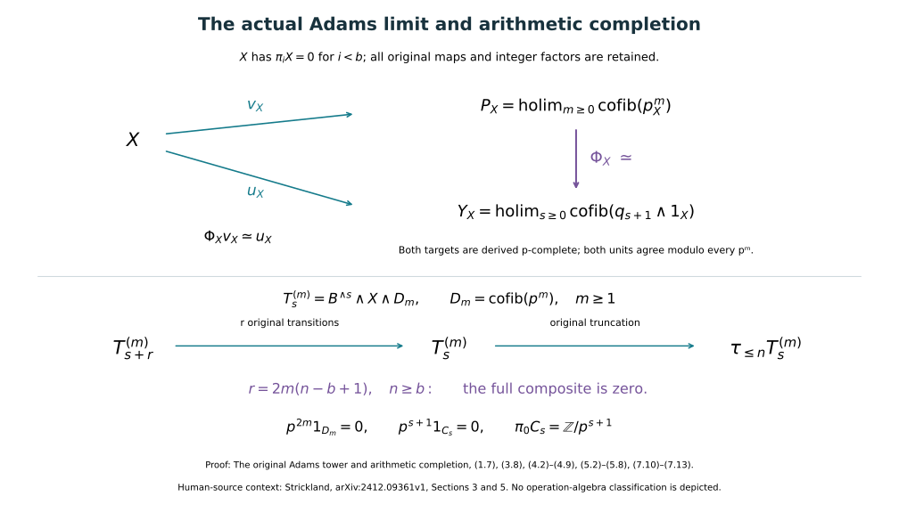

# The original Adams tower and arithmetic completion

Proof companion for CG-S6 lesson 7. GPT-6 Astra (OpenAI), Ultra, 11 October 2026. New exposition CC0. This chapter proves the arithmetic comparison of the actual tower constructed in [the Adams companion](the-adams-tower-and-exact-inverse-limits.md). The proof applies to every bounded-below spectrum and keeps the original sphere as its receiving example. All completion maps, Moore torsion terms and inverse-limit terms are specified. The classification of the cooperation algebra and the value of the original framed six-manifold are subsequent calculations.

## 1. The original integer maps and the Moore tower {#arithmetic-moore-tower}

Fix the same prime \(p\), sphere spectrum \(\mathbb S\), ordinary-cohomology spectrum \(H=H\mathbb F_p\), unit \(\eta\), and fibre map \(\alpha:B\to\mathbb S\) as in the Adams companion. Retain its ordered factors and maps

\[
\begin{gathered}
F_s=B^{\wedge s},\qquad
a_s=\alpha\wedge1_{B^{\wedge s}}:F_{s+1}\longrightarrow F_s,\\
q_s=\alpha^{\wedge s}:F_s\longrightarrow\mathbb S,
\qquad C_s=\operatorname{cofib}(q_{s+1}),\quad C_{-1}=0.
\end{gathered}
\tag{1.1}
\]

Here \(F_0=\mathbb S\), \(q_0=1\), and the unit identifications in each smash product are the original ones. In particular \(C_0=H\). No scalar is absorbed into any of these maps.

For a spectrum \(X\), write \(p^m_X=p^m1_X\) for multiplication by the integer \(p^m\) in the additive stable category. Define

\[
D_m=\operatorname{cofib}(p^m_{\mathbb S}),\qquad
X/p^m=D_m\wedge X=\operatorname{cofib}(p^m_X),\qquad m\geq0.
\tag{1.2}
\]

Thus \(D_0=0\) and \(X/p^0=0\). The transition \(d_m:X/p^{m+1}\to X/p^m\) is induced by the entire square

\[
\begin{array}{ccccc}
X&\xrightarrow{p^{m+1}_X}&X&\longrightarrow&X/p^{m+1}\\
{\scriptstyle p_X}\downarrow&&\downarrow{\scriptstyle1_X}&&\downarrow{\scriptstyle d_m}\\
X&\xrightarrow{p^m_X}&X&\longrightarrow&X/p^m .
\end{array}
\tag{1.3}
\]

Its extension to the next term has vertical map \(\Sigma p_X\). Fix these cofibres and their induced maps, using mapping cylinders if necessary. Define the arithmetic completion and its original unit by

\[
P_X=\operatorname*{holim}_{m\geq0}X/p^m,
\qquad v_X:X\longrightarrow P_X.
\tag{1.4}
\]

The stage \(m=0\) may be dropped without changing the limit. To see this at the level of homotopy limits, their path description has one extra first coordinate and a path to the image of the next coordinate. That extra coordinate and path have a contractible space of choices. Retaining the zero stage makes the fibre map of (1.4) particularly precise below.

For every integer \(a\), the original cofiber sequence gives

\[
0\longrightarrow \pi_aX/p^m\pi_aX
\xrightarrow{\ \overline{j_m}\ }\pi_a(X/p^m)
\xrightarrow{\ \partial_m\ }(\pi_{a-1}X)[p^m]
\longrightarrow0,
\qquad A[p^m]=\{x\in A:p^mx=0\}.
\tag{1.5}
\]

The first map sends the coset of \(x\) to \((j_m)_*x\). The last is the original connecting map, with target restricted to its image. Exactness of the long sequence proves both its surjectivity and the stated kernel. Naturality of the whole square (1.3) proves that the transition on the left is reduction of cosets and that the transition on the right is

\[
(\pi_{a-1}X)[p^{m+1}]\longrightarrow(\pi_{a-1}X)[p^m],
\qquad z\longmapsto pz.
\tag{1.6}
\]

This is not the inclusion of one torsion subgroup into another. The factor \(p\) comes from the left vertical arrow of (1.3), after suspension.

We also need a bound on actual spectrum maps. For every spectrum \(X\) and every \(m\geq1\),

\[
p^{2m}1_{X/p^m}=0.
\tag{1.7}
\]

Indeed, put \(Q=X/p^m\) and retain the triangle
\(X\xrightarrow{p^m}X\xrightarrow j Q\xrightarrow\partial\Sigma X\).
Its last two arrows satisfy \((\Sigma p^m)\partial=0\). Consequently
\(\partial(p^m1_Q)=0\). Exactness of \([Q,-]\) gives a map \(g:Q\to X\) with \(p^m1_Q=jg\). Multiplying by the same integer once more gives

\[
p^{2m}1_Q=(p^m1_Q)jg=j(p^m1_X)g=0.
\tag{1.8}
\]

The last equality uses \(jp^m=0\) from the original triangle. Neither this proof nor what follows replaces (1.7) by the stronger assertion \(p^m1_Q=0\). A cofiber can retain an extension in its endomorphism group.

## 2. The completion map and its exact universal property {#arithmetic-universal-map}

Let

\[
L=\mathbb S[1/p]
=\operatorname*{hocolim}(\mathbb S\xrightarrow p\mathbb S\xrightarrow p\mathbb S\xrightarrow p\cdots).
\tag{2.1}
\]

This notation denotes the displayed telescope of the original maps. If \(e_j\) is the inclusion of its \(j\)-th sphere into \(A=\bigvee_{j\geq0}\mathbb S\), and \(\sigma e_j=e_{j+1}\), its model is

\[
L=\operatorname{cofib}(1_A-p\sigma:A\longrightarrow A).
\tag{2.2}
\]

On the direct sum of any groups, \(1-p\sigma\) is injective: its zeroth component first makes the zeroth coefficient zero, and induction makes every later coefficient zero. The cofiber sequence therefore identifies \(\pi_aL\) with the direct limit of \(\pi_a\mathbb S\) under multiplication by \(p\). Multiplication by \(p\) on that limit has inverse \([x,j]\mapsto[x,j+1]\). Thus \(p_L\) is an equivalence. The stable Whitehead implication used here follows by attaching cells representing the homotopy groups of a cofiber: if all those groups vanish, every cell map and its successive relative obstruction can be contracted. Equivalently, a CW replacement with zero homotopy groups maps equivalently to zero.

Write \(\operatorname{Map}(U,V)\) for the internal mapping spectrum; its \(a\)-th homotopy group is \([\Sigma^aU,V]\). A spectrum \(Y\) is *derived \(p\)-complete* in this chapter when

\[
\operatorname{Map}(L,Y)=0.
\tag{2.3}
\]

In Section 7 we prove the exact comparison with the usual definition on its homotopy groups. A spectrum \(K\) is *\(p\)-invertible* when \(p_K\) is an equivalence. For such a spectrum, the actual telescope map gives \(L\wedge K\simeq K\), because every transition in that telescope is an equivalence. Therefore, if \(Y\) satisfies (2.3), smash–mapping adjunction gives

\[
\operatorname{Map}(K,Y)
\simeq\operatorname{Map}(L\wedge K,Y)
\simeq\operatorname{Map}(K,\operatorname{Map}(L,Y))=0.
\tag{2.4}
\]

This proves the exact vanishing for every suspension as well as for maps in degree zero.

If \(p^N1_Y=0\) for a positive integer \(N\), then \(Y\) is derived \(p\)-complete. Multiplication by \(p^N\) on \(\operatorname{Map}(L,Y)\) can be computed either by precomposition on \(L\) or by postcomposition on \(Y\). The former is an equivalence and the latter is zero, so the mapping spectrum is zero. Derived complete spectra are closed under homotopy limits and fibre sequences: the functor \(\operatorname{Map}(L,-)\) preserves those limits.

Applying a homotopy limit to the full triangles (1.3), including \(m=0\), gives the fibre sequence

\[
K_X\xrightarrow{\epsilon_X}X\xrightarrow{v_X}P_X,
\qquad
K_X=\operatorname*{holim}(X\xleftarrow p X\xleftarrow p X\xleftarrow p\cdots)
=\operatorname{Map}(L,X).
\tag{2.5}
\]

The last equality follows by applying \(\operatorname{Map}(-,X)\) to (2.1). Its map \(\epsilon_X\) is evaluation at the initial sphere of the telescope. In the coordinate description of the limit it sends \((x_m)\) to \(x_0\); the compatible maps of (1.3) send it to \(p^mx_m=x_0\). This verifies the map, including the initial integer factor.

By (1.7), every \(X/p^m\) is derived complete. Hence \(P_X\) is derived complete. Multiplication by \(p\) on \(K_X=\operatorname{Map}(L,X)\) is an equivalence, by precomposition with \(p_L\). Thus for any complete \(Y\), applying \(\operatorname{Map}(-,Y)\) to (2.5) and using (2.4) gives the equivalence of mapping spectra

\[
v_X^*:\operatorname{Map}(P_X,Y)\xrightarrow{\ \simeq\ }\operatorname{Map}(X,Y).
\tag{2.6}
\]

This proves existence, uniqueness up to homotopy, and the higher compatibility of the factorization of a map \(X\to Y\) through the actual \(v_X\). More precisely, the homotopy fibre over a specified map and its specified comparison homotopy is contractible. No compatibility of separately chosen maps between unrelated tower stages is presumed.

Since \(p\) is invertible on the fibre \(K_X\), taking cofibres of multiplication by \(p^m\) in (2.5) proves

\[
X/p^m\xrightarrow{\ \simeq\ }P_X/p^m
\quad(m\geq1).
\tag{2.7}
\]

There is also an exact detection result. If \(f:Y\to Z\) is a map of complete spectra and \(f/p\) is an equivalence, its fibre \(T\) is complete and \(T/p=0\). The latter says that \(p_T\) is invertible. Equation (2.4), with \(K=T=Y\) there, makes \(\operatorname{Map}(T,T)=0\); hence its identity map is zero and \(T=0\). Thus \(f\) is an equivalence. This argument requires no boundedness or finiteness hypothesis.

## 3. Coefficient spectra and the finite extension argument {#arithmetic-extension-length}

We give the prerequisite that relates the original Adams transitions to (1.7). For an arbitrary abelian group \(G\), repeat the original simplex-cochain construction of the Adams companion, Sections 8–9, with values in \(G\). Its formulas are still

\[
U^n_q(G)=C^n(\Delta^q;G),\qquad
K^n_q(G)=\ker(\delta:U^n_q(G)\to U^{n+1}_q(G)),
\]
\[
(\delta u)(i_0,\ldots,i_{n+1})=
\sum_{j=0}^{n+1}(-1)^j u(i_0,\ldots,\widehat{i_j},\ldots,i_{n+1}).
\tag{3.1}
\]

Values on tuples with a repeated vertex are zero. All face maps, degeneracies, the cone contraction, the quotient-bundle charts and the suspension maps are the same formulas. Their proofs used additivity and the displayed integer signs; finiteness of \(G\) was used only to count cells. The cocycle values on simplices containing vertex zero give
\(K^n_q(G)=G^{\binom qn}\) for \(n\geq1\), while \(K^0_q(G)=G\). Thus exact sequences of coefficient groups give exact sequences at each of these simplicial levels. Realization and the already proved bundle lifting argument apply to these discrete groups of any cardinality. We obtain the ordinary coefficient spectrum \(HG\), with \(\pi_0HG=G\) and all its other homotopy groups zero, together with the actual maps induced by homomorphisms of coefficients.

For later use we prove the degree-zero mapping assertion

\[
[Z,HG]\xrightarrow{\ \pi_0\ }\operatorname{Hom}_{\mathbb Z}(\pi_0Z,G)
\quad\hbox{is an isomorphism when }\pi_iZ=0\ (i<0).
\tag{3.2}
\]

Choose a CW replacement of \(Z\) with cells only in dimensions at least zero. Such a replacement is obtained by adjoining zero-cells for generators of \(\pi_0\), one-cells for its relations and the subsequent missing homotopy generators, and then successive higher cells for the successive kernels and missing generators. At a fixed degree, later cells of larger dimension do not change the required isomorphism; compactness of a representative sphere and of a homotopy proves that the union has the asserted homotopy groups. Mapping a zero-cell into \(HG\) assigns its element of \(G\). Each one-cell extends exactly when its original integer attaching relation is zero in \(G\). Every later extension and every choice of its homotopy is controlled by a positive homotopy group of \(HG\), hence exists uniquely up to the next relative homotopy. Induction over the cells, using their weak topology, constructs the map and its homotopies. Consequently the zero-cell labels modulo precisely the one-cell relations give (3.2). This also proves naturality and injectivity, with the original attaching coefficients retained.

Let \(V\) be any \(\mathbb F_p\)-vector space. The degree-zero cellular complex gives
\(\pi_0(H\wedge HV)=\mathbb F_p\otimes_{\mathbb Z}V=V\): only products of zero-cells contribute generators, and the original one-cell incidences impose exactly the tensor relations. Both factors are connective, so there is no contribution from a negative-dimensional cell. By (3.2) there is a unique homotopy class

\[
\mu_V:H\wedge HV\longrightarrow HV
\quad\hbox{with}\quad
(\mu_V)_*(\lambda\otimes v)=\lambda v.
\tag{3.3}
\]

The composite \(HV\xrightarrow{\eta\wedge1}H\wedge HV\xrightarrow{\mu_V}HV\) induces the identity on \(\pi_0\); (3.2) says that it is the identity map in the stable category. For \(\Sigma^jHV\), use the actual symmetry map moving the suspension sphere past \(H\), followed by \(\Sigma^j\mu_V\). The unit lies in degree zero, so this same unit identity has sign plus for every integer \(j\). This construction supplies the precise retraction needed here; it assumes no presentation of the Steenrod operations.

For any spectrum \(Z\), the map

\[
g_Z=\alpha\wedge1_Z:B\wedge Z\longrightarrow Z
\tag{3.4}
\]

has the following property: every map \(f:Z\to\Sigma^jHV\) satisfies \(fg_Z=0\). Indeed, using (3.3) with the indicated suspension, \(f\) factors as

\[
Z\xrightarrow{\eta\wedge1_Z}H\wedge Z
\xrightarrow{1_H\wedge f}H\wedge\Sigma^jHV
\xrightarrow{\mu_{V,j}}\Sigma^jHV.
\tag{3.5}
\]

The first map composed with (3.4) is zero by the defining fibre sequence of \(B\). Naturality of the unit and its proved retraction verify that (3.5) is exactly \(f\).

Call a map with this vanishing property an *\(H\)-ghost*. The definition quantifies over every \(V\), every \(j\) and every target map; it does not mean only that one homotopy group vanishes. Say that a target has extension length at most one when it is \(\Sigma^jHV\), and length at most \(u+v\) when it occurs as the middle object of a fibre triangle whose first and third objects have lengths at most \(u\) and \(v\). The zero object has length zero. We only use explicit finite constructions of this kind.

**Extension lemma.** If a target \(E\) has such a construction of length at most \(r\), then any composite of \(r\) \(H\)-ghosts followed by any map to \(E\) is zero.

For length one this is the definition. For the induction step retain a fibre triangle \(E'\xrightarrow i E\xrightarrow h E''\), with lengths \(u,v\). Start at the end nearest \(E\). The last \(v\) ghosts, followed by the given map and then \(h\), compose to zero by induction. Exactness lifts their composite to a map into \(E'\). Precomposing that lift with the preceding \(u\) ghosts makes it zero by induction. Its image under \(i\) is the full original composite, so that composite is zero. This proves the lemma, retaining the actual extension map; no splitting was used.

If \(p^NG=0\), the filtration

\[
G\supset pG\supset p^2G\supset\cdots\supset p^NG=0
\tag{3.6}
\]

has \(N\) successive quotients \(V_i=p^iG/p^{i+1}G\), each an \(\mathbb F_p\)-vector space. The full short exact sequence
\(0\to p^{i+1}G\to p^iG\to V_i\to0\) induces the fibre triangle of its coefficient spectra: the composite is strictly zero on the original cochains, and its cofiber map to \(HV_i\) is an isomorphism on every homotopy group by the long exact sequence. Hence \(HG\) has extension length at most \(N\). All connecting homomorphisms of (3.6) remain part of those triangles.

For completeness, construct the needed finite Postnikov sections as follows. For a spectrum \(T\) with \(\pi_iT=0\) for \(i<b\), kill \(\pi_{n+1}T\) by adjoining cells of dimension \(n+2\), kill the next homotopy group by cells of dimension \(n+3\), and continue. The resulting map \(T\to\tau_{\leq n}T\) is an isomorphism on \(\pi_i\) for \(i\leq n\), and the target has zero groups above \(n\). At each step all elements of the indicated group are represented and killed; new groups in higher degrees are handled in the later steps. Compactness verifies these assertions at the union. Maps out of a spectrum with cells in dimensions at least \(n+1\) to a spectrum with no homotopy above \(n\) are null, with all relative homotopies, by the same cell argument as (3.2). This gives the factorization and uniqueness needed for the natural maps between successive truncations. Their fibres have precisely one nonzero group, giving the triangles

\[
\Sigma^jH\pi_jT\longrightarrow\tau_{\leq j}T
\longrightarrow\tau_{\leq j-1}T,
\qquad b\leq j\leq n,
\qquad \tau_{\leq b-1}T=0.
\tag{3.7}
\]

To identify the fibre, shift it by \(-j\) and apply (3.2) to its identity homomorphism into \(H\pi_jT\). That map is an isomorphism on all homotopy groups. This proves the identification, including its actual map to the original truncation.

If every \(\pi_jT\), \(b\leq j\leq n\), is killed by \(p^N\), (3.6), (3.7), and the extension lemma give the explicit bound

\[
\text{extension length of }\tau_{\leq n}T\ \leq\ N(n-b+1).
\tag{3.8}
\]

No finite-generation hypothesis occurs in this proof. The finite number in (3.8) counts the displayed coefficient and Postnikov extensions, even when their groups are infinite.

## 4. The exact number of vanishing transitions {#arithmetic-vanishing-transitions}

Suppose \(X\) is bounded below: fix an integer \(b\) such that \(\pi_iX=0\) whenever \(i<b\). The fibre \(B\) in (1.1) is connective. Indeed, \(\pi_0\eta:\mathbb Z\to\mathbb F_p\) is surjective, so the fibre long sequence gives \(\pi_iB=0\) for \(i<0\). A smash product of connective CW spectra is connective because its cells have the sums of the original cell dimensions. Shifting this argument shows that smashing with a connective spectrum preserves the lower bound \(b\).

Fix \(m\geq1\) and retain the tower

\[
T_s^{(m)}=F_s\wedge X\wedge D_m,
\qquad
t_s=a_s\wedge1_X\wedge1_{D_m}:T_{s+1}^{(m)}\longrightarrow T_s^{(m)}.
\tag{4.1}
\]

Every \(T_s^{(m)}\) has no homotopy below \(b\). Equation (1.7), smashed with the remaining original factors, proves that its identity map is killed by \(p^{2m}\). In particular every one of its homotopy groups is killed by this same integer. Each \(t_s\) is an \(H\)-ghost by (3.4)–(3.5).

For every \(n\geq b\), put

\[
r=2m(n-b+1).
\tag{4.2}
\]

The target \(\tau_{\leq n}T_s^{(m)}\) has extension length at most \(r\) by (3.8). Applying the extension lemma to the original composite and then its truncation gives

\[
T_{s+r}^{(m)}\xrightarrow{t_s\,t_{s+1}\cdots t_{s+r-1}}T_s^{(m)}
\longrightarrow\tau_{\leq n}T_s^{(m)}
\quad\text{equal to zero in the stable category}.
\tag{4.3}
\]

The last map is an isomorphism on \(\pi_n\). Hence

\[
(t_s\,t_{s+1}\cdots t_{s+r-1})_*:
\pi_nT_{s+r}^{(m)}\longrightarrow\pi_nT_s^{(m)}
\quad\text{is zero for every }s\geq0.
\tag{4.4}
\]

The order of the maps in (4.3) means that the rightmost map acts first. The number \(r\) is uniform in \(s\). The result is stronger than the vanishing of the limit: it specifies a full finite composite of the actual maps that is zero in each fixed homotopy degree. For \(n<b\), every group in question is already zero.

Here is the full inverse-limit calculation. For an inverse sequence \(A_s\) with maps \(u_s:A_{s+1}\to A_s\), set

\[
Q:\prod_{s\geq0}A_s\longrightarrow\prod_{s\geq0}A_s,
\qquad (Qa)_s=u_sa_{s+1}.
\tag{4.5}
\]

If all composites of \(r\) consecutive transitions are zero, then \(Q^r=0\), and

\[
(1-Q)^{-1}=1+Q+Q^2+\cdots+Q^{r-1}.
\tag{4.6}
\]

In coordinates this says

\[
a_s=b_s+u_sb_{s+1}+u_su_{s+1}b_{s+2}
+\cdots+u_su_{s+1}\cdots u_{s+r-2}b_{s+r-1}.
\tag{4.7}
\]

Multiplying (4.6) on either side by \(1-Q\) gives \(1-Q^r=1\). This verifies both inverse identities, with every summand retained. Thus both \(\ker(1-Q)=\lim A_s\) and \(\operatorname{coker}(1-Q)=\lim^1 A_s\) vanish.

For a countable tower of spectra \(Z_s\), its homotopy limit is the fibre of \(1-Q\) on the product. The full long exact sequence gives

\[
0\longrightarrow\lim{}^1_s\pi_{n+1}Z_s
\longrightarrow\pi_n\operatorname*{holim}_s Z_s
\longrightarrow\lim_s\pi_nZ_s\longrightarrow0.
\tag{4.8}
\]

This is also the proof of (4.8): homotopy groups of a product of spectra are the products of the homotopy groups, and the two outside groups are respectively the indicated cokernel and kernel. Apply (4.6) twice, in degrees \(n+1\) and \(n\), with their respective finite bounds (4.2). Both outside groups vanish. Therefore every homotopy group of the limit of (4.1) vanishes, proving

\[
\operatorname*{holim}_{s\geq0}(F_s\wedge X\wedge D_m)=0
\quad\text{for every }m\geq1.
\tag{4.9}
\]

There is no interchange of an infinite sum with a product in this proof: (4.6) is a finite sum for each fixed degree and fixed \(m\).

## 5. The actual equivalence of the two completions {#arithmetic-adams-equivalence}

Retain the Adams target and its unit

\[
Y_X=\operatorname*{holim}_{s\geq0}(C_s\wedge X),
\qquad u_X:X\longrightarrow Y_X.
\tag{5.1}
\]

We first strengthen the exponent assertion in the preceding companion from homotopy groups to actual spectrum maps:

\[
p^{s+1}1_{C_s\wedge X}=0\qquad(s\geq0).
\tag{5.2}
\]

The original cochain model of \(H\) consists of simplicial \(\mathbb F_p\)-vector spaces with additive structure maps. Adding a map \(p\) times is zero at each level. The stable addition agrees with this pointwise addition, since both are induced by the diagonal and codiagonal for the additive group objects. Thus \(p1_H=0\), and \(p1_{H\wedge Z}=0\) for every \(Z\). In the triangle

\[
W_s\wedge X\xrightarrow{i_s\wedge1}C_s\wedge X
\xrightarrow{r_s\wedge1}C_{s-1}\wedge X,
\qquad W_s=H\wedge F_s,
\tag{5.3}
\]

the first object is therefore killed by \(p\). Start with \(C_{-1}\wedge X=0\). If \(p^s1_{C_{s-1}\wedge X}=0\), then \((r_s\wedge1)p^s=0\). Exactness gives an actual stable map \(h_s:C_s\wedge X\to W_s\wedge X\) with
\(p^s1_{C_s\wedge X}=(i_s\wedge1)h_s\).
Multiplication by one further \(p\) makes this zero through the first object. This proves (5.2) by induction. It retains the extension in (5.3) and does not split it.

Section 2 now proves that every \(C_s\wedge X\) is complete, and hence that \(Y_X\) is complete. This part holds for arbitrary \(X\).

We next use boundedness below. The original cofibres give

\[
\operatorname*{holim}_{s\geq0}(F_{s+1}\wedge X)
\longrightarrow X\xrightarrow{u_X}Y_X.
\tag{5.4}
\]

Smashing with \(D_m\) commutes with this homotopy limit. This follows directly from its full two-cell description: \(D_m\wedge Z=\operatorname{cofib}(p^m_Z)\). In spectra a cofiber is the suspension of a fibre, suspension is an equivalence, and limits preserve fibres. Thus the homotopy limit of the cofibres of the natural maps \(p^m\) is the cofiber of that map on the limit. The same argument explains why this particular smash product commutes with products. No assertion is made that an arbitrary smash product commutes with every inverse limit.

By (4.9), the first object of (5.4), smashed with \(D_m\), is zero. Dropping its initial stage has no effect, by the same path-coordinate argument used after (1.4). Therefore

\[
u_X/p^m:X/p^m\xrightarrow{\ \simeq\ }Y_X/p^m
\quad(m\geq1).
\tag{5.5}
\]

Since \(Y_X\) is complete, (2.6) supplies the actual map \(\Phi_X\) with its comparison to the original unit:

\[
\Phi_X:P_X\longrightarrow Y_X,
\qquad \Phi_Xv_X\simeq u_X.
\tag{5.6}
\]

To specify its construction, apply the fibre sequence of mapping spectra from (2.5) with target \(Y_X\). The restriction map (2.6) is an equivalence, and \(\Phi_X\), together with the displayed homotopy, is the lift of the specified point \(u_X\). Its space of choices is contractible by (2.4). This defines the morphism and its coherent naturality, not merely an equality of the two target groups.

Reduce its defining equality modulo \(p\). Equations (2.7) and (5.5) show that both maps out of \(X/p\) are equivalences, so \(\Phi_X/p\) is an equivalence. Both its source and target are complete. The detection result following (2.7) proves that \(\Phi_X\) itself is an equivalence. We have proved the full statement

\[
\boxed{
\operatorname*{holim}_{m\geq0}\operatorname{cofib}(p^m_X)
\xrightarrow[\ \Phi_Xv_X\simeq u_X\ ]{\ \Phi_X\;\simeq\ }
\operatorname*{holim}_{s\geq0}\operatorname{cofib}(q_{s+1}\wedge1_X)
}
\tag{5.7}
\]

for every spectrum \(X\) bounded below. All original factors, maps and integer coefficients have remained in the construction. In particular, for the original sphere,

\[
\Phi_{\mathbb S}:P_{\mathbb S}\xrightarrow{\ \simeq\ }\widehat{\mathbb S}_H,
\qquad
\Phi_{\mathbb S}v_{\mathbb S}\simeq u_{\mathbb S}.
\tag{5.8}
\]

Combining this specific map with Section 11 of the Adams companion identifies its already proved complete separated filtration on \(\pi_a\widehat{\mathbb S}_H\) with the filtration on \(\pi_aP_{\mathbb S}\) given by the kernels of
\(\pi_aP_{\mathbb S}\xrightarrow{(\Phi_{\mathbb S})_*}\pi_a\widehat{\mathbb S}_H\to\pi_aC_{s-1}\).
The associated-graded isomorphism is precisely its equation (11.8), transported by this map. This does not replace an original stable sphere group by a completed group: Section 7 retains the exact comparison on homotopy groups.

The diagram retains the original exponent bounds. The map \(\Phi_X\) is constructed in (5.6); the lower composite is exactly (4.3). Its reproducible source is `draw_arithmetic_completion.py`. The full diagram and all its labels have been inspected after rendering.

## 6. The full arithmetic presentation {#arithmetic-original-presentation}

We now calculate those homotopy groups with both derived contributions. Use the same \(A=\bigvee_{j\geq0}\mathbb S\) and \(\sigma\) as in (2.2). Define the original backward shift and integer map by

\[
\delta e_0=0,\qquad \delta e_j=e_{j-1}\ (j\geq1),
\qquad M=\delta-p1_A.
\tag{6.1}
\]

They satisfy \(\delta\sigma=1_A\) and

\[
\delta(1_A-p\sigma)=\delta-p1_A=M.
\tag{6.2}
\]

Set \(T=\operatorname{cofib}(M)\). The original sphere at \(e_0\) gives the fibre/cofiber sequence

\[
\mathbb S\xrightarrow{e_0}L\longrightarrow T\longrightarrow\Sigma\mathbb S.
\tag{6.3}
\]

Here is an explicit verification including the maps. The target copy of \(A\) in (2.2) is the direct sum \(e_0\mathbb S\vee\sigma A\); projection onto its second summand, identified with \(A\), is \(\delta\). In these coordinates the full map \(1-p\sigma\) is the column \((\epsilon,M)\), where \(\epsilon\) selects the zeroth coefficient. Taking the cofiber of the included first summand \(\mathbb S\to\operatorname{cofib}(\epsilon,M)=L\) leaves exactly \(\operatorname{cofib}(M)=T\). The induced map \(L\to T\) is \(\delta\) on the target copy of \(A\) and the identity on the cone on its source copy. Equation (6.2) is exactly the compatibility on the attached cone. Thus the map out of \(\mathbb S\) is the positive \(e_0\) unit of (2.1), with no sign or integer alteration.

Applying \(\operatorname{Map}(-,X)\) to (6.3) compares its fibre sequence with (2.5). It gives the natural unit-preserving identification

\[
P_X\simeq\operatorname{Map}(\Sigma^{-1}T,X).
\tag{6.4}
\]

In integral degree zero, (6.1) is the free presentation

\[
0\longrightarrow\bigoplus_{j\geq0}\mathbb Ze_j
\xrightarrow{\delta-p}\bigoplus_{j\geq0}\mathbb Ze_j
\xrightarrow{\rho}\mathbb Z[1/p]/\mathbb Z\longrightarrow0,
\qquad \rho(e_j)=p^{-j-1}+\mathbb Z.
\tag{6.5}
\]

The first map is injective. For a vector with highest nonzero coefficient \(c_N\), its highest coefficient after applying \(\delta-p\) is \(-pc_N\), which cannot be zero in \(\mathbb Z\). The map \(\rho\) is surjective because every fraction with denominator a power of \(p\) has the displayed form. Its relations are \(-pe_0\) and \(e_{j-1}-pe_j\) for \(j\geq1\). For a finite vector \(\sum_{j=0}^Nc_je_j\), these relations express its class as
\((\sum_{j=0}^Nc_jp^{N-j})e_N\).
Its image under \(\rho\) is zero exactly when that integer coefficient is divisible by \(p^{N+1}\). But \(p^{N+1}e_N=pe_0=0\) in the quotient. This proves the kernel assertion, keeping the finite sum and every power of \(p\).

For an abelian group \(G\), dualizing (6.5) gives the full map on products

\[
\mathcal M_G:\prod_{j\geq0}G\longrightarrow\prod_{j\geq0}G,
\qquad
\mathcal M_G(b)_0=-pb_0,
\qquad
\mathcal M_G(b)_j=b_{j-1}-pb_j\ (j\geq1).
\tag{6.6}
\]

In particular its zeroth component is not the same formula as a later component. By the defining free-resolution calculation of \(\operatorname{Hom}\) and \(\operatorname{Ext}^1_{\mathbb Z}\), (6.5) proves

\[
\ker\mathcal M_G=\operatorname{Hom}_{\mathbb Z}(\mathbb Z[1/p]/\mathbb Z,G),
\qquad
\operatorname{coker}\mathcal M_G=
\operatorname{Ext}^1_{\mathbb Z}(\mathbb Z[1/p]/\mathbb Z,G).
\tag{6.7}
\]

These identifications can also be read directly: an element of the kernel assigns images to all generators respecting every relation in (6.5), and the cokernel identifies two extension assignments when their difference is a change of chosen lifts of those free generators. Thus the second group records the actual extension data of the original presentation.

Applying the mapping-spectrum long exact sequence to \(T=\operatorname{cofib}(M)\), with the suspension in (6.4), yields the precise natural short exact sequence

\[
0\longrightarrow
\operatorname{Ext}^1_{\mathbb Z}(\mathbb Z[1/p]/\mathbb Z,\pi_aX)
\longrightarrow\pi_aP_X
\longrightarrow
\operatorname{Hom}_{\mathbb Z}(\mathbb Z[1/p]/\mathbb Z,\pi_{a-1}X)
\longrightarrow0.
\tag{6.8}
\]

Indeed the outside groups before naming them are exactly
\(\operatorname{coker}\mathcal M_{\pi_aX}\) and
\(\ker\mathcal M_{\pi_{a-1}X}\). This checks both indices and the suspension. No splitting of (6.8) is asserted.

## 7. The unit sign, both derived terms and the original sphere {#arithmetic-homotopy-groups}

Fix the mapping-cone convention
\(d_{\operatorname{Cone}(f)}(b,a)=(d_Bb+fa,-d_Aa)\).
The construction in (6.3) determines its connecting map, and hence the sign of the original completion unit. At the free-cell level the cone on \(\mathbb S\to L\) has degree-one coordinates \((a,z)\in A\oplus\mathbb S\) and differential
\((a,z)\mapsto(\epsilon a+z,Ma)\) in degree zero \(\mathbb S\oplus A\). Its copy of the cone on \(M\) sends \(a\) to \((a,-\epsilon a)\). Projection to the suspended \(\mathbb S\) is therefore \(-\epsilon a\). Consequently the connecting map \(T\to\Sigma\mathbb S\) in (6.3) is represented on the original free source cells by \(-\epsilon\). This records the boundary sign, rather than changing the definition of \(M\).

It follows that, for \(x\in\pi_aX\), the original unit in (6.8) is

\[
(v_X)_*(x)=\iota_a\bigl[(-x,0,0,\ldots)\bigr],
\tag{7.1}
\]

where \(\iota_a\) is the indicated inclusion of
\(\operatorname{coker}\mathcal M_{\pi_aX}\) into \(\pi_aP_X\).
One can check this sign purely in the original abelian extension. Lift \(\rho(e_j)\) from (6.5) to \(p^{-j-1}\in\mathbb Z[1/p]\). The relation \(M(e_0)=-pe_0\) then lifts to \(-1\), while every relation \(M(e_j)=e_{j-1}-pe_j\) for \(j\geq1\) lifts to zero. Pushing that extension along \(1\mapsto x\) gives exactly the vector in (7.1).

For \(G\) arbitrary, restriction to the cyclic subgroup
\(\mathbb Z/p^m\to\mathbb Z[1/p]/\mathbb Z\), \(1\mapsto p^{-m}+\mathbb Z\), gives the coefficient comparison

\[
\lambda_m:\operatorname{coker}\mathcal M_G\longrightarrow G/p^mG,
\qquad
\lambda_m([b])=-\sum_{j=0}^{m-1}p^j b_j\pmod{p^mG}.
\tag{7.2}
\]

To prove it with the full maps, use the free presentation
\(\mathbb Z\xrightarrow{p^m}\mathbb Z\to\mathbb Z/p^m\).
Its map to (6.5) sends the target generator to \(e_{m-1}\) and the source generator to \(-\sum_{j=0}^{m-1}p^je_j\). Indeed

\[
M\left(-\sum_{j=0}^{m-1}p^je_j\right)=p^me_{m-1}.
\tag{7.3}
\]

Applying \(\operatorname{Hom}(-,G)\) proves (7.2). Directly, for a change of lifts \(b=\mathcal M_G(c)\), the sum in (7.2) equals \(p^mc_{m-1}\), so it is zero in the asserted quotient. The extra summand in \(\lambda_{m+1}\) is \(-p^mb_m\), so the maps are compatible with reduction. In particular (7.1) maps to the positive coset of \(x\) in every original quotient. Both negative signs are required for this exact comparison.

The full limit sequence for the original tower (1.3) is

\[
0\longrightarrow\lim{}^1_m\pi_{a+1}(X/p^m)
\longrightarrow\pi_aP_X
\longrightarrow\lim_m\pi_a(X/p^m)\longrightarrow0.
\tag{7.4}
\]

This is (4.8) with its actual Moore transitions. The proof of (4.9) applied to the different tower \(F_s\wedge X\wedge D_m\); it does not set the left group of (7.4) to zero. Both (1.5)–(1.6) and (7.4) remain available without a finite-generation assumption.

There is an exact relation between the two derived terms and the ordinary inverse limit of coefficient quotients. Apply these formulas to the actual coefficient spectrum \(HG\). Its original cofiber \(HG/p^m\) has only

\[
\pi_0(HG/p^m)=G/p^mG,
\qquad \pi_1(HG/p^m)=G[p^m],
\tag{7.5}
\]

with transitions reduction and multiplication by \(p\), respectively. All other homotopy groups vanish by its complete long exact sequence. Equation (6.8) identifies \(\pi_0P_{HG}\) with \(\operatorname{coker}\mathcal M_G\) and \(\pi_1P_{HG}\) with \(\ker\mathcal M_G\). Combining with (7.4) proves

\[
0\longrightarrow\lim{}^1_m\bigl(G[p^m],\times p\bigr)
\longrightarrow\operatorname{Ext}^1_{\mathbb Z}(\mathbb Z[1/p]/\mathbb Z,G)
\xrightarrow{(\lambda_m)}\lim_mG/p^mG\longrightarrow0,
\tag{7.6}
\]
\[
\operatorname{Hom}_{\mathbb Z}(\mathbb Z[1/p]/\mathbb Z,G)
\xrightarrow{\ \simeq\ }\lim_m\bigl(G[p^m],\times p\bigr),
\qquad f\longmapsto\bigl(f(p^{-m}+\mathbb Z)\bigr)_{m\geq1}.
\tag{7.7}
\]

The second map is also verified directly by the relations in (6.5): its first value is killed by \(p\), and each later value becomes the previous one after multiplication by \(p\). These data define \(f\) on every generator, so they give its inverse. For (7.6), the map to each quotient is the free-presentation restriction (7.2), equivalently the corresponding projection of the original cofiber tower. Thus the agreement concerns the maps as well as the groups. There is no assertion that an extension in (7.6) splits.

To compare (2.3) with the group definition of completeness, the free presentation of \(\mathbb Z[1/p]\) is \(1-p\sigma\) on \(\bigoplus_{j\geq0}\mathbb Z\), followed by \(e_j\mapsto p^{-j}\). It is exact: injectivity was proved after (2.2), and the relations \(e_j=pe_{j+1}\) identify the quotient with exactly the indicated fractions. Its dual map is
\(\Delta_G(b)_j=b_j-pb_{j+1}\). The full mapping-spectrum sequence from (2.2) gives

\[
0\longrightarrow\operatorname{Ext}^1_{\mathbb Z}(\mathbb Z[1/p],\pi_{a+1}X)
\longrightarrow\pi_a\operatorname{Map}(L,X)
\longrightarrow\operatorname{Hom}_{\mathbb Z}(\mathbb Z[1/p],\pi_aX)
\longrightarrow0.
\tag{7.8}
\]

Consequently (2.3) holds exactly when both \(\operatorname{Hom}_{\mathbb Z}(\mathbb Z[1/p],\pi_aX)\) and \(\operatorname{Ext}^1_{\mathbb Z}(\mathbb Z[1/p],\pi_aX)\) vanish for every \(a\). This is the exact morphism-based comparison to groupwise derived completeness.

For the original sphere, (5.8), (6.8) and (7.1) now give

\[
0\longrightarrow
\operatorname{Ext}^1_{\mathbb Z}(\mathbb Z[1/p]/\mathbb Z,\pi_a\mathbb S)
\longrightarrow\pi_a\widehat{\mathbb S}_H
\longrightarrow
\operatorname{Hom}_{\mathbb Z}(\mathbb Z[1/p]/\mathbb Z,\pi_{a-1}\mathbb S)
\longrightarrow0,
\tag{7.9}
\]

where the left and right maps use the specified \(\Phi_{\mathbb S}\), and the original sphere unit is exactly the image of \([(-x,0,\ldots)]\). This completes the arithmetic comparison required by the preceding Adams chapter. No original sphere group, torsion endpoint or unit has been removed. The needed actual cooperation calculations are proved in the linked companions below. The [original integral comparison](the-original-integral-stable-group-and-its-completion-maps.md#integral-degree-six-answer) now supplies the original integral degree-six group; the [original geometric framing proof](the-original-six-dimensional-framing-invariant.md#framed-six-original-nullbordism) now proves its zero value and actual framed nullbordism.

There is already an exact calculation on the original degree-zero line. The fibre sequence defining \(B\) gives
\(\pi_0B=p\mathbb Z\subset\pi_0\mathbb S=\mathbb Z\), with \(\alpha_*\) the inclusion, since \(\pi_1H=0\). The degree-zero smash calculation used in (3.3) gives

\[
\pi_0F_s=(p\mathbb Z)^{\otimes s},\qquad
e_s=p\otimes\cdots\otimes p,\qquad
(q_s)_*(e_s)=p^s,
\tag{7.10}
\]

where the empty tensor for \(s=0\) is the original generator \(1\in\mathbb Z\). No factor of \(p\) has been removed from the tensor or its receiving map. Since \(F_{s+1}\) is connective, its full cofiber sequence gives

\[
\pi_0C_s=\mathbb Z/p^{s+1},\qquad
(r_s)_*:\mathbb Z/p^{s+1}\longrightarrow\mathbb Z/p^s,
\quad\overline z\longmapsto\overline z.
\tag{7.11}
\]

The quotient maps here are induced by the original identity on \(\mathbb S\). Also
\(\pi_0W_s=\mathbb F_p\otimes(p\mathbb Z)^{\otimes s}\), with its indicated generator \(\overline1\otimes e_s\). The map \(i_s\) is induced by \(q_s\) on the target of the cofiber square, so (7.10) proves the entire sequence

\[
0\longrightarrow\mathbb F_p\{\overline1\otimes e_s\}
\xrightarrow{\ \overline a(\overline1\otimes e_s)\mapsto\overline{ap^s}\ }
\mathbb Z/p^{s+1}\longrightarrow\mathbb Z/p^s\longrightarrow0.
\tag{7.12}
\]

This includes \(s=0\), where the final group is \(\mathbb Z/1=0\). For \(s\geq1\) it does not split: a split middle group would be killed by \(p^s\), whereas the original class of \(1\) in \(\mathbb Z/p^{s+1}\) is not. Thus (5.2) is sharp for \(C_s\): no smaller power \(p^j\), \(j<s+1\), can kill its identity map, because it does not even kill that homotopy class.

The finite-stage convergence already proved in the Adams companion applies to the original sphere and its maps (7.11). It follows that

\[
\pi_0\widehat{\mathbb S}_H=\mathbb Z_p,\qquad
F^s\pi_0\widehat{\mathbb S}_H=p^s\mathbb Z_p,\qquad
E_\infty^{s,s}=p^s\mathbb Z_p/p^{s+1}\mathbb Z_p\simeq\mathbb F_p.
\tag{7.13}
\]

For the middle equality, the kernel of projection of compatible residue classes to \(\mathbb Z/p^s\) consists exactly of multiples of \(p^s\). Division of a compatible zero residue by \(p^s\) at levels \(s+m\) produces the unique compatible residues modulo \(p^m\), proving that assertion in both directions. Equation (7.12) determines its consecutive quotient and sign. This supplies the actual extension and filtration on the degree-zero line without using an operation-algebra identification.

## 8. Two full worked examples {#arithmetic-worked-examples}

### Exercise 8.1 The integral coefficient spectrum

Compute \(P_{H\mathbb Z}\), including its unit, from the original Moore tower.

**Solution.** Multiplication by \(p^m\) on \(\mathbb Z\) is injective, so (7.5) gives only \(\pi_0(H\mathbb Z/p^m)=\mathbb Z/p^m\). The transition is reduction. The inverse limit is by definition

\[
\mathbb Z_p=\{(z_m)_{m\geq1}:z_m\in\mathbb Z/p^m,\ z_{m+1}\equiv z_m\pmod{p^m}\}.
\tag{8.1}
\]

The difference map on the product of these groups is surjective: given \((b_m)\), choose \(a_1=0\) and successively choose \(a_{m+1}\) lifting \(a_m-b_m\). Then \(a_m-d_ma_{m+1}=b_m\). Thus its \(\lim^1\) vanishes. Equation (7.4) gives \(\pi_0P_{H\mathbb Z}=\mathbb Z_p\) and zero in every other degree, including degree \(-1\). The degree-zero coefficient classification (3.2) identifies the spectrum and its map as

\[
P_{H\mathbb Z}\simeq H\mathbb Z_p,
\qquad
\mathbb Z\longrightarrow\mathbb Z_p,
\qquad z\longmapsto(z\bmod p^m)_{m\geq1}.
\tag{8.2}
\]

In the original product presentation, (7.1) represents this map by \((-z,0,\ldots)\), and (7.2) sends it to \(+z\bmod p^m\). This checks the same unit in both constructions. Also (7.7) is zero here, because \(\mathbb Z\) has no element of order \(p\), hence no nonzero compatible sequence of \(p\)-power torsion elements. Every term of the full sequences has now been accounted for.

### Exercise 8.2 A completion whose group moves one degree

Let \(G=\mathbb Z[1/p]/\mathbb Z\). Compute \(P_{HG}\) from the same original maps, retaining the torsion endpoint.

**Solution.** Multiplication by \(p^m\) on \(G\) is surjective: the element represented by \(a/p^j\) is the image of \(a/p^{j+m}\). Thus \(G/p^mG=0\). Its kernel is the cyclic group with original generator \(p^{-m}+\mathbb Z\), and the full identification is

\[
\mathbb Z/p^m\xrightarrow{\ \simeq\ }G[p^m],
\qquad \overline a\longmapsto ap^{-m}+\mathbb Z.
\tag{8.3}
\]

It is injective because \(ap^{-m}\) is integral exactly when \(p^m\mid a\), and surjective by the definition of the kernel. The transition is multiplication by \(p\) in \(G\). Applied to the next original generator it gives

\[
p\,(ap^{-m-1}+\mathbb Z)=ap^{-m}+\mathbb Z.
\tag{8.4}
\]

Therefore (8.3) identifies that transition with reduction \(\mathbb Z/p^{m+1}\to\mathbb Z/p^m\), not with multiplication by \(p\) on a fixed cyclic presentation. By (7.5), the only nonzero homotopy group of \(HG/p^m\) is now in degree one. The inverse limit is \(\mathbb Z_p\); its \(\lim^1\) is zero by the same explicit recursion used in Exercise 8.1. Hence

\[
\pi_aP_{HG}=\begin{cases}\mathbb Z_p,&a=1,\\0,&a\ne1,\end{cases}
\qquad P_{HG}\simeq\Sigma H\mathbb Z_p.
\tag{8.5}
\]

The equivalence follows by shifting and using (3.2), since the spectrum has exactly the displayed single homotopy group. Equations (7.6)–(7.7) give, with no terms omitted,

\[
\operatorname{Ext}^1_{\mathbb Z}(\mathbb Z[1/p]/\mathbb Z,G)=0,
\qquad
\operatorname{Hom}_{\mathbb Z}(\mathbb Z[1/p]/\mathbb Z,G)=\mathbb Z_p.
\tag{8.6}
\]

The original unit \(HG\to P_{HG}\) has zero map on \(\pi_0\), as (7.1) and (8.6) show. The nonzero group in (8.5) is precisely the right torsion contribution in (6.8), shifted by its original index. Replacing completion by only \(\lim G/p^mG\) would give zero and lose this entire group. This example explains why the full arithmetic formulas were required in (7.9).

## 9. Source comparison and exact scope {#arithmetic-source-comparison}

The human literature context is Neil Strickland, [*Arithmetic localisation and completion of spectra*, arXiv:2412.09361v1](https://arxiv.org/abs/2412.09361v1), original TeX, Section 5, especially labels `lem-pi-hL`, `prop-hL` and `cor-bousfield-hL`. Its telescope and Moore presentations in Section 3 correspond to (2.2) and (6.1). The original author source is retained with its archive hash in the private reading ledger. Actual reading is limited to lines 1–160, 403–524, 568–600 and 1006–1329. No PDF was used. The complete receiving proofs, uniform transition bound and comparison of the original Adams unit are given above.

Two local source corrections matter for this comparison. Original TeX line 1256 puts \(X\) in the internal mapping target in an identification of \(Y\); that target must be \(Y\), as its following displayed adjunction already uses. The printed version fails for \(X=0\) and \(Y=H\mathbb F_p\): the first is \(p\)-invertible, the second is nonzero and complete by \(p1_H=0\), whereas mapping into zero is zero. The correct map is the unit equivalence \(Y\simeq\operatorname{Map}(\Sigma^{-1}T,Y)\) proved by (2.5)–(2.6) and (6.4). Equation (2.4) gives the full corrected orthogonality argument.

At line 1264 the conclusion is \(\{p\}\)-local, meaning that \(p\) is invertible, rather than \(p\)-local, which in the source means that all other primes are inverted. To test the distinction, \(X=L\) has \(\pi_0L=\mathbb Z[1/p]\) and has no maps to any complete target by (2.4). For a prime \(q\ne p\), multiplication by \(q\) on \(\mathbb Z[1/p]\) is not surjective: \(q(a/p^j)=1\) would imply \(qa=p^j\), impossible for integers \(a,j\geq0\). Thus this \(X\) satisfies the premise and is \(\{p\}\)-local, but is not \(p\)-local. The corrected conclusion and all maps it needs are proved in Section 2.

The included Adams, CW, Hurewicz and signed-chain companions supply the original geometric and ordinary-cohomology constructions used here. This is an author-written teaching proof of classical completion facts and their application to the original tower, with the bounded-below generality proved in (5.7). There is no claim of novelty, exhaustive literature reading or independent proof certification. The needed actual cooperation comparisons are now proved in the linked companions below. The [sphere-twist and smooth-recognition proof](sphere-twists-and-the-original-smooth-six-sphere-comparison.md#twist-original-smooth-map) now constructs the new interior gluing with its full frame defect, cancels every actual handle and gives the orientation-preserving diffeomorphism to the original six-sphere, homotopic to its original degree-one map. The [original geometric framing proof](the-original-six-dimensional-framing-invariant.md#framed-six-original-nullbordism) supplies the original framed value and nullbordism. The [original integral comparison](the-original-integral-stable-group-and-its-completion-maps.md#integral-degree-six-answer) supplies the full integral group and its actual unit map.

The included [exact arithmetic checker](../checks/verify_arithmetic_completion.py) verifies 814 finite instances of the original presentation, all endpoint signs, prime-power transitions, the full finite inverse sum, extension counts and the sharp degree-zero exponent. These checks supplement the complete all-spectrum arguments in the text.

The [actual mod-two cooperation companion](the-actual-mod-two-adams-resolution-and-cooperation-maps.md#cooperation-chain-comparison) now constructs both cross-product coordinate maps, the actual cofree Adams resolution and both chain maps and inverse homotopies comparing it with the actual cooperation cobar complex. Its [original diagonal and degree-range proof](the-actual-mod-two-adams-resolution-and-cooperation-maps.md#cooperation-original-diagonal) identifies the generator tied to the original integer two, proves every degree-two reduced coproduct zero, and shows that the degree-six calculation at every word length uses cooperation degrees through eight. The [actual mod-two comparison through degree eight](the-actual-mod-two-cooperation-comparison-through-degree-eight.md#actual-eight-receiving-cobar) supplies the required original algebra comparison and completed degree-six group. The [actual odd-prime companion](the-original-odd-prime-cooperations-and-degree-six-adams-calculation.md#odd-actual-adams) now proves the full signed bar and original suspension calculation, the actual cooperation degrees needed by stem six, and the signed comparison with the original Adams tower. It proves \(\pi_6(\mathbb S^{\wedge}_p)=0\) for every odd prime. The [original integral comparison](the-original-integral-stable-group-and-its-completion-maps.md#integral-degree-six-answer) now proves finite generation of the original sphere groups, the exact suspension range and the full unit comparison with all prime completions. It proves \(\pi_6(\mathbb S)=\mathbb Z/2\mathbb Z\) and that the original 2-completion unit is an isomorphism in degree six. The [original geometric framing proof](the-original-six-dimensional-framing-invariant.md#framed-six-original-nullbordism) constructs the full quadratic invariant, proves framed bordism invariance and gives value zero for the original framed homotopy six-sphere, with an actual framed nullbordism. The [sphere-twist and smooth-recognition proof](sphere-twists-and-the-original-smooth-six-sphere-comparison.md#twist-original-smooth-map) now constructs the new interior gluing with its full frame defect, cancels every actual handle and gives the orientation-preserving diffeomorphism to the original six-sphere, homotopic to its original degree-one map.
