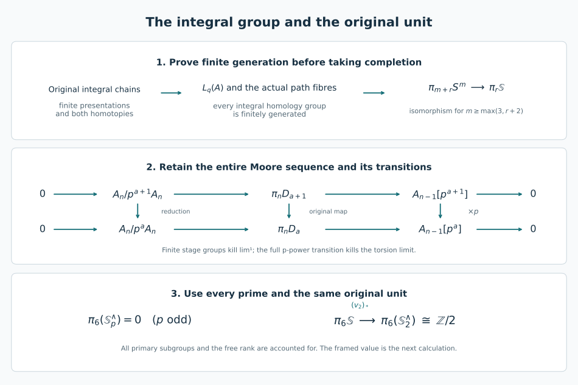

# The original integral stable group and its completion maps

Proof companion for CG-S6 lesson 7. GPT-6 Astra (OpenAI), Ultra, 11 October 2026. New exposition CC0-1.0. This chapter supplies the integral receiving calculation after the completed sphere groups. All sphere suspensions append the last real coordinate, as in the included Pontryagin–Thom chapter, (8.1)–(8.2). The [original geometric framing proof](the-original-six-dimensional-framing-invariant.md#framed-six-original-nullbordism) constructs the full quadratic invariant, proves framed bordism invariance and gives value zero for the original framed homotopy six-sphere, with an actual framed nullbordism. The [sphere-twist and smooth-recognition proof](sphere-twists-and-the-original-smooth-six-sphere-comparison.md#twist-original-smooth-map) now constructs the new interior gluing with its full frame defect, cancels every actual handle and gives the orientation-preserving diffeomorphism to the original six-sphere, homotopic to its original degree-one map.

## 1. Finite integral chain models with their actual comparison maps {#integral-finite-chain-models}

We first prove the finiteness facts used below. A subgroup of a finite-rank free abelian group is free of finite rank. In the proof of Lemma 5.1 of the included Thom/Euler chapter, restrict its well-ordered basis to the finitely many original basis elements. At each coordinate the quotient subgroup embeds in the original copy of \(\mathbb Z\), and is either zero or generated by a least positive integer. A chosen lift adds at most one basis vector. The resulting basis has at most the original rank. A subgroup of a finitely generated abelian group is finitely generated: pull it back under a surjection from a finite-rank free group, use the preceding statement, then take its image. Quotients and finite extensions are finitely generated as well. For an extension, lift a finite generating set of its quotient and adjoin a finite generating set of its kernel; subtracting a lifted expression puts each original element in the kernel.

Let \(C\) be a chain complex of free abelian groups, zero in negative degrees, with every \(H_j(C)\) finitely generated. For each original group choose a finite free presentation
\[
 0\longrightarrow R_j\xrightarrow{d_j}F_j
 \xrightarrow{e_j}H_j(C)\longrightarrow0.
 \tag{1.1}
\]
The kernel \(R_j\) is free of finite rank by the preceding argument. Choose a cycle \(z_f\in C_j\) representing the image of each basis element \(f\) of \(F_j\). For each basis element \(r\) of \(R_j\), the full integral combination \(z_{d_jr}\) is a boundary, so choose an actual chain \(y_r\in C_{j+1}\) with
\[
 \partial y_r=z_{d_jr}.
 \tag{1.2}
\]
Every coefficient of the original relation \(d_jr\) remains in (1.2).

Let \(P\) be the direct sum, over \(j\geq0\), of the two-term complexes \(R_j\to F_j\), placed in degrees \(j+1,j\), with the displayed differential \(d_j\). Its group in degree \(n\) is exactly
\[
 P_n=F_n\oplus R_{n-1},\qquad
 \partial_P(f,r)=(d_{n-1}r,0),
 \quad R_{-1}=0.
 \tag{1.3}
\]
Equations (1.2) define a chain map \(v:P\to C\), sending \(f\) to \(z_f\) and \(r\) to \(y_r\). Since every \(d_j\) is injective, the direct-sum description gives \(H_j(P)=\operatorname{coker}d_j\); the induced map is exactly \(e_j\) followed by the identity on the original \(H_j(C)\). Thus \(v\) is a homology isomorphism and \(P_n\) has finite rank in every degree.

We also need the chain-level strength of this comparison over the integers. Its full cone is
\[
 \operatorname{Cone}(v)_n=C_n\oplus P_{n-1},\qquad
 \partial(c,p)=(\partial_Cc+v(p),-\partial_Pp).
 \tag{1.4}
\]
The cone sequence and the preceding homology isomorphism make it acyclic. Its cycles are free, by the subgroup theorem proved in the included Thom/Euler chapter. For every degree choose a section of the surjection from its next chain group onto its cycle group. With the resulting decomposition into a cycle and a lifted preceding cycle, its differential sends \((z,z')\) to \((z',0)\); the map \((z,z')\mapsto(0,z)\) in the next degree is a contraction. Both terms of \(\partial h+h\partial=1\) are thereby explicit. This contraction has been constructed on (1.4), including its negative second differential.

For clarity, write the blocks of that contraction as
\(h(c,p)=(a(c)+b(p),g(c)+e(p))\).
The block equations give
\[
 \partial_Pg=g\partial_C,\qquad
 vg-1_C=-\partial_Ca-a\partial_C,\qquad
 gv-1_P=\partial_Pe+e\partial_P.
 \tag{1.5}
\]
Thus \(g:C\to P\) and the two displayed homotopies are actual inverses. No coefficient field or division of an integral relation has been used.

Consequently, if \(A\) is any finitely generated abelian coefficient group, tensoring (1.5) with \(A\) proves
\[
 H_j(C\otimes A)\cong H_j(P\otimes A).
 \tag{1.6}
\]
Each group of \(P\otimes A\) is finitely generated, so the right side is finitely generated by the first paragraph. More generally, any finite tensor product of complexes of this kind has finitely generated homology: tensor their maps (1.5), retaining the differential
\[
 \partial(c_1\otimes\cdots\otimes c_s)
 =\sum_{i=1}^s(-1)^{\sum_{j<i}|c_j|}
 c_1\otimes\cdots\otimes\partial c_i\otimes\cdots\otimes c_s.
 \tag{1.7}
\]
The tensor homotopy for a degree-one homotopy in position \(i\) has the same preceding-degree sign. The cross terms cancel in pairs, leaving its original \(\partial h+h\partial\) in that position. Change the factors one at a time and add these homotopies. The resulting finite tensor of the \(P\)'s has finite-rank groups in each total degree, because the nonnegative degrees have only finitely many ordered partitions. Its homology is therefore finitely generated. This proves the tensor assertion with the original chain maps and all their signs.

## 2. Integral homology of the original coefficient spaces {#integral-coefficient-spaces}

For an abelian group \(A\), use the original cocycle model
\[
 K^q(A)_n=Z^q(\Delta^n;A),\qquad
 L_q(A)=|K^q(A)|.
 \tag{2.1}
\]
Faces and degeneracies pull back the original oriented simplex cochains; addition is the addition in \(A\). The ordinary-cohomology construction in Sections 8–9 of the included Adams-tower chapter applies to these coefficients. We specify why its use here does not require a field. Keep its full cochain group \(U^q(A)_n=C^q(\Delta^n;A)\), its cone to vertex zero \(\kappa\), and the identity \(\partial\kappa+\kappa\partial=1-\iota_0\epsilon\), including its augmentation term. For a positive-degree cocycle \(u\), the original cochain \(u\kappa\) satisfies \(\delta(u\kappa)=u\). Thus its equations (8.1)–(8.4) give the degreewise exact sequence \(0\to K^q(A)\to U^q(A)\to K^{q+1}(A)\to0\). Every coefficient is \(0,1,-1\). The extra degeneracy (8.7) and contraction (8.9) keep exactly the same formulas in \(A\). The quotient-bundle proof (9.1)–(9.4) uses addition, subtraction, chosen lifts of simplices and the original collar maps; it uses neither a field inverse nor finiteness. Its total space \(|U^q(A)|\) is therefore contractible, and its fibre is the original \(L_q(A)\). Starting from the discrete group \(L_0(A)=A\), the exact homotopy sequence gives
\[
 \pi_i(L_q(A))=
 \begin{cases}A&i=q,\\0&i\ne q,\end{cases}
 \qquad(q\geq1),
 \tag{2.2}
\]
where the isomorphism evaluates the original cocycle on the positive sphere class. The connecting map has sign plus: the original lifted path starts at zero and ends at the specified fibre point, exactly as in (9.6) there. The cellular construction (9.8) also gives \([X,L_q(A)]_* =\widetilde H^q(X;A)\) for based CW domains. Make the lower skeleton constant; label each oriented \(q\)-cell by its element of \(A\). The first extension condition is its full signed cellular coboundary. Later obstructions vanish by (2.2). Apply this construction to the relative cylinder to obtain the homotopy precisely when the two cochains differ by a coboundary. In degree one the group \(A\) is abelian, so conjugations in the attaching word act trivially. In every dimension the original cell labels, signed incidence numbers and coefficient group are retained.

The homogeneous bundle of the original simplicial abelian group \(K^q(A)\) has contractible total realization: insertion of the zero vertex supplies its contraction. Its connecting homomorphism and (2.2) construct a map
\[
 j_{q,A}:|BK^q(A)|\longrightarrow L_{q+1}(A)
 \tag{2.3}
\]
inducing the identity of the original group \(A\). At the first cellular extension its obstruction is the signed cocycle boundary. That boundary is zero; every later obstruction is in a zero group of (2.2). The full homotopy sequence of the bundle shows that (2.3) induces every homotopy isomorphism. The included CW comparison supplies its inverse and homotopies. This is the same connecting-value comparison used at the primes, now for the displayed original coefficient group.

Suppose \(G\) is a simplicial abelian group and every group \(H_i(|G|;\mathbb Z)\) is finitely generated. Its augmentation-ideal chain complex \(\bar C(G;\mathbb Z)\) is free: in degree zero use the differences between each nonbasepoint vertex and the basepoint; higher groups are the retained nondegenerate simplices. Its homology is the reduced integral homology. Apply Section 1 to this complex and its finite tensor powers.

The integral bar/prism comparison has exactly the original sign
\[
 (-1)^{\sum_{i=1}^s(s-i)|a_i|}
 \tag{2.4}
\]
on the product prism associated with \([a_1|\cdots|a_s]\). Its internal face and multiplication identities were established as integer identities in Section 2 of the actual degree-eight companion; its degenerate-chain contraction also retains the integer signs. On the full chains at each simplicial bar level, the shuffle and front/back maps are inverse chain homotopy equivalences over \(\mathbb Z\), by the full prism proof in Section 4 of the Thom/Euler companion. The chain maps preserve the degenerate subcomplexes: a repeated shuffle step repeats a vertex, and every front/back cut retains a repetition in at least one factor. Each degenerate subcomplex is acyclic by its original face/degeneracy contraction. The quotient maps consequently induce homology isomorphisms, and the descended comparison induces a homology isomorphism as well. This argument does not require a chosen full-chain homotopy to descend to a particular degenerate quotient. Hence the cone of the total comparison is acyclic by the length filtration: each associated cone is acyclic, and a total degree \(n\) contains only lengths \(0\leq s\leq n\). Successive removal of a cycle's largest filtration component proves acyclicity in finitely many steps. This proves the integral comparison
\[
 H_*(B(C(G;\mathbb Z)))\xrightarrow{\cong}
 H_*(|BG|;\mathbb Z).
 \tag{2.5}
\]
This argument uses the integral chain homotopies, and does not invoke vector-space exactness.

Filter the left side by that same bar length. Its first page in length \(s\) and internal degree \(t\) is the homology of \(\bar C(G;\mathbb Z)^{\otimes s}\) in degree \(t\), with the original degree shift \(s\). These groups are finitely generated by Section 1. For each total degree, only finitely many positions occur. The finite filtered-chain convergence proved in Section 2 of the path-fibre companion therefore expresses the total homology as a finite succession of subquotients and extensions of finitely generated groups. It is finitely generated. Equations (2.3) and (2.5) propagate this property from \(L_q(A)\) to \(L_{q+1}(A)\).

For \(A=\mathbb Z\), begin in degree one. The positively oriented circle maps to \(L_1(\mathbb Z)\) by its single edge carrying the cocycle value one. Its induced homomorphism on the original fundamental group is \(1\mapsto1\). The real-line covering of the circle, with deck translations by the original integers, has contractible total space. Its higher homotopy groups are zero by disk lifting. Thus this map induces all homotopy isomorphisms in (2.2), and the CW comparison is a homotopy equivalence. The original circle's integral cellular homology is \(\mathbb Z\) in degrees zero and one and zero elsewhere. The preceding integral bar argument now proves finite generation of every \(H_i(L_q(\mathbb Z);\mathbb Z)\), for every \(q\geq1\).

For a finite cyclic group \(A=\mathbb Z/m\mathbb Z\), with its actual integer \(m\geq2\), (2.1) has finitely many simplices in each dimension: it is a subgroup of the finite group of all \(A\)-valued functions on the finitely many oriented \(q\)-faces. Its realization consequently has finitely many nondegenerate cells in each dimension. Its integral cellular chain groups, and therefore homology groups, are finitely generated. This argument retains the full modulus \(m\).

Finally, a finite presentation of a finitely generated abelian group admits the full integer row and column comparison proved by the Euclidean basis algorithm in the handle-chain companion. It gives an isomorphism from a finite direct sum of copies of \(\mathbb Z\) and the original cyclic quotients to \(A\); retain that isomorphism and its inverse. Applying (2.1) to these homomorphisms gives inverse maps of the actual cocycle groups in every simplicial degree. Finite direct sums there are finite products. The integral shuffle/front-back comparison and Section 1 prove that finite products of the already treated spaces have finitely generated homology. Transporting along the specified inverse maps proves
\[
 H_i(L_q(A);\mathbb Z)\text{ is finitely generated}
 \quad(i\geq0,\ q\geq1,\ A\text{ finitely generated}).
 \tag{2.6}
\]
The cohomology-representing group remains the original \(A\); the chosen integer presentation has only supplied proved comparison maps.

## 3. Finite generation of the original unstable groups {#integral-unstable-finiteness}

We will use a CW comparison for the intermediate path fibres. Here are its maps and the facts needed from it. For a space \(Y\), let \(S(Y)_n\) be the set of all continuous maps \(\Delta^n\to Y\), with the original face and degeneracy pullbacks. Set
\[
 Q(Y)=|S(Y)|,\qquad e_Y:Q(Y)\longrightarrow Y,
 \qquad e_Y[\sigma;t]=\sigma(t).
 \tag{3.1}
\]
Evaluation agrees on all identifications and is continuous by the quotient topology. The realization argument of the Adams companion, Section 9, makes \(Q(Y)\) a CW complex.

We recall the comparison proof to fix what (3.1) preserves. An ordered triangulated map \(f:P\to Y\) from a finite polyhedron lifts to \(Q(Y)\): on each oriented simplex \(a:\Delta^n\to P\), use the characteristic simplex labelled \(f a\). The lifts agree on their faces and evaluate to exactly \(f\). Subdivision changes this lift by a homotopy. To construct it, triangulate each simplex times an interval with its original triangulation at the bottom and the chosen subdivision at the top, extending the already chosen triangulations on side faces. Label every prism simplex by its projection to that original simplex followed by \(f\). Their characteristic maps into \(Q(Y)\) give the homotopy; every signed side face agrees with its neighbour. The construction is relative to a subpolyhedron.

We also need this comparison for a map \(g:P\to Q(Y)\) already given. A compact image in a CW complex is contained in a finite subcomplex. For this realization, the subcomplex is made from finitely many characteristic simplices and their face identifications. Subdivide those simplices with their identifications retained. The open stars of the subdivided faces give a finite cover. Subdivide \(P\) until the image of each closed simplex lies in one such star. Choose the corresponding carrier faces on vertices; on a simplex use their common carrier and affine barycentric interpolation. On a face the carrier restriction is the already chosen face map, since its characteristic identifications are affine face maps or degeneracy collapses. Interpolating in the same carrier gives a homotopy from \(g\) to this map, relative to a subpolyhedron where it was already of this form. This is the simplicial-approximation argument in the actual characteristic simplices; no injectivity of a boundary characteristic map is required. Apply the prism construction of the preceding paragraph to each carrier simplex and its restrictions. It compares that map to the characteristic lift of its evaluation in \(Y\). Thus \(g\) is homotopic to a characteristic lift of \(e_Yg\), after the displayed subdivision.

Apply these statements to spheres, and then to disks with their boundary prescribed. Every sphere map to \(Y\) lifts; a nullhomotopy in \(Y\) lifts after subdivision and the relative prism restores the original boundary map in \(Q(Y)\). The same argument for an interval proves the component assertion. Hence \(e_Y\) induces every homotopy isomorphism and a bijection on components. The induced homology map is also an isomorphism. Indeed the cellular chain group of \(Q(Y)\) is freely generated by the nondegenerate singular simplices of \(Y\), with exactly their original signed face differential. The full singular chain complex of \(Y\) maps onto this complex by killing its degenerate simplices. The degenerate subcomplex is contractible by the face/degeneracy contraction proved in the included Thom/Euler companion: successively remove the first degeneracy, with its alternating sign; the two matching face terms give the identity and all other terms cancel. Therefore this quotient induces a homology isomorphism. On each characteristic cell, evaluation (3.1) gives precisely its original singular simplex, so its homology map is the inverse comparison. We have proved
\[
 (e_Y)_*:\pi_iQ(Y)\xrightarrow{\cong}\pi_iY,
 \qquad
 (e_Y)_*:H_i(Q(Y);\mathbb Z)\xrightarrow{\cong}H_i(Y;\mathbb Z).
 \tag{3.2}
\]
The CW comparison is used only with these specified maps.

Now let \(X\) be a simply connected CW complex with every integral homology group finitely generated. We construct spaces \(W_n\) and actual maps to \(X\) so that
\[
 \begin{gathered}
 W_n\text{ is a CW complex with }\pi_iW_n=0\quad(1\leq i\leq n),\\
 H_i(W_n;\mathbb Z)\text{ is finitely generated for every }i,\\
 \pi_iW_n\longrightarrow\pi_iX\text{ is an isomorphism for }i>n.
 \end{gathered}
 \tag{3.3}
\]
Start with \(W_1=X\). Suppose \(W_{n-1}\) is constructed, with \(n\geq2\). The first Hurewicz isomorphism in the included CW companion gives the original map
\[
 h_n:\pi_nW_{n-1}\xrightarrow{\cong}H_n(W_{n-1};\mathbb Z).
 \tag{3.4}
\]
In particular its source, denoted \(A_n\) in this paragraph, is finitely generated. The universal-coefficient proof in the Thom/Euler companion, Theorem 5.2, gives
\[
 H^n(W_{n-1};A_n)
 \xrightarrow{\cong}
 \operatorname{Hom}(H_n(W_{n-1};\mathbb Z),A_n),
 \tag{3.5}
\]
because the preceding homology group is zero. Choose the class corresponding to the full inverse \(h_n^{-1}\). Section 2 constructs a based representing map
\[
 f_n:W_{n-1}\longrightarrow L_n(A_n).
 \tag{3.6}
\]
Evaluation on the original positive sphere class and (3.5) show that \((f_n)_*\) on \(\pi_n\) is the identity of \(A_n\), under (2.2). This specifies the homotopy-killing map; it is not just an abstract equality of two groups.

Use the actual contractible bundle of Section 2 and form its pullback
\[
 V_n=\{(w,u)\in W_{n-1}\times|U^{n-1}(A_n)|:
                 f_n(w)=|\delta|(u)\}.
 \tag{3.7}
\]
Its fibre is the original \(L_{n-1}(A_n)\). The displayed bundle contraction identifies its homotopy sequence with that of the path fibre of (3.6), with the positive connecting map already fixed. Exactness, (2.2), and \((f_n)_*=1_{A_n}\) show that \(V_n\) is connected, that \(\pi_iV_n=0\) for \(1\leq i\leq n\), and that its projection induces an isomorphism on \(\pi_i\) for \(i>n\). For \(n=2\), the possible \(\pi_1\) of the fibre is exactly the original \(A_2\); the identity connecting map from \(\pi_2W_1\) kills that group. Thus the bottom step has no exceptional fundamental-group term.

Apply the proved integral fibration spectral sequence of the path-fibre companion, Section 3, to (3.7). Its base is the actual simply connected CW complex \(W_{n-1}\); the local coefficient action is consequently trivial. Its second page is
\[
 E^2_{s,t}=H_s\bigl(W_{n-1};H_t(L_{n-1}(A_n);\mathbb Z)\bigr).
 \tag{3.8}
\]
The coefficient group is finitely generated by (2.6). Apply the actual finite free chain comparison (1.5) to the integral chains of \(W_{n-1}\), then tensor with this very group. Equation (1.6) proves that every entry of (3.8) is finitely generated. In each total degree the first-quadrant filtration has finitely many positions. Every later entry is a subquotient of a finitely generated group, and the finite filtration of the abutment has those entries as successive quotients. Therefore every \(H_i(V_n;\mathbb Z)\) is finitely generated. Put \(W_n=Q(V_n)\), with its map to \(W_{n-1}\) equal to evaluation followed by the projection in (3.7). Equations (3.2) prove all assertions (3.3) and complete the induction.

For a fixed \(r\geq2\), (3.3) at \(n=r-1\) identifies \(\pi_rX\) with \(\pi_rW_{r-1}\), and (3.4) identifies the latter with its finitely generated \(H_r\). Thus we have proved
\[
 \pi_rX\text{ is finitely generated for every }r\geq2.
 \tag{3.9}
\]
In particular (3.9) applies to every original sphere \(S^m\), \(m\geq2\), whose integral cellular homology consists of its original copies of \(\mathbb Z\) in degrees zero and \(m\).

## 4. The finite-range homology comparison {#integral-finite-range}

We require the range of a particular suspension map, so we prove the finite-range form of the path-fibre argument. Let \(f:A\to B\) be a map between simply connected spaces, let \(B\) be a CW complex, and suppose
\[
 H_i(f;\mathbb Z)\text{ is an isomorphism for }i\leq D,
 \qquad D\geq2.
 \tag{4.1}
\]
No CW hypothesis on \(A\) is needed for this argument. Form the original path-fibration replacement \(E_f\to B\), with fibre \(K\). Its retraction onto \(A\) is the explicit one in the path-fibre companion, (1.1)–(1.3). Its fibre is connected: a path in the connected total space joining two fibre points projects to a loop in \(B\); lift a contraction of that loop relative the endpoint lifts. The resulting top path joins the points inside \(K\).

Naturality of the degree-two Hurewicz isomorphism and (4.1) make \(\pi_2E_f\to\pi_2B\) an isomorphism. The actual homotopy sequence consequently gives \(\pi_1K=0\). Suppose that \(\pi_nK\ne0\) for some \(2\leq n\leq D-1\), and choose its least such degree. The first Hurewicz theorem, proved for the actual space, gives
\[
 H_j(K;\mathbb Z)=0\quad(0<j<n),\qquad
 H_n(K;\mathbb Z)\cong\pi_nK\ne0.
 \tag{4.2}
\]
In the fibration spectral sequence, the only possible incoming differential to \((0,n)\) is
\[
 d_{n+1}:H_{n+1}(B;\mathbb Z)\longrightarrow H_n(K;\mathbb Z).
 \tag{4.3}
\]
For smaller pages its source has fibre degree strictly between zero and \(n\), hence is zero. For larger pages its fibre degree is negative. The source in (4.3) has no earlier outgoing differential, by the same vanishing, and no incoming differential because it is in the bottom row. Later outgoing targets have negative column. The bottom edge proved in the path-fibre companion, (3.10), therefore identifies
\[
 \ker d_{n+1}=\operatorname{im}\bigl(H_{n+1}(E_f)\to H_{n+1}(B)\bigr).
 \tag{4.4}
\]
Since \(n+1\leq D\), that homology map is surjective by (4.1). Thus \(d_{n+1}=0\). The other proved edge identifies
\[
 H_n(K)=E^\infty_{0,n}=F_0H_n(E_f)
 \subset F_{n-1}H_n(E_f)
 =\ker\bigl(H_n(E_f)\to H_n(B)\bigr)=0.
 \tag{4.5}
\]
The last equality uses injectivity in degree \(n\leq D\). This contradicts (4.2). Hence \(K\) is \((D-1)\)-connected. Its full homotopy sequence proves
\[
 \pi_i(f)\text{ is an isomorphism for }i\leq D-1,
 \quad\pi_D(f)\text{ is surjective}.
 \tag{4.6}
\]
If \(B\) is not itself CW, the same result holds using (3.1) whenever (4.1) holds: lift the given map to the CW comparisons via \(Q(f):Q(A)\to Q(B)\), use (3.2), and apply the proof just given. Naturality is exact, \(e_BQ(f)=fe_A\), so the resulting statements concern the original \(f\).

## 5. The original sphere suspension and stable finite generation {#integral-original-suspension}

Fix \(m\geq3\). Keep the original positive coordinates and the right-appended suspension homeomorphism of the Pontryagin–Thom companion, (8.1)–(8.2):
\[
 (\mathbb R^m)^+\wedge\mathbb R^+
   \xrightarrow{\theta_m}(\mathbb R^m\times\mathbb R)^+.
 \tag{5.1}
\]
No real coordinate is permuted. Use the resulting right loop adjunction and define
\[
 u_m:S^m\longrightarrow\Omega S^{m+1},
 \qquad u_m(x)(t)=\theta_m([x,t]).
 \tag{5.2}
\]
Here the loop parameter is the positive last real coordinate compactified to the based circle, with its endpoints identified at infinity. This is the adjoint of the original identity of \(S^{m+1}\) under (5.1).

We calculate enough integral homology of the original loop space to apply Section 4. The path fibration
\[
 \Omega S^{m+1}\longrightarrow P S^{m+1}\longrightarrow S^{m+1}
 \tag{5.3}
\]
has contractible total space, by shrinking each based path. The loop space is \((m-1)\)-connected: the exact loop adjunction identifies \(\pi_i\Omega S^{m+1}\) with \(\pi_{i+1}S^{m+1}\), which is zero for \(i+1<m+1\) by cellular approximation in the original sphere. Write \(F_t=H_t(\Omega S^{m+1};\mathbb Z)\). Then \(F_0=\mathbb Z\) and \(F_t=0\) for \(0<t<m\), by first Hurewicz and its lower-degree conclusion.

The integral spectral sequence of (5.3) has precisely two possible base columns, zero and \(m+1\), with entries equal to the original \(F_t\). The full cellular complex of the sphere with these coefficients has zero differential and those two copies; this assertion uses no assumption on torsion in \(F_t\). Consequently the only possible differential is the original transgression
\[
 d_{m+1}:E^{m+1}_{m+1,t}=F_t
             \longrightarrow E^{m+1}_{0,t+m}=F_{t+m}.
 \tag{5.4}
\]
There are no earlier differentials, since their target columns vanish. The contractibility of the total space makes both its kernel and cokernel zero for every \(t\geq0\): the source and target positions have positive total degree and must vanish on the last page. Hence (5.4), with its actual orientation sign, is an isomorphism. It follows inductively that
\[
 F_t\cong
 \begin{cases}\mathbb Z&t\equiv0\pmod m,\\0&t\not\equiv0\pmod m,
 \end{cases}\qquad t\geq0.
 \tag{5.5}
\]
For the copies of \(\mathbb Z\), the precise comparison is the succession of the actual maps (5.4) from the original \(F_0\); no transgression sign has been changed or suppressed. Only the groups, not their products, are asserted in (5.5).

On \(\pi_m\), (5.2) sends the positive identity sphere class to the class whose right adjoint is the positive identity of \(S^{m+1}\). Both groups are \(\mathbb Z\), by the first Hurewicz isomorphism for the original spheres and the loop adjunction. It is therefore an isomorphism, with this exact class correspondence. The natural first Hurewicz isomorphism for the \((m-1)\)-connected loop space proves that \(H_m(u_m)\) is an isomorphism. In degrees \(0<i<2m\), \(i\ne m\), both source and target homology groups are zero by the sphere cells and (5.5). In degree zero both spaces are connected. Thus
\[
 H_i(u_m;\mathbb Z)\text{ is an isomorphism for }i\leq2m-1.
 \tag{5.6}
\]
Apply (4.6), using the exact comparisons (3.1) if necessary for the loop target. We conclude that \((u_m)_*\) is an isomorphism on \(\pi_j\) for \(j\leq2m-2\), and is surjective for \(j=2m-1\). Under the right loop adjunction, the map on a representative \(a:S^j\to S^m\) has the original formula
\[
 S^j\wedge S^1\xrightarrow{a\wedge1}S^m\wedge S^1
   \xrightarrow{\theta_m}S^{m+1}.
 \tag{5.7}
\]
This is exactly the suspension obtained by appending the last real coordinate in the original Pontryagin–Thom construction. There is no left/right factor interchange and hence no unrecorded sign comparison.

For any original stable degree \(r\geq0\), take
\[
 m\geq\max(3,r+2),\qquad j=m+r\leq2m-2.
 \tag{5.8}
\]
Every later suspension remains in the same isomorphism range, since replacing \(m\) by \(m+1\) increases the right bound by two and \(j\) by one. The original colimit therefore identifies, by its actual structure map,
\[
 \pi_{m+r}(S^m)\xrightarrow{\cong}\pi_r(\mathbb S).
 \tag{5.9}
\]
The left side is finitely generated by (3.9). We have proved finite generation of every nonnegative original stable sphere group, without assuming it in a completion theorem. In particular the exact maps give
\[
 \pi_{14}(S^8)\xrightarrow{\cong}\pi_6(\mathbb S),\qquad
 \pi_{12}(S^7)\xrightarrow{\cong}\pi_5(\mathbb S),\qquad
 \pi_{16}(S^9)\xrightarrow{\cong}\pi_7(\mathbb S).
 \tag{5.10}
\]
All spheres and all coordinate orders in these maps are the original ones.

## 6. Every term of the original completion sequence {#integral-original-completion}

Put \(A_n=\pi_n(\mathbb S)\). These groups are finitely generated by Section 5 for \(n\geq0\); they are zero for \(n<0\), since the original sphere colimit is then represented below the dimension of its sphere. Fix a prime \(p\). Use the original Moore cofibre
\[
 D_a=\operatorname{cofib}(p^a:\mathbb S\to\mathbb S),
 \qquad a\geq1.
 \tag{6.1}
\]
Its map \(D_{a+1}\to D_a\) is induced by multiplication by \(p\) on the source sphere and the identity on the target sphere in the square comparing \(p^{a+1}\) with \(p^a\). The full exact homotopy sequence gives
\[
 0\longrightarrow A_n/p^aA_n\xrightarrow{\iota_a}\pi_nD_a
 \xrightarrow{\partial_a} A_{n-1}[p^a]\longrightarrow0,
 \quad A[p^a]=\{x\in A:p^ax=0\}.
 \tag{6.2}
\]
No splitting of (6.2) has been chosen or asserted. Naturality for the displayed square gives reduction on its left term and multiplication by \(p\) on its right term:
\[
 \overline x\longmapsto\overline x,
 \qquad y\longmapsto py.
 \tag{6.3}
\]
In particular the second map is not the inclusion of one torsion subgroup into another. Both groups in (6.2) are finite, because their original \(A\)'s are finitely generated. The middle group is consequently finite as well.

The original arithmetic completion is
\[
 \mathbb S^{\wedge}_p=\operatorname*{holim}_{a\geq1}D_a,
 \qquad v_p:\mathbb S\longrightarrow\mathbb S^{\wedge}_p.
 \tag{6.4}
\]
Adding the zero stage \(D_0\) gives the same map and limit as the arithmetic companion. Its full difference-map sequence is
\[
 0\longrightarrow\lim{}^1_a\pi_{n+1}D_a
 \longrightarrow\pi_n(\mathbb S^{\wedge}_p)
 \longrightarrow\lim_a\pi_nD_a\longrightarrow0.
 \tag{6.5}
\]
Every \(\pi_{n+1}D_a\) is finite by (6.2). The finite-group difference-map proof in Section 2 of the Adams companion therefore kills the first term of (6.5). Explicitly, in each fixed earlier finite group the images from later stages stabilize; solve each finite initial system of difference equations, retain the stabilized choices, and take their compatible infinite sequence. This proves surjectivity of the full difference map on the product, which is exactly the stated \(\lim^1\)-vanishing. Thus the middle-to-right arrow of (6.5) is an isomorphism with its original coordinate projections.

The right terms of (6.2) also have zero inverse limit, for a different reason that retains their maps. The \(p\)-primary torsion of \(A_{n-1}\) has some finite exponent \(p^e\). A composite of \(e\) successive maps in (6.3) is multiplication by \(p^e\), hence is zero on every such subgroup. For a compatible sequence \((y_a)\), this says
\[
 y_a=p^ey_{a+e}=0.
 \tag{6.6}
\]
Let \((z_a)\in\lim\pi_nD_a\). Its boundaries form a compatible sequence and therefore vanish by (6.6). Exactness of (6.2) gives a unique \(\overline x_a\in A_n/p^aA_n\) with \(\iota_a(\overline x_a)=z_a\). Injectivity of \(\iota_a\) and (6.3) make these preimages compatible. Conversely any compatible sequence of those preimages gives \((z_a)\). This proves both inverse maps in
\[
 \lim_a A_n/p^aA_n\xrightarrow{\cong}\lim_a\pi_nD_a.
 \tag{6.7}
\]
Combining (6.5)–(6.7) gives an exact comparison, natural in the original sphere maps:
\[
 \Psi_{n,p}:\pi_n(\mathbb S^{\wedge}_p)
       \xrightarrow{\cong}\lim_a A_n/p^aA_n,
 \qquad
 \Psi_{n,p}(v_p)_*(x)=(x+p^aA_n)_{a\geq1}.
 \tag{6.8}
\]
The displayed unit identity follows at each stage from the target sphere of (6.1). Both possible derived contributions, the \(\lim^1\) in (6.5) and the torsion tower in (6.2), have been retained and proved to vanish with their actual transitions.

We now compute the right side for an original finitely generated abelian group \(A\). Let \(T\subset A\) be its torsion subgroup. The full integer basis algorithm supplies a finite-rank free quotient \(A/T\). Choose a basis there and lifts \(b_1,\ldots,b_r\) in \(A\). The map
\[
 \mathbb Z^r\oplus T\longrightarrow A,
 \qquad ((z_i),t)\longmapsto\sum_i z_i b_i+t
 \tag{6.9}
\]
is an isomorphism: the quotient determines all \(z_i\), and then their subtraction determines the unique original \(t\). Retain this map and this inverse, rather than replacing the original elements of \(A\) by unnamed coordinates.

The finite group \(T\) has an annihilating integer
\(M=\prod_{\ell\mid M}\ell^{e_\ell}\), with its full prime factors. For each prime divisor \(\ell\), put \(M_\ell=M/\ell^{e_\ell}\), choose integers \(c_\ell,d_\ell\) with
\[
 c_\ell M_\ell+d_\ell\ell^{e_\ell}=1,
 \qquad E_\ell=c_\ell M_\ell.
 \tag{6.10}
\]
Then \(E_\ell\) acts on \(T\) as the projection onto its original subgroup
\(T_\ell=\{t:\ell^{e_\ell}t=0\}\). Indeed \(E_\ell\) is one modulo \(\ell^{e_\ell}\) and zero modulo every other prime power in \(M\); these identities prove \(E_\ell^2=E_\ell\), \(E_\ell E_k=0\) for \(\ell\ne k\), and \(\sum E_\ell=1\), as endomorphisms of \(T\). They also prove that its image equals the displayed subgroup. Thus the explicit mutually inverse maps are \(t\mapsto(E_\ell t)_\ell\) and \((t_\ell)_\ell\mapsto\sum t_\ell\). When \(T=0\), take the empty sum; when \(p\nmid M\), put \(T_p=0\).

On \(T_\ell\) with \(\ell\ne p\), multiplication by \(p\) is invertible: choose its inverse modulo \(\ell^{e_\ell}\) by the integer Bézout identity. Consequently this summand contributes zero to every quotient by \(p^a\). On \(T_p\), the quotient \(T_p/p^aT_p\) becomes exactly \(T_p\) once \(a\geq e_p\), with the identity as every later transition. On each free basis element of (6.9), the quotient is \(\mathbb Z/p^a\mathbb Z\) with ordinary reduction. Define \(\mathbb Z_p\) to be the inverse limit of these displayed quotients. We have proved the mutually inverse coordinate maps
\[
 \lim_a A/p^aA
 \xleftrightarrow{\cong}\mathbb Z_p^{,r}\oplus T_p.
 \tag{6.11}
\]
In the reverse direction, the \(a\)-th component of \(((z_{i,a})_a,t)\) is exactly \(\sum_i z_{i,a}b_i+t+p^aA\). In the forward direction, project a residue to the original free quotient to recover every compatible \(z_{i,a}\); subtract their lifted residue and project by \(E_p\) to recover the eventually constant \(t\). These are inverse at every stage and in the limit. The original map \(A\to\lim A/p^aA\) sends the free integers to their full residue sequences, its \(p\)-primary subgroup by the identity just described, and each other primary subgroup to zero. All Bézout coefficients, original inclusions and basis lifts remain visible in this comparison.

## 7. The integral degree-six answer and its exact receiving map {#integral-degree-six-answer}

The included actual mod-two cooperation proof, Section 8, establishes
\[
 \pi_6(\mathbb S^{\wedge}_2)\cong\mathbb F_2
 \tag{7.1}
\]
with complete separated Adams filtration. Its sole nonzero associated-graded class lies in filtration two and is represented in the original cooperation cobar complex by
\[
 [\,(\xi_1^{\mathrm{act}})^4\mid(\xi_1^{\mathrm{act}})^4\,].
 \tag{7.2}
\]
The included odd-prime proof, Sections 5–6, establishes
\[
 \pi_6(\mathbb S^{\wedge}_p)=0\qquad(p\text{ odd}).
 \tag{7.3}
\]
These are the actual completion spectra (6.4), through the unit-preserving equivalence \(\Phi_{\mathbb S}\) in (5.8) of the arithmetic companion. No integral conclusion was assumed in either calculation.

Apply (6.8) and (6.11) to the now proved finitely generated group \(A_6=\pi_6(\mathbb S)\). If its free rank \(r\) were positive, its 2-adic completion would contain \(\mathbb Z_2\). This group is infinite: the map \(\mathbb Z\to\mathbb Z_2\) is injective, since a nonzero integer is not divisible by \(2^a\) for all \(a\). That contradicts the two-element group (7.1). Hence \(r=0\). Formula (6.11) now identifies the original subgroup \((A_6)_2\) with (7.1), by its actual inclusion and the unit. In particular \((A_6)_2\) has exactly two elements.

For every odd prime, (7.3) and (6.11) imply \((A_6)_p=0\). The complete finite-primary decomposition (6.10) therefore says that \(A_6=(A_6)_2\). We conclude
\[
 \boxed{\ (v_2)_*:\pi_6(\mathbb S)
       \xrightarrow{\cong}\pi_6(\mathbb S^{\wedge}_2)
       \cong\mathbb Z/2\mathbb Z.\ }
 \tag{7.4}
\]
The first arrow is the original unit map. Its inverse is the inverse of (6.8), restricted through the original inclusion \((A_6)_2=A_6\) in (6.11). In particular the unique nonzero integral class maps to the class detected by (7.2), and no unspecified generator comparison is left in (7.4).

Equation (7.4) computes the full original integral group. The [original geometric framing proof](the-original-six-dimensional-framing-invariant.md#framed-six-original-nullbordism) now determines the Pontryagin–Thom value on the actual framed six-manifold in lesson 7. It proves the geometric quadratic law, framed bordism invariance and the zero value of the original homotopy six-sphere, hence constructs its framed nullbordism. These arguments use the actual frames and maps as well as the group calculation. The [sphere-twist and smooth-recognition proof](sphere-twists-and-the-original-smooth-six-sphere-comparison.md#twist-original-smooth-map) now constructs the new interior gluing with its full frame defect, cancels every actual handle and gives the orientation-preserving diffeomorphism to the original six-sphere, homotopic to its original degree-one map.

The diagram shows the maps proved in Sections 1–7. Its top row applies the finite-chain comparison with its stated finite-generation hypotheses, then the proved coefficient-space and path-fibre induction. The middle row is the entire exact sequence (6.2), and its right vertical arrow is the original multiplication by \(p\). The last row uses all primes and the same original unit (7.4). This is a diagram of proved maps, not a drawing of the framed manifold. Its reproducible source is `draw_integral_stable_comparison.py`; the complete rendered figure has been inspected.

## 8. Two complete calculations of the retained contributions {#integral-completion-exercises}

### Exercise 8.1. Recover the original torsion element from its primary images

Keep the original group
\[
 A=\mathbb Z b_1\oplus\mathbb Z b_2\oplus\mathbb Z/72\mathbb Z,
 \qquad x=5b_1-4b_2+\overline{17}.
 \tag{8.1}
\]
Calculate its completion maps at 2, 3 and 5, including the actual torsion subgroups, their projection coefficients and the kernels. Recover the original torsion element from its two nonzero primary images.

**Solution.** The full factorization is \(72=8\cdot9\). In (6.10), choose
\[
 1\cdot9+(-1)\cdot8=1,
 \qquad 8\cdot8+(-7)\cdot9=1.
 \tag{8.2}
\]
The resulting projectors on the original quotient are multiplication by
\(E_2=9\) and \(E_3=64\). Directly,
\[
 9^2-9=72,\qquad64^2-64=56\cdot72,
 \qquad9\cdot64=8\cdot72,
 \qquad9+64=1+72.
 \tag{8.3}
\]
Thus the original subgroups are
\[
 T_2=9\mathbb Z/72\mathbb Z\cong\mathbb Z/8\mathbb Z,
 \quad\overline u\longmapsto\overline{9u},
 \qquad
 T_3=8\mathbb Z/72\mathbb Z\cong\mathbb Z/9\mathbb Z,
 \quad\overline v\longmapsto\overline{8v}.
 \tag{8.4}
\]
Under these specific isomorphisms, the projections of \(\overline t\) have coordinates \(t\bmod8\) and \(8t\bmod9\), respectively: the second coefficient is eight because \(64t=8(8t)\). It must be retained. The original element has images
\[
 \begin{aligned}
 x&\longmapsto(5,-4,\overline9)
      &&\text{in }\mathbb Z_2^2\oplus T_2,\\
 x&\longmapsto(5,-4,\overline8)
      &&\text{in }\mathbb Z_3^2\oplus T_3,\\
 x&\longmapsto(5,-4,0)
      &&\text{in }\mathbb Z_5^2.
 \end{aligned}
 \tag{8.5}
\]
Here \(5\) and \(-4\) denote their full compatible integer residue sequences in each displayed ring, not new real coordinates. The torsion calculations are \(9\cdot17=153\equiv9\pmod{72}\) and \(64\cdot17=1088\equiv8\pmod{72}\). Their sum is the original \(\overline{17}\). The first completion kernel is \(T_3\), the second is \(T_2\), and the third is all of \(T\). There are no additional free kernel elements, because a nonzero integer cannot be divisible by every power of the relevant prime. Every coefficient and subgroup in the original group has now been accounted for.

### Exercise 8.2. A torsion term that exists at every stage and has zero limit

Let the original free integral chain complex be
\[
 C_n=\mathbb Zx\oplus\mathbb Zr,
 \quad C_{n-1}=\mathbb Zy,
 \quad\partial x=0,\quad\partial r=12y,
 \qquad n\geq2,
 \tag{8.6}
\]
with all other groups zero. For a prime \(p\), calculate the full group in degree \(n\) of the cone of \(p^a:C\to C\), its connecting map and every transition to the preceding cone. Use these calculations to find the inverse limit for \(p=2,3,5\).

**Solution.** Keep the cone differential (1.4). A degree-\(n\) element is
\((\alpha x+\beta r,\gamma y)\); its differential is
\((12\beta+p^a\gamma)y\). Put
\[
 g_a=\gcd(12,p^a),\qquad
 z_a=\left(\frac{p^a}{g_a}r,-\frac{12}{g_a}y\right).
 \tag{8.7}
\]
All integer solutions to the cycle equation are \(\mathbb Z(x,0)\oplus\mathbb Zz_a\). To verify completeness, divide the equation by the positive integer \(g_a\); its two remaining coefficients are coprime. It forces \(\beta=(p^a/g_a)k\) and \(\gamma=-(12/g_a)k\) for a unique integer \(k\). The full group of boundaries is generated by
\[
 (p^ax,0),\qquad(p^ar,-12y)=g_a z_a.
 \tag{8.8}
\]
Indeed these are the images of the original basis \(x,r\) in the source cone summand one degree higher; there is no omitted target summand in that degree. Therefore
\[
 H_n\operatorname{Cone}(p^a_C)
  = (\mathbb Z/p^a\mathbb Z)[(x,0)]
       \oplus(\mathbb Z/g_a\mathbb Z)[z_a].
 \tag{8.9}
\]
This splitting is proved for this particular chain complex, not assumed for the sphere sequence (6.2). Its connecting homomorphism sends the second original cone coordinate to homology in degree \(n-1\). Hence
\[
 \partial_a[z_a]=\left[-\frac{12}{g_a}y\right]
    \in (\mathbb Z/12\mathbb Z)[p^a].
 \tag{8.10}
\]
The minus sign comes from the actual cycle equation and remains in the answer.

The original cone transition is the identity on its target \(C\) and multiplication by \(p\) on its source \(C\). It sends the first generator by reduction and sends
\[
 z_{a+1}\longmapsto
 \left(\frac{p^{a+1}}{g_{a+1}}r,-\frac{12p}{g_{a+1}}y\right)
   =\frac{p g_a}{g_{a+1}}z_a.
 \tag{8.11}
\]
The integer factor is retained; it is an integer since \(g_{a+1}/g_a\) is either one or \(p\). Applying (8.10) to (8.11) gives
\(-12p/g_{a+1}\) modulo 12, which is exactly multiplication by \(p\) on the previous connecting value. This verifies the full original square.

At \(p=2\), the groups \(\mathbb Z/g_a\mathbb Z\) are \(\mathbb Z/2\), then \(\mathbb Z/4\) at every subsequent stage. The transition from stage two to stage one has coefficient one; every later transition has coefficient two. Every composite of two transitions is zero, including the composite landing at stage one, where its coefficient is two modulo two. Thus all compatible torsion coordinates are zero. At \(p=3\), every such group is \(\mathbb Z/3\) and every transition has coefficient three, so is zero. At \(p=5\), every \(g_a=1\), so the groups themselves are zero. In all three cases the first coordinates in (8.9) have their original reduction maps, and the exact inverse limit is
\[
 \lim_a H_n\operatorname{Cone}(p^a_C)\cong\mathbb Z_p,
 \qquad [(x,0)]\text{ has its full compatible residue sequence}.
 \tag{8.12}
\]
The nonzero stage torsion at 2 and 3 disappeared because of the proved transition maps, not because it was discarded from any chain or exact sequence.

## 9. Source use, proof locators and review scope {#integral-stable-sources}

Neil P. Strickland's *Arithmetic localisation and completion of spectra*, [arXiv:2412.09361v1](https://arxiv.org/abs/2412.09361v1), is the human source context for the completion comparison. The original author TeX, rather than a PDF or a transcription, was read at lines 1–160, 241–524, 568–600 and 1006–1401. The source archive is retained intact; the read `author-main.tex` has SHA-256 `dbf9bfca06bc6c01e066de90fe015fed7cd25abb6ac655eeb0db41682a91ac78`. Its finite-spectrum discussion at lines 1330–1359 uses finite generation of integral homotopy at line 1339. Sections 1–5 here provide that prerequisite for the original sphere, and Sections 6–7 prove the original unit comparison needed by lesson 7. The author's formulations and original files have not been rewritten.

The remaining proof providers are included in this course. Their precise receiving uses are: the [Thom/Euler proof](thom-euler-for-lesson11.md), Sections 4–5, for the integral chain comparisons, subgroup theorem and universal coefficients; the [first Hurewicz proof](cw-models-and-the-first-hurewicz-map.md#hurewicz-theorem), Sections 3–4, for the original sphere class and inverse map; the [path-fibre proof](path-fibres-and-integral-homotopy-equivalences.md#serre-homology), Sections 1–5, for the exact fibration sequence, finite filtered-chain convergence and both homology edges; the [original cocycle spaces](the-adams-tower-and-exact-inverse-limits.md#adams-original-cocycles), Sections 8–9, for the coefficient group, contraction, bundle and representing map; the [actual bar comparison](the-actual-mod-two-cooperation-comparison-through-degree-eight.md#actual-eight-original-suspension), Sections 1–2, for the integer prism and its endpoint signs; and the [original Pontryagin–Thom suspension](framed-manifolds-and-the-pontryagin-thom-map.md#pt-stabilization-and-original-framing), Section 8, for the exact right-appended real coordinate.

The same prerequisite proofs have pinned external copies: Thom/Euler, Sections 4–5, first Hurewicz, Section 4, path-fibre sequence and edges, Sections 1–5, original cocycle spaces, Sections 8–9, integer prism comparison, Sections 1–2, original sphere suspension, Section 8. Their local navigation links above remain usable offline.

The receiving completed groups are proved in the actual degree-eight calculation, Section 8, and the actual odd-prime calculation, Sections 5–6. Their exact map to (6.4) is the original arithmetic equivalence, (5.8); its Section 7 retains the full homotopy-group sequence. These pinned GitHub links belong to the private course repository and require access. The complete sources are also in the offline edition.

The present chapter is an independently written exposition and receiving derivation, not a claim of a new stable-stem result. Reading coverage is limited to the stated original-source intervals. The proofs and rendered reader are checked by the author; no independent certification or exhaustive literature audit is asserted. The [original geometric framing proof](the-original-six-dimensional-framing-invariant.md#framed-six-original-nullbordism) constructs the full quadratic invariant, proves framed bordism invariance and gives value zero for the original framed homotopy six-sphere, with an actual framed nullbordism. The [sphere-twist and smooth-recognition proof](sphere-twists-and-the-original-smooth-six-sphere-comparison.md#twist-original-smooth-map) now constructs the new interior gluing with its full frame defect, cancels every actual handle and gives the orientation-preserving diffeomorphism to the original six-sphere, homotopic to its original degree-one map.

The [supplementary exact checker](../checks/verify_integral_stable_comparison.py) passes 257 finite checks of full integer cone matrices, kernel bases, incoming boundaries, original transition maps, connecting signs, primary projectors and receiving suspension indices. Both complete exercises retain their original coefficients. The all-index and geometric arguments are proved in the text; finite checks do not certify those proofs.
