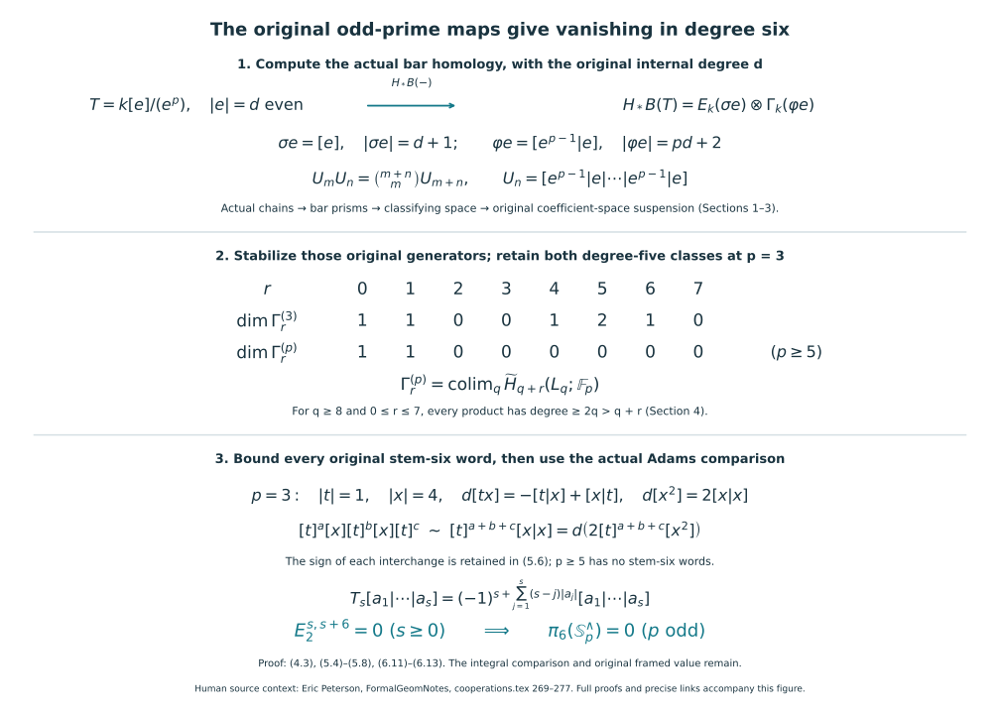

# The original odd-prime cooperations and degree-six Adams calculation

Proof companion for CG-S6 lesson 7, 11 October 2026. GPT-6 Astra (OpenAI), Ultra. New exposition CC0-1.0. This text proves the original odd-prime bar calculation, actual coefficient-space suspension, the exact cooperation degrees needed by stem six, and the signed comparison with the actual Adams tower. It proves vanishing of the completed sixth sphere group at every odd prime. The included integral comparison and [original geometric framing proof](the-original-six-dimensional-framing-invariant.md#framed-six-original-nullbordism) now supply the original integral group, geometric framed value and nullbordism. The [sphere-twist and smooth-recognition proof](sphere-twists-and-the-original-smooth-six-sphere-comparison.md#twist-original-smooth-map) now constructs the new interior gluing with its full frame defect, cancels every actual handle and gives the orientation-preserving diffeomorphism to the original six-sphere, homotopic to its original degree-one map.

The diagram displays the actual maps proved in Sections 1–6. The symbol \(\sim\) in its third panel means equality modulo the explicit signed boundaries (5.6); (5.7) gives the final boundary. Both degree-five classes at the prime three are counted, and the full integer binomial coefficients remain in the bar products. The sign-changing chain isomorphism (6.11) connects these boundaries to the original Adams tower. The reproducible figure source is `draw_odd_prime_cooperations.py`; human source context and immutable proof links appear in Section 8.

## 1. The complete truncated-polynomial bar algebra {#odd-original-bar}

Let \(p\) be an odd prime, \(k=\mathbb F_p\), and let \(T=k[e]/(e^p)\), with original even internal degree \(d\geq0\). The augmentation is \(e\mapsto0\). Every nonzero letter \(e^i\), \(1\leq i<p\), has even internal degree, so its suspended degree \(id+1\) is odd. Use the [full bar differential (2.2)](the-actual-mod-two-cooperation-comparison-through-degree-eight.md#actual-eight-bar-comparison), evaluated in this original coefficient field. Define the exact words
\[
 U_n=[e^{p-1}|e|\cdots|e^{p-1}|e]\quad(n\text{ displayed pairs}),
 \qquad V_n=[e|e^{p-1}|e|\cdots|e^{p-1}|e],
\]
where \(U_0=[]\) and \(V_0=[e]\). Every interior multiplication is a product with exponent \(p\), so its value is zero in \(T\). Thus these are cycles in the reduced bar. Their original bidegrees (length, internal degree) are \((2n,npd)\) and \((2n+1,(np+1)d)\), respectively.

To prove that they are a complete homology basis, take the free augmented \(T\)-resolution with one basis vector \(u_n\) at resolution degree \(2n\), internal degree \(npd\), and \(v_n\) at resolution degree \(2n+1\), internal degree \((np+1)d\). Its differential is
\[
 d v_n=e u_n,\qquad d u_n=e^{p-1}v_{n-1}\ (n\geq1),
 \qquad Tu_0\longrightarrow k.
\]
The kernels are exactly \(\ker(e:T\to T)=ke^{p-1}\) and \(\ker(e^{p-1}:T\to T)=eT\). These are the images of the preceding differentials, and the augmentation kernel is \(eT\). Hence the resolution is exact in every degree. The assignments \(u_n\mapsto1\otimes U_n\), \(v_n\mapsto1\otimes V_n\) give a map to the free bar resolution: its first face contributes precisely the displayed coefficient, while all interior products vanish. Its augmentation is the identity of \(k\). The free-resolution comparison and both inductively constructed homotopies in the [actual degree-eight companion, Section 3](the-actual-mod-two-cooperation-comparison-through-degree-eight.md#actual-eight-exterior-bar), therefore show that, after tensoring with \(k\), the original words \(U_n,V_n\) are a complete independent homology basis. This retains the full bar complex on every letter \(e^i\); letters other than \(e,e^{p-1}\) have not been omitted from that comparison.

The multiplication can be proved on the words themselves, before taking homology. Write \(a=e^{p-1}\), \(b=e\) for this paragraph only; their suspended degrees are both odd, and they are distinct since \(p>2\). In a shuffle of the alternating words \((ab)^m,(ab)^n\), pair every term whose output has two consecutive equal letters with the term obtained by exchanging the sources of the first such pair. Those letters come from different inputs because each input alternates. Their exchange is an allowed shuffle, changes its sign by \(-1\), preserves its entire output word, and is an involution without a fixed point. Thus these terms cancel with their full original signs. Every remaining word alternates, starts with \(a\), and ends with \(b\). Its first \(b\) must come from the input that supplied its first \(a\), because neither input has supplied another \(a\). Remove this complete pair and repeat. Hence each remaining shuffle interleaves the \(m+n\) whole pairs. There are exactly \(\binom{m+n}{m}\) such shuffles, and exchanging two whole pairs has four odd crossings, with sign \(+1\). Therefore
\[
 U_m U_n=\binom{m+n}{m}U_{m+n}
\]
in the full reduced bar, with the original integer coefficient mapped to \(k\).

Likewise shuffle \([b]\) with \((ab)^n\). Inserting \(b\) immediately before and immediately after each existing \(b\) gives the same output with opposite signs. These \(2n\) placements cancel in pairs; the sole remaining placement is before the first \(a\), with sign \(+1\). Thus \([e]U_n=V_n\). The two shuffles in \([e]^2\) have opposite signs, so \([e]^2=0\). Associativity of the full shuffle now gives all products, including
\[
 V_m U_n=\binom{m+n}{m}V_{m+n},\qquad
 U_m V_n=\binom{m+n}{m}V_{m+n},\qquad V_m V_n=0.
\]
Consequently the complete homology algebra is
\[
 H_*(B(T))=E_k(\sigma e)\otimes\Gamma_k(\varphi e),
 \qquad |\sigma e|=d+1,\qquad |\varphi e|=pd+2,
\]
with \(\sigma e\) represented by \(V_0\), \(\gamma_n(\varphi e)\) by \(U_n\), and \(\sigma e\gamma_n(\varphi e)\) by \(V_n\). All products and every original internal degree are explicit. The original one-letter suspension sends \(e\) to the nonzero indecomposable \(V_0\); it sends \(e^i\), \(2\leq i<p\), to zero, since
\[
 d[e^{i-1}|e]=(-1)^{(i-1)d+1}[e^i]=-[e^i].
\]
Both augmentation endpoints vanish and the internal differential is zero. Thus its kernel on the positive augmentation ideal is exactly the span of its decomposable powers.

## 2. The original odd-prime chains and the actual suspension {#odd-original-chains}

Use the original simplicial cocycle groups \(K^q\), with coefficient \(k=\mathbb F_p\), and put \(L_q=|K^q|\). These are the actual models of [Sections 8–11 of the included Adams-tower companion](the-adams-tower-and-exact-inverse-limits.md#adams-original-cocycles), which were constructed for every prime. In particular \(L_0\) is the discrete additive group \(k\); the actual group addition, original cochain quotient bundles and positive suspension maps are fixed there.

For any simplicial abelian group \(G\), the full signed shuffle followed by its addition gives the augmented graded-commutative differential algebra \(C(G;k)\). The [degenerate-chain contraction (1.1)](the-actual-mod-two-cooperation-comparison-through-degree-eight.md#actual-eight-chain-models) was proved with integer signs before passing to the field, so it applies here unchanged. A homogeneous odd chain \(a\) has \(a\ast a=-a\ast a\), whence \(a\ast a=0\), since multiplication by the actual nonzero coefficient two is invertible in \(k\).

A positive even chain has zero \(p\)-th power. First take a single simplex of positive even degree \(d\). Its \(p\)-fold product is the sum of all labelled \((d,\ldots,d)\)-shuffle paths, each with its original permutation sign. Rotate the \(p\) input labels cyclically. No nonidentity rotation fixes a path: the label of its first step changes. Thus each orbit has exactly \(p\) terms. The corresponding simplices have the same image under addition in \(G\), and their signs agree: moving one whole degree-\(d\) block past the other \(p-1\) blocks has sign \((-1)^{(p-1)d^2}=+1\). Each orbit therefore has coefficient \(p\), whose image in \(k\) is zero. For a linear combination of such simplices, its summands commute because their degrees are even. The full multinomial expansion has every mixed coefficient divisible by \(p\): in a partition of the prime \(p\) with at least two nonzero entries, each entry is less than \(p\), so \(p!/\prod n_i!\) has exactly one factor of \(p\). The pure powers already vanish by the orbit argument. Consequently
\[
 a^{\ast2}=0\quad (|a|\text{ odd}),\qquad
 b^{\ast p}=0\quad (|b|>0\text{ even}).
 \tag{2.1}
\]
No degree-zero chain identity is inferred from the second statement.

The [full multiplicative bar/prism comparison](the-actual-mod-two-cooperation-comparison-through-degree-eight.md#actual-eight-bar-comparison) applies over this coefficient field. In detail, use the same bisimplicial object \(\mathcal B_{s,t}G=G_t^s\), the same oriented product prism, and the sign
\[
 (-1)^{\epsilon_s},\qquad
 \epsilon_s=\sum_{i=1}^s(s-i)|a_i|.
 \tag{2.2}
\]
The difference of the internal exponents in (2.6) there is the integer \(2j-2s\); the two interior-face exponents in (2.7) are equal as integers. Hence those full signs agree over \(k\), without setting minus one to plus one. The two augmentation endpoints vanish for exactly the same reasons: a projected positive simplex becomes degenerate, and an augmentation-ideal degree-zero chain has coefficient sum zero. The signed product-prism subdivision enumerates the same paths in both orders and gives the suspended-letter Koszul sign. The degenerate quotients, front/back comparisons and finite length-filtration cone argument use only vector-space exactness and the original signed boundary identities. They therefore prove the actual multiplicative isomorphism
\[
 H_*(B(C(G;k)))\xrightarrow{\cong}H_*(|BG|;k).
 \tag{2.3}
\]
The characteristic-two assertion about all bar-chain squares is not used in this argument. The length-one word still represents the original positively oriented interval times its input, with connecting value the original group element.

The homogeneous group bundle \(K^q\to EK^q\to BK^q\) has contractible middle realization by insertion of the zero vertex. The [original quotient-bundle and homotopy exact-sequence proofs](the-adams-tower-and-exact-inverse-limits.md#adams-original-spectrum) give the sole nonzero homotopy group \(k\) in degree \(q+1\). The cellular cohomology-representing map
\[
 j_q:|BK^q|\longrightarrow L_{q+1}
 \tag{2.4}
\]
sends the actual connecting element to itself. The first extension is the [cellular construction with its explicit obstruction cocycle](the-actual-mod-two-cooperation-comparison-through-degree-eight.md#actual-eight-original-suspension): the signed attaching-sphere sum is zero exactly because the chosen cochain is a cocycle. Every higher obstruction lies in a zero homotopy group. It is consequently a homotopy equivalence by the included CW comparison. It preserves group addition up to homotopy: in degree \(q+1\), the product has no mixed positive cohomology classes, since both factors are \(q\)-connected. Its two restrictions agree with \(j_q\), so the two maps in the group-addition identity represent the same cohomology class.

For \(q\geq1\), the suspension comparison follows from the common positive connecting value and
\([\Sigma L_q,L_{q+1}]=\widetilde H^q(L_q;k)=k\). At \(q=0\), the reduced degree-zero cohomology of the \(p\)-point set has dimension \(p-1\), so checking one value alone would be insufficient. Instead check every original element \(g\in k\): the one-letter bar path lifts in the homogeneous bundle from zero to \(g\), and the original cochain contraction defining \(\sigma_0\) has that same endpoint \(g\). Both maps therefore have the same cohomology value on every nonbasepoint component. This proves the complete original suspension comparison also at \(q=0\).

## 3. The full homology-algebra induction, retaining all coefficients {#odd-full-induction}

For an odd-degree generator \(a\), the algebra \(E_k(a)\) has a bar with zero multiplication differential and basis the words \([a|\cdots|a]_n\). Every suspended letter has even degree, so every shuffle sign is plus. The full product coefficient is the integer \(\binom{m+n}{m}\) mapped into \(k\). Thus its bar homology is \(\Gamma_k(\sigma a)\), with original degree \(|a|+1\). For an even-degree truncated generator, Section 1 gives precisely \(E_k(\sigma e)\otimes\Gamma_k(\varphi e)\), with degrees \(|e|+1\) and \(p|e|+2\).

Retain the complete comparison of a divided-power algebra with its truncated generators. If \(z\) has even degree, let \(z_j=\gamma_{p^j}(z)\). For \(N=\sum_j n_jp^j\), with \(0\leq n_j<p\), the original product is
\[
 \prod_j z_j^{n_j}
 =c_N\gamma_N(z),\qquad
 c_N=\frac{N!}{\prod_j(p^j!)^{n_j}}.
 \tag{3.1}
\]
This is the actual integer multinomial coefficient; it has not been absorbed into a new divided-power generator. Counting the multiples of \(p,p^2,\ldots\) in a factorial gives
\(v_p(N!)=\sum_{r\geq1}\lfloor N/p^r\rfloor=(N-\sum_j n_j)/(p-1)\). Subtracting \(\sum_j n_jv_p(p^j!)\) proves \(v_p(c_N)=0\). Thus its residue in \(k\) is invertible. In contrast, the coefficient of \(z_j^p\) is \((p^{j+1})!/(p^j!)^p\), whose valuation is exactly one, so that power is zero. It follows that the actual algebra map
\[
 \bigotimes_{j\geq0}k[Z_j]/(Z_j^p)\longrightarrow\Gamma_k(z),
 \quad Z_j\longmapsto\gamma_{p^j}(z)
 \tag{3.2}
\]
is an isomorphism. Its inverse on the original basis is explicitly
\(\gamma_N(z)\mapsto(c_N\bmod p)^{-1}\prod_jZ_j^{n_j}\). Both products and every coefficient of this inverse are retained.

For a tensor product of odd exterior factors and even truncated factors, tensor the original free resolutions from Section 1 and the one-generator exterior resolution. They are exact free resolutions because every augmented exact complex over the field splits, and the full signed tensor homotopies contract every summand containing an acyclic factor. Shuffle their maps into the full free bar. This is a chain map lifting the identity, with its tensor Koszul signs; the inductively lifted reverse map and both homotopies prove that it induces a homology isomorphism. The shuffle map is multiplicative since both orders enumerate the same signed multi-input shuffles. Thus the bar homology is the tensor product of the two explicitly computed kinds of factors above. Infinite families are handled by their directed union: each chain and each bounding chain involves only finitely many factors.

This algebraic calculation applies to the actual spaces. If \(H_*(L_q;k)\) has this tensor-algebra form with positive generators, choose cycle representatives for its specified generators. Relations (2.1) make their assignment a well-defined differential-algebra map from that zero-differential tensor algebra to \(C(K^q;k)\), retaining all original products. It induces the given homology isomorphism. Bar length has finite range in every total degree, so the tensor comparisons and the finite filtered-cone argument prove that applying the full bar preserves this homology isomorphism. Composing with (2.3) and (2.4) calculates the original homology algebra of \(L_{q+1}\). The one-letter suspension sends every old algebra generator to the specified generator of degree one greater. Every product of two positive cycles maps to a boundary by the complete two-letter bar differential, with its original sign. The tensor-resolution bases show that the one-letter images are independent indecomposables. Hence the suspension kernel is exactly the decomposable subspace, and its map on indecomposables is injective.

The base of this induction is also exact. In degree zero the chains of the discrete original group \(k\) form its group algebra. For \(g=[1]\), with unit \([0]\), set \(e=g-[0]\). Then \((g-[0])^p=g^p-[0]=0\). The map \(k[e]/(e^p)\to k[k]\) is bijective: the expansions of \((g-[0])^i\), \(0\leq i<p\), in the ordered basis \([0],g,\ldots,g^{p-1}\) form a triangular matrix with diagonal one and all original binomial coefficients. Section 1 at internal degree zero, followed by the actual comparison (2.3)–(2.4), therefore proves
\[
 H_*(L_1;k)=E_k(a_1)\otimes\Gamma_k(b_2),
 \quad a_1\leftrightarrow[e],\quad b_2\leftrightarrow[e^{p-1}|e].
 \tag{3.3}
\]
The subscripts are the original degrees. Formula (3.2) supplies the even truncated generators \(\gamma_{p^j}(b_2)\) of degrees \(2p^j\), with their full coefficient comparison.

## 4. The exact stable cooperation degrees needed by the original stem six {#odd-stable-cooperations}

A generator of \(H_*(L_q;k)\) of degree \(d\) has excess \(r=d-q\). The induction retains each generator by the original suspension, with degree increasing by one and excess unchanged. Every generator has nonnegative excess, starting with (3.3). All additional generators at the next stage are exactly the following, with multiplicities retained:

- From an odd exterior generator of degree \(d=q+r\), the extra divided powers have degree \(p^j(d+1)\), \(j\geq1\), and excess
  \[(p^j-1)(q+1)+p^jr.\]
- From an even truncated generator of degree \(d=q+r\), the extra divided powers of its new two-letter generator have degree \(p^j(pd+2)\), \(j\geq0\), and excess
  \[(p^{j+1}-1)q+p^{j+1}r+2p^j-1.\]

These are direct substitutions into the full degrees in Section 3. For \(q\geq4\), \(p\geq3\), \(r\geq0\), every first kind has excess at least \(2(q+1)\geq10\), and every second kind at least \(2q+1\geq9\). Thus after stage four no new generator of excess at most seven appears. The original suspension is bijective on the generator bases in that range, including their specified representatives.

Here are all retained generators for \(p=3\) through stage four, restricted only after computing their full degrees. Each entry records (type, degree, excess), with \(E\) denoting odd exterior and \(T\) even truncated:
\[
\begin{array}{c|l}
q&\text{all generators with excess at most seven}\\\hline
1&(E,1,0),\ (T,2,1),\ (T,6,5)\\
2&(T,2,0),\ (T,6,4),\ (E,3,1),\ (T,8,6),\ (E,7,5)\\
3&(E,3,0),\ (T,8,5),\ (E,7,4),\ (T,4,1),\ (E,9,6),\ (T,8,5)\\
4&(T,4,0),\ (E,5,1),\ (T,8,4),\ (E,9,5),\ (E,9,5),\ (T,10,6).
\end{array}
\tag{4.1}
\]
The repeated entries at excess five are two different generators. Their original origins at stage three are, respectively, the new two-letter class from the degree-two truncated generator and the suspension of the degree-seven exterior generator. They are retained separately in (4.1). No excluded larger-excess generator can later contribute in this range: suspension preserves excess, and each extra-generator formula is at least the old excess and increases it for positive \(q\).

For \(p\geq5\), the complete stage-one list in this range is only \((E,1,0),(T,2,1)\). The next possible initial excess is \(2p-1\geq9\). At the first transition, the smallest extra generator from the odd class has excess \(2(p-1)\geq8\), and the smallest from the even class has excess \(2p\geq10\). At a later transition \(q\geq2\), every extra odd-source generator has excess at least \((p-1)(q+1)\geq12\), and every extra even-source generator has excess at least \((p-1)q+1\geq9\). Thus the two suspended generators of excess zero and one are the entire list for every stage.

The [actual stable homology comparison](the-adams-tower-and-exact-inverse-limits.md#adams-stable-homology) is the original one
\[
 \Gamma_r^{(p)}=\pi_r(Hk\wedge Hk)
 =\operatorname*{colim}_q\widetilde H_{q+r}(L_q;k).
 \tag{4.2}
\]
All generators at stage \(q\) have degree at least \(q\); consequently a product of two positive generators has degree at least \(2q\). For \(q\geq8\) and \(0\leq r\leq7\), the degree \(q+r<2q\) contains only individual generators. Formulas (4.1)–(4.2) and the exact suspension now prove the full dimensions
\[
\begin{aligned}
 (\dim\Gamma^{(3)}_0,\ldots,\dim\Gamma^{(3)}_7)
  &=(1,1,0,0,1,2,1,0),\\
 (\dim\Gamma^{(p)}_0,\ldots,\dim\Gamma^{(p)}_7)
  &=(1,1,0,0,0,0,0,0)\quad(p\geq5).
\end{aligned}
 \tag{4.3}
\]
This is an actual stable vector-space calculation, with the original maps and no operation-algebra classification assumed.

## 5. Vanishing in the actual odd-prime cooperation cobar {#odd-actual-cobar}

Use the [actual cooperation unit, multiplication and coproduct](the-actual-mod-two-adams-resolution-and-cooperation-maps.md#cooperation-original-factors) defined by the original coefficient spectrum and its ordered factors; Section 6 below supplies their graded comparison at every odd prime. Their cross-product construction and counit identities are the full graded ones. They are valid over \(k\): the shuffle cross product has its integer Koszul sign, the coefficient multiplication is associative and graded-commutative, and insertion of the original unit gives the coproduct. These maps give a connected graded-commutative bialgebra \(\Gamma^{(p)}\); the coproduct is an algebra map with the original tensor sign. The construction does not require a polynomial presentation.

At \(p\geq5\), every nonzero positive cooperation of degree at most seven has degree one, by (4.3). Every letter in a cobar word of stem six would have degree at most seven; the degree-one letters all have excess zero, so such a word cannot have stem six. The actual cochain group is zero in every length.

At \(p=3\), fix the actual class \(t\in\Gamma_1^{(3)}\) supplied by the stable image of the original \(b_2\) in (3.3), and the actual class \(x\in\Gamma_4^{(3)}\) supplied at stage two by the index-three divided power of the suspension of \(a_1\). Their nonzero and independent values follow from the complete bar bases and the injective suspension on indecomposables. These are specified representatives from the original spaces, rather than rescaled generators. The coproduct of each is primitive. For \(t\), positive bidegrees cannot sum to one. For \(x\), all possible reduced bidegrees are \((1,3),(2,2),(3,1)\), and (4.3) makes each corresponding tensor group zero. The original endpoints are fixed by the counit. Thus
\[
 \Delta t=t\otimes1+1\otimes t,\qquad
 \Delta x=x\otimes1+1\otimes x.
 \tag{5.1}
\]
Here \(|t|=1\), \(|x|=4\). The entire coproducts of the actual products are therefore
\[
\begin{aligned}
 \Delta(tx)&=tx\otimes1+t\otimes x+x\otimes t+1\otimes tx,\\
 \Delta(x^2)&=x^2\otimes1+2x\otimes x+1\otimes x^2.
\end{aligned}
\tag{5.2}
\]
The two tensor terms in the first reduced coproduct lie in distinct bidegrees and are nonzero, and the second has its original nonzero coefficient two. Hence the actual products \(tx\) and \(x^2\) are nonzero, proved by these actual morphisms. No separate degree-eight dimension count or projective classification is needed to establish them.

Use the full signed cobar convention
\[
 d[a]=\sum_{\bar\Delta a=\sum b\otimes c}(-1)^{|b|}[b|c],
 \qquad d(UV)=d(U)V+(-1)^{|U|_{\rm tot}}U d(V),
 \quad |[a]|_{\rm tot}=|a|-1.
 \tag{5.3}
\]
Coassociativity cancels the two orders of each double split, with opposite signs; splits in different slots cancel by the displayed Leibniz rule. Thus this is the actual cooperation cobar differential. From (5.2), retaining exactly the two endpoints in the full coproduct before projecting them away, we get
\[
 d[tx]=-[t|x]+[x|t],\qquad d[x^2]=2[x|x].
 \tag{5.4}
\]
Formula (4.3) lists all positive single-letter degrees at most seven as one, four, five and six. Their slot excesses are zero, three, four and five. A sum of these excesses can equal six only by taking exactly two of excess three and otherwise excess zero. Therefore every stem-six word is exactly
\[
 [t]^a[x][t]^b[x][t]^c,\qquad a,b,c\geq0.
 \tag{5.5}
\]
The actual degrees-five and six spaces, including both degree-five generators, cannot contribute to such a word; all their excesses have been considered. The primitive equations (5.1) show that every word (5.5) is a cocycle.

For any cocycle words \(U,V\), (5.3)–(5.4) give the exact signed interchange
\[
 U[x][t]V-U[t][x]V=(-1)^{|U|_{\rm tot}}d(U[tx]V).
 \tag{5.6}
\]
Apply this identity to each adjacent pair with an \(x\) to the left of a \(t\), retaining the displayed signed preimage at each step. The number of such inverted pairs decreases strictly, so this process ends after finitely many steps at \([t]^{a+b+c}[x|x]\). Its actual preimage is
\[
 d\bigl(2[t]^{a+b+c}[x^2]\bigr)=[t]^{a+b+c}[x|x]
 \quad\text{in }\mathbb F_3,
 \tag{5.7}
\]
since \(2\cdot2=1\) in the original field and the prefix has total degree zero. Adding every signed preimage from (5.6) to the one in (5.7) gives an actual preimage of the original word (5.5). Linear extension covers every cocycle, at every length. Hence
\[
 H^{s,s+6}(C^*(\Gamma^{(p)}))=0
 \qquad\text{for every odd prime }p\text{ and every }s\geq0.
 \tag{5.8}
\]
This proves the vanishing in the actual cooperation cobar. The next section constructs its receiving comparison with the original odd-prime Adams tower, including the full sign change. The [original geometric framing proof](the-original-six-dimensional-framing-invariant.md#framed-six-original-nullbordism) constructs the full quadratic invariant, proves framed bordism invariance and gives value zero for the original framed homotopy six-sphere, with an actual framed nullbordism. The [sphere-twist and smooth-recognition proof](sphere-twists-and-the-original-smooth-six-sphere-comparison.md#twist-original-smooth-map) now constructs the new interior gluing with its full frame defect, cancels every actual handle and gives the orientation-preserving diffeomorphism to the original six-sphere, homotopic to its original degree-one map.

## 6. The actual odd-prime Adams resolution, with both sign comparisons {#odd-actual-adams}

Use the [original ordered tower](the-adams-tower-and-exact-inverse-limits.md#adams-original-tower). Write \(H=Hk\), \(M(Y)=\pi_*(H\wedge Y)\), and retain the ordered original tower factors \(F_s=B^{\wedge s}\), \(W_s=H\wedge F_s\). The actual cross-product map \(Q_Y\) uses
\[
 (H_1\wedge H_2)\wedge(H_3\wedge Y)
 \longrightarrow H_1\wedge\mu(H_2,H_3)\wedge Y.
 \tag{6.1}
\]
It is an isomorphism on the field homology factors by the original signed field cross-product comparison. The unit-insertion definitions are
\[
 \Delta=Q_H^{-1}\pi_*(1_H\wedge\eta\wedge1_H),
 \qquad \rho_Y=Q_Y^{-1}M(\eta\wedge1_Y),
 \qquad \epsilon=\pi_*\mu.
 \tag{6.2}
\]
The counit is a left inverse to the coaction. Inserting two successive units proves coassociativity: under the iterated version of (6.1), both composites multiply the same neighboring factors in the same order. Multiplication of the two inside factors proves that \(Q_Y\) identifies the coaction on \(M(H\wedge Y)\) with the cofree coaction. All these maps retain their original symmetry maps; graded tensor products use \((-1)^{|b||c|}\) when crossing the middle homogeneous factors \(b,c\). Associativity and the graded commutativity of \(\mu\) consequently prove the graded algebra compatibility used in (5.2).

The suspension signs in the resolution must also be retained. Define the shifted comodules by actual suspended spectra,
\[
 V^s=M(\Sigma^sF_s),\qquad I^s=M(\Sigma^sW_s),
 \qquad V^s_t=M(F_s)_{t-s},\quad I^s_t=M(W_s)_{t-s}.
 \tag{6.3}
\]
Their coactions are those of (6.2), not unsigned copies of a shifted grading. The actual symmetry
\[
 \kappa_s:\Sigma^s(H\wedge F_s)\longrightarrow H\wedge\Sigma^sF_s
 \tag{6.4}
\]
moves the original \(s\) ordered suspension coordinates past the displayed \(H\)-factor. On a homogeneous degree-\(j\) coefficient its Koszul contribution is \((-1)^{sj}\). We use (6.4) itself, so that this sign is retained at every stage. Equations (6.1)–(6.4) make \(I^s\) cofree, isomorphic to \(\Gamma^{(p)}\otimes V^s\).

Suspend the original fibre/cofibre sequence
\(F_{s+1}\to F_s\to W_s\to\Sigma F_{s+1}\) by precisely these \(s\) ordered coordinates. The counit splitting in (6.2) makes its first homology unit map injective. Its full long exact sequence therefore gives the exact sequence of actual comodules
\[
 0\longrightarrow V^s\xrightarrow{v_s}I^s
 \xrightarrow{b_s}V^{s+1}\longrightarrow0.
 \tag{6.5}
\]
Here \(b_s\) is induced by the actual map \(\Sigma^s(\partial\wedge1_{F_s})\), with the appended suspension coordinate in its original order. Put \(D^s=v_{s+1}b_s\). Then \(D^{s+1}D^s=0\), since \(b_{s+1}v_{s+1}=0\), and exactness of (6.5) proves
\[
 0\longrightarrow k\longrightarrow I^0\xrightarrow{D^0}I^1
 \xrightarrow{D^1}I^2\longrightarrow\cdots
 \tag{6.6}
\]
exact, with cofree terms. No minus sign has been discarded in forming this sequence.

The first-page differential is the same connecting composite, with sign plus for the original cone coordinate. To verify this precisely, use the cones for
\(F_{s+1}\xrightarrow{a_s}F_s\xrightarrow{q_s}\mathbb S\).
The map \(W_s=\operatorname{cofib}(a_s)\to C_s=\operatorname{cofib}(q_sa_s)\) sends the base \(F_s\) by \(q_s\) and sends its cone on \(F_{s+1}\) by the identity of that cone. The connecting map from \(C_s\) to \(\Sigma F_{s+1}\) collapses the base sphere and retains the same increasing cone coordinate. Its composite with \(W_s\to C_s\) therefore collapses the original base \(F_s\) and retains that same cone coordinate; this is exactly \(\partial\wedge1_{F_s}\), with sign plus. The following map to \(\Sigma W_{s+1}\) is the suspension of the unit inclusion of \(F_{s+1}\). The connecting map in the cofibres-of-composable-maps sequence is this composite: on the middle cone coordinate it is the suspension of that inclusion, and on the sphere base it is zero. For the cellular cone convention this is also a direct signed chain calculation. If \(f:A\to B\) and \(g:B\to C\), retain
\[
 \operatorname{Cone}(f)_n=B_n\oplus A_{n-1},\qquad
 d(b,a)=(d_Bb+f(a),-d_Aa).
\]
The first map of the three-cone sequence is \((b,a)\mapsto(gb,a)\). Its connecting map from \(\operatorname{Cone}(g)=C\oplus\Sigma B\) to \(\Sigma\operatorname{Cone}(f)\) is \((c,b)\mapsto(b,0)\): applying either differential gives \((-d_Bb,0)\), retaining the negative differential of the suspension. Applying this formula at the next tower index to the preceding map gives \((b,a)\mapsto(a,0)\), with coefficient plus one. These are the same increasing cone coordinates used above. Hence
\[
 d_1=(\Sigma(\eta\wedge1_{F_{s+1}}))_*
        (\partial\wedge1_{F_s})_*:
 \pi_{t-s}W_s\longrightarrow\pi_{t-s-1}W_{s+1}.
 \tag{6.7}
\]
This verifies the orientation with the original mapping cones, rather than cancelling a possible minus sign by the coefficient characteristic.

The original unit gives
\(\lambda_s:\pi_t(\Sigma^sW_s)\to I^s_t\).
Under \(M(\kappa_s)\) and the cofree comparison, it is \(z\mapsto1\otimes(\kappa_s)_*z\). The primitive part of a cofree comodule is exactly its subspace \(1\otimes V\): applying its first-factor counit to the primitive identity proves both inclusions. Thus \(\lambda_s\) is an isomorphism onto \(\operatorname{Prim}(I^s)_t\), with inverse obtained by \(M(\kappa_s)\), the first-factor counit, and \((\kappa_s)_*^{-1}\). Unit naturality for the actual suspended map (6.7) gives
\[
 D^s\lambda_s=\lambda_{s+1}d_1.
 \tag{6.8}
\]
This identifies the actual first-page complex with primitives of (6.6), including the suspension symmetry of (6.4).

For its second exact resolution put \(q=1-u\epsilon\), \(\bar\Gamma=\ker\epsilon\), and
\(J^s=\Gamma\otimes\bar\Gamma^{\otimes s}\), with cofree first factor. Retain the full coproduct and both endpoints before projecting. The differential is
\[
\begin{aligned}
 d_J(g\otimes[a_1|\cdots|a_s])
 &=\sum g_{(1)}\otimes[q(g_{(2)})|a_1|\cdots|a_s]\\
 &\quad+\sum_{i=1}^s(-1)^i\sum
 g\otimes[a_1|\cdots|a_i'|a_i''|\cdots|a_s].
\end{aligned}
\tag{6.9}
\]
Every adjacent double splitting has opposite signs in its two orders; coassociativity identifies its two tensor terms. Splitting different positions has the same cancellation. The leading two splittings cancel the leading-then-first-bar split by coassociativity and the projection \(q\). This proves \(d_J^2=0\), and the same identities prove that it preserves the coaction.

Define \(h_0(g)=\epsilon(g)\) and
\(h_s(g\otimes[a_1|\cdots|a_s])=\epsilon(g)a_1\otimes[a_2|\cdots|a_s]\).
In degree zero, \(h_1d_J=q\), so \(u h_0+h_1d_J=1\). In positive degrees, the leading term of \(h_{s+1}d_J\) is \(q(g)\otimes[a_1|\cdots|a_s]\). The leading term of \(d_Jh_s\) has the unit contribution \(u\epsilon(g)\otimes[a_1|\cdots|a_s]\) and the reduced coproduct of \(a_1\). The latter cancels the position-one splitting from \(h_{s+1}d_J\), whose coefficient is \((-1)^1=-1\). A later position \(i\) has coefficient \((-1)^{i-1}\) after applying \(h_s\), and coefficient \((-1)^i\) before it, so every such pair cancels as well. The two retained terms sum to the original input. This proves \(d_Jh+h d_J=1\), with its full augmented interpretation, and exactness of the cofree resolution \(k\to J^\bullet\).

Here are the comparison maps and inverse homotopies. For a cofree target the mutually inverse assignments are
\[
 f\longmapsto(\epsilon\otimes1)f,
 \qquad g\longmapsto(1\otimes g)\rho.
 \tag{6.10}
\]
Thus a comodule map on a subcomodule extends: extend its first assignment as a degree-preserving linear map on a complementary basis, then apply the second. Start \(A^0=B^0=1_\Gamma\). If \(A^n\) is already defined, prescribe
\(A^{n+1}(D^nx)=d_JA^nx\) on \(\operatorname{im}D^n\). Exactness and the preceding chain identity make this well defined; extend it by (6.10). The same construction with the resolutions exchanged gives \(B\). These are actual cochain maps lifting the augmentation identity.

For \(E=BA-1\), set \(H^0=0\). Having defined through \(H^n\), the map \(R^n=E^n-D^{n-1}H^n\) vanishes on \(\ker D^n=\operatorname{im}D^{n-1}\), by the preceding homotopy identity and \(D^2=0\). Therefore prescribe \(H^{n+1}(D^nx)=R^nx\) and extend by (6.10). This gives \(BA-1=DH+HD\). Apply the same construction to \(AB-1\), giving \(AB-1=d_JK+Kd_J\). Every extension preserves the coaction, so applying primitives gives both inverse homotopies between the actual first page (6.8) and the primitive complex of (6.9).

That primitive complex has differential \(d_{\rm alt}\) given by the second sum of (6.9). It remains to identify its signs with (5.3). For a homogeneous original word define
\[
 T_s[a_1|\cdots|a_s]
  =(-1)^{s+\sum_{j=1}^s(s-j)|a_j|}[a_1|\cdots|a_s].
 \tag{6.11}
\]
It is its own inverse. If the letter at position \(i\) splits into \(b,c\), the change in the exponent in (6.11) is exactly
\(1+\sum_{j<i}|a_j|+|b|\).
Including the alternating coefficient \((-1)^i\), the total exponent of \(T_{s+1}d_{\rm alt}\) is
\[
 \epsilon_s+i+1+\sum_{j<i}|a_j|+|b|,
 \qquad \epsilon_s=s+\sum_{j=1}^s(s-j)|a_j|.
\]
The exponent of \(dT_s\), using precisely (5.3), is
\(\epsilon_s+\sum_{j<i}|a_j|-(i-1)+|b|\).
Their difference is the even integer \(2i\). Thus \(T_{s+1}d_{\rm alt}=dT_s\) on every original coproduct term. This proves the full chain isomorphism, without changing the underlying cooperation or absorbing any coefficient into its generators. Combining it with (6.8) and both resolution homotopies gives
\[
 E_2^{s,t}(\text{original mod-}p\text{ tower})
 \xrightarrow{\cong}H^{s,t}(C^*(\Gamma^{(p)}),d).
 \tag{6.12}
\]
All prime-dependent signs in this comparison are explicit in (6.4), (6.7), (6.9) and (6.11).

Equations (5.8) and (6.12) make every degree-six \(E_2\)-group zero for every odd prime. Every later group on that line is zero as well. The [complete separated convergence for the original finite sphere tower](the-adams-tower-and-exact-inverse-limits.md#adams-actual-convergence), together with its [unit-preserving arithmetic comparison](the-original-adams-tower-and-arithmetic-completion.md#arithmetic-adams-equivalence), therefore gives
\[
 \pi_6(\mathbb S^{\wedge}_p)=0\qquad(p\text{ odd}).
 \tag{6.13}
\]
Indeed all successive quotients of its Adams filtration vanish, so the filtration is constant; its intersection is zero by separatedness, forcing the original filtered group to be zero. This conclusion concerns the specified arithmetic completion. It does not infer an integral stable homotopy result without its further comparison.

## 7. Two complete calculations in the original odd-prime coordinates {#odd-exercises}

### Exercise 7.1. The divided-power coefficient that cannot be discarded

Work with \(p=3\), the original algebra \(T=\mathbb F_3[e]/(e^3)\), and \(|e|=2\). In the full bar use \(U_n=[e^2|e|\cdots|e^2|e]\), with exactly \(n\) pairs. Calculate \(U_1U_3^2\) with its original integer coefficient, recover the inverse coordinate for \(U_7\), and calculate \(U_3^3\). Give every bidegree involved.

**Solution.** A pair has length two and internal degree six, so \(U_n\) has bidegree \((2n,6n)\) and total degree \(8n\). The complete signed-shuffle calculation of Section 1 gives
\[
 U_3^2=\binom63U_6=20U_6,
 \qquad U_1U_6=\binom71U_7=7U_7.
\]
Consequently
\[
 U_1U_3^2=140U_7=2U_7\quad\text{in }\mathbb F_3.
 \tag{7.1}
\]
Both sides have bidegree \((14,42)\), total degree \(56\). The base-three digits of seven are \(n_0=1,n_1=2\), so (3.1) gives the very same integer coefficient \(7!/(1!(3!)^2)=140\). For the map (3.2), \(Z_0\mapsto U_1\), \(Z_1\mapsto U_3\), the exact inverse value is
\[
 U_7\longmapsto 2Z_0Z_1^2,
 \tag{7.2}
\]
since the original coefficient two is its own inverse in \(\mathbb F_3\). Neither generator nor product has been rescaled.

The next complete product is
\[
 U_3^3=\binom63\binom93U_9
 =20\cdot84\,U_9=1680U_9=0\quad\text{in }\mathbb F_3.
 \tag{7.3}
\]
Its bidegree is \((18,54)\), total degree \(72\). The valuation of the integer coefficient is exactly one: \(1680=3\cdot560\), and \(560\) is not divisible by three. Thus (7.3) is precisely the retained relation \(Z_1^3=0\) under the original coordinate map. The vector \(U_9\) itself remains nonzero by the complete free-resolution basis; the zero product does not make that homology class zero.

### Exercise 7.2. An explicit actual stem-six boundary with every sign

At \(p=3\), use the actual classes \(t,x\) of Section 5. Find a full preimage of the original word \([x|t|x|t]\) under the actual cobar differential (5.3), and expand every contribution.

**Solution.** The required word has length four, internal degree ten and stem six. Take the original length-three, internal-degree-ten cochain
\[
 Q=[tx|x|t]-[t|x|tx]+[t|tx|x]+2[t|t|x^2].
 \tag{7.4}
\]
Its four terms have ordered degree triples \((5,4,1),(1,4,5),(1,5,4),(1,1,8)\). All original coefficients are displayed. By (5.4) and the full Leibniz signs,
\[
\begin{aligned}
 d[tx|x|t]&=-[t|x|x|t]+[x|t|x|t],\\
 -d[t|x|tx]&=-[t|x|t|x]+[t|x|x|t],\\
 d[t|tx|x]&=-[t|t|x|x]+[t|x|t|x],\\
 2d[t|t|x^2]&=4[t|t|x|x].
\end{aligned}
\tag{7.5}
\]
The minus sign in the second line also retains the odd total degree three of the prefix letter \([x]\); the \([t]\) letters have total degree zero. The first two copies of \([t|x|x|t]\) cancel with coefficients minus one and plus one. The copies of \([t|x|t|x]\) do the same. The remaining coefficient of \([t|t|x|x]\) is \(-1+4=3\), whose image in the original field is zero. Thus
\[
 dQ=[x|t|x|t].
 \tag{7.6}
\]
This is an actual incoming boundary using the original degree-eight product \(x^2\), whose nonvanishing was proved from its full coproduct in (5.2). All four bounding terms and every coefficient are necessary to the displayed cancellation.

## 8. Source context and current scope {#odd-source-context}

Human source context: Eric Peterson, *Formal Geometry and Bordism Operations*, author pre-publication source [cooperations.tex, lines 269–277](https://github.com/ecpeterson/FormalGeomNotes/blob/2f1cd08cb4f7b7b643eec441eae78637bbb71973/cooperations.tex#L269-L277), routes the odd-prime Hopf-ring result to Wilson. The exact source revision is `2f1cd08cb4f7b7b643eec441eae78637bbb71973`; the TeX file SHA-256 is `2253b476bf04401f1a7df935418745b5ea6dfdf6b9cdd7207014b64eaf46eae4`. Actual reading coverage is lines 59–353; this is bounded reading of that file. The complete source archive and its file identities are retained privately. The preceding alternating-word calculation, original chain maps and actual finite-range homology proof do not import the cited odd-prime classification or its circle-product comparisons. No PDF was used, and no independent review or novelty is claimed.

The included proofs used here also have immutable GitHub editions:

- Original bar, prism signs and suspension, Sections 1–4.
- Original coefficient-space construction and finite Adams convergence, Sections 8–11.
- Original cooperation factors and cofree comparison, Sections 1–2.
- Unit-preserving arithmetic comparison, Section 5.

This chapter proves the actual odd-prime completed groups in (6.13). The [original integral comparison](the-original-integral-stable-group-and-its-completion-maps.md#integral-degree-six-answer) now proves finite generation of the original sphere groups, the exact suspension range and the full unit comparison with all prime completions. It proves \(\pi_6(\mathbb S)=\mathbb Z/2\mathbb Z\) and that the original 2-completion unit is an isomorphism in degree six. The [original geometric framing proof](the-original-six-dimensional-framing-invariant.md#framed-six-original-nullbordism) constructs the full quadratic invariant, proves framed bordism invariance and gives value zero for the original framed homotopy six-sphere, with an actual framed nullbordism. The [sphere-twist and smooth-recognition proof](sphere-twists-and-the-original-smooth-six-sphere-comparison.md#twist-original-smooth-map) now constructs the new interior gluing with its full frame defect, cancels every actual handle and gives the orientation-preserving diffeomorphism to the original six-sphere, homotopic to its original degree-one map. The receiving lesson now includes these complete arguments.

The [supplementary exact checker](../checks/verify_odd_prime_bar.py) passes 1188 finite checks of all retained bar letters in the stated ranges, integer shuffle coefficients, full graded recursion, exact sign conjugacy, actual sample boundaries and both exercises. The geometric comparisons, all-index arguments and convergence are proved in this text; finite checks do not certify those proofs.
