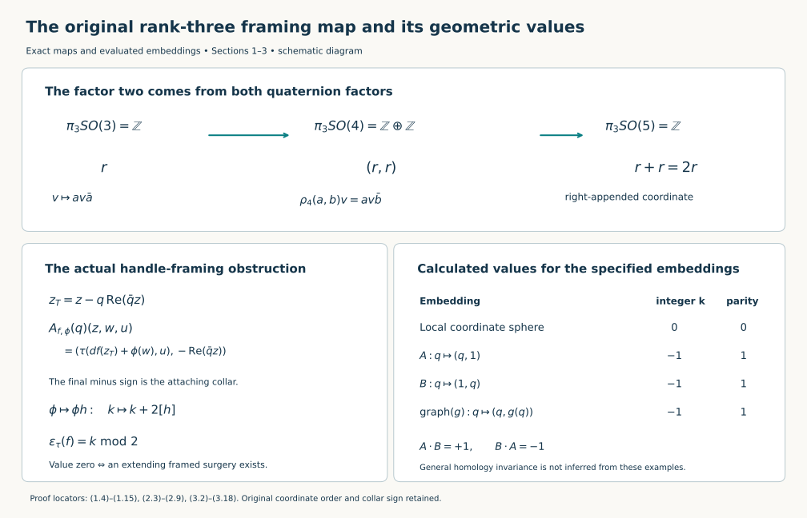
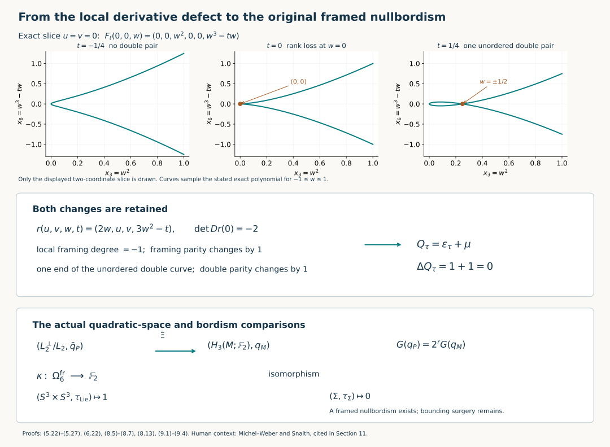

# The original six-dimensional framing obstruction

Receiving proof for CG-S6 lesson 7. GPT-6 Astra (OpenAI), Ultra, 11 October 2026. New exposition CC0-1.0. The original integral sixth stable sphere group is calculated in the integral-comparison companion. This chapter constructs its geometric invariant with the original framing matrices, both defects of a generic homotopy, the full middle-homology quadratic law and the exact index-three reduction maps. It proves framed bordism invariance, calculates the specified framed product, and obtains a framed nullbordism of the original homotopy six-sphere. The [sphere-twist and smooth-recognition proof](sphere-twists-and-the-original-smooth-six-sphere-comparison.md#twist-original-smooth-map) now constructs the new interior gluing with its full frame defect, cancels every actual handle and gives the orientation-preserving diffeomorphism to the original six-sphere, homotopic to its original degree-one map.

Figure 1. The first row retains both quaternion factors and the right-appended coordinate. The lower panels record the original negative collar coordinate, the change by twice the normal-frame class, and the exact values in the stated frames. This is a diagram of the proved maps and calculated embeddings, not a claim of general homology invariance. Complete proofs: Sections 1–3, especially (1.14), (2.4), (2.9), (3.5), (3.8), (3.10), and (3.17). Human context: Françoise Michel and Claude Weber, [original author TeX edition 1409.0704v1](https://arxiv.org/abs/1409.0704v1), lines 620–669; that passage states the general invariant and cites its geometric proofs. Reproducible diagram source: [draw_framed_six_obstruction.py](../checks/draw_framed_six_obstruction.py).

## 1. The full rank-three framing map and its factor two {#framed-six-rank-three}

Use the original quaternion coordinates
\[
 q=q_0+q_1i+q_2j+q_3k,\qquad
 i^2=j^2=k^2=-1,\quad ij=k,\quad ji=-k,
 \quad |q|^2=q_0^2+q_1^2+q_2^2+q_3^2.
 \tag{1.1}
\]
The other two cyclic products are \(jk=i\) and \(ki=j\), and reversing either order changes its sign. Quaternion conjugation changes all three imaginary signs. Thus \(q\bar q=\bar q q=|q|^2\). Let \(S^3\) be the original unit sphere in these four ordered coordinates, with its positive boundary orientation.

For a unit quaternion \(a\), conjugation \(v\mapsto av\bar a\) preserves the imaginary subspace with coordinates \((i,j,k)\) and its Euclidean norm. It lies in \(SO(3)\), since \(S^3\) is connected and at \(a=1\) it is the identity. Its kernel is \(\{1,-1\}\): a quaternion commuting with \(i,j,k\) is real. The map is onto. Indeed for a unit imaginary quaternion \(u\), write \(a=\cos t+u\sin t\). It fixes \(u\); for an imaginary \(v\perp u\), direct multiplication using \(uv=-vu\) gives
\[
 a v\bar a=\cos(2t)v+\sin(2t)uv.
 \tag{1.2}
\]
Every orientation-preserving rotation has an axis and such a rotation on its perpendicular plane. The derivative of the map at 1 sends an imaginary \(h\) to \(v\mapsto hv-vh\); it is injective and both Lie algebras have dimension three. Therefore this surjection is a local diffeomorphism with the displayed two-element kernel, and is a covering map. Lifting spheres and homotopies gives
\[
 \pi_3(SO(3))\cong\pi_3(S^3)\cong\mathbb Z,\qquad
 \pi_2(SO(3))=0.
 \tag{1.3}
\]
The generator in (1.3) is the original conjugation map on the positively oriented \(S^3\), not an unspecified choice.

The corresponding four-dimensional map is
\[
 \rho_4:S^3\times S^3\longrightarrow SO(\mathbb H),
 \qquad \rho_4(a,b)(v)=av\bar b.
 \tag{1.4}
\]
It preserves the full norm (1.1) and orientation. Its kernel consists of \((1,1)\) and \((-1,-1)\): apply the identity action to \(v=1\), then to every imaginary basis element. Its derivative sends \((\alpha,\beta)\) to \(v\mapsto\alpha v-v\beta\); vanishing first gives \(\alpha=\beta\), then makes this imaginary quaternion commute with every quaternion, hence zero. The derivative is an isomorphism onto \(\mathfrak{so}(4)\) by dimension. Its compact image is both closed and open in the connected \(SO(4)\), so (1.4) is onto and is the indicated two-sheeted cover. Connectedness of \(SO(4)\) follows directly by successively rotating its oriented orthonormal columns to the coordinate columns in coordinate two-planes. The stabilizer of the first vector \(1\in\mathbb H\) has \(a=b\). Consequently the original inclusion fixing that first coordinate is exactly
\[
 SO(3)\longrightarrow SO(4),\qquad
 [a]\longmapsto\rho_4(a,a).
 \tag{1.5}
\]
Here \([a]\) denotes the rotation (1.2); the equality records the actual diagonal lift.

To compute the next stabilization with its coefficient, let
\[
 Sp(2)=\{G\in M_2(\mathbb H):G^*G=GG^*=I_2\}.
 \tag{1.6}
\]
The first-column map has base the original unit sphere \(S^7\subset\mathbb H^2\). Quaternionic Gram–Schmidt near each chosen first column gives a local section: project a fixed independent second vector onto the orthogonal complement and divide by its positive norm. The full projection is \(w-v(v^*w)\); the divisor is \(|w-v(v^*w)|\), which is nonzero on that neighbourhood. Its fibre over \((1,0)^T\) is exactly \(\operatorname{diag}(1,b)\), \(b\in S^3\). Thus it is a fibre bundle
\[
 S^3\xrightarrow{\,b\mapsto\operatorname{diag}(1,b)\,}
 Sp(2)\longrightarrow S^7.
 \tag{1.7}
\]
It follows that \(Sp(2)\) is connected and simply connected. In degrees three and four the adjacent homotopy groups of \(S^7\) vanish by cellular approximation. The same exact homotopy sequence therefore proves that the displayed fibre map induces an isomorphism on \(\pi_3\).

Consider the five-dimensional real space of matrices
\[
 X(q,t)=
 \begin{pmatrix}t&q\\\bar q&-t\end{pmatrix},
 \qquad(q_0,q_1,q_2,q_3,t)\in\mathbb R^5.
 \tag{1.8}
\]
The last coordinate is the appended real coordinate; no earlier coordinate has moved. Direct multiplication gives
\[
 X(q,t)^2=(|q|^2+t^2)I_2,\qquad
 \operatorname{Re}\operatorname{tr}X(q,t)^2
       =2(q_0^2+q_1^2+q_2^2+q_3^2+t^2).
 \tag{1.9}
\]
Conjugation \(X\mapsto GXG^*\) preserves this space. It preserves Hermitian matrices; the real trace is cyclic, because \(\operatorname{Re}(uv)=\operatorname{Re}(vu)\) for quaternions and one sums over both matrix indices. Its trace therefore remains zero. Equation (1.9), with its factor two retained, proves preservation of the stated Euclidean norm. Since \(Sp(2)\) is connected, this representation lands in \(SO(5)\).

Its kernel is exactly \(\{I_2,-I_2\}\). A matrix commuting with \(X(0,1)\) is block diagonal, say \(\operatorname{diag}(a,b)\). Commuting with every \(X(q,0)\) says \(aq=qb\) for all \(q\). Taking \(q=1\) gives \(a=b\), and the imaginary basis then makes \(a\) real. Its unit norm forces \(a=\pm1\). At the Lie-algebra level an arbitrary element is
\[
 \begin{pmatrix}\alpha&\beta\\-\bar\beta&\gamma\end{pmatrix},
 \qquad \alpha,\gamma\in\operatorname{Im}\mathbb H,\quad
 \beta\in\mathbb H.
 \tag{1.10}
\]
Commuting with all (1.8) first gives \(\beta=0\), then \(\alpha q=q\gamma\) for all \(q\), so \(\alpha=\gamma=0\). Thus the representation has injective derivative. Both dimensions are ten. Its compact image is consequently open and closed in connected \(SO(5)\), hence all of \(SO(5)\); it is the displayed double cover.

Under this cover, the block matrix \(\operatorname{diag}(a,b)\) acts by
\[
 (q,t)\longmapsto(aq\bar b,t).
 \tag{1.11}
\]
This is exactly (1.4) followed by stabilization that appends the last real coordinate. It fixes \(t\) and retains all four quaternion coordinates in their original order.

Both block inclusions of \(S^3\) into \(Sp(2)\) induce the same map on \(\pi_3\). The required based conjugation homotopy is explicit:
\[
 J_\theta=
 \begin{pmatrix}\cos\theta&-\sin\theta\\
                 \sin\theta&\cos\theta\end{pmatrix},
 \quad0\leq\theta\leq\frac{\pi}{2},\qquad
 J_{\pi/2}\operatorname{diag}(a,1)J_{\pi/2}^{-1}
        =\operatorname{diag}(1,a).
 \tag{1.12}
\]
Every \(J_\theta\) belongs to \(Sp(2)\); conjugation fixes its identity throughout. By (1.7) this common \(\pi_3\)-map is an isomorphism. The identity
\(\operatorname{diag}(a,b)=\operatorname{diag}(a,1)\operatorname{diag}(1,b)\)
then proves that the map
\(\pi_3(S^3\times S^3)\to\pi_3Sp(2)\)
is
\[
 \mathbb Z\oplus\mathbb Z\longrightarrow\mathbb Z,
 \qquad (r,s)\longmapsto r+s.
 \tag{1.13}
\]
Indeed multiplication of based maps into a topological group induces the sum on positive homotopy groups: the two coordinate concatenations of their cube representatives obey the interchange law, have the same unit and consequently agree. Equation (1.12) proves that both summands have sign plus in the chosen generator.

For \(j\geq5\), the original frame bundle \(SO(j)\to SO(j+1)\to S^j\), with its last column as projection, has zero adjacent \(\pi_4(S^j)\) and \(\pi_3(S^j)\). Its exact sequence makes every further right stabilization an isomorphism on \(\pi_3\). Covering maps preserve these groups.

There is one coordinate comparison still required: (1.5) fixes the first quaternion coordinate, whereas right stabilization of the original three coordinates fixes an appended last line. Keep both presentations. After one further appended line, the actual change of coordinates is
\[
 P(v_1,v_2,v_3,t,s)=(t,v_1,v_2,v_3,-s).
\]
The four-coordinate cyclic permutation has determinant \(-1\), and the displayed last-coordinate minus sign makes \(\det P=+1\). Thus \(P\in SO(5)\), and conjugation by \(P\) carries the original right-stabilized matrix \(\operatorname{diag}(\operatorname{Ad}(a),1,1)\) to \(\operatorname{diag}(1,\operatorname{Ad}(a),1)\), exactly the map (1.5) followed by (1.11). Successive coordinate-plane rotations, as in the connectedness proof above, give a path from \(I_5\) to this specified \(P\). Conjugation along that path is a based homotopy, so the two original maps induce the same stable \(\pi_3\)-map. The last-coordinate sign and the intervening coordinate permutation have both been retained and proved harmless by this actual homotopy.

Combining this comparison with (1.5), (1.11) and (1.13), the full original rank-three-to-stable framing map is therefore
\[
 \boxed{\ \pi_3(SO(3))=\mathbb Z
       \longrightarrow\pi_3(SO)=\mathbb Z,\qquad r\longmapsto2r.\ }
 \tag{1.14}
\]
The stable generator is the right stabilization of \(v\mapsto av\) on the original \(\mathbb H\), with \(a\) running over its positive unit sphere. The two in (1.14) is the sum of the two actual diagonal factors in (1.5); it has not been absorbed into a generator.

Consequently the exact group of stable three-sphere framing differences modulo changes of an actual oriented rank-three normal frame is
\[
 \operatorname{coker}\bigl(\pi_3SO(3)\to\pi_3SO\bigr)
 =\mathbb Z/2\mathbb Z,
 \qquad r\longmapsto r\bmod2.
 \tag{1.15}
\]
This is the specified framing obstruction group. Constructing its quadratic value on the middle homology of the original six-manifold, with invariance under the actual geometric changes, is the next calculation. Equation (1.15) alone does not assign that value.

## 2. The obstruction for an actual embedded three-sphere {#framed-six-embedded-obstruction}

Let \(M\) be an oriented smooth six-manifold, and retain a specified stable tangent framing
\[
 \tau:TM\oplus\underline{\mathbb R}^{\,s}
       \longrightarrow\underline{\mathbb R}^{\,6+s}.
 \tag{2.1}
\]
Here a framing is the displayed fibrewise linear isomorphism, in the displayed order. Fix an orientation-preserving parametrized embedding \(f:S^3\hookrightarrow M\), where the sphere has the quaternion coordinates (1.1). Its normal bundle has rank three. Give it the orientation for which the ordered sum \(TS^3\oplus\nu_f\) has the pullback orientation of \(TM\).

This oriented normal bundle is trivial. To prove this without replacing it by its stable class, choose trivializations over the two hemispheres of \(S^3\). Their transition on the equatorial \(S^2\) is a map to \(GL^+(3,\mathbb R)\), and the positive polar deformation retracts that group to \(SO(3)\). Equation (1.3) says the transition is nullhomotopic. Extending that nullhomotopy over one hemisphere changes its trivialization so that the two agree on the equator. The resulting three sections trivialize the original normal bundle. Denote an oriented normal frame by
\[
 \phi_q:\mathbb R^3\longrightarrow(\nu_f)_q.
 \tag{2.2}
\]
Choose a metric only to view the normal vectors in \(T_{f(q)}M\). Write the inner product on \(\mathbb H\) as
\(\langle q,z\rangle=\operatorname{Re}(\bar qz)\). For \(q\in S^3\) and \(z\in\mathbb H\), retain both parts of its orthogonal decomposition:
\[
 r=\operatorname{Re}(\bar qz),\qquad
 z_T=z-qr\in T_qS^3,\qquad z=z_T+qr.
 \tag{2.3}
\]

The actual matrix to be compared is
\[
 \begin{split}
 A_{f,\phi}(q):\mathbb H\oplus\mathbb R^3\oplus\mathbb R^s
       &\longrightarrow\mathbb R^{6+s}\oplus\mathbb R,\\
 (z,w,u)&\longmapsto
 \bigl(\tau_{f(q)}(df_q(z_T)+\phi_q(w),u),-r\bigr).
 \end{split}
 \tag{2.4}
\]
Every map in (2.4) is specified. Its inverse first recovers \(r\) as the negative last coordinate, applies \(\tau^{-1}\) to recover the tangent vector and \(u\), decomposes that tangent vector uniquely into \(df(TS^3)\) and \(\nu_f\), and finally returns \(z=z_T+qr\) and \(w=\phi^{-1}\) of its normal part. Thus (2.4) is an invertible real matrix at every \(q\).

The last minus sign records the collar of the handle trace. Form the incoming cylinder with coordinate \(t\) increasing toward the handle. The attaching part of \(D^4\times D^3\) is \(\partial D^4\times D^3\); its outward radial coordinate points back into the cylinder, hence to \(-\partial_t\). The trace framing on the cylinder sends a vector \((v,u,c\partial_t)\) to \((\tau(v,u),c)\). At the central attaching sphere, its expression in the handle coordinates is exactly (2.4). Neither the collar sign nor the order of its final coordinate has been suppressed.

Take the basepoint \(q_0=1\) and set
\[
 B_{f,\phi}(q)=A_{f,\phi}(1)^{-1}A_{f,\phi}(q).
 \tag{2.5}
\]
This is a based map into \(GL^+(7+s,\mathbb R)\): the determinant sign of \(A\) is constant on the connected sphere, so its quotient has positive determinant. For definiteness the deformation to \(SO(7+s)\) is the positive polar homotopy
\[
 B\longmapsto B(B^TB)^{-t/2},\qquad 0\le t\le1.
 \tag{2.6}
\]
The positive definite power exists by the spectral theorem, varies continuously, and fixes \(B=I\). Use the stable generator specified after (1.14), and define the integer and its parity
\[
 k_\tau(f,\phi)=[B_{f,\phi}]\in\pi_3SO(7+s)=\mathbb Z,
 \qquad
 \varepsilon_\tau(f)=k_\tau(f,\phi)\pmod2.
 \tag{2.7}
\]
The equality with the stable group in (2.7) is proved by the sphere bundles at the end of Section 1, since \(7+s\ge5\).

We now prove all choice statements needed for this definition at a fixed parametrized embedding. First change its oriented normal frame to \(\phi'_q=\phi_qh(q)\), with \(h:S^3\to GL^+(3,\mathbb R)\). Directly from (2.4),
\[
 A_{f,\phi'}(q)=
 A_{f,\phi}(q)\operatorname{diag}(I_4,h(q),I_s).
 \tag{2.8}
\]
Taking based classes of this product gives
\[
 k_\tau(f,\phi')=k_\tau(f,\phi)+2[h],
 \tag{2.9}
\]
where \([h]\in\pi_3SO(3)=\mathbb Z\) uses the actual polar deformation and original generator of (1.3). To check the product statement when \(h(1)\ne I\), put \(H(q)=\operatorname{diag}(I_4,h(q),I_s)\). The based matrix for the right side of (2.8) is
\[
 H(1)^{-1}B_{f,\phi}(q)H(1)\,
 H(1)^{-1}H(q).
\]
Conjugation by the constant positive matrix \(H(1)\) is based homotopic to the identity conjugation along a path in \(GL^+\). Matrix multiplication adds the homotopy classes, as proved for (1.13). The second class is the original rank-three inclusion, whose coefficient is exactly two by (1.14). This proves (2.9), including its plus sign. Every integer \([h]\) is attained: compose the original conjugation map \(S^3\to SO(3)\) with a based degree-\([h]\) map of the original sphere, constructed by the oriented pinch map and reflection when its degree is negative. In particular the parity in (2.7) is independent of the normal frame.

A change of metric or of normal splitting also leaves that parity fixed. Any second splitting of
\(0\to TS^3\to f^*TM\to\nu_f\to0\)
differs from the first by a bundle map \(\nu_f\to TS^3\). Its effect on the ordered sum is the triangular matrix
\(\left(\begin{smallmatrix}I&D\\0&I\end{smallmatrix}\right)\);
replacing \(D\) by \(tD\) is an explicit homotopy through invertible matrices. Once the splitting is fixed, the remaining change is an oriented normal frame and is covered by (2.9). A homotopy of \(\tau\) or of \(\phi\) gives a homotopy of (2.4) and (2.5), so keeps the integer \(k\) itself fixed.

Stabilizing (2.1) by an identity line is also exact. With the new variable appended to \(u\), formula (2.4) has the new target variable immediately before its final collar coordinate. Thus the new \(A\) is \(Q(A\oplus I_1)\), where \(Q\) is the constant permutation exchanging that appended coordinate with the collar coordinate. In (2.5) the two copies of \(Q\) cancel. The new based matrix is precisely \(B\oplus I_1\). Its class and the parity (2.7) are therefore preserved by the original right stabilization.

**Framing-extension criterion.** For the given parametrized embedding \(f\), there exists an oriented normal frame for which its surgery trace carries a stable framing extending (2.1) if and only if \(\varepsilon_\tau(f)=0\).

Here is the extension proof. A tubular neighbourhood gives the actual attaching map \(S^3\times D^3\to M\). The pullback of the cylinder framing over that entire attaching part is a matrix-valued function whose restriction to \(w=0\) is (2.4). Contracting the original normal disc by \(w\mapsto tw\) makes it homotopic to that restriction. The pair
\((D^4\times D^3,S^3\times D^3)\)
retracts as a pair to \((D^4,S^3)\). Consequently a framing on the attaching part extends to the handle exactly when (2.4) is nullhomotopic in its component of \(GL(7+s,\mathbb R)\), equivalently when (2.5) represents zero. More explicitly, a nullhomotopy of the central matrix gives an extension over the core \(D^4\); the homotopy on the attaching part and the collar homotopy-extension property then restore its full prescribed matrix on \(S^3\times D^3\). A continuous extension can be made smooth relative to this collar by matrix approximation; on the compact handle, sufficiently close approximation stays inside the open set of invertible matrices. This yields a genuine smooth framing of the trace. Conversely an extending handle framing restricts over its core to a nullhomotopy of (2.5), so forces \(k_\tau(f,\phi)=0\).

If (2.7) is zero, the integer \(k\) is even. Choose \(h\) in (2.9) of class \(-k/2\); then the new actual normal frame has integer zero and the preceding construction extends it. If an actual framed trace exists, that same construction in reverse gives \(k=0\) for its normal frame and hence parity zero for every frame. This proves both directions of the criterion.

Finally \(\varepsilon_\tau(f)\) is invariant under a parametrized isotopy of embeddings. The normal bundles of such an isotopy form an oriented rank-three bundle over \(S^3\times[0,1]\). Parallel transport for a connection extends the starting normal frame over the interval. Equations (2.3)–(2.5) then form a continuous homotopy of based matrices. Its two integers agree; any prescribed different normal frame at the endpoint changes the integer by (2.9) and leaves its parity unchanged.

This proves a value for each actual parametrized embedded sphere and an exact handle-extension criterion. Dependence only on its homology class, the effect of a general homotopy through singular maps, and the quadratic law have not been assumed in this construction.

## 3. Explicit values with every quaternion factor retained {#framed-six-original-values}

### 3.1. The standard local sphere has value zero

Take a positively oriented coordinate ball in a framed six-manifold. Its stable frame is homotopic on a smaller closed ball to its value at the centre, because the ball contracts. This homotopy does not change (2.7). A constant target change cancels in (2.5), so it suffices to compute in the original ordered \(\mathbb R^6=\mathbb H\oplus\mathbb R^2\) with its identity tangent framing. Embed \(S^3\) as \(q\mapsto(q,0,0)\). The oriented rank-three normal frame is
\[
 \phi_q(w_0,w_1,w_2)=(-q w_0,w_1,w_2).
 \tag{3.1}
\]
The minus sign is required: moving the outward radial vector past the three positively oriented tangent vectors reverses orientation. At \(q=1\), the ordered list \((i,j,k,-1,e_5,e_6)\) has positive determinant.

Using (2.3), the full matrix (2.4) is
\[
 (z,w_0,w_1,w_2)\longmapsto
 (z-q\operatorname{Re}(\bar qz)-qw_0,\,
    w_1,w_2,\,-\operatorname{Re}(\bar qz)).
 \tag{3.2}
\]
Before the constant target permutation that moves \(w_1,w_2\) ahead of the last coordinate, its \(\mathbb H\oplus\mathbb R w_0\) block is
\[
 R_q=
 \begin{pmatrix}
 I_4-qq^T&-q\\-q^T&0
 \end{pmatrix}
 =I_5-2v_qv_q^T,
 \qquad
 v_q=\frac{(q,1)}{\sqrt2}.
 \tag{3.3}
\]
Here \(q\) is its original real column of length four. The equality retains every entry and the full factor two. These reflection matrices have an explicit homotopy to a constant:
\[
 v_{q,t}=
 \frac{((1-t)q,1)}{\sqrt{(1-t)^2+1}},
 \qquad
 R_{q,t}=I_5-2v_{q,t}v_{q,t}^T,\quad0\le t\le1.
 \tag{3.4}
\]
The denominator is positive throughout, and \(R_{q,1}=\operatorname{diag}(I_4,-1)\) is independent of \(q\). Multiplying by the inverse value at \(q=1\) during the homotopy makes it based and ends at the identity. The constant target permutation in (3.2) cancels in (2.5). Therefore
\[
 k_\tau(f,\phi)=0,\qquad \varepsilon_\tau(f)=0.
 \tag{3.5}
\]
The same calculation applies in any sufficiently small framed coordinate ball by the original frame homotopy just specified.

### 3.2. Both product spheres have value one

Give \(S^3\times S^3\) its product of the original boundary orientations and the actual Lie-group tangent framing
\[
 \tau_{(a,b)}(v,w)=
       \bigl(\operatorname{Im}(\bar av),\,
             \operatorname{Im}(\bar bw)\bigr)
       \in\operatorname{Im}\mathbb H\oplus\operatorname{Im}\mathbb H.
 \tag{3.6}
\]
Each imaginary coordinate is in the order \(i,j,k\). The inverse sends \((h,\ell)\) to \((ah,b\ell)\); hence (3.6) is a genuine unstabilized frame, with \(s=0\).

For \(f_A(q)=(q,1)\), use \(\phi_A(w)=(0,w)\). Its matrix (2.4) is
\[
 A_A(q)(z,w)=
    \bigl(\operatorname{Im}(\bar qz),\,w,\,
         -\operatorname{Re}(\bar qz)\bigr)
 = C_A(L_{\bar q}\oplus I_3)(z,w),
\quad
 C_A(z,w)=(\operatorname{Im}z,w,-\operatorname{Re}z).
 \tag{3.7}
\]
Thus the based matrix is exactly \(L_{\bar q}\oplus I_3\).
The map \(q\mapsto L_{\bar q}\) is the pointwise inverse of the original generator \(q\mapsto L_q\), so its class is \(-1\), not an unspecified generator. Consequently
\[
 k_\tau(f_A,\phi_A)=-1,\qquad\varepsilon_\tau(f_A)=1.
 \tag{3.8}
\]

For \(f_B(q)=(1,q)\), the oriented normal frame is
\(\phi_B(w)=(-w,0)\). Swapping its tangent block past a rank-three normal block has sign \((-1)^9=-1\); the displayed minus on all three normal vectors has determinant \(-1\) and restores the required orientation. Formula (2.4) gives
\[
 A_B(q)(z,w)=
  \bigl(-w,\operatorname{Im}(\bar qz),
              -\operatorname{Re}(\bar qz)\bigr)
 =C_B(L_{\bar q}\oplus I_3)(z,w).
 \tag{3.9}
\]
Again its constant \(C_B=A_B(1)\) cancels in (2.5), and
\[
 k_\tau(f_B,\phi_B)=-1,\qquad\varepsilon_\tau(f_B)=1.
 \tag{3.10}
\]
The actual two submanifolds meet at \((1,1)\). Their tangent vectors in the order \(A,B\) give exactly the product orientation in (3.6). Their integral intersection numbers are therefore \(A\cdot B=+1\) and \(B\cdot A=-1\). Each has zero self-intersection, as witnessed by translating the other constant factor to a distinct point. The product cell complex, with cells in dimensions \(0,3,3,6\) and zero cellular differentials, proves that these are the two original integral generators of \(H_3(S^3\times S^3;\mathbb Z)\). Its full middle intersection matrix in the ordered basis \(A,B\) is
\[
 \begin{pmatrix}0&1\\-1&0\end{pmatrix}.
 \tag{3.11}
\]

### 3.3. Every graph over the first product factor

There is a useful extension of (3.7), proved without assuming a homology-invariance theorem. Let \(g:S^3\to S^3\) be any smooth map and let
\[
 f_g(q)=(q,g(q)).
 \tag{3.12}
\]
This is an embedding regardless of the derivative of \(g\), since its first projection is the identity. Define its original left-trivialized derivative \(H(q)\) by
\[
 dg_q(qh)=g(q)H(q)h,\qquad h\in\operatorname{Im}\mathbb H.
 \tag{3.13}
\]
It is a real \(3\)-by-\(3\) matrix, not assumed invertible. An actual normal frame in the product metric is
\[
 \phi_g(q)(w)=\bigl(-qH(q)^Tw,\ g(q)w\bigr).
 \tag{3.14}
\]
Its inner product with \((qh,dg_q(qh))\) is
\(-\langle h,H^Tw\rangle+\langle Hh,w\rangle=0\).
It is injective because its second component is injective. The ordered tangent and normal blocks have matrix
\[
 D_H=
 \begin{pmatrix}I_3&-H^T\\H&I_3\end{pmatrix},
 \qquad
 \det D_H=\det(I_3+HH^T)>0.
 \tag{3.15}
\]
The determinant equality follows by subtracting \(H\) times the first block row from the second; the final matrix is block triangular. For every nonzero \(w\),
\(w^T(I_3+HH^T)w=|w|^2+|H^Tw|^2>0\).
Thus (3.14) is the correctly oriented normal frame, including at all singular points of \(dg\).

The full comparison matrix is
\[
 A_g(q)(z,w)=
 \bigl(h-H(q)^Tw,\ H(q)h+w,\ -r\bigr),
 \quad h=\operatorname{Im}(\bar qz),\quad
 r=\operatorname{Re}(\bar qz).
 \tag{3.16}
\]
It is \(\operatorname{diag}(D_{H(q)},1)C_A(L_{\bar q}\oplus I_3)\).
The matrix map \(q\mapsto D_{H(q)}\) is nullhomotopic through the actual matrices \(D_{tH(q)}\), since
\(\det D_{tH}=\det(I_3+t^2HH^T)>0\)
for every \(t\). Apply this homotopy also to the inverse basepoint matrix in (2.5). Its endpoint is exactly the based matrix in (3.7), so
\[
 k_\tau(f_g,\phi_g)=-1,\qquad\varepsilon_\tau(f_g)=1
       \quad\hbox{for every smooth }g:S^3\to S^3.
 \tag{3.17}
\]
The original homology class of (3.12) is \(A+\deg(g)B\): its two projection maps on \(H_3\) are respectively the identity and multiplication by the integer degree of \(g\). Equation (3.17) proves the framing value on this entire family while preserving every derivative in the comparison.

For \(g(q)=q\), this is the actual diagonal and its class is \(A+B\). Its value is one. Together with (3.8), (3.10), and \(A\cdot B=1\), this gives the explicit equality
\[
 \varepsilon_\tau(f_{\mathrm{diag}})
   =1=1+1+1
   =\varepsilon_\tau(f_A)+\varepsilon_\tau(f_B)
        +(A\cdot B)\pmod2.
 \tag{3.18}
\]
This is a verified example of the quadratic law. Sections 5–6 prove the general law and the passage from parametrized embeddings to middle homology; (3.18) is an explicit comparison example for those later proofs.

## 4. The full finite quadratic calculation {#framed-six-quadratic-algebra}

We next prove the algebra that will receive the geometric construction. Its objects here are actual finite quadratic spaces. No quadratic law for the geometric values of Section 2 is presumed.

Let \(V\) be a finite-dimensional vector space over \(\mathbb F_2\), and let \(\lambda:V\times V\to\mathbb F_2\) be a nonsingular alternating bilinear form. Let \(q:V\to\mathbb F_2\) be an actual function satisfying
\[
 q(0)=0,\qquad
 q(x+y)=q(x)+q(y)+\lambda(x,y)
 \quad\hbox{for every }x,y\in V.
 \tag{4.1}
\]
All additions in (4.1) are in the specified field. The alternation condition gives \(\lambda(x,x)=0\), and expanding \(\lambda(x+y,x+y)=0\) proves \(\lambda(x,y)=\lambda(y,x)\) in this field.

Choose \(e\ne0\). Nonsingularity supplies \(f\) with \(\lambda(e,f)=1\). The actual projection
\[
 P(v)=v+\lambda(v,f)e+\lambda(v,e)f
 \tag{4.2}
\]
has image \(W=\{w:\lambda(w,e)=\lambda(w,f)=0\}\), since pairing its right side with \(e\) or \(f\) cancels the respective two equal terms. It fixes every \(w\in W\) and kills \(e,f\). Thus the original vector \(v\) has the unique decomposition
\[
 v=\lambda(v,f)e+\lambda(v,e)f+P(v).
 \tag{4.3}
\]
The restriction of \(\lambda\) to \(W\) is nonsingular: an element in its radical also pairs to zero with \(e,f\), hence with every vector by (4.3), and therefore is zero. Repeating this construction gives an even dimension \(2g\) and an actual basis \(e_1,f_1,\ldots,e_g,f_g\) with
\[
 \lambda(e_i,f_j)=\delta_{ij},\qquad
 \lambda(e_i,e_j)=\lambda(f_i,f_j)=0.
 \tag{4.4}
\]
The coordinate map and inverse are retained by (4.3) at every step. This does not discard the original \(V\), its original vectors, or its function \(q\).

Put \(a_i=q(e_i)\) and \(b_i=q(f_i)\). Iterating the actual identity (4.1), keeping every nonzero pairing in (4.4), yields
\[
 q\!\left(\sum_i(\alpha_i e_i+\beta_i f_i)\right)
  =\sum_i\bigl(\alpha_i a_i+\beta_i b_i+\alpha_i\beta_i\bigr).
 \tag{4.5}
\]
For one pair this follows by considering \(\alpha_i,\beta_i\in\{0,1\}\); for different pairs all cross pairings vanish by (4.4). Induction on the number of pairs proves the displayed formula for every original vector, not just on the chosen basis.

Define the integer Gauss sum using the whole original vector space:
\[
 G(q)=\sum_{v\in V}(-1)^{q(v)}.
 \tag{4.6}
\]
The four terms contributed by the \(i\)-th pair in (4.5) are
\[
 1+(-1)^{a_i}+(-1)^{b_i}-(-1)^{a_i+b_i}
      =2(-1)^{a_i b_i}.
 \tag{4.7}
\]
Indeed their values are \(2,2,2,-2\) for \((a_i,b_i)=(0,0),(0,1),(1,0),(1,1)\), respectively. Summing (4.5) independently over every \(\alpha_i,\beta_i\) now gives
\[
 G(q)=2^g(-1)^{\sum_i a_i b_i}.
 \tag{4.8}
\]
The left side depends only on the original function \(q\), so the exponent on the right modulo two is independent of every basis choice. We have proved that
\[
 \operatorname{Arf}(q)=\sum_{i=1}^gq(e_i)q(f_i)\in\mathbb F_2
 \tag{4.9}
\]
is well-defined. For \(g=0\), the only vector is zero; the empty sum is zero and \(G(q)=1\), as (4.8) requires. The full numbers of zeros and ones are consequently
\[
 \#q^{-1}(0)=\frac{2^{2g}+2^g(-1)^{\operatorname{Arf}(q)}}2,
 \qquad
 \#q^{-1}(1)=\frac{2^{2g}-2^g(-1)^{\operatorname{Arf}(q)}}2.
 \tag{4.10}
\]
Both counts follow by adding and subtracting the total count \(2^{2g}\) and the difference (4.6).

### 4.1. Vanishing and an actual zero-valued Lagrangian

A Lagrangian here is a subspace \(L\subset V\) with \(\lambda|_{L\times L}=0\) and \(\dim L=g\). Nonsingularity then gives \(L^\perp=L\): the linear map \(V\to L^*\) defined by \(\lambda\) is surjective, so its kernel \(L^\perp\) has dimension \(g\) and already contains \(L\). The surjectivity follows by extending a functional on \(L\) to a basis of \(V\), then using the isomorphism \(V\to V^*\) given by the nonsingular pairing.

We prove
\[
 \operatorname{Arf}(q)=0
 \quad\Longleftrightarrow\quad
 \text{there is a Lagrangian }L\subset V\text{ with }q|_L=0.
 \tag{4.11}
\]
For the forward direction use induction on \(g\). The case \(g=0\) has \(L=\{0\}\). If \(g\ge1\), (4.10) with Arf zero gives at least three zeros of \(q\), so choose a nonzero \(e\) with \(q(e)=0\). Choose \(f\) with \(\lambda(e,f)=1\) and define the specified new vector
\[
 f'=f+q(f)e.
 \tag{4.12}
\]
If \(q(f)=0\), it is \(f\). If \(q(f)=1\), (4.1) gives
\(q(f+e)=1+0+1=0\). Thus in both cases \(\lambda(e,f')=1\) and \(q(f')=0\).

Use (4.2) with \(f'\) and let \(W=\langle e,f'\rangle^\perp\). The exact isomorphism
\[
 \mathbb F_2^2\oplus W\longrightarrow V,\qquad
 (\alpha,\beta,w)\longmapsto\alpha e+\beta f'+w
 \tag{4.13}
\]
has inverse \((\lambda(v,f'),\lambda(v,e),P(v))\) by (4.3). Formula (4.1) identifies its quadratic function exactly with
\(\alpha\beta+q(w)\).
The sum over \(\alpha,\beta\) is \(2\) by (4.7), so \(G(q)=2G(q|_W)\). Since \(G(q)=2^g\), (4.8) for \(W\) shows that its Arf invariant is zero. The induction hypothesis constructs a zero-valued Lagrangian \(L_W\subset W\). Then \(L=\mathbb F_2e\oplus L_W\), with its actual inclusion from (4.13), has dimension \(g\), zero pairing, and zero \(q\) by (4.1). This proves existence with explicit inclusion and projection maps at every step.

Conversely suppose such an \(L\) is given. For every \(v\in V\), the sum over its original coset is
\[
 \sum_{\ell\in L}(-1)^{q(v+\ell)}
   =(-1)^{q(v)}
       \sum_{\ell\in L}(-1)^{\lambda(v,\ell)}.
 \tag{4.14}
\]
If \(v\notin L^\perp\), choose \(\ell_0\in L\) with \(\lambda(v,\ell_0)=1\). Pairing the term indexed by \(\ell\) with the term indexed by \(\ell+\ell_0\) cancels that entire sum. If \(v\in L^\perp=L\), every term is one because \(q|_L=0\), so the coset sum is \(2^g\). Only the zero coset contributes to (4.6). It follows that \(G(q)=2^g\), hence \(\operatorname{Arf}(q)=0\) by (4.8). This proves the reverse implication of (4.11).

### 4.2. Exact reduction and addition

Let \(U\subset V\) be any subspace with zero pairing and \(q|_U=0\). Its dimension need not be \(g\). For \(v\in U^\perp\) and \(u\in U\), (4.1) gives \(q(v+u)=q(v)\). Thus the actual quotient map
\[
 p:U^\perp\longrightarrow U^\perp/U,\qquad v\longmapsto v+U
 \tag{4.15}
\]
defines a function \(\bar q(v+U)=q(v)\) and pairing
\(\bar\lambda(v+U,w+U)=\lambda(v,w)\).
Both are independent of representatives because the original \(U\) is orthogonal to \(U^\perp\). The radical of \(\lambda|_{U^\perp}\) is \(U\): nonsingularity gives \((U^\perp)^\perp=U\) by the same dimension argument used above. Therefore the quotient pairing is nonsingular. If \(\dim U=d\), its dimension is \(2g-2d\).

Partition the Gauss sum into the original cosets of \(U\). The cancellation in (4.14), with \(U\) in place of \(L\), kills precisely the cosets outside \(U^\perp\). Each remaining coset contributes \(2^d(-1)^{\bar q(v+U)}\). Hence the full equality, with its factor, is
\[
 G(q)=2^dG(\bar q),\qquad
 \operatorname{Arf}(q)=\operatorname{Arf}(\bar q).
 \tag{4.16}
\]
The second equation follows by substituting the actual dimensions into (4.8); the first is the exact comparison that proves it.

For two given spaces \(V_1,V_2\) with their functions, the orthogonal direct-sum function is \(q_1(v_1)+q_2(v_2)\). Directly summing all ordered pairs gives
\[
 G(q_1\oplus q_2)=G(q_1)G(q_2),\qquad
 \operatorname{Arf}(q_1\oplus q_2)
       =\operatorname{Arf}(q_1)+\operatorname{Arf}(q_2).
 \tag{4.17}
\]
No isometry-class replacement is needed for either identity.

On the original two-dimensional space with coordinates \((\alpha,\beta)\), the values \(q(e)=q(f)=1\), \(\lambda(e,f)=1\) uniquely give
\[
 q(\alpha,\beta)=\alpha+\beta+\alpha\beta,\qquad
 \begin{array}{c|rrrr}
  (\alpha,\beta)&(0,0)&(1,0)&(0,1)&(1,1)\\ \hline
  q(\alpha,\beta)&0&1&1&1
 \end{array}
 \tag{4.18}
\]
by (4.5). Its Gauss sum is \(1-1-1-1=-2\), and its Arf invariant is one. These are the exact algebraic values that match the three product embeddings calculated in Section 3. A proof that the geometric construction supplies (4.1) on all of middle homology is required before (4.18) can be called the invariant of the framed product. That proof is given in Sections 5–6.

The algebraic definition (4.9) is recorded in Victor P. Snaith, *The Arf-Kervaire Invariant of framed manifolds*, [arXiv:1001.4751v1](https://arxiv.org/abs/1001.4751v1), original author TeX lines 1218–1243, citing Cahit Arf, *Untersuchungen über quadratische Formen in Körpern der Charakteristik 2*, J. Reine Angew. Math. **183** (1941), 148–167. The complete arguments (4.2)–(4.18) above are supplied here. The source's geometric construction at lines 1265–1268 and surgery discussion at 1440–1488 are bounded reading context: the asserted cohomotopy identification and geometric quadratic law in those passages have not been used as unproved substitutes for the next calculation.

## 5. Immersions, the derivative defect, and homotopy invariance {#framed-six-homotopy-defects}

Figure 2. The upper plots show the exact two-coordinate slice \(u=v=0\) of (5.22), with the other four coordinates zero; the curves sample \(-1\le w\le1\), while their defining polynomial and all three parameter values are displayed. The marked double pair at \(t=1/4\) has \(w=\pm1/2\). The middle panel retains the signed derivative degree and both parity changes. The lower panel records the actual quotient map of (8.6), its full Gauss factor, and the final framed bordism values (9.3)–(9.4). Human context is cited in Section 11. Reproducible source: [draw_framed_six_geometric.py](../checks/draw_framed_six_geometric.py). The [sphere-twist and smooth-recognition proof](sphere-twists-and-the-original-smooth-six-sphere-comparison.md#twist-original-smooth-map) now constructs the new interior gluing with its full frame defect, cancels every actual handle and gives the orientation-preserving diffeomorphism to the original six-sphere, homotopic to its original degree-one map.

The construction in Section 2 applies to a smooth immersion \(f:S^3\to M^6\), even when distinct points have the same image. Its normal bundle is the quotient of \(f^*TM\) by the image of \(df\); it is an actual oriented rank-three bundle over the original domain. The hemisphere argument preceding (2.2) still trivializes it. Formula (2.4) uses the derivative at each domain point, so it remains an invertible matrix. Define \(k_\tau(f,\phi)\) and \(\varepsilon_\tau(f)\) by the same formulas (2.5)–(2.7). Their metric, splitting, framing-change and regular-homotopy proofs are unchanged: none of those proofs used injectivity at two different domain points.

A self-transverse immersion here means that every equality \(f(x)=f(y)\), \(x\ne y\), has
\[
 df_x(T_xS^3)+df_y(T_yS^3)=T_{f(x)}M.
 \tag{5.1}
\]
We also require no triple points. Its double points are a finite set of unordered pairs \(\{x,y\}\). Transversality makes that set zero-dimensional. Local injectivity of an immersion, followed by compactness of the domain, excludes accumulation on the diagonal; compactness away from the diagonal then makes the set finite. Write
\[
 \mu(f)=\#\{\{x,y\}:x\ne y,\ f(x)=f(y)\}\pmod2,\qquad
 Q_\tau(f)=\varepsilon_\tau(f)+\mu(f)\in\mathbb F_2.
 \tag{5.2}
\]
The order of the sheets changes an integral intersection sign in dimension three. The count in (5.2) is deliberately the count of unordered pairs modulo two; it does not assign an invariant integer sign to such a pair.

We prove that two homotopic self-transverse immersions have the same \(Q_\tau\). The proof retains both defects of a general homotopy, including the failure of its derivative to have rank three.

### 5.1. The original derivative frame and the constant minus one

Use the original tangent frame \(qi,qj,qk\) of the domain sphere. For an immersion with normal frame \(\phi\), put
\[
 G_{f,\phi}(q)(h,w,u)
   =\tau_{f(q)}\bigl(df_q(qh)+\phi_q(w),u\bigr),
 \quad
 (h,w,u)\in\operatorname{Im}\mathbb H\oplus\mathbb R^3
                    \oplus\mathbb R^s.
 \tag{5.3}
\]
This is a positive invertible matrix. The tangent frame \(qi,qj,qk\) is positively oriented: at \(1\) this is the boundary orientation, and its determinant sign cannot change on the connected sphere. The normal orientation is the one fixed in Section 2.

Let the constant isomorphism \(C\) be
\[
 C(z,w,u)=(\operatorname{Im}z,w,u,-\operatorname{Re}z).
 \tag{5.4}
\]
The full matrix (2.4), with all domain and target factors in their original order, satisfies
\[
 \begin{split}
 A_{f,\phi}(q)&=(G_{f,\phi}(q)\oplus I_1)\,
                  C\,(L_{\bar q}\oplus I_{3+s}),\\
 A_{f,\phi}(1)^{-1}A_{f,\phi}(q)
   &=C^{-1}\bigl(G_{f,\phi}(1)^{-1}G_{f,\phi}(q)\oplus I_1\bigr)C
                  (L_{\bar q}\oplus I_{3+s}).
 \end{split}
 \tag{5.5}
\]
Indeed \(\bar qz=r+h\), so \(z_T=qh\), and the last coordinate in (5.4) is exactly the negative collar coordinate in (2.4).

Conjugation by a constant invertible real matrix acts as the identity on the stable \(\pi_3\) used here. For positive determinant, take a path to the identity after polar deformation. For negative determinant, append a real coordinate and conjugate instead by \(\operatorname{diag}(C,-1)\), which has positive determinant and has the same conjugation action on a matrix with its appended coordinate fixed. Stabilization is an isomorphism in this degree by Section 1. This proves the assertion for both signs of \(C\); no sign of that constant matrix is omitted.

For a map \(G:S^3\to GL^+(6+s,\mathbb R)\), denote the class of \(G(1)^{-1}G(q)\), followed by polar deformation and the proved stabilization, by \([G]\in\mathbb Z\). Equations (5.5) and (3.8) give the exact integer identity
\[
                 k_\tau(f,\phi)=[G_{f,\phi}]-1.
 \tag{5.6}
\]
In particular the constant minus one must be retained when comparing a single derivative frame with the handle obstruction. It cancels when comparing two immersions with the same original domain sphere.

### 5.2. A generic homotopy and its rank-two points

Let \(F:S^3\times[0,1]\to M\) be a smooth homotopy between the two immersions, constant in the parameter near its ends. Write \(F_t(q)=F(q,t)\), and let \(D_vF\) be its derivative only in the three sphere directions. We may perturb the homotopy relative to those end collars to have the following properties:

1. \(D_vF\) has rank at least two, and its rank-two points form a finite subset of the interior of \(S^3\times[0,1]\).
2. Its derivative section meets the rank-two matrix stratum transversely.
3. Away from the diagonal, the simultaneous equation \(F_t(x)=F_t(y)\) is transverse; there are no triple points for any \(t\).

Here is the relative perturbation argument in the dimensions at issue. In a coordinate chart, the space of six-by-three matrices of rank \(r\) has codimension \((6-r)(3-r)\). For \(r=2\) this is four, equal to the dimension of \(S^3\times[0,1]\); for \(r\le1\) it is at least ten. The first-jet perturbations are
\[
 F(q,t)\longmapsto
 F(q,t)+\chi(q,t)\left(a+\sum_{j=1}^3 b_j(q_j-q_j^0)\right)
 \tag{5.7}
\]
in a target chart, with \(a,b_j\in\mathbb R^6\). On the smaller chart where \(\chi=1\), their value and vertical derivative parameters are independent. The parameterized section is therefore a submersion to the first-jet fibres. Apply Sard to its inverse image of each rank stratum. In pairs of disjoint domain charts at the same parameter, use independent value parameters \(a\); the difference of the two target values is then a submersion. The pair domain has dimension seven and the equality has codimension six, so its transverse locus is one-dimensional. Three distinct domain points have parameter-domain dimension ten and two target equalities of total codimension twelve, hence have empty coincidence locus after transverse perturbation. Cutoffs vanish on the end collars.

These constructions are relative versions of the finite chart perturbations proved in the included Whitney and complement companions. For completeness, the noncompact part of the distinct-point domains causes no new assumption: exhaust it by compact sets on which all point separations are at least \(1/n\). Make the successive parameter choices transverse on the \(n\)-th compact set and small enough in each of the first \(n\) derivative norms to preserve every earlier transverse compact set. Choose the bound at step \(n\) smaller than \(2^{-n}\) times those positive tolerances. The resulting smooth limit has all the required transversality properties. Alternatively a single sufficiently small choice handles the compact complement of the local diagonal neighbourhoods described below. The rank-two points are isolated in a compact set away from the end collars and thus finite. The argument below also proves the required control near the diagonal.

At a rank-two point choose local coordinates and two independent columns of \(D_vF\). A smooth invertible target change sends these columns to the first two coordinate vectors. Subtract their components from the third column. In these coordinates the derivative has the exact block form
\[
       \begin{pmatrix}I_2&0\\0&r(x,t)\end{pmatrix},
       \qquad r(x,t)\in\mathbb R^4.
 \tag{5.8}
\]
The matrix in (5.8) has three columns; the bottom right entry denotes one four-component column. All operations are invertible row or column operations defined on the whole chosen neighbourhood. They retain the original derivative by their invertible comparison matrices. Rank two means \(r=0\). Transversality in property 2 says precisely that
\[
 D r:\mathbb R^3_x\oplus\mathbb R_t\longrightarrow\mathbb R^4
       \quad\hbox{is invertible at the zero.}
 \tag{5.9}
\]
This is because \(r\) is a local normal coordinate to the rank-two stratum. Hence on the oriented boundary of a sufficiently small coordinate four-ball the map \(r/|r|\) has degree
\[
       \sigma=\operatorname{sgn}\det Dr\in\{+1,-1\}.
 \tag{5.10}
\]
To prove this degree statement directly, use \(r(y)=Dr(0)y+R(y)\), with \(|R(y)|/|y|\to0\). On a sufficiently small sphere the linear homotopy removing \(R\) has no zero. An invertible linear map has sphere degree the sign of its determinant, by polar deformation to an orthogonal matrix and then rotation or one coordinate reflection. The radius and the actual \(Dr\) are retained in this comparison.

### 5.3. The exact local framing contribution

Identify the last four coordinates in (5.8), in their displayed order, with \(\mathbb H\), and set \(a=r/|r|\). The first three derivative columns in (5.8) are lifted to a complete positive frame by
\[
       \operatorname{diag}(I_2,L_a)
              \operatorname{diag}(1,1,|r|,1,1,1).
 \tag{5.11}
\]
The third column is exactly \(r\), since the first column of \(L_a\) is \(a\). The other three quaternion columns give an actual normal complement. Replacing the positive entry \(|r|\) by \((1-u)|r|+u\), \(0\le u\le1\), is a homotopy through positive matrices, so it contributes zero to \(\pi_3\). The stable class of (5.11) is therefore \(\sigma\), using the original generator \(L_q\) of Section 1 and the actual degree (5.10).

Every row or column comparison made in (5.8) extends over the four-ball. Its boundary map consequently has zero \(\pi_3\) class. The coordinate trivialization of \(TM\), its comparison with the specified \(\tau\), the original tangent frame on the parameter sphere, and the appended stable directions also extend over this ball. They therefore change neither the local class nor its parity. An arbitrary other positive normal frame changes the stable integer by \(2n\), with \(n\in\mathbb Z\), exactly as in (2.9). The full local statement is thus
\[
             [G_{\partial D^4}]=\sigma+2n,\qquad
             [G_{\partial D^4}]\equiv1\pmod2.
 \tag{5.12}
\]
This is a calculation of the actual derivative defect. It does not assume a classification of immersions by a derivative invariant.

Remove disjoint small open four-balls around all the rank-two points and call the remaining parameter manifold \(P\). The vertical normal bundle of \(F\) on \(P\) is an oriented rank-three bundle. It is trivial. To see this, \(S^3\times[0,1]\) is a four-sphere with two open balls removed; after the further removals, its interior has the homotopy type of \(\mathbb R^4\) minus finitely many points. Shrinking each removed coordinate ball to its centre and retracting its collar gives this homotopy equivalence. Joining small spheres around those points by disjoint arcs gives a CW model consisting of a tree and one three-sphere for each point, hence a wedge of three-spheres. An oriented rank-three bundle on each three-sphere has a clutching map \(S^2\to SO(3)\), which is nullhomotopic by (1.3); over the joining tree its frames can be matched by paths in \(SO(3)\). This constructs a frame on \(P\).

Use such a frame to define \(G:P\to GL^+(6+s,\mathbb R)\) by (5.3). The oriented boundary relation is
\[
 [S^3\times\{1\}]-[S^3\times\{0\}]
       =\sum_j[\partial D^4_j]\quad\hbox{in }H_3(P;\mathbb Z),
 \tag{5.13}
\]
where each \(\partial D^4_j\) has the outward orientation of the removed ball, rather than the boundary orientation of \(P\). It follows either from the relative fundamental chain of \(P\), or by the displayed wedge model. This same relation holds for the \(\pi_3\) classes after applying \(G\). Here is a homology-to-homotopy justification: \(P\) is simply connected, so the polar deformation of \(G\) lifts to the simply connected double cover of \(SO(6+s)\). That cover has \(\pi_2=0\), by the covers and sphere fibrations of Section 1. The included first-Hurewicz proof identifies its \(\pi_3\) with its \(H_3\). Applying that isomorphism to (5.13) proves the asserted relation of the exact homotopy classes.

Combining (5.6), (5.12), and (5.13) gives
\[
 k_\tau(F_1,\phi_1)-k_\tau(F_0,\phi_0)
       =\sum_j(\sigma_j+2n_j)
 \tag{5.14}
\]
for the normal frames induced from the chosen frame on \(P\). Prescribed endpoint frames add their respective even changes from (2.9); parity is unaffected. If \(c\) is the number of rank-two points, the consequence is
\[
                  \varepsilon_\tau(F_1)+\varepsilon_\tau(F_0)
                              =c\pmod2.
 \tag{5.15}
\]

### 5.4. Compactifying the unordered double points

The double-point locus away from the diagonal is a smooth one-manifold by property 3. We now compute all its possible ends on the diagonal, rather than discard those ends.

In a coordinate chart of \(S^3\), write an ordered nearby pair as
\[
             x_-=x-\tfrac{\rho}{2}u,\qquad
             x_+=x+\tfrac{\rho}{2}u,\qquad |u|=1,\quad\rho>0.
 \tag{5.16}
\]
For unordered pairs \(u\) and \(-u\) are identified, so the boundary direction belongs to \(\mathbb {RP}^2\). Use a local choice of \(u\) to describe that quotient. In a common target chart the divided difference is
\[
 \begin{split}
 \Psi(x,u,\rho,t)
  &=\frac{F_t(x+\rho u/2)-F_t(x-\rho u/2)}{\rho}\\
  &=\int_{-1/2}^{1/2} D_vF_t(x+\rho a u)\,u\,da.
 \end{split}
 \tag{5.17}
\]
The second line proves smooth extension to \(\rho=0\), where
\[
                     \Psi(x,u,0,t)=D_vF_t(x)u.
 \tag{5.18}
\]
Changing \(u\) to \(-u\) multiplies (5.17) by \(-1\); its zero set therefore descends to the unordered quotient.

At a boundary zero, \(u\) spans the one-dimensional kernel of a rank-two derivative. The derivative of (5.18) in the two local projective-direction variables maps isomorphically onto the two-dimensional image of that derivative. Modulo this image, its derivative in \((x,t)\) is the map (5.9), up to the nonzero scalar specifying the chosen unit kernel vector. It is an isomorphism onto the four-dimensional cokernel. Consequently the full derivative
\[
 D_{(x,[u],t)}\Psi:\mathbb R^3\oplus\mathbb R^2\oplus\mathbb R
                                     \longrightarrow\mathbb R^6
 \tag{5.19}
\]
is invertible. The implicit function theorem then makes the zero set near this point a single smooth half-interval parametrized by \(\rho\ge0\). Thus each rank-two point supplies exactly one end of the unordered double-point curve. If \(D_vF\) has rank three there is no boundary zero at all.

The space of unordered pairs can be compactified by precisely these direction charts and the ordinary charts away from the diagonal. This can also be constructed by taking the real radial blow-up of the diagonal and then the free exchange involution; the explicit coordinates (5.16)–(5.18) specify the construction used here. Since \(S^3\times S^3\times[0,1]\) is compact and the direction fibres are compact, this compactification is compact. Its closed zero locus is a compact smooth one-manifold. Its boundary consists of the double points of \(F_0\), the double points of \(F_1\), and the one end for each of the \(c\) rank-two points. No triple-point end occurs by property 3. Critical points of the time function on the double-point curve are interior points of that curve and contribute no boundary.

A compact one-manifold is a finite disjoint union of circles and intervals: follow a nonzero tangent field in each coordinate interval and use compactness to obtain either a circle or an interval ending at boundary; a finite coordinate cover excludes infinitely many components. Each interval has two boundary points. Counting the entire boundary modulo two therefore gives
\[
                         \mu(F_1)+\mu(F_0)=c\pmod2.
 \tag{5.20}
\]
This counts both defects in the same homotopy. Equations (5.15) and (5.20) prove
\[
                         Q_\tau(F_1)=Q_\tau(F_0).
 \tag{5.21}
\]

### 5.5. An explicit singularity with all coefficients

The local model
\[
 F_t(u,v,w)=
        (u,v,w^2,uw,vw,w^3-tw)
                 \in\mathbb R^6
 \tag{5.22}
\]
checks every contribution in the preceding argument. Its three vertical derivative columns are
\[
 \begin{pmatrix}1\\0\\0\\w\\0\\0\end{pmatrix},
 \quad
 \begin{pmatrix}0\\1\\0\\0\\w\\0\end{pmatrix},
 \quad
 \begin{pmatrix}0\\0\\2w\\u\\v\\3w^2-t\end{pmatrix}.
 \tag{5.23}
\]
The invertible target map
\[
 (a,b,c,d,e,f)\longmapsto(a,b,c,d-wa,e-wb,f)
 \tag{5.24}
\]
has determinant one, fixes the last column of (5.23), and sends the first two columns to the first two coordinate vectors. The exact remaining column is
\[
             r(u,v,w,t)=(2w,u,v,3w^2-t).
 \tag{5.25}
\]
It vanishes only at \((0,0,0,0)\). With the parameter order \((u,v,w,t)\) and the target order displayed in (5.25),
\[
 Dr(0)=
 \begin{pmatrix}
 0&0&2&0\\
 1&0&0&0\\
 0&1&0&0\\
 0&0&0&-1
 \end{pmatrix},\qquad
                 \det Dr(0)=-2.
 \tag{5.26}
\]
Thus its exact local degree is \(-1\), and its framing parity contribution is one.

Two distinct inputs of (5.22) with equal outputs must have the same \(u,v\) and opposite nonzero \(w\). The fourth and fifth coordinates force \(u=v=0\); the sixth then forces \(w^2=t\). For \(t<0\) there is no such pair; for \(t>0\) there is exactly the unordered pair
\[
                 \{(0,0,\sqrt t),(0,0,-\sqrt t)\}.
 \tag{5.27}
\]
At these points the concatenated six derivative columns, with the positive-\(w\) sheet first and both sheet coordinates ordered \((u,v,w)\), have determinant \(32w^5\), where \(w=\sqrt t\). Subtract the first sheet's first two columns from the second sheet's corresponding columns, then expand along the first two coordinate rows. The remaining determinant is the product \(4w^2\) from the two entries \(-2w\) and the determinant \(8w^3\) of the block with columns \((2w,2w^2)^T\) and \((-2w,2w^2)^T\). This proves the stated factor and sign. In particular the two sheets are transverse. Formula (5.27) has one endpoint as \(t\downarrow0\), exactly as (5.19) predicts. The full cubic and the coefficient three in its derivative are retained throughout.

### 5.6. The resulting homotopy-class function

Every smooth map \(S^3\to M^6\) can be perturbed to a self-transverse immersion without triple points. The single-map rank-two codimension is four, greater than the three-dimensional domain, so it has no rank-two points; the distinct-pair dimension is six, and the triple-point dimension is nine against codimension twelve. The same chart perturbations and compact diagonal control used above prove the assertion. A sufficiently small perturbation is homotopic to the original map by its short target-chart paths, or by a metric exponential on a finite compact cover.

It follows from (5.21) that
\[
 Q_\tau:[S^3,M]\longrightarrow\mathbb F_2,\qquad
          [f]\longmapsto \varepsilon_\tau(\widetilde f)+\mu(\widetilde f)
 \tag{5.28}
\]
is well-defined, where \(\widetilde f\) is any such perturbed representative. The brackets here denote unbased homotopy classes. For an actual embedding it equals exactly (2.7). The constant homotopy class has value zero: use the embedded small coordinate sphere of Section 3.1, which bounds its coordinate four-disc, has no double points and has the calculated \(k=0\). In particular every nullhomotopic embedded three-sphere has framing parity zero.

If \(M\) is two-connected, the included first-Hurewicz comparison identifies its \(\pi_3\) with \(H_3(M;\mathbb Z)\). Its simple connectedness removes the basepath ambiguity between based and unbased classes. Thus (5.28) already defines a function on the original integral middle homology, and its value on an embedded representative is independent of that representative and of its parametrization whenever the oriented homology class is unchanged. The quadratic addition formula and passage to coefficients in \(\mathbb F_2\) require the next calculation; no such formula was assumed in proving (5.28).

## 6. The geometric quadratic law on the original middle homology {#framed-six-quadratic-law}

Assume throughout this section that \(M\) is closed, oriented, two-connected and six-dimensional, with the specified stable frame \(\tau\). Write its original integral intersection form as
\[
 \lambda_{\mathbb Z}:H_3(M;\mathbb Z)\times H_3(M;\mathbb Z)
                       \longrightarrow\mathbb Z.
 \tag{6.1}
\]
It uses the given orientation and the ordered pair of cycles. The integral duality companion proves the intersection-to-cap-product comparison used here, including the orientation signs.

### 6.1. Joining two immersed representatives

Choose self-transverse immersions \(f,g:S^3\to M\), mutually transverse and with no triple points in their union. The chart perturbations in Section 5 give these simultaneous properties. Choose one regular image point on each sphere which is neither a self-double point nor a point on the other sphere. Join them by an embedded arc whose interior avoids both immersed images. Such an arc exists: start with any path in the connected \(M\), smooth it relative to its end collars, then perturb it. The avoidance dimension is \(1+3<6\), and the pair-coincidence dimension for the arc is \(2<6\). The relative value perturbations therefore make it embedded and disjoint from the two images in its interior.

Remove small embedded three-discs at its two ends and join their two-sphere boundaries by a thin tube along the arc. An actual choice of this tube is obtained from a three-frame in the rank-five normal bundle of the arc. Choose the required end frames in the original image charts and extend along the interval: a rank-five oriented frame bundle over an interval is trivial, and ordered orthonormal three-frames in \(\mathbb R^5\) form a connected space, since they extend to positive five-frames and \(SO(5)\) is connected. A tubular chart sends the sphere of radius \(\rho>0\) in those three normal directions to the tube \(S^2_\rho\times[0,1]\). Take the radius small enough that this chart is injective and its interior misses both compact immersed images outside the specified end discs. Near the ends use the original disc charts to round the joins. Their radial derivatives have the required nonzero signs, so the inverse-function and compact separation argument used for the included handle tubes supplies a uniform smaller radius and no extra intersections.

This produces an immersion \(f\# g:S^3\to M\) representing the original sum of the two \(\pi_3\) classes. To verify that class, collapse the joining neck to its core arc and the two attaching two-spheres to points. The resulting map is the oriented pinch map to the wedge of the two original spheres, with the joining basepath retained. Simple connectedness makes its basepath action trivial. Under Hurewicz its class is therefore \(x+y\), where \(x=f_*[S^3]\) and \(y=g_*[S^3]\).

No double point is created on the thin tube. Thus the integer counts of unordered self-double points obey
\[
 N(f\# g)=N(f)+N(g)+N(f,g),
 \tag{6.2}
\]
where \(N(f,g)\) counts the intersection pairs with one preimage on each sphere. The signed count in the fixed order \(f,g\) is exactly
\[
 \lambda_{\mathbb Z}(x,y)=
              \sum_{(a,b):\,f(a)=g(b)}\operatorname{sgn}(df_a,dg_b).
 \tag{6.3}
\]
Here the sign compares the two ordered positively oriented three-dimensional tangent bases with the given orientation of \(TM\). Every sign is \(+1\) or \(-1\), so reduction of (6.2) and (6.3) gives
\[
 \mu(f\#g)=\mu(f)+\mu(g)+\lambda_{\mathbb Z}(x,y)\pmod2.
 \tag{6.4}
\]

### 6.2. The framing contribution of the actual joining tube

We prove the other part of (6.4), namely
\[
                    \varepsilon_\tau(f\#g)
                            =\varepsilon_\tau(f)+\varepsilon_\tau(g).
 \tag{6.5}
\]
Use the actual trace of the disc-and-tube construction. Its domain is a four-dimensional pair of pants \(P_0\), consisting of two incoming sphere cylinders joined by one one-handle. It is diffeomorphic to a round four-disc with two smaller round interior four-discs removed. This model can be seen by thickening the two incoming balls and their joining interval inside \(\mathbb R^4\); the interval has a product three-disc neighbourhood, and rounding that union gives a ball. Removing the two original balls leaves the indicated trace. Use this model to retain an actual trivialization \(TP_0=P_0\times\mathbb R^4\).

The trace is an immersion
\[
       \mathcal F:P_0\longrightarrow M\times[0,1].
 \tag{6.6}
\]
It is the product of each original immersion with the time coordinate away from the joining region. In a four-dimensional tube chart with coordinates \((a,z)\in\mathbb R\oplus\mathbb R^3\), the joining region has the explicit saddle model
\[
       (a,z)\longmapsto
       \bigl(E(a,z),\,t_0-a^2+|z|^2\bigr),
 \tag{6.7}
\]
where \(E\) is the chosen embedded four-dimensional chart along the arc in \(M\). Its derivative is injective because \(dE\) is injective. Below the critical value the level has two disc pieces; above it the level contains their joining \(S^2\)-tube. Product collars join (6.7) to the two cylinder maps. The collar-coordinate construction and rounding are the same explicit disc and supported-Morse comparison proved in the included handle and Morse companions. They preserve the four independent derivatives in (6.7). Intersections between different image points of this trace do not affect its immersion property and are allowed.

The oriented rank-three normal bundle of (6.6) is trivial. Indeed \(P_0\) has the homotopy type of a wedge of two three-spheres, and the bundle argument following (5.12) applies. Choose an actual normal frame \(\psi\). The original cylinder frame sends
\[
 (v,c\partial_t,u)\longmapsto(\tau(v,u),c)
                    \in\mathbb R^{6+s}\oplus\mathbb R.
 \tag{6.8}
\]
Combine it with \(d\mathcal F\), the specified trivialization of \(TP_0\), and \(\psi\). This gives a map
\[
                \Phi:P_0\longrightarrow GL(7+s,\mathbb R)
 \tag{6.9}
\]
in one determinant component. The incoming and outgoing sphere parametrizations in the round-ball model are \(q\mapsto a_i+R_iq\), with their actual radii \(R_i>0\). The radial coordinate pointing away from each ball centre maps, in its product boundary collar, to \(c_i(q)\partial_t\) with \(c_i(q)>0\). At an inner hole this radial direction points into \(P_0\); at the outer sphere it points out. Both have positive time direction. These facts explain the same positive sign on every \(c_i\); the boundary orientation of the inner spheres is nevertheless negative in the fundamental-chain relation.

Choose the trace metric to be a product on those collars. Its normal frame there lies in \(TM\), so it gives precisely a rank-three normal frame \(\phi_i\) for the boundary immersion. The domain comparison from the original matrix (2.4) to (6.9) is
\[
 T_i(q)=R_i(I_4-qq^T)-c_i(q)^{-1}qq^T
                   \quad\hbox{on }\mathbb H,
 \qquad I_3\oplus I_s\quad\hbox{on the other factors}.
 \tag{6.10}
\]
The first term converts a domain tangent vector into the tangent vector of the sphere of radius \(R_i\); the second converts the original negative collar coordinate into the trace's positive radial time derivative. In particular the minus sign has not been removed. Directly,
\[
                  A_{f_i,\phi_i}(q)
                     =\Phi(a_i+R_iq)\,(T_i(q)\oplus I_{3+s}).
 \tag{6.11}
\]
If a different prescribed collar has tangential radial components, its triangular shear is removed by multiplying that shear by a parameter from one to zero, as in the splitting proof of Section 2. This is an explicit invertible homotopy and returns (6.11).

The map \(T_i\) is homotopic through invertible matrices to the radial reflection
\[
       R(q)=I_4-2qq^T:
       \quad R_i\longmapsto(1-u)R_i+u,\qquad
       c_i^{-1}\longmapsto(1-u)c_i^{-1}+u.
 \tag{6.12}
\]
Both displayed coefficients stay positive. After appending one coordinate, the full reflection has the homotopy
\[
 R_\theta(q)=I_5-2v_\theta(q)v_\theta(q)^T,\qquad
 v_\theta(q)=(\cos\theta\,q,\sin\theta),\quad
                 0\le\theta\le\pi/2.
 \tag{6.13}
\]
At zero it is \(R(q)\oplus I_1\), and at \(\pi/2\) it is the constant \(\operatorname{diag}(I_4,-1)\). Multiplying by the inverse basepoint matrix throughout makes this a based homotopy. Thus the exact stable \(\pi_3\) contribution of (6.10) is zero. Consequently (6.11) identifies each boundary \(k_\tau(f_i,\phi_i)\) with the stable class of the restriction of \(\Phi\) to that boundary sphere.

The boundary relation for the original round-ball model is
\[
              [S_{\rm out}^3]=[S_1^3]+[S_2^3]
                       \quad\hbox{in }H_3(P_0;\mathbb Z),
 \tag{6.14}
\]
using the positive boundary orientation of each individual ball for all three displayed spheres. Apply \(\Phi\) and the same covering/Hurewicz argument used for (5.13). The exact integer equality for the extending normal frames is
\[
              k_\tau(f\#g,\phi_{\rm out})
                      =k_\tau(f,\phi_1)+k_\tau(g,\phi_2).
 \tag{6.15}
\]
For any other prescribed normal frames the changes are the even integers \(2[h_i]\) of (2.9). Reduction modulo two proves (6.5). The radial comparisons (6.10)–(6.13) are essential: an assertion of additivity for the derivative frames alone would omit the constant minus one in (5.6).

### 6.3. Descent with every integral comparison retained

Let \(Q_{\tau,\mathbb Z}\) be the function on \(H_3(M;\mathbb Z)\) constructed in (5.28). Combining (6.4) and (6.5), while retaining the actual sum representative, proves
\[
 Q_{\tau,\mathbb Z}(x+y)
   =Q_{\tau,\mathbb Z}(x)+Q_{\tau,\mathbb Z}(y)
                     +\lambda_{\mathbb Z}(x,y)\pmod2.
 \tag{6.16}
\]
This is now a proved geometric quadratic identity.

We spell out the coefficient change. Two-connectedness implies \(H_1(M;\mathbb Z)=H_2(M;\mathbb Z)=0\) by the included Hurewicz proofs. Compactness gives finite generation. Integral duality and the full universal coefficient sequence give
\[
 \begin{split}
 H_3(M;\mathbb Z)&\xrightarrow{\ \cong\ }H^3(M;\mathbb Z)
                       \xrightarrow{\ \cong\ }
                   \operatorname{Hom}(H_3(M;\mathbb Z),\mathbb Z),\\
 0&\longrightarrow H_3(M;\mathbb Z)\otimes\mathbb F_2
       \longrightarrow H_3(M;\mathbb F_2)
       \longrightarrow
       \operatorname{Tor}_1^{\mathbb Z}(H_2(M;\mathbb Z),\mathbb F_2)
       \longrightarrow0 .
 \end{split}
 \tag{6.17}
\]
The omitted-looking Ext term in the first line is
\(\operatorname{Ext}^1_{\mathbb Z}(H_2(M;\mathbb Z),\mathbb Z)=0\);
the Tor term displayed in the second line is also zero because its original argument is zero. The first line proves that \(H_3(M;\mathbb Z)\) is free and that (6.1) is unimodular. Interchanging the two degree-three cycles has sign \((-1)^{3\cdot3}=-1\), so
\[
 \lambda_{\mathbb Z}(y,x)=-\lambda_{\mathbb Z}(x,y),\qquad
 2\lambda_{\mathbb Z}(x,x)=0,\qquad
 \lambda_{\mathbb Z}(x,x)=0.
 \tag{6.18}
\]
The last implication uses that the value is an integer. Therefore its reduction \(\lambda_2\) is alternating and nonsingular on the actual quotient
\[
 \rho:H_3(M;\mathbb Z)\longrightarrow
          H_3(M;\mathbb Z)/2H_3(M;\mathbb Z)
               \xrightarrow{\ \cong\ }H_3(M;\mathbb F_2).
 \tag{6.19}
\]
Nonsingularity follows by reducing the unimodular integral matrix: its determinant is \(+1\) or \(-1\), whose residue is nonzero.

Using (6.16) and (6.18),
\[
 \begin{split}
 Q_{\tau,\mathbb Z}(2y)&=0,\\
 Q_{\tau,\mathbb Z}(x+2y)
     &=Q_{\tau,\mathbb Z}(x)+0+2\lambda_{\mathbb Z}(x,y)
       =Q_{\tau,\mathbb Z}(x)\quad\hbox{in }\mathbb F_2.
 \end{split}
 \tag{6.20}
\]
Hence the following definition is independent of every integral lift:
\[
 q_\tau:H_3(M;\mathbb F_2)\longrightarrow\mathbb F_2,\qquad
        q_\tau(\rho x)=Q_{\tau,\mathbb Z}(x).
 \tag{6.21}
\]
Its exact comparison with the original geometric construction is
\[
 \begin{split}
 q_\tau(\rho f_*[S^3])&=\varepsilon_\tau(f)+\mu(f),\\
 q_\tau(\rho f_*[S^3])&=\varepsilon_\tau(f)
                                      &&\text{if }f\text{ is embedded},\\
 q_\tau(a+b)&=q_\tau(a)+q_\tau(b)+\lambda_2(a,b)
                                      &&\text{for all }a,b.
 \end{split}
 \tag{6.22}
\]
The first line holds for any self-transverse immersion without triple points; the second is its specialization with the actual double count zero. Together with \(q_\tau(0)=0\), this supplies precisely the quadratic space required in Section 4.

There is also no orientation ambiguity in the parity value of a geometric sphere. Put \(y=-x\) in (6.16) and use (6.18) to obtain
\[
                       Q_{\tau,\mathbb Z}(-x)=Q_{\tau,\mathbb Z}(x).
 \tag{6.23}
\]
An orientation-reversing reparametrization changes its integral class from \(x\) to \(-x\), and (6.23) proves equality of the two parities. The original oriented class and the signed integral pairing remain recorded in (6.1), (6.3), and (6.18).

### 6.4. The value of the specified framed product

For the original product framing (3.6), the integral generators \(A,B\) have the intersection matrix (3.11). Their embedded representatives have values one by (3.8) and (3.10). Equations (6.21)–(6.22) now prove on every vector, rather than only on the three earlier examples, that
\[
 q_\tau(\alpha\,\rho A+\beta\,\rho B)
       =\alpha+\beta+\alpha\beta,\qquad
 \operatorname{Arf}(q_\tau)=1,\qquad
                 G(q_\tau)=-2.
 \tag{6.24}
\]
Here \(\alpha,\beta\in\mathbb F_2\), and (4.18) proves the full table and Gauss sum. For an original integral graph class \(A+dB\), the retained calculation is
\[
       Q_{\tau,\mathbb Z}(A+dB)
          =1+d+d=1\pmod2,
 \tag{6.25}
\]
which agrees with the direct all-derivative computation (3.13)–(3.17) for every integer \(d\). On a homotopy six-sphere the group \(H_3(-;\mathbb F_2)\) is zero, so this constructed quadratic form has Arf invariant zero by the \(g=0\) case of Section 4. A further proof of framed bordism invariance is required before these two values distinguish framed bordism classes or give a framed nullbordism of the original homotopy sphere.

## 7. Embedded representatives and the exact surgery criterion on classes {#framed-six-embedded-representatives}

We prove that every original integral middle-homology class of a simply connected six-manifold can be represented by an embedded three-sphere whenever it is represented by a map of a three-sphere. For the two-connected \(M\) in Section 6 every class has such a map by the proved Hurewicz comparison. This assertion does not require assuming that an arbitrary immersion has an even double-point count.

First retain the explicit Whitney immersion
\[
 W:S^3\subset\mathbb R\oplus\mathbb R^3\longrightarrow
           \mathbb R^3\oplus\mathbb R^3,\qquad
                 W(x_0,x)=(x,x_0x).
 \tag{7.1}
\]
Its derivative on a tangent vector \((v_0,v)\), where \(x_0v_0+x\cdot v=0\), is
\[
                         dW(v_0,v)=(v,v_0x+x_0v).
 \tag{7.2}
\]
If this is zero then \(v=0\). If \(x\ne0\) the second component forces \(v_0=0\); if \(x=0\) then \(x_0=\pm1\) and the tangent constraint forces \(v_0=0\). Thus (7.1) is an immersion everywhere. Equal first components give the same \(x\). The sphere equation then allows only equal \(x_0\), or opposite \(x_0\). In the latter case, equality of the second components forces \(x_0x=0\). Distinct points therefore occur exactly at
\[
                         (1,0),\quad(-1,0).
 \tag{7.3}
\]
In the two local coordinate charts using \(x\), the two image tangent maps are \(v\mapsto(v,v)\) and \(v\mapsto(v,-v)\). The full concatenated determinant is
\[
                \det\begin{pmatrix}I_3&I_3\\ I_3&-I_3\end{pmatrix}
                            =\det(-2I_3)=-8\ne0.
 \tag{7.4}
\]
These two \(x\)-charts have opposite induced orientations on the boundary sphere. If both source charts are required positive, reverse the first coordinate in the south chart, and the ordered intersection determinant becomes \(+8\). Both values and their coordinate conventions are specified here; the unordered double count is one.

Translate and positively scale (7.1) into any chosen framed coordinate ball. Its homotopy class there is zero. Equations (5.21), (5.28), and (3.5) consequently give
\[
                 Q_\tau(W)=0,\qquad \mu(W)=1,\qquad
                                      \varepsilon_\tau(W)=1.
 \tag{7.5}
\]
This proves its framing parity through the already established homotopy comparison, independently of any classification of regular homotopy classes.

Now perturb the chosen map representing a given class to a self-transverse immersion \(f\). If it has an odd number of double points, take its connected sum with a small copy of (7.1) in a coordinate ball disjoint from its image, using a thin joining arc as in Section 6.1. The ball exists because a finite union of immersed three-dimensional chart images has empty interior in a six-manifold. This operation leaves the homotopy class unchanged and changes the integer double count by exactly one, by (6.2), with no intersection between the original image and that local copy. It also changes \(\varepsilon\) by one by (6.5) and (7.5), so it preserves the already defined \(Q_\tau\). The resulting immersion has an even number of double points.

Pair those double points. For each pair, label its two local sheets so that the two ordered intersection signs are opposite. This is possible because interchanging two three-dimensional sheets multiplies the sign by \((-1)^9=-1\). Join the corresponding two pairs of domain preimages by disjoint arcs in \(S^3\), avoiding every other double-point preimage. Their image interiors are disjoint embedded arcs: away from the finite preimage set the immersion is one-to-one, and the two arcs can be chosen disjoint by general position in the three-dimensional domain. These arcs form a Whitney circle in \(M\).

The circle is nullhomotopic since \(M\) is simply connected. Construct its corner collars in the two original sheet charts and fill its inner curve by a disc. Relative perturbation makes this disc embedded and makes its interior disjoint from the entire immersed image and from its fixed collar. The precise dimension inequalities are
\[
                 2+3<6,\qquad 2+2<6,\qquad
                 \operatorname{codim}(\text{rank }1
                          \text{ in six-by-two matrices})=5>2.
 \tag{7.6}
\]
To apply the perturbation to the full immersed image, use its finitely many domain charts, including both charts at each double point; the same value parameters give transversality to each of these sheet images. Negative inverse-image dimension gives avoidance of every sheet. The original prescribed collar is untouched.

The rank-four adapted-frame construction and the supported Whitney move are proved in Sections 2–5 of the included companion *Whitney moves in the original receiving dimensions*, for the dimension pair \((3,3)\) in a six-dimensional level. That proof is local to the two chosen sheets, their arcs and the disjoint disc interior. It does not require the sheets to lie on different connected components. Apply its full frame correction, its actual sheet-coordinate comparison and its supported move here. The move removes exactly the chosen two opposite-sign double points and creates none, since its support meets the image only in those prescribed sheets. It is a regular homotopy on the domain patches; its effect on all remaining domain points is fixed.

Iteration removes all double points, since their finite number drops by two at each step. The resulting immersion is injective; a smooth injective immersion from compact \(S^3\) into a Hausdorff manifold is an embedding. It represents the original homotopy class, as every preceding operation was a homotopy of maps. This proves the claimed embedded-representative theorem with the odd-count case included.

For the two-connected framed \(M\), every integral lift \(x\) of \(a\in H_3(M;\mathbb F_2)\) therefore has an embedded representative. For every such representative the original handle-extension criterion is exactly
\[
 \begin{split}
 q_\tau(a)=0
 \quad\Longleftrightarrow\quad&
 \text{some actual oriented normal framing of that embedded sphere}\\[-2pt]
 &\text{extends the specified stable frame across its }D^4\times D^3
   \text{ surgery handle.}
 \end{split}
 \tag{7.7}
\]
The proof is the equality in the second line of (6.22) followed by both directions of the extension construction in Section 2. No representative-dependent assumption remains. Formula (7.7) does not yet say that several chosen spheres can be made disjoint or that a resulting bordism has a prescribed homology; those are further geometric calculations.

## 8. Framed bordism invariance {#framed-six-bordism-invariance}

We first prove the change across an actual stage of index-three handles, then reduce an arbitrary framed bordism between two-connected six-manifolds to two such stages. The reduction needs vanishing in relative degree two, not an assumption that the whole bordism is a homology equivalence.

### 8.1. A complete index-three stage

Let \(T\) be the trace obtained from \(M\times[0,1]\), with \(M\) as in Section 6, by attaching \(r\) handles \(D^3_{a_j}\times D^4_{b_j}\) of index three. Retain every radius \(a_j,b_j>0\), attaching map and original orientation. Suppose \(T\) has its specified stable framing extending that on \(M\). Write its outgoing boundary as \(P\) with its induced frame. The sphere-attaching maps have domain \(S^2_{a_j}\). Since \(M\) is two-connected they are nullhomotopic.

The pair \((T,M)\) has a relative CW model with precisely \(r\) cells of dimension three, and the reversed pair \((T,P)\) has precisely \(r\) cells of dimension four. These are the original core and cocore models from the handle-chain companion. The first description gives \(\pi_1T=\pi_2T=0\); the second shows that \(P\to T\) induces isomorphisms on \(\pi_1,\pi_2\). In the latter claim the relative groups through degree three vanish because all relative cells have dimension four. Thus \(P\) is also two-connected, and Section 6 applies to it.

Put \(H=H_3(M;\mathbb Z)\), \(K=H_3(T;\mathbb Z)\), and \(V=H_3(P;\mathbb Z)\). The complete relevant integral sequences are
\[
 \begin{split}
 0&\longrightarrow H\xrightarrow{\,j\,}K
               \xrightarrow{\,r_3\,}\mathbb Z^r\longrightarrow0,\\
 0&\longrightarrow\mathbb Z^r\xrightarrow{\,\delta\,}V
               \xrightarrow{\,p\,}K\longrightarrow0 .
 \end{split}
 \tag{8.1}
\]
For the first line, \(H_4(T,M)=0\) and \(H_2(M)=0\). For the second line, \(H_3(T,P)=0\) and \(H_4(T)=0\). The last vanishing follows from \(H_4(M)=H^2(M)=0\) and the first relative cell description. All these are the original relative homology groups, with the indicated zero terms accounted for. Both sequences split as sequences of abelian groups because their right-hand groups are free: \(H\) is free by (6.17), and the first sequence makes \(K\) free. In particular \(\delta\) has a primitive image \(L\) of rank \(r\), and reduction of both sequences modulo two remains exact.

The image under \(\delta\) of the \(j\)-th cocore generator is the actual belt sphere
\[
            B_j=\{0\}\times S^3_{b_j}\ \subset P.
 \tag{8.2}
\]
These spheres are disjoint, with zero mutual and self-intersections; a small normal push-off in the \(D^3_{a_j}\) factor proves the self-intersection assertion with the original radius retained. The reversed handle is an index-four surgery along this sphere, and the given framing of \(T\) extends across that actual handle. By (7.7),
\[
                         q_P(\rho B_j)=0.
 \tag{8.3}
\]
The reversed collar has the same negative incoming radial coordinate as Section 2 after the specified reversal of time. A constant reflection needed to express the reversed stable frame cancels in the based comparison (2.5); it introduces no extra parity. Since the pairing on \(L\) is zero, the proved quadratic identity then gives \(q_P=0\) on the whole image \(L_2\) of \(L\) modulo two.

We identify the reduction space, including its actual maps. For every original handle let \(\sigma_j\in\{+1,-1\}\) be the orientation sign of its given ordered parameter chart
\((u_1,u_2,u_3,v_1,v_2,v_3,v_4)\)
relative to the orientation of \(T\). Give its core the given \(u\)-orientation and its belt the boundary orientation of the given \(v\)-disc. Then
\[
             \lambda_P(B_j,z)=\sigma_j\bigl(r_3p(z)\bigr)_j
                         \quad (z\in V).
 \tag{8.4}
\]
To check the sign and coefficient, represent the relative core by \(D^3_{a_j}\times\{v_*\}\) on the outgoing face and a chain in the old boundary capping its attaching sphere. The cap exists since \(H_2(M)=0\). At \(v_*=(b_j,0,0,0)\) the outward normal of \(T\) is \(+\partial_{v_1}\). Moving it past the three \(u\)-directions reverses orientation, so the outgoing boundary has orientation \(-\sigma_j\) times
\((u_1,u_2,u_3,v_2,v_3,v_4)\).
The ordered tangents “belt, core” are
\((v_2,v_3,v_4,u_1,u_2,u_3)\),
which are minus that displayed tuple. Their intersection sign is therefore \(\sigma_j\). They meet once; other handle cores miss this belt. Chains from \(M\) can be represented outside the attaching cores and have zero such intersection. Additivity and the exact first line of (8.1) prove (8.4) for every \(z\), retaining all original signs.

It follows that
\[
 L^\perp=p^{-1}(jH),\qquad
 \Xi:L^\perp/L\longrightarrow H,\qquad
                    \Xi(z+L)=j^{-1}p(z)
 \tag{8.5}
\]
is an isomorphism. It is well-defined since \(\ker p=L\). It is injective by the same equality and surjective because \(p\) is onto. These statements give both the actual map and its inverse: lift \(j(x)\) through \(p\); its class modulo \(L\) is independent of the lift.

The isomorphism preserves the full intersection pairing. Represent any finite chosen set of middle classes in \(M\) by immersed three-spheres as in Section 5 and move them off the finitely many attaching two-sphere cores. The avoidance inequality is \(3+2<6\). Their images have positive compact separation from those cores. The actual tube compression of the handle companions puts all attaching tubes inside that separation, retaining the original tube domains, radii and the ambient comparison diffeomorphism. Thus these cycles lie in the common exterior of \(M\) and \(P\). Their ordered tangent intersections and orientation agree there, so their integral pairings agree. Different lifts add belt classes, which pair to zero with \(L^\perp\) by definition. This proves the pairing assertion for (8.5).

The same common-exterior representatives prove equality of the quadratic functions under its reduction modulo two. The specified trace framing restricts along the product there to a homotopy of the original stable frames; (2.4)–(2.9) preserve the parity during that homotopy. The immersion and its double points are the same in the exterior. Formula (6.22) therefore identifies its two \(q\)-values. Adding an element of \(L_2\) does not change the value on \(L_2^\perp\), by (8.3) and the quadratic law. Consequently
\[
 \bar\Xi:(L_2^\perp/L_2,\bar q_P,\bar\lambda_P)
                  \xrightarrow{\ \cong\ }
       (H_3(M;\mathbb F_2),q_M,\lambda_M)
 \tag{8.6}
\]
is an actual isomorphism of quadratic spaces. It is the reduction of (8.5) through the exact free sequences (8.1), not an unidentified comparison of isometry classes.

The dimensions differ by \(2r\). Apply the full Gauss-sum identity (4.16) to \(L_2\):
\[
                         G(q_P)=2^rG(q_M),\qquad
                         \operatorname{Arf}(q_P)
                              =\operatorname{Arf}(q_M).
 \tag{8.7}
\]
This proves invariance across the entire original index-three stage.

### 8.2. Making the interior two-connected with the stable frame retained

Let \(C^7\) be a compact framed bordism from two-connected closed \(M^6\) to two-connected closed \(N^6\). We may make its interior connected without changing its boundary. In the eight-dimensional product trace, attach an index-one handle along two seven-discs in distinct components of the upper interior face, away from the original boundary. Its new upper face is obtained by removing those two seven-balls and joining their six-spheres by a tube. The frame on each small attaching disc is homotopic to its centre value by contraction, with that homotopy implemented in its collar. The two centre frames join by a path in the appropriate connected component of invertible matrices; the orientations of the two attaching feet fix that component. Extend over the product one-handle, then restore the full prescribed disc frames using those collar homotopies. This gives the new upper face its stable frame and leaves both original boundary framings fixed.

Next make \(\pi_1C\) and \(\pi_2C\) zero by framed surgeries in the interior. Here are the exact existence and extension arguments. A finite handle CW model gives finitely many generators of \(\pi_1C\). Represent them by disjoint embedded loops: the coincidence and avoidance dimensions for finitely many curves are at most two, less than seven. Their actual oriented normal bundles have rank six and are trivial because an oriented bundle on \(S^1\) is obtained by identifying its end frames by an element of the connected \(SO(6)\).

For a surgery on an embedded \(S^k\subset C^7\), \(k=1,2\), compare the original stable frame on the attaching region with the parameter frame on \(D^{k+1}\times D^{7-k}\). The comparison is the same full radial splitting as (2.3)–(2.4), with \(z\in\mathbb R^{k+1}\), radial component \(\langle q,z\rangle\), and last coordinate \(-\langle q,z\rangle\). Its extension obstruction is in \(\pi_kSO(8+s)\). Changing the actual normal frame changes it by the inclusion from \(\pi_kSO(7-k)\), by the product calculation of (2.8). This is the same extension-over-the-core argument used in Section 2, with the original dimensions displayed.

For \(k=1\), the map
\[
                    \pi_1SO(6)\longrightarrow\pi_1SO(8+s)
 \tag{8.8}
\]
is an isomorphism. Each successive sphere bundle \(SO(j)\to SO(j+1)\to S^j\), \(j\ge6\), has zero adjacent sphere groups in degrees one and two, so its exact sequence proves this statement. Choose the normal-frame class which cancels the obstruction. The resulting framed surgery trace attaches an index-two handle in dimension eight; seen from the outgoing seven-manifold its dual handle has index six. Attaching the original two-handles kills the normal closure of the chosen loop generators in \(\pi_1\), and the outgoing inclusion preserves \(\pi_1\), since its relative cells have dimension six. Thus the new interior is simply connected.

Its \(\pi_2\) is finitely generated: Hurewicz identifies it with the finitely generated \(H_2\) of the compact manifold. Represent a finite set of generators by disjoint embedded two-spheres in the interior. The derivative rank-loss codimension exceeds two, the self-coincidence dimension is four, and \(4<7\); the same relative chart perturbation gives the embeddings and mutual disjointness.

Their oriented normal bundles have rank five. The stable frame of \(TC\), together with the actual radial trivialization \(TS^2\oplus\mathbb R\cong\mathbb R^3\), makes each normal bundle stably trivial. Its clutching class is in \(\pi_1SO(5)\); its stabilization is injective by the sphere-bundle argument just given, starting at \(j=5\). Hence the original clutching class is zero and the original rank-five bundle is trivial. For \(k=2\), the remaining handle obstruction is zero because
\[
                             \pi_2SO(8+s)=0.
 \tag{8.9}
\]
This follows from the covers of \(SO(3),SO(4),SO(5)\) in Section 1 and the successive sphere bundles; all their relevant degree-two groups vanish.

Attach the resulting framed index-three traces in dimension eight. Their outgoing dual handles have index five. The incoming cell attachment quotients \(\pi_2\) by the selected generators, as follows from the exact homotopy sequence of the relative three-cell attachment on a simply connected space. The outgoing inclusion is an isomorphism on \(\pi_1,\pi_2\), since its relative cells have dimension five. Thus the final \(C'\) is two-connected. All surgeries and their complete frame extensions took place in the interior, so the original boundary manifolds, boundary maps and stable frames are retained. Extra stable outward-normal coordinates produced by the traces are retained as appended coordinates; the stabilization invariance proved in Section 2 compares them with the original boundary frames.

### 8.3. Only indices three and four are needed

Take a finite relative Morse presentation of \(C'\), with its actual incoming and outgoing collars. The included zero/top removal applies because \(C'\) and both boundaries are connected. The included index-one removal applies because \(C'\) and both boundaries are simply connected; its proof explicitly assumes only those fundamental-group conditions. Apply it also to the reversed cobordism. This gives precisely the index range \(2,3,4,5\).

The long exact sequences of the two original pairs give
\[
                 H_2(C',M;\mathbb Z)=0,\qquad
                 H_2(C',N;\mathbb Z)=0,
 \tag{8.10}
\]
since \(H_2(C')=0\) and \(H_1(M)=H_1(N)=0\). After index-one removal the relative degree-two chain group has zero outgoing differential. The first equality in (8.10) therefore says that its degree-three boundary is onto. The included integral handle-chain proof constructs an integer section and an actual kernel basis, making that boundary \((I\ \ 0)\) by a recorded invertible upper-basis change. The higher-handle-slide companion realizes this change by the full original framed slides.

Use the included Whitney construction with sheet dimensions \((2,4)\) in the six-dimensional regular level. The lower level is the original simply connected \(M\). It removes opposite-sign intersection pairs and turns the displayed incidence coefficients into exactly one or zero geometric intersections. Sections 2–5 of *Actual Morse data for the modified framed handles* realize that presentation by actual Morse data, identify every intersection with its unique trajectory, prove escape and compact support, and cancel all the index-two handles with their selected index-three partners.

Only indices \(3,4,5\) remain. Reverse the original cobordism, retaining the reversal maps and every frame. Its indices are \(2,3,4\), and the second equality in (8.10) supplies the same surjectivity in relative degree two. The identical argument cancels the reversed index-two handles with reversed index-three handles. In the original direction these are indices five and four. No lower index is introduced. Consequently the final presentation of the same \(C'\), with both original boundary maps retained, has only
\[
                              \text{indices }3\text{ and }4.
 \tag{8.11}
\]
This derivation checks the precise hypotheses of the existing cancellation proofs. It uses no acyclicity in relative degrees three or four.

Order those two handle stages by the included rearrangement construction and call their common regular boundary \(P\). The first stage is exactly an index-three trace from \(M\) to \(P\), so (8.7) gives \(\operatorname{Arf}(q_P)=\operatorname{Arf}(q_M)\). The second stage, viewed in reverse, is exactly an index-three trace from \(N\) to \(P\). Its incoming boundary is two-connected, so the same proof gives \(\operatorname{Arf}(q_P)=\operatorname{Arf}(q_N)\). Stable frames under reversal are compared by the original collar isomorphisms; a constant coordinate reflection changes neither based parity nor the mod-two pairing. Hence
\[
                         \operatorname{Arf}(q_M)
                               =\operatorname{Arf}(q_N)
 \tag{8.12}
\]
for every framed bordism between the stated two-connected six-manifolds.

### 8.4. The homomorphism on the entire framed bordism group

Every class in \(\Omega^{\mathrm{fr}}_6\) has a two-connected representative. Join its finitely many connected components by framed index-one traces. Kill a finite set of loop generators by interior one-sphere surgery in dimension six, using rank-five normal bundles and the isomorphism \(\pi_1SO(5)\to\pi_1SO(7+s)\). After simple connectedness, kill finitely many \(\pi_2\) generators by two-sphere surgery. These spheres can be made disjoint and embedded since \(2+2<6\). Their rank-four normal bundles are trivial: stable triviality kills their clutching class because \(\pi_1SO(4)\to\pi_1SO(7+s)\) is an isomorphism, using the covers and sphere bundles of Section 1. Their frame-extension obstruction is \(\pi_2SO(7+s)=0\).

The traces now have dimension seven. The two-sphere surgery attaches index-three handles, and its outgoing dual handles have index four; their relative cells preserve \(\pi_1,\pi_2\) at the outgoing end. The one-sphere surgery has dual index five and preserves \(\pi_1\) there. These exact cell comparisons prove the claimed effect on the homotopy groups. Thus the result is two-connected and framed bordant to the given manifold.

Define its value to be the Arf invariant of (6.21) on any such representative. If two choices represent the same framed bordism class, a framed bordism between them exists by the definition of that group, and (8.12) proves their values equal. This is a well-defined function
\[
                  \kappa:\Omega^{\mathrm{fr}}_6\longrightarrow\mathbb F_2.
 \tag{8.13}
\]
For addition, take two two-connected representatives and connect their disjoint union by the same framed one-handle trace. The resulting connected sum has middle homology the direct sum of their original middle groups: apply the Mayer–Vietoris sequence across the joining five-sphere, whose homology in degrees two and three is zero. The ordered intersection pairing is the orthogonal sum, since cycles in the two punctured summands are disjoint. Every such class has a representative in its punctured summand, and (6.22) proves that its quadratic value is its original value. The full quadratic function is therefore the orthogonal sum. Equation (4.17) proves additivity of (8.13).

The zero class has the standard framed \(S^6=\partial D^7\) as a representative and has zero middle homology. Its value is zero. Reversing an oriented representative reverses its integral pairing and its orientation data, but the corresponding constant target and normal-coordinate reflections in (2.4) preserve the based parity by the stable conjugation proof following (5.5). Modulo two the reversed pairing equals the original pairing. Thus its value is unchanged, as required for a homomorphism to \(\mathbb F_2\). These arguments establish (8.13) on the whole original framed bordism group, not only on a collection of chosen two-connected representatives.

## 9. The original framed homotopy six-sphere has a framed nullbordism {#framed-six-original-nullbordism}

The included Pontryagin–Thom companion proves the actual map and both inverse bordism/homotopy constructions
\[
                  \operatorname{PT}:\Omega^{\mathrm{fr}}_6
                                       \xrightarrow{\ \cong\ }\pi_6(\mathbb S),
 \tag{9.1}
\]
with the original normal and tangent frame comparison and the right-appended suspension coordinates. For arbitrary stable tangent frames in this six-dimensional bordism group, the [general stable tangent-frame comparison](sphere-twists-and-the-original-smooth-six-sphere-comparison.md#twist-general-stable-framing) supplies the full original-involution homotopy without a complex-structure hypothesis, independently of the later sphere-recognition conclusion. Its (7.9)–(7.19) prove both inverse maps and the complete boundary-frame correction used here. The included integral stable comparison proves, with the original unit map to the two-completion and all other primary components retained, that
\[
                                   \pi_6(\mathbb S)\cong\mathbb Z/2.
 \tag{9.2}
\]
The product with the actual Lie framing (3.6) has \(\kappa=1\) by (6.24) and (8.13). Thus (8.13) is a nonzero homomorphism from the two-element group in (9.1)–(9.2) to \(\mathbb F_2\). It is consequently an isomorphism: its two elements have distinct images. In particular
\[
 [S^3\times S^3,\tau_{\mathrm{Lie}}]
       \quad\hbox{is the unique nonzero element of }
                                  \Omega^{\mathrm{fr}}_6.
 \tag{9.3}
\]
This conclusion now uses the proved bordism invariance; the earlier product example by itself did not establish it.

Let \(\Sigma\) be the original smooth homotopy six-sphere in lesson 7, with the actual stable tangent framing constructed in the spin-six companion. Its original integral homology gives \(H_3(\Sigma;\mathbb F_2)=0\). Hence its quadratic space is the zero space, its Gauss sum is \(1\), and its Arf invariant is zero by (4.8)–(4.9). Since (8.13) is an isomorphism,
\[
              [\Sigma,\tau_\Sigma]=0\quad\hbox{in }\Omega^{\mathrm{fr}}_6,
 \qquad
              \operatorname{PT}(\Sigma,\tau_\Sigma)=0
                                      \quad\hbox{in }\pi_6(\mathbb S).
 \tag{9.4}
\]
By the definition of framed bordism, or by the explicit inverse nullhomotopy construction in the Pontryagin–Thom companion, there is a compact smooth seven-manifold \(W\) with boundary the original \(\Sigma\) and a stable framing which restricts to the specified \(\tau_\Sigma\), after the stated appended coordinates. The boundary identification is part of this construction. Formula (9.4) has therefore supplied the actual existence of a framed nullbordism.

The conclusion is about that framed bordism and its retained boundary map. Its relative homology in degrees three and four has not been proved zero. The [sphere-twist and smooth-recognition proof](sphere-twists-and-the-original-smooth-six-sphere-comparison.md#twist-original-smooth-map) now constructs the new interior gluing with its full frame defect, cancels every actual handle and gives the orientation-preserving diffeomorphism to the original six-sphere, homotopic to its original degree-one map. A framed nullbordism alone does not replace that calculation.

More generally, for every closed two-connected framed six-manifold \(M\), the same proved isomorphisms give
\[
 \begin{split}
 M\text{ has a framed nullbordism}
   &\ \Longleftrightarrow\ \operatorname{Arf}(q_M)=0\\
   &\ \Longleftrightarrow\
       H_3(M;\mathbb F_2)\text{ has a }q_M\text{-zero Lagrangian}.
 \end{split}
 \tag{9.5}
\]
The first equivalence is (8.13) together with (9.1)–(9.3); the second is the full constructive algebraic argument (4.11). Two such framed manifolds represent the same framed bordism class exactly when their Arf values agree, because \(\kappa\) is injective. These are framed bordism statements with the specified stable frames. They do not assert that the underlying smooth manifolds are diffeomorphic.

## 10. Two complete calculations {#framed-six-exercises}

### Exercise 1. The full local derivative and double-point change

For the original family (5.22), take \(t=9/25\). Determine its unordered double pair, the signed six-column determinant in the original sheet order, the local derivative degree at the unique singular parameter, and the resulting change of \(Q_\tau\). Retain the cubic term and every numerical coefficient.

**Solution.** The equal-output equations in Section 5.5 give the pair
\[
       \{(0,0,3/5),(0,0,-3/5)\}.
 \tag{10.1}
\]
In both images the third coordinate is \(9/25\), and the last coordinate is
\[
              (3/5)^3-(9/25)(3/5)=27/125-27/125=0,
 \tag{10.2}
\]
with the same equality after both signs are reversed. The first, second, fourth and fifth coordinates are zero. Thus the common image is \((0,0,9/25,0,0,0)\).

At the positive sheet, the three columns are
\[
 a_1=(1,0,0,3/5,0,0)^T,\quad
 a_2=(0,1,0,0,3/5,0)^T,\quad
 a_3=(0,0,6/5,0,0,18/25)^T.
 \tag{10.3}
\]
The negative sheet has
\[
 b_1=(1,0,0,-3/5,0,0)^T,\quad
 b_2=(0,1,0,0,-3/5,0)^T,\quad
 b_3=(0,0,-6/5,0,0,18/25)^T.
 \tag{10.4}
\]
The last entries are \(3(9/25)-9/25=18/25\), using the full derivative of the cubic. Subtract \(a_1,a_2\) from \(b_1,b_2\) and expand along the first two rows. The remaining determinant is
\[
 \left(\frac{-6}{5}\right)^2
   \det\begin{pmatrix}6/5&-6/5\\18/25&18/25\end{pmatrix}
    =\frac{36}{25}\frac{216}{125}
    =\frac{7776}{3125}
    =32(3/5)^5>0.
 \tag{10.5}
\]
Thus the double point is transverse with the positive sign in that specified order of sheet coordinates.

The singular derivative parameter is \((u,v,w,t)=(0,0,0,0)\). Equations (5.24)–(5.26) retain its four-component residual column \((2w,u,v,3w^2-t)\), with determinant \(-2\) at zero. The local degree is therefore \(-1\). For the actual local lift (5.11) its stable integer is \(-1\); another oriented normal frame adds the displayed even integer \(2n\) in (5.12). Hence its contribution to the change of \(\varepsilon_\tau\) is one. The family has no double point for \(t<0\) and exactly the one in (5.27) for \(t>0\); its change of \(\mu\) is also one. Therefore
\[
                        \Delta Q_\tau=1+1=0\quad\text{in }\mathbb F_2.
 \tag{10.6}
\]
This calculation accounts for the local end of the compact double curve and for the full framing comparison. It does not equate the two signed integer contributions: the cancellation is the stated equality in \(\mathbb F_2\).

### Exercise 2. Two belt classes, both original signs, and the full quotient

Take the actual integral lattice with ordered basis
\((A,B,p_1,t_1,p_2,t_2)\) and intersection matrix
\[
 J=
 \begin{pmatrix}0&1\\-1&0\end{pmatrix}
 \oplus
 \begin{pmatrix}0&-1\\1&0\end{pmatrix}
 \oplus
 \begin{pmatrix}0&1\\-1&0\end{pmatrix}.
 \tag{10.7}
\]
On its reduction modulo two prescribe \(q(A)=q(B)=1\),
\(q(p_1)=q(p_2)=0\), \(q(t_1)=1\), \(q(t_2)=0\), and the quadratic law with the reduction of this exact matrix. Calculate the quadratic polynomial, the reduction by \(L=\mathbb Zp_1\oplus\mathbb Zp_2\), both fibre counts, and the Arf value. This is a specified integral algebraic example of the comparison (8.5); no geometric realization of these extra data is assumed.

**Solution.** Write the original vector as
\[
        z=xA+yB+u_1p_1+v_1t_1+u_2p_2+v_2t_2.
 \tag{10.8}
\]
The exact integral belt pairings are
\[
                     \lambda(p_1,z)=-v_1,\qquad
                     \lambda(p_2,z)=v_2.
 \tag{10.9}
\]
Thus \(L^\perp\) is precisely the sublattice \(v_1=v_2=0\). Its actual quotient map and inverse are
\[
 \begin{split}
  L^\perp/L&\longrightarrow\mathbb ZA\oplus\mathbb ZB,
       &z+L&\longmapsto xA+yB,\\
  \mathbb ZA\oplus\mathbb ZB&\longrightarrow L^\perp/L,
       &xA+yB&\longmapsto xA+yB+L.
 \end{split}
 \tag{10.10}
\]
The two original signs in (10.9) have been retained, although both reduce to the same nonzero sign in the coefficient field.

Iteration of the quadratic identity gives, with all coordinates now reduced modulo two,
\[
 q(z)=x+y+xy+v_1+u_1v_1+u_2v_2.
 \tag{10.11}
\]
In particular \(q\) vanishes on the original \(L/2L\). On its perpendicular quotient (10.10), the polynomial is exactly \(x+y+xy\). The three ordered two-coordinate Gauss factors in (10.11) are respectively \(-2,2,2\), by their four-term sums in (4.7). Therefore
\[
       G(q)=(-2)\cdot2\cdot2=-8
             =2^2\,G(\bar q),\qquad
       \operatorname{Arf}(q)=\operatorname{Arf}(\bar q)=1.
 \tag{10.12}
\]
There are \(2^6=64\) original vectors modulo two. Keeping both total and signed count gives
\[
                    \#q^{-1}(0)=\frac{64-8}{2}=28,\qquad
                    \#q^{-1}(1)=\frac{64+8}{2}=36.
 \tag{10.13}
\]
The zero-valued isotropic plane \(L/2L\) is not a Lagrangian: it has dimension two while half the full dimension is three. Equation (4.11) and the computed Arf value prove that no zero-valued Lagrangian exists. Thus adjoining these two zero-valued belt directions has retained the nonzero Arf invariant, exactly as the complete index-three comparison (8.7) requires.

## 11. Proof providers, human sources, and the receiving calculation {#framed-six-sources}

The preceding arguments use the following retained course providers at the stated proof locations. Their original definitions, parameters and signs are not replaced by the comparison coordinates introduced here.

- The original integral stable group and its completion maps, Sections 1–7: integral finite generation, the original stabilization range, full Moore sequence, all primary components and the actual degree-six unit.
- Framed manifolds and the Pontryagin–Thom map: original stable frame comparison, collapse and its inverse, both bordism/homotopy constructions and the appended coordinates.
- Spin six and the framing comparison: the actual stable tangent framing of the original six-manifold.
- CW models and the first Hurewicz map: the exact homotopy-to-homology comparisons used on the spheres, covering groups and two-connected manifolds.
- Framed handle slides and removal of index one, Sections 1, 7–8: the actual fundamental-group hypotheses, cancellation and reversed operation.
- Whitney moves in the original receiving dimensions, Sections 1–5: relative chart perturbations, disc collars, full rank-four frame correction and supported moves for \((2,4)\) and \((3,3)\) in dimension six.
- Actual Morse data for the modified framed handles, Sections 2–6: exact realization, intersection-to-trajectory comparison, support and cancellation. Section 8.3 above checks the weaker relative-degree-two hypotheses needed for its first two reductions.

Françoise Michel and Claude Weber, *Michel Kervaire work on knots in higher dimensions*, [original author TeX 1409.0704v1](https://arxiv.org/abs/1409.0704v1), lines 620–779, gives the framing obstruction, the exceptional dimensions six and fourteen, and the surgery context. The reading ledger retains its unchanged original TeX, version and hashes. The passage cites Kervaire–Milnor, Levine and Kosinski for the general geometric assertions; it does not itself supply all the proofs given here.

Victor P. Snaith, *The Arf-Kervaire Invariant of framed manifolds*, [original author TeX 1001.4751v1](https://arxiv.org/abs/1001.4751v1), lines 1218–1281 and 1440–1488, records the finite quadratic invariant, a cohomotopy construction and its framed-surgery setting, citing Cahit Arf's 1941 paper for the algebra. Those are the exact portions read; the cohomotopy identification stated there has not been substituted for the derivative-defect and handle arguments in Sections 5–8.

The local matrices, compactified double-point construction, complete homology comparisons and exercises are written out in this chapter. Finite symbolic checks and selected rendered-reader checks supplement those arguments; they are not independent mathematical review. This is a teaching reconstruction of the stated classical geometric machinery, with no novelty claim and no claim to have exhaustively read the cited literature.

The next substantive calculation starts with the actual framed \(W^7\) supplied by (9.4). It must perform the bounding surgeries with all middle homology and framing changes retained, obtain the required homology or homotopy equivalences with their actual boundary maps, and then apply the proved smooth cobordism result. Neither the cardinality in (9.2) nor the existence of \(W\) alone establishes that final smooth identification.
