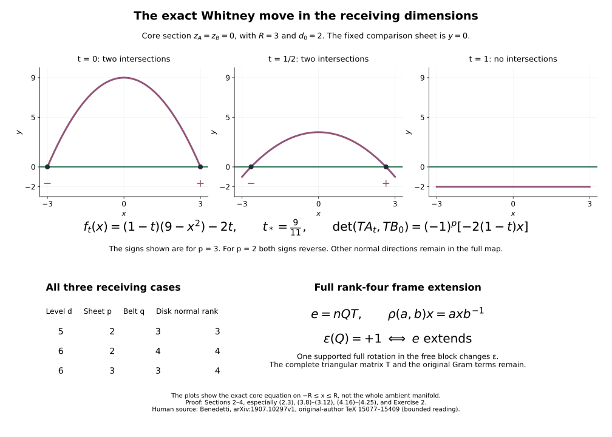

# Whitney moves in the original receiving dimensions {#receiving-whitney-moves}

Proof companion for the CG-S6 lesson 7. GPT-6 Astra (OpenAI), Ultra, 10 October 2026. New teaching exposition CC0. We retain the original handle radii, all sheet orientations, full normal frames and every ambient comparison. This chapter extends the earlier five-dimensional disk construction to the six-dimensional levels required by the seven-dimensional cobordism.

## 1. The specified levels and the complement used to fill the disk {#receiving-whitney-levels}

The three receiving dimension triples are
\[
 (d,p,q)=(5,2,3),\quad(6,2,4),\quad(6,3,3),
 \qquad d=p+q.
 \tag{1.1}
\]
Let \(N\) be the original connected, oriented, simply connected closed \(d\)-manifold before a finite collection of disjoint framed index-\(p\) surgeries. Retain the original full attachments
\[
 \varphi_j:S^{p-1}_{r_j}\times D^{q+1}_{s_j}\longrightarrow N,
 \qquad r_j,s_j>0.
 \tag{1.2}
\]
Denote the resulting boundary by \(N'\) and its belt spheres by
\[
 B_j=\{0\}\times S^q_{s_j}.
 \tag{1.3}
\]
Let \(A_1,\ldots,A_m\) be disjoint oriented embedded \(p\)-spheres in \(N'\), with their original framed attaching maps retained, and transverse to every \(B_j\). Choose opposite-sign intersection points \(a,b\) of a particular \(A=A_i\) and \(B=B_j\).

The original complement map is
\[
 P:N'\setminus\bigcup_j B_j
    \xrightarrow{\ \cong\ }
    N\setminus\bigcup_jL_j,\qquad
 L_j=\varphi_j(S^{p-1}_{r_j}\times\{0\}).
 \tag{1.4}
\]
It is the simultaneous disjoint-region map of the [belt-complement chapter](belt-sphere-complements-and-the-whitney-disk.md#belt-complement-map), with every original radial function, cutoff integral and seam map included. Its positive-face formula, before the retained rounding comparisons, is
\[
 (u,v)\longmapsto
 \varphi_j\left(\frac{r_j}{\|u\|}u,
               \frac{F_j(\|u\|)}{s_j}v\right),
 \quad u\ne0,\quad\|v\|=s_j.
 \tag{1.5}
\]
All components of its derivative are given in that chapter's equation (1.13a).

The complement in (1.4) is simply connected. Indeed loops and their based null-homotopies in \(N\) can be perturbed relative their prescribed collars off the finitely many \(L_j\). The exact inequalities are
\[
 1+(p-1)<d,\qquad 2+(p-1)<d
 \tag{1.6}
\]
in each of (1.1). To see why they suffice, use finite chart perturbations whose value parameters span the normal space to \(L_j\) at each possible intersection. For a transverse parameter the inverse-image dimensions are the left sides of (1.6) minus \(d\), both negative. Sard's theorem gives such a parameter, fixed near the collars that already avoid the cores. Relative smoothing gives the required initial smooth representatives. This is exactly the finite-parameter construction already proved in Sections 2-3 of the belt-complement chapter, now with the displayed dimensions. The original inclusion induces an isomorphism on fundamental groups; (1.4) carries this assertion to the belt complement.

Construct embedded arcs \(\alpha,\beta\) from \(a\) to \(b\), respectively in \(A,B\), with interiors missing all intersection points. Both spheres have dimension at least two. Coordinate paths, finite detours around the forbidden points, removal of loops and smoothing relative endpoint germs give these arcs, as in the earlier disk proof, Section 7.1. They are disjoint from one another except at the two endpoints, since their interior crossings would be forbidden intersections of \(A\) and \(B\).

At an endpoint \(c\in\{a,b\}\), use actual parametrizations
\[
 a_c(x,u)\in A,\quad u\in\mathbb R^{p-1},
 \qquad b_c(y,v)\in B,\quad v\in\mathbb R^{q-1}.
\]
Their first axes give the chosen arcs, directed away from that endpoint, with the specified original parameters. In a target chart \(\psi\), define
\[
 \mathcal H_c(x,u,y,v)=
 \psi^{-1}\bigl(\psi(a_c(x,u))+\psi(b_c(y,v))-\psi(c)\bigr).
 \tag{1.7}
\]
Its derivative at zero is the direct sum of the two transverse sheet tangent maps, hence invertible. It gives a full chart on a smaller original neighbourhood and satisfies the exact identities
\[
 \mathcal H_c(x,u,0,0)=a_c(x,u),\qquad
 \mathcal H_c(0,0,y,v)=b_c(y,v).
 \tag{1.8}
\]
The prescribed disk quadrant is \(\mathcal H_c(x,0,y,0)\), \(x,y\geq0\). Its interior avoids both sheets. The endpoint neighbourhoods can be made disjoint and avoid every other sphere.

Along \(\alpha\), extend the endpoint \(y\)-direction to a transverse vector field; its normal quotient has rank \(q\geq3\). Along \(\beta\), extend the endpoint \(x\)-direction; its normal quotient has rank \(p\geq2\). The spaces of nonzero vectors in these ranks are connected. Trivialize each quotient over the interval by the already proved projector transport, join the prescribed endpoint vectors through nonzero vectors with their end germs fixed, and interpolate the tangent components separately. Extend the fields to neighbourhoods, retaining the exact endpoint coordinate fields. Their small positive-time flows give the two strips, agreeing exactly with the endpoint quadrants. Their derivatives have rank two at time zero. The compactness and local-inverse argument in Section 7.2 of the belt-complement chapter gives a uniform width on which the strips and quadrants form an embedded corner collar. Their inward sides avoid every sphere: the local defining functions have leading term \(t\nu(s)\), with \(\nu(s)\ne0\), and a uniform \(O(t^2)\) remainder; the other sheets have positive compact separation away from the endpoint charts.

Keep the same complete rounding curve with its positive width \(\epsilon\), original smooth step \(\chi\), and \(\kappa(t)=\chi(3t-1)\):
\[
 \begin{aligned}
 x(t)&=\frac{\epsilon}{2}+2\epsilon\int_0^t\kappa(s)\,ds,\\
 y(t)&=\frac{\epsilon}{2}+2\epsilon\int_t^1\kappa(1-s)\,ds,\\
 (x',y')&=2\epsilon(\kappa(t),-\kappa(1-t)),\\
 \kappa(t)+\kappa(1-t)&=1,\qquad
 \int_0^1\kappa(t)\,dt=\frac12 .
 \end{aligned}
 \tag{1.9}
\]
Thus its endpoints are \((\epsilon/2,3\epsilon/2)\) and \((3\epsilon/2,\epsilon/2)\); its exact vertical and horizontal germs join the strip edges at width \(\epsilon/2\). This gives the original compact corner annulus \(C_0\), with smooth inner boundary \(\gamma\), and preserves both outer corner charts.

The inner curve is in the simply connected belt complement (1.4), so bounds a continuous disk there. Prescribe its entire inward filling collar by extending \(C_0\) smoothly a little across \(\gamma\), away from its existing interior, using the actual transverse collar field. Parametrize that filling collar by a round disk \(D_h^2\), retaining \(h>0\). The relative embedded-disk proof from Section 5 of the belt-complement chapter applies with the following explicit dimension checks. For immersions of a two-dimensional disk into a \(d\)-manifold, the rank-one stratum of two-column derivative matrices has codimension \(d-1>2\), and the rank-zero stratum has codimension \(2d>2\). The far-pair coincidence domain has dimension four, less than \(d\). For avoidance of the additional sheets and the retained annulus,
\[
 2+p<d,\qquad 2+2<d .
 \tag{1.10}
\]
Their boundary and corner strata have no larger dimensions. Value-and-first-derivative chart perturbations give transversality to the rank strata; independent value perturbations at two separated points give transversality to the diagonal. Compact near-diagonal injectivity of the resulting immersion remains under a sufficiently small \(C^1\) perturbation. Sard then eliminates every listed locus. Keep the full prescribed collar fixed, and take the perturbation small enough to remain in the open belt complement. These are all the estimates used by the earlier relative construction, and they hold for every triple (1.1).

The resulting embedded filling meets \(C_0\) only along its prescribed boundary and agrees with its whole continued collar there. Glue them to obtain a disk \(D\) with the two original outer corners. Its interior avoids every \(A_\ell,B_j\). The domain has the original quadrant charts, strip charts and round filling chart; their common collar agrees with all derivatives. In particular no assertion about the smooth extension of an arbitrary higher-dimensional sphere diffeomorphism has entered the disk construction.

## 2. The original orientation and normal blocks {#receiving-whitney-normal-blocks}

Both arc parameters run from \(a\) to \(b\). Write \(a'=\alpha'\), \(b'=\beta'\), and choose full tangent frames \(U=(u_1,\ldots,u_{p-1})\), \(V=(v_1,\ldots,v_{q-1})\) along the respective arcs so that \((a',U)\), \((b',V)\) have the original sheet orientations. Their endpoint germs are the original coordinate frames with these signs; interval frame transport extends them. Retain
\[
 \sigma_a=\operatorname{sgn}_{TN'}(a'_a,U_a,b'_a,V_a),\qquad
 \sigma_b=\operatorname{sgn}_{TN'}(a'_b,U_b,b'_b,V_b)
          =-\sigma_a.
 \tag{2.1}
\]
Orient \(D\) so its boundary follows \(\alpha\) forward and \(\beta\) backward. At \(a\) its tangent orientation is \((a'_a,b'_a)\). At \(b\) its quadrant coordinates point backwards along both arcs, and its disk orientation is the negative of their coordinate orientation; equivalently it is the negative of \((a'_b,b'_b)\). Moving \(b'\) past \(p-1\) columns gives
\[
 \begin{aligned}
 \operatorname{sgn}_{TN'}(TD_a,U_a,V_a)
       &=(-1)^{p-1}\sigma_a,\\
 \operatorname{sgn}_{TN'}(TD_b,U_b,V_b)
       &=-(-1)^{p-1}\sigma_b
        =(-1)^{p-1}\sigma_a .
 \end{aligned}
 \tag{2.2}
\]
This common factor is retained.

For any original metric matrix \(G\), let \(V_0\) be the two-column disk tangent matrix and \(W=(U,V)\) the \((d-2)\)-column extra-sheet matrix. The exact normal projections and Gram matrix are
\[
 \begin{aligned}
 W^\perp&=W-V_0(V_0^{\mathsf T}GV_0)^{-1}V_0^{\mathsf T}GW,\\
 (W^\perp)^{\mathsf T}GW^\perp
 &=W^{\mathsf T}GW
   -W^{\mathsf T}GV_0(V_0^{\mathsf T}GV_0)^{-1}V_0^{\mathsf T}GW .
 \end{aligned}
 \tag{2.3}
\]
The Gram matrix is positive definite: a zero value would put a nonzero linear combination of \(W\) into the span of \(V_0\), contradicting the invertibility of the corner chart. The column operation taking \((V_0,W)\) to \((V_0,W^\perp)\) has determinant one, so preserves both signs (2.2). These projections give an exact frame on each whole endpoint quadrant.

Along the \(A\)-arc, its \(p-1\) projected extra tangent vectors are independent because the disk tangent plane meets \(TA\) exactly in the arc line. Positive completions by \(q-1\) vectors form a connected space: in a quotient frame the complementary block is in \(GL^+(q-1,\mathbb R)\), and its components along the first block are arbitrary. The group \(GL^+(r,\mathbb R)\) is connected by its exact positive triangular factor and a succession of rotations for its orthogonal factor. Hence completions can be chosen smoothly along the interval, retaining both entire corner germs. Along the \(B\)-arc apply the same argument with its fixed \(q-1\) projected tangent vectors and the remaining \(p-1\) vectors. The determinant factor (2.2) puts both endpoint choices in the same positive component.

To extend these frames through the strips while preserving the exact corner frames \(e_C\), start with the normal-bundle projection connection \(P_\perp\,d\). On the corner patches change it to
\[
 \nabla^C s
 =P_\perp\,ds-
   (P_\perp\,de_C)(e_C^{\mathsf T}e_C)^{-1}e_C^{\mathsf T}s .
 \tag{2.4}
\]
This displayed expression uses an auxiliary Euclidean realization of the bundle, as in the original projector construction; the original metric normal projections remain (2.3). Direct substitution gives \(\nabla^C(e_C\xi)=e_C\,d\xi\). Cut off this connection correction to the disjoint corner patches, equal to it on the whole joining germs. Transport the boundary frames along each strip width. Linear ODE uniqueness makes the transported frames agree with \(e_C\) on the overlaps, and invertible transport preserves their ranks. This yields a full frame on \(C_0\), adapted to the \(A\) block on one outer arc and to the \(B\) block on the other. Extend it a little over the filling collar in the same way.

At \(d=5\) the rank-three extension and its controlled sign change are proved in the earlier chapter, Section 6.6. At \(d=6\) the rank is four. We now prove that extension with every original frame coefficient retained.

## 3. Rank-four frames and the exact rotation obstruction {#receiving-rank-four-frame}

Use the real quaternions \(\mathbb H\) with their original ordered basis \((1,i,j,k)\), multiplication \(ij=k,jk=i,ki=j\), reversed products with minus signs, and \(i^2=j^2=k^2=-1\). Their associative matrix realization, conjugation and full norm identity are proved in [lesson 11](almost-complex-structures-and-integrability.md), Section 2. No alteration of the receiving disk coordinates is made by this auxiliary algebra.

For unit quaternions define
\[
 \rho:S^3\times S^3\longrightarrow SO(4),\qquad
 \rho(a,b)(x)=a x b^{-1}.
 \tag{3.1}
\]
Norm multiplicativity proves orthogonality. Its determinant is \(+1\), since the domain is connected and the identity pair acts as the identity. It is a homomorphism: the two left multipliers multiply in order, and the right multipliers do too after taking the inverse. If it acts trivially, substitution \(x=1\) gives \(a=b\), and then \(a\) commutes with \(i,j,k\). Comparing its four coefficients gives zero imaginary part. Thus
\[
 \ker\rho=\{(1,1),(-1,-1)\}.
 \tag{3.2}
\]
The derivative at the identity sends imaginary \(u,v\) to the skew map \(x\mapsto ux-xv\). A zero such map gives \(u=v\), which commutes with all quaternions and is imaginary, hence \(u=v=0\). Both tangent spaces have dimension six, so this derivative is an isomorphism. Translation gives local inverses everywhere. The image is open and, by compactness of \(S^3\times S^3\), closed. The group \(SO(4)\) is connected: send a first unit column to the first standard vector by a rotation in their two-plane, continue on its orthogonal complement, and end with the orientation-preserving one-dimensional identity; varying each rotation angle to zero gives a path. Therefore \(\rho\) is onto.

This is a two-sheet covering. For an image point take disjoint inverse-function neighbourhoods of its two preimages (3.2). A smaller image neighbourhood has no other inverse images: otherwise compactness gives a limiting third preimage, contrary to (3.2). Intersect the two inverse images with that smaller neighbourhood. These are its two disjoint local sheets. This proves the covering assertion without a classification of compact Lie groups.

Each \(S^3\) is simply connected. Smooth a loop through the original Euclidean embedding and radial retraction. Its smooth image has measure zero in the three-dimensional sphere, by Sard in coordinate charts, so misses a point. Stereographic projection from that point identifies its image with a loop in \(\mathbb R^3\), and affine contraction gives a disk. The initial smoothing is homotopic to the loop by the same retraction construction. Thus the product \(S^3\times S^3\) is simply connected too.

Lift a loop \(Q\) in \(SO(4)\), choosing its initial point. Its final point is either that initial point or its product by \((-1,-1)\). Write this endpoint sign as \(\epsilon(Q)\in\{1,-1\}\). Then
\[
 Q\text{ extends over a disk}\quad\Longleftrightarrow\quad
 \epsilon(Q)=1.
 \tag{3.3}
\]
Necessity follows by lifting a disk, whose domain is simply connected; the lift closes on its boundary. For sufficiency, a closed lift has two quaternion loops, each contracting by the preceding construction. Their product filling followed by \(\rho\) fills \(Q\). Homotopies of loops preserve the sign: lift the homotopy with its starting points varying continuously; the endpoint difference has values in the discrete kernel (3.2) and hence is constant. Changing the initial lift multiplies both ends by the same central kernel element and also leaves the sign unchanged.

There is an exact full rotation with negative sign. Put
\[
 a(\theta)=\cos(\theta/2)+i\sin(\theta/2),\qquad
 b(\theta)=\cos(\theta/2)-i\sin(\theta/2),
 \quad 0\leq\theta\leq2\pi.
 \tag{3.4}
\]
Since \(b^{-1}=a\), multiplication gives
\[
 \begin{aligned}
 \rho(a,b)(1)&=\cos\theta+i\sin\theta,\\
 \rho(a,b)(i)&=-\sin\theta+i\cos\theta,\\
 \rho(a,b)(j)&=j,\qquad \rho(a,b)(k)=k .
 \end{aligned}
 \tag{3.5}
\]
For example \(a j=j\overline a\) proves \(a j a=j\); the same identity holds for \(k\). This is one full positive rotation in the ordered \((1,i)\)-plane, fixing its orthogonal complement. Its lift ends at \((-1,-1)\). Conjugation by an oriented orthogonal comparison carries it to any specified oriented coordinate two-plane and preserves this central endpoint. Its inverse has the same negative sign.

Now let \(e\) be the original smooth oriented frame of the rank-four disk normal bundle prescribed on a whole filling collar. The projector transport used in Section 6.1 of the belt-complement chapter supplies an auxiliary oriented orthonormal frame \(n\) on the complete round filling disk \(D_h^2\). That proof uses the projection identity \(P_\perp^2=P_\perp\) and a linear ODE along radial segments; it is valid in every rank, with four initial independent vectors here. Express the prescribed full frame as
\[
 e=nR,\qquad R:D_h^2\text{ collar}\longrightarrow GL^+(4,\mathbb R).
 \tag{3.6}
\]
Here \(R\) is the exact matrix of all original coefficients.

Apply Gram-Schmidt with each positive length retained. For its columns \(r_j\), define
\[
 \begin{aligned}
 w_j&=r_j-\sum_{a<j}\langle q_a,r_j\rangle q_a,\\
 t_{jj}&=\|w_j\|>0,\qquad q_j=w_j/t_{jj},\\
 t_{aj}&=\langle q_a,r_j\rangle\ (a<j),\qquad t_{aj}=0\ (a>j).
 \end{aligned}
 \tag{3.7}
\]
Every \(w_j\) is nonzero by independence of the original columns. Thus
\[
 R=QT,\qquad Q\in SO(4),\quad
 T\text{ upper triangular with }t_{jj}>0.
 \tag{3.8}
\]
This is an exact factorization; no entry of \(T\) is discarded. All factors depend smoothly on the collar coordinates.

The original frame extends, retaining its entire prescribed collar, precisely when the loop \(Q|_{\partial D_h^2}\) has sign \(+1\). If a full \(R\) extends, (3.7) applied to it extends \(Q\), proving necessity. For sufficiency, lift the prescribed whole collar map \(Q\) through (3.1). A closed boundary lift makes its annular lift single-valued: extend radially by path lifting, and use the same endpoint sign on every radial circle. Choose an inner collar circle. Its two lifted quaternion loops bound disks by the argument for (3.3). Put a product collar on these fillings and join it to the given collar using its actual radial parameter dependence; the smooth relative approximation and radial retraction, fixed on a smaller whole prescribed collar, give a smooth \(S^3\times S^3\)-valued disk extension. Its projection is an extension \(\widetilde Q\) equal to every value and derivative of the original \(Q\) on that smaller collar.

Extend the triangular factor just as explicitly. First choose \(r_0<h\) within the given collar. A smooth radial map \(r\mapsto\tau(r)\), equal to \(r\) near the boundary and constant \(r_0\) farther inside that collar, keeps its argument within the given domain. Composing each prescribed entry with \((\theta,\tau(r))\) gives an extension that is constant in the inward radial direction before leaving the collar. Choose a further radial cutoff \(\lambda\), one there and zero on a neighbourhood of the disk centre. For \(a<j\) set
\[
 \widetilde t_{aj}(r,\theta)=\lambda(r)t_{aj}(\tau(r),\theta),
 \qquad
 \widetilde t_{jj}(r,\theta)
   =\exp\bigl(\lambda(r)\log t_{jj}(\tau(r),\theta)\bigr).
 \tag{3.9}
\]
Where \(\tau\) is no longer needed, retain its constant value \(r_0\). The expressions are constant \(0\) off the diagonal and \(1\) on it near the centre, hence smooth there despite polar coordinates. All diagonal entries stay positive, and all original entries and their derivatives remain on the prescribed outer collar. Then
\[
 \widetilde e=n\,\widetilde Q\,\widetilde T
 \tag{3.10}
\]
is the required full extending frame. It retains every original Gram and triangular factor on the original collar.

Finally, the sign can be changed while preserving the adapted outer boundary conditions of Section 2. On a closed subarc of the \(A\)-arc, away from both corners, keep its first \(p-1\) frame vectors fixed and rotate two of the last \(q-1\) vectors by an angle from \(0\) to \(2\pi\), constant near the subarc endpoints. Such two vectors exist since \(q\geq3\). Use the same angle along the corresponding whole strip width, so the rotation is identity on the strip's end germs and extends by identity to the rest of \(C_0\). It preserves the \(A\) tangent block exactly and does not change the \(B\)-arc at all.

To check its sign for a nonorthogonal original frame, keep the comparison homotopy
\[
 R_s=Q\bigl((1-s)T+sI\bigr),\qquad 0\leq s\leq1.
 \tag{3.11}
\]
Every upper triangular diagonal entry is positive, so this is a homotopy through invertible matrices retaining the endpoints as stated. The loop sign is constant under it. Apply (3.11) also to \(R_s T_{\rm rot}\). At \(s=1\) the two orthogonal factors have lifts whose endpoints multiply, and (3.4)-(3.5) give the negative factor. Therefore
\[
 \epsilon(RT_{\rm rot})=-\epsilon(R).
 \tag{3.12}
\]
This is an exact comparison for the original full \(R\), not a replacement of it by \(Q\).

If the initial filling sign is negative, make this supported rotation once. Its restriction to the inner circle traverses one full rotation; reversing the circle direction has the same negative endpoint sign. The new sign is positive. Apply (3.10) and glue to the unchanged corner annulus using the complete common collar. This constructs the adapted full frame over the actual disk with both original corners, in both new \(d=6\) cases. Its adjustment changes only an auxiliary disk frame. The original handle framings are transported later by the actual ambient diffeomorphism.

## 4. The exact supported move in both normal blocks {#receiving-whitney-flow}

Write \(r=d-2=(p-1)+(q-1)\), and use the auxiliary model coordinates
\[
 (x,y,z_A,z_B)\in
 \mathbb R^2\times\mathbb R^{p-1}\times\mathbb R^{q-1}.
 \tag{4.1}
\]
The original two-dimensional disk-to-model comparison is constructed in Sections 3-4 of the [supported-move chapter](whitney-move-with-controlled-support.md#move-original-disk). It is a comparison of two-dimensional corner disks and their full collars, so its formulas have no ambient-rank dependence. Retain its arbitrary positive \(R\), both original corner germs, its polar radius and its complete collar-extension map. In this model put
\[
 \begin{aligned}
 \phi(x)&=R^2-x^2,\\
 D_R&=\{(x,y,0,0):-R\leq x\leq R,\ 0\leq y\leq\phi(x)\},\\
 A_0&=\{(x,\phi(x),z_A,0)\},\qquad
 B_0=\{(x,0,0,z_B)\}.
 \end{aligned}
 \tag{4.2}
\]
Let \(\psi_D:D_R\to D\) be that complete original disk comparison. Its normal rank here is \(r\), with \(r=3\) or \(4\).

### 4.1. The full coordinates sending both model sheets to the originals

Use the finite coordinate embedding \(\iota\) and its tubular retraction \(\mathfrak r\) from the original disk proof. With the complete extending frame \(e_1,\ldots,e_r\), define
\[
 \mathcal E(w,z)=\mathfrak r\left(
   \iota\psi_D(w)+
   \sum_{\nu=1}^r z_\nu D\iota_{\psi_D(w)}e_\nu(\psi_D(w))
 \right).
 \tag{4.3}
\]
On the zero section its derivative is
\[
 D\mathcal E_{(w,0)}(\xi,\eta)
    =D\psi_D(\xi)+\sum_{\nu=1}^r\eta_\nu e_\nu .
 \tag{4.4}
\]
It is invertible because the disk tangent space and its full normal frame are complementary.

Extend the surface and frame slightly beyond the original boundary in their exact local quadrant and strip charts. On a smaller corner neighbourhood keep the original corner extension exclusively. Away from these smaller sets, combine their Euclidean \(\iota\)-images by a partition of unity and apply \(\mathfrak r\). The extensions agree on the disk, so their values and every derivative there agree: the terms differentiating the weights sum to zero. Project the extended frame into the normal bundle of the extended surface, retaining its exact original values on the disk. Independence and rank persist on a smaller neighbourhood.

The inverse function theorem and compactness give one open neighbourhood of the compact zero section on which (4.3) is an embedding. If arbitrarily small such neighbourhoods had equal-image pairs, limits would lie on the zero section; its injectivity makes their limits equal, and its local inverse then excludes the pairs. Thus (4.3) gives actual ambient coordinates, including outside both corners.

Let \(K_c\) be the exact map from the model corner chart to the original transverse chart (1.7), at \(c=a,b\), incorporating the prescribed disk comparison. The map \(g_c=\mathcal E^{-1}K_c\) fixes the zero section. Its normal quotient derivative is identity, because the frame there was the projection of those same original corner fields. Its tangential derivative can contain a full \(2\)-by-\(r\) shear \(A_c(w)\). Integral Taylor expansion gives
\[
 g_c(w,z)=
 \left(w+A_c(w)z+\sum_{\mu,\nu=1}^r z_\mu z_\nu B_{\mu\nu}(w,z),
       z+\sum_{\mu,\nu=1}^r z_\mu z_\nu C_{\mu\nu}(w,z)\right).
 \tag{4.5}
\]
Each vector coefficient is retained. For the transverse dilation
\(\Delta_s(w,z)=(w,sz)\), the exact conjugate extends smoothly to \(s=0\):
\[
 \begin{aligned}
 g_{c,s}(w,z)=\bigg(&w+sA_c(w)z+
           s^2\sum_{\mu,\nu}z_\mu z_\nu B_{\mu\nu}(w,sz),\\
                  &z+s\sum_{\mu,\nu}z_\mu z_\nu C_{\mu\nu}(w,sz)\bigg),\\
 Dg_{c,s}|_{z=0}
   &=\begin{pmatrix}I_2&sA_c\\0&I_r\end{pmatrix}.
 \end{aligned}
 \tag{4.6}
\]
For \(s>0\) it is \(\Delta_s^{-1}g_c\Delta_s\); at \(s=0\) it is identity. The last determinant is one. Compactness and the parameter-dependent inverse function theorem give uniform diffeomorphism germs for all \(s\in[0,1]\). Cut off their velocity \(\partial_s g_{c,s}\circ g_{c,s}^{-1}\), equal to it on all trajectories from a smaller required corner neighbourhood. Its flow \(G_c\) agrees there at time one with the entire \(g_c\), not just its derivative. The velocity vanishes on the disk and has zero normal quotient derivative there; the cutoff preserves these facts. Choose the two corner supports disjoint.

Now \(\mathcal E_1=\mathcal E G_aG_b\) agrees with both complete \(K_c\), fixes the prescribed disk map and retains its full normal quotient frame. Along the interior \(A\)-arc use base coordinates \((s,t)\), with that arc at \(t=0\). The original sheet is the unique graph
\[
 (s,h_A(s,z_A),z_A,k_B(s,z_A)).
 \tag{4.7}
\]
The graph functions vanish at \(z_A=0\), and \(D_{z_A}k_B(s,0)=0\), because the first \(p-1\) normal frame vectors span the projected \(A\) directions. The full derivative \(D_{z_A}h_A(s,0)\) is retained. The inverse function theorem gives this graph uniformly along a compact interior arc. Near the corners every graph function vanishes as a germ because those complete sheet charts already match.

The full graph shear and its vector field are
\[
 \begin{aligned}
 (s,t,z_A,z_B)&\longmapsto
      (s,t+h_A(s,z_A),z_A,z_B+k_B(s,z_A)),\\
 X_A&=h_A(s,z_A)\partial_t+
       \sum_{\nu=1}^{q-1}(k_B)_\nu(s,z_A)\partial_{(z_B)_\nu}.
 \end{aligned}
 \tag{4.8}
\]
Its inverse subtracts the same functions, whose arguments remain fixed. Its model-sheet trajectories are
\[
 (s,\tau h_A(s,z_A),z_A,\tau k_B(s,z_A)),\qquad 0\leq\tau\leq1.
 \tag{4.9}
\]
For a sufficiently small closed transverse disk these trajectories are compactly contained in the required arc neighbourhood. A cutoff equal to one near their union and zero outside a larger neighbourhood therefore gives a global supported flow \(G_A\) agreeing exactly with (4.8) there. It fixes the disk; its normal quotient derivative is identity, because \(Dk_B(s,0)=0\). Its full tangent shear \(Dh_A\) remains.

Along the interior \(B\)-arc the exact graph and shear are
\[
 \begin{aligned}
 &(s,h_B(s,z_B),k_A(s,z_B),z_B),\qquad
       D_{z_B}k_A(s,0)=0,\\
 &(s,t,z_A,z_B)\longmapsto
       (s,t+h_B(s,z_B),z_A+k_A(s,z_B),z_B).
 \end{aligned}
 \tag{4.10}
\]
The same explicit trajectory cutoff gives \(G_B\), with its complete tangent derivatives retained. Its support and that of \(G_A\) are disjoint, since the closed interior arc portions are disjoint and both corrections vanish near the corners. Consequently
\[
 \Psi=\mathcal E_1G_AG_B
 \tag{4.11}
\]
maps both whole model sheet germs to the original ones along the entire disk.

There are no additional sheet branches in a sufficiently small open neighbourhood \(U\) of \(D_R\). Otherwise extra-branch points tending to the compact disk would limit either to its interior, which avoids both sheets, or to its boundary, where the complete graph and corner charts describe the whole embedded sheet. Both are impossible. The other sphere cores are compact and miss \(D\), including its boundary, so decrease \(U\) to avoid them too. We have proved the full equalities
\[
 \Psi^{-1}(A)\cap U=A_0\cap U,\qquad
 \Psi^{-1}(B)\cap U=B_0\cap U,
 \tag{4.12}
\]
with no assertion limited to tangent spaces.

### 4.2. Every cutoff and the exact pair cancellation

Choose positive parameters \(d_0,b_0\), retaining the original \(R\). These are auxiliary support parameters; the ambient dimension is still the integer \(d\). Define
\[
 \begin{aligned}
 u(x)&=4\phi(x)/d_0+2,&
 \mu(x)&=\chi(u(x)),&
 \delta(x)&=\mu(x)(\phi(x)+d_0),\\
 L(y)&=(y+2d_0)/d_0,&
 H(x,y)&=(\phi(x)+d_0-y)/d_0,&
 \eta(x,y)&=\chi(L(y))\chi(H(x,y)),\\
 Z(z)&=2-\frac{2}{b_0^2}\sum_{\nu=1}^{r}z_\nu^2,&
 \zeta(z)&=\chi(Z(z)),&
 v(x,y,z)&=\delta(x)\eta(x,y)\zeta(z).
 \end{aligned}
 \tag{4.13}
\]
The field is \(-v\partial_y\). Its support is contained in
\[
 K_{d_0,b_0}=
 \left\{x^2\leq R^2+d_0/2,\quad
 -2d_0\leq y\leq R^2-x^2+d_0,\quad
 \sum_{\nu=1}^{r}z_\nu^2\leq b_0^2\right\}.
 \tag{4.14}
\]
As \(d_0,b_0\) decrease to zero, any limiting point in these compact sets lies in \(D_R\). Therefore positive choices exist with \(K_{d_0,b_0}\subset U\), by the compact subsequence argument of the earlier supported move. Its complete flow is
\[
 \mathcal H_t(x,y,z)=(x,Y_t(x,y,z),z),\qquad
 \dot Y_t=-v(x,Y_t,z),\qquad Y_0=y.
 \tag{4.15}
\]
Compact support gives existence for all time; uniqueness gives inverse \(\mathcal H_{-t}\).

On \(A_0\), the full exact formula is
\[
 \mathcal H_t(x,\phi(x),z_A,0)
  =(x,\phi(x)-t\delta(x)\zeta(z_A,0),z_A,0),
 \quad0\leq t\leq1.
 \tag{4.16}
\]
Indeed \(\delta\geq0\), and where it is nonzero the entire vertical segment lies between \(-d_0\) and \(\phi(x)\): its endpoint is
\((1-\mu)\phi-\mu d_0\geq-d_0\).
Both factors of \(\eta\) are identically one there. Substitution proves (4.16); where \(\delta=0\) it is the constant solution.

Its intersection with the fixed comparison sheet \(B_0\) requires \(z_A=z_B=0\). If \(\phi<0\), the vertical coordinate remains negative. If \(\phi\geq0\), then \(\mu=1\), and the exact equation is
\[
 (1-t)(R^2-x^2)-td_0=0.
 \tag{4.17}
\]
The two solutions before cancellation and its unique time are
\[
 x_\pm(t)=\pm\sqrt{R^2-\frac{td_0}{1-t}},\qquad
 0\leq t<t_*=\frac{R^2}{R^2+d_0}.
 \tag{4.18}
\]
At \(t=t_*\) they meet at \(x=0\); for \(t>t_*\) none remains. The cutoff transition has \(\phi<0\), so contributes no extra intersection.

Orient \(A_0\) by \((x,z_A)\), \(B_0\) by \((x,z_B)\), and the ambient coordinates by \((x,y,z_A,z_B)\). Subtract the first \(A\)-tangent column from the first \(B\)-tangent column. This yields \(-f_t'(x)\partial_y\), where \(f_t(x)=(1-t)(R^2-x^2)-td_0\). Moving that column past the \(p-1\) \(A\)-normal columns gives the complete intersection determinant
\[
 \det(TA_t,TB_0)=(-1)^p f_t'(x)
             =(-1)^p[-2(1-t)x].
 \tag{4.19}
\]
Thus the \(p=3\) case has the opposite model convention from the earlier \(p=2\) case. The two signs remain opposite. At the meeting point the retained derivatives are
\[
 \partial_x^2 f_{t_*}(0)=-\frac{2d_0}{R^2+d_0}\ne0,\qquad
 \partial_t f_t(0)=-(R^2+d_0)\ne0.
 \tag{4.20}
\]
The original sheet signs multiply (4.19) by the determinant sign of \(\Psi\) and the two fixed signs comparing the model sheet parameters to their original orientations. This retains exactly the original pair (2.1).

### 4.3. The full derivative, original framings and cobordism map

Every cutoff derivative remains in
\[
 \begin{aligned}
 \delta'(x)&=-2x\left[\chi(u)+
             \frac{4(\phi+d_0)}{d_0}\chi'(u)\right],\\
 \eta_x&=-\frac{2x}{d_0}\chi(L)\chi'(H),\\
 \eta_y&=\frac{\chi'(L)\chi(H)-\chi(L)\chi'(H)}{d_0},\\
 \zeta_{z_\nu}&=-\frac{4z_\nu}{b_0^2}\chi'(Z),\\
 v_x&=\delta'\eta\zeta+\delta\eta_x\zeta,\quad
 v_y=\delta\eta_y\zeta,\quad
 v_{z_\nu}=\delta\eta\zeta_{z_\nu}.
 \end{aligned}
 \tag{4.21}
\]
Put
\[
 \begin{aligned}
 J_t&=\exp\left(-\int_0^t v_y(x,Y_s,z)\,ds\right)>0,\\
 \partial_yY_t&=J_t,\qquad
 \partial_xY_t=-J_t\int_0^t\frac{v_x(x,Y_s,z)}{J_s}\,ds,\\
 \partial_{z_\nu}Y_t&=-J_t\int_0^t
                   \frac{v_{z_\nu}(x,Y_s,z)}{J_s}\,ds .
 \end{aligned}
 \tag{4.22}
\]
Differentiating (4.15) and then dividing by \(J_t\) proves each formula with its zero initial derivative. The full matrix is
\[
 D\mathcal H_t=
 \begin{pmatrix}
 1&0&0\\
 \partial_xY_t&J_t&D_zY_t\\
 0&0&I_r
 \end{pmatrix},\qquad
 \det D\mathcal H_t=J_t .
 \tag{4.23}
\]
All \(r\) mixed normal derivatives are included.

Push the vector field through \(\Psi\) and extend it by zero. Its global ambient isotopy \(H_t\) equals \(\Psi\mathcal H_t\Psi^{-1}\) on the support, with
\[
 DH_t|_{\Psi(w)}
   =D\Psi|_{\mathcal H_t(w)}D\mathcal H_t|_wD\Psi^{-1}|_{\Psi(w)}.
 \tag{4.24}
\]
Its determinant is
\[
 \det DH_t|_{\Psi(w)}
  =\frac{\det D\Psi|_{\mathcal H_t(w)}}{\det D\Psi|_w}\,J_t>0 .
 \tag{4.25}
\]
Both evaluations of the original coordinate derivative and their quotient remain. The signs agree because these points are joined by a trajectory in its coordinate domain.

Equations (4.12) and (4.16)-(4.20) show that \(H_1(A)\) loses exactly the selected two intersections with the fixed comparison \(B\), and creates none. All other sphere cores miss the support and are fixed on a neighbourhood. An injective ambient map fixing such a core cannot introduce a new intersection with it. The selected belt is the comparison set; the ambient isotopy need not fix that belt pointwise.

For every original whole attaching tube \(\varphi_\ell\) at this level, use
\[
 \varphi_{\ell,t}=H_t\varphi_\ell,\qquad
 D\varphi_{\ell,t}|_\xi
   =DH_t|_{\varphi_\ell(\xi)}D\varphi_\ell|_\xi .
 \tag{4.26}
\]
This carries the entire collection, retaining every domain, radius and mutual disjointness. The other framed cores remain unchanged because the ambient map is identity on their neighbourhoods, even if the outer parts of their thick tubes meet its support.

In the actual inward collar \(c:N'\times[0,L)\to W\) of the preceding cobordism, choose \(\beta=1\) near zero and zero near \(L\), and extend by
\[
 \widehat H_t(c(z,\rho))=c(H_{t\beta(\rho)}(z),\rho).
 \tag{4.27}
\]
The inverse uses \(H_{t\beta(\rho)}^{-1}\) at that same radius. Its full product-collar derivative is
\[
 \begin{pmatrix}
 DH_{t\beta(\rho)}
   &t\beta'(\rho)\,\left.\partial_sH_s\right|_{s=t\beta(\rho)}\\
 0&1
 \end{pmatrix}.
 \tag{4.28}
\]
Compose with the original collar derivatives. It fixes the incoming collar and agrees with the full outgoing gluing germs. Together with identity on each original parameter handle, it gives the exact diffeomorphism from the old attachments to those in (4.26). Transport every later attaching and collar map by this same map. For its final composite \(F\), retain \(G_{\rm new}=G_{\rm old}F^{-1}\) and the complete metric transformation \(DF^{-{\mathsf T}}g_{\rm old}DF^{-1}\), as in the higher-index slide chapter.

This proves the supported framed Whitney move in all three cases (1.1). Iteration terminates for any fixed pair of sphere systems: each move decreases the finite total number of intersection points by two, changes no intersection outside the selected support, and preserves all algebraic coefficients because the removed signs are opposite. Therefore every coefficient can be represented by exactly its absolute value of points, all of its sign. Sections 2–5 of the [actual Morse realization and middle-cancellation companion](realizing-framed-handles-and-middle-cancellation.md#middle-six-seven-reduction) now prove that actual-function and trajectory comparison before invoking Morse cancellation.

## 5. Two complete calculations {#receiving-whitney-exercises}

### Exercise 1. A nonorthogonal rank-four frame and its corrected extension sign

In an auxiliary oriented normal frame retain the complete original matrix
\[
 R(\theta)=Q(\theta)T,\qquad
 Q(\theta)=\operatorname{diag}(I_2,\operatorname{Rot}(\theta)),
 \quad
 T=\begin{pmatrix}
 2&1&4&-2\\0&3&1&5\\0&0&5&0\\0&0&0&5
 \end{pmatrix},
 \quad0\leq\theta\leq2\pi .
 \tag{5.1}
\]
Here \(\operatorname{Rot}(\theta)\) has columns \((\cos\theta,\sin\theta)\) and \((-\sin\theta,\cos\theta)\). Decide whether this frame extends over a disk, and compute a correction fixing its first two original vectors and every Gram contribution.

Its determinant is \(2\cdot3\cdot5\cdot5=150>0\). With quaternion coordinates \((1,i,j,k)\), the matrix \(Q\) is conjugation by \(\cos(\theta/2)+i\sin(\theta/2)\). Both entries of its pair lift equal this quaternion; they end at \((-1,-1)\). Thus \(\epsilon(R)=-1\) and the original frame does not extend.

Right-multiply the full matrix by \(Q(\theta)\). This rotates its last two original vectors and fixes its first two exactly. Put \(c=\cos\theta,s=\sin\theta\). The corrected matrix, without discarding \(T\), is
\[
 R'(\theta)=Q(\theta)TQ(\theta)=
 \begin{pmatrix}
 2&1&4c-2s&-4s-2c\\
 0&3&c+5s&-s+5c\\
 0&0&5\cos(2\theta)&-5\sin(2\theta)\\
 0&0&5\sin(2\theta)&5\cos(2\theta)
 \end{pmatrix}.
 \tag{5.2}
\]
Its determinant is still \(150\). Equation (3.12) gives
\(\epsilon(R')=(-1)(-1)=1\), so the exact full frame extends by (3.9)-(3.10). The original and corrected Gram matrices are
\[
 \begin{aligned}
 R^{\mathsf T}R&=T^{\mathsf T}T=
 \begin{pmatrix}
 4&2&8&-4\\
 2&10&7&13\\
 8&7&42&-3\\
 -4&13&-3&54
 \end{pmatrix},\\
 (R')^{\mathsf T}R'&=Q(\theta)^{\mathsf T}
       (T^{\mathsf T}T)Q(\theta).
 \end{aligned}
 \tag{5.3}
\]
Thus all mixed Gram terms are present. The correction did not turn the original frame into an orthonormal one. For the supported arc construction replace \(\theta\) by \(2\pi\lambda(s)\), where \(\lambda\) is the actual smooth step from zero to one, constant on neighbourhoods of the subarc endpoints. It then agrees with the identity with every derivative on those endpoint germs.

### Exercise 2. The three-dimensional sheet sign in a six-dimensional level

Take the model \((d,p,q)=(6,3,3)\) with \(R=3\), \(d_0=2\), and the full cutoff (4.13) on a neighbourhood containing its compact support. Retain \(b_0>0\). Calculate the two core intersections at time \(t=\tfrac12\), their original model determinant signs, and the cancellation time.

At the core \(z_A=z_B=0\), \(\zeta=1\). In the region where intersections are possible \(\mu=1\), and \(\eta\) is one on the whole trajectory. Thus
\[
 t_*=\frac{9}{11},\qquad
 x_\pm(1/2)=\pm\sqrt{9-2}=\pm\sqrt7.
 \tag{5.4}
\]
The slope of the moved sheet there is
\[
 -2(1-\tfrac12)x=-x.
 \tag{5.5}
\]
The ordered tangent determinant includes \((-1)^p=-1\), so (4.19) gives \(x\): it is negative at \(-\sqrt7\) and positive at \(+\sqrt7\). The earlier five-dimensional \((p,q)=(2,3)\) convention would give the opposite signs and cannot be substituted.

Along these core tracks all first derivatives of the flat cutoff factors \(\eta,\zeta\) vanish. Hence (4.22) gives \(J_t=1\), \(D_zY_t=0\), and \(\partial_xY_t=2tx\) for the derivative at fixed original \(y\). The derivative along the original curved sheet is the full chain-rule expression
\[
 \partial_xY_t+\partial_yY_t\,\phi'(x)
       =2tx-2x=-2(1-t)x.
 \tag{5.6}
\]
This verifies (5.5) without omitting the derivative of the original sheet. At cancellation the exact second and time derivatives are
\[
 \partial_x^2 f_{t_*}(0)=-\frac4{11},\qquad
 \partial_t f_t(0)=-11.
 \tag{5.7}
\]
They are both nonzero, so the unique event is the stated pair tangency. In the cutoff transition \(\phi<0\), the vertical flow is nonincreasing and cannot create another intersection.

<figure>

</figure>

The plots show the exact core equation from Exercise 2 on the displayed original interval. Their signs include the full ordered-tangent determinant (4.19). Every omitted drawing direction remains in (4.21)-(4.26). The lower panel records the full frame comparison (3.8)-(3.12); it does not discard the triangular or Gram factors.

## 6. Human sources and the receiving calculation {#receiving-whitney-sources}

Riccardo Benedetti, [Lectures on Differential Topology, arXiv:1907.10297v1](https://arxiv.org/abs/1907.10297v1), gives the relevant stronger cancellation statement and complement argument in original-author TeX lines 15077-15113, the full Whitney-disk requirement in lines 15152-15207, and the subbundle-extension discussion in lines 15300-15327. Those passages, through line 15409, have been read directly from the retained author TeX. The author-source SHA-256 is recorded with its intact archive in this course's source ledger. This is additional bounded reading, not a claim to have read the whole book or obtained its whole h-cobordism proof.

The source's local comparison chooses an auxiliary metric making the two sheets orthogonal at their intersection. Here (2.3) instead retains the original metric and every mixed projection term, and (4.3)-(4.12) construct the entire sheet comparison. The rank-four calculation (3.1)-(3.12) supplies the particular frame extension needed for the two six-dimensional level cases. It does not use an unproved general Grassmannian fundamental-group assertion.

The earlier included belt-complement and supported-move chapters give the exact rank-three case, relative disk perturbation, corner-disk parametrization and boundary-collar extension used at their stated locators. Lesson 11 supplies the quaternion multiplication identities. The present formulas retain both their original data and the exact comparisons. No source PDF was read for this work, and no novelty claim is made.

Sections 1-4 prove the disk, full adapted frame, complete sheet coordinates, supported move and framed cobordism comparison for all triples (1.1). The [actual Morse realization and middle-cancellation companion](realizing-framed-handles-and-middle-cancellation.md#middle-six-seven-reduction) constructs the compatible function, proves the exact intersection-to-trajectory comparison and every escape and support hypothesis, and completes the simply connected smooth cobordism reductions in dimensions six and seven. In particular its equations (4.6)–(4.7) prove the exact bijection from the reduced geometric intersections to actual transverse trajectories; an unreduced signed coefficient alone is not substituted for that bijection. The [complete smooth-recognition proof](sphere-twists-and-the-original-smooth-six-sphere-comparison.md#twist-original-smooth-map) now supplies the full sphere-group calculation.
